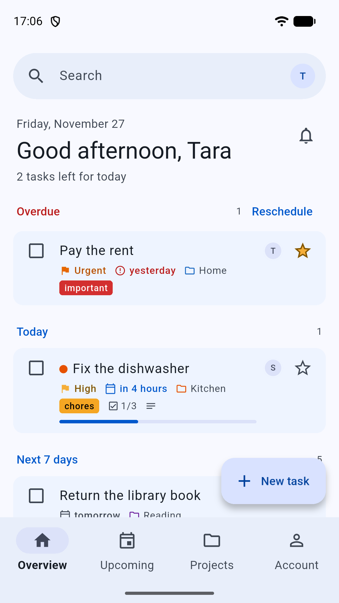
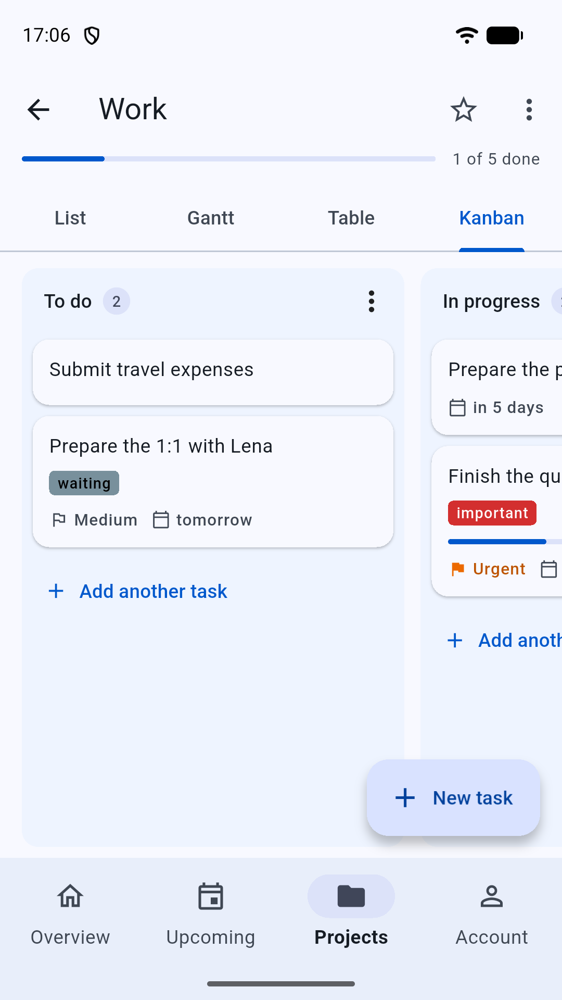
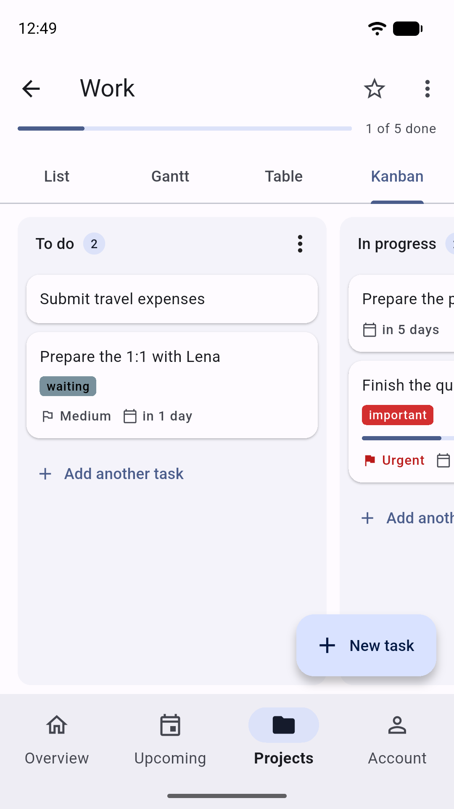
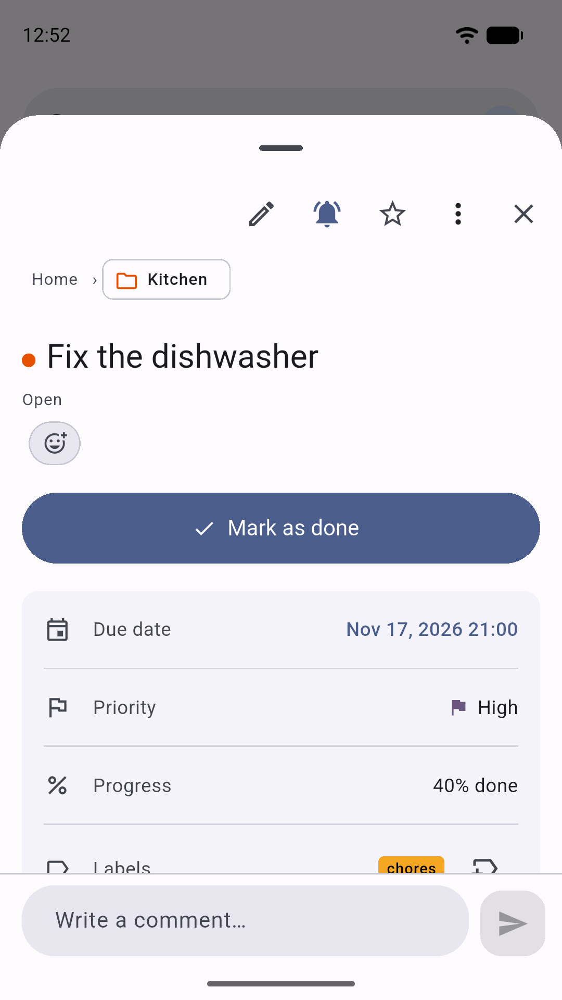

# Vikunja app

The official [Vikunja](https://vikunja.io) app for Android, iPhone and iPad. It brings the projects and tasks of your Vikunja server to your phone and tablet, keeps a copy on the device so that everything works offline, and adds what a phone is good at: reminders, home-screen widgets and quick capture.

Vikunja is the open-source to-do app you can host yourself. The app is for everyone who uses a Vikunja server, whether you run it yourself or someone runs it for you.

<p>
  
  
  
  
</p>

## Features

- **Projects and tasks the way the web shows them:** list, Kanban, table and timeline views, subtasks and related tasks, descriptions in a rich-text editor like the web's, with checklists, and dates, priorities, colors, repeats and reminders. Create, edit, archive, duplicate and share projects, manage their views, and sort tasks by hand or in any of the web's orders.
- **Works offline:** the app keeps your projects and tasks on the device. What you check off, create or change offline is sent as soon as your server can be reached, and a background sync keeps everything current while the app is closed.
- **Quick add:** type a whole task in one line, with labels, project, people, priority, due date and repeat, in the syntax of Vikunja's Quick Add Magic. Several lines become several tasks, indented lines become subtasks. On Android, share text, links or files from another app straight into a task.
- **Filters and search:** filtered views, saved filters with a filter builder, and a search across tasks, projects, saved filters and labels, all offline.
- **Fast through your lists:** swipe a task to check it off or to give it a new due date, select several tasks to change them at once, and move every overdue task to a new day in one go.
- **Working together:** comments with mentions and reactions, attachments from files, photos or the camera, labels, teams, and sharing with people, teams or a link with a QR code. On Vikunja 2.8.0 and newer, deleted tasks and projects go to the trash and can be restored.
- **Notifications:** reminders and due dates arrive on time, even without a connection, with Done and Snooze right in the notification. Comments, assignments and mentions arrive in an inbox and as notifications, within a second while the app is open.
- **Home-screen widgets:** a task list with checkboxes (today, the next days, overdue, favorites, a project, a label or a saved filter) and a New task button, on iPhone and iPad also on the Lock Screen.
- **Several accounts:** switch between accounts on one or more servers, and open a project that someone shared by link as a guest, without an account of your own. Your profile, preferences, sessions, API tokens and CalDAV tokens are managed in the app.
- **For self-hosted servers:** trust your server's own certificate or certificate authority, use a client certificate or access headers such as a Cloudflare Access token, and allow plain `http://` only for the servers you choose.
- **App lock and privacy:** lock the app with your fingerprint, face or the device's screen lock, hide its content in the app switcher, block screenshots on Android, and keep task titles out of notifications and widgets. The app has no analytics, ads, tracking or crash reporting, and your data goes only to the servers you add ([privacy policy](https://vikunja.io/privacy/#mobile-app)).
- **Your language:** English and German, and every language that Vikunja's translators bring along. The app follows your device's language, or the one you pick for it alone.
- **Accessible and adaptive:** made for TalkBack and VoiceOver, high contrast, reduced motion and large text; light and dark themes and, on Android 12 and newer, your wallpaper's colors; on tablets, foldables and iPads the task opens beside the list.

## Download

- **Android:** [Google Play](https://play.google.com/store/apps/details?id=io.vikunja.app)
- **iPhone and iPad:** App Store
- **Android without Google Play:** signed APKs on the [GitHub releases page](https://github.com/go-vikunja/app/releases) and on [dl.vikunja.io](https://dl.vikunja.io/app/). Take the one for your device's processor, usually `vikunja-app-<version>-arm64-v8a.apk`, or `vikunja-app-<version>.apk`, which runs on every device but is larger. Each release lists the SHA-256 of every APK and of the signing certificate. An APK installed this way does not update itself; [Obtainium](https://obtainium.imranr.dev) can watch the releases for you.

## Requirements

- Android 7.0 or newer, or iOS 15 or newer on iPhone and iPad. The widgets on iPhone and iPad need iOS 17.
- A Vikunja server with version 2.3.0 or newer. A few features need a newer server, such as the trash and reminders for the tasks you follow, which come with Vikunja 2.8.0.

## Getting started

1. Open the app and enter your server's address, the one you open Vikunja with in your browser, for example `https://vikunja.example.com`, then tap **Continue**.
2. Tap **Continue to sign-in** and sign in on your server's own page in the browser. Whatever your server offers works: a local account, LDAP, single sign-on through OpenID Connect, and two-factor authentication. The app never sees your password.
3. The first sync downloads your projects and tasks. From then on the app works offline too.

No server at hand? **Try the public demo** connects to [try.vikunja.io](https://try.vikunja.io), where you sign in with the username `demo` and the password `demo`. Everyone shares this account and it is reset now and then, so keep nothing personal there.

To open a project that someone shared with you by link, paste the link into the address field or tap **Open a shared link**. If your server uses its own certificate, needs a client certificate or sits behind an access proxy, set that up under **Connection options** below the address field.

When you update from an earlier version of the app on Android, it fills in your server and tries to keep you signed in. Widgets on your home screen stay there and ask to be set up once.

## Help and feedback

- The [help page](https://vikunja.io/help/mobile) answers common questions. **Help and bug reports** on the app's About page opens it.
- Ask questions in the [Vikunja forum](https://community.vikunja.io) or on [Matrix](https://matrix.to/#/#vikunja:matrix.org).
- Report a bug or suggest a feature with the [issue forms](https://github.com/go-vikunja/app/issues/new/choose). **Support details** on the About page shows what the app can add to a bug report, never your tasks, names or passwords, and shares it only when you tap Share.
- A problem of the Vikunja server or its web interface goes to [go-vikunja/vikunja](https://github.com/go-vikunja/vikunja/issues).

## Translations

The app is translated on [Vikunja's Crowdin project](https://crowdin.com/project/vikunja), together with the rest of Vikunja. A language comes into the app once at least half of it is translated and approved. Translations come only through Crowdin, not as pull requests ([CONTRIBUTING.md](CONTRIBUTING.md#translations)).

## Contributing

Contributions are welcome. [CONTRIBUTING.md](CONTRIBUTING.md) says how to propose a change and which rules the code and the texts follow, and the [developer guide](docs/development.md) has the setup, the commands and the test servers.

## Security

Report a security problem privately, never in a public issue: [SECURITY.md](SECURITY.md) says how. The [threat model](docs/threat-model.md) describes what the app protects.

## Building from source

You need Flutter 3.47.9, the version that CI uses (`tool/ci/pins.sh`), and the Android SDK or, on a Mac, Xcode.

```sh
flutter pub get        # at the repository root
cd app
flutter run            # on a connected device, an emulator or a simulator
```

`tool/ci/checks.sh` and `tool/ci/test.sh` run the checks and the tests as CI does. The [developer guide](docs/development.md) covers the prerequisites, the repository layout, code generation, the test servers and releases.

## License

The app is free software under the [MIT License](LICENSE), Copyright (c) Vikunja and contributors. The name "Vikunja" and the Vikunja logo belong to the Vikunja project and are not under the MIT License. Third-party material keeps its own license; [NOTICE.md](NOTICE.md) lists it and says what the license covers. Contributions come under the same terms ([CONTRIBUTING.md](CONTRIBUTING.md)).
