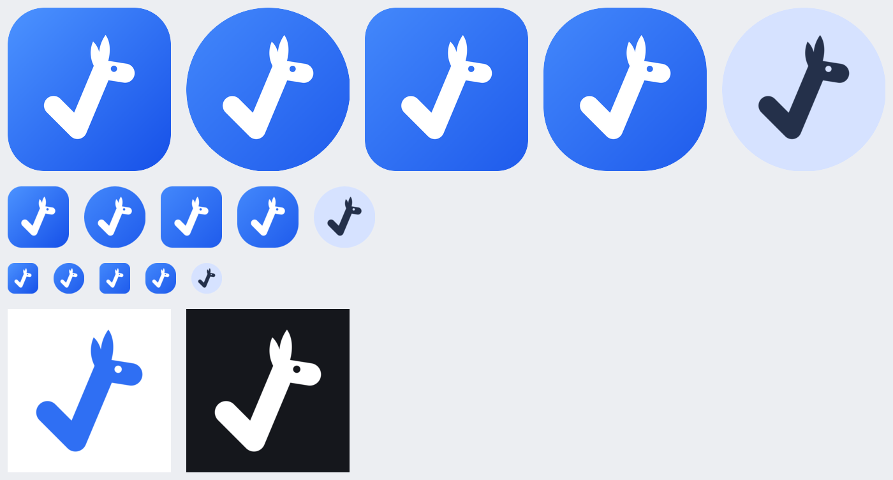
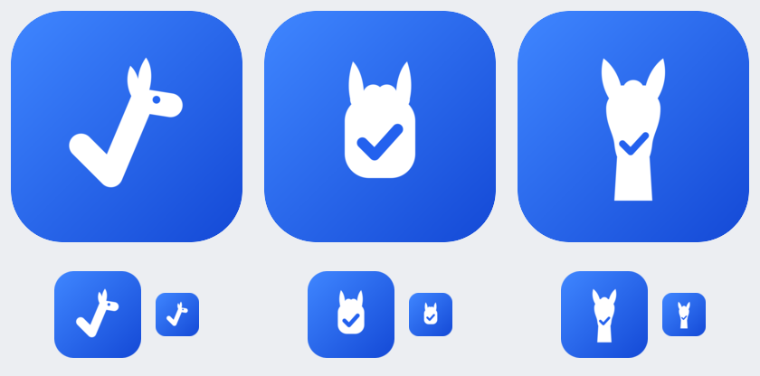

# Branding

Name and logo of Taskuna, an unofficial Vikunja mobile client. Its `applicationId` and bundle id are `dev.coderoftime.vikunja`.

The name and logo are proposals and still wait for the owner's approval in the step 1 review ([Q2](../docs/open-questions.md#q2-app-identity)).



## Name: Taskuna

- **Home screen:** `Taskuna` (7 characters)
- **Store listing:** `Taskuna – client for Vikunja` (de: `Taskuna – Client für Vikunja`)
- **Store description:** must say that the app is unofficial and that the Vikunja project does not make or endorse it.

Why Taskuna:
- **It leans towards Vikunja.** It is *task* + *vicuña*. "Vikunja" is the German spelling of vicuña, and both come from Quechua *wik'uña*. So the name points at Vikunja without containing the name "Vikunja".
- **It says what the app does.** It is a task app.
- **It is easy to say.** In English it is "TASK-oo-na". In German, "Tas-ku-na" follows normal German spelling. It has no ñ, so it is ASCII-safe for store names and URL schemes.
- **No conflicts found.** On 2026-10-09 there were no apps with this name in the App Store (DE, US) or on Google Play, and no web results.
- **The OAuth redirect scheme fits the rule.** `vikunja-taskuna` meets the `vikunja-` prefix rule in [D14](../docs/decisions.md#d14-browser-sign-in-only) and avoids `vikunja-desktop` and `vikunja-flutter`.

**Known weak spot:** The name shares the ending *-kuna* with **Kuna**, a third-party iOS client for Vikunja ([trykuna.app](https://trykuna.app/), App Store seller Richard John Annand). The *Task-* prefix tells them apart, and both endings come from vicuña on their own. Mention this if you contact the Vikunja maintainers.

### Alternatives

All checked on 2026-10-09 with the Apple iTunes Search API (DE and US stores), Google Play search, web search, the [Vikunja integrations page](https://vikunja.io/docs/integrations/) and the [community forum](https://community.vikunja.io/).

| Name | Idea | Conflict check |
|---|---|---|
| **Vicudo** | vicuña + to-do | No store or web results. Two problems: in Portuguese it reads as "vi cu do", which is vulgar (*cu*), and its *Vicu-* start is close to the existing Vikunja clients called *Viku*. |
| **Puna** | the high Andean grassland where vicuñas live | "Puna: Beginner Calisthenics" is in the App Store (US and DE), and there are also Puna Ako, AIPuna and ePuna. In Andean Spanish *puna* also means altitude sickness. |
| **Chaku** | the Andean round-up where vicuñas are gathered and shorn | In Hindi and Urdu *chaku* means "knife", and a Play search for it returns knife games. The App Store has Chaku2-NEXT. Germans may say "Tschaku" or "Schaku". |
| **Kunja** | the end of "Vikunja" | It is one letter away from **Kuna**, an existing iOS client for Vikunja. School apps use the name ("Navodit Vidya Kunja", "Jyoti Kunja Academy"). |

Names not to use:
- **Viku / Vicu:** "Viku: a focused iOS Client for Vikunja" (forum). The App Store also has "Viku - AI Art Generator" and "Viku" (education).
- **Cria:** a Vikunja TUI on the official integrations page. The App Store also has "Cria Planner" (productivity, by Alpaca Media).
- **Anything containing "Vikunja":** the official app on Google Play is "Vikunja" (`io.vikunja.app`). An unofficial iOS app is also called "Vikunja". Using the name would suggest the app is official.
- **Llama, Vicuna, Alpaca, Guanaco:** well-known AI model names. "Llama" is a Meta trademark.

**No formal trademark search was done** (EUIPO, DPMA, USPTO). Do one before the first store release.

## Logo

**The check-llama.** A llama head in profile whose neck is the long stroke of a checkmark: a llama for Vikunja and a check for tasks.

- **Construction:** The checkmark and the head are one polyline with one stroke weight (16 on a 100-unit grid), round caps and a round join at the poll. Two banana-shaped ears and an eye cut out of the head make it a llama.
- **The lean towards Vikunja comes from:**
  - a white camelid;
  - the same blue family as Vikunja's `#196AFF`.
- **What keeps it clearly separate from Vikunja's artwork:**
  - a profile, not a front view;
  - geometric, not illustrated;
  - a gradient squircle, not a flat circle;
  - the checkmark built into the animal.
- **Legibility:** At 48 px you can still see the check, the head and the ears (see the preview sheet).

### Explorations



| | Variant | Verdict |
|---|---|---|
| A | [`a-check-llama.svg`](explorations/a-check-llama.svg): the checkmark's long stroke becomes the llama's neck and head | **Chosen.** The check is part of the animal, not a separate element. It reads at 48 px because it uses one stroke weight. Its composition is unlike Vikunja's logo. |
| B | [`b-checkbox-head.svg`](explorations/b-checkbox-head.svg): front-facing head shaped like a rounded checkbox, with a fringe and banana ears | Friendly, but it reads as a cat or a generic creature at small sizes. The check is just a symbol placed on the face. |
| C | [`c-front-head.svg`](explorations/c-front-head.svg): front-facing geometric head, with the neck running off the bottom | Too close to Vikunja's own logo (a front-facing llama with a neck) for an unofficial app. The check is lost at 48 px. |

The final mark is A with the strokes outlined by hand into one path. That makes the eye a real hole, so the background shows through, and makes the themed icon a clean silhouette.

### Colours

| Token | Hex | Use |
|---|---|---|
| Blue light | `#4C93FF` | Gradient start (top left) |
| Blue dark | `#1650E8` | Gradient end (bottom right); colour used to flatten alpha in PNGs |
| Brand blue | `#2F6FF3` | Flat brand colour: `logo-mark.svg` / `logo_mark.png` (connect screen, in light mode) |
| Theme seed | `#1973FF` | `AppTheme.seedColor` in `app/lib/app/theme/app_theme.dart`; the app's Material 3 colour scheme is generated from it |
| White | `#FFFFFF` | Mark on the icon |
| *(Vikunja, reference only)* | `#196AFF` | Not used, only for comparison |

The gradient is linear, from the top-left corner to the bottom-right corner, on both the iOS icon and the Android background.

The logo and the theme's primary colour are not meant to match exactly. `ColorScheme.fromSeed` maps the seed to Material 3 tones, so the light-mode primary is always darker than the flat brand blue.

### Geometry

The mark lives in a 100 × 100 unit grid:
- **Mark:** bounding box x 5.9–81.9, y 1.0–88.1.
- **Placement point:** the mark is placed by the point (43.9, 46.5), between the bounding-box centre and the visual centroid.

| File | Transform | Mark size |
|---|---|---|
| `icon-ios.svg` (1024) | `translate(182.8 163.2) scale(7.5)` | ≈ 568 × 651 px; margins ≈ 228 px left and right, 172 px top, 201 px bottom |
| `icon-foreground.svg`, `icon-monochrome.svg` (108) | `translate(30.85 29.48) scale(0.5273)` | ≈ 40 × 46 dp |

The foreground uses the same proportion of the visible 72 dp as the iOS icon uses of its 1024 px. Its farthest point is about 24 dp from the centre, well inside the 33 dp safe-zone radius.

## Files

| File | What it is |
|---|---|
| `logo-mark.svg` | The mark alone, brand blue on a transparent background, square viewBox. For in-app use (connect screen, about page); recolour it with a `ColorFilter` for dark backgrounds. |
| `icon-foreground.svg` | Android adaptive icon foreground: 108 × 108 canvas, white mark inside the central 66 dp safe zone, transparent. |
| `icon-background.svg` | Android adaptive icon background: 108 × 108 blue gradient. |
| `icon-monochrome.svg` | Android 13+ themed icon layer: same silhouette as the foreground. Only alpha counts; the system tints it. |
| `icon-ios.svg` | iOS app icon: 1024 × 1024 full bleed, opaque. iOS applies the squircle mask. |
| `png/icon-ios-1024.png` | RGB, **no alpha channel** (App Store requirement) |
| `png/icon-foreground-1024.png` | RGBA, transparent |
| `png/icon-background-1024.png` | RGB |
| `png/icon-monochrome-1024.png` | RGBA, white mark on transparent |
| `png/icon-android-legacy-1024.png` | RGBA: the visible 72 dp of the adaptive layers as a rounded square, for Android 7 launchers without adaptive icons |
| `png/logo-mark-1024.png` | RGBA, brand-blue mark on transparent |
| `png/preview-sheet.png` | Preview of the masks, sizes and themed icon |
| `explorations/` | The three design variants and `comparison.png` |
| `render.sh` | Regenerates every PNG from the SVGs |

## Regenerating the PNGs

```sh
./branding/render.sh
```

**Needs:**
- Inkscape 1.x CLI. The script uses `inkscape` on `PATH`, or `/Applications/Inkscape.app/Contents/MacOS/inkscape`. Override it with `INKSCAPE=...`.
- ImageMagick 7 (`magick`).

ImageMagick on this machine has no librsvg delegate. `magick -list format` shows `SVG` handled by its internal **MSVG** renderer, which draws the paths correctly but paints `linearGradient` fills black. So Inkscape does the rasterising, and ImageMagick only removes alpha, resizes and builds the preview sheets.

The core commands, if you need them without the script:

```sh
inkscape icon-ios.svg --export-type=png --export-filename=png/tmp.png -w 1024 -h 1024
magick png/tmp.png -background '#1650E8' -alpha remove -alpha off -define png:color-type=2 png/icon-ios-1024.png
inkscape icon-foreground.svg --export-type=png --export-filename=png/icon-foreground-1024.png \
  -w 1024 -h 1024 --export-background-opacity=0
```

## Using the assets in the app

The icons are wired up with `flutter_launcher_icons` (config in `app/pubspec.yaml`). It writes the Android mipmaps and adaptive-icon drawables and the iOS `AppIcon.appiconset`; the generated files are committed. After changing the PNGs here, run:

```sh
cd app && dart run flutter_launcher_icons
```

flutter_launcher_icons 0.14.4 rewrites `ASSETCATALOG_COMPILER_GENERATE_SWIFT_ASSET_SYMBOL_EXTENSIONS` to `AppIcon` in the Debug and Release configurations of `app/ios/Runner.xcodeproj/project.pbxproj`. Set it back to `YES` afterwards; `app/test/app/xcode_project_test.dart` fails until you do.

| Platform icon | Source |
|---|---|
| Android 8+ adaptive icon | `icon-background-1024.png` + `icon-foreground-1024.png`, with `adaptive_icon_foreground_inset: 0` because the foreground already keeps the mark inside the safe zone |
| Android 13+ themed icon | `icon-monochrome-1024.png` |
| Android 7 (API 24–25) legacy icon | `icon-android-legacy-1024.png` |
| iOS | `icon-ios-1024.png`, with `remove_alpha_ios: true` |

The Android 12+ splash screen shows the adaptive icon on the app's surface colour (`launch_background` in `app/android/app/src/main/res/values*/colors.xml`). The iOS launch screen uses the `LaunchBackground` colour set in `app/ios/Runner/Assets.xcassets`, with the light and the dark surface colour. `app/test/app/launch_screen_colors_test.dart` keeps both in sync with the Flutter theme.

The connect screen shows the logo mark at 72 × 72 pt from `app/assets/branding/`, exported from `png/logo-mark-1024.png`:

```sh
cd app
magick ../branding/png/logo-mark-1024.png -filter Lanczos -resize 72x72 -strip -define png:color-type=6 assets/branding/logo_mark.png
magick ../branding/png/logo-mark-1024.png -filter Lanczos -resize 144x144 -strip -define png:color-type=6 assets/branding/2.0x/logo_mark.png
magick ../branding/png/logo-mark-1024.png -filter Lanczos -resize 216x216 -strip -define png:color-type=6 assets/branding/3.0x/logo_mark.png
```

In dark mode the app tints it with the theme's primary colour.

To use vector adaptive icons instead of PNGs:
- Convert the three 108 dp SVGs to Android VectorDrawables, for example with Android Studio's Vector Asset tool.
- The eye hole relies on the default non-zero fill rule (the eye is wound opposite to the head), which VectorDrawable also uses.

## Open points

- **Vikunja maintainers:** [D15](../docs/decisions.md#d15-app-id-devcoderoftimevikunja) says to check the use of the name and logo with them before the store release (step 37), including how close the logo is to theirs.
- **iOS 18 icon variants:** iOS 18 dark and tinted variants are not made yet. The monochrome silhouette is a good start for the tinted one.
- **Licence:** no licence is chosen for these assets ([Q3](../docs/open-questions.md#q3-licence-and-distribution) is deferred).
