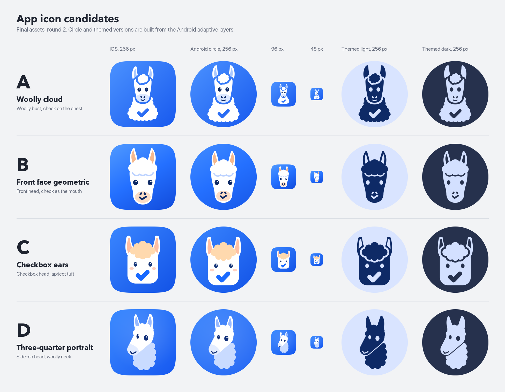
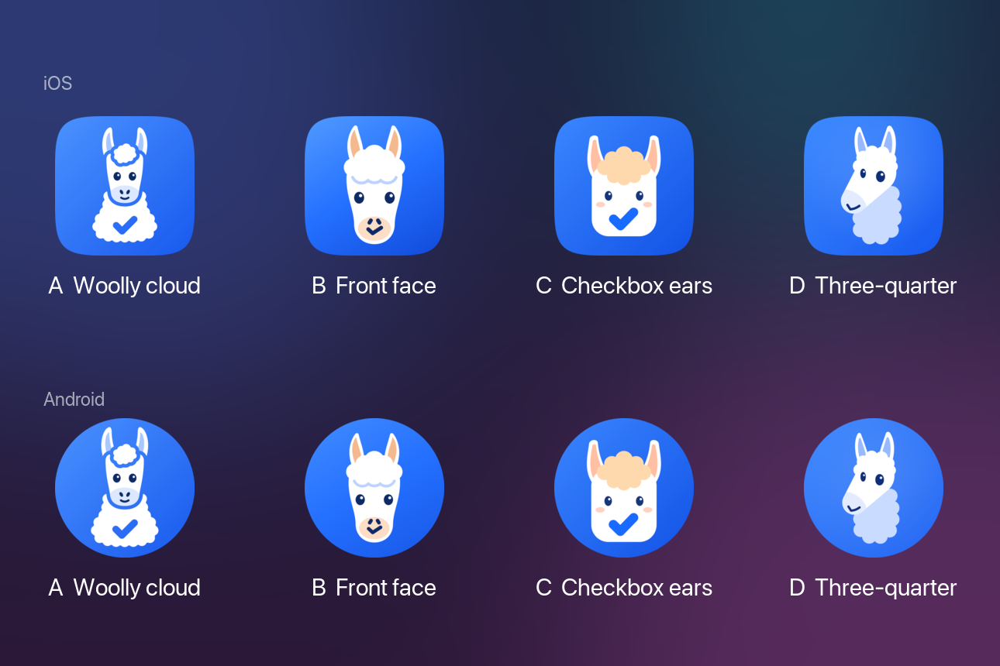

# App icon candidates, round 2

Four llama concepts were refined into full icon sets. The owner should pick one. All four keep the same base: a white llama on a diagonal blue gradient, with a check somewhere in the mark.

## How to read the sheets

**`comparison.png`** has one row per concept. The columns are:
- iOS squircle at 256 px
- Android circle at 256 px
- iOS squircle at 96 px and 48 px
- Android themed icon at 256 px, in light and in dark theme

The circle and themed versions are built from the Android adaptive layers (the central 72 of 108 units), not from the iOS art. A circle mask on the iOS art would cut off the ears and the chest.

The themed colours stand in for Material You defaults:
- **Light:** `#0E2A66` glyph on `#D9E4FF`
- **Dark:** `#D3E0FF` glyph on `#26314D`

**`homescreen-mock.png`** shows all four at 180 px (60 pt at 3x, the iPhone home-screen size) on a dark wallpaper. The top row is iOS and the bottom row is Android.

## At a glance

| | Concept | Idea | Initial blind test | Recheck of the final | Main risk |
|---|---|---|---|---|---|
| **A** | Woolly cloud | Front-facing bust, check on the woolly chest | camelid 3/3, appeal 7.7 | camelid, appeal 7 | Same idea as the Ollama logo; the face can read as a horse |
| **B** | Front face geometric | Front-facing head, the check is the mouth | camelid 3/3, appeal 7.3 | camelid, appeal 7 | Ollama look-alike; the light themed icon reads as a horse |
| **C** | Checkbox ears | The head is a checkbox, the check is the mouth | camelid 3/3, appeal 7.0 | camelid, appeal 7 | Close to generic to-do icons; can read as a bunny or a sheep |
| **D** | Three-quarter portrait | Side-on head on a woolly neck | camelid 3/3, appeal 7.0 | camelid, appeal 7 | Donkey or horse reading; the check is only implied |

- **Initial blind test:** three viewers per concept looked at the version before refinement. Appeal is their mean.
- **Recheck:** a fresh look at the final assets, without context.

Every viewer saw a camelid in every concept, in both rounds, and the recheck gave all four an appeal of 7. So appeal does not decide it. The differences are in look-alike risk, how visible the check is, and how each icon holds up at 48 px and as a themed icon.

## A: Woolly cloud

Files: [`woolly-cloud/final/`](woolly-cloud/final/)

**Idea.** A front-facing llama bust:
- a white head with banana-shaped ears and a lopsided woolly forelock
- a woolly chest that narrows into a neck beside the jaw
- a large check centred on the chest

Overlapping shapes are separated by blue cut-outs of one even width.

**Colours.**
- **Background:** gradient `#4B92FF` → `#1859EE`
- **Body:** white
- **Inner ears:** `#A9C8FF`
- **Muzzle:** `#DCE8FF`
- **Eyes, nostrils and mouth:** `#0E2A66`

**Blind tests.**
- **Initial:** camelid 3/3, appeal 7.7, the highest of the four.
- **Recheck:** camelid, appeal 7.
  - **What the viewer saw:** a white cartoon head and chest; tall inward-curving ears; a scalloped tuft; a long narrow face with a light blue muzzle and a small smile; a scalloped white wool body with a bold blue check in the middle.
  - **Look-alikes:**
    - **Ollama logo:** the closest brand risk, a front-facing cartoon llama head. The style and colour differ, but the idea is very close.
    - **To-do apps:** the check on blue and white is generic (Microsoft To Do, Google Tasks, Things).
    - **Other llama apps:** possible overlap with llama-branded productivity apps such as Llama Life.
    - **Other animals:** the long smooth face can read as a horse, donkey or mule, the wool body as a sheep, and the ears as a rabbit's.
    - **Themed icon:** the ears read as horns, so at small sizes it can look like a goat, a little devil or a cat.

**Strengths.**
- It had the highest appeal in the initial test.
- At 48 px the ears, forelock, eyes, woolly chest and check all hold up.
- The check is a separate, large element, so the to-do meaning survives at small sizes.
- It fills the tile well: about 83% of the iOS height, with a wide chest.
- The logo mark is a die-cut sticker with a blue outline. It works on light and dark, and it avoids a plain blue circle, which would mimic Vikunja's official logo.
- One shared geometry builds every file (`woolly-cloud/refine/build.py`).

**Risks.**
- It shares the "front-facing llama head" idea with Ollama, more than any other concept here.
- Horse/donkey readings of the face and a sheep reading of the body remain.
- In the themed icon the ears can read as horns.
- It has the most detail of the four (forelock, outlines, scalloped chest), so it is the busiest at 48 px.

## B: Front face geometric

Files: [`front-face-geometric/final/`](front-face-geometric/final/)

**Idea.** A front-facing llama head with no body:
- banana-shaped ears with apricot insides
- a compact woolly topknot of five circles, with a scalloped fringe line
- wide-set navy eyes
- a tan muzzle whose mouth is a check

**Colours.**
- **Background:** three-stop gradient `#4A94FF` → `#2470FF` → `#1450E0`, centred near Vikunja's `#196AFF`
- **Inner ears:** `#F4B98F`
- **Muzzle:** `#FCDDC6`
- **Fringe line:** `#BCD2FF`
- **Eyes, nostrils and check:** `#0E2A66`
- **Logo outline:** `#1F5FEA`

**Blind tests.**
- **Initial:** camelid 3/3, appeal 7.3.
- **Recheck:** camelid, appeal 7.
  - **What the viewer saw:** a white head with peach inner ears and a fluffy topknot; wide-set oval eyes; a long face narrowing to a peach muzzle with two nostril dashes and a check for a mouth. The viewer felt it suits a task app, with the check doing double duty.
  - **Look-alikes:**
    - **Ollama logo:** the closest risk, also a minimalist front-facing white llama head. Also close to Meta's Llama branding and the many llama mascots in AI tools.
    - **Other animals:** the topknot reads as a sheep, and the long ears as a rabbit or donkey.
    - **Themed icon:** the solid dark silhouette reads more like a horse, mule, donkey or goat.
    - **Muzzle:** the nostrils and check mouth form a small smiley inside the face, which can look like a second face or a smirk.
    - **Minor:** the check is faintly like a Nike swoosh, and the blue gradient is common among productivity apps.

**Strengths.**
- It has the simplest silhouette: one head, a big face and few parts.
- The warm apricot and tan accents set it apart from all-blue to-do icons.
- In colour it reads as a llama at 96 and 48 px.
- The SVGs have no `<use>` or `xlink` and use user-space gradients, so they import cleanly into Android Studio and `flutter_svg`.

**Risks.**
- It has the strongest Ollama and AI-llama association. The refinement reduced it, but it is not gone.
- The check is the smallest of the four. At 48 px it is barely visible, so the to-do meaning depends on larger sizes.
- In the light themed icon the dark face suggests a horse. It reads fine in dark theme.
- The nostrils and check mouth can read as a second smiley face or a smirk.

## C: Checkbox ears

Files: [`checkbox-ears/final/`](checkbox-ears/final/)

**Idea.** The head is a white rounded square that doubles as a checkbox. It has:
- a bold check where the mouth would be
- banana-shaped ears from the top corners
- an apricot woolly tuft
- open navy eyes and blush cheeks
- no snout

**Colours.**
- **Background:** gradient `#3A86FF` → `#1252E6`
- **Tuft:** `#FFD9AE`
- **Inner ears:** `#FFBFA3`
- **Blush:** `#FFD2C2`
- **Eyes:** `#163679`
- **Check and logo outline:** Vikunja's `#196AFF`

**Blind tests.**
- **Initial:** camelid 3/3, appeal 7.0.
- **Recheck:** camelid, appeal 7.
  - **What the viewer saw:** a white rounded-square head that also reads as a checkbox, with tall narrow ears with peach-pink insides; a curly peach tuft between the ears; oval eyes with highlights and pink blush; a blue check slightly right of centre, like a lopsided smile. No snout, nose or neck.
  - **Look-alikes:**
    - **Other animals:** a sheep or lamb (the tuft), a rabbit (the ears), or a goat or cat (the ears read as horns or as pointy ears).
    - **To-do apps:** a white tile with a blue check on blue sits close to Microsoft To Do, TickTick, Things and Any.do. The animal sets it apart, but the colours and the check are generic.
    - **Style:** it is close to kawaii llama stickers on LINE and Kakao, so it is friendly but not very ownable.
    - **Themed icon:** the tuft reads as a cloud or brain and the ears as horns, so it drifts toward a yak, bull or little devil.

**Strengths.**
- It says "task app" most directly: the head is the checkbox, and its check is the largest of the four.
- It holds up best at 48 px: the shape is chunky and the check stays clear.
- The warm tuft and cheeks break up the blue.
- The check uses Vikunja's own blue.

**Risks.**
- It is the closest of the four to generic to-do icons.
- It is the least llama-specific: there is no snout, the style is kawaii, and bunny and sheep readings remain.
- In the themed icon the tuft reads as a cloud or brain and the ears as horns. In light theme the dark glyph is heavy.
- The recheck still saw the check as slightly off-centre, like a lopsided smile.
- Minor: a small corner where the ear meets the head is visible at full size.

## D: Three-quarter portrait

Files: [`three-quarter-portrait/final/`](three-quarter-portrait/final/)

**Idea.** A llama head in three-quarter view:
- the snout points down-left
- the head rises from a woolly neck column
- a check-shaped line on the muzzle forms the mouth

**Colours.**
- **Background:** gradient `#3D8BFF` → `#1658F0`, with a faint white glow (14%) behind the head
- **Head:** white
- **Inner ears:** `#97B9FF`
- **Muzzle patch:** `#E3ECFF`
- **Neck wool:** `#C9DBFF`
- **Eyes and mouth:** `#0F2E78`
- **Logo outline:** `#2A72F8`

**Blind tests.**
- **Initial:** camelid 3/3, appeal 7.0.
- **Recheck:** camelid, appeal 7.
  - **What the viewer saw:** a white head in three-quarter view with tall pointed ears and a woolly tuft; eyes set high; a long wedge snout ending in a paler muzzle, with a small line mouth that reads as a smirk or a check; a separate periwinkle cloud-shaped neck below a hard diagonal edge.
  - **Look-alikes:**
    - **Other animals:** a donkey or horse (the wedge snout and straight ears), a sheep or lamb (the topknot and neck), a goat or a hornless unicorn.
    - **Neck:** it can read as a scarf or a cloud collar.
    - **Themed icon:** at small sizes it looks like a dark fox, dog, donkey or bat, because the wool texture disappears.
    - **Brands:** Ollama (a mix-up is unlikely, since theirs is frontal line art), Meta's Llama branding, Fortnite's loot llama, and generic flat-blue productivity icons.

**Strengths.**
- It is the only non-frontal pose, so it is the furthest from the Ollama logo and has the most distinctive silhouette.
- The long neck is a real camelid cue that the frontal concepts lack.
- The SVGs contain plain paths only, so they import safely as Android vector drawables.

**Risks.**
- The snout and straight ears still read as a donkey or horse.
- The check exists only as the mouth line. At 48 px and in the themed icon the task meaning is gone.
- The mark is narrow (43% of the tile width), so blue space is left on either side. Widening it would bring back the sheep reading.
- The themed icon loses the wool and reads as a fox, dog, donkey or bat.

## Side by side

These observations come from the two sheets above:
- **The check at 48 px:** clear in C and A, a dot in B, and absent in D.
- **Themed icon:** C and A keep their outline best. B in light theme looks like a horse, and D looks like a fox or donkey.
- **Ollama risk:** highest for A and B, which are frontal llama heads. Lowest for D.
- **Generic to-do risk:** highest for C, which is a white tile with a blue check.
- **Warm accents:** B and C have apricot/peach details, A and D are all blue and white.

## Open points

- The recheck was one more look per concept. If two concepts stay close, a blind round on just those two at 48 px and as themed icons would be a cheap tie-breaker.
- The Ollama resemblance is a visual judgement only. No trademark search has been done.
- None of the icons contain lettering, so the icon choice does not depend on the name decision (Taskuna or Rurana, see [`names.md`](names.md)).

## Files

Each concept's `final/` folder has the same set:
Each finalist's `final/` folder keeps the SVG sources (`icon-ios.svg`, `icon-foreground.svg`, `icon-background.svg`, `icon-monochrome.svg`, `logo-mark.svg`); the iteration renders and PNG exports were not kept in git. Render them with Inkscape if needed. The checkbox-ears concept was the app icon from 2026-10-09 to 2026-10-13; the current icon is derived from `../source/logo-llama.jpg` by `../build-icons.sh` (see [../README.md](../README.md)).

Older versions stay at the top level of each concept folder. Build sources and iterations:
- **Woolly cloud:** `woolly-cloud/refine/build.py`, iterations in `woolly-cloud/iterations/`
- **Front face geometric:** iterations v6 to v11 in `front-face-geometric/refine/`
- **Checkbox ears:** `checkbox-ears/work-v7/build.py` and `preview.py`, design rounds in `work-v7/r1` to `r9`
- **Three-quarter portrait:** `three-quarter-portrait/refine/build.py` and `preview.sh`, iterations in `refine/iterations/`

The `full-body-silhouette` and `lettermark-hybrid` folders are empty and are not part of this comparison.
