# Architecture

This is the current, condensed architecture. It is derived from [research/synthesis.md](research/synthesis.md) §2, which has the full reasoning and the Vikunja source references. Status markers:

- **[exists]**: built in step 1, in the combined step 2+3 (HTTP core, browser sign-in, session manager), in step 5 (read client, repository interfaces, the first screens), in step 6 (the Drift database per account, the local repositories, the initial sync), in step 7 (the incremental sync with delete reconciliation, its triggers, the full resync), in step 11 (the outbox, the serial sender, the task write ports and the first mutations: done with undo, favourite, delete), in step 12a (creates through the outbox with temporary ids and the remap, the remaining core properties of `TaskChanges`, the edit page and the new-task sheet), in step 12b (labels and assignees as id-set deltas in `TaskChanges`, sent through the task's label and assignee endpoints; reminders as the whole list; the label create and the project user search; the Labels, Assignees and Reminders sections of the edit page with their pickers), in step 4 (the account switcher sheet behind an avatar button, the Accounts section of the Account tab, adding an account through the Connect screen, the switch transition, the recency order in the account registry, removing any account, the drain of inactive accounts' outboxes) in step 13 (the `vikunja_logic` package with the Quick Add Magic parser, the day intervals and the default time; the user settings read with the account in the sync; `QuickAddService`; the composer in the new-task sheet; the "New task" app shortcut and quick action), in step 15 (`core/notifications/`: the plan and the diff, the scheduler per signed-in account, the `scheduled_notifications` table of schema version 4, the gateway over flutter_local_notifications, the background action isolate for Done and Snooze; `features/notifications/`: the setup screen, the Notifications section of the Account tab, the tap listener; the Android and iOS notification configuration), in step 16 (`core/background/`: the periodic job for every signed-in account over workmanager, the runner with its deadline and heartbeat skip, the drain after a background Done; `core/activity/`: the activity sync and the notifier; the `server_notifications` table of schema version 5; the notifications ports in `vikunja_api` and `ServerNotification` in `vikunja_domain`; `features/inbox/`: the inbox and the bell with its badge; the Activity switch, the background line and the activity and session taps; the workmanager setup on Android and iOS) or in step 14 (`RelationChange` and `TaskRelationRef` in `TaskChanges` and `Subscription` in `vikunja_domain`; relation changes in `TasksWritePort.update`, `duplicate`, `SubscriptionsPort` and `SubscriptionsWritePort` in `vikunja_api`; `parseSubtasksViaIndention` in `vikunja_logic`; relation deltas in the outbox with temporary ids at both ends of an edge and the inverse rows, `duplicateTask`, `SubscriptionRepository`, quick add's subtasks by indentation; the Subtasks, Parent and Related sections of the detail sheet, the add-relation sheet, Duplicate and the follow toggle).
- **[exists, step 9]**: built in step 9 (`evaluateDatemath`, `DateRangePreset`, `selectUpcoming`, `showsAtTopLevel` and `buildTaskTree`, `TaskListSort` and `compareTasksForList`, `classifyViewFilter` and `checklistStatistics` in `vikunja_logic`; `AvatarsPort` and the settings `filter_id_used_on_overview` and `minimum_priority` in `vikunja_api`; the `list_snapshots`, `list_snapshot_tasks` and `list_preferences` tables of schema version 6 with their DAOs, `watchActiveOpenTasks`, `watchOverviewTasks`, `watchProjectList` and `refreshProjectList` on `TaskRepository` in place of the paged project list, `ListPreferences`, the saved filters and the download of the Overview's saved filter in the sync, the avatar cache in `core/avatar/`; the Upcoming tab, the Overview's saved filter, the project screen per list view and the web's task row).
- **[exists, step 10]**: built in step 10 (`parseRichText` with `RichDocument`, `parseTaskIdFromUrl`, `parseTaskReference` and the task deep links, `parseAttachmentUrl`, the attachment preview rules and `humanSize` in `vikunja_logic`; `TaskAttachment`, `TaskComment`, `Reactions`, `TaskDetails` and `CommentSortOrder` in `vikunja_domain`; `TasksPort.readDetails` and `readByIndex`, `CommentsPort`, `AttachmentsPort`, `TasksWritePort.markRead` and the setting `comment_sort_order` in `vikunja_api`; `TaskDetailsRepository`, `TaskResolver`, the attachment image cache in `core/attachments/` and the deep-link relay in `core/links/`; the rewritten task detail sheet with the rich-text renderer, `TaskOpener` and the deep links on the app's scheme with their Android and iOS configuration).
- **[exists, step 8]**: built in step 8 (`DateDisplay`, `TimeFormat`, `ColorSchema` and the settings `dateDisplay`, `timeFormat`, `colorSchema` and `defaultViewKind` of `UserSettings` in `vikunja_domain`; `date_display`, `time_format`, `color_schema` and `default_view` read by `parseUserSettings` in `vikunja_api`; the navigation rail (`AdaptiveNavigationRail`, `usesNavigationRail`); the theme providers with `color_schema` and dynamic colour, `AppTheme.light` and `dark` with a colour scheme and the Appearance section; `DisplaySettings`, `MomentFormatter` and `pickerFormatsBuilder`; the default view; `projectDisplayTitle` and `compareTitles` in `core/text/`; `watchFavoriteTasks`, `watchSavedFilterTasks` and `refreshSavedFilter` on `TaskRepository`, `watchSavedFilters` on `ProjectRepository`, `ProjectTreePreferences` in `ListPreferences`, the saved filters' favourite flag and the `filter:` snapshots in the sync; the Projects tab's sections with archived projects, `features/smart_lists/`, `offlineProvider` and the offline banner).
- **[exists, step 17]**: built in step 17 (`RealtimeMessage` with `RealtimeAuthSucceeded`, `RealtimeError`, `RealtimeNotification` and `RealtimeUnknown`, the frame codec, `RealtimeSocket`, `RealtimeConnector` with `RealtimeUpgradeRefused`, `IoRealtimeConnector` with the upgrade by hand and `realtimeUri` in `vikunja_api`; `core/realtime/`: `RealtimeConnection` with `RealtimeState` and `realtimeConnectorProvider`; `realtimeConnectionProvider` in `features/sync/application/`; `ActivityRepository.receive`; `AccountTokens`, now public; the shell's keep-alive listeners from `initState`).
- **[exists, step 20]**: built in step 20 (`Bucket`, `BucketPlacement` and `TaskChanges.kanban` in `vikunja_domain`; `calculateItemPosition` and `buildBoard` with `BoardColumn` in `vikunja_logic`; `BucketsPort` with `BoardBucket`, the bucket codecs and the kanban moves and positions of `TasksWritePort.update` in `vikunja_api`; the `kanban_buckets` table and `list_snapshot_tasks.bucket_id` of schema version 7, `KanbanDao`, `TasksDao.watchBoard`, `watchBoard`, `refreshBoard`, `loadMoreOfBucket` and `placeTask` on `TaskRepository` with `BoardSource`, `downloadBoard` and `downloadNextBucketPage`, the purge of gone views' snapshots and buckets in the sync, placements in the outbox with `applySentPlacements`; `shownViewsOf`, `board_moves.dart`, `ProjectBoard`, `BoardColumnView`, `BoardCard`, `TaskSummary` and `NewTaskColumn`; the board in the project screen).
- **[exists, step 21]**: built in step 21 (`BucketsWritePort` and `ProjectViewsWritePort` with `encodeBucket` in `vikunja_api`; `compareBucketOrder` and the refined done rule of `buildBoard` with `queuedDoneChanges` in `vikunja_logic`; `BucketRepository` with `planBucketDeletion`, `columnHoldsTasks`, `planBucketMove` and `DeleteFailedAfterNewDefault`, `LocalBucketRepository`, `bucketRepositoryProvider`, `KanbanDao.buckets`, `putBucket`, `updateBucket` and `removeBucket`, `ProjectsDao.loadView` and `setViewBuckets`, `BoardSource.queuedDoneChanges`; `ColumnMenuButton`, `column_changes.dart`, `column_sheets.dart` and `NewColumnTile` on the board).
- **[exists, step 22]**: built in step 22 (`TaskChanges.positions` in `vikunja_domain`; `ProjectsWritePort` and the list positions of `TasksWritePort.update` in `vikunja_api`; `ProjectListSource.queuedPositions` from `TasksDao.loadProjectList` by view id, `ListSnapshotsDao.applySentPositions`, `ProjectsDao.moveProject`, `TaskRepository.positionTask`, `ProjectRepository.moveProject`, positions in the outbox, `SyncProblem.changes` and the list wording of a sync problem; `list_moves.dart` (`listIsReorderable`, `listGroupsOf`, `planListMove`), `project_moves.dart` (`ProjectTreeMoves`, `ProjectMovePlan`), `isArchivedInTree`, `ProjectListBody`, `reorder_slot.dart` (`ReorderSlot`, `DropLine`, `DragEdgeScroller`, `LiftedRows` with `liftedAboveFinger`, `LiftableRow`), `projectMoveFailureText`, the `actions` of `TaskRow` and `ProjectRow`; the drag and the screen-reader moves of a list view and of the project tree).
- **[exists, step 23]**: built in step 23 (`NewProject`, `ProjectChanges` and `ViewDraft` and the value equality of `ViewFilter` in `vikunja_domain`; `create`, `update`, `delete` and `duplicate` of `ProjectsWritePort`, `create`, `update`, `move` and `delete` of `ProjectViewsWritePort`, the write transport's shared `patchOrReplace` and the project and view bodies of `project_codec.dart` in `vikunja_api`; `ProjectsDao.loadProject`, `subtreeOf`, `updateProject`, `setArchived`, `purgeSubtree`, `putView` and `removeView`, `TasksDao.purgeInDeletedProjects` and `renameIdentifiers`, `LocalListPreferences.forget`, `SyncEngine.refreshAfterWrite`, `pullWholeOnNextRun`, `createProject`, `updateProject`, `deleteProject` and `duplicateProject` on `ProjectRepository`, `ProjectViewRepository` with `sortedViews`, `planViewMove` and `LastViewNotDeletable`, `LocalProjectViewRepository` and its providers; `project_management.dart` (`projectSubtreeIds`, `parentCandidates`, `splitListFilter`, `joinListFilter`), `features/projects/presentation/manage/` (`ProjectManagementActions`, `NewProjectSheet`, `ProjectEditPage`, `DuplicateProjectSheet`, `ProjectViewsPage`, `ViewFormSheet`, `pickParentProject`, the confirmations, `CodePointLimitFormatter`, `projectChangeFailureText`), the project menu of `ProjectTasksScreen`, New project on the Projects tab, the routes `/home/project/:id/edit` and `/home/project/:id/views`).
- **[exists, step 24]**: built in step 24 (`SavedFilter` and `SavedFilterDraft` in `vikunja_domain`; the filter engine in `vikunja_logic`: `parseTaskFilter` with `FilterExpression` and `FilterError`, `matchesFilter` and `BoundFilter`, `FilterContext` with `filterLocation`, `FilterableTask`, `mergeSavedFilter`, `parseFilterDate`, `filterForApi`, `filterFromApi` and `untitledFilterIds` with `LookupTables`, `matchesTaskSearch` and `TaskSearchMatcher`, `fexpr.dart`, and `evaluateDatemath` rewritten after go-datemath (`datemath_expression.dart`, `wall_clock.dart`) with a `Location`, over the dependency `timezone`; `SavedFiltersReadPort`, `SavedFiltersPort` and `saved_filter_codec.dart` in `vikunja_api`; `core/filters/` (`LocalFilter`, `LocalFilters`, `locationForFilters`, `SearchIndex`), the saved filters' definitions in the sync (`SavedFilterDefinition`, `fetchSavedFilterDefinitions`, `storeSavedFilterAnswer`, `forgetSavedFilter`), `FilterEvaluation`, the `matchingIds` of `ProjectListSource` and `BoardSource`, `TaskRepository.watchLabelTasks`, `SavedFilterRepository` with `LocalSavedFilterRepository`, `TaskSearch` with `LocalTaskSearch`, `TasksDao.loadFilterRowsInProject` and `loadFilterRowsOfSavedFilters`, `watchTables(alsoOn:)` with the task repository's `clockTicks`; `features/filters/` (`FilterField`, `FilterTextEditingController`, `filter_syntax.dart`, `filterErrorText`), `features/search/` (`SearchPage`, `SearchButton`), `SavedFilterFormPage`, the saved filter menu of `SmartListScreen`, `LabelTasksScreen`, `DueSectionsList`, the builder in `ViewFormSheet`, New saved filter and the search buttons on the tabs, Refresh in the menus of Upcoming and Projects, the routes `/home/search`, `/home/labels/:id`, `/home/filters/new` and `/home/filters/:id/edit`).
- **[exists, step 25]**: built in step 25 (`ChecklistToggle`, `TaskChanges.descriptionBase` and `checklistToggles`, `DescriptionConflict` and `ProjectChanges.description` in `vikunja_domain`; `toggleTaskItem`, `checklistToggleFor`, `rebaseChecklistToggles`, `checklistItemText`, `RichTaskItem.taskId` and `RichDocument.taskItems` in `vikunja_logic`; the `rebaseDescription` hooks of `TasksWritePort.update` and `ProjectsWritePort.update` and the description in `encodeProjectChanges` in `vikunja_api`; the editor bundle in `app/editor/` (TipTap 3.31.3 configured with the web editor's schema, `bridge.js`, the Node tests over the oracle vectors), built by `tool/build_editor.sh` into `app/assets/editor/editor.html` and `NOTICES.md`, with the CI job `editor`; the description base and taps in the outbox payload, the sender's base check, rebase and `DescriptionConflict`, `OutboxDao.queueUpdate(ifDescription:)`, `retryOverwritingDescription` and `dropDescription`, `updateDescription`, `toggleChecklistItem`, `webDescription`, `keepMyDescription` and `useWebDescription` on `TaskRepository`, `ProjectRepository.updateDescription` with its server check; `features/description_editor/` (`editor_protocol.dart`, `EditorBridge`, `WebViewEditorBridge` with `lockDownWebView`, `DescriptionEditorPage`, `EditorToolbar`, `MentionBar` with `MentionController`, `showLinkSheet`, `DescriptionDrafts`) over the dependency `webview_flutter`; the detail sheet's Edit button, "Add description" and checklist taps (`onToggleTaskItem` of `RichHtml` and `RichTextView`), the Description rows of the task and project edit pages, `showDescriptionConflictSheet` and Compare versions in Sync problems, the routes `/home/tasks/:id/description` and `/home/project/:id/description`).
- **[exists, step 26]**: built in step 26 (`TaskChanges.coverImageAttachmentId` and `FileTooLarge` in `vikunja_domain`; `safeFileName` in `vikunja_logic`; `AttachmentsWritePort` (`upload`, `delete`) as `VikunjaWriteClient.attachments`, `AttachmentsPort.download`, the cover in `encodeTaskChanges` and `AuthInterceptor.bodyReadOnceKey` in `vikunja_api`; `UploadFiles` with the account's uploads folder, `upload_policy.dart` (`appMaxUploadBytes`, `maxUploadBytesOf`, `uploadTimeoutFor`, `maxUploadTimeoutsInARow`, `uploadProblemReason`), `PendingUpload` and `AttachmentDownloads` in `core/attachments/`; the `uploadAttachment` op kind with `QueuedUpload`, the sender's upload lane with its timeouts, the adoption of a lost answer and the 4020 cover recovery, every outbox trap fixed for the new kind; `queueUpload`, `watchPendingUploads`, `uploadedAttachments` and `cancelUpload` on `TaskRepository`; `AttachmentRepository` with `LocalAttachmentRepository`; `FileActions` with `PlatformFileActions` in `core/files/`; `ShareIntentSource` with `ChannelShareIntentSource` in `core/share/`; `features/attachments/` (`AttachmentPicker` with `PluginAttachmentPicker` and `ChannelDocumentPicker`, `queueAttachments`, `attachmentFailureText`), `TaskAttachmentsSection` with `PendingUploadRow` and the menu of `AttachmentRow`, the editor's Image button with the `insertImage` command, `features/share/` (`ShareIntentListener`, `showShareSheet`, `ShareFilesController`, `share_text.dart`, `shareTargets`), over the dependencies `file_selector`, `image_picker` and `share_plus`; on Android `ShareTargetActivity`, `ShareInbox`, `ContentFiles.kt`, `DocumentPickerChannel`, `FileActionsChannel` with `AttachmentFileProvider` and the share taken once by `MainActivity`; the camera and photo library usage strings on iOS).
- **[exists, step 30]**: built in step 30 (`UserSettings` with the name, the email reminders, the discoverable flags, the overdue reminders and their time (`ClockTime`) and `copyWith`, `UserProfile`, `UserSettingsChanges` with `SettingChange`, `AvatarProvider` with `choices` and `isFromSignIn` and `Capability.userSettingsMergePatch` in `vikunja_domain`; `UserSettingsWritePort` (`update`, `avatarProvider`, `setAvatarProvider`, `uploadAvatar`) from `createUserSettingsWritePort`, with the v2 merge-patch of the changed fields and the full writes built from a fresh raw read, `WriteTransport` in a file of its own, `parseUserProfile` and `AccountApi.currentUserWithProfile` in `vikunja_api`; `AccountSettingsRepository` with `LocalAccountSettingsRepository` and its providers, `storeCurrentUser` with the profile and the avatar provider in `sync_state`, the profile from every sync's `GET /user`, `AccountRegistry.updateDisplayName`, `AvatarCache.evict` and `noteUpdated` with `avatarGenerationProvider`, `SessionManager.refreshNow` and `SessionCheck.refreshOnNextCheck`, `zonesWithDeviceOffsets`; `features/account_settings/` (`AccountSettingsPage`, `AvatarPage`, `AvatarCropPage`, `showSearchableOptionSheet`, `pickDefaultProject`, `SavingProgressBar`, `accountSettingsFieldError` and `accountSettingsFailureText`, `webSettingsPageUri`, `suggestedTimeZones`, `serverLanguages`), `pickTimeOfDay` and `showCupertinoPickerSheet`, the Account tab's profile header, its Account settings row and "On this device", the own avatar in the header, the switcher button and its tiles, the routes `/home/account-settings` and `/home/account-settings/avatar`).
- **[exists, step 31]**: built in step 31 (`TotpStatus`, `UserSession`, `ApiToken`, `NewApiToken`, `CreatedApiToken`, `ApiPermissionGroups`, `CaldavToken`, `CreatedCaldavToken`, `UserDataExport` and `UserProfile.deletionScheduledAt` in `vikunja_domain`; `describeUserAgent` with `DeviceDescription` and `DeviceKind` in `vikunja_logic`; `AccountSecurityPort` from `createAccountSecurityPort` over `AccountSecurityApi`, the codecs of `dto/account_security_codec.dart`, `deletion_scheduled_at` in `parseUserProfile` and query parameters on `WriteTransport.send` in `vikunja_api`; `AccountSecurityRepository` with `OnlineAccountSecurityRepository` (`currentSessionId`, `revokeOtherSessions`, `OtherSessionsNotAllEnded`) and its providers, `accountSecurityPortProvider`, `deletion_scheduled_at` in the stored profile, `endingSessionOfDeletedAccount`, `deviceChannel`, `SensitiveClipboard` and `SecureDisplay` over `copySensitive` and `setSecure` in `MainActivity`, the redaction of `secret` and `otpauth` links, `SessionCheck.refreshOnNextCheck` for the two-factor page; `PushedPages` with `PagePush.pushPage`; `features/account_settings/` (the Security, Integrations, Your data and Delete account sections with `SecurityOverview`, `SessionsPage`, `ApiTokensPage`, `ApiTokenFormPage` with `PermissionGroupTile` and the web's presets, `CaldavPage`, `DataExportPage`, `OneTimeSecretView` and `OneTimeSecretPage`, `confirmAccountDeletion` and `DeletionScheduledNote`, `openWebSettingsPage`, `accountSecurityFailureText`, `canReadTotpStatus`, `WebSettingsPage.totp`, `dataExport`, `exportDownload` and `deletion` with the https guard of `webSettingsPageUri`), `pickDay`, `announce`, `openExternalOrSay` and the shared form parts in `features/common/`, the scheduled deletion on the Account tab, the routes `/home/account-settings/sessions`, `/home/account-settings/api-tokens` with `new`, `/home/account-settings/caldav` and `/home/account-settings/data-export`).
- **[exists, step 27]**: built in step 27 (`CommentDraft`, `ReactionEntity` with `maxReactionLength`, `reactionsEqual` and `reactionsHash`, `Permission`, `TaskDetails.maxPermission` and `copyWith`, `TaskComment.copyWith` with its reactions in `==` and `isEdited` after `editedAfter`, and `Task.commentCount` and `isUnread`, 0 and false without their expands, in `vikunja_domain`; `commentHtmlFromText` with `MentionSpan` and `QuotedComment`, and `quotedTextOf` in `vikunja_logic`; `CommentsWritePort` and `ReactionsWritePort` as `VikunjaWriteClient.comments` and `reactions`, `comment_count` and `is_unread` in `parseTask`, `max_permission` and v1's `x-max-permission` header in `readDetails`, and `tool/capture_comment_fixtures.dart` in `vikunja_api`; the comment vectors in the editor's tests; `tasks.comment_count` and `tasks.is_unread` of schema version 8, `TasksDao.storeCommentState`, `addToCommentCount` and `upsertAll(withCommentState:)`, `TaskFilters.commentState` in the sync, `addComment`, `editComment`, `deleteComment`, `addReaction`, `removeReaction` and `watchServerChanges` on `TaskDetailsRepository` with the row's count and flag kept in step, `ActivityRepository.find`, `ActivityItem.commentId` with `commentIdOf`, `CommentDrafts` in `core/storage/`, dropped at sign-out, `systemConfirmsCopies` in `core/platform/`; `TaskWriteAccess`, `toggledReaction`, `activeUser` and `activeServerOffersComments` in `features/tasks/application/`; `CommentComposer` with `CommentComposerController` and `CommentTextController`, the comments section on every server with comments and its menu (Reply, Copy link, Edit, Delete), `ReactionChips` that toggle and add with `pickReaction`, `commentFailureText`, the open sheet's live refresh and its opening at a comment, `TaskOpener`'s `commentId`, `CommentTarget` with the route `/home/tasks/:id/comments/:commentId/edit` and the router's `_CommentEdits`, `CommentCount` on task rows and board cards).
- **[exists, step 28]**: built in step 28 (`Project.maxPermission` with `copyWith`, `Permission.isAdmin`, `Label.maxTitleLength`, `LabelChanges`, `Team`, `TeamMember`, `NewTeam`, `TeamChanges`, `ProjectUserShare`, `ProjectTeamShare`, `LinkShare`, `NewLinkShare` and `TeamMemberMissing` in `vikunja_domain`; `linkShareUrl` and `webFrontendBase`, `externalTeamProvider`, `TeamGuards` with `TeamLeaveRule`, `labelTitleProblem` and `teamNameProblem` in `vikunja_logic`; `TeamsPort` from `createTeamsPort`, `ProjectSharingPort` from `createProjectSharingPort`, `LabelsWritePort.update` and `delete`, `UsersPort.searchUsers`, `expand=permissions` on the project list with `max_permission` in `parseProject` and v1's header in `ProjectsPort.read`, the id-like label search matched over the whole list, `readAllPages`, the team and sharing codecs and `tool/capture_sharing_fixtures.dart` in `vikunja_api`; `projects.max_permission` of schema version 9, `LabelsDao.remove`, `LabelRepository.update` and `delete` with `isOwnLabel`, `UserRepository.search`, `TeamRepository` with `OnlineTeamRepository`, `ProjectSharingRepository` with `OnlineProjectSharingRepository`, `LinkShareActions` in `core/files/`, `ActivityItem.teamId`; `ProjectAccess` with `projectAccessProvider` and the gating of the project screen, the board, the pickers, the task sheet and the rows; `OrganiseSection` on the Account tab, `features/labels/` (`LabelsPage`, `LabelFormPage`), `features/teams/` (`TeamsPage`, `TeamPage`, `NewTeamSheet`, `TeamEditSheet`, `team_confirmations.dart`, `TeamAvatar` and `TeamBadge`), `features/sharing/` (`ProjectSharePage`, `pickPerson`, `pickTeam`, `LinkShareFormSheet`, `LinkShareSheet`, `LinkQrSheet` with `QrCodeView`, `access_cleanup.dart`, `share_texts.dart`), `LabelDescriptionTarget` and `TeamDescriptionTarget`, `PageReachability`, `OnlineOnlyFab`, the tappable `LabelPill`, the routes `/home/labels` with `new`, `:id/edit` and `:id/description`, `/home/teams`, `/home/teams/:id` with `description` and `/home/project/:id/share`; the dependency `qr`).
- **[exists, step 29]**: built in step 29 (`TableSortField`, `TableSort` with `forColumns`, `TableColumn`, `compareTasksForTable`, the title comparison of both sorts moved into the package-internal `task_order.dart`, `CalendarDate`, `GanttRange` with `defaultGanttRange` and `ganttFilterText`, `layoutGantt` with `GanttLayout` (`groupSpans`), `GanttRow`, `GanttBar` and `GanttBarKind`, and `ganttArrows` with `GanttArrow`, `GanttArrowKind` and `GanttAnchor` in `vikunja_logic`; `LocalFilter.compileWithRequest`, the `request` of `LocalFilters.matchingInProject` and `TaskRepository.watchProjectList` with the fallback to the view's snapshot, `refusesViewFilter` and `downloadsSnapshot` in `core/filters/`, `refreshProjectList` and `LocalProjectViewRepository` downloading a table or Gantt view only for a filter the engine refuses, `ViewPreferences.tableSort` and `timeline` with `TimelinePreferences`, `ListPreferences.watchTableColumns` and `saveTableColumns`, `todayProvider` in `core/time/`; `isShownInApp` for every kind in `project_list_model.dart`, `timelineSourceProvider`, `tableColumnsProvider` and `buildTableRows`; the switch on the view's kind in `ProjectTasksScreen`, `ProjectTableControls`, `ProjectTableBody`, `showTableColumnsSheet`, `tableSortLabel` and `tableSortsInMenuOrder`, `ViewEmptyState`, `columns` on `TaskRow` and `TaskSummary`, `TablePriorityLabel`, `TableDateItem`, `PercentDoneItem`, `CreatedByItem` and `DoneBadge`; `features/projects/presentation/timeline/` (`ProjectTimelineBody`, `ProjectTimelineControls`, `TimelineChart`, `TimelineHeader`, `TimelineRow`, `TimelineGridPainter`, `TimelineOverlayPainter`, `TimelineSemantics`, `TimelineTodayRequests`); `pickDayRange` moved to `features/common/presentation/`).
- **[exists, step 32]**: built in step 32 (`AccountKind` and `Account.linkShare`, `LinkShareGone` with `SessionEndReason.linkShareGone`, `InvitePreview` and `InviteTeam` in `vikunja_domain`; `parseLinkShareUrl` with `ParsedLinkShareUrl` and `parseInviteLink` with `ParsedInviteLink` in `vikunja_logic`; `LinkShareClaims`, `LinkShareAuthClient` with `LinkShareAuth` and `LinkShareToken`, `LinkShareGoneInterceptor`, `InviteLinksPort` from `createInviteLinksPort`, code 13003 in `normalizeError` and `tool/capture_link_share_fixtures.dart` in `vikunja_api`; `LinkShareStore`, `LinkShareSession` with `LinkShareSessions`, `LinkShareGateway`, `linkShareAccountIdFor`, `accountTitle` and `link_share_providers.dart` in `core/auth/`, the guest entry of the registry codec and `updateGuestTitle`, the guest branches of `flagAccountsWithoutTokens`, `SignOut`, `SessionCheck`, `BackgroundSyncRunner`, the activity sync, `ActivityNotifier.sessionEnded` and `realtimeConnectionProvider`, the guest dispatch of `AccountTokens`, `activeAccountIsGuest` and `accountIsGuest`, `GuestReadClient` in `core/sync/`, share paths and the `hash` key in the redaction; `GuestSignIn`, `GuestLandings`, `passwordResetPageUri` and the offers of `BrowserSignInMethod` in `features/onboarding/application/`, the link and invite states of the Connect screen with `ConnectTarget`, `InviteCard`, `describeLinkFailure`, `features/onboarding/presentation/guest/` (`SharedLinkSheet`, `SharePasswordSheet`, `GuestLandingListener`), "Create account" and "Forgot password?" on the overview, `OpenSharedLinkSheet` in `features/share/`, `ServerNotices`, `GuestNote` and `GuestReauthBanner` in `features/home/`, `account_identity.dart`, `AppRoutes.isClosedToGuests` and the guest gates of the screens).
- **[in review, steps 18–19]**: built in steps 18 and 19 and in review (the plugin `plugins/rurana_widgets` with `RuranaWidgets`, `WidgetInstance`, `WidgetProviderKind`, `WidgetAction` and `MemoryRuranaWidgets`; `WidgetKind`, `WidgetConfig`, `WidgetSnapshot` with `WidgetRow` and `WidgetSnapshotState`, `WidgetCatalog`, `WidgetTexts`, `WidgetSnapshotBuilder`, `WidgetPublisher` with `WidgetPublishers`, `WidgetRefresher`, `WidgetHost` with `PluginWidgetHost` and `NoWidgetHost`, `WidgetTapImport` with `importWidgetTaps`, `widgetActionsMain` and `widget_providers.dart` in `core/widgets/`; `ExternalDone` in `core/outbox/`; the `imported_widget_actions` table of schema version 10 with `ImportedWidgetActionsDao`; `widget_link.dart` and `DeepLinkRelay.widgetLinks` in `core/links/`; `AppBackgrounding` in `core/platform/`; `TaskOpener.requestNewTask` and `showNewTask`; `features/widgets/` (`WidgetsSection`, `WidgetsPage`, `WidgetConfigurePage`, `widget_choices.dart`, `WidgetLinkListener`) and the routes `/home/widgets` and `/home/widgets/configure`; the Glance widgets, `MarkDoneAction`, `WidgetActionQueue`, `WidgetActionsWorker`, `WidgetConfigureActivity`, `WidgetSchedule`, their resources, the Kotlin unit tests and `proguard-rules.pro` in `app/android/`; the `RuranaWidgets` extension, `Runner.entitlements` and `tool/add_widget_extension.rb` for iOS).
- **[exists, step 35a]**: built in step 35a (`core/security/`: `PrivacySettings` with `LockAfter` and `NotificationContent`, `PrivacySettingsStore` and `PrivacySettingsUnreadable`, `privacySettingsControllerProvider` with `StoredPrivacySettings`, `privacySettingsProvider`, `DeviceAuthenticator` with `LocalAuthDeviceAuthenticator`, `DeviceAuthPrompt` and `deviceAuthSupportedProvider`, `AppExcursions`, `AppLockController`, `screenProtectionProvider`; `core/platform/`: `RecentsScreenshots` with `recentsHiddenNativelyProvider`, `SecureDisplay` reference-counted with `SecureHold` over `SecureWindow`, `AppRoundTrips` (`roundTrip`, `launchAway`), `androidMajorVersionProvider`, `systemBackArrivesAsPopProvider`, `AppBackgrounding.setBackMovesToBack`; `AppLockGate` in `app/widgets/`; the lock waits of `TaskOpener` and `ShareIntentListener`; the excursions of the browser sign-in, the pickers, the file and link-share actions, the notification gateway and the widget pin; `NotificationPrivacy`, the category `task_locked`, the generic notification texts, `reconcile(force:)` and `ActivityTray.withdrawTaskNotifications`; `scheduled_notifications.hidden_on_lock_screen` and `done_needs_unlock` of schema version 11; widget snapshots without rows and `WidgetHost.deleteSnapshotsExcept`; `features/privacy/` (`PrivacySection`, `PrivacyPage`, `lock_after_texts.dart`, `appSwitcherBestEffortProvider`) and the route `/home/privacy`; `MainActivity` as a `FlutterFragmentActivity` with the AppCompat themes, `setRecentsScreenshotEnabled`, `setBackMovesTaskToBack` with its back callback and no default focus highlight; `NSFaceIDUsageDescription`, `.privacySensitive()` and `MarkDoneIntent`'s `authenticationPolicy` for iOS; the app lock fakes in the test helpers).
- **[exists, step 35b]**: built in step 35b (`core/network/`: `OriginKey`, `NetworkProfile` with `PinnedCertificate`, `CaCertificate`, `ClientCertificate`, `PinMismatch` and `ProfileSecrets`, `CertificateInfo`, `NetworkProfiles` with `ConnectionProfileState`, `NetworkProfileSecrets`, `HeaderRules` with `HeaderPreset`, `validateClientCertificate`, `CertificateProbe` with `CaCheck`, `profileSecurityContext` and `profileHttpClient`, `NetworkProfileAdapter` in `createDio`, `secret_scrubbing.dart`, `networkProfilesProvider`, `connectionProfileProvider`, `connectionProfileRevisionProvider` and `certificateProbeProvider`; `ProfileRealtimeConnector` in `core/realtime/`; the Cloudflare Access names in the log redaction; `features/connection/`: `ConnectionPage`, `CertificatePage`, `ClientCertificatePage`, `HeadersPage`, `SecretTextField`, `FingerprintView`, `connectionFixFor`, `confirmBrowserLeg`, `ConnectionTile`, `ConnectionSettingsAction` and the route `/connection`; `ConnectFailureCard`, `ConnectionOptionsButton` and `retryAfterConnectionChange` on the Connect screen; the forget option of `confirmRemoveAccount` and `SignOutController.signOut`; the five connection-settings exceptions, `ConnectionSettingsFailure`, `TlsFailure.clientCertificateRefused` and the new `NetworkProblem`s in `vikunja_domain`; `preConsentProbeKey`, `mentionsClientCertificateRefusal` and `IoRealtimeConnector(createHttpClient:)` in `vikunja_api`; the Docker profile `tls`, `tool/gen_tls_test_certs.sh`, `tool/tls_e2e.py` and the dummy fixtures in `app/test/fixtures/tls/`).
- **[exists, step 35c]**: built in step 35c (the error hooks of `configureLogging` and `resetLoggingForTest` in `bootstrap/logging_setup.dart`; the new rules of `redactSecrets`; the `toString`s of `Task`, `Project`, `Label`, `ProjectView` and `TaskAttachment` without titles in `vikunja_domain`; `core/links/widget_link_key.dart` (`prepareWidgetLinkKey`, `readWidgetLinkKey`, `widgetLinkKeyMatches`), `WidgetLink.linkKey` and `WidgetLink.maxDays`, `NotificationPayload.linkKey`, the `linkKey` of `host.json` (`WidgetHost.writeHost`, the plugin, Kotlin's `HostSettings`, Swift's `Host`), Kotlin's `WidgetLinks.configureLink`, `openLink` and `newTaskLink`, Swift's `WidgetLinks.url`, and the ways without the key in `WidgetLinkListener` and `NotificationTapListener`; the refusal of `WidgetConfigurePage`; `_AppSchemeLinks` taking every pushed route and the redirect's backstop in `app_router.dart`; `core/platform/backup_exclusion.dart` (`BackupExclusion`, `PlatformBackupExclusion`, `excludeAppDataFromBackup`) and the iOS branch of `PlatformSensitiveClipboard`; `DeviceChannel` in `AppDelegate.swift`; `res/xml/data_extraction_rules.xml`; `tool/check_exported_components.py`; `.github/workflows/osv.yaml`, `osv-scanner.toml`, the new steps of `ci.yaml`, `app/android/app/gradle.lockfile` with the locking in `build.gradle.kts` and the wrapper's checksum; `app/test/security/`, `app/test/ci/`, `app/test/bootstrap/` and the other new tests; [threat-model.md](threat-model.md)).
- **[in review, licence]**: built with the owner's licence decision of 2026-10-27 and in review ([D67](decisions.md#d67-agpl-30-or-later-with-an-app-store-permission-contributions-under-the-dco-the-name-and-the-logo-reserved-no-f-droid-the-legal-notices-on-an-about-page-and-the-licence-page-the-source-code-published-before-the-first-store-release): `LICENSE`, `NOTICE.md`, `CONTRIBUTING.md`, `tool/check_dco.py` with `dco.yaml`; `app/lib/app/legal.dart` with `sourceCodeUrl` and `copyrightNotice`, `AboutPage` and the `/about` route, `core/legal/app_licenses.dart` with `registerAppLicenses` and `parseNotices`, `licencePageLocalizations`; `app/assets/legal/`, `tool/build_android_notices.py` with `tool/android_notices/`; embedded Cronet in place of Google Play services Cronet (`app/android/app/build.gradle.kts`); the rewritten task links, task item ids, images and quotes of the editor page; the workspace root package `rurana`).
- **[in review, step 36a]**: built in step 36a and in review ([D68](decisions.md#d68-screen-readers-heading-levels-on-screen-titles-and-section-headers-one-announcer-with-the-apps-own-live-region-on-android-high-contrast-and-reduce-motion-followed-and-a-route-sweep-that-every-route-pushed-page-and-overlay-must-pass-wcag-22-aa-as-the-yardstick-with-written-deviations): `ScreenTitle`, `SectionSemantics`, the heading levels of the title and section widgets, `Announcer` with `AnnouncerHost` in `features/common/presentation/announce.dart`, `reduceMotionOf` in `motion.dart`, `AppBarTextAction`, `AppTheme.highContrastLight` and `highContrastDark` with the `contrastLevel` of `brandScheme`, the overdue icon of `DueBadge` and of the task sheet's due row, the relations and the summary of `TimelineSemantics`, the refresh buttons of the session, API token and CalDAV pages, the headers of the iOS picker and day-range sheets; the route sweep, the 3.12× check and the static rules in `app/test/a11y/`).
- **[planned, step N]**: designed, not built. N is the [roadmap](roadmap.md) step.

This page reflects the owner's decisions of 2026-10-09 ([D13](decisions.md#d13-support-floor-230)–[D22](decisions.md#d22-session-keep-alive-through-background-sync)), the step 2+3 decisions ([D23](decisions.md#d23-browser-sign-in-through-flutter_web_auth_2-client-id-and-redirect-uri)–[D27](decisions.md#d27-paging-and-the-query-builder-move-to-step-5)) the step 5 decisions ([D29](decisions.md#d29-ui-reads-through-repository-interfaces-the-online-implementation-is-replaced-by-drift-in-step-6-without-ui-changes), [D30](decisions.md#d30-kanban-board-reads-deferred-to-step-20)) the step 6 decisions ([D31](decisions.md#d31-one-drift-sqlite-file-per-account-shared-across-isolates-deleted-on-sign-out), [D32](decisions.md#d32-initial-sync-by-keyset-paging-with-per-page-checkpoints-full-re-pull-as-refresh-until-step-7)) the step 7 decision ([D33](decisions.md#d33-incremental-sync-watermark-on-updated-with-a-120-s-overlap-keyset-over-updated-id-delete-detection-by-per-project-count-check-and-id-reconcile-daily-full-resync)), the step 11 decision ([D34](decisions.md#d34-outbox-local-first-writes-serial-sender-coalescing-retry-classes-sync-interplay-pending-fields-win-until-sent-pending-deletes-hidden-v1-full-replace-emulation)), the step 12a decision ([D35](decisions.md#d35-creates-through-the-outbox-temporary-negative-ids-with-remap-createupdatedelete-coalescing-lost-response-recovery-by-title-within-a-1-h-window)), the step 12b decision ([D36](decisions.md#d36-labels-and-assignees-as-id-set-deltas-in-the-task-update-sent-through-their-endpoints-after-a-read-before-write-diff-reminders-as-the-whole-list-label-creation-online-only)), the step 4 decision ([D37](decisions.md#d37-account-switcher-a-sheet-from-an-avatar-button-and-an-accounts-section-a-switch-resets-the-navigation-the-most-recently-active-account-follows-a-removal-inactive-outboxes-drain-in-the-foreground)) the step 13 decision ([D38](decisions.md#d38-quick-add-the-web-grammar-in-vikunja_logic-with-d19s-fixes-weekday-and-ordinal-dates-at-the-default-time-and-an-unknown-project-kept-in-the-title-a-live-composer-labels-created-online-and-assignees-looked-up-on-submit-the-task-through-the-outbox)) the step 15 decision ([D39](decisions.md#d39-local-notifications-a-scheduler-per-signed-in-account-plans-from-the-local-database-and-diffs-against-a-rolling-window-with-stable-keys-exact-alarms-when-allowed-done-through-the-outbox-from-a-background-isolate-without-a-token-refresh-snooze-local-only-permissions-asked-once-after-the-first-sync)), the step 16 decision ([D40](decisions.md#d40-background-sync-one-periodic-job-for-every-signed-in-account-with-a-deadline-skipped-while-the-app-is-in-front-the-incremental-run-as-the-session-keep-alive-a-one-off-drain-after-a-background-done-server-notifications-synced-into-a-local-inbox-on-their-own-cadence-new-unread-ones-as-activity-notifications-the-first-run-silent)), the step 14 decision ([D41](decisions.md#d41-relations-as-deltas-in-the-task-update-sent-through-the-relation-endpoints-after-a-read-before-write-diff-temporary-ids-on-both-ends-resolved-at-send-time-the-inverse-rows-kept-locally-duplicate-and-subscriptions-online-only-subtasks-from-indented-quick-add-lines)), the step 9 decision ([D43](decisions.md#d43-task-lists-from-the-local-database-like-the-webs-a-view-snapshot-for-positions-and-server-only-filters-the-overviews-saved-filter-downloaded-by-the-sync-upcoming-with-the-web-presets-and-a-pinned-overdue-part)), the step 10 decision ([D44](decisions.md#d44-task-detail-complete-rich-text-from-an-own-parser-of-the-web-editors-schema-details-and-comments-online-on-demand-deep-links-on-the-app-scheme)), the step 8 decision ([D45](decisions.md#d45-app-shell-on-wide-android-screens-the-colour-scheme-and-dynamic-colour-the-webs-display-settings-applied-only-when-set-translated-default-names-the-project-tree-with-favourites-saved-filters-and-archived-projects-smart-lists-a-sticky-offline-banner)), the step 17 decision ([D46](decisions.md#d46-realtime-in-the-foreground-one-websocket-for-the-active-account-while-the-app-is-in-front-pushed-notifications-stored-at-once-and-a-sync-nudged-for-the-task-they-name-re-auth-on-every-token-change-quiet-fallback-to-polling)) and the step 20 decision ([D47](decisions.md#d47-kanban-board-from-per-view-board-snapshots-moves-and-positions-through-the-outbox-with-the-done-buckets-rules-accessible-drag-and-drop)), which carries out the deferral of [D30](decisions.md#d30-kanban-board-reads-deferred-to-step-20), the step 21 decision ([D48](decisions.md#d48-bucket-management-online-applied-to-the-local-board-at-once-from-a-column-menu-with-a-guard-against-the-servers-orphaned-tasks)), the step 22 decision ([D49](decisions.md#d49-manual-ordering-list-views-by-drag-through-the-outbox-projects-reordered-and-nested-online-never-a-project-position-below-01)), the step 23 decision ([D50](decisions.md#d50-project-management-and-views-online-applied-to-the-local-database-at-once-from-the-project-screens-menu)), the step 24 decision ([D51](decisions.md#d51-one-filter-engine-on-the-device-with-the-servers-semantics-saved-filter-definitions-synced-on-change-and-managed-online-a-filter-builder-offline-search)), the step 25 decision ([D52](decisions.md#d52-descriptions-edited-in-a-bundled-tiptap-page-in-a-locked-down-webview-with-a-native-toolbar-checklists-ticked-in-place-no-silent-overwrite-of-a-description-changed-on-the-web)), which carries out [D18](decisions.md#d18-tiptap-description-editor-in-a-webview), the step 26 decision ([D53](decisions.md#d53-attachments-uploaded-through-the-outbox-in-their-own-lane-opened-shared-and-saved-through-the-platform-cover-and-delete-online-and-an-own-android-share-target)), the step 30 decision ([D54](decisions.md#d54-account-settings-and-profile-edited-in-the-app-with-writes-that-never-wipe-the-webs-settings-the-avatar-managed-password-and-email-left-to-the-web)) and the step 31 decision ([D55](decisions.md#d55-security-and-integration-settings-two-factor-status-sessions-and-tokens-in-the-app-a-new-token-shown-once-export-and-deletion-through-the-web)), which keep [D14](decisions.md#d14-browser-sign-in-only) and were built before steps 27 to 29, and the step 27 decision ([D57](decisions.md#d57-comments-written-in-the-app-online-with-a-draft-kept-on-the-device-reactions-on-tasks-and-comments-comment-counts-and-the-unread-dot-on-rows)), which writes the comments and reactions that D44 only reads, and the hardening of [D58](decisions.md#d58-server-html-parsed-within-budgets-counted-inside-packagehtml-a-document-past-one-ends-with-an-ellipsis), which bounds D44's parser, and the step 28 decision ([D60](decisions.md#d60-labels-managed-online-and-applied-locally-teams-project-shares-and-link-shares-online-only-the-project-permission-stored-and-every-screen-shaped-by-it)), which manages labels, teams and a project's shares and stores the user's permission on each project, and the step 29 decision ([D61](decisions.md#d61-the-table-view-as-a-detailed-list-sorted-like-the-server-and-the-gantt-view-as-a-read-only-timeline-with-the-webs-filter-range-rows-bars-and-arrows-both-from-the-local-database)), which shows the Table and Gantt views as the detailed list and the read-only timeline of [D20](decisions.md#d20-scope-cuts-and-desktop-adaptations), and the step 32 decision ([D62](decisions.md#d62-create-account-password-reset-and-invite-links-through-the-browser-sign-in-page-link-share-guests-as-an-account-kind-with-token-renewal-and-a-reduced-ui)), which leads to the web's pages for a new account and a password reset, D14 kept, and adds link-share guests as an account kind of their own, and the steps 18 and 19 decision ([D63](decisions.md#d63-home-screen-widgets-from-json-snapshots-the-app-writes-through-an-in-repo-plugin-glance-widgets-on-android-with-done-through-a-headless-dart-worker-a-widgetkit-extension-on-ios-with-an-app-group-outbox-and-no-token)), which puts one list of an account on the home screen from JSON snapshots the app writes, with a widget's Done through the outbox, and keeps [D24](decisions.md#d24-tokens-in-secure-storage-readable-after-the-first-unlock): the iOS widget extension holds no token, and the step 35a decision ([D64](decisions.md#d64-an-app-lock-over-the-ui-not-encryption-with-biometrics-or-the-devices-screen-lock-device-privacy-settings-for-the-app-switcher-screenshots-notification-content-and-widget-titles)), which puts an app lock over the UI with biometrics or the device's screen lock, a gate and not encryption, so D24 stays, and adds the device's privacy settings for the app switcher, screenshots, notification content and widget titles, and the step 35b decision ([D65](decisions.md#d65-connection-settings-per-server-address-in-the-apps-transport-a-certificate-pinned-in-the-tls-handshake-or-a-trusted-ca-certificate-a-client-certificate-access-headers-and-unencrypted-connections-only-with-consent-failing-closed)), which applies connection settings per server address in the app's transport, below every interceptor: a certificate pinned in the TLS handshake or a trusted CA certificate, a client certificate, access headers and the consent to unencrypted connections, which the transport now enforces, all failing closed; it corrects the per-server adapter switch of [D5](decisions.md#d5-dio-with-native_dio_adapter) and keeps D24 for its secrets, and the step 35c decision ([D66](decisions.md#d66-a-threat-model-uncaught-errors-redacted-and-never-printed-in-release-builds-the-apps-data-out-of-backups-and-device-transfer-routes-pushed-by-the-platform-taken-only-as-app-scheme-links-widget-links-and-notification-taps-switching-accounts-only-with-a-per-install-key-exported-components-and-dependencies-checked-in-ci)), which adds the threat model ([threat-model.md](threat-model.md)), redacts uncaught errors and prints none in release builds, keeps the app's data out of backups and device transfer, takes only app-scheme links from the routes the platform pushes, lets widget links and notification taps switch accounts only with a per-install key, and checks the exported components and the dependencies in CI; it corrects the backup wording of D24 and D31 and rewords principle 5 for guests, and the step 36a decision ([D68](decisions.md#d68-screen-readers-heading-levels-on-screen-titles-and-section-headers-one-announcer-with-the-apps-own-live-region-on-android-high-contrast-and-reduce-motion-followed-and-a-route-sweep-that-every-route-pushed-page-and-overlay-must-pass-wcag-22-aa-as-the-yardstick-with-written-deviations)), which gives every screen title and section header a heading level, sends every announcement through one announcer with the app's own live region on Android, follows high contrast and Reduce Motion, and guards every route, pushed page and overlay with an accessibility sweep.

## 1. Principles

1. **The local database is the single source of truth for the UI.** Screens read database streams. The network only feeds the database. [repository interfaces with streams exist, step 5; the database and the initial sync behind them exist, step 6 ([D29](decisions.md#d29-ui-reads-through-repository-interfaces-the-online-implementation-is-replaced-by-drift-in-step-6-without-ui-changes), [D31](decisions.md#d31-one-drift-sqlite-file-per-account-shared-across-isolates-deleted-on-sign-out)); the incremental sync exists, step 7 ([D33](decisions.md#d33-incremental-sync-watermark-on-updated-with-a-120-s-overlap-keyset-over-updated-id-delete-detection-by-per-project-count-check-and-id-reconcile-daily-full-resync)); the first writes change the same database before the server hears of them, step 11 ([D34](decisions.md#d34-outbox-local-first-writes-serial-sender-coalescing-retry-classes-sync-interplay-pending-fields-win-until-sent-pending-deletes-hidden-v1-full-replace-emulation)); a created task lives in it under a temporary id until the server has assigned one, step 12a ([D35](decisions.md#d35-creates-through-the-outbox-temporary-negative-ids-with-remap-createupdatedelete-coalescing-lost-response-recovery-by-title-within-a-1-h-window)); the lists build the web's nesting and order from it, with downloaded snapshots for a view's positions and for filters the device cannot evaluate, step 9 ([D43](decisions.md#d43-task-lists-from-the-local-database-like-the-webs-a-view-snapshot-for-positions-and-server-only-filters-the-overviews-saved-filter-downloaded-by-the-sync-upcoming-with-the-web-presets-and-a-pinned-overdue-part)); what only a single task read carries (attachments, reactions, comments, the unread flag) is read online when the detail sheet asks for it and never stored, step 10 ([D44](decisions.md#d44-task-detail-complete-rich-text-from-an-own-parser-of-the-web-editors-schema-details-and-comments-online-on-demand-deep-links-on-the-app-scheme)); a kanban view's board is a downloaded snapshot of its buckets and cards with this device's changes on top, exists, step 20 ([D47](decisions.md#d47-kanban-board-from-per-view-board-snapshots-moves-and-positions-through-the-outbox-with-the-done-buckets-rules-accessible-drag-and-drop)); a change to its columns is made on the server and then written into that snapshot at once, exists, step 21 ([D48](decisions.md#d48-bucket-management-online-applied-to-the-local-board-at-once-from-a-column-menu-with-a-guard-against-the-servers-orphaned-tasks)); a list view's manual order is its downloaded positions with this device's queued ones on top, and a project moved in the tree is moved on the server and then in the database at once, exists, step 22 ([D49](decisions.md#d49-manual-ordering-list-views-by-drag-through-the-outbox-projects-reordered-and-nested-online-never-a-project-position-below-01)); a project created, edited, archived, duplicated or deleted and a view created, edited, moved or deleted are changed on the server and then in the database at once, exists, step 23 ([D50](decisions.md#d50-project-management-and-views-online-applied-to-the-local-database-at-once-from-the-project-screens-menu)); every filtered list, board, saved filter and the Overview's saved filter is evaluated from it on the device with the server's rules, so a change made here shows at once, offline too, a download standing in only for a filter the device cannot evaluate, exists, step 24 ([D51](decisions.md#d51-one-filter-engine-on-the-device-with-the-servers-semantics-saved-filter-definitions-synced-on-change-and-managed-online-a-filter-builder-offline-search)); a task's description saved from the editor or a checkbox ticked in it changes the stored task at once, offline too, and the change is queued, while a project's description is written on the server and then in the database, exists, step 25 ([D52](decisions.md#d52-descriptions-edited-in-a-bundled-tiptap-page-in-a-locked-down-webview-with-a-native-toolbar-checklists-ticked-in-place-no-silent-overwrite-of-a-description-changed-on-the-web)); a file added to a task is copied into the account's uploads folder and queued at once, offline too, and shows as a pending upload until the server has it, while the task's attachments and its cover stay what the online details read lists, because an upload bumps no `updated` and a stored list would go stale; deleting an attachment and changing the cover are made on the server and then shown, exists, step 26 ([D53](decisions.md#d53-attachments-uploaded-through-the-outbox-in-their-own-lane-opened-shared-and-saved-through-the-platform-cover-and-delete-online-and-an-own-android-share-target)); the account's own settings, name and avatar are read from the database, which every sync's `GET /user` feeds with the settings and since step 30 the profile, and a change is made on the server and the answer, read back, stored at once, never queued and never written from the stored settings, which hold only what the app uses, exists, step 30 ([D54](decisions.md#d54-account-settings-and-profile-edited-in-the-app-with-writes-that-never-wipe-the-webs-settings-the-avatar-managed-password-and-email-left-to-the-web)); the account's two-factor status, sessions, API and CalDAV tokens and data export are read online each time a page shows them and never stored, because they change on the server, the sessions with every refresh anywhere, and a token's value must never reach the database; only the date of a scheduled deletion comes with the stored profile, exists, step 31 ([D55](decisions.md#d55-security-and-integration-settings-two-factor-status-sessions-and-tokens-in-the-app-a-new-token-shown-once-export-and-deletion-through-the-web)); a task's comment count and unread flag are stored since step 27, from the sync's task pages, the detail sheet's read and this device's own comment writes, so the rows show them offline too, while the comments and reactions themselves are still read online and, written here, sent at once and shown in the open sheet from the server's answer, never stored, because the thread can only be read online and a reaction bumps no `updated` the sync could follow, exists, step 27 ([D57](decisions.md#d57-comments-written-in-the-app-online-with-a-draft-kept-on-the-device-reactions-on-tasks-and-comments-comment-counts-and-the-unread-dot-on-rows)); the user's permission on each project is stored since step 28, from the sync's project list, and decides what the screens offer, while teams and a project's shares are read online and never stored, because adding a member bumps no `updated`, exists, step 28 ([D60](decisions.md#d60-labels-managed-online-and-applied-locally-teams-project-shares-and-link-shares-online-only-the-project-permission-stored-and-every-screen-shaped-by-it)); the Table and Gantt views are built from it too, a timeline's range evaluated with the web's filter on the device and a download standing in only for a view filter the device cannot evaluate, exists, step 29 ([D61](decisions.md#d61-the-table-view-as-a-detailed-list-sorted-like-the-server-and-the-gantt-view-as-a-read-only-timeline-with-the-webs-filter-range-rows-bars-and-arrows-both-from-the-local-database)); a link-share guest's shared project is stored the same way, its permission from one single read per sync run because the project list sends a guest none, exists, step 32 ([D62](decisions.md#d62-create-account-password-reset-and-invite-links-through-the-browser-sign-in-page-link-share-guests-as-an-account-kind-with-token-renewal-and-a-reduced-ui))]
2. **One domain-level API interface, two transport adapters** (`/api/v1`, `/api/v2`). The adapter is chosen from the negotiated **capabilities**, never from a version string. [negotiation, error model, authenticated transport, read client and the task write adapters exist, creates included (step 12a), and so do the label and assignee requests of the update, the label create and the project user search (step 12b), the server notification ports (step 16), the relation requests of the update, duplicate and the subscription ports (step 14), the avatar port (step 9) and the task details, by-index, comment, attachment and mark-read requests (step 10); the realtime socket, gated by `Capability.websocket`, on the v2 or the v1 path exists (step 17); the buckets port and the kanban moves and positions of the task update exist (step 20); the bucket and view write ports exist (step 21); the project move port and the list positions of the task update exist (step 22); the rest of the project port and the view port's create, update, move and delete exist (step 23); the saved filter ports exist (step 24); the description rebase hook of the task and project updates exists (step 25); the attachment write port, the streamed download and the cover in the task update exist (step 26); the user settings write port beside the write client writes the account's settings as a v2 merge-patch of the changed fields where `Capability.userSettingsMergePatch` says the server merges them (2.7.0), else as a full v2 `PUT` or v1 `POST` built from a fresh raw read that keeps every key the app does not know, exists (step 30); the account security port beside it reads the two-factor status, the sessions, the API and CalDAV tokens with the permissions the server offers and the data export, and ends sessions and creates and deletes tokens, on the connection's preferred version, since all of it came with v2 in 2.4.0 and 2.3 has v1 only, exists (step 31); the comment and reaction write ports of the write client, `CommentsWritePort` (v2 `POST`, a merge-patch and `DELETE`; v1 `PUT`, a read before the `POST`, and `DELETE`) and `ReactionsWritePort` (v2 `POST`, v1 `PUT`, removed with `POST …/reactions/delete` on both), the expands `comment_count` and `is_unread` on the sync's task lists and the user's permission in the details read (v2's `max_permission`, v1's `x-max-permission` header), exists (step 27); the teams and project sharing ports, label changes and deletes, the user search and `expand=permissions` on the sync's project list, exists (step 28); the link-share sign-in and renewal (`LinkShareAuthClient`), the invite check (`InviteLinksPort`, v2 only) and a gone share recognised on both versions, exists (step 32); the routed client with route-absent downgrade planned]
3. **Every mutation goes through the outbox, even when online.** The UI, notification actions and widgets share one retry, ordering and conflict path. [exists, step 11: the outbox, the sender and the task writes of the UI ([D34](decisions.md#d34-outbox-local-first-writes-serial-sender-coalescing-retry-classes-sync-interplay-pending-fields-win-until-sent-pending-deletes-hidden-v1-full-replace-emulation), section 7.5); creates through the same outbox since step 12a ([D35](decisions.md#d35-creates-through-the-outbox-temporary-negative-ids-with-remap-createupdatedelete-coalescing-lost-response-recovery-by-title-within-a-1-h-window)); labels, assignees and reminders through it since step 12b ([D36](decisions.md#d36-labels-and-assignees-as-id-set-deltas-in-the-task-update-sent-through-their-endpoints-after-a-read-before-write-diff-reminders-as-the-whole-list-label-creation-online-only)); the Done of a notification goes through it from a background isolate since step 15 ([D39](decisions.md#d39-local-notifications-a-scheduler-per-signed-in-account-plans-from-the-local-database-and-diffs-against-a-rolling-window-with-stable-keys-exact-alarms-when-allowed-done-through-the-outbox-from-a-background-isolate-without-a-token-refresh-snooze-local-only-permissions-asked-once-after-the-first-sync), section 7.7), and the background runs drain it for every account since step 16 (section 7.8); relation changes go through it as deltas of the task update since step 14 ([D41](decisions.md#d41-relations-as-deltas-in-the-task-update-sent-through-the-relation-endpoints-after-a-read-before-write-diff-temporary-ids-on-both-ends-resolved-at-send-time-the-inverse-rows-kept-locally-duplicate-and-subscriptions-online-only-subtasks-from-indented-quick-add-lines), section 7.5); kanban moves and positions go through it as placements of the task update, exists, step 20 ([D47](decisions.md#d47-kanban-board-from-per-view-board-snapshots-moves-and-positions-through-the-outbox-with-the-done-buckets-rules-accessible-drag-and-drop), section 7.5); a board's column changes do not: like creating a label, duplicating and following, they are online calls outside it, exists, step 21 ([D48](decisions.md#d48-bucket-management-online-applied-to-the-local-board-at-once-from-a-column-menu-with-a-guard-against-the-servers-orphaned-tasks), section 7.5); a list view's manual order goes through it as positions of the task update, while a project's move in the tree is an online call outside it like a column change, exists, step 22 ([D49](decisions.md#d49-manual-ordering-list-views-by-drag-through-the-outbox-projects-reordered-and-nested-online-never-a-project-position-below-01), section 7.5); creating, editing, archiving, duplicating and deleting a project and managing its views are online calls outside it too, exists, step 23 ([D50](decisions.md#d50-project-management-and-views-online-applied-to-the-local-database-at-once-from-the-project-screens-menu), section 7.5); so are creating, editing, favouriting and deleting a saved filter, exists, step 24 ([D51](decisions.md#d51-one-filter-engine-on-the-device-with-the-servers-semantics-saved-filter-definitions-synced-on-change-and-managed-online-a-filter-builder-offline-search), section 7.5); a task's description, edited in the editor or ticked in a checklist, goes through it as the description of the task update, which keeps the description it started from and is checked against the server's when it is sent, while a project's description is an online call outside it like the project's other fields, with the same check, exists, step 25 ([D52](decisions.md#d52-descriptions-edited-in-a-bundled-tiptap-page-in-a-locked-down-webview-with-a-native-toolbar-checklists-ticked-in-place-no-silent-overwrite-of-a-description-changed-on-the-web), section 7.5); a file added to a task goes through it as an operation of its own per file, `uploadAttachment`, which a lane of the sender sends beside the queue, so a large file never holds up an edit, while deleting an attachment, making one the cover and the editor's image upload are online calls outside it like a column change, exists, step 26 ([D53](decisions.md#d53-attachments-uploaded-through-the-outbox-in-their-own-lane-opened-shared-and-saved-through-the-platform-cover-and-delete-online-and-an-own-android-share-target), section 7.5); the account's settings, name and avatar are online calls outside it, one at a time, because a refusal belongs at its field and a write has to start from the server's own copy, exists, step 30 ([D54](decisions.md#d54-account-settings-and-profile-edited-in-the-app-with-writes-that-never-wipe-the-webs-settings-the-avatar-managed-password-and-email-left-to-the-web), section 7.5); ending sessions and creating and deleting API and CalDAV tokens are online calls outside it too, because they act on other devices and apps at once and a new token's value exists only in the create answer, which a queued create could never show, exists, step 31 ([D55](decisions.md#d55-security-and-integration-settings-two-factor-status-sessions-and-tokens-in-the-app-a-new-token-shown-once-export-and-deletion-through-the-web), section 7.5); writing, editing and deleting comments and adding and removing reactions are online calls outside it too, because the thread they belong to can only be read online, a queued comment would need a recovery of lost answers for little gain over the draft the composer keeps on the device, and a reaction bumps no `updated` the sync could follow, exists, step 27 ([D57](decisions.md#d57-comments-written-in-the-app-online-with-a-draft-kept-on-the-device-reactions-on-tasks-and-comments-comment-counts-and-the-unread-dot-on-rows), section 7.5); changing and deleting labels and managing teams and a project's shares are online calls outside it too, because they are rare management writes whose refusal belongs where the user acted, exists, step 28 ([D60](decisions.md#d60-labels-managed-online-and-applied-locally-teams-project-shares-and-link-shares-online-only-the-project-permission-stored-and-every-screen-shaped-by-it), section 7.5); a home-screen widget's Done goes through the same outbox, imported exactly once from the Android queue or the iOS outbox files, in review, steps 18–19 ([D63](decisions.md#d63-home-screen-widgets-from-json-snapshots-the-app-writes-through-an-in-repo-plugin-glance-widgets-on-android-with-done-through-a-headless-dart-worker-a-widgetkit-extension-on-ios-with-an-app-group-outbox-and-no-token), sections 7.5 and 7.10)]
4. **Every entry point builds the same object graph** with a Riverpod `ProviderContainer`. The entry points are the UI isolate, background tasks, the notification-action isolate and the Android widget worker. [UI exists, and the step 6 sync engine runs without a widget tree; the notification-action isolate builds the same container since step 15 (section 5.8); the background tasks do too since step 16 (sections 5.8 and 7.8); since step 26 the headless containers leave queued uploads to the UI isolate, exists, step 26 (section 7.5); the Android widget worker's headless engine (`widgetActionsMain`) builds the notification action's container, in review, steps 18–19 (sections 5.8 and 7.10); the iOS widget extension runs no Dart]
5. **Secrets live only in the Keychain/Keystore.** Extensions, widgets and the notification-action isolate never refresh user tokens; a guest token may be renewed, re-authentication at most once. [exists; the action isolate's "no refresh" rule since step 15 (section 5.8); the description editor's WebView gets no token and loads nothing from the network, exists, step 25 (section 8); an attachment download carries the token only as the Bearer header to the account's own server and a downloaded file leaves the app only as a file, never as an authenticated link, and on Android the share target reads only other apps' `content://` files and the file provider hands out only the download cache, so another app can make Rurana give up neither its database, its tokens nor its queued uploads, exists, step 26 (sections 5.2, 5.3 and 8); the app never handles a password ([D14](decisions.md#d14-browser-sign-in-only)): since step 30 the password and the email are changed on the web's own pages in the browser and no password route is called, so their error bodies, which echo the submitted password, never reach the app, exists, step 30 (sections 4, 5.5 and 6); since step 31 two-factor authentication, the data export's request and download and the account's deletion are left to the web's pages too, so the app shows no password or code field, no QR code and never the two-factor secret, which the port does not even read; a new API or CalDAV token is the one secret the app shows, only in the state of the page that created it (never in storage, a provider that outlives the page, the registry, a log or a route), copied as a clip marked sensitive on Android and kept out of screenshots and the Recents thumbnail (`FLAG_SECURE`) while it shows, and the log redaction also covers a `secret` key and `otpauth` links, [D14](decisions.md#d14-browser-sign-in-only) and [D24](decisions.md#d24-tokens-in-secure-storage-readable-after-the-first-unlock) kept, exists, step 31 ([D55](decisions.md#d55-security-and-integration-settings-two-factor-status-sessions-and-tokens-in-the-app-a-new-token-shown-once-export-and-deletion-through-the-web), sections 4, 6 and 8); comments hold no secret: an unsent comment is kept in the preferences beside the account's other notes and deleted with the account at sign-out, and no comment text, draft, mention or reaction is logged, exists, step 27 ([D57](decisions.md#d57-comments-written-in-the-app-online-with-a-draft-kept-on-the-device-reactions-on-tasks-and-comments-comment-counts-and-the-unread-dot-on-rows), sections 5.6 and 8); a link share's hash appears only inside its link on screen, in the QR code, the share sheet and the sensitive clipboard, and a link's password only in its field and the create request, never in a log, a route or the database, exists, step 28 ([D60](decisions.md#d60-labels-managed-online-and-applied-locally-teams-project-shares-and-link-shares-online-only-the-project-permission-stored-and-every-screen-shaped-by-it), section 8); the background sync isolate of step 16 does refresh, through the same session manager, because its runs are the keep-alive (section 5.8, [D40](decisions.md#d40-background-sync-one-periodic-job-for-every-signed-in-account-with-a-deadline-skipped-while-the-app-is-in-front-the-incremental-run-as-the-session-keep-alive-a-one-off-drain-after-a-background-done-server-notifications-synced-into-a-local-inbox-on-their-own-cadence-new-unread-ones-as-activity-notifications-the-first-run-silent)); since step 32 a link-share guest's token and the link's hash live only in secure storage (`LinkShareStore`), the share's password nowhere, and a container the OS started signs a guest in again at most once, exists, step 32 ([D62](decisions.md#d62-create-account-password-reset-and-invite-links-through-the-browser-sign-in-page-link-share-guests-as-an-account-kind-with-token-renewal-and-a-reduced-ui), section 5); the Android widget worker never refreshes, like the notification action, and the iOS widget extension holds no token, makes no request and gets no keychain group ([D24](decisions.md#d24-tokens-in-secure-storage-readable-after-the-first-unlock)), in review, steps 18–19 (section 7.10); the app lock is a gate over the UI, not encryption: the tokens stay readable after the first unlock as D24 has it, so the background runs, the notification actions and the widget worker keep working while the app is locked, exists, step 35a (section 8); since step 35b the connection settings' secrets (access-header values, a client certificate's PKCS#12 file and its password) live in secure storage, one entry per server address, while their pins, CA certificates, header names and consents, which are not secret, are in preferences, exists, step 35b (section 3.1); since step 35c the wording above says "user tokens", because a guest's renewal rotates nothing and may run in those containers, as step 32 built it; nothing of the app leaves an Android device through a backup or a device-to-device transfer, and the databases, uploads and widget files stay out of iOS backups while the preferences stay in them; an uncaught error's text is redacted and never printed in a release build; and the threat model ([threat-model.md](threat-model.md)) records what these rules protect, against whom, and what is left over, step 35c ([D66](decisions.md#d66-a-threat-model-uncaught-errors-redacted-and-never-printed-in-release-builds-the-apps-data-out-of-backups-and-device-transfer-routes-pushed-by-the-platform-taken-only-as-app-scheme-links-widget-links-and-notification-taps-switching-accounts-only-with-a-per-install-key-exported-components-and-dependencies-checked-in-ci), section 8)]
6. **Pure logic lives in pure-Dart packages** and is pinned by test vectors, many ported from the web frontend's tests. [exists for domain, api and, since step 13, `vikunja_logic` with the quick-add parser ([D38](decisions.md#d38-quick-add-the-web-grammar-in-vikunja_logic-with-d19s-fixes-weekday-and-ordinal-dates-at-the-default-time-and-an-unknown-project-kept-in-the-title-a-live-composer-labels-created-online-and-assignees-looked-up-on-submit-the-task-through-the-outbox)), to which step 9 adds the list logic: the server's date math, the web's date-range presets, the Upcoming selection, the List view's subtask tree and sorts, the view filter classes and the checklist counts ([D43](decisions.md#d43-task-lists-from-the-local-database-like-the-webs-a-view-snapshot-for-positions-and-server-only-filters-the-overviews-saved-filter-downloaded-by-the-sync-upcoming-with-the-web-presets-and-a-pinned-overdue-part)), and step 10 the rich-text parser of the web editor's schema, pinned by an oracle of the web's own output, and the task link, task reference, deep link, attachment URL and attachment preview rules ([D44](decisions.md#d44-task-detail-complete-rich-text-from-an-own-parser-of-the-web-editors-schema-details-and-comments-online-on-demand-deep-links-on-the-app-scheme)), and step 20 the web's position rule and the board model ([D47](decisions.md#d47-kanban-board-from-per-view-board-snapshots-moves-and-positions-through-the-outbox-with-the-done-buckets-rules-accessible-drag-and-drop)), whose done rule step 21 refines ([D48](decisions.md#d48-bucket-management-online-applied-to-the-local-board-at-once-from-a-column-menu-with-a-guard-against-the-servers-orphaned-tasks)), and whose position rule step 22 reuses for list and project moves, planned in `app/` (section 6) ([D49](decisions.md#d49-manual-ordering-list-views-by-drag-through-the-outbox-projects-reordered-and-nested-online-never-a-project-position-below-01)), and step 23 for view moves ([D50](decisions.md#d50-project-management-and-views-online-applied-to-the-local-database-at-once-from-the-project-screens-menu)), and step 24 the filter engine: the server's filter language with its error codes, its date math completed and evaluated in a timezone, the web's title ↔ id transforms and the server's task search, pinned by the vectors of the server's and the web's source and by the server's observed answers ([D51](decisions.md#d51-one-filter-engine-on-the-device-with-the-servers-semantics-saved-filter-definitions-synced-on-change-and-managed-online-a-filter-builder-offline-search)), and step 25 the checklist tick that changes one `data-checked` value in place and its rebase onto a description changed on the web, pinned by the probe cases and by fuzz tests ([D52](decisions.md#d52-descriptions-edited-in-a-bundled-tiptap-page-in-a-locked-down-webview-with-a-native-toolbar-checklists-ticked-in-place-no-silent-overwrite-of-a-description-changed-on-the-web)), and step 26 the sanitiser that makes the name of an attachment, a picked or a shared file one safe path segment and attachment name (`safeFileName`) ([D53](decisions.md#d53-attachments-uploaded-through-the-outbox-in-their-own-lane-opened-shared-and-saved-through-the-platform-cover-and-delete-online-and-an-own-android-share-target)), and step 31 the device line read from a session's User-Agent (`describeUserAgent`: Rurana with its version and system, a browser with its system, a Dart client, else the raw text), pinned by vectors of real User-Agents ([D55](decisions.md#d55-security-and-integration-settings-two-factor-status-sessions-and-tokens-in-the-app-a-new-token-shown-once-export-and-deletion-through-the-web)), and step 27 the comment HTML the web's editor writes for typed text with its mentions and a reply's quote (`commentHtmlFromText`) and the one-line preview of a quoted comment (`quotedTextOf`), pinned by 49 vectors with the web's own samples, 48 of which the bundled editor also serialises back unchanged ([D57](decisions.md#d57-comments-written-in-the-app-online-with-a-draft-kept-on-the-device-reactions-on-tasks-and-comments-comment-counts-and-the-unread-dot-on-rows)); the editor bundle of step 25 is pinned the same way, by the web's 123 recorded outputs of step 10 (section 8); step 32 the share and invite link parsers (`parseLinkShareUrl`, `parseInviteLink`), pinned by round trips through `linkShareUrl` ([D62](decisions.md#d62-create-account-password-reset-and-invite-links-through-the-browser-sign-in-page-link-share-guests-as-an-account-kind-with-token-renewal-and-a-reduced-ui))]

## 2. Workspace packages and the dependency rule

The repository is a Dart pub workspace with one shared lockfile. Since step 25 `app/editor/` is an npm package with its own lockfile beside it, outside the workspace: its build is the editor page that `app/` ships as an asset, committed, so Flutter builds need no Node [exists, step 25].

| Package | Kind | Exists (steps 1, 2+3, 4, 5, 6, 7, 11, 12a, 12b and 13 to 16) | Exists, step 9 | Exists, step 10 | Exists, step 8 | Exists, step 17 | Exists, step 20 | Exists, step 21 | Exists, step 22 | Exists, step 23 | Exists, step 24 | Exists, step 25 | Exists, step 26 | Exists, step 30 | Exists, step 31 | Exists, step 27 | Exists, step 28 | Exists, step 29 | Exists, step 32 | In review, steps 18–19 | Exists, step 35a | Exists, step 35b | Planned |
|---|---|---|---|---|---|---|---|---|---|---|---|---|---|---|---|---|---|---|---|---|---|---|---|
| `app/` | Flutter | the "Connect to server" feature (connect, server overview); `core/auth/` (token store, account registry, session manager, browser sign-in, sign-out); router guards; theming, en/de localisation, redacting logging; `core/repositories/` (`ProjectRepository`, `TaskRepository`); `/home` as a tab shell: Overview, Projects (tree, project tasks, task detail), Account; `core/db/` (`AppDatabase`, tables, DAOs, mappers, `AccountDatabaseFiles`), `core/sync/` (`SyncEngine`, `SyncStatus`, `DefaultSyncEngine`), `core/repositories/local/`; the first-sync screen, the quiet sync indicator, "last synced" and "Sync now" in the Account tab, database deletion on sign-out; the incremental `refresh()` and `fullResync()` in `core/sync/`, `ForegroundSyncScheduler` in `features/sync/application/`, "Full resync" in the Account tab; `core/outbox/` (the `outbox` table and the `pending_*` task columns of schema version 2, `OutboxSender`, `SyncProblem`), the write methods of `TaskRepository`, done with Undo and the favourite star on the rows, done, favourite and Delete in the task detail sheet, "Pending changes" with "Send now" and the "Sync problems" list in the Account tab; the create path: `createTask`, `updateTask` and `watchTask` on `TaskRepository`, temporary negative task ids, the `task_id_remaps` table of schema version 3, the create op and the lost-response lookup in `OutboxSender`; the edit page and the new-task sheet in `features/tasks/presentation/`, the FABs on the Overview and on a project's list, Edit in the detail sheet; `LabelRepository` and `UserRepository` in `core/repositories/` (`LocalLabelRepository`, `LocalUserRepository`, `labelRepositoryProvider`, `userRepositoryProvider`); label, assignee and reminder changes on the task's child rows in the outbox DAO, in `completeCreate` and in the sync overlay; `undoDone` restoring reminders; the Labels, Assignees and Reminders sections of the edit page, the label picker, the people picker and the reminder sheet in `features/tasks/presentation/pickers/`; `features/accounts/` (`AccountSwitcher`, `accountPendingChangesProvider`, the account switcher sheet), the avatar button on the Overview and Projects app bars and the Accounts section of the Account tab, the recency order in `AccountRegistry`, `isNewAccount` on `SignInSucceeded` and the adding mode of the Connect screen, the switch transition (the previous account's routes closed, the tabs reset), the drain of inactive accounts' outboxes in `features/sync/application/` (step 4); `features/quick_add/` (`QuickAddService` with `plan` and `submit`, `quickAddServiceProvider`; the composer in the new-task sheet: the highlighting title field, the preview chips, the suggestions, the prefix toolbar and the help sheet), `core/settings/` (`userSettingsProvider`) and the user settings stored by the sync's account phase, `defaultProjectFor` with the user's default project, `date_shortcuts.dart` delegating to `vikunja_logic`, the "New task" app shortcut and quick action (`AppShortcuts` in `core/platform/` over `quick_actions`) (step 13); `core/notifications/` (`planNotifications` and `diffSchedule`, `NotificationScheduler` per signed-in account with its keep-alive provider, the `scheduled_notifications` table and DAO of schema version 4, `LocalNotificationGateway` over flutter_local_notifications, `NotificationPreferencesStore` over the preferences, `handleNotificationAction` with its `@pragma('vm:entry-point')` entry point, the account wiper cancelling the account's ids); `features/notifications/` (the setup screen at `/notifications-setup`, the Notifications section of the Account tab, the tap listener); the Android manifest, Gradle and iOS `AppDelegate` configuration for notifications (step 15); `core/background/` (`BackgroundScheduler` with `WorkmanagerBackgroundScheduler`, the `callbackDispatcher` entry point, `BackgroundSyncRunner` with its deadline and the foreground heartbeat skip); `core/activity/` (`ActivitySync`, `ActivityNotifier`); the `server_notifications` table and DAO of schema version 5; `LocalActivityRepository` and its providers in `core/repositories/`; `showActivity` and the `activity` channel in `LocalNotificationGateway`, the `activity` preference, the background drain from the action handler; `features/inbox/` (the inbox at `/home/inbox`, the bell with its unread badge on the Overview), the Activity switch and the background line on the Account tab, the activity and session taps; the workmanager setup in the Android and iOS projects (step 16); relation deltas in the outbox (the `relations` payload JSON, the local apply with the inverse rows on a local other task, relation refs resolved through the remap at send time and rewritten by `completeCreate`, the sync overlay of pending relation deltas), `duplicateTask` in `LocalTaskRepository`, `SubscriptionRepository` with `LocalSubscriptionRepository` and its providers, quick add's subtasks by indentation in `QuickAddService.submit`; in the task detail sheet the Subtasks, Parent and Related sections, the add-relation sheet, Duplicate in its overflow and the follow toggle in its header, the follow toggle in a project's overflow, the tree in the multi-line preview's count (step 14) | `core/db/`: the `list_snapshots`, `list_snapshot_tasks` and `list_preferences` tables of schema version 6 (`tables/lists.dart`), `ListSnapshotsDao`, `ListPreferencesDao`, `TasksDao.watchActiveOpenTasks`, `watchOpenTasksInList` and `watchProjectList`, relations hydrated in the order they were stored; `TaskRepository.watchActiveOpenTasks`, `watchOverviewTasks`, `watchProjectList` and `refreshProjectList` with `OverviewTasks`, `ListSnapshot` and `ProjectListSource` (`task_lists.dart`) in place of `watchProjectTasks`, `refreshProjectTasks`, `loadMoreProjectTasks` and `PagedList`, `SharedLatest`; `ListPreferences` with `LocalListPreferences` and its providers; in `core/sync/` the saved filters of the project list in `sync_state` (`saved_filters.dart`) and the downloads of the Overview's saved filter and of a view (`list_downloads.dart`); `core/avatar/` (`AvatarCache`, `accountAvatarCacheProvider`); `features/upcoming/` (the Upcoming tab at `/home/upcoming`: the range button, the preset sheet, the custom day range, the overdue and without-date switches, the sections); the Overview over `overviewTasksProvider` with the saved filter's note; the project screen per list view (`project_list_model.dart`, `project_view_labels.dart`: the view chips, the sort sheet, show done per view, the nested subtasks, the Done part, the note for a view only the server can evaluate, the quiet download); the web's task row (`minimumPriorityProvider`, `task_row_content.dart`, `task_row_parts.dart`, `UserAvatar`); `ListNote` and `showOptionSheet` in `features/common/` | `TaskDetailsRepository` with `LocalTaskDetailsRepository` and its providers, `TaskResolver` with `LocalTaskResolver` (`resolve`, `findLocal`) and its providers in `core/repositories/`, `TasksDao.findByIdentifier`; `core/attachments/` (`AttachmentImages`, `AttachmentImageCache`, `accountAttachmentImagesProvider`), dropped from memory together with the avatar cache when an account is removed; in `core/links/` `DeepLinkRelay`, `DeepLinkSource` and their providers, and the scheme allowlist of `ExternalLinkOpener`; `comment_sort_order` in the stored settings JSON; in `app_router.dart` an app-scheme `WidgetsBindingObserver`, a redirect guard and `overridePlatformDefaultLocation: true`; the rewritten task detail sheet with `features/tasks/presentation/details/` (`TaskDetailsController`, `CommentsController` and the comments section, `AttachmentRow`, `ReactionChips`, `ProjectBreadcrumb`, `TaskMetadataLine`, `DetailsNotice`) and `features/tasks/presentation/rich_text/` (`RichHtml`, `RichTextView`, the mention and task-link pills, the attachment images and the full-screen viewer), `link_targets.dart`, `task_identifier.dart` and `account_context_providers.dart` in `features/tasks/application/`; `TaskOpener` and the account picker in `features/tasks/presentation/open/`, which the notification tap listener, the inbox, deep links and task links share; `features/deep_links/` (`DeepLinkListener`); `TaskLinkActivity`, the narrowed `CallbackActivity` filter and the dropped link data in `MainActivity` on Android, `CFBundleURLTypes` on iOS | `AdaptiveNavigationRail` and `usesNavigationRail` in `app/widgets/adaptive_navigation_bar.dart`, `HomeShell` with the rail outside its scaffold and the offline banner below the content; `app/theme/theme_providers.dart` (`themeModeProvider`, `systemColorsProvider` over dynamic_color, `useSystemColorsProvider`, `appColorSchemesProvider`), `AppTheme.light` and `dark` with an optional `colorScheme`, the appearance loaded behind the launch screen in `bootstrap.dart`, the Appearance section of the Account tab (`appearance_section.dart`); `date_display`, `time_format`, `color_schema` and `default_view` in the stored settings JSON; `DisplaySettings` and `displaySettingsProvider` (`features/tasks/application/display_settings.dart`), `MomentFormatter` (`features/tasks/presentation/moment_formatter.dart`, in place of `moment_format.dart`), `pickerFormatsBuilder` (`app/l10n/picker_localizations.dart`); the user's default view in `resolveViewId` and the translated default view titles; `core/text/` (`projectDisplayTitle` and `Project.displayTitle` in `project_titles.dart`, `compareTitles` in `title_order.dart`); `TasksDao.watchFavoriteTasks`, `ListSnapshotsDao.removeAll` with a set of keys to keep; `TaskRepository.watchFavoriteTasks`, `watchSavedFilterTasks` and `refreshSavedFilter` with `SavedFilterTasks`, `ProjectRepository.watchSavedFilters`, `SavedFilterRef.isFavorite`, `ListPreferences.watchProjectTree` and `saveProjectTree` with `ProjectTreePreferences`; in `core/sync/` the saved filters' favourite flag, the purge of `filter:` snapshots and `downloadSavedFilter`; the Projects tab's sections (Favourites, Saved filters, All projects) with "Show archived projects" and the saved collapsed state, `buildProjectTree(includeArchived:)`, an archived project's note without a FAB; `features/smart_lists/` (`SmartListScreen`, `SmartListRow`, `savedFiltersProvider`, `favoriteTasksProvider`, `savedFilterTasksProvider`); `offlineProvider` (`features/sync/application/offline_state.dart`) and `OfflineBanner` (`features/sync/presentation/offline_banner.dart`), `RefreshableList` without the offline notice under the shell; the screens under `/home/projects/:id` keyed by id; the dependency dynamic_color | `core/realtime/` (`RealtimeConnection` with `RealtimeState`, `realtimeConnectorProvider` over `IoRealtimeConnector` with the app's `User-Agent`); `realtimeConnectionProvider` (`features/sync/application/realtime_connection_providers.dart`); `ActivityRepository.receive` (`LocalActivityRepository`: a pushed notification upserted as handled); `AccountTokens` public in `repository_providers.dart`; `HomeShell` keeping `foregroundSyncSchedulerProvider`, `realtimeConnectionProvider`, `inactiveOutboxesProvider` and `accountNotificationSchedulersProvider` alive with `ref.listenManual` from `initState`; `FakeRealtimeConnector` and `FakeRealtimeSocket` in the test helpers, with which `SyncFakes` overrides `realtimeConnectorProvider` | `core/db/`: the `kanban_buckets` table of schema version 7 (`tables/kanban.dart`) and `list_snapshot_tasks.bucket_id`, `KanbanDao` (`replaceBoard`, `appendToBucket`, `load`, `loadedPages`, `applySentPlacements`, `removeGoneViews`), `TasksDao.watchBoard` and `loadBoard`; `TaskRepository.watchBoard`, `refreshBoard`, `loadMoreOfBucket` and `placeTask` with `BoardSource` and `BoardSlot` (`task_lists.dart`); `downloadBoard` and `downloadNextBucketPage` in `core/sync/list_downloads.dart`; the purge of the snapshots and buckets of gone views in the project phase of both sync runs; `TaskChanges.kanban` in the outbox (the payload JSON, `changesAfterCreate`, `withoutPlacements`, the placements behind an unsent create dropped by its project move, `applySentPlacements` after a sent update); the sync problem wording for a full and a missing column; `shownViewsOf` in place of `listViewsOf`, `boardSourceProvider`; `features/projects/application/board_moves.dart` (`planCardMove` with `CardMove`: `PlaceCard`, `MarkCardDone`, `ColumnFull`; `boardIsReadOnly`, `columnIsFull`, `defaultColumnOf`, `positionsOnTop`); `features/projects/presentation/board/` (`ProjectBoard`, `BoardColumnView`, `BoardCard`); the board body in `ProjectTasksScreen` with its downloads; `TaskSummary` and `TaskProgressBar` (`features/tasks/presentation/task_summary.dart`), shared by the row and the card; `NewTaskColumn` of the new-task sheet; `notificationPredicate` of `RefreshableList.buildRefreshable`; `FakeBucketsPort` in the test helpers | `BucketRepository` (`core/repositories/bucket_repository.dart`, with `planBucketDeletion` and `BucketDeletion`, `columnHoldsTasks`, `planBucketMove` and `DeleteFailedAfterNewDefault`), `LocalBucketRepository`, `bucketRepositoryProvider` and `accountBucketRepositoryProvider`; `KanbanDao.buckets`, `putBucket`, `updateBucket` and `removeBucket`, `ProjectsDao.loadView` and `setViewBuckets`; `BoardSource.queuedDoneChanges` from `TasksDao.loadBoard`; `downloadBoard` taking its time before the request; in `features/projects/presentation/board/` `ColumnMenuButton` with `ColumnAction` (`column_menu.dart`), `ColumnChange`, `columnChangeFailureText` and `confirmDeleteColumn` (`column_changes.dart`), `showColumnTitleSheet` and `showColumnLimitSheet` (`column_sheets.dart`) and `NewColumnTile`; the header's menu and semantics actions in `BoardColumnView` and the column changes in `ProjectBoard`; `FakeBucketRepository`, `FakeBucketsWritePort` and `FakeProjectViewsWritePort` in the test helpers | `TaskChanges.positions` in the outbox (the payload JSON, `changesAfterCreate`, `withoutLabels`, `withRelations`, `withoutPlacements`, the positions behind an unsent create dropped by its project move, `ListSnapshotsDao.applySentPositions` after a sent update); `TasksDao.watchProjectList` and `loadProjectList` by view id with `ProjectListSource.queuedPositions`; `TaskRepository.positionTask`; `ProjectRepository.moveProject` with `ProjectsDao.moveProject`, the write client in `LocalProjectRepository`; `SyncProblem.changes` and the sync problem wording for a list that can't be reordered or no longer exists; `features/projects/application/list_moves.dart` (`listIsReorderable`, `ListGroup`, `listGroupsOf`, `planListMove`), `effectivePositionsOf`, `project_moves.dart` (`ProjectTreeMoves`, `ProjectMovePlan` with `MoveProject`, `ProjectStays` and `ProjectMoveRefused`, `minProjectPosition`), `isArchivedInTree` (`project_tree.dart`); `ProjectListBody` (`project_list_body.dart`) in place of the project screen's own list, `reorder_slot.dart` (`ReorderSlot`, `DropLine`, `DragEdgeScroller`, `LiftedRows`, `liftedAboveFinger`, `LiftableRow`), the drag and the moves of the tree in `ProjectsScreen`, `projectMoveFailureText` (`project_move_failure.dart`); the `actions` of `TaskRow` and `ProjectRow`, `ProjectRow.indentOf`; the strings `moveUp`, `moveDown`, `movedUp` and `movedDown`, shared with the board; `FakeProjectsWritePort` and the list positions of `FakeWriteClient`, `positionTask` and `moveProject` of the fake repositories in the test helpers | `ProjectRepository.createProject`, `updateProject`, `deleteProject` and `duplicateProject` in `LocalProjectRepository`; `ProjectViewRepository` (`core/repositories/project_view_repository.dart`, with `sortedViews`, `planViewMove`, `viewAt` and `LastViewNotDeletable`), `LocalProjectViewRepository`, `projectViewRepositoryProvider` and `accountProjectViewRepositoryProvider`; `ProjectsDao.loadProject`, `subtreeOf`, `updateProject`, `setArchived`, `purgeSubtree`, `putView` and `removeView`, `TasksDao.purgeInDeletedProjects` and `renameIdentifiers`, `ListPreferencesDao.removeAll`, `LocalListPreferences.forget`; `SyncEngine.refreshAfterWrite`, `pullWholeOnNextRun` (`core/sync/incremental_run.dart`); `features/projects/application/project_management.dart` (`projectSubtreeIds`, `parentCandidates`, `ListFilterParts`, `splitListFilter`, `joinListFilter`); `features/projects/presentation/manage/`: `ProjectManagementActions` and `projectMenuItem` (`project_actions.dart`), `createProjectAndOpen` and `NewProjectSheet`, `ProjectEditPage`, `duplicateProjectAndOpen` and `DuplicateProjectSheet`, `ProjectViewsPage`, `showViewFormSheet` and `ViewFormSheet`, `pickParentProject` and `parentProjectLabel` (`parent_picker.dart`), `confirmArchiveProject`, `confirmDeleteProject`, `confirmDeleteView` and `confirmDiscardProjectChanges` (`project_confirmations.dart`), `ProjectChange`, `projectChangeFailureText` and `isInvalidViewFilter` (`project_change_failure.dart`), `CodePointLimitFormatter`, `projectTitleMaxLength`, `projectIdentifierMaxLength`, `ParentProjectTile`, `FormErrorText` and `showFailureAfterClose` (`form_parts.dart`), `viewKindLabel`, `viewKindIcon` and `bucketModeLabel` (`view_labels.dart`; there also `viewKindOptionLabel` and `isShownInApp` until step 29); the project menu and the gone state of `ProjectTasksScreen`; New project in the Projects tab's app bar and empty state; the routes `/home/project/:id/edit` and `/home/project/:id/views` (`AppRoutes.projectEdit`, `projectViews`); `FakeProjectViewRepository` (`project_view_fakes.dart`), the project writes of `FakeProjectRepository`, `FakeProjectsWritePort` and `FakeProjectViewsWritePort`, `refreshAfterWrite` of `RecordingSyncEngine` and `copyProject` in the test helpers | `core/filters/`: `LocalFilter` (`compile`: the filter text through `parseTaskFilter`, bound with the include-nulls flag, null when the engine refuses it or it names `bucket_id`; the view's search through `matchesTaskSearch`), `LocalFilters` (`matchingInProject`, `matchingOnBoard`, `matchingForSavedFilter(openOnly:)`, `countMatches`), `filterableTaskOf`, `changesWithTime` and `evaluatesLocally` (`local_filters.dart`), `locationForFilters`, `deviceLocation` and `ensureTimeZones` over the bundled zone database (`filter_zone.dart`), `SearchIndex`, `SearchQuery`, `foldForSearch` and `compareSearchedTasks` (`search_index.dart`); `TasksDao.loadFilterRowsInProject` and `loadFilterRowsOfSavedFilters` (`FilterRow`), `loadOpenTasksAmong`, `loadSearchableTasks`, `projectListTables`, `boardTables` and `savedFilterTables`, `loadProjectList` and `loadBoard` with `matchingIds`, `ListSnapshotsDao.remove`, `watchTables(alsoOn:)`; `SavedFilterRef` with its description, `updated` and `definition` (`SavedFilterDefinition`), `FilterEvaluation` on `SavedFilterTasks` and `OverviewTasks`, `matchingIds` on `ProjectListSource` and `BoardSource` (`task_lists.dart`); `TaskRepository.watchLabelTasks` and the evaluation in `LocalTaskRepository` with `clockTicks`, `switchLatest` moved to `shared_latest.dart`; `SavedFilterRepository` (`core/repositories/saved_filter_repository.dart`) with `LocalSavedFilterRepository`, `savedFilterRepositoryProvider` and `accountSavedFilterRepositoryProvider`; `TaskSearch` with `SearchResults` (`task_search.dart`), `LocalTaskSearch`, `taskSearchProvider` and `accountTaskSearchProvider`; in `core/sync/saved_filters.dart` the definitions in `sync_state` (`needsDefinition`, `savedFilterRefOf`, `fetchSavedFilterDefinitions` in both project phases, `storeSavedFilterAnswer`, `forgetSavedFilter`) and no `filter:` or `overview:` downloads for the filters evaluated here; `plainTextToHtml`; `features/filters/`: `FilterField` with `FilterInput` (`filter_field.dart`), `FilterTextEditingController`, `filter_syntax.dart` (`filterSpans`, `filterCompletionContext`, `fieldSuggestions`, `completeFilter`, `filterDateShortcuts`), `FilterLookups` and `filterErrorOf` (`filter_check.dart`), `filterErrorText`; `features/search/` (`SearchPage`, `SearchButton`, `searchResultsProvider`, `lastSearchQueryProvider`); in `features/smart_lists/` `SavedFilterFormPage`, `savedFilterFailureText` and `isInvalidSavedFilter` (`saved_filter_failure.dart`), the menu of `SmartListScreen`, `LabelTasksScreen` with `labelTasksProvider`, `DueSectionsList`; `confirmDiscardChanges`; the builder in `ViewFormSheet`; `matchingIds` in `project_list_model.dart`, `ProjectListBody` and `ProjectBoard`; New saved filter, the search button and Refresh in the menu on the Projects tab, the search button on the Overview and Upcoming and Refresh in Upcoming's menu; the routes `/home/search`, `/home/labels/:id`, `/home/filters/new` and `/home/filters/:id/edit` (`AppRoutes.search`, `labelTasks`, `savedFilterNew`, `savedFilterEdit`); `FakeSavedFilterRepository` and `FakeTaskSearch` (`saved_filter_fakes.dart`), `FakeSavedFiltersReadPort`, `FakeSavedFiltersPort`, the filter results of the fake task repository and `loadRoboto` (`real_fonts.dart`) in the test helpers | the dependency `webview_flutter` (4.14.1, with `webview_flutter_android` 4.14.1 and `webview_flutter_wkwebview` held at 3.27.0) and the asset folder `assets/editor/`; `features/description_editor/`: `editor_protocol.dart` (`editorChannelName`, `EditorCommand` with `EditorCommandName`, `EditorInit`, `EditorTheme`, `EditorLinks`, `EditorMention`, `EditorState` with `EditorActive`, the sealed `EditorEvent`, `EditorDocument`, `EditorMessages`, `decodeEditorMessage`), `EditorBridge` with `EditorBridgeFactory`, `WebViewEditorBridge` with `lockDownWebView` and `editorBridgeFactoryProvider`, `DescriptionTarget` (`TaskDescriptionTarget`, `ProjectDescriptionTarget`), `unchangedDescription` and `editorLinksOf`, `MentionController` with `MentionSuggestions` and `mentionable`, `DescriptionDrafts` with `descriptionDraftsProvider`, `DescriptionEditorPage`, `EditorToolbar`, `MentionBar`, `showLinkSheet` with `LinkEdit`, `editorThemeOf`; the routes `/home/tasks/:id/description` and `/home/project/:id/description` (`AppRoutes.taskDescription`, `projectDescription`); `updateDescription`, `toggleChecklistItem`, `webDescription`, `keepMyDescription` and `useWebDescription` on `TaskRepository` and `LocalTaskRepository`, `ProjectRepository.updateDescription`; in the outbox `description_base` and `checklist_toggles` in the payload JSON, `description_conflict` in the failure JSON, the sender's base check with the rebase of taps and `DescriptionConflict`, `OutboxSender.webDescription`, `keepMyDescription` and `useWebDescription`, `OutboxDao.queueUpdate(ifDescription:)`, `retryOverwritingDescription` and `dropDescription`, `withDescriptionBase` and `withoutDescription`; `ProjectsDao.updateProject(description:)`; the detail sheet's Edit button by the Description heading, "Add description" and the checklist taps (`onToggleTaskItem` of `RichHtml` and `RichTextView`), the Description rows of `TaskEditPage` and `ProjectEditPage`; `showDescriptionConflictSheet` and Compare versions on a conflict's card in Sync problems, the conflict wording of `describeSyncProblem`; `FakeEditorBridge` and `FakeEditorBridges` (`editor_bridge_fakes.dart`), `FakeWebViewPlatform` (`fake_webview_platform.dart`) and the `rebaseDescription` of the fake write clients in the test helpers | the dependencies `file_selector` (1.1.0, `file_selector_ios` held at 0.5.3+6), `image_picker` (1.2.4, `image_picker_ios` held at 0.8.13+10) and `share_plus` (13.3.1); `core/attachments/`: `UploadFiles` (the account's uploads folder: `store`, `release`, `fileFor`, `delete`, `sweep`, `isStoredName`), `upload_policy.dart` (`defaultMaxUploadBytes`, `appMaxUploadBytes`, `maxUploadBytesOf`, `uploadTimeoutFor`, `maxUploadTimeout`, `maxUploadTimeoutsInARow`, `uploadFileMissingMessage`, `UploadProblemReason` and `uploadProblemReason`), `PendingUpload` with `PendingUploadState` and `UploadTooLarge` (`pending_upload.dart`), `AttachmentDownloads`; `QueuedUpload` with `encodeQueuedUpload` and `decodeQueuedUpload` (`core/outbox/upload_json.dart`), `OutboxOperationKind.uploadAttachment`, `SyncProblem.fileName`, `file_too_large` in the failure JSON, `cover_image_attachment_id` in the payload JSON; `OutboxDao.queueUpload`, `takesUploads`, `queuedUploads`, `uploadFiles`, `removeUpload`, `watchPendingUploads` and `resetSending(keep:)`; the sender's upload lane (`uploadedAttachments`, `uploadingOperations`, `cancelUpload`, `sweepUploads`, the adoption of a lost answer, the 4020 cover recovery); `AccountDatabaseFiles.uploadsDirectoryFor`; `queueUpload`, `watchPendingUploads`, `uploadedAttachments` and `cancelUpload` on `TaskRepository` and `LocalTaskRepository`; `AttachmentRepository` (`core/repositories/attachment_repository.dart`), `LocalAttachmentRepository`, `attachmentRepositoryProvider` and `accountAttachmentRepositoryProvider`, `accountUploadFilesProvider`, `attachmentDownloadsProvider`; `core/files/` (`FileActions` with `plainMimeType`, `PlatformFileActions`, `fileActionsProvider`); `core/share/` (`ShareIntentSource` with `IncomingShare`, `SharedFile`, `CopiedSharedFile`, `SharedFileTooLarge` and `SharedFileUnreadable`, `ChannelShareIntentSource` with `incomingShareFromChannel` and `maxSharedTextLength`, `NoShareIntentSource`, `shareIntentSourceProvider`); `features/attachments/` (`AttachmentPicker` with `PickedFile`, `PickedFiles`, `AttachmentSource` and `attachmentPickerProvider`, `PluginAttachmentPicker` with `cameraFileName` and `mediaTypeOf`, `ChannelDocumentPicker`, `queueAttachments` with `QueuedAttachments`, `pendingUploadsProvider`, `attachmentSourceItems`, `formatFileSize`, `attachmentFailureText` and `queuedAttachmentsText`); `TaskAttachmentsSection` (`details/attachments_section.dart`), `PendingUploadRow`, `AttachmentAction` and the menu, busy status and cancel of `AttachmentRow`, `attachmentIconFor`, `refresh`, `addAttachment`, `removeAttachment` and `setCover` of `TaskDetailsController`; `EditorCommand.insertImage`, `attachmentImageSrc` and `attachmentImageId`, the Image button of `EditorToolbar` and the upload in `DescriptionEditorPage`; `features/share/` (`ShareIntentListener` around the router's child, `showShareSheet` with `ShareSheet` and `ShareOutcome`, `ShareFilesController` with the `ShareFileStatus` kinds, `sharedTaskText`, `sharedTextToAppend`, `sharedTextHtml`, `appendToDescription`, `shareTargets`); the `title` and `body` of `pickAccount`; the upload wording of `describeSyncProblem` and no Retry for an upload whose copy is gone; on Android `ShareTargetActivity`, `ShareInbox`, `ContentFiles.kt`, `DocumentPickerChannel`, `FileActionsChannel` with `AttachmentFileProvider`, `res/xml/attachment_paths.xml`, the share taken once and the three channels in `MainActivity`, `androidx.core`; `NSCameraUsageDescription` and `NSPhotoLibraryUsageDescription` (en, de) on iOS; `FakeAttachmentRepository`, `FakeFileActions` and `FakeShareIntentSource` (`attachment_fakes.dart`), `FakeAttachmentPicker` (`attachment_picker_fake.dart`), `FakeAttachmentsWritePort` and the pending uploads of the fake task repository in the test helpers | `AccountSettingsRepository` with `AccountSettingsState` (the settings, the profile and the avatar provider; `core/repositories/account_settings_repository.dart`), `LocalAccountSettingsRepository` (one change at a time, the answer stored at once, `OwnAvatarChange` for the avatar caches, a quiet `refreshAfterWrite`), `accountSettingsRepositoryForProvider`, `accountSettingsRepositoryProvider` and `accountSettingsProvider`, `userSettingsWritePortProvider`; `storeCurrentUser` (`core/settings/current_user_store.dart`), shared by the sync and the repository, `encodeUserProfile` and `decodeUserProfile` (`user_profile_json.dart`), the new settings in the stored settings JSON, `SyncStateKeys.userProfile` and `avatarProvider`; the profile from every sync's `GET /user` (`currentUserWithProfile` of `DefaultSyncEngine` and `AccountGateway`), with the name into the registry and the user's `updated` into the avatar cache; `AccountRegistry.updateDisplayName`; `AvatarCache.evict`, `noteUpdated`, `recordUpdated`, `generationOf` and `evictions`, `avatarGenerationProvider`; `SessionManager.refreshNow`, `SessionCheck.refreshOnNextCheck`; `zonesWithDeviceOffsets` (`filter_zone.dart`); `features/account_settings/`: `AccountSettingsPage`, `account_settings_rows.dart` (`SettingChoiceTile`, `SettingsNote`, `SavingProgressBar`), `AccountSettingsField`, `accountSettingsFieldError`, `accountSettingsFailureText` and `avatarUploadFailureText` (`account_settings_failure.dart`), `pickDefaultProject` and `defaultProjectLabel`, `showSearchableOptionSheet` with `SearchableOption`, `signInProviderName`, `avatar_labels.dart`, `AvatarPage`, `AvatarCropPage`, `square_avatar.dart` (`decodeAvatarSource`, `centreSquare`, `cropInViewport`, `encodeSquareAvatar`), `AvatarFiles` with `TemporaryAvatarFiles` and `avatarFilesProvider`, `WebSettingsPage` and `webSettingsPageUri`, `timeZoneChoices`, `suggestedTimeZones`, `deviceTimeZoneSuggestions` and `formatUtcOffset` (`time_zone_choices.dart`), `serverLanguages` and `serverLanguageOf`; `pickTimeOfDay` (`pickers/time_picker.dart`) and `showCupertinoPickerSheet` (`pickers/cupertino_picker_sheet.dart`), which `pickDateTime` now shares; on the Account tab `AccountHeader` with the own avatar opening the settings, the Account settings row and the "On this device" heading over the Notifications and Appearance sections, the hint of `AppearanceSection`; `UserAvatar` with `accountId`, `primary` and the generation, the own avatar in `AccountSwitcherButton` and `AccountTile`; the routes `/home/account-settings` and `/home/account-settings/avatar` (`AppRoutes.accountSettings`, `accountAvatar`); `FakeAccountSettingsRepository` and `FakeUserSettingsWritePort` (`account_settings_fakes.dart`), `FakeAvatarFiles`, `currentUserWithProfile` of the fake gateway and the account settings of `SyncFakes` in the test helpers | `AccountSecurityRepository` (`core/repositories/account_security_repository.dart`, online only; `currentSessionId` from the access token's `sid`, `revokeOtherSessions` with `OtherSessionsNotAllEnded`), `OnlineAccountSecurityRepository` (`core/repositories/online/`), `accountSecurityRepositoryForProvider`, `accountSecurityRepositoryProvider` and `accountSecurityPortProvider`; `deletion_scheduled_at` in `encodeUserProfile` and `decodeUserProfile`; `endingSessionOfDeletedAccount` (`core/auth/deleted_account.dart`) around the `GET /user` of the sync, the account settings and `SessionCheck`, whose `refreshOnNextCheck` also serves the two-factor page; `core/platform/`: `deviceChannel`, which `ClientIdentity` now shares, `SensitiveClipboard` with `PlatformSensitiveClipboard` and `sensitiveClipboardProvider`, `SecureDisplay` with `PlatformSecureDisplay` and `secureDisplayProvider`, over `copySensitive` and `setSecure` in `MainActivity`; `secret` and `otpauth` links in `redactSecrets`; `PushedPages` and `PagePush.pushPage` (`app/router/pushed_pages.dart`), the observer among the router's observers; `features/account_settings/`: `account_security_sections.dart` (`securitySection`, `integrationsSection`, `yourDataSection`, `deleteAccountSection`, `SecurityOverview`, `TotpProblem`, `offersTotp`), `SessionsPage` with `session_labels.dart` (`sessionDeviceLine`, `sessionDeviceIcon`), `ApiTokensPage`, `ApiTokenFormPage` with `PermissionGroupTile`, `api_token_permissions.dart` (`ApiTokenPreset`, `presetSelection`, `selectedPermissions`, `humanizePermission`, `apiTokenTitleMaxLength`) and `api_token_expiry.dart` (`ApiTokenExpiryChoice`, `presetExpiry`, `endOfDay`, `isCustomExpiryValid`), `CaldavPage` with `integration_addresses.dart` (`caldavPrincipalUri`, `apiDocsUri`, `caldavDocsUri`), `DataExportPage`, `OneTimeSecretView` and `OneTimeSecretPage`, `SecurityListBody` and `SecurityEmptyNote`, `account_deletion.dart` (`confirmAccountDeletion`, `deletionDate`, `DeletionScheduledNote`), `openWebSettingsPage`, `accountSecurityFailureText`, `canReadTotpStatus` (`totp_status_reading.dart`), `WebSettingsPage.totp`, `dataExport`, `exportDownload` and `deletion` with the https guard in `webSettingsPageUri`; in `features/common/presentation/`: `pickDay` (`day_picker.dart`, over `showCupertinoPickerSheet`, which now takes a minimum and a maximum), `announce`, `openExternalOrSay` (`external_link.dart`), `formatFileSize` (`file_size_text.dart`, moved from `attachment_messages.dart`) and `form_parts.dart` with `CodePointLimitFormatter`, `FormSectionTitle` and `FormErrorText` (moved from the project management's form parts); the scheduled deletion below the Account tab's header; the routes `/home/account-settings/sessions`, `api-tokens`, `api-tokens/new`, `caldav` and `data-export` (`AppRoutes.accountSessions`, `accountApiTokens`, `accountApiTokenNew`, `accountCaldav`, `accountDataExport`); `FakeAccountSecurityRepository`, `FakeAccountSecurityPort`, `FakeSensitiveClipboard` and `FakeSecureDisplay` (`account_security_fakes.dart`) and the security fakes of `SyncFakes` in the test helpers, `security_harness.dart` beside the tests and `registerAndLoginAgainLater` in the contract helpers | `tasks.comment_count` and `tasks.is_unread` of schema version 8 (`drift_schema_v8.json`; the migration deletes `last_full_sync_at`), `TasksDao.storeCommentState`, `addToCommentCount` and `upsertAll(withCommentState:)`, `TaskFilters.commentState` on every task page of the full pull, the delta and the reconcile; `TaskDetailsRepository.addComment`, `editComment`, `deleteComment`, `addReaction`, `removeReaction` and `watchServerChanges`, the row's count and flag kept in step by `details` and `markRead`; `ActivityRepository.find`; `ActivityItem.commentId` with `commentIdOf`; `CommentDrafts` with `CommentComposerDraft` (`core/storage/comment_drafts.dart`, `commentDraftsProvider`), dropped by the account wiper; `systemConfirmsCopies` (`core/platform/copy_confirmation.dart`); `features/tasks/application/`: `TaskWriteAccess` (`taskWriteAccessProvider`), `toggledReaction` and `reactedWith` (`reaction_toggle.dart`), `activeUser` and `activeServerOffersComments`; `features/tasks/presentation/details/`: `CommentComposer` with `CommentComposerController` and `ComposerReply`, `CommentTextController` with `ComposerMention`, `commentsSection` with `CommentActions`, `ReactionChips` with `reactionLabel`, `pickReaction` with `quickReactions`, `commentFailureText` with `CommentWrite`, `CommentsController` (the writes applied at once, `refreshLoaded`, the paging after a deletion) and `TaskDetailsController` (`writing`, `setReactions`, `countComments`); the sheet's pinned composer, its `commentId` and its live refresh; `TaskOpener.showTask` and `openInActiveAccount` with `commentId`, from the inbox and the tap listener; `CommentTarget` in the description editor with `AppRoutes.commentEdit` and the router's `_CommentEdits`; `CommentCount` in `task_meta.dart` on `TaskRow` and `BoardCard` and in `TaskSummary`'s label; `FakeCommentsWritePort` and `FakeReactionsWritePort` in the fake write client and the writes of `FakeTaskDetailsRepository` in the test helpers | `projects.max_permission` of schema version 9 (`drift_schema_v9.json`; the migration deletes `last_full_sync_at`) and the mapper; `LabelsDao.remove`; `LabelRepository.update` and `delete` in `LocalLabelRepository`, which gets the sync engine, and `isOwnLabel`; `UserRepository.search`; `TeamRepository` and `ProjectSharingRepository` (`core/repositories/`, online only) with `OnlineTeamRepository` and `OnlineProjectSharingRepository` and their providers, `teamsPortProvider` and `projectSharingPortProvider`; `LinkShareActions` with `PlatformLinkShareActions` (`core/files/link_share_actions.dart`); `ActivityItem.teamId` and the team entry of the inbox; `ProjectAccess` and `projectAccessProvider` (`features/projects/application/project_access.dart`) and the gating of `ProjectTasksScreen`'s menu, FAB and "Read only" note, of `list_moves.dart` and `board_moves.dart` (`writable`), the column menu (`canChangeView`), `writableProjects` and `defaultProjectFor`, the project picker, the task detail sheet, `SubtasksSection.isReadOnly` and `TaskRow`; `OrganiseSection` on the Account tab; `features/labels/` (`LabelsPage`, `LabelFormPage`, `label_groups.dart`, `LabelColorDot`, `label_change_failure.dart`); `features/teams/` (`TeamsPage`, `TeamPage`, `NewTeamSheet`, `TeamEditSheet`, `team_confirmations.dart`, `TeamAvatar` and `TeamBadge`, `team_failure.dart`, `team_server_providers.dart`); `features/sharing/` (`ProjectSharePage`, `pickPerson`, `pickTeam`, `LinkShareFormSheet`, `LinkShareSheet`, `LinkQrSheet` and `QrCodeView` over `link_qr.dart`, `link_share_links.dart`, `link_share_clipboard.dart`, `share_candidates.dart`, `share_texts.dart`, `access_cleanup.dart`); `LabelDescriptionTarget` and `TeamDescriptionTarget`; `PageReachability` (`features/sync/application/page_reachability.dart`); `OnlineOnlyFab`; `LabelPill.onTap`, `ColorRow.palette` and `SheetOption.destructive`; the routes `/home/labels` with `new`, `:id/edit` and `:id/description`, `/home/teams`, `/home/teams/:id` with `description` and `/home/project/:id/share`; the dependency `qr` (4.0.0); `team_sharing_fakes.dart` in the test helpers, `organise_harness.dart` beside the tests and `accessibility_smoke_organise_test.dart` | `isShownInApp` for every kind in `project_list_model.dart`, so `shownViewsOf` and `resolveViewId` take table and Gantt views; `LocalFilter.compileWithRequest`, `LocalFilters.matchingInProject(request:)`, `refusesViewFilter` and `downloadsSnapshot` in `core/filters/`; `TaskRepository.watchProjectList(request:)` with the view's snapshot for a refused filter, `refreshProjectList` and the download after a view's write only where `downloadsSnapshot` says so; `ViewPreferences.tableSort` and `timeline` (`TimelinePreferences`), `ListPreferences.watchTableColumns` and `saveTableColumns` under the key `table_columns`; `todayProvider` (`core/time/`); `timelineSourceProvider`, `tableColumnsProvider` and `buildTableRows` (`table_model.dart`); the switch on the view's kind in `ProjectTasksScreen`; `ProjectTableControls`, `ProjectTableBody`, `showTableColumnsSheet`, `tableSortLabel` and `tableSortsInMenuOrder`, `ViewEmptyState`; `columns` on `TaskRow` and `TaskSummary` with `TablePriorityLabel`, `TableDateItem`, `PercentDoneItem`, `CreatedByItem` and `DoneBadge`; `features/projects/presentation/timeline/` (`ProjectTimelineBody`, `ProjectTimelineControls`, `TimelineChart`, `TimelineHeader`, `TimelineRow`, `TimelineGridPainter`, `TimelineOverlayPainter`, `TimelineSemantics`, `TimelineDays`, `TimelineTodayRequests`); `pickDayRange` moved from `features/upcoming/` to `features/common/presentation/`; `projectViewKindWebOnly` removed; the list preference and sync fakes in the test helpers | `core/auth/`: `LinkShareStore` (the hash and the token in secure storage), `LinkShareSession` and `LinkShareSessions`, `LinkShareGateway` over `LinkShareAuthClient`, `linkShareAccountIdFor`, `accountTitle` and the link-share providers; the guest entry of the registry codec (`kind: link_share` without `user_id`) and `updateGuestTitle`; guest branches in `flagAccountsWithoutTokens`, `SignOut`, `SessionCheck`, `BackgroundSyncRunner`, the activity sync, `ActivityNotifier.sessionEnded` and `realtimeConnectionProvider`; `AccountTokens` dispatching to the guest session and `LinkShareGoneInterceptor` on a guest's `Dio`; `GuestReadClient` (`core/sync/`) and a guest sync without the account phase; `activeAccountIsGuest` and `accountIsGuest`; share paths and `"hash"` in the redaction; `GuestSignIn`, `GuestLandings`, `passwordResetPageUri` and the offers of `BrowserSignInMethod` (`features/onboarding/application/`); the share-link and invite states of the Connect screen with `ConnectTarget`, `InviteCard`, `describeLinkFailure`, `SharedLinkSheet`, `SharePasswordSheet` and `GuestLandingListener`; "Create account", "Forgot password?" and the invitation note on the overview; `OpenSharedLinkSheet` in the share target; `ServerNotices`, `GuestNote`, `GuestReauthBanner` and the guest wording of the Account tab, the account tiles and the failure texts (`account_identity.dart`: `AccountAvatar`, `accountSubtitleOf`); `AppRoutes.isClosedToGuests` and the guest gates of the screens; the guest fakes in the test helpers | `core/widgets/`: `WidgetKind` and `WidgetConfig`, `WidgetSnapshot` with `WidgetRow`, `WidgetSnapshotState` and `WidgetDueTone`, `WidgetCatalog`, `WidgetTexts`, `WidgetSnapshotBuilder`, `WidgetPublisher` and `WidgetPublishers`, `WidgetRefresher`, `WidgetHost` with `PluginWidgetHost` and `NoWidgetHost`, `WidgetTapImport` and `importWidgetTaps`, `widgetActionsMain` (re-exported by `main.dart`) and the providers; `ExternalDone` (`core/outbox/`), which the notification action now calls; `imported_widget_actions` with `ImportedWidgetActionsDao` (schema version 10); `widget_link.dart` and `DeepLinkRelay.widgetLinks` (`core/links/`); `AppBackgrounding` (`core/platform/`); `TaskOpener.requestNewTask` and `showNewTask`, which the New task shortcut now uses; the tap import and the publishing in `BackgroundSyncRunner` and the widget step of the account data wiper; `features/widgets/`: `WidgetsSection`, `WidgetsPage`, `WidgetConfigurePage` with `widget_choices.dart`, `WidgetLinkListener`; the routes `/home/widgets` and `/home/widgets/configure`; `app/android/`: `TasksWidget`, `QuickAddWidget`, `MarkDoneAction`, `WidgetActionQueue`, `WidgetActionsWorker`, `WidgetConfigureActivity`, `WidgetSchedule`, the state definition, model and theme, their resources, `proguard-rules.pro` and the JVM tests; `app/ios/`: the `RuranaWidgets` extension and `Runner/Runner.entitlements`; the widget fakes in the test helpers | `core/security/`: `PrivacySettings` with `LockAfter` and `NotificationContent`, `PrivacySettingsStore` and `PrivacySettingsUnreadable`, `privacySettingsControllerProvider` with `StoredPrivacySettings`, `privacySettingsProvider`, `DeviceAuthenticator` with `LocalAuthDeviceAuthenticator`, `DeviceAuthPrompt` and `deviceAuthSupportedProvider`, `AppExcursions`, `AppLockController`, `screenProtectionProvider`; `core/platform/`: `RecentsScreenshots` with `recentsHiddenNativelyProvider`, `SecureDisplay` reference-counted with `SecureHold` over `SecureWindow`, `AppRoundTrips` (`roundTrip`, `launchAway`), `androidMajorVersionProvider`, `systemBackArrivesAsPopProvider`, `AppBackgrounding.setBackMovesToBack`; `AppLockGate` in `app/widgets/`; the lock waits of `TaskOpener` and `ShareIntentListener`; the excursions of the browser sign-in, the pickers, the file and link-share actions, the notification gateway and the widget pin; `NotificationPrivacy`, the category `task_locked`, the generic notification texts, `reconcile(force:)` and `ActivityTray.withdrawTaskNotifications`; `scheduled_notifications.hidden_on_lock_screen` and `done_needs_unlock` of schema version 11; widget snapshots without rows and `WidgetHost.deleteSnapshotsExcept`; `features/privacy/` (`PrivacySection`, `PrivacyPage`, `lock_after_texts.dart`, `appSwitcherBestEffortProvider`) and the route `/home/privacy`; `MainActivity` as a `FlutterFragmentActivity` with the AppCompat themes, `setRecentsScreenshotEnabled`, `setBackMovesTaskToBack` with its back callback and no default focus highlight; `NSFaceIDUsageDescription`, `.privacySensitive()` and `MarkDoneIntent`'s `authenticationPolicy` for iOS; the app lock fakes in the test helpers | `core/network/`: `OriginKey`, `NetworkProfile` with `PinnedCertificate`, `CaCertificate`, `ClientCertificate`, `PinMismatch` and `ProfileSecrets`, `CertificateInfo`, `NetworkProfiles`, `NetworkProfileSecrets`, `HeaderRules`, `validateClientCertificate`, `CertificateProbe`, `profileHttpClient`, `NetworkProfileAdapter` in `createDio`, `secret_scrubbing.dart` and the providers; `ProfileRealtimeConnector` (`core/realtime/`); `features/connection/` (the Connection screen, the certificate, client certificate and headers pages, `connectionFixFor`, `confirmBrowserLeg`, `ConnectionTile`, `ConnectionSettingsAction`) and the route `/connection`; `ConnectFailureCard`, `ConnectionOptionsButton` and `retryAfterConnectionChange` on the Connect screen; forgetting the settings in `confirmRemoveAccount` and `SignOutController`; the dummy TLS fixtures in `test/fixtures/tls/` | all other screens and `core/` services |
| `app/editor/` | Node (npm), outside the pub workspace | — | — | — | — | — | — | — | — | — | — | `package.json` with exact versions and `package-lock.json` (the TipTap 3.31.3 packages, ProseMirror pinned to the web's versions through `overrides`; esbuild and jsdom for the build and the tests), `.nvmrc`; `build.mjs` (one minified script inlined into `template.html` with its CSP hash, `NOTICES.md` from the licences of every bundled package, `--check`); `src/`: `extensions.js` (the web editor's extensions in its order, the custom nodes re-implemented), `bridge.js` (the page side of the protocol), `links.js`, `theme.js`, `polyfills.js`, `main.js`, `editor.css`; `test/`: the oracle, schema, bridge, content and page tests; the build writes `app/assets/editor/editor.html` and `NOTICES.md`, run by `tool/build_editor.sh` | the command `insertImage` in `bridge.js` (only an attachment URL under the account's API root, with the web's id when one is given, inserted as the web's image) and its bridge tests; the page rebuilt | — | — | `test/comment_html.test.mjs`: the composer's comment HTML vectors of `vikunja_logic` loaded into the built page and serialised back byte for byte; the page itself unchanged | — | — | — | — | — | — | — |
| `packages/vikunja_domain` | pure Dart | `ServerVersion`, `ApiVersion`, `ServerInfo`, `Capability`, `ServerCapabilities` + `SupportTier`, `ServerConnection`, sealed `ServerConnectionFailure`, sealed `VikunjaFailure`, `User`, `Account`, `TokenSet`; `Project`, `ProjectView`, `Label`, `Task`, `TaskReminder`, `TaskRelationKind`, `Page<T>`, `TaskQuery`; `TaskChanges` with `DateChange` (`SetDate`, `ClearDate`); `NewTask`; `TaskChanges` gains `repeatAfter`, `repeatMode` and `projectId` (step 12a); `IdSetChange`; `TaskChanges` gains `labels`, `assignees` (`IdSetChange`) and `reminders`, `NewTask` its reminders; `NewLabel` (step 12b); `UserSettings`, `QuickAddMagicMode` (step 13); `ServerNotification` (id, name, payload, created, read time, `taskId`, `projectId`) (step 16); `TaskRelationRef`, `RelationChange` (`added`, `removed`, `merge`, `applyTo`, `mapTaskIds`, `isEmpty`) and `TaskChanges.relations`; `Subscription` with `SubscriptionEntity` (step 14) | `UserSettings.filterIdUsedOnOverview`, `minimumPriority` and `effectiveMinimumPriority` (medium when unset) | `TaskDetails` (attachments, the cover attachment id, reactions, comment count, unread flag, subscription), `TaskAttachment`, `TaskComment` (with `isEdited`), `Reactions`; `CommentSortOrder` and `UserSettings.commentSortOrder` | `DateDisplay` (the web's nine displays), `TimeFormat` and `ColorSchema`; `UserSettings.dateDisplay` and `timeFormat` (null when never set), `colorSchema` (auto unless set) and `defaultViewKind` (null for the first view) | — | `Bucket` (id, view, title, limit, count, position; `isFull`) and `BucketPlacement` (bucket and an optional position); `TaskChanges.kanban` (placements by view id; merged per view, the later winning; a later project move or a later change of `done` drops the earlier ones) and a `TaskChanges.toString` that names the fields without user text | — | `TaskChanges.positions` (list positions by view id; merged per view, the later winning; a later project move drops the earlier ones, a change of `done` keeps them) | `NewProject` (title, parent, colour), `ProjectChanges` (title, identifier, colour, parent, favourite, archived and position, null unchanged; `isEmpty`; a `toString` without user text) and `ViewDraft` (title, kind, filter, bucket mode, position); `ViewFilter` equal by value | `SavedFilter` (id, title, description, the `ViewFilter` with include-nulls, search and sort, favourite, timezone, created, updated; `pseudoProjectId`, `pseudoProjectIdOf`, `idOfPseudoProject`) and `SavedFilterDraft` (title, description, filter, favourite; a `toString` without user text) | `ChecklistToggle` (`byId` with the item's `data-task-id`, or `byPosition` with its ordinal and text, and the state asked for; a `toString` without the text); `TaskChanges.descriptionBase` (the description the first unsent description change started from; merge keeps the earliest) and `checklistToggles` (the taps the description change consists of; merge appends them while every description change is taps, else null), both never sent; `DescriptionConflict`, a `VikunjaFailure` the client raises; `ProjectChanges.description` | `TaskChanges.coverImageAttachmentId` (any attachment of the task, 0 clears; the later wins on merge); `FileTooLarge`, a `DomainError` with the status 413 and the code 4012 or 4035 | `UserSettings` gains `name`, `emailRemindersEnabled`, `discoverableByName`, `discoverableByEmail`, `overdueTasksRemindersEnabled` and `overdueTasksRemindersTime` (a `ClockTime`, the server's `H:MM`, 9:00 unless set) and `copyWith` (null unsets the nullable settings); `UserProfile` (id, username, name, `isLocalUser`, `authProvider`, `pendingEmail`, `updated`; `displayName`, `user`; a `toString` without the name and the email); `UserSettingsChanges` (a nullable field per setting, a `SettingChange` `set` or `clear` for the settings that can be unset; `isEmpty`, `applyTo`; a `toString` without user text); `AvatarProvider` (the five `choices` in the web's order, `ldap` and `openid` set by a sign-in, `isFromSignIn`, `fromWire` with an empty value as `default`); `Capability.userSettingsMergePatch` (v2 on 2.7.0+) | `security/`: `TotpStatus` (`notSetUp`, `setupStarted`, `enabled`); `UserSession` (id, the raw User-Agent at creation, IP address, created, last active); `ApiToken` (id, title, permissions per group in the server's order, expiry, created; `permissionCount`, `isExpiredAt`), `NewApiToken`, `CreatedApiToken` (the token and its value) and `ApiPermissionGroups` (the groups `/routes` offers, `groupNames` with `other` last, `offers`, `isEmpty`); `CaldavToken` and `CreatedCaldavToken`; `UserDataExport` (id, size, created, expires; `isExpiredAt`); `UserProfile.deletionScheduledAt`; a `toString` that never prints a token's value or title | `CommentDraft` (the web editor's HTML of a comment to write; a `toString` with its length only); `ReactionEntity` (`task`, `comment`, by the path segment of their routes), `maxReactionLength` (20 code points), `reactionsEqual` and `reactionsHash`; `TaskComment.copyWith`, its reactions in `==` and `isEdited` once `updated` is more than `editedAfter` (3 s) past `created`; `Permission` (`read`, `write`, `admin`, `canWrite`, `fromValue`) and `TaskDetails.maxPermission` with `copyWith`; `Task.commentCount` and `isUnread`, 0 and false without their expands and part of `==` | `Project.maxPermission` (null when unknown, part of `==`) and `Project.copyWith`; `Permission.isAdmin`; `Label.maxTitleLength` (250); `LabelChanges` (null unchanged, `''` clears the colour); `team/`: `Team`, `TeamMember`, `NewTeam`, `TeamChanges`; `sharing/`: `ProjectUserShare`, `ProjectTeamShare` (`isHidden`), `LinkShare` and `NewLinkShare`, whose `toString` never prints a hash, password or name; `TeamMemberMissing`, a `NotFound` | — | `AccountKind` and `Account.linkShare` (`linkShareId`, `projectId`, `shareName`; the user id the negative share id), `LinkShareGone` (a `SessionEnded`) with `SessionEndReason.linkShareGone`, `InvitePreview` with `InviteTeam` | — | — | `CleartextBlockedException`, `ConnectionProfileLockedException`, `ConnectionProfileIncompleteException`, `ConnectionProfilesDamagedException` and `ClientCertificateRefusedException`; `ConnectionSettingsFailure` with `ConnectionSettingsProblem`; `TlsFailure.clientCertificateRefused`; `NetworkProblem.clientCertificate`, `cleartextBlocked`, `profileLocked`, `profileIncomplete` and `profileDamaged` with `concernsConnectionSettings` | — |
| `packages/vikunja_api` | pure Dart | `normalizeServerAddress`, `parseServerInfo`, `ServerConnector` / `DioServerConnector`, `normalizeError`, retry interceptor, PKCE, `AuthorizationRequest`, `OAuthTokenClient`, `JwtClaims`, auth interceptor + `AccessTokenSource`, `AccountApi`, `createAuthenticatedDio`, `serverInfoToJson`; `VikunjaReadClient` (`ProjectsPort`, `LabelsPort`, `TasksPort`) and `ReadClient` over v1 and v2, JSON codecs (`dto/`), paging, query builder; `/info`, error, OAuth and read fixtures and contract tests; `VikunjaWriteClient` (`TasksWritePort`: update by `TaskChanges`, delete) from `createWriteClient` over v2 merge-patch and v1 full-replace emulation (`write/`), write contract tests; `TasksWritePort.create(NewTask)` over v2 `POST` and v1 `PUT /projects/{id}/tasks`, the step 12a `TaskChanges` fields in both adapters, the create and move contract tests; `TasksWritePort.update` with reminders in the body and label and assignee deltas through `/tasks/{id}/labels` and `/tasks/{id}/assignees` after a read-before-write diff, `LabelsWritePort.create(NewLabel)` (`VikunjaWriteClient.labels`), `UsersPort.searchProjectUsers` (`VikunjaReadClient.users`), the label, assignee, reminder and user search contract tests (step 12b); `parseUserSettings` (the `settings` of `GET /user`, read with the current user), the settings contract test (step 13); `NotificationsPort.list` (`VikunjaReadClient.notifications`) and `NotificationsWritePort.markRead` / `markAllRead` (`VikunjaWriteClient.notifications`) over v1 and v2, the notifications contract test with two users (step 16); `TasksWritePort.update` with relation deltas through `/tasks/{id}/relations` after a read-before-write diff (4008 and 4009 tolerated, a missing other task wrapped apart from a gone task), `TasksWritePort.duplicate`, `SubscriptionsPort.forTask` / `forProject` (`VikunjaReadClient.subscriptions`) and `SubscriptionsWritePort.subscribe` / `unsubscribe` (`VikunjaWriteClient.subscriptions`) over v1 and v2, the relation, duplicate and subscription contract tests (step 14) | `AvatarsPort.fetch` (`VikunjaReadClient.avatars`, `GET /avatar/{username}?size=`, the bytes and their media type as `AvatarImage`); `parseUserSettings` reads `filter_id_used_on_overview` and `minimum_priority`; the lists contract test (avatars, view positions, the default saved filter and its open tasks, the two settings) | `TasksPort.readDetails` (one `GET /tasks/{id}` with the expands `reactions`, `comment_count` and `is_unread`) and `TasksPort.readByIndex` (follows a v2 307 once, on the account's base); `CommentsPort.list` (`VikunjaReadClient.comments`); `AttachmentsPort.fetch` (`VikunjaReadClient.attachments`, `AttachmentPreviewSize`, `AttachmentBlob`, streamed and refused above `maxAttachmentBytes`); `TasksWritePort.markRead`; `parseUserSettings` reads `comment_sort_order`; the task details contract test | `parseUserSettings` reads `date_display`, `time_format`, `color_schema` and `default_view` from `frontend_settings`; the settings contract test with the four | `lib/src/realtime/`: `RealtimeMessage` (`RealtimeAuthSucceeded`, `RealtimeError`, `RealtimeNotification` over the notifications list item parser, `RealtimeUnknown`) with the frame codec, `RealtimeSocket` and `RealtimeConnector` with `RealtimeUpgradeRefused`, `IoRealtimeConnector` (the upgrade by hand over `HttpClient`, `Sec-WebSocket-Accept` checked, 15 s connect timeout, 25 s ping, `closeCode` null for a drop), `realtimeUri`; `retryAfterFromHeaders` beside `retryAfterOf`; the codec tests on frames captured from 2.7.0, the URI tests, the connector tests against a loopback server, the realtime contract test | `BucketsPort.board` and `bucketTasks` (`VikunjaReadClient.buckets`) with `BoardBucket`; the bucket codecs (`dto/bucket_codec.dart`: `parseBucket`, `bucketTasksOf`, `parseBucketMove`); `TasksWritePort.update` sends `TaskChanges.kanban` last, per view the move and then the position; fixtures recorded from 2.7.0 by `tool/capture_kanban_fixtures.dart`; the kanban contract test | `BucketsWritePort` (`create`, `update`, `delete`; `VikunjaWriteClient.buckets`) and `ProjectViewsWritePort.setBuckets` (`VikunjaWriteClient.views`) over v1 and v2; `encodeBucket` (`dto/bucket_codec.dart`); fixtures recorded from 2.7.0 by `tool/capture_bucket_fixtures.dart`; the buckets contract test | `ProjectsWritePort.move` (`VikunjaWriteClient.projects`: a v2 merge-patch of `position` and `parent_project_id` with a 304 read back, a v1 read posted back whole; a position below 0.1, infinite or NaN an `ArgumentError` before any request); `TasksWritePort.update` sends `TaskChanges.positions` after the kanban placements, per view through `/tasks/{id}/position`; fixtures recorded from 2.7.0 by `tool/capture_ordering_fixtures.dart`; the ordering contract test | `ProjectsWritePort.create`, `update`, `delete` and `duplicate` and `ProjectViewsWritePort.create`, `update`, `move` and `delete` over v1 and v2 (a position below 0.1 in `update` an `ArgumentError` like `move`'s, a gone project or view on delete a success, a pseudo project's duplicate an `ArgumentError`, all before any request); `patchOrReplace` of the write transport (a v2 merge-patch with a 304 read back, a v1 read posted back whole), shared with `move` and `setBuckets`; `encodeNewProject`, `encodeProjectChanges`, `encodeNewView` and `encodeViewChanges` (`dto/project_codec.dart`: `hex_color` without `#`, never a `project_id` in a view body); fixtures recorded from 2.7.0 by `tool/capture_project_fixtures.dart`; the project management contract test | `SavedFiltersReadPort.read` (`VikunjaReadClient.savedFilters`) and `SavedFiltersPort` (`read`, `create`, `update`, `setFavorite`, `delete`; `VikunjaWriteClient.savedFilters`) over v1 and v2 (`update` and `setFavorite` through `patchOrReplace`, a saved filter gone on delete a success); `parseSavedFilter` and `encodeSavedFilterDraft` (`dto/saved_filter_codec.dart`, never a timezone), `parseViewFilter` and `encodeViewFilter` public and shared with the views; fixtures recorded from 2.7.0 by `tool/capture_saved_filter_fixtures.dart`; the saved filters contract test | `rebaseDescription` of `TasksWritePort.update` (the description sent is what it returns for the server's right before the write: v1 from the read its full replace makes anyway, v2 after one read; a throw ends the call before any write) and of `ProjectsWritePort.update` (one read on both versions, then the merge-patch or the read posted back whole); `description` in `encodeProjectChanges`; the base and the taps never sent; `test/write/description_write_test.dart`; the description contract test | `AttachmentsWritePort` (`upload`: one multipart part `files` per request over v2 `POST` and v1 `PUT`, read once, `null` lists, a blank name sent as `file`, a `timeout`, `FileTooLarge` for 4012, a 413 and a connection closed while sending a body above the known limit plus 2 MiB or one the transport has no memory for; `delete`, a gone attachment counting as deleted) as `VikunjaWriteClient.attachments`; `AttachmentsPort.download` (streamed to `<target>.part`, resumed with `Range`, renamed when complete); `cover_image_attachment_id` in `encodeTaskChanges`; `AuthInterceptor.bodyReadOnceKey`; the byte capture of the fake HTTP adapter; fixtures recorded from 2.7.0 by `tool/capture_attachment_fixtures.dart`; the attachments contract test | `UserSettingsWritePort` (`update`, which returns the stored profile and settings as `UserSettingsWriteResult`; `avatarProvider`, `setAvatarProvider`, `uploadAvatar`) from `createUserSettingsWritePort`, beside `VikunjaWriteClient` (`write/user_settings_write_api.dart`): with `Capability.userSettingsMergePatch` a v2 merge-patch of the changed fields, a 304 a success and a 405 falling back to the full write; otherwise a fresh raw `GET /user` with the changes applied to its JSON, every unknown key kept, written whole by a v2 `PUT` or a v1 `POST`; a read-back `GET /user` after every write; the write transport in `write/write_transport.dart` (`WriteTransport`), shared with `WriteClient`; `parseUserProfile` (`dto/user_profile_codec.dart`, exported) and `AccountApi.currentUserWithProfile` with `UserWithProfile`; `parseUserSettings` reads the name, the email reminders, the discoverable flags and the overdue reminders with their time; fixtures recorded from 2.7.0 by `tool/capture_user_settings_fixtures.dart`; the user settings write contract test | `AccountSecurityPort` (`account/account_security_port.dart`, exported: `totpStatus`, `sessions`, `revokeSession`, `apiTokens`, `apiPermissions`, `createApiToken`, `deleteApiToken`, `caldavTokens`, `createCaldavToken`, `deleteCaldavToken`, `dataExport`) from `createAccountSecurityPort`, `AccountSecurityApi` on the write transport and the preferred version: every list page by page up to 20 pages, v2 envelopes and v1 arrays with their headers, an id seen before skipped; 412 code 1016 as `notSetUp`, a 404 code 16001 on a revoke as ended; the creates never retried, a blank title and a past expiry refused before any request; `dto/account_security_codec.dart` (`parseTotpStatus`, which reads only `enabled` and whether a secret is present, `parseUserSession`, `parseApiToken`, `parseCreatedApiToken`, `encodeNewApiToken`, `parseApiPermissionGroups`, `parseCaldavToken`, `parseCreatedCaldavToken`, `parseUserDataExport` with v1's `{}` and v2's `null` as none); query parameters on `WriteTransport.send`; `parseUserProfile` reads `deletion_scheduled_at`; fixtures recorded from 2.7.0 by `tool/capture_account_security_fixtures.dart`, which scrubs every token, secret, `otpauth` link, password and email and refuses a capture that still holds one; the account security contract test | `CommentsWritePort` (`create`, `update`, `delete`) and `ReactionsWritePort` (`add`, `remove`) as `VikunjaWriteClient.comments` and `reactions`: v2 `POST`, a merge-patch (a 304 read back) and `DELETE`, v1 `PUT`, a read before the `POST` that keeps the author and `created`, and `DELETE`; a 4015 after an update or delete read again, a comment still there a `ServerFailure` 404; v1's refusal of a body too long without the repeated body; a reaction of 0 or more than 20 code points refused before an add; `comment_count` and `is_unread` in `parseTask`; `max_permission` in `parseTaskDetails` and v1's `x-max-permission` header in `readDetails`; fixtures recorded from 2.7.0 by `tool/capture_comment_fixtures.dart`; the comments and reactions contract test with two users | `TeamsPort` (`teams/teams_port.dart`, exported, from `createTeamsPort`: `list`, `read`, `create`, `update`, `delete`, `addMember`, `removeMember`, `toggleAdmin`) and `ProjectSharingPort` (`sharing/project_sharing_port.dart`, from `createProjectSharingPort`: the user, team and link shares) over v1 and v2; `LabelsWritePort.update` (v2 merge-patch, v1 read posted back whole; a 403 checked against the label list) and `delete` (8002 counts as deleted); `UsersPort.searchUsers` with `parseOtherUser`; `expand=permissions` on `ProjectsPort.list`, `max_permission` in `parseProject`, v1's `x-max-permission` header winning in `ProjectsPort.read`, write answers without it; `LabelsPort.list` matching an id-like search over the whole list; `transport/all_pages.dart` (`readAllPages`); `dto/team_codec.dart`, `dto/sharing_codec.dart`, `encodeLabelChanges`; 139 fixtures recorded from 2.7.0 by `tool/capture_sharing_fixtures.dart` with names, emails, hashes and passwords scrubbed; the teams and labels and the project sharing contract tests | — | `auth/`: `LinkShareClaims` (type-2 JWTs), `LinkShareAuthClient` (`authenticate`, `renew`) with `LinkShareAuth` and `LinkShareToken`, `LinkShareGoneInterceptor`; `invites/`: `InviteLinksPort` from `createInviteLinksPort` (v2 only); code 13003 as `LinkShareGone` in `normalizeError`; `tool/capture_link_share_fixtures.dart` with 21 responses recorded from 2.7.0 in `test/fixtures/link_share/` and `invites/` | — | — | `preConsentProbeKey` on the `/info` probes; the client-certificate and connection-settings classification in `transportFailure` with `mentionsClientCertificateRefusal`; no retry for connection-settings problems; `IoRealtimeConnector(createHttpClient:)` | the routed client with route-absent downgrade |
| `packages/vikunja_logic` | pure Dart | the Quick Add Magic parser (`parseTaskText`, `quickAddPrefixes`, `cleanupItemText`, `ParsedTaskText`, `QuickAddRepeat` with `toTaskRepeat`) with the ported golden cases; the day intervals and the default time, moved from `app/` (step 13, [D38](decisions.md#d38-quick-add-the-web-grammar-in-vikunja_logic-with-d19s-fixes-weekday-and-ordinal-dates-at-the-default-time-and-an-unknown-project-kept-in-the-title-a-live-composer-labels-created-online-and-assignees-looked-up-on-submit-the-task-through-the-outbox)); `parseSubtasksViaIndention` with `IndentedLine`, pinned by the web's test vectors (step 14) | `evaluateDatemath` (go-datemath, weeks from Monday), `DateRangePreset` (the web's 14 presets) with `DateRange`, `selectUpcoming` with `UpcomingSelection`, `showsAtTopLevel` and `buildTaskTree` with `TaskTreeNode` (the web's List-view nesting), `TaskListSort` (the web's 17 sorts) and `compareTasksForList`, `classifyViewFilter` with `ViewFilterKind` (none, open only, done only, other), `checklistStatistics`, pinned by the web's test vectors | `parseRichText` (the web editor's TipTap/ProseMirror schema on `package:html` as a typed tree: `RichDocument` of `RichBlock`s and `RichInline`s; pinned by an oracle of the web's own output and by fuzz tests; markup nested deeper than 96 elements reduced to its text; parsed by `parseBoundedHtml` within the budgets of [D58](decisions.md#d58-server-html-parsed-within-budgets-counted-inside-packagehtml-a-document-past-one-ends-with-an-ellipsis), a document past one cut off with `…` and `RichDocument.truncated`) and `isRichTextEmpty`; `parseTaskIdFromUrl`, pinned by the web's test vectors and more of its own; `parseTaskReference` with `TaskReference` (`TaskById`, `TaskByIdentifier`), `TaskDeepLink` with `parseTaskDeepLink` and `buildTaskDeepLink`; `parseAttachmentUrl` with `AttachmentRef`; the attachment preview rules (`canPreviewImage`, `attachmentPreviewKind` and the rest), pinned by the web's test vectors, and `humanSize` (the web's `getHumanSize`); the dependency `html` (pure Dart) | — | — | `calculateItemPosition` (the web's vectors, except 2^16 instead of 0 without neighbours) and `minPositionSpacing`; `buildBoard` with `BoardColumn` (a kanban view's columns from its download, the local tasks and the queued placements) | `compareBucketOrder` (position, then id) exported; `buildBoard`'s done rule only for a task whose done state may have changed after the download (in `queuedDoneChanges`, or a done task's `doneAt`, else the task's `updated`, after `loadedAt`) | — | — | `lib/src/filter/`: `parseTaskFilter` (the server's reading: `fexpr.dart`, a translation of fexpr v0.6.0, the value quoting and operator rewrites, the left fold, the merged ranges; `FilterError` with 4016, 4017, 4019, 4024 and 4033) into a `FilterExpression` (`fields`, `usesBucketId`, `matchesOnlyOpenTasks`, `usesRelativeDates`, `and`, `includingNulls`, `bind` to a `BoundFilter`), `matchesFilter`, `mergeSavedFilter`, `FilterContext` (now, a `Location`, include-nulls, a view for `bucket_id`) with `filterLocation`, `FilterableTask` with `fromTask`, `parseFilterDate` with `FilterDate`, `filterForApi`, `filterFromApi` and `untitledFilterIds` with `LookupTables` and `FilterIds`, `matchesTaskSearch` and `TaskSearchMatcher`; `evaluateDatemath` rewritten after go-datemath (`datemath_expression.dart`: absolute dates and times, epoch milliseconds, `now+d`, the units `Q`, `b`, `fy` and `fQ`) over `wall_clock.dart`, in an optional `Location` that `DateRangePreset.resolve` passes on; `buildBoard(matchingIds:)`; `THIRD_PARTY_NOTICES.md`; the dependency `timezone`; pinned by the vectors of the language research (`test/fixtures/filter/language_*.jsonl`) and the server's observed answers (`server_observed.jsonl`), and 5,000 tasks evaluated under 150 ms | `text/checklist_toggle.dart`: `toggleTaskItem` (only the item's `data-checked` value at its `sourceOffset`, after checking that the HTML is the one it was parsed from, and the input's `checked="checked"` in TipTap's exact shape), `checklistToggleFor`, `rebaseChecklistToggles` (each tap onto another version of the HTML by `data-task-id`, else by position and text, else dropped) and `checklistItemText`; `RichTaskItem.taskId` (null when missing, empty or repeated) and `RichDocument.taskItems`; pinned by the probe cases (identical items, nesting, tables, quotes, CR LF, emoji) and fuzz tests | `attachments/safe_file_name.dart`: `safeFileName` (control and bidirectional formatting characters removed, `/` and `\` replaced by `_` and `"` by `'`, which a multipart name cannot carry, trimmed, cut to `maxSafeFileNameBytes`, 200 UTF-8 bytes, keeping the extension; empty, `.` and `..` the fallback) | — | `security/device_description.dart`: `describeUserAgent` (`DeviceDescription` with `DeviceKind` `rurana`, `browser`, `dartClient` or `other`, the app's version and build, the browser, the system and its version, the versions browsers freeze, such as macOS 10.15.7 and Chrome's reduced Android, left out; tolerant, never throws), pinned by vectors of Rurana's own, the browsers' on every system, a Dart client's, empty and garbage User-Agents | `text/comment_html.dart`: `commentHtmlFromText` (escaped paragraphs, linked http(s) addresses, the web's mention nodes from `MentionSpan`s, a reply's quote from `QuotedComment` rebuilt from what the editor's schema keeps, its mentions as text, a comment past D58's budgets quoted up to the cut, then `…`) and `quotedTextOf`, pinned by the vectors of `test/fixtures/comment_html_vectors.json`; the rich-text parser's `droppedTags` and `blockTags` made public for it | `links/link_share_url.dart`: `linkShareUrl` (`{base}share/{hash}/auth` with `?view=`) and `webFrontendBase`; `teams/team_rules.dart`: `externalTeamProvider`, `TeamGuards` and `TeamLeaveRule`; `names/name_rules.dart`: `labelTitleProblem` and `teamNameProblem` | `lists/table_sort.dart`: `TableSortField`, `TableSort` (the web's `field:dir`, `index:desc` for anything else; `forColumns`) and `TableColumn` (the web's 16 columns, its six defaults and the field each sorts by), `compareTasksForTable` (the server's order, ties newest first), sharing the list sort's title comparison, now in the package-internal `task_order.dart`; `time/calendar_date.dart`: `CalendarDate`; `gantt/`: `GanttRange` with `defaultGanttRange` and `ganttFilterText`, `layoutGantt` (`GanttLayout` with `groupSpans`, `GanttRow`, `GanttBar`, `GanttBarKind`) and `ganttArrows` (`GanttArrow`, `GanttArrowKind`, `GanttAnchor`); pinned by the web's vectors and the server's observed answers (`test/fixtures/gantt/gantt_observed.json`) | `links/incoming_links.dart`: `parseLinkShareUrl` (`ParsedLinkShareUrl` with `shortened`: the web's link, its guest address and a link inside text) and `parseInviteLink` (`ParsedInviteLink`, the fragment form), neither printing its secret, with round trips through `linkShareUrl` | — | — | — | `buildDateShortcuts` and the colour rules of step 5 stay in `app/` |
| `plugins/rurana_widgets` | Flutter plugin (Dart, Kotlin, Swift), in the workspace | — | — | — | — | — | — | — | — | — | — | — | — | — | — | — | — | — | — | `RuranaWidgets` (the snapshot, catalog, host and Android config files written in Dart; `configs`, `displayedSnapshotKeys`, `update`, `updateAll`, `canRequestPin`, `requestPin`, `takeActions`, `ackActions`, `deleteForAccount`), `WidgetInstance`, `WidgetProviderKind`, `WidgetAction`, `MemoryRuranaWidgets` (`testing.dart`); `RuranaWidgetsPlugin.kt` (the directories, the placed widgets, the redraw broadcast to the app's receivers, the pin with its config), `RuranaWidgetsPlugin.swift` (the App Group container, `reloadTimelines`); SwiftPM, no podspec; 20 tests over a fake channel | — | — | — |

**Dependency rule:**
- `app` → `vikunja_api` → `vikunja_domain`.
- `app` also uses `vikunja_domain` directly.
- `app` → `vikunja_logic` → `vikunja_domain` (since step 13); `vikunja_logic` does not use `vikunja_api`. Since step 10 it uses `html`, a pure Dart HTML5 parser, for the rich-text parser [exists, step 10]. Since step 24 it also uses `timezone`, the pure Dart zone database the app already uses for notifications, for the filters' dates [exists, step 24].
- `packages/*/lib` never depend on Flutter, directly or through a dependency. CI enforces this with `tool/check_pure_dart_packages.sh`.
- Since step 25 `app` uses `webview_flutter` (the platform packages for Android and WebKit directly too, for the lockdown) for the description editor only, behind `EditorBridge`; the plugin imports the legacy Material library internally, which the app's own code still never does ([D2](decisions.md#d2-material_ui-and-cupertino_ui)). `app/editor/` is no Dart package: nothing imports it, its build writes `app/assets/editor/`, and the app talks to the page only through the JavaScript channel (section 6) [exists, step 25].
- Since step 26 `app` uses `file_selector` (1.1.0; the document picker on iOS, `file_selector_ios` held at 0.5.3+6, 0.5.3+7 having appeared three days before step 26), `image_picker` (1.2.4; the photo picker and the camera, `image_picker_ios` held at 0.8.13+10, 0.8.13+12 having appeared six days before) and `share_plus` (13.3.1; sharing a file, and on iOS also "open in" and "save to Files"), behind `AttachmentPicker` and `FileActions`; on Android the document picker, "open with", "save as" and the share target are own Kotlin behind method channels of `MainActivity` (section 8), because `file_selector_android` reads every picked file whole into memory on the main thread and the share-receiving plugins keep the names other apps choose and read `file://` paths. None of the three imports the legacy Material library; `file_selector_android`, which comes with `file_selector` but is never called, imports the legacy Cupertino library, while the app's own code still imports neither ([D2](decisions.md#d2-material_ui-and-cupertino_ui)) [exists, step 26].
- Since step 28 `app` uses `qr` (4.0.0: pure Dart, BSD-3-Clause, depending only on `meta`) to draw the QR codes of link shares; it is no Flutter package, the app paints the modules itself (`QrCodeView`) [exists, step 28].
- Since steps 18–19 `app` depends on the in-repo Flutter plugin `plugins/rurana_widgets`, a workspace member and a path dependency outside `packages/`, so the purity check does not cover it; it has no Glance dependency. The Android app adds Glance 1.2.0 with the Compose compiler plugin 2.4.0 and declares WorkManager 2.11.2, which workmanager already brought; the iOS widget extension links no Flutter and no plugin (section 7.10, [D63](decisions.md#d63-home-screen-widgets-from-json-snapshots-the-app-writes-through-an-in-repo-plugin-glance-widgets-on-android-with-done-through-a-headless-dart-worker-a-widgetkit-extension-on-ios-with-an-app-group-outbox-and-no-token)) [in review, steps 18–19].
- Since step 35a `app` uses `local_auth` (3.0.2, with `local_auth_android` 2.3.0 and `local_auth_darwin` 2.0.5) behind `DeviceAuthenticator` and names `local_auth_android` directly for its `AndroidAuthMessages`, the localized prompt texts; the Android app declares AppCompat 1.8.0 for the themes the `FlutterFragmentActivity` needs (section 8, [D64](decisions.md#d64-an-app-lock-over-the-ui-not-encryption-with-biometrics-or-the-devices-screen-lock-device-privacy-settings-for-the-app-switcher-screenshots-notification-content-and-widget-titles)) [exists, step 35a].

**Layers inside `app`:**
- The layers are presentation → application → repositories → (DAOs, `vikunja_api` ports).
- The UI never imports wire DTOs or adapters.
- Since step 5, the project and task screens read through `core/repositories` (section 6); since step 6 those repositories read the account's database, which the sync engine feeds (section 7). Onboarding and session code call `vikunja_api` directly (`ServerConnector`, `AccountApi`, the token client; since step 32 `LinkShareAuthClient` and `InviteLinksPort` [exists, step 32]), because they run before an account exists.
- Since steps 18–19 `core/widgets/` imports from `features/` for the snapshot builder (the Overview's grouping, the project list model, tree and access, the default project, the display settings, the date formatter and the task meta texts), the first `core/` code to do so [in review, steps 18–19].

`vikunja_api` receives a configured `Dio`, so it never chooses a transport itself:
- The app injects `NativeAdapter`: Cronet on Android, NSURLSession on iOS.
  - Cronet is embedded since the licence step: the app's Gradle build replaces Play services Cronet with `org.chromium.net:cronet-embedded`, whose provider is always enabled, so every Android device gets Cronet, with or without Google Play services; the `dart:io` fallback for disabled providers stays but no longer applies. `AndroidManifest.xml` turns off Cronet's HTTP flags and telemetry (the disabled `android.net.http.MetaDataHolder` service), so no system package can reconfigure the bundled stack or swap in the platform's `HttpEngine` (see [D5](decisions.md#d5-dio-with-native_dio_adapter), [D67](decisions.md#d67-agpl-30-or-later-with-an-app-store-permission-contributions-under-the-dco-the-name-and-the-logo-reserved-no-f-droid-the-legal-notices-on-an-about-page-and-the-licence-page-the-source-code-published-before-the-first-store-release)) [in review, licence].
  - Since step 26 uploads go through it too. It holds a request body whole in memory, two or three times over, before it sends it, so an upload shows no real progress, can still be cancelled, and the app caps files at 50 MiB (`appMaxUploadBytes`); `dart:io` would stream the body but lose user CAs [exists, step 26].
- Since step 35b the base `Dio`s wrap that adapter in `NetworkProfileAdapter`, which applies each server address's connection settings and sends pinned, CA-trusted and client-certificate addresses through `dart:io` (section 3.1) [exists, step 35b].
- Tests and contract tests use dio's default `dart:io` adapter.

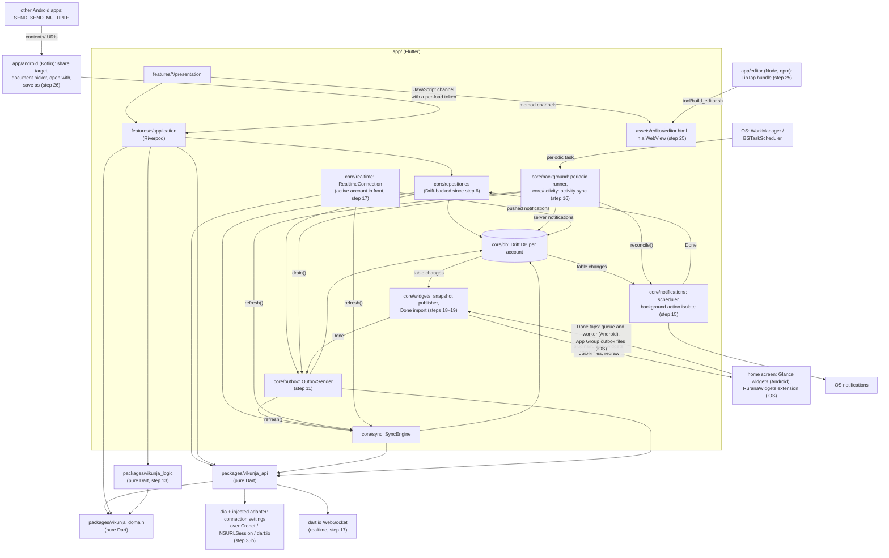

The repository interfaces exist since step 5; step 6 put the database and the sync engine behind them ([D29](decisions.md#d29-ui-reads-through-repository-interfaces-the-online-implementation-is-replaced-by-drift-in-step-6-without-ui-changes), [D31](decisions.md#d31-one-drift-sqlite-file-per-account-shared-across-isolates-deleted-on-sign-out)); step 7 made `refresh()` incremental ([D33](decisions.md#d33-incremental-sync-watermark-on-updated-with-a-120-s-overlap-keyset-over-updated-id-delete-detection-by-per-project-count-check-and-id-reconcile-daily-full-resync)); step 11 added the outbox behind the same interfaces, so a write is a row change plus a queued op that the sender pushes through the write ports ([D34](decisions.md#d34-outbox-local-first-writes-serial-sender-coalescing-retry-classes-sync-interplay-pending-fields-win-until-sent-pending-deletes-hidden-v1-full-replace-emulation), section 7.5); step 12a added creates to it, rows under a temporary id that the sender remaps to the server's ([D35](decisions.md#d35-creates-through-the-outbox-temporary-negative-ids-with-remap-createupdatedelete-coalescing-lost-response-recovery-by-title-within-a-1-h-window)); step 12b put label, assignee and reminder changes into the same update op ([D36](decisions.md#d36-labels-and-assignees-as-id-set-deltas-in-the-task-update-sent-through-their-endpoints-after-a-read-before-write-diff-reminders-as-the-whole-list-label-creation-online-only)); step 13 added `vikunja_logic`, whose quick-add parser the app's quick-add service uses, and the service creates its tasks through the same outbox ([D38](decisions.md#d38-quick-add-the-web-grammar-in-vikunja_logic-with-d19s-fixes-weekday-and-ordinal-dates-at-the-default-time-and-an-unknown-project-kept-in-the-title-a-live-composer-labels-created-online-and-assignees-looked-up-on-submit-the-task-through-the-outbox)); step 15 schedules the OS notifications from the same database and sends a notification's Done through the same outbox from a background isolate ([D39](decisions.md#d39-local-notifications-a-scheduler-per-signed-in-account-plans-from-the-local-database-and-diffs-against-a-rolling-window-with-stable-keys-exact-alarms-when-allowed-done-through-the-outbox-from-a-background-isolate-without-a-token-refresh-snooze-local-only-permissions-asked-once-after-the-first-sync), section 7.7); step 16 runs the same engine, outbox and scheduler for every account from a periodic background job and stores the server's notifications in the same database ([D40](decisions.md#d40-background-sync-one-periodic-job-for-every-signed-in-account-with-a-deadline-skipped-while-the-app-is-in-front-the-incremental-run-as-the-session-keep-alive-a-one-off-drain-after-a-background-done-server-notifications-synced-into-a-local-inbox-on-their-own-cadence-new-unread-ones-as-activity-notifications-the-first-run-silent), section 7.8); step 14 puts relation changes into the same update op, with temporary ids at both ends of an edge, and duplicates and follows tasks online ([D41](decisions.md#d41-relations-as-deltas-in-the-task-update-sent-through-the-relation-endpoints-after-a-read-before-write-diff-temporary-ids-on-both-ends-resolved-at-send-time-the-inverse-rows-kept-locally-duplicate-and-subscriptions-online-only-subtasks-from-indented-quick-add-lines), section 7.5); step 9 builds the lists from the same database the web's way, with view snapshots that the project screen downloads and a download of the Overview's saved filter in every sync run ([D43](decisions.md#d43-task-lists-from-the-local-database-like-the-webs-a-view-snapshot-for-positions-and-server-only-filters-the-overviews-saved-filter-downloaded-by-the-sync-upcoming-with-the-web-presets-and-a-pinned-overdue-part), sections 6, 7.2 and 7.3); step 10 reads what only a single task read carries online and on demand without storing it, renders descriptions and comments from the rich-text parser of `vikunja_logic`, and opens tasks from links, notifications and the inbox through one opener ([D44](decisions.md#d44-task-detail-complete-rich-text-from-an-own-parser-of-the-web-editors-schema-details-and-comments-online-on-demand-deep-links-on-the-app-scheme), sections 4, 6 and 8); step 8 applies the user's web settings to the theme and the formats once they are set, opens the Favorites and saved filters as lists, a saved filter as a downloaded snapshot like a view's, and shows one offline banner from the sync's last outcome ([D45](decisions.md#d45-app-shell-on-wide-android-screens-the-colour-scheme-and-dynamic-colour-the-webs-display-settings-applied-only-when-set-translated-default-names-the-project-tree-with-favourites-saved-filters-and-archived-projects-smart-lists-a-sticky-offline-banner), sections 6, 7 and 8); step 17 opens one WebSocket for the active account while the app is in front, stores the notifications it pushes in the same database as handled and asks the same engine for an incremental run when they name a task or project, while the polling stays ([D46](decisions.md#d46-realtime-in-the-foreground-one-websocket-for-the-active-account-while-the-app-is-in-front-pushed-notifications-stored-at-once-and-a-sync-nudged-for-the-task-they-name-re-auth-on-every-token-change-quiet-fallback-to-polling), sections 4 and 7.9) [exists, step 17]; step 20 opens a project's Kanban views as boards built from per-view board downloads in the same database, which the project screen fetches and the sync never does, and queues moves and positions as placements of the task's update op through the same outbox ([D47](decisions.md#d47-kanban-board-from-per-view-board-snapshots-moves-and-positions-through-the-outbox-with-the-done-buckets-rules-accessible-drag-and-drop), sections 4, 6, 7.1 to 7.3 and 7.5) [exists, step 20]; step 21 changes a board's columns online, outside the outbox, writes the server's answer into the same stored board and view at once and then downloads the board quietly ([D48](decisions.md#d48-bucket-management-online-applied-to-the-local-board-at-once-from-a-column-menu-with-a-guard-against-the-servers-orphaned-tasks), sections 4, 6, 7.1, 7.2 and 7.5) [exists, step 21]; step 22 reorders a list view sorted manually by drag, queuing the positions in the task's update op through the same outbox, and moves projects in the tree online, outside it, writing the server's answer into the stored project at once and then syncing quietly ([D49](decisions.md#d49-manual-ordering-list-views-by-drag-through-the-outbox-projects-reordered-and-nested-online-never-a-project-position-below-01), sections 4, 6, 7.1 to 7.3 and 7.5) [exists, step 22]; step 23 creates, edits, archives, duplicates and deletes projects and manages their views online, outside the outbox, from the project screen's menu, writing the server's answer into the stored projects and views at once (an identifier change also into the stored tasks' identifiers, a delete as a purge of the stored subtree) and then syncing quietly in a run that starts after the write ([D50](decisions.md#d50-project-management-and-views-online-applied-to-the-local-database-at-once-from-the-project-screens-menu), sections 4, 6, 7.1 to 7.3 and 7.5) [exists, step 23]; step 24 evaluates every view filter, saved filter and the Overview's saved filter on the device with the filter engine of `vikunja_logic`, over the stored tasks and the saved filters' definitions, which the sync now reads when a saved filter is new or changed, keeps the downloads only for filters the device cannot evaluate, manages saved filters online, outside the outbox, and searches the database offline ([D51](decisions.md#d51-one-filter-engine-on-the-device-with-the-servers-semantics-saved-filter-definitions-synced-on-change-and-managed-online-a-filter-builder-offline-search), sections 4, 6, 7.1 to 7.3 and 7.5) [exists, step 24]; step 25 edits descriptions in a page built from our own TipTap bundle (`app/editor/`, a new piece beside the Dart packages) that a locked-down WebView shows under a native toolbar, queues a task's description and the checklist ticks of the detail sheet through the same outbox as a description change that keeps the description it started from, which the sender checks against the server's before it writes (ticks are applied again to a description changed on the web, an edit becomes a sync problem to resolve), and saves a project's description online with the same check ([D52](decisions.md#d52-descriptions-edited-in-a-bundled-tiptap-page-in-a-locked-down-webview-with-a-native-toolbar-checklists-ticked-in-place-no-silent-overwrite-of-a-description-changed-on-the-web), sections 4, 6, 7.2, 7.5 and 8) [exists, step 25]; step 26 adds files to tasks through the same outbox as an operation of its own per file, kept in the account's uploads folder until a lane of the sender beside the queue has uploaded it, downloads attachments into the app's cache to open, share and save them through the platform, deletes them and sets the cover online, lets the editor insert an uploaded image, and takes what other Android apps share through an own pass-through activity into a new or an existing task ([D53](decisions.md#d53-attachments-uploaded-through-the-outbox-in-their-own-lane-opened-shared-and-saved-through-the-platform-cover-and-delete-online-and-an-own-android-share-target), sections 4 to 8) [exists, step 26]; step 30 changes the account's own settings, name and avatar online, outside the outbox, from an Account settings page: on 2.7.0 a v2 merge-patch of the changed fields, on older servers a full write built from a fresh read of the server's raw settings that keeps every key the app does not know, never from the stored settings; the answer, read back with `GET /user`, goes into the database at once and a quiet sync follows; every sync's `GET /user` now also stores the profile and puts the name into the account registry, and the password and the email stay on the web's pages ([D54](decisions.md#d54-account-settings-and-profile-edited-in-the-app-with-writes-that-never-wipe-the-webs-settings-the-avatar-managed-password-and-email-left-to-the-web), sections 4 to 8) [exists, step 30]. Step 31 adds the account's security and integration settings to that page, online only and never stored: the two-factor status, the sessions with this device marked and the others ended one by one or all at once, API tokens with the server's permissions and CalDAV tokens created, shown once and deleted, and the data export's status, while setting up and turning off two-factor authentication, the export's request and download and the account's deletion open the web's own pages, because they need the password or a code; a session that turning on two-factor authentication ended and a deleted account ask for a new sign-in at once ([D55](decisions.md#d55-security-and-integration-settings-two-factor-status-sessions-and-tokens-in-the-app-a-new-token-shown-once-export-and-deletion-through-the-web), sections 4 to 8) [exists, step 31]. Step 27 makes the comments a conversation: written, answered with the web's quote, with mentions, edited in the editor page and deleted, online, from a field pinned under the task sheet that keeps an unsent comment on the device; reactions on tasks and comments; the comment count with the web's unread dot on rows and cards from two columns the sync fills; an open sheet that follows the task's changes on the server; and notifications and inbox entries that open the task at their comment ([D57](decisions.md#d57-comments-written-in-the-app-online-with-a-draft-kept-on-the-device-reactions-on-tasks-and-comments-comment-counts-and-the-unread-dot-on-rows), sections 4 to 8) [exists, step 27]. Step 28 manages labels online, applied to the database at once, and teams and a project's people, team and link shares online only, from an Organise section on the Account tab and a Share page per project, and stores the user's permission on each project, which every project screen follows ([D60](decisions.md#d60-labels-managed-online-and-applied-locally-teams-project-shares-and-link-shares-online-only-the-project-permission-stored-and-every-screen-shaped-by-it), sections 4 to 8) [exists, step 28]. Step 29 shows the Table and Gantt views: a table view as a detailed list with the web's columns, chosen once per account, sorted per view in the server's order, and a Gantt view as a read-only timeline with the web's range, filter, rows, bars and relation arrows, both read from the local database like the lists, a download standing in only for a view filter the engine refuses ([D61](decisions.md#d61-the-table-view-as-a-detailed-list-sorted-like-the-server-and-the-gantt-view-as-a-read-only-timeline-with-the-webs-filter-range-rows-bars-and-arrows-both-from-the-local-database), sections 6 and 7) [exists, step 29]. Step 32 adds link-share guests: a link share pasted or shared from another app opens as an account of its own, kept alive by a token renewed through `POST /user/token` and signed in again with the stored hash, synced like a user's account with the shared project's permission from one extra read, and shown with what a guest may do; it also leads from the server overview to the web's pages for a new account and a password reset ([D62](decisions.md#d62-create-account-password-reset-and-invite-links-through-the-browser-sign-in-page-link-share-guests-as-an-account-kind-with-token-renewal-and-a-reduced-ui), sections 3 to 8) [exists, step 32]. Steps 18 and 19 put one list of an account on the home screen: the app writes JSON snapshots through the in-repo plugin `plugins/rurana_widgets`, Glance widgets on Android and a WidgetKit extension on iOS draw them, and a widget's Done comes back through a queue and a headless Dart worker (Android) or App Group files (iOS) into the outbox, exactly once ([D63](decisions.md#d63-home-screen-widgets-from-json-snapshots-the-app-writes-through-an-in-repo-plugin-glance-widgets-on-android-with-done-through-a-headless-dart-worker-a-widgetkit-extension-on-ios-with-an-app-group-outbox-and-no-token), sections 5.8, 6, 7 and 8) [in review, steps 18–19].

## 3. Server connection and v1/v2 negotiation [exists]

`ServerConnector.connect(input)` either returns a `ServerConnection` or throws a `ServerConnectionFailure`. The implementation is `DioServerConnector`.

Since step 32 the Connect screen first checks whether the input is a link share or an invite link (`parseLinkShareUrl`, `parseInviteLink`, section 5.1): it then probes only the link's base, never the link with its secret [exists, step 32].

1. **Normalise the address** (`normalizeServerAddress`):
   - Remove invisible characters that copy and paste brings along (zero-width spaces and joiners, soft hyphens).
   - Accept only `http` and `https`.
   - Convert an international host name to its `xn--` (punycode) form.
   - Cut the path at its last `/api/v1` or `/api/v2`, so a pasted `…/api/v1/info` works. Strip trailing `/` and keep any sub-path.
   - Record whether the user typed a scheme and a port.
   - Invalid input → `InvalidServerAddress`.
   - Based on the web frontend's `apiUrl.ts` and `checkAndSetApiUrl.ts`.
2. **Build the candidate roots, in order:**
   - The address as typed. Without a typed scheme, try `https` first, then `http`.
   - Without a typed port, also try Vikunja's default port 3456, but only after the default port could not be reached at all.
   - Candidates overlap to bound the wait: each one starts when the one before it could not connect, or 2.5 s after that one started. Their outcomes are still used strictly in this order.
   - Each probe waits at most 5 s to connect and 5 s for the response, so an address where nothing answers fails after at most 17.5 s.
3. **Probe each candidate.** Send `GET {root}/api/v2/info` and `GET {root}/api/v1/info` in parallel.
   - A probe counts only if the answer is a 200, JSON, and has a string `version`.
   - Servers older than 2.4.0 answer the v2 probe with 404 and `{"message":"Not Found"}`. That means "no v2", not "not Vikunja".
   - The API versions whose probe counted become `ServerConnection.apiVersions`.
   - If v1 reports 2.4.0 or newer (or an unparseable version) while the v2 probe got no HTTP response, v2 is probed once more. If that also gets no response, the connection fails with that error instead of quietly using v1.
4. **Stop at the first candidate where something answered over HTTP:**
   - At most one redirect is followed per connection attempt. It must keep the probe path (`…/api/v1/info` or `…/api/v2/info`) under another origin or sub-path, or be a same-host `http` → `https` redirect. The root derived from it is probed like any other candidate. A redirect from `https` to `http` is never followed.
   - If the address is a route of the Vikunja web app (the answer is the web app's HTML), up to four parent paths are probed.
   - Only connection-level failures (DNS, connection refused, timeout, a TLS handshake failure) move on to the next candidate. A rejected certificate is not one of them: a TLS server answered, so it ends the search with `TlsFailure`. Since step 35b neither is a refused client certificate nor a request the connection settings stopped, so a server address with settings never falls back to `http` (section 3.1) [exists, step 35b]. A server that answers is never second-guessed on another port or scheme.
   - If nothing counts, the most informative failure is thrown:

   | Failure | Cause |
   |---|---|
   | `ServerUnreachable` | DNS or connection failure |
   | `ServerTimeout` | timeout |
   | `TlsFailure` | certificate or handshake problem; since step 35b also a refused client certificate (`clientCertificateRefused`) [exists, step 35b] |
   | `ServerUnavailable` | a 5xx or 429 instead of `/info` (Vikunja down, restarting or rate limiting, or the proxy cannot reach it) |
   | `BehindLoginProxy` | any other redirect off the host, or to a login-like path; 401; 403 with `WWW-Authenticate`; 407; an HTML login form |
   | `NotAVikunjaServer` | anything else that answers without a Vikunja `/info` |
   | `ConnectionSettingsFailure` | since step 35b: the server address's connection settings stopped the request before it left the device (unencrypted without consent, not available yet, incomplete, damaged; section 3.1); the most informative of all [exists, step 35b] |

5. **Parse `/info`** (`parseServerInfo`). The version is parsed leniently:
   - `v2.7.0` and `v2.7.0-6-ge7d7f173` are both accepted.
   - `dev`, `unstable` and similar sort above every release.
6. **Derive `ServerCapabilities`** from:
   - the reachable API versions;
   - version thresholds;
   - the `/info` flags;
   - `enabled_pro_features` (licence).

   A Vikunja server older than 2.3.0, the support floor ([D13](decisions.md#d13-support-floor-230)), is **not a failure**. It yields a connection with `SupportTier.unsupported`, so the UI can say what it found: the overview shows the header, the badges and a blocking banner that says browser sign-in needs 2.3.0, but no sign-in methods and no server features.
7. **Ask before using `http://`.** If the connection uses `http` (`ServerConnection.isInsecure`), the app shows an "Unencrypted connection" dialog. It uses the server only after the user confirms ([D8](decisions.md#d8-cleartext-policy)). Since step 35b the answer is a consent recorded for the server address, which the transport enforces for every request and the socket and the server's Connection screen can revoke (section 3.1) [exists, step 35b].

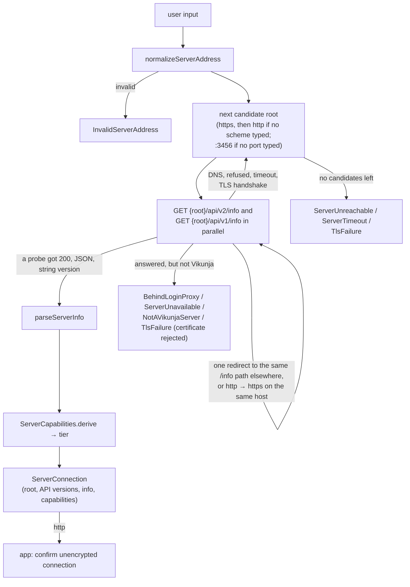

**Support tiers** (`SupportTier`):

| Tier | Servers | Meaning |
|---|---|---|
| `unsupported` | < 2.3.0, or an unparseable version without v2 | Shown, but not usable: browser sign-in needs 2.3.0. No legacy tier is planned. |
| `oauth` | ≥ 2.3.0 (dev builds included) without a reachable `/api/v2`, e.g. 2.3.x, or a newer server whose proxy hides v2 | `/api/v1`; OAuth 2.0 + PKCE sign-in, WebSocket |
| `full` | any server with a reachable `/api/v2` (2.4.0+) | + v2 adapter (PATCH, ETag, envelopes, problem+json) |

**Capability gating rules:**
- Features check a `Capability` and never compare version strings.
  - Development builds report `dev`/`unstable`.
  - A proxy can hide `/api/v2`.
  - Admins can switch features off.
  - Since step 30 `userSettingsMergePatch` (v2 on 2.7.0 and later) decides how the account's settings are written: a merge-patch of the changed fields, else a full write that keeps the keys the app does not know (section 4) [exists, step 30].
  - Since step 31 `totp`, `caldav` and `userDeletion` decide whether the account settings offer two-factor authentication, CalDAV and Delete account; v2 ignores the server's `user_deletion_enabled`, so the app's check is what keeps that row away. The capabilities stored at sign-in are not refreshed while signed in, so a route the server has dropped since reads as "not offered". The one version check there is a safety rule, not a feature gate: the two-factor status is not read from a server before 2.7 over plain `http`, because such a server sends the secret with it (section 6) [exists, step 31].
  - Since step 28 `linkSharing` decides whether a project admin sees the share page's Links (a link share call answered 404 later says that link sharing is off), and `publicTeams` whether teams offer "Public team", show the Public badge and add public teams to the team pick; the stored capabilities stay as they were at sign-in. The confirmations that remove access list the server's cleanup only from 2.7.0 (`serverCleansUpAccess`), the version that brought it (section 6) [exists, step 28].
  - Since step 32 `registration` and `localAuth` decide whether the server overview offers "Create account" and "Forgot password?", and `userInvites` with local accounts but without `registration` adds the note that registration needs an invitation. `linkSharing` answers a share link without a request only on a freshly probed server on which no account is stored; a stored account's capabilities are a snapshot, so the server's 404 decides there (section 5.1) [exists, step 32].
- Licensed features (time tracking, admin panel, audit logs, invites) come only from `enabled_pro_features`. Their routes return a plain 404 when unlicensed.
- `concurrent_writes`:
  - It is reported since 2.4.0 and is `false` on SQLite.
  - A missing value means "unknown", so writes are serialized.
- Re-negotiation [planned; the step 6 sync does not re-negotiate] happens at login, every 24 h, on app update, and after a "route absent" 404.

**Transport rules that already apply:**
- Only `http` and `https`.
- No credentials in URLs.
- `Authorization`, `Cookie`, `Set-Cookie` and tokens are never logged.
- Plain `http://` needs explicit confirmation in the app (step 7 above); since step 35b the transport refuses `http://` and `ws://` to an address without the consent, the pre-consent `/info` probe excepted [exists, step 35b].
- Since step 35b the base `Dio`s follow no redirect either, and access headers go only to their own server address (section 3.1) [exists, step 35b].

### 3.1 Connection settings per server address (`core/network/`) [exists, step 35b]

([D65](decisions.md#d65-connection-settings-per-server-address-in-the-apps-transport-a-certificate-pinned-in-the-tls-handshake-or-a-trusted-ca-certificate-a-client-certificate-access-headers-and-unencrypted-connections-only-with-consent-failing-closed))

- **One server address, the origin** (`OriginKey`): scheme, lower-case host (an IPv6 address without brackets, an international name in its `xn--` form, as `normalizeServerAddress` gives it) and effective port, written `https://host:443`, always with the port and an IPv6 host in brackets; `ws` and `wss` count as `http` and `https`. Servers under different paths of one origin share its settings; the connector's `:3456` candidate is another origin.
- **In the transport:** `createDio(…, profiles:)` wraps the platform adapter (`createPlatformHttpAdapter()`, or a test's own adapter) in `NetworkProfileAdapter`. `dioProvider` and `authDioProvider` each own one over the shared, keepAlive `networkProfilesProvider`, which depends only on `preferencesStoreProvider` and `secureStoreProvider`, and the account `Dio`s borrow the base adapter (section 5.2). So every HTTP request of the app passes it, the frozen token client and session manager included, below the retry, auth and log interceptors, and no object above the transport holds a header value. An edit changes the table in place; the `Dio`s are never rebuilt, because a rebuild would tear down running syncs.
- **Per request** (`NetworkProfileAdapter.fetch`):
  1. `NetworkProfiles.forOrigin` gives the profile with its secrets, or null; its exceptions fail the request as a connection error.
  2. An `http` origin without consent: only the pre-consent probe passes (`preConsentProbeKey` in `extra`, which `vikunja_api`'s `/info` probes set; a `GET` of a path ending in `/api/v1/info` or `/api/v2/info`; no `Authorization`), to the platform adapter without any part of the profile. Anything else throws `CleartextBlockedException`.
  3. No profile, or only a consent: the platform adapter, unchanged.
  4. Headers only: the platform adapter, with the headers merged into a copy of the options (a header the request already has wins, ignoring case) and `followRedirects: false`.
  5. A pin, a CA or a client certificate (`needsDartIo`): an `IOHttpClientAdapter` per origin, cached by revision, pin, CA and client certificate. Its `SecurityContext` (`profileSecurityContext`: no system roots with a pin or a CA, the CA's PEM, the PKCS#12 for both the chain and the key) is built when the adapter is created; one `dart:io` refuses is `ConnectionProfileIncompleteException`. A replaced adapter closes without force; a `StateError` from a closed one is retried once on the current one.
  - Errors leave as `DioException`s with the caller's own options. The connection-settings exceptions and `ClientCertificateRefusedException` pass unchanged; a `FormatException` or `ArgumentError` on a request with headers is `ConnectionProfileIncompleteException`; an error whose text quotes a stored header value or the password (8 characters or more, `secret_scrubbing.dart`) keeps its `DioExceptionType` with a stand-in of its kind that has no text.
- **Pin** (`profileHttpClient`, `pinnedCertificateCheck`): `badCertificateCallback` accepts only the origin's host and port with the pinned SHA-256 over the leaf's DER, on every new connection, before any HTTP byte. Another leaf is recorded through `recordPinMismatch` (once per certificate, no revision change) and the handshake fails: `TlsFailure(certificateRejected: true)` while connecting, `NetworkFailure(tls)` later. A pin and a CA exclude each other.
- **Refused client certificate:** on the `dart:io` path of an `https` origin, an `HttpException` before the response starts a check that sends no HTTP: a `SecureSocket` with the profile's context and pin check (5 s), then up to 3 s for the server to hang up. A hang-up, or a handshake failing with a client-certificate alert, confirms it (`ClientCertificateRefusedException`); anything else leaves the original error. The result is kept 10 s per origin.
- **Storage** (`NetworkProfiles`, `NetworkProfileSecrets`):
  - Preferences, key `network.profiles`: `{schemaVersion: 1, cleartextMigrated, revisionCounter, profiles: {<origin key>: {revision, pin, caCertificate, clientCertificate, headerNames, cleartextConsentAt, lastPinMismatch}}}`. The pin and the mismatch keep the certificate's SHA-256, subject, issuer and validity, the CA its file name and PEM (public), the client certificate its file name and import date. Unknown fields and entries are written back.
  - Secure storage: `network_profile.<id>.secrets` (id: the first 32 hex characters of the SHA-256 of the origin key) with the header values, the PKCS#12 file in base64 and its password, read only when the entry names headers or a client certificate, so settings with only a pin, a CA or a consent need no secure read. Secrets are written before the metadata and deleted after it, with D24's accessibility (section 5.3).
  - Every write runs under a lock shared by the isolate, reads the stored JSON afresh, changes only its origin and announces the change in the isolate (`changes`). A revision grows with every edit, never with a mismatch record, and is never reused for an origin forgotten and set up again.
- **Loading:** lazily, at the first request of each container; the UI, the background runs, the notification actions and the widget worker need no override. Metadata is cached for 30 s or until this isolate writes, successful secret reads per origin and revision; after a failed read the next try waits 5 s, failing fast meanwhile; concurrent first reads share one.
- **Fail closed:**
  - Preferences or secure storage not readable (before the first unlock): `ConnectionProfileLockedException`, transient.
  - Damaged metadata (not JSON, a newer schema, an unreadable entry, a pin with a CA): `ConnectionProfilesDamagedException` for every origin and every edit until `resetAll()`, which writes empty settings, deletes the secrets of every origin it can name and gives no consent again.
  - Missing or unusable secrets: `ConnectionProfileIncompleteException` ("needs re-entry").
- **Cleartext migration:** the first load gives the consent once to each registry account, user or guest, on an `http` origin without an entry (`cleartextMigrated`). It reads the registry through an `AccountRegistry` of its own and never changes an existing entry, so a revoked consent stays revoked.
- **Failures** (`transportFailure` in `vikunja_api`): the five exceptions by type to `ConnectionSettingsFailure` (`cleartextBlocked`, `locked`, `incomplete`, `damaged`) or `TlsFailure(clientCertificateRefused: true)`, and the platforms' client-certificate errors and BoringSSL's received alerts by marker. Neither is connection-level (step 4 above). Later they are `NetworkFailure`s with `NetworkProblem.clientCertificate`, `cleartextBlocked`, `profileLocked`, `profileIncomplete` or `profileDamaged` (`concernsConnectionSettings`): the outbox keeps the work queued (section 7.5), `RetryInterceptor` does not retry them, and `offlineAfter`, the list notices (`refreshable_list.dart`) and the team pages do not call them offline.
- **Realtime:** `ProfileRealtimeConnector` applies the same settings to each upgrade (section 7.9).
- **Screens:** the Connection screen, the Connect screen's actions and the browser hint are in section 6, forgetting the settings with the last account in section 5.6.
- **Tests:** `test/core/network/` with local TLS servers from `test/fixtures/tls/` (`test/helpers/tls_fixtures.dart`, among them a `SecureServerSocket` that requires a client certificate), `test/core/realtime/profile_realtime_connector_test.dart`, `test/features/connection/`, and the opt-in Docker test `test/core/network/tls_docker_test.dart` (tag `tls-docker`, `RURANA_TLS_DOCKER=1`) against the profile `tls` (section 8).

## 4. API abstraction [read client exists, step 5; task write ports exist, steps 11 and 12a; label and assignee requests, label create and user search exist, step 12b; notification ports exist, step 16; relation requests, duplicate and subscription ports exist, step 14; avatar port exists, step 9; task details, by-index, comment, attachment and mark-read requests exists, step 10; realtime port exists, step 17; buckets port and kanban moves and positions exists, step 20; bucket and view write ports exists, step 21; project move port and list positions exists, step 22; project and view management ports exists, step 23; saved filter ports exists, step 24; description rebase hooks exists, step 25; attachment write port, download and cover exists, step 26; user settings and avatar port exists, step 30; account security port exists, step 31; comment and reaction write ports and the permission in the details, exists, step 27; teams and project sharing ports, label update and delete, user search and the project permission, exists, step 28; link-share sign-in, renewal and invite check, exists, step 32; routed client planned]

Step 5 built the read half: `VikunjaReadClient` with the ports `ProjectsPort`, `LabelsPort` and `TasksPort`, created by `createReadClient(dio:, connection:)` over the account's authenticated `Dio` (section 5.2). It uses `/api/v2` when the connection reached it and `/api/v1` otherwise, and hides the version differences inside one `ReadClient` (section 6). Step 12b added `UsersPort.searchProjectUsers(projectId, {query})` as `VikunjaReadClient.users`, for the people picker: everyone with access to the project (owner, shares, teams) matching the query, in one page, never paged; an empty query is left out and lists them all. Step 16 added `NotificationsPort.list` as `VikunjaReadClient.notifications`, the user's server notifications, newest first (section 7.8). Step 14 added `SubscriptionsPort` as `VikunjaReadClient.subscriptions`: `forTask(id)` and `forProject(id)` return the subscription that covers the task or project (its own, or one inherited from a parent project, which it then names), null when there is none, from `GET /tasks/{id}` and `GET /projects/{id}`, the only reads that carry it [exists, step 14]. Step 9 adds `AvatarsPort` as `VikunjaReadClient.avatars`: `fetch(username, size:)` reads `GET /avatar/{username}?size=` as bytes with their media type (`AvatarImage`: PNG, JPEG or, for some avatar providers, SVG); an unknown username gets the server's placeholder, and an answer that is not an image or is empty throws `UnexpectedResponse` [exists, step 9]. Step 10 adds what the detail sheet reads ([D44](decisions.md#d44-task-detail-complete-rich-text-from-an-own-parser-of-the-web-editors-schema-details-and-comments-online-on-demand-deep-links-on-the-app-scheme)) [exists, step 10]:
- `TasksPort.readDetails(id)`: one `GET /tasks/{id}` with the repeated `expand=reactions`, `comment_count` and `is_unread`, parsed into `TaskDetails`: the attachments (`TaskAttachment`, from the task's `attachments` with `file.*` flattened), the cover attachment id (0 for none; it may name an attachment that is gone), the reactions (`Reactions`, each value with the users who gave it), the comment count, the unread flag (the server sends `is_unread` only when it is true) and the subscription. Since step 27 also the user's permission on the task's project (`TaskDetails.maxPermission`): v2's `max_permission`, else v1's `x-max-permission` header, null when neither says; it stays `admin` for the owner of an archived project, which refuses every write all the same [exists, step 27].
- `TasksPort.readByIndex(project, index)`: `GET /projects/{project}/tasks/by-index/{index}`, where `project` is a numeric project id or an identifier in any case, percent-encoded by the port. On v2 an index the task had before it moved to another project answers a 307; the port follows it once (section 5.2). An unknown project or index is `NotFound`, an unreadable project `Forbidden`; the identifiers `.` and `..` cannot be put in a path and are `NotFound` without a request.
- `CommentsPort.list(taskId, page:, newestFirst:)` as `VikunjaReadClient.comments`: one page of `GET /tasks/{id}/comments` with `order_by` `asc` or `desc` (at most the server's `max_items_per_page`), each `TaskComment` with its author, times and reactions. The server sorts by `created`, which it keeps to the second, so the port sorts each page by `(created, id)` itself. A task on a server with comments switched off answers `NotFound`.
- `AttachmentsPort.fetch(taskId, attachmentId, preview:)` as `VikunjaReadClient.attachments`: `GET /tasks/{task}/attachments/{id}`, the original or, with an `AttachmentPreviewSize` (`sm`, `md`, `lg`, `xl`: 100, 200, 400 or 800 px wide), a PNG preview. The server answers the original for anything it cannot preview (SVG included), so the caller checks `AttachmentBlob.contentType`. The body streams in and is refused with `UnexpectedResponse` above `maxAttachmentBytes` (25 MB), by its `Content-Length` or by what arrives; the connection is then cancelled. A missing attachment is `NotFound`, a foreign one `Forbidden`.

Step 11 added the first write half: `VikunjaWriteClient` with `TasksWritePort` (`update(id, TaskChanges)`, which returns the task as the server stored it, and `delete(id)`), created by `createWriteClient(dio:, connection:)` over the same `Dio` and chosen the same way, v2 when the connection reached it (section 7.5). Step 12a added `create(NewTask)` to the port, which returns the created task with the server's id, `index` and `identifier`. Step 12b extended `update` by `reminders` in the body and by the task's label and assignee endpoints, which it calls after reading the task, only for the ids whose state differs, then reads the task back; and it added `LabelsWritePort.create(NewLabel)` as `VikunjaWriteClient.labels` (section 7.5). Step 16 added `NotificationsWritePort` (`markRead`, `markAllRead`) as `VikunjaWriteClient.notifications` (section 7.8). Step 14 extended `update` by relation changes, sent through the task's relation endpoints after the same read, only for the edges that differ; added `duplicate(id)`, which returns the server's copy of the task; and added `SubscriptionsWritePort` (`subscribe` and `unsubscribe` of a task or a project) as `VikunjaWriteClient.subscriptions` (section 7.5, [D41](decisions.md#d41-relations-as-deltas-in-the-task-update-sent-through-the-relation-endpoints-after-a-read-before-write-diff-temporary-ids-on-both-ends-resolved-at-send-time-the-inverse-rows-kept-locally-duplicate-and-subscriptions-online-only-subtasks-from-indented-quick-add-lines)) [exists, step 14]. Step 10 adds `TasksWritePort.markRead(id)`, v2 `PUT` and v1 `POST /tasks/{id}/read`, which clears the task's unread flag; the server answers 200 for a read, a missing and an inaccessible task alike, so there is nothing to tolerate [exists, step 10]. Step 20 extends `update` by `TaskChanges.kanban`, the bucket placements per view, sent after everything else (below) [exists, step 20]. Step 21 adds `BucketsWritePort` as `VikunjaWriteClient.buckets` and `ProjectViewsWritePort` as `VikunjaWriteClient.views` (below) [exists, step 21]. Step 22 extends `update` by `TaskChanges.positions`, the list positions per view, and adds `ProjectsWritePort` as `VikunjaWriteClient.projects` (below) [exists, step 22]. Step 23 adds the rest of `ProjectsWritePort` and of `ProjectViewsWritePort` (below) [exists, step 23]. Step 24 adds `SavedFiltersPort` as `VikunjaWriteClient.savedFilters`, and its read alone as `SavedFiltersReadPort` on `VikunjaReadClient.savedFilters` (below) [exists, step 24]. Step 25 gives `TasksWritePort.update` and `ProjectsWritePort.update` a `rebaseDescription` hook and `ProjectChanges` its description (below) [exists, step 25]. Step 26 adds `AttachmentsWritePort` as `VikunjaWriteClient.attachments`, `AttachmentsPort.download` and `TaskChanges.coverImageAttachmentId` in the task update (below) [exists, step 26]. Step 30 adds `UserSettingsWritePort`, from `createUserSettingsWritePort` beside the write client, for the account's settings and avatar (below) [exists, step 30]. Step 31 adds `AccountSecurityPort`, from `createAccountSecurityPort` beside them, for the account's two-factor status, sessions, API and CalDAV tokens and data export (below) [exists, step 31]. Step 27 adds `CommentsWritePort` as `VikunjaWriteClient.comments` and `ReactionsWritePort` as `VikunjaWriteClient.reactions` (below) [exists, step 27]. Step 28 adds `LabelsWritePort.update` and `delete`, `UsersPort.searchUsers`, and `TeamsPort` and `ProjectSharingPort`, from `createTeamsPort` and `createProjectSharingPort` beside the write client (below) [exists, step 28]. The remaining per-area ports (a project's background and webhooks, …) come with the steps that need them. A `RoutedVikunjaClient` that picks the v2 or the v1 adapter per `ApiGroup` is still planned:
- **v2 wins whenever it exists.** It offers PATCH (no full-replace hazard), totals, ETag and problem+json.
- **A 404 without a Vikunja error `code`** on a core group means the route is absent. That group is downgraded to v1 and the request is re-sent.
- **On licence-gated groups** the same 404 means `FeatureUnavailable`.

Step 17 adds the realtime port (`lib/src/realtime/`, [D46](decisions.md#d46-realtime-in-the-foreground-one-websocket-for-the-active-account-while-the-app-is-in-front-pushed-notifications-stored-at-once-and-a-sync-nudged-for-the-task-they-name-re-auth-on-every-token-change-quiet-fallback-to-polling)) [exists, step 17], beside the clients, because it is no REST and needs no `Dio`. `realtimeUri(connection)` is `apiBaseUri(preferredApiVersion)` with `ws` or `wss` and `/ws` appended, sub-path and port kept: `/api/v2/ws` on servers with v2, `/api/v1/ws` otherwise (2.3+, the same protocol). `IoRealtimeConnector.connect(url, headers:)` upgrades by hand over dart:io's `HttpClient` (a GET with the upgrade headers, redirects not followed, no `Origin`, since the server refuses a foreign one with 403), because `WebSocket.connect` hides the status and `Retry-After` of a refused upgrade: any answer but 101 throws `RealtimeUpgradeRefused(statusCode, retryAfter:)` (`retryAfter` only for a 429, read by `retryAfterFromHeaders`, the parser of `retryAfterOf` over a plain header lookup); a 101 without `Upgrade: websocket` or with a wrong `Sec-WebSocket-Accept` throws a `WebSocketException`; everything else is a plain I/O exception (`SocketException`, `HttpException`, `HandshakeException`, and `TimeoutException` after 15 s for TCP, TLS and the 101 together), never a `VikunjaFailure`. The detached socket becomes a client `WebSocket` without compression that pings every 25 s; the server's own pings every 30 s are answered regardless. `RealtimeSocket` has `messages` (single-subscription, done when the socket closes), `authenticate(token)` (the first auth, and a re-auth of the open socket), `subscribe(event)`, `closeCode` and `closeReason` (null for a connection that ended without a close frame, a read error such as a reset included) and `close([code])`; sending after a close does nothing. The codec turns each frame into a sealed `RealtimeMessage` and never throws: `RealtimeAuthSucceeded` (`{"action":"auth.success"}`), `RealtimeError(code, event:)` (`invalid_token`, `auth_required`, `invalid_event` or a code it does not know), `RealtimeNotification(ServerNotification)` for `notification.created`, whose `data` the notifications list parser reads, because it equals the item of `GET /notifications` on both versions, and `RealtimeUnknown` for anything else, malformed frames included. `vikunja_api` logs nothing, and a notification's `toString()` names only its id and kind. The app's use of it is section 7.9.

Step 20 adds the kanban read path that [D30](decisions.md#d30-kanban-board-reads-deferred-to-step-20) deferred, and the kanban writes ([D47](decisions.md#d47-kanban-board-from-per-view-board-snapshots-moves-and-positions-through-the-outbox-with-the-done-buckets-rules-accessible-drag-and-drop)) [exists, step 20]. `BucketsPort` as `VikunjaReadClient.buckets`: `board(projectId, viewId, perPage:, filterTimezone:)` reads a kanban view's board into `BoardBucket`s, each the `Bucket` (title, limit, `count`, the bucket's real total, position) with its first `perPage` tasks in the server's order (position, then id), each task with its position in the view and the bucket as `bucketId`; `per_page` applies to every bucket on its own, capped by the server at its `max_items_per_page`; an empty bucket has no `tasks` key and v2's `null` collections are empty; a filter-mode view answers synthetic buckets with the ids 0 to n−1; a view that is not a kanban view is `UnexpectedResponse`. `bucketTasks(projectId, viewId, bucketId, page:, perPage:, filterTimezone:)` reads one more page of a bucket as a `Page<Task>` from the view's tasks endpoint with `filter=bucket_id = N`, sorted by position; the server sends `bucket_id: 0` on those tasks, so the port takes the bucket from the request. The codecs are `parseBucket`, `bucketTasksOf` and `parseBucketMove` (`dto/bucket_codec.dart`). The writes ride `TasksWritePort.update`: after the body (with `done`) and the label, assignee and relation requests, per view of `TaskChanges.kanban` the move into the bucket of the project the task is in after the body, and then, when the placement has a position and the move's top-level `bucket_id` is the target, the position; a repeating task moved into a done bucket reopens in the default bucket, where a position would be for the wrong bucket. A placement alone costs the read the port makes without a body, the move and the position. The task is read back only when the move's echo of the task has another `updated` than the task as the port had it (a move into or out of a done bucket, a repeating task reopened); a plain move changes nothing on the task. A move into the bucket the task is in answers `task: null` and changes nothing, so a resend is harmless. A full bucket fails as `DomainError` 10004, a bucket that is gone as `NotFound` 10001 (3014 when the server finds no view for it), a bucket that is not the view's as `DomainError` 10002, and a filter-mode view's synthetic buckets like missing ones.

Step 21 adds the writes of a board's columns ([D48](decisions.md#d48-bucket-management-online-applied-to-the-local-board-at-once-from-a-column-menu-with-a-guard-against-the-servers-orphaned-tasks)) [exists, step 21]. `BucketsWritePort` as `VikunjaWriteClient.buckets`: `create(projectId, viewId, title:, limit:, position:)` returns the server's bucket with count 0 (without a position the server picks id × 65536, usually the rightmost; not idempotent); `update(projectId, viewId, bucketId:, title:, limit:, position:)` always sends all three, because the server replaces them together and stores 0 for one left out, and returns what was sent, since the answer's count and dates are not the stored ones; `delete(projectId, viewId, bucketId)`, where a bucket already gone (404 code 10001) counts as deleted. The body (`encodeBucket`) never carries an `id` or a `project_view_id`, which v1 would let override the URL's. `ProjectViewsWritePort.setBuckets(projectId, viewId, doneBucketId:, defaultBucketId:)` changes only the ids given, 0 clearing one, and returns the view as stored: on v2 a `PATCH` merge-patch with only those ids, an unchanged view's 304 followed by a read; on v1, whose only update is a full replace that turns a view sent without `view_kind` into a list view, a read of the view posted back whole with the change; with no id given, only the read. An empty title is `ValidationFailed` (v1 412 code 2002, v2 422), the last bucket of a view `DomainError` 10003, a bucket change in an archived project 3008 (the view change succeeds there), a bucket of another view on the view change 10002, where an unknown id is stored as 0; a read share gets 403 for everything, a write share for the view change only, which needs a project admin.

Step 22 adds the writes of manual ordering ([D49](decisions.md#d49-manual-ordering-list-views-by-drag-through-the-outbox-projects-reordered-and-nested-online-never-a-project-position-below-01)) [exists, step 22]. `TasksWritePort.update` sends `TaskChanges.positions` last, after the kanban placements: per view one position through the board's endpoint (`/tasks/{id}/position`, `{project_view_id, position}`), without a read-back, since a position bumps no `updated`; the first refusal ends the update before the next view. A position alone costs the read the port makes without a body and one request per view. The server may store another value (it spreads equal positions apart, and below 0.01 it recalculates the view); done tasks a view's filter hides keep and take part in its positions. A view the task cannot be placed in (a read share, another project's view, a saved filter's view whose filter the task does not match) is `Forbidden`, a view that is gone `NotFound` 3014. `ProjectsWritePort.move(projectId, position:, parentProjectId:)` puts a project at a position under a parent (0 for the top level, always sent) and returns it as stored, every other field kept: on v2 a `PATCH` merge-patch with only `position` and `parent_project_id`, an unchanged project's 304 followed by a read; on v1, whose only update is a full replace that clears the colour and identifier left out, resets the favourite and archived flags and renumbers the siblings when the position is left out, a read of the project posted back whole with the two fields changed. A position below 0.1, infinite or NaN is an `ArgumentError` before any request: below 0.1 the server renumbers every sibling under that parent and bumps their `updated`, at the top level, by the source, those of every user on the instance. A reorder needs write permission, a parent change admin permission on the project and the new parent (`Forbidden` code 1 otherwise); the project itself as the parent is `DomainError` 3010, one of its descendants 3011, a pseudo project 3009, an archived project or parent 3008, a project or parent that does not exist `NotFound` 3001. A parent change keeps the position, and a move bumps the project's `updated`.

Step 23 adds project and view management ([D50](decisions.md#d50-project-management-and-views-online-applied-to-the-local-database-at-once-from-the-project-screens-menu)) [exists, step 23]. `ProjectsWritePort.create(NewProject)` sends only the title, a parent other than 0 and a colour (`hex_color` without `#`), not idempotent, and returns the project at the server's position (id × 65536) with its four default views (List with `done = false`, Gantt, Table, Kanban with To-Do, Doing and Done); an archived parent is `DomainError` 3008, a pseudo one 3009, one without write permission `Forbidden`, one that does not exist `NotFound` 3001. `update(projectId, ProjectChanges)` sends only the set fields (an empty colour or identifier clears it) and returns the project as stored, through `patchOrReplace`, the write transport's update that `move` and `setBuckets` now share: on v2 a `PATCH` merge-patch, an unchanged object's 304 followed by a read; on v1 a read of the object posted back whole with the changes, so position, favourite, archive state, identifier, colour and description stay; empty changes are a read, and a position below 0.1, infinite or NaN is an `ArgumentError` before any request, as for `move`. An identifier any project on the instance uses is `DomainError` 3007; it is stored upper-case, and a change renames every task's identifier without bumping the tasks' `updated`. An archived project refuses everything but unarchiving with 3008, unarchiving under an archived parent is 3016, archiving the owner's default project 3013; archiving and unarchiving cascade to every descendant and bump their `updated`; the favourite is per user and refused on an archived project. `delete(projectId)` deletes the project's tasks and its whole subtree, other users' projects in it included, needs admin (`Forbidden`), refuses another user's default project with 3012, and counts a project already gone (404 code 3001) as deleted. `duplicate(projectId, parentProjectId:, copyShares:)` sends `{parent_project_id, duplicate_shares}` and returns the copy the server filled in the same request ("*title* - duplicate" without an identifier, at the source's position, with its tasks, done ones included, views, buckets and positions, without subprojects and the favourite; the shares only with `copyShares`); read permission on the source and write permission on the parent are enough; a pseudo project (an id below 1) is an `ArgumentError` before any request, because the server would copy its tasks into a broken real project. `ProjectViewsWritePort.create(projectId, ViewDraft)` never sends a `project_id` (v1 would create the view in that project), nor a filter, mode or position the draft does not have; a board without a mode becomes manual with To-Do, Doing and Done. `update(projectId, viewId, ViewDraft)` always sends title, kind and filter (every key of the filter, so a merge-patch replaces the stored one; none clears it), the mode and position when set, through `patchOrReplace`; a kind change keeps a board's buckets. `move(projectId, viewId, position:)` sends the position alone (any value, never renumbered), so a kind, filter or mode changed elsewhere is not written back. `delete(projectId, viewId)` counts a view already gone (404 code 3014) as deleted; the server deletes a project's last view too. The view writes need project admin (`Forbidden` for a write share) and work on archived projects; a filter the server cannot parse is `DomainError` 4024, a bad value 4019, an unknown field 4016, and an unknown view or one of another project `NotFound` 3014. The bodies come from `encodeNewProject`, `encodeProjectChanges`, `encodeNewView` and `encodeViewChanges` (`dto/project_codec.dart`).

Step 24 adds saved filters ([D51](decisions.md#d51-one-filter-engine-on-the-device-with-the-servers-semantics-saved-filter-definitions-synced-on-change-and-managed-online-a-filter-builder-offline-search)) [exists, step 24]. `SavedFiltersReadPort.read(id)` as `VikunjaReadClient.savedFilters` reads `GET /filters/{id}` on both versions into a `SavedFilter` (title, description, the `ViewFilter` of its `filters` with include-nulls, search and sort, the favourite, a `filter_timezone` when the server sends one, created and updated): the only place the definition comes from, since the project list names a saved filter as the pseudo project −id−1 without it and there is no list endpoint; another user's is `Forbidden`, an unknown id `NotFound` 11001. `SavedFiltersPort` as `VikunjaWriteClient.savedFilters` has the same `read` and `create(SavedFilterDraft)` (v2 `POST`, v1 `PUT /filters`, not idempotent), `update(id, SavedFilterDraft)` with every field of the draft through `patchOrReplace` (a v2 merge-patch, a 304 followed by a read; on v1 a read posted back whole with the draft overlaid, which keeps what the app does not model), `setFavorite(id, favorite:)` (only the flag, the same way) and `delete(id)` (one already gone, 404 code 11001, counts as deleted; the server keeps its views). The body (`encodeSavedFilterDraft`, `dto/saved_filter_codec.dart`, beside `parseSavedFilter`) is the title, the description, the filter with every key (`encodeViewFilter`, now shared with the views, as is `parseViewFilter`) and the favourite, never a timezone, which v2 refuses and v1 drops. The server checks the filter on every write like a view's (`DomainError` 4024, 4019, 4016); v1 refuses a `filters` object with nothing set as a 412 code 2002, while an empty filter text with every key sent is accepted, so the form requires one.

Step 25 adds the description writes ([D52](decisions.md#d52-descriptions-edited-in-a-bundled-tiptap-page-in-a-locked-down-webview-with-a-native-toolbar-checklists-ticked-in-place-no-silent-overwrite-of-a-description-changed-on-the-web)) [exists, step 25]. `TaskChanges.descriptionBase` and `checklistToggles` are never sent. `TasksWritePort.update(id, changes, rebaseDescription:)`: with the hook and a `description`, the description sent is what the hook returns for the description the server has right before the write; v1 passes the description of the read its full replace makes anyway, v2 reads the task once (`GET /tasks/{id}`) and then patches; whatever the hook throws ends the call before any write (the app throws `DescriptionConflict`, section 7.5). Without the hook or without a description nothing is read for it. `ProjectChanges.description` goes into the body (`encodeProjectChanges`), and `ProjectsWritePort.update(projectId, changes, rebaseDescription:)` reads the project first on both versions, then sends a v2 merge-patch with the rebased description or posts the read back whole with it on v1. The server stores the editor's HTML byte for byte, an emptied description as written (`

`), without a length limit; it has no preconditions, so a change on the web between the read and the write is still overwritten.

Step 26 adds attachments ([D53](decisions.md#d53-attachments-uploaded-through-the-outbox-in-their-own-lane-opened-shared-and-saved-through-the-platform-cover-and-delete-online-and-an-own-android-share-target)) [exists, step 26]. `AttachmentsWritePort` as `VikunjaWriteClient.attachments`: `upload(taskId, fileName:, bytes:, length:, mimeType:, timeout:, cancel:)` sends one multipart part `files` per request (v2 `POST`, v1 `PUT /tasks/{id}/attachments`), because a per-file error names no file and the server's body limit counts every file together; `bytes` must be exactly `length` long and is read once, so the request carries `AuthInterceptor.bodyReadOnceKey`, and a 401 code 11 refreshes the token for the next request without repeating this one. The server keeps the name as sent but for what precedes a `/`, so a blank one, which it would take for no file, goes as `file`; it sniffs the type from the bytes, so `mimeType` only labels the part. The answer `{errors, success}` may hold `null` lists: the first attachment of `success` is returned, a per-file error is `FileTooLarge` for 4012, a `DomainError` 400 for another code and a `ServerFailure` without one. A file above the limit is `FileTooLarge`: the per-file 4012, a 413 (4035 from Vikunja; a proxy's without a code is taken for 4035), a connection closed while the body was sent (a broken pipe or a reset, as dart:io, Cronet and URLSession report it) only when the body is longer than the server takes, its limit plus 2 MiB, and that limit is known (`ServerInfo.maxFileSizeBytes`, the configured `max_file_size` rounded down to whole MiB as the server enforces it, 20 MiB under one), otherwise a `NetworkFailure`, and a body the native transport has no memory for (Cronet's "not enough memory for request body", an `OutOfMemoryError`). `timeout` bounds sending the body and, again, the wait for the answer; null keeps the client's defaults, which suit only small files. An error of `bytes` is rethrown as it is, a cancel as its `DioException`. Not idempotent: every call adds an attachment, also under a name the task has already. `delete(taskId, attachmentId)` counts one already gone (404 code 4011) as deleted. `AttachmentsPort.download(taskId, attachmentId, target:, cancel:)` on `VikunjaReadClient.attachments` streams the original into `<target>.part` and renames it when complete, so `target` only ever holds a whole file; a part left by a cancelled or broken-off download is resumed with `Range: bytes=<n>-` (a 206 whose `Content-Range` starts elsewhere drops the part as `UnexpectedResponse`, a 416 drops it and reads anew, a 200 replaces it); the name of `Content-Disposition` is never used, the caller names the file; the parent folder is created; a missing attachment is `NotFound` 4011, a foreign one `Forbidden`, a body that breaks off a `NetworkFailure` that keeps the part, a failed write to disk rethrown as it is, and the caller's cancel keeps the part too. `TaskChanges.coverImageAttachmentId` goes into the task update's body like the other fields (`cover_image_attachment_id`, 0 clearing it; on v1 overlaid into the full replace). Deleting the cover attachment leaves its id on the task, and every later update that does not clear it, a v2 merge-patch or a v1 full replace, is a `DomainError` 4020, as is an id that is none of the task's attachments. Upload and delete need write permission (`Forbidden` for a read share; any writer may delete anyone's attachment), refuse an archived project with 3008 and a missing task with `NotFound` 4002; a server with attachments switched off answers every attachment route with a `NotFound` without a code.

Step 30 adds the account's own settings and avatar ([D54](decisions.md#d54-account-settings-and-profile-edited-in-the-app-with-writes-that-never-wipe-the-webs-settings-the-avatar-managed-password-and-email-left-to-the-web)) [exists, step 30]. `UserSettingsWritePort` comes from `createUserSettingsWritePort(dio:, connection:)` over the account's `Dio`, beside the write client and on the same preferred version. `update(UserSettingsChanges)` writes only what the changes set and returns the profile and the settings as stored (`UserSettingsWriteResult`), read back with `GET /user` after every write, since no write answer carries them; empty changes only read. Where `Capability.userSettingsMergePatch` holds (v2 on 2.7.0 and later) it sends one `PATCH /user/settings/general` merge-patch of the changed fields, the web's keys (`quick_add_magic_mode`, `filter_id_used_on_overview`, `minimum_priority`, `date_display`, `time_format`, `color_schema`, `default_view`, …) inside `frontend_settings`, which the server merges deeply, a cleared one as `null`, which removes the key, and a cleared default project as 0; an unchanged state answers 304, a success, and a 405 (a server without the merge-patch after all) falls back to the full write. Everywhere else (2.4 to 2.6 on v2, 2.3 on v1) a write replaces every setting, a field left out reset and a `frontend_settings` left out wiping every web setting: the port reads the raw settings fresh (`GET /user`), applies the changes to that JSON, keeping every key it does not know and merging `frontend_settings` key by key, leaves out the read-only `$schema` and `extra_settings_links`, and writes the object whole, v2 `PUT` or v1 `POST /user/settings/general`; never from the app's stored settings, which keep only what the app models. The server keeps no order between overlapping writes, so callers send one at a time. Refusals: a timezone the server cannot load is a `DomainError` 1025 (names are case-sensitive; an empty one stores the server's default), a default project that is archived, missing or not writable 3017, a week start outside 0–6 or an overdue time that is not `H:MM` a `ValidationFailed` naming the field (v1 code 2002, none for v2's own schema check); the name and the language are not checked. `avatarProvider()` reads v2 `GET /user/settings/avatar/provider` or v1 `GET /user/settings/avatar` (null for a value the client does not know, an empty one as `default`); `setAvatarProvider` writes v2 `PUT` or v1 `POST` on the same paths, a value the server does not know a `DomainError` 1018, the sign-in providers' `ldap` and `openid` an `ArgumentError` before any request; `upload` without an uploaded image would make the server fail every avatar request, so the app sets it only by uploading. `uploadAvatar(fileName:, bytes:, length:, timeout:)` sends one multipart part `avatar` (v2 `PUT /user/settings/avatar`, v1 `PUT /user/settings/avatar/upload`), read once, a blank name sent as `avatar`; the server sniffs PNG, JPEG, GIF, BMP, TIFF and WebP from the bytes, fits the image into 1024 × 1024 keeping its aspect ratio, ignores the EXIF orientation, stores a PNG and makes `upload` the provider; anything else is a `ValidationFailed` naming `avatar` (the server's 400 without a code), more than 50 megapixels a `DomainError` 4032, a body above the request limit `FileTooLarge`, and an error of `bytes` is rethrown as it is. A provider change and an upload bump the user's `updated`, the only sign of a new avatar, since avatar answers are `no-store` without an ETag. `AccountApi.currentUserWithProfile()` reads `GET /user` once into the user, the settings and the `UserProfile` (`parseUserProfile`: the name, `is_local_user`, `auth_provider`, `pending_email` and `updated`; the server never sends the current email), and `parseUserSettings` also reads the name, the email reminders, the discoverable flags and the overdue reminders with their time. The password and email routes are never called: the app opens the web's pages for them (section 6), and their error bodies would echo the submitted password. The write client's transport moved into `write/write_transport.dart` (`WriteTransport`), which both share.

Step 31 adds the account's security and integration settings ([D55](decisions.md#d55-security-and-integration-settings-two-factor-status-sessions-and-tokens-in-the-app-a-new-token-shown-once-export-and-deletion-through-the-web)) [exists, step 31]. `AccountSecurityPort` comes from `createAccountSecurityPort(dio:, connection:)` over the account's `Dio`, on the write transport, which gained query parameters, and the connection's preferred version: every endpoint here came with v2 in 2.4.0, and 2.3 has v1. Every call needs a user session, which the app's OAuth access token is (an API token gets `TokenRejected`), and none needs a password or a code, which is why the app calls exactly these. `totpStatus()` reads `GET /user/settings/totp`: 412 code 1016 is `notSetUp`, `enabled` true is `enabled`, a secret without it `setupStarted`; only whether a secret is present is read, never the secret or its url, which servers before 2.7 send even while two-factor authentication is on; an account of OIDC or LDAP is a `DomainError` 1021, and a server with two-factor authentication off has no route (`NotFound` with `routeAbsent`). `sessions()` reads `GET /user/sessions` into `UserSession`s, the most recently active first (the raw User-Agent of the request that created the session, the IP address, created, and last active, which only a refresh moves); nothing marks the caller's own, which is the `sid` claim of its access token and survives refreshes. `revokeSession(id)` sends `DELETE /user/sessions/{id}`; a session that is gone (404 code 16001) counts as ended and another user's is a `Forbidden`; the session's refresh fails at once while its access token keeps working for up to 10 minutes, and there is no call that ends all others. `apiTokens()` reads `GET /tokens` without the values; `apiPermissions()` reads `GET /routes` (`{group: {permission: {path, method}}}`, on v2 with a `$schema` key that is skipped; it differs from server to server) into `ApiPermissionGroups`; `createApiToken(NewApiToken)` sends the title, the permissions and `expires_at` in RFC 3339 UTC (v2 `POST`, v1 `PUT /tokens`) and returns `CreatedApiToken`, whose value, `tk_` and 40 hex digits, only this answer carries; a blank title and an expiry that is not in the future, both of which the server accepts, are an `ArgumentError` before any request, no permission or no title a `ValidationFailed` (v1 412 code 2002, v2 422), a permission the server does not offer a `DomainError` 14002; `deleteApiToken(id)` answers an unknown and another user's token alike with a `Forbidden`. `caldavTokens()`, `createCaldavToken()` (v2 `POST`, v1 `PUT /user/settings/token/caldav`; the value is 64 letters and digits) and `deleteCaldavToken(id)` (an unknown id a silent success) work even where the server's CalDAV is off; CalDAV tokens have neither a title nor an expiry. Neither create is ever retried: a lost answer is a value nobody will see. `dataExport()` reads `GET /user/export` into a `UserDataExport` (id, size, created, and expires, 7 days after it was made), null for none (v1 `{}`, v2 `null`); there is no state for an export being made, and requesting and downloading one need the password, so they stay on the web. Lists read every page, at most 20, v2 envelopes and v1 arrays with pagination headers alike (the v1 CalDAV list has neither page parameters nor headers), skipping an id seen on an earlier page, because a refresh between two pages reorders the sessions. `parseUserProfile` also reads `deletion_scheduled_at`, the zero date as null: the confirmation of the mailed link plus 72 hours, which, once past, does not mean the account is gone, since the server's hourly deletion can fail and retry. Nothing here logs a value, and every type that carries one prints `[redacted]` in its place.

Step 27 adds comments and reactions ([D57](decisions.md#d57-comments-written-in-the-app-online-with-a-draft-kept-on-the-device-reactions-on-tasks-and-comments-comment-counts-and-the-unread-dot-on-rows)) [exists, step 27]. `CommentsWritePort` as `VikunjaWriteClient.comments`: `create(taskId, html)` (v2 `POST`, v1 `PUT /tasks/{id}/comments` with `{comment}`) returns the comment as stored and is not idempotent; `update(taskId, commentId, html)` sends a v2 merge-patch, whose answer is the stored comment (an unchanged body answers 304 and the comment is read), and on v1 reads the comment first and then posts `{comment}`, because the v1 answer echoes the body without the author and with a zero `created`; it returns the comment without reactions, which the server never sends for one comment; `delete(taskId, commentId)` counts a comment already gone as deleted. The server stores the HTML as sent, never sanitised; it refuses an empty body with 2002 but takes whitespace and `

`, so the caller checks; a body above its limit (1 MiB) is a 2002 on v1, whose message repeats the whole body and is dropped by the port, and a 413 on v2. Writing needs write permission (`Forbidden` for a read share); changing or deleting a comment is for its author alone (`Forbidden` even for the project's owner); an archived project refuses every write with 3008; a missing task is `NotFound` 4002, a missing comment 4015, and because the server answers an update or a delete it could not apply with 4015 too, the port reads the comment again and throws a `ServerFailure` 404 without a code while it is still there. A comment write bumps the task's `updated` and marks the task unread for everyone else with access; an edit notifies only the users it mentions for the first time. `ReactionsWritePort` as `VikunjaWriteClient.reactions`: `add(kind, id, value)` (v2 `POST`, v1 `PUT /{tasks|comments}/{id}/reactions` with `{value}`) and `remove` (`POST …/reactions/delete` on both versions), a comment's by its own id; adding a value twice and removing one the user does not have change nothing; a value is any text of 1 to `maxReactionLength` (20) code points, refused before the request otherwise, because v1 would store a longer one, which v2 then refuses to remove; permission, archive and missing targets as for comments, a link share `Forbidden` too; reactions bump no `updated` and notify nobody. `TaskExpand.commentCount` and `isUnread` (`expand=comment_count&expand=is_unread`) work on every task list and single read of both versions since 1.0, and `parseTask` reads them into `Task.commentCount` and `isUnread`, 0 and false without them; the flag is set by someone else's new comment and cleared only by mark-read, which bumps no `updated`.

Step 28 adds label management, teams and project sharing ([D60](decisions.md#d60-labels-managed-online-and-applied-locally-teams-project-shares-and-link-shares-online-only-the-project-permission-stored-and-every-screen-shaped-by-it)) [exists, step 28]. `LabelsWritePort.update(id, LabelChanges)` writes only what is set: v2 a merge-patch (a 304 is read back), v1 the label read and posted back whole with the change on top, so a colour or description another client wrote that the codec cannot parse survives; colours go without `#`, an empty one clears. The server refuses a deleted label's update like someone else's (403, the read in front of both writes), so after a `Forbidden` without a code the port searches the label list for the id and throws `NotFound` 8002 when it is absent. `delete(id)` counts 8002 as deleted. `LabelsPort.list` takes a search the server would read as ids (a part between commas that is a number) as a text search over every label, matched on the device by title and description, so a label titled "2026" is found. `UsersPort.searchUsers(query)` is the global user search (v1 `GET /users?s=`, `null` for none; v2 `GET /users?q=`, one envelope), no request for a blank query, every user parsed without an email (`parseOtherUser`). `ProjectsPort.list` sends `expand=permissions` on both versions, and `parseProject` reads `max_permission` into `Project.maxPermission`, null staying null; `ProjectsPort.read` lets v1's `x-max-permission` header win over the body, which servers before 2.6 fill with 0; every `ProjectsWritePort` answer has it null. `TeamsPort` (from `createTeamsPort`, over the write transport like `AccountSecurityPort`) lists every page of the user's teams (`includePublic` for public ones), reading a team listed without members on its own (servers before 2.6); `read` takes v2's `max_permission` or v1's header; `create` reads the team back, because the answer has no members, and returns the created team with its creator as the only admin when that read fails; `update` sends a v2 merge-patch, on v1 name, description and `is_public` from a fresh read, and a cleared description as `

`; `toggleAdmin` settles an answer with id 0 by reading the team, the member's flag or `TeamMemberMissing`; `external_id` is never sent. `ProjectSharingPort` (from `createProjectSharingPort`) lists every page of a project's user, team and link shares and adds, changes and removes them; it sends only `username` or `team_id`, `permission` and, for a link, `name` and `password`, never uses a change answer (`id` 0) as a row, and reads a team the reader cannot see as `ProjectTeamShare.isHidden`. Both page through `readAllPages` (`transport/all_pages.dart`). The share types print no hash, password or name, and the fixtures of `tool/capture_sharing_fixtures.dart` carry 40 `x` in place of a hash.

Step 32 adds a guest's way in and the invite check ([D62](decisions.md#d62-create-account-password-reset-and-invite-links-through-the-browser-sign-in-page-link-share-guests-as-an-account-kind-with-token-renewal-and-a-reduced-ui)) [exists, step 32]. `LinkShareAuthClient(dio, connection)` runs on a `Dio` without the auth interceptor and without body logging (the app's auth `Dio`), on v2 from 2.4.0, else v1: `authenticate(hash, password:)` posts `/shares/{hash}/auth`, with the password only when one is given, and returns `LinkShareAuth` (the token with its claims, the project id, the permission, the share's name); `renew(token)` posts `/user/token` and returns a `LinkShareToken`. Its failures keep the ports' convention: a missing password is a `DomainError` 412 code 13001, a wrong one a `Forbidden` code 13002, an unknown or deleted share (404 code 3006) and missing routes because link sharing is off (404 without a code) a `LinkShareGone`, a 429 `RateLimited` with its `Retry-After`. `LinkShareClaims.tryParse` reads type-2 JWTs only (`id`, `hash`, `project_id`, `permission`, `sharedByID`, `iat`, `exp`) and never prints the hash; `JwtClaims` still takes type 1 only. `normalizeError` maps v1's 400 code 13003 to `LinkShareGone` for every client; v2's 401 without a code becomes one only through `LinkShareGoneInterceptor`, which looks only at requests whose bearer is a link-share token and so may sit in any client. `InviteLinksPort.check(token)` (`createInviteLinksPort`) posts `/api/v2/invite-links/check` and returns `InvitePreview` (the name, the teams, whether the email needs no confirmation); without v2 it throws `NotFound` before any request, and 404 code 2005 is an invalid, expired, used up or unlicensed invite. The fixtures are 21 responses recorded from 2.7.0 by `tool/capture_link_share_fixtures.dart`, hashes as 40 `x`, tokens as placeholders that are no JWTs and passwords as `<password>`; the invite check's 200 is the source's shape, since the test server has no licence.

**Key differences the adapters hide:**

| | v1 | v2 |
|---|---|---|
| Create | `PUT /projects/{id}/tasks`, 201 with the task | `POST /projects/{id}/tasks`, 201 with the task; on both versions the server assigns `id`, `index` and `identifier`, ignores `labels` in the body and refuses an empty title (v1: 400 code 4001, v2: a 422 validation error) |
| Update | `POST` = full replace, so the v1 adapter does GET → overlay → POST and round-trips assignees and reminders | `PATCH` with merge-patch of the changed fields only |
| Update that changes nothing | 200 with the task | 304 with an empty body, so the adapter re-reads the task |
| Delete | `DELETE`, 200 | `DELETE`, 204; on both versions a 404 with code 4002 means already gone and counts as success |
| Task labels and assignees (step 12b) | `PUT /tasks/{id}/labels` (`{label_id}`) and `PUT /tasks/{id}/assignees` (`{user_id}`), 201; `DELETE /tasks/{id}/labels/{labelId}` and `DELETE /tasks/{id}/assignees/{userId}`, 200 | `POST` on the same paths, 201; `DELETE`, 204; on both versions an add that is already in place is a 400 (8001, 4021), removing a label that is not attached a 403, removing an assignee idempotent |
| Label create (step 12b) | `PUT /labels`, 201 with the label | `POST /labels`, 201 with the label |
| Project users (step 12b) | `GET /projects/{id}/projectusers?s=`, a bare array | `GET /projects/{id}/users/search?q=`, an envelope with every result in one page |
| Server notifications (step 16) | `GET /notifications`, a bare array with pagination headers; one marked with `POST /notifications/{id}` (`{read}`) | `GET /notifications`, an envelope; one marked with `PUT /notifications/{id}`; on both versions all are marked with `POST /notifications` |
| Task relations (step 14) | `PUT /tasks/{id}/relations` (`{other_task_id, relation_kind}`), 201; `DELETE /tasks/{id}/relations/{kind}/{otherId}`, 200 | `POST` on the same path, 201; `DELETE`, 204; on both versions the server stores the inverse edge on the other task and a delete removes both directions; an edge already there is a 409 code 4008, a missing one on delete a 404 code 4009, a cycle a 409 code 4023, the task itself a 400 code 4010, a missing other task a 404 code 4002, an unknown kind a 400 code 4007 on v1 and a 422 on v2 |
| Duplicate (step 14) | `PUT /tasks/{id}/duplicate`, 201 with `{duplicated_task}` | `POST` on the same path; on both versions the copy carries `copiedfrom` to the source, and every request makes another copy |
| Subscriptions (step 14) | `PUT /subscriptions/{task\|project}/{id}`, 201; `DELETE`, 200 | `POST`, 201; `DELETE`, 204; on both versions an existing subscription is a 412 code 12002, unsubscribing without one a 403, and unsubscribing an inherited one stores an opt-out; the state is on the single reads of a task or project only |
| Task by index (step 10) | `GET /projects/{id or identifier}/tasks/by-index/{n}`; an index the task had before it moved is a 404 | the same path; such an index answers a 307 whose root-relative `Location` hard-codes `/api/v2`; on both versions an all-digit segment is read as a project id, so a project with such an identifier is reachable only by its id |
| Mark a task read (step 10) | `POST /tasks/{id}/read` | `PUT /tasks/{id}/read`; on both versions idempotent, 200 also for a missing or foreign task |
| Realtime (step 17) | `GET /api/v1/ws` with an upgrade (2.3+) | `GET /api/v2/ws`; on both versions the same frames: `auth` with a user JWT within 30 s, `subscribe` (never acknowledged), `notification.created` with the notifications list item; a plain GET is a 426, and the upgrade shares the per-IP limit of login and register (10 per 60 s, refused upgrades counted) |
| Kanban board (step 20) | `GET /projects/{p}/views/{v}/tasks` on a kanban view: a bare array of buckets with their `tasks` and `count`, whose paging headers count buckets; one more page of a bucket on the same path with `filter=bucket_id = N`, a bare task array | `GET /projects/{p}/views/{v}/buckets/tasks`: `{items, total}` without page fields; one more page on `…/views/{v}/tasks` with the same filter, an envelope; on both versions `per_page` and `page` apply per bucket (at most 50), the tasks of a further page all carry `bucket_id: 0`, and a filter-mode view answers synthetic buckets |
| Kanban move and position (step 20) | `POST /projects/{p}/views/{v}/buckets/{b}/tasks` (`{task_id}`) and `POST /tasks/{id}/position` (`{project_view_id, position}`) | `PUT` on the same paths; on both versions the move answers the top-level `bucket_id` (the task in it carries 0, and is `null` when the task was in that bucket already), keeps the task's position and bumps no `updated` unless the done state changes; a full bucket is a 412 code 10004, an unknown bucket a 404 code 10001 (or 3014, depending on what the id names; a filter-mode view's synthetic buckets as well), a bucket of another view a 400 code 10002, an archived project a 412 code 3008, a read-only share a 403; a position below 0.01 makes the server recalculate the whole view |
| Buckets (step 21) | `PUT /projects/{p}/views/{v}/buckets` (`{title, limit, position}`), 201; `POST …/buckets/{b}` with the same body; `DELETE …/buckets/{b}`, 200 | `POST` and `PUT` on the same paths, `DELETE`, 204, and no `PATCH` and no read of one bucket; on both versions the update replaces title, limit and position together and answers an incomplete bucket, positions are stored as sent (ties in storage order), a delete moves the bucket's tasks to the default bucket, else to the leftmost counted before the delete, keeping their positions and ignoring the limit (so deleting the leftmost while no other default is set strands its tasks outside every bucket, an upstream bug section 7.2 guards against), and clears the view's done or default id that named it; the last bucket is a 412 code 10003, a gone one a 404 code 10001, an empty title a 412 code 2002 on v1 and a 422 on v2 (blanks are accepted), a negative limit refused, an archived project a 412 code 3008, a read-only share a 403 |
| Done and default bucket (step 21) | `POST /projects/{p}/views/{v}`, a full replace: a field left out is cleared, a view without `view_kind` becomes a list view, so the adapter reads the view and posts it back whole | `PATCH` with merge-patch, only the ids sent, 304 when nothing changes (`PUT` would replace like v1); on both versions project admins only (a 403 for a write share), allowed on an archived project, a bucket of another view a 400 code 10002, an unknown id stored as 0, no task's done state changes, and only the view's `updated` moves, which `GET /projects` carries |
| List positions (step 22) | `POST /tasks/{id}/position` (`{project_view_id, position}`) with a list view, as for a card | `PUT` on the same path; on both versions the answer is `{task_id, project_view_id, position}`, no `updated` moves, positions are per view and shared by everyone, done tasks the view hides keep theirs, equal positions are spread apart and one below 0.01 recalculates the view; a read share, another project's view or a saved filter's view whose filter the task does not match is a 403, a view that is gone a 404 code 3014 |
| Project move (step 22) | `POST /projects/{id}`, a full replace: the colour and identifier left out are cleared, favourite and archived reset, a missing position renumbers the siblings, so the adapter reads the project and posts it back whole | `PATCH` with merge-patch, only what is sent, 304 when nothing changes (`PUT` would replace like v1); on both versions a position below 0.1 renumbers every sibling under that parent (at the top level possibly every user's), a parent change keeps the position and needs admin on the project and the new parent (a 403 code 1 with write only), a reorder needs write; the project itself as the parent is a 412 code 3010, a descendant 3011, a pseudo project 3009, an archived project or parent 3008, an unknown project or parent a 404 code 3001; a move bumps `updated`, also of the siblings it renumbers |
| Projects (step 23) | `PUT /projects`, 201; `POST /projects/{id}`, a full replace, so the adapter reads the project and posts it back whole; `DELETE /projects/{id}`, 200; `PUT /projects/{id}/duplicate`, 201 | `POST /projects`, 201; `PATCH` with merge-patch, only what is sent, 304 when nothing changes (`PUT` would replace like v1); `DELETE`, 204; `POST /projects/{id}/duplicate`, 201; on both versions a new project gets the position id × 65536 and four default views, a whitespace title and an unchecked `hex_color` (its `#` dropped) are accepted, the identifier is stored upper-case and unique on the instance (a 400 code 3007) and renames every task's identifier without bumping their `updated`, archiving cascades both ways (unarchiving under an archived parent a 412 code 3016, archiving the owner's default project 3013), an archived project or parent refuses edits, favourites and children (3008), a delete is hard and recursive (another user's default project 3012, a gone project a 404 code 3001), and a duplicate answers `{duplicated_project}` with tasks, views, buckets and positions, shares only on request, no subprojects |
| Views (step 23) | `PUT /projects/{p}/views`, 201, where a body `project_id` would override the path; `POST …/views/{v}`, a full replace, so the adapter reads the view and posts it back whole; `DELETE`, 200 | `POST`, 201; `PATCH` with merge-patch, 304 when nothing changes (`PUT` would replace like v1); `DELETE`, 204; on both versions project admins only (a 403 for a write share), allowed on an archived project, a view without a kind is a list, a board without a mode gets the manual mode with three buckets, a kind change keeps the buckets, positions are stored as sent and never renumbered, an invalid filter is a 400 code 4024 (syntax), 4019 (value) or 4016 (field), a gone view a 404 code 3014, the last view can be deleted, and no view change bumps the project's `updated` |
| Saved filters (step 24) | `PUT /filters`, 201; `POST /filters/{id}`, a full replace, so the adapter reads the saved filter and posts it back whole; `DELETE`, 200 | `POST /filters`, 201; `PATCH` with merge-patch, 304 when nothing changes; `DELETE`, 204; on both versions `GET /filters/{id}` is the only read of the definition (no list endpoint; `GET /projects` names a saved filter as the pseudo project −id−1 with its title, description, favourite and `updated`), a filter is checked like a view's (4024, 4019, 4016), another user's saved filter is a 403, an unknown one a 404 code 11001, a delete keeps its views, and 2.7.0 stores no timezone (v1 drops it, v2 refuses it) |
| Description check (step 25) | the read of the full replace gives the hook the current description, no extra request, for a task and a project | one `GET` before the `PATCH`, for a task and a project; on both versions the HTML is stored as sent and no write is conditional |
| Attachments (step 26) | `PUT /tasks/{id}/attachments` (multipart, the part `files`), 200; `DELETE …/attachments/{a}`, 200; an empty file name answers 200 with `success: null` | `POST`, 201; `DELETE`, 204; an empty file name is a 422; on both versions the answer is `{errors, success}`, either may be `null`, a per-file error names no file, one byte over the limit is a per-file 4012 inside the success (whose message says "0 bytes"), a body over the limit plus 2 MiB a 413 code 4035 or a closed connection, any type is taken and sniffed, unicode and repeated names are kept and a path is cut to its last segment, an empty file is accepted; a download needs the Bearer header, answers ranges (206) and 304 and refuses HEAD (405); previews `sm` to `xl` are PNGs that ignore the EXIF orientation; an upload bumps no `updated`, a delete does; deleting the cover leaves `cover_image_attachment_id` set, and every update that does not clear it is a 400 code 4020; an archived project is a 412 code 3008, a read share a 403 for upload and delete, attachments switched off a plain 404 on every route [exists, step 26] |
| User settings (step 30) | `POST /user/settings/general`, a full replace: a field left out is reset, a `frontend_settings` left out wipes the web's settings and `overdue_tasks_reminders_time` is required (2002), so the adapter reads `GET /user` fresh and posts the raw settings back whole with the changes | `PATCH` with merge-patch on 2.7.0, merged deeply also inside `frontend_settings` (`null` removes a key), 304 when nothing changes; `PUT` replaces like v1 and is all 2.4 to 2.6 have; an unknown top-level key is a 422; `GET /user/settings/general` exists since 2.7.0; on both versions `GET /user` carries the settings, the name, `is_local_user`, `auth_provider`, `pending_email` and `updated` but never the email, the timezone must load (400 code 1025), the default project must be writable and not archived (400 code 3017), the week start is 0–6, the name and the language are not checked, and no write answers with the profile [exists, step 30] |
| Avatar (step 30) | `GET` and `POST /user/settings/avatar` for the provider; `PUT /user/settings/avatar/upload` (multipart, the part `avatar`) | `GET` and `PUT /user/settings/avatar/provider`; `PUT /user/settings/avatar` for the upload; on both versions the providers default, initials, gravatar, marble and upload (another value a 412 code 1018; `ldap` and `openid` come from a sign-in), `upload` before any upload makes every avatar request a 500, an upload makes `upload` the provider, keeps the aspect ratio, ignores EXIF and is stored as a PNG, more than 50 megapixels is a 400 code 4032, and avatar answers are `no-store` without an ETag, so the user's `updated` is the only change signal [exists, step 30] |
| Password and email (step 30) | `POST /user/password`; `POST /user/settings/email` | `POST /user/password`; `PUT /user/settings/email`; on both versions never called by the app (section 6): a password change ends every session of the user, the app's OAuth refresh token included (401 code 16002), error bodies echo the submitted password, the email change needs the password and, with a mailer, stays `pending_email` until confirmed, and OIDC and LDAP users get a 412 code 1021 for both and their name overwritten at each sign-in [exists, step 30] |
| Two-factor authentication (step 31) | `GET /user/settings/totp`; `POST /user/settings/totp/enroll`, `enable` and `disable` | the same paths; on both versions the status is a 412 code 1016 when not set up and `{secret, enabled, url}` otherwise, the secret and the url blanked while it is on only from 2.7.0, a 412 code 1021 for an OIDC or LDAP account and no route where the server has it off; enabling (a code) ends every session of the user, the app's included, disabling (the password) is also the only way to cancel a setup, and the app reads only the status (section 6) [exists, step 31] |
| Sessions (step 31) | `GET /user/sessions`, a bare array with pagination headers; `DELETE /user/sessions/{id}`, 200 | `GET`, an envelope; `DELETE`, 204; on both versions `{id, device_info, ip_address, created, last_active}`, the User-Agent of the request that created the session and `last_active` moved only by a refresh, no flag for the caller's own (the `sid` of its access token), an unknown id a 404 code 16001, an ended session's refresh refused at once while its access token lasts up to 10 minutes, and no call that ends all others [exists, step 31] |
| API tokens (step 31) | `GET /tokens`, a bare array with pagination headers; `PUT /tokens`, 201; `DELETE /tokens/{id}`, 200 | `GET`, an envelope; `POST`, 201; `DELETE`, 204; on both versions the value only in the create answer, `expires_at` required but a past date accepted, the permissions per group from `GET /routes`, which differ by server, no permission or no title a 412 code 2002 on v1 and a 422 on v2, a permission not offered a 400 code 14002, an unknown or another user's token a 403, and an API token reaching none of these endpoints (401 code 11) [exists, step 31] |
| CalDAV tokens (step 31) | `GET /user/settings/token/caldav`, a bare array without paging; `PUT`, 201; `DELETE …/caldav/{id}`, 200 | `GET`, an envelope; `POST`, 201; `DELETE`, 204; on both versions `{id, token, created}`, the 64-character value only in the create answer, an unknown id deleted without complaint, the routes there even with CalDAV off; CalDAV itself, at `dav/principals/{username}/` under the server's root, takes the username with a CalDAV token, an API token with the CalDAV permission, or the password of a local account without two-factor authentication [exists, step 31] |
| Data export (step 31) | `GET /user/export`, `{}` for none; `POST /user/export/request` and `POST /user/export/download`, both with the password | `GET`, `null` for none; the same `POST`s; on both versions `{id, size, created, expires}`, kept for 7 days, no state while a new one is made (the old one shows until it is written), readiness told only by email; the app reads only the status and opens the web's pages for the rest [exists, step 31] |
| Account deletion (step 31) | `POST /user/deletion/request`, `/confirm` and `/cancel` | the same paths; on both versions never called by the app: the request and the cancel need the password of a local account, the confirmation the mailed link, after which `GET /user` carries `deletion_scheduled_at`, the confirmation plus 72 hours (the zero date for none); v2 ignores `user_deletion_enabled`; once the account is deleted, `GET /user` answers its still valid access token with a 404 code 1005 and the refresh with a 401 code 16002 [exists, step 31] |
| Comments (step 27) | `PUT /tasks/{id}/comments`, 201; `POST …/comments/{c}`, 200, whose answer has no author and a zero `created`, so the adapter reads the comment first; `DELETE`, 200; an empty or too long body a 412 code 2002, the long one repeated in the message | `POST`, 201; `PATCH` with merge-patch (or `PUT`), 200 with the stored comment, 304 when nothing changes; `DELETE`, 204; an empty body a 422 code 2002, one over the request limit a 413; on both versions lists oldest first, newest first with `order_by=desc`, at most 50 per page; the HTML stored as sent and never sanitised, whitespace and `

` accepted; write permission needed, an edit or a delete for the author alone (403 for anyone else, the owner included); an archived project a 412 code 3008, a missing task 4002, a missing comment, and a write the server did not apply, a 404 code 4015; a write bumps the task's `updated` and makes it unread for everyone else [exists, step 27] |
| Reactions (step 27) | `PUT /{tasks\|comments}/{id}/reactions` (`{value}`), 201, a value of any length stored | `POST`, 201; more than 20 code points a 422, also for a removal; on both versions removed with `POST …/reactions/delete`, 200; adding again and removing an absent value change nothing; an empty value a 2002; write permission needed (a read share and a link share a 403); an archived project a 412 code 3008, a missing task 4002, a missing comment 4015; nothing bumped and nobody notified; a task carries them with `expand=reactions`, a comment list always, a single comment never [exists, step 27] |
| Comment count, unread and permission (step 27) | `expand=comment_count&expand=is_unread` on every task list and single read; the user's permission as the `x-max-permission` header of a single read | the same expands; `max_permission` in the body of a single read; on both versions `comment_count` 0 included and `is_unread` only when true, set by someone else's new comment and cleared only by mark-read, which bumps no `updated` [exists, step 27] |
| Labels (step 28) | `POST /labels/{id}`, a full replace of title, description and colour, so the adapter reads the label and posts it back whole; `DELETE`, 200 | `PATCH` with merge-patch, 304 when nothing changes; `DELETE`, 204; on both versions only the creator (or the owner of the creator's bot) may change one, anyone else a 403 without a code, also for a label that is gone; a delete of a gone one a 404 code 8002; a search that is a number is an id lookup; from 2.7.0 a delete takes the label off every task, and neither bumps a task's `updated` [exists, step 28] |
| Teams (step 28) | `PUT /teams`, 201; `POST /teams/{id}`, which resets an `is_public` it is not sent; `DELETE`, 200; members `PUT /teams/{id}/members` (`{username, admin}`), 201, and `DELETE …/members/{username}`, 200 | `POST`, 201; `PATCH` with merge-patch (`PUT` resets `is_public` too); `DELETE`, 204; members `POST`, 201, and `DELETE`, 204; on both versions the members only inside a team, none in the create answer, the admin toggle `POST …/members/{username}/admin` a toggle answered `{id: 0}` for someone outside the team, the last member refused (6006), already a member 6005, an external team's member removal 6010, an empty description not stored, a team the user is not in a 403 [exists, step 28] |
| User search (step 28) | `GET /users?s=`, a bare array, `null` for none | `GET /users?q=`, one envelope; on both versions the exact username in any case, a name or an email only for those who allow it, never an email in the answer [exists, step 28] |
| Project shares (step 28) | users `PUT /projects/{p}/users` (`{username, permission}`), 201, `POST …/users/{username}`, 200, and `DELETE`, 200; teams the same under `/projects/{p}/teams` with `{team_id, permission}` | `POST`, 201, `PUT`, 200, and `DELETE`, 204; unknown body fields a 422; on both versions only a project admin changes them, reading needs read access; change answers have `id` 0 and a zero `created`; already shared or the owner 7002, an unknown user 1005, no share 7003, a team already shared 6004, an unknown team 6002, a team without a share 6007; a team the reader cannot see listed without its name (2.6.0) [exists, step 28] |
| Link shares (step 28) | `PUT /projects/{p}/shares`, 201; `DELETE …/shares/{id}`, 200 | `POST`, 201; `DELETE`, 204; on both versions admin only (2.7.0), no change (405), the 40-character hash in the create answer and the list, the password never returned, a gone share 3006, and no routes at all, so a 404, without `link_sharing_enabled` [exists, step 28] |
| Project permission (step 28) | `max_permission` on `GET /projects` items only with `expand=permissions`, in a single read as the `x-max-permission` header | the same expand; in the body of a single read; on both versions 0 read, 1 write, 2 admin, null without the expand (possibly 0 before 2.6); a share change bumps only the shared project's `updated`, team membership and link shares bump nothing [exists, step 28] |
| Link-share guest (step 32) | `POST /shares/{hash}/auth` (`{password}`), 200 with `token`, `project_id`, `permission` and the hash echoed; `POST /user/token`, a new token; a gone share 400 code 13003 on every request | the same paths (from 2.4.0), the body optional; a gone share 401 without a code; on both versions 412 code 13001 without the password, 403 code 13002 for a wrong one, 404 code 3006 for an unknown or deleted share, no routes without link sharing, the sign-in on the limit of 10 requests a minute and IP, the renewal not, and the project list without the permission for a guest [exists, step 32] |
| Invite check (step 32) | — | `POST /api/v2/invite-links/check` (`{token}`, public, 2.7.0, licensed `user_invites`): `{name, teams, skip_email_confirm}`, 404 code 2005 for an invalid, expired, used up or unlicensed invite [exists, step 32] |
| Lists | bare arrays with pagination headers | `{items,total,…}` envelopes |
| Errors | `{code,message}` | RFC 9457 problem+json |

**Errors [exists]:** `normalizeError` turns every error into a sealed `VikunjaFailure`. It reads all four error shapes: v1 `{code, message}`, v2 problem+json `{status, title, detail, code?, errors?}`, Echo `{message}` and the 429 `{message}`.

| `VikunjaFailure` | Cause |
|---|---|
| `NetworkFailure` | offline, timeout or TLS problem |
| `TokenRejected` | 401 code 11: the access token is missing, malformed or expired |
| `SessionEnded` | the refresh says the session is gone: 16002 after re-reading storage, 16003, 412 code 1020 or 1040 |
| `RefreshRaceLost` | 401 code 16004: a concurrent refresh with the same token won |
| `OAuthFailure` | 17001–17007 from the OAuth endpoints |
| `Forbidden`, `NotFound` | 403, 404 (`routeAbsent` when there is no Vikunja code); since step 31 a `NotFound` 1005 from `GET /user`, the account deleted, makes the app refresh, which ends the session (section 5.5) [exists, step 31]; since step 27 a comment update or delete answered `NotFound` 4015 is followed by a read of the comment, and one still there makes it a `ServerFailure` 404 without a code: the server did not apply the write [exists, step 27] |
| `ValidationFailed` | v1 412 with `invalid_fields`, v2 422 with `errors[]` |
| `RateLimited` | 429, with `Retry-After` |
| `ServerFailure` | 5xx |
| `DomainError`, `UnexpectedResponse` | any other Vikunja code; any unknown shape |
| `DescriptionConflict` | never from the server: the app raises it before a description write whose base the server no longer has (section 7.5) [exists, step 25] |
| `FileTooLarge` | a `DomainError` (status 413) for an upload above the server's limit: the per-file code 4012, a 413 (4035; a proxy's without a code taken for 4035), a connection closed while a body over the known limit plus 2 MiB was sent, or a body the native transport could not hold in memory (4035) [exists, step 26]; since step 30 also an avatar upload answered 413 (4035 when the answer has no code) [exists, step 30] |
| `TeamMemberMissing` | a `NotFound` the teams port raises when an admin toggle names someone outside the team (section 4) [exists, step 28] |
| `LinkShareGone` | a `SessionEnded` (reason `linkShareGone`) for a guest whose link no longer works: v1 400 code 13003, v2 401 without a code on a link-share token (`LinkShareGoneInterceptor`), 404 code 3006 or 404 without a code at the share endpoints; never a 401 code 11 (section 5.5) [exists, step 32] |

A version-aware code map for the error codes renumbered in 2.7.0 is planned.

**Paging and query builder [exists, step 5]:** `Page<T>` (`items`, `page`, `perPage`, `totalPages`, `hasMore`; `total` on v2 only) over v1 pagination headers and v2 envelopes, and `TaskQuery` (filter, sorts, expands, paging) with its translation into query parameters, are built with the read client that first uses them ([D27](decisions.md#d27-paging-and-the-query-builder-move-to-step-5); details in section 6).

**DTOs:** one hand-written codec layer (`lib/src/dto/`) serves both versions, because the server models are identical. It is tested against JSON captured from the 2.7.0 server and against the live server. The DTO-vs-OpenAPI contract test of [D12](decisions.md#d12-hand-written-api-adapters-and-an-openapi-spec-for-contract-tests) is still planned.

## 5. Auth and session [exists, step 2+3; the account switcher, step 4; link-share guests, step 32]

Step 2+3 built sign-in, token storage, refresh and sign-out for several accounts. Step 4 built the account switcher on them (section 5.7, [D37](decisions.md#d37-account-switcher-a-sheet-from-an-avatar-button-and-an-accounts-section-a-switch-resets-the-navigation-the-most-recently-active-account-follows-a-removal-inactive-outboxes-drain-in-the-foreground)) [exists, step 4]; the keep-alive scheduling exists since step 16 ([D22](decisions.md#d22-session-keep-alive-through-background-sync), [D40](decisions.md#d40-background-sync-one-periodic-job-for-every-signed-in-account-with-a-deadline-skipped-while-the-app-is-in-front-the-incremental-run-as-the-session-keep-alive-a-one-off-drain-after-a-background-done-server-notifications-synced-into-a-local-inbox-on-their-own-cadence-new-unread-ones-as-activity-notifications-the-first-run-silent), section 7.8). Step 30 adds the session check after the web's password page (sections 5.4 and 5.5) and a display name that follows the server's (section 5.7) ([D54](decisions.md#d54-account-settings-and-profile-edited-in-the-app-with-writes-that-never-wipe-the-webs-settings-the-avatar-managed-password-and-email-left-to-the-web)) [exists, step 30]. Step 31 adds the same check after the web's two-factor page, a deleted account that ends the session like any other ended one (section 5.5) and the app's own session read from the access token's `sid` (section 5.3) ([D55](decisions.md#d55-security-and-integration-settings-two-factor-status-sessions-and-tokens-in-the-app-a-new-token-shown-once-export-and-deletion-through-the-web)) [exists, step 31]. Step 32 adds link-share guests, an account kind with a session of its own beside the session manager (sections 5.1 to 5.8), and the overview's ways to the web's registration and reset pages ([D62](decisions.md#d62-create-account-password-reset-and-invite-links-through-the-browser-sign-in-page-link-share-guests-as-an-account-kind-with-token-renewal-and-a-reduced-ui)) [exists, step 32].

**Sign-in:** browser OAuth 2.0 + PKCE only (≥ 2.3), which covers local, LDAP, OIDC and TOTP accounts through the web login ([D14](decisions.md#d14-browser-sign-in-only), [D23](decisions.md#d23-browser-sign-in-through-flutter_web_auth_2-client-id-and-redirect-uri)). Since step 32 a link share opens as a guest account, a second kind beside the users of browser sign-in: the app signs in with the link's hash, and a share with a password takes that password, which is no account password, for the one request and never stores it (section 5.1, [D62](decisions.md#d62-create-account-password-reset-and-invite-links-through-the-browser-sign-in-page-link-share-guests-as-an-account-kind-with-token-renewal-and-a-reduced-ui)) [exists, step 32]. Password, TOTP and API-token login are not planned for now. The app never handles a password: since step 30 changing the password or the email opens the web's own pages in the browser, D14 kept ([D54](decisions.md#d54-account-settings-and-profile-edited-in-the-app-with-writes-that-never-wipe-the-webs-settings-the-avatar-managed-password-and-email-left-to-the-web), section 6) [exists, step 30]. Since step 31 so do setting up and turning off two-factor authentication, requesting and downloading the data export and requesting or cancelling the account's deletion, so the app never handles a TOTP code either ([D55](decisions.md#d55-security-and-integration-settings-two-factor-status-sessions-and-tokens-in-the-app-a-new-token-shown-once-export-and-deletion-through-the-web), section 6) [exists, step 31]. Since step 32 the server overview also offers "Create account", which runs the same browser sign-in after a hint that the web's sign-in page has a Create account link (the web returns to the app after a registration that needs no email confirmation), and "Forgot password?", which opens the web's `get-password-reset` page in the browser; a reset ends every session, which the existing "Sign in again" covers. The app shows no registration, reset or confirmation form and takes no pasted token [exists, step 32].

| | Value |
|---|---|
| `client_id` | `dev.coderoftime.vikunja` |
| `redirect_uri` | `vikunja-dev.coderoftime.vikunja://oauth/callback` (Vikunja accepts only schemes that start with `vikunja-`) |
| Authorize page | `{frontend_url}oauth/authorize` from `/info`; the server root + `/` when `frontend_url` is empty. An `http://` `frontend_url` is never used for an `https://` server; the server root + `/` is used instead |
| Token endpoint | `POST /api/v2/oauth/token` when `/api/v2` is reachable, otherwise `POST /api/v1/oauth/token` (2.3.x); JSON body, public. 60 requests per minute per IP on 2.7.0; before that the v1 endpoint shares the login limit of 10 per minute ([research/README.md](research/README.md) item 6) |
| Current user | `GET /api/v{2,1}/user`; since step 13 its `settings` are parsed too (`parseUserSettings`: the default project, the quick-add mode and the default reminders, among others; since step 9 also the saved filter the Overview shows, `filter_id_used_on_overview`, and the lowest priority a row labels, `minimum_priority`; since step 10 the order of comments, `comment_sort_order`, oldest first unless the web stored `desc`; since step 8 the display settings `date_display`, `time_format`, `color_schema` and `default_view`, sections 6 and 8; since step 30 also the name, the email reminders, the discoverable flags and the overdue reminders with their time, section 4) and stored by the sync (section 7.3); since step 30 the same read also gives the profile (`AccountApi.currentUserWithProfile`, `parseUserProfile`: the name, `is_local_user`, `auth_provider`, `pending_email` and `updated`, never the email), which the sync stores beside the settings and whose name goes into the account registry (sections 5.7 and 7.3); since step 31 the profile also carries `deletion_scheduled_at`, and a 404 code 1005, the account deleted, ends the session (section 5.5) [exists, step 13; the two list settings exists, step 9; the comment order exists, step 10; the display settings exists, step 8; the other settings and the profile exists, step 30; the scheduled deletion and the deleted account exists, step 31] |
| Logout | `POST /api/v2/logout` or `POST /api/v1/user/logout`; needs a valid access token |

The protocol facts are verified against the Vikunja source in [research/auth.md](research/auth.md) §3–§7 and §12.

### 5.1 Browser sign-in

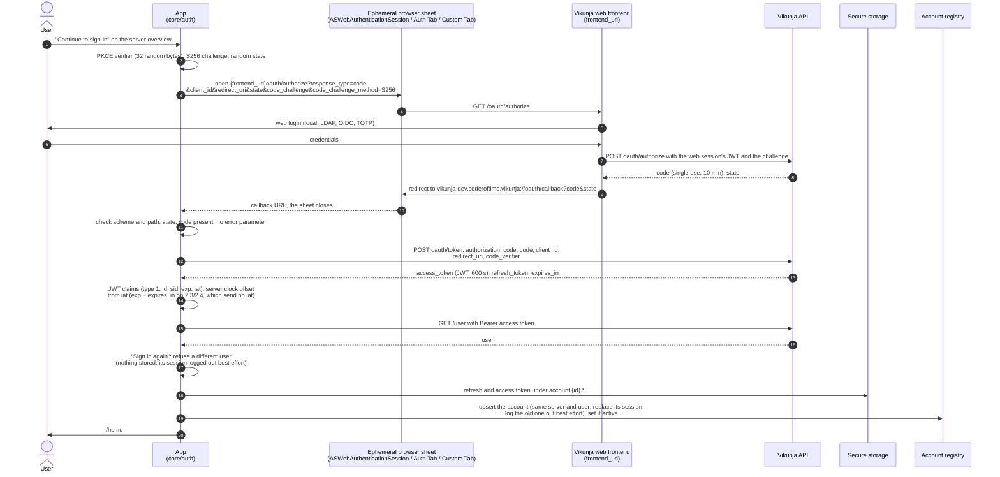

- Every attempt has a fresh verifier and state.
- The browser session is ephemeral ([D23](decisions.md#d23-browser-sign-in-through-flutter_web_auth_2-client-id-and-redirect-uri)). Vikunja shows no consent screen and its callback carries no `iss` ([RFC 9207](https://www.rfc-editor.org/rfc/rfc9207)), so a reused web login would let a malicious server get a code for another server without the user noticing (a mix-up). In an ephemeral session the user has to type that server's credentials into its login page.
  - Every sign-in shows the login form. OIDC and SSO users sign in at their identity provider again each time. iOS shows no "… Wants to Use … to Sign In" prompt.
  - On Android, flutter_web_auth_2 5.1.0 opens a Custom Tab instead of an Auth Tab for Chrome and Edge before 141, Samsung Internet before 28 and Firefox before 143. It treats these versions as lacking ephemeral support, so the sheet can share the browser's cookies; other browsers may ignore the flag as well. Chrome 133 on the test emulator gets such a Custom Tab.
  - Signing out of the app does not end a web login the user has in the browser. Only the fallback browsers above would reuse it.
  - Since step 35b the browser does not use the app's connection settings (section 3.1): before it opens for a server whose API or sign-in page address has a pinned or CA certificate, a client certificate or access headers, `confirmBrowserLeg` says what the browser will meet (the fingerprint to compare, the certificate it needs installed, the access login, another host), with Continue and Cancel (section 6) [exists, step 35b].
- "Sign in again" accepts only the account's own user. Another user is refused before anything is stored, its new session is logged out best effort, and the home screen shows a message.
- Closing the sheet cancels silently. A wrong state, a missing code, an `error` parameter and token endpoint errors (17001–17007) end in an inline message on the overview.
- While a sign-in runs (and on `/home` while a sign-out runs), back navigation is blocked and the buttons are disabled, so leaving the screen cannot strand a code exchange half way. On Android before 12, back on the root route would finish the activity and the isolate with it.
- The router sends the app to `/home` when an active account exists, and to onboarding (`/`) otherwise. Since step 4 the same screens add another account while one is active: "Add account" pushes the Connect screen in an adding mode (section 6, screens) [exists, step 4].
- Guest sign-in (`GuestSignIn` in `features/onboarding/application/`, [D62](decisions.md#d62-create-account-password-reset-and-invite-links-through-the-browser-sign-in-page-link-share-guests-as-an-account-kind-with-token-renewal-and-a-reduced-ui)) [exists, step 32]:
  - `connect(link)`: a stored account's connection whose web frontend (`webFrontendBase`) is the link's base, else the link's base probed like a typed address (an `http` server needs the user's consent), else, when no Vikunja server answers there, the server address the user types, because the web may run on another host than the API.
  - `signIn(connection, link, password:)`: `LinkShareGateway.authenticate` (`POST /shares/{hash}/auth`), then the hash and the token into `LinkShareStore`, then `LinkShareSessions.signedIn`, which replaces a session of the same share only now, so the old one answers requests until the new one exists; then `Account.linkShare` upserted and activated with the name of section 5.7 (the project's title read once with the new token when the share has no name), and the link's project and view remembered in memory for the landing after the first sync. 13001 and 13002 return `GuestPasswordRequired`, `LinkShareGone` `GuestLinkGone` (`sharingOff` for a 404 without a code), anything else `GuestSignInFailed`. A connection whose capabilities say link sharing is off returns `GuestLinkGone(sharingOff: true)` without a request only when no account is stored on that server.
  - `reopen(accountId, password:)`: the same with the stored hash and connection, without a landing, for "Open the link again".
  - The share's password goes only into the one request; the hash never into the screen's state, a route or a log.

### 5.2 Authenticated requests

- `createAuthenticatedDio` builds one `Dio` per account:
  - base URL `connection.apiBaseUri(connection.preferredApiVersion)`;
  - adapter, timeouts and `User-Agent` from the app's base `Dio` ([D5](decisions.md#d5-dio-with-native_dio_adapter)); since step 35b that adapter applies the server address's connection settings (section 3.1) [exists, step 35b];
  - a retry interceptor and the auth interceptor.
- The auth interceptor asks an `AccessTokenSource` for the token. The session manager implements it, so `vikunja_api` holds no refresh policy and no storage.
  - `validAccessToken()` refreshes proactively when `exp − serverNow < 60 s`.
  - `refreshAfterRejection(rejectedToken)` runs after a 401 with code 11. The request is retried once with the new token; a second 401 is not retried.
  - The `Authorization` header is never added to absolute URLs on another origin.
- The retry interceptor retries only GET and HEAD, on network errors, 502, 503, 504 and 429. It makes at most 2 retries with exponential backoff and jitter, and honours `Retry-After` up to a cap. Writes are retried by the outbox sender (section 7.5), never by the transport.
- `OAuthTokenClient` uses a separate `Dio` without the auth interceptor, because the token endpoint is public and a refresh must never trigger a refresh.
- Redirects are not followed: the token client, the account `Dio` and every request the auth interceptor adds a token to use `followRedirects: false` (since step 35b the base `Dio`s too, so that no access header reaches the host a redirect names [exists, step 35b]), so neither a code, a refresh token nor an access token reaches the host a redirect names. A 3xx ends as `UnexpectedResponse`. One read follows a redirect by hand since step 10 [exists, step 10]: on v2, `TasksPort.readByIndex` accepts a 307 and follows it once, only when the `Location` is the server's own `/api/v2/projects/{id}/tasks/by-index/{n}` (the server writes that prefix whatever path it is served under). The port keeps only the part after `/api/v2` and joins it to the account's base URL, so the second request goes to the same server and sub-path with the token; any other `Location` is `UnexpectedResponse`.
- Attachment downloads (step 10) stream the body and cancel the request once it is longer than the port's cap, so a huge file is never held in memory (section 4) [exists, step 10].
- Since step 26 `AttachmentsPort.download` streams an original to a file the same way, through the account's `Dio` to the account's own server only: the server takes the token only as the `Authorization: Bearer` header, which the interceptor adds and never to another origin, and a downloaded file is handed to other apps as a file (section 8), never as a link that would need the token. An upload is one multipart request whose body is read once: it carries `AuthInterceptor.bodyReadOnceKey`, so a 401 code 11 still refreshes the token for the next request but the request is not repeated (the outbox sends it again), and it takes timeouts by the file's size (section 7.5) in place of the client's defaults; like every write it is never retried by the transport [exists, step 26].
- The realtime socket (step 17) does not use the account's `Dio`: it goes over dart:io with the app's `User-Agent`, so Cronet's and NSURLSession's handling of the system proxy and, on Android, of user-installed CAs does not apply to it ([D5](decisions.md#d5-dio-with-native_dio_adapter)), but since step 35b the server address's connection settings do (section 7.9) [exists, step 35b]; the token travels in the socket's first frame, never in the URL or a header, and the upgrade follows no redirect (sections 4 and 7.9) [exists, step 17].
- `normalizeError` turns every error into a `VikunjaFailure` (section 4).
- Since step 32 `AccountTokens` hands a guest's requests to its `LinkShareSession` instead of the session manager, and a guest's `Dio` carries `LinkShareGoneInterceptor`, which tells the session when a request finds the share gone (section 5.5). `LinkShareAuthClient` uses the auth `Dio`, without the auth interceptor and without body logging [exists, step 32].

### 5.3 Token storage

([D24](decisions.md#d24-tokens-in-secure-storage-readable-after-the-first-unlock))

- `flutter_secure_storage` 11, per account: `account.<id>.refresh_token` and `account.<id>.access_token`.
- iOS: Keychain with `first_unlock_this_device` and `synchronizable: false`. Background isolates can read the tokens while the device is locked, once it has been unlocked after a restart. The items never reach iCloud Keychain or another device.
- Android: the plugin's v11 defaults (AES-GCM, with the key wrapped by an Android Keystore RSA key). `android:allowBackup="false"` keeps them out of Auto Backup.
- The access token is stored too, so another isolate can adopt a refresh result instead of refreshing again.
- Since step 31 the stored access token also names the app's own session: its `sid` claim (`JwtClaims.sessionId`), which every refresh keeps, is how the Sessions page marks "This device" and why the app never ends that session there (`currentSessionId`; when only the refresh token survived a crash between the two writes, it asks the session manager for a valid access token) (section 6) [exists, step 31].
- `TokenSet` keeps `exp` and `iat` in server time. The server clock offset comes from `iat` when a token arrives, and every expiry check uses server time.
- The offset is kept per account in preferences (`auth.server_clock_offset.<id>`; not a secret), written after the tokens and only when it moved by 5 s or more. A cold start or another isolate therefore judges stored tokens in server time before its first response. Sign-out deletes it.
- iOS keeps Keychain items when the app is deleted, but not its preferences. The first UI start that finds neither the install marker (`auth.install_marker`) nor a registry wipes secure storage once, so a reinstall never inherits refresh tokens ([D24](decisions.md#d24-tokens-in-secure-storage-readable-after-the-first-unlock)). Deleting the app never logs its sessions out on the server; they end after 72 h without a refresh.
- Secrets appear nowhere else: not in SharedPreferences, not in the database, not in logs, and since step 25 not in the description editor's WebView, which loads nothing from the network and gets no token or cookie (section 8) [exists, step 25], and since step 26 not in what the app hands to other apps or takes from them: a downloaded attachment goes out as a file through Android's file provider, read-only, for the one app that opens it, or iOS's share sheet; the share target reads only other apps' `content://` URIs, never `file://` and never the app's own providers, so a sending app cannot make Rurana upload its own database, tokens or stored files, and the document picker reads only the `content://` URIs the user picked (section 8) [exists, step 26]. Since step 31 the value of a new API or CalDAV token, the only secret the app shows, is only on screen and in the clipboard, never in storage, a provider that outlives its page or a log (section 6) [exists, step 31]. `toString()` of `TokenSet` redacts the tokens.
- Since step 32 a guest's secrets: `LinkShareStore` keeps the link's hash, its long-lived secret, and the current token under `account.<id>.share_hash` and `account.<id>.share_token`, apart from users' tokens. The hash is written before the token and deleted before it, and a session that writes a token reads the hash again afterwards and takes the token back when a sign-out in another isolate deleted it. The share's password is never stored, and `StoredLinkShare` prints nothing of it [exists, step 32].
- Since step 35b the connection settings' secrets: one entry `network_profile.<id>.secrets` per server address with the access-header values, a client certificate's PKCS#12 file and its password (a file password, not an account password), written before their metadata in preferences and deleted after it (section 3.1, [D65](decisions.md#d65-connection-settings-per-server-address-in-the-apps-transport-a-certificate-pinned-in-the-tls-handshake-or-a-trusted-ca-certificate-a-client-certificate-access-headers-and-unencrypted-connections-only-with-consent-failing-closed)) [exists, step 35b].

### 5.4 Refresh

Vikunja rotates the refresh token on **every** refresh and has **no grace period**: the old token is dead as soon as the server commits the rotation. Reusing it gives 401 code 16002, and a concurrent refresh with the same token that loses the race gets 16004. Every rule below follows from that ([D26](decisions.md#d26-refresh-concurrency-single-flight-re-read-and-adopt-write-ahead-epoch)).

- **When:** proactively 60 s before `exp` (server time), and reactively once after a 401 with code 11 for a user JWT. Since step 30 also on demand, `refreshNow()`, for the check after the web's password page (section 5.5): a password change ends every session of the user, which only a refresh shows, while the access token keeps working until it expires, so `refreshNow()` rotates the tokens however long the access token still lasts, through the same refresh as below; it throws like a refresh, `SessionEnded` once the session is gone (also for a retired manager), and does nothing for a manager that does not refresh [exists, step 30]. Since step 31 also after the web's two-factor page, and when `GET /user` answers 404 code 1005 (section 5.5) [exists, step 31].
- **Single-flight:** one refresh per account and isolate at a time; concurrent callers await the same future.
- **Re-read, then adopt:** before calling the server, the session manager re-reads the stored refresh token. If it differs from the caller's snapshot, another isolate or process has refreshed, and the stored tokens are adopted without a server call.
- **Cross-isolate safety:** `RandomAccessFile.lock` does not serialise isolates of one process (POSIX record locks are per process; verified by `app/test/core/auth/file_lock_isolates_test.dart`). Re-reading and adopting are the cross-isolate mechanism, as documented in `app/lib/core/auth/session_manager.dart`.
- **Write-ahead:** the rotated refresh token (with the new access token) is written to secure storage **before** the new access token is used for anything.
- **Not cancellable:** the refresh request is not tied to a UI cancel token and has a generous timeout. A response lost after the server rotated leaves only a dead token.
- **Adoption on 16002 and 16004:** the session manager re-reads storage a few times with short delays, because a sibling may be about to persist the winning tokens. Losing again to a newer stored token keeps it looking. Only when nothing newer appears is the session ended.
- **Re-read on 16003 and 412:** these answers are about the session of the token that was sent. Storage is re-read first, and a session that another isolate stored meanwhile (a new sign-in) is adopted. Only when storage is unchanged does the session end.
- **Write failure:** if the secure write after a successful refresh fails, the new tokens stay in memory and are written again before the next refresh; newer tokens in storage win. Only the error type is logged.
- **Retirement and auth epoch:** sign-out and account removal retire the account's session manager first, then wipe its storage. A retired manager hands out no token and never writes storage; it stays retired in this isolate until a new sign-in replaces it. `retire()` waits only for a storage write that has already started, never for a refresh still on the network, whose result is discarded. Guarding a sibling isolate against writing tokens back after a sign-out in another isolate is still open: step 16's heartbeat skip keeps background runs away while the app is in front, where sign-outs happen, which narrows it to a run that began before the app came to the front (section 7.8).
- **Link-share guests** (`LinkShareSession`, step 32, [D62](decisions.md#d62-create-account-password-reset-and-invite-links-through-the-browser-sign-in-page-link-share-guests-as-an-account-kind-with-token-renewal-and-a-reduced-ui)) [exists, step 32]: none of the above applies, because a guest has no refresh token and the server does not rotate. `validAccessToken()` returns the stored token and renews it through `POST /user/token` once half its lifetime (72 h by default) has passed; concurrent renewals share one request, and a failed renewal keeps the old token while it is valid and waits 5 minutes before the next try. An expired token (less than 60 s left, in server time from the token's `iat`, kept in memory) is replaced by signing in again with the stored hash, also shared by concurrent callers; a 429 blocks that for its `Retry-After` (60 s without one, at most 10 min), and a container the OS started (`runsHeadlessProvider`: the background runner, the notification action isolate) tries it at most once. `refreshAfterRejection` after a 401 code 11 takes a newer token from memory or storage, else signs in again, but never renews, since the renewal passes the same check. A share that needs its password again (13001, 13002) or is gone ends the session. `retire()` and `settle()` work as for the session manager.

| Refresh outcome | Failure | Action |
|---|---|---|
| 200 | — | persist (write-ahead), then use |
| network error or timeout | `NetworkFailure` | keep the tokens, retry later |
| 5xx | `ServerFailure` | re-read storage (SQLite servers answer a lost race with 500) and adopt a newer token; otherwise retry once, then keep the tokens |
| 429 | `RateLimited` | wait for `Retry-After`, capped at 10 min |
| 401 16004, 16002, or 401 without a code (2.3.0, 2.4.0) | `RefreshRaceLost` / `SessionEnded` | re-read and adopt; otherwise session ended |
| 401 16003, 412 1020 or 1040 | `SessionEnded` | re-read and adopt a newer session; otherwise session ended |

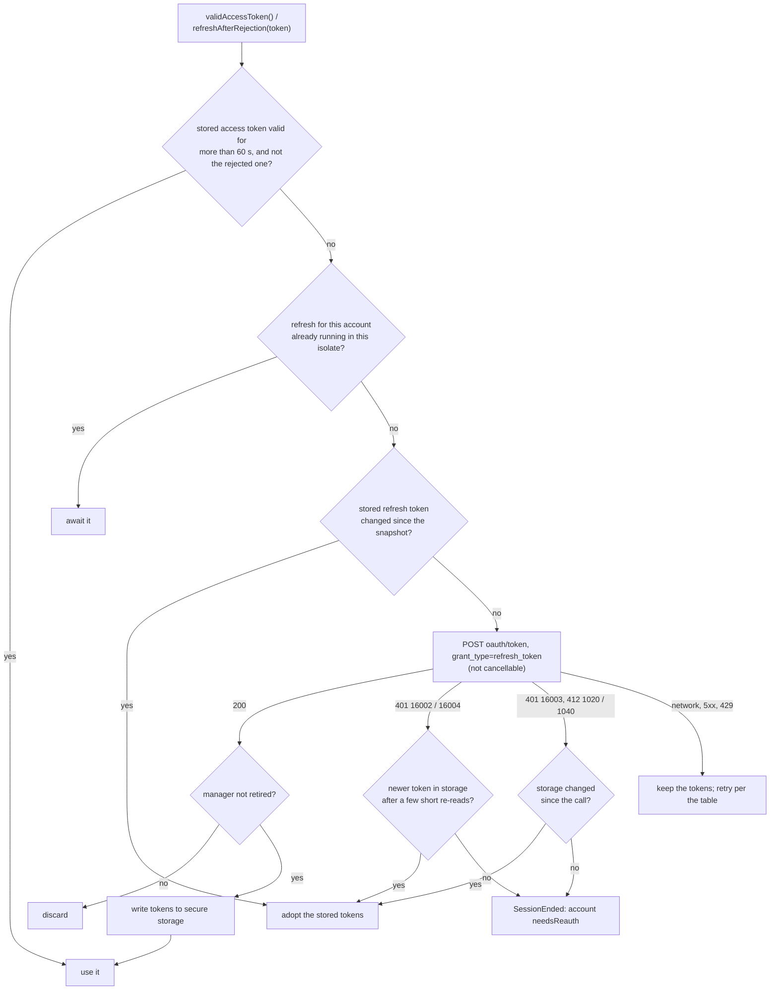

### 5.5 Session end and `needsReauth`

- A `SessionEnded` failure marks the account `needsReauth` in the registry. Its local data stays. Since step 17 a token the realtime socket has refused (`invalid_token`, or a close 1008 "session revoked") goes to `refreshAfterRejection`, so a session that really ended ends inside the session manager the same way; the socket never marks the account itself (section 7.9) [exists, step 17].
- `/home` (its Account tab since step 5) then shows a "Sign in again" banner. It runs the browser sign-in for the same server; signing in as the same user replaces the account's tokens and clears the flag.
- `/home` checks the active session with `GET /user` after its first frame, when the app resumes and when the active account changes: at most once a minute per account, never for an account in `needsReauth`, and never while a sign-in or sign-out runs. A session the server ended shows the banner right away. An unreachable server shows nothing. A sign-in counts as a check.
- The server ends an OAuth session after 72 h without a refresh (`service.jwtttl`), and there is no long-session option for the code grant. The check above refreshes an expiring access token, so opening the app moves that window. Since step 16 every background run refreshes every account it reaches, as often as the OS runs the job: every 30 min at best on Android, when the system decides on iOS (section 7.8) [exists, step 16].
- The outbox sender of an account in `needsReauth` is paused and resumes with the next sign-in; nothing queued is dropped (section 7.5) [exists, step 11]. Since step 16 a background run that finds the session ended marks the account the same way and posts one "Sign in again to *host*" notification, whose tap opens the Account tab (section 7.8) [exists, step 16].
- A password change on the web ends every session of the user, the app's OAuth session included: its next refresh answers 401 code 16002, while the 600 s access token keeps working until it expires. Since step 30 "Change password" on the Account settings page calls `SessionCheck.refreshOnNextCheck(accountId)` before it opens the web's page (section 6), so the account's next check, when the app comes back to the front, runs at once despite the minute between checks and first rotates the tokens (`refreshNow()`, section 5.4): a changed password has ended the session, the account is marked `needsReauth`, and the banner and the existing "Sign in again" flow take over with nothing queued dropped; an unchanged one costs only that refresh, and a server that cannot be reached shows nothing, as for any check. "Change email address" refreshes nothing; the page reads the account again on every return, which shows a pending change ([D54](decisions.md#d54-account-settings-and-profile-edited-in-the-app-with-writes-that-never-wipe-the-webs-settings-the-avatar-managed-password-and-email-left-to-the-web)) [exists, step 30].
- Turning on two-factor authentication on the web ends every session as well, the app's included. Since step 31 the two-factor row asks for the same check before it opens the web's page (`openWebSettingsPage`, which does so for the password page too), so the return rotates the tokens at once and a session that ended asks to sign in again right away. A deleted account answers `GET /user` with 404 code 1005 while its access token still works, and its refresh fails at once: `endingSessionOfDeletedAccount` wraps the `GET /user` of the session check, the sync's account phase and the account settings, refreshes on that answer (`refreshNow()`) and so marks the account `needsReauth` like any ended session instead of failing every read until the token expires; where the refresh does not end the session, the 404 stands ([D55](decisions.md#d55-security-and-integration-settings-two-factor-status-sessions-and-tokens-in-the-app-a-new-token-shown-once-export-and-deletion-through-the-web)) [exists, step 31].
- Since step 32 a guest's session ends only through its `LinkShareSession`: a gone share (`LinkShareGone` from any request through the interceptor, from `normalizeError` for v1's 13003, or at the share endpoints) or a share that needs its password again marks the account `needsReauth`. The banner then reads "Guest access ended" with "Open the link again" (`GuestReauthBanner`, also on the first-sync screen), which reopens the stored link and asks for the password where the share has one; a gone link and link sharing turned off get their own card. A guest's session check reads `GET /user` (the guest's pseudo user) through its session, renewing when due, and maps v2's 401 without a code to `LinkShareGone` itself, because that client has no interceptor and `/token/test` passes a deleted share's token. A 401 code 1027, an endpoint that needs a user, ends nothing [exists, step 32].

### 5.6 Sign-out

1. Best-effort logout: make sure the access token is valid (refresh first if needed), then `POST` logout. Network errors are ignored.
2. Retire the account's session manager (section 5.4), so nothing in this isolate writes its tokens again.
3. Wipe the account's secure entries, its server clock offset and its registry entry.
4. Since step 6: close the account's database and delete its file with the WAL and journal files ([D31](decisions.md#d31-one-drift-sqlite-file-per-account-shared-across-isolates-deleted-on-sign-out)). The confirmation dialog says that the local data is deleted.

When no active account remains, the router returns to onboarding. Since step 4 any account can be removed this way, not only the active one; removing the active account while others remain activates the most recently active of them, and the shell stays (section 5.7) [exists, step 4]. Since step 15 the wiper also disposes the account's notification scheduler and cancels its pending OS notifications before it closes the database (section 7.7, [D16](decisions.md#d16-multi-account-in-the-first-release)) [exists, step 15]. Since step 16 `server_notifications` goes with the database, and the last sign-out also cancels the background work (`BackgroundScheduler.cancelAll()`, section 7.8) [exists, step 16]. Since step 10 the wiper also drops the account's avatar cache and attachment image cache from memory (section 6) [exists, step 10]. Since step 17 the active account's socket closes as soon as a sign-out starts, before the logout request: the server closes the session's sockets with 1008 "session revoked" when the logout ends the session, and that close must not reach the session manager (section 7.9) [exists, step 17]. Since step 26 the wiper also deletes the account's uploads folder with the database (`AccountDatabaseFiles.deleteFor`), so queued uploads go with their ops, drops the account's `UploadFiles` and purges its downloaded attachments from the cache (`AttachmentDownloads.purgeAccount`) (section 7.1) [exists, step 26]. Since step 27 the wiper also deletes the account's unsent comments (`CommentDrafts.discardAll`, section 6) [exists, step 27].

Since step 32 a guest's sign-out skips the logout (the server keeps no session for a guest), retires its `LinkShareSession` and deletes its `LinkShareStore` entries with the rest; the confirmation reads "Remove guest access?" and names the guest and the server [exists, step 32].

Since step 35b removing the last account, user or guest, of a server address offers "Also forget this server's connection settings" (on by default, with what is stored below it) in the confirmation when settings are stored; `SignOutController.signOut(…, forgetConnectionSettings:)` forgets them after the sign-out if no account uses the address by then, and a failure never blocks the sign-out (section 3.1) [exists, step 35b].

### 5.7 Multi-account registry

([D25](decisions.md#d25-account-registry-in-sharedpreferences-without-secrets))

- The registry lives in `SharedPreferencesAsync` as JSON and holds no secrets:
  - the accounts (`Account`: id, server root, user id, username, display name, `addedAt`, `needsReauth`);
  - the active account id;
  - each account's last server connection, with `/info` re-serialised by `serverInfoToJson`, so start-up and headless refreshes need no probe.
- Account id: the first 32 hex characters of `sha256("${serverRoot}|${userId}")`. The same user on the same server is always the same account, so signing in again replaces its session instead of adding a duplicate.
- Since step 32 a link-share guest is an `Account.linkShare`: the share id, the project id and the share's name, the user id `-shareId` and the username `link-share-<id>` the server writes for the guest. Its id is the first 32 hex characters of `sha256("${serverRoot}|share|${shareId}")`, so the same link opened again replaces the guest's session and never collides with a user. The registry writes it with `kind: link_share`, `link_share_id`, `project_id` and `share_name` and without `user_id`, so a build before guests cannot read the entry and keeps it unchanged instead of taking it for a user without tokens. Its name is the share's name, else the shared project's title, which `updateGuestTitle` follows from every sync's project list for an unnamed share, else `link-share-<id>`; `updateDisplayName` never renames a guest to the server's "Link Share". `flagAccountsWithoutTokens` checks a guest's hash in `LinkShareStore` instead of tokens [exists, step 32].
- Display name (since step 30): `updateDisplayName(accountId, name)` stores the name the server has, a blank one showing the username as at sign-in, fed by every sync's `GET /user` in either isolate and by a name change on the Account settings page (section 6). An account that shows it already is not written, the re-authentication flag and the rest stay, and a failure is only logged, since the next sync tries again. When the stored name is one another isolate wrote (a background run) that this isolate has not announced yet, it is announced once on `changes`, so the header, the switcher and the initials follow [exists, step 30].
- Per-account objects are keyed by the account id: the session manager, the authenticated `Dio`, the database and the sync engine (step 6), the outbox sender (step 11), the notification preferences, scheduler and os-id namespace (step 15, section 7.7), the activity repository and the background run's last-run time (step 16, section 7.8), the avatar cache (step 9, section 6), and the task details repository, the task resolver and the attachment image cache (step 10, section 6), and the uploads folder with its `UploadFiles`, the attachment repository and the account's folder of the download cache (step 26, sections 6 and 7.1), and the user settings write port and the account settings repository (step 30, sections 6 and 7.2), and the account security port and repository (step 31, sections 4 and 6), and a guest's `LinkShareSession` (step 32, section 5.4) [exists, step 32].
- The registry and secure storage are written separately. An account without tokens is handled like `needsReauth`: the accounts provider marks it at start (`flagAccountsWithoutTokens`), and a session manager that finds no tokens ends the session. Unreadable storage (the Keychain before the first unlock) is not taken as missing tokens.
- Entries that cannot be decoded are left out of the state but written back unchanged; a readable entry with the same id replaces one. A registry that cannot be decoded at all is copied to `auth.account_registry.unreadable` before it is first overwritten ([D25](decisions.md#d25-account-registry-in-sharedpreferences-without-secrets)).
- `bootstrap.dart` loads the registry before `runApp`, behind the native launch screen, so the first route is already the right one. The token-presence check runs afterwards without blocking start-up.
- Account switching ([D37](decisions.md#d37-account-switcher-a-sheet-from-an-avatar-button-and-an-accounts-section-a-switch-resets-the-navigation-the-most-recently-active-account-follows-a-removal-inactive-outboxes-drain-in-the-foreground)) [exists, step 4]:
  - **Recency:** the registry also stores the activation order, most recent first, as an additional JSON field. `setActive` and `upsert(activate: true)` move the id to the front, `remove` drops it. A registry without the field (written before step 4) reads as the stored account order with the active account first, and entries this version cannot read keep their place untouched. The UI lists the accounts in this order; the stored order of the accounts does not change.
  - **Remove:** when the removed account was active, `remove` activates the most recently active remaining account (before step 4: the first remaining one). Removing any account is the sign-out of section 5.6: removing an inactive one disposes its sender, engine and database and leaves the active account, its sync engine, its scheduler and its screens untouched; the active account's scheduler resumes once the global "signing out" flag clears. Removing the active account while others exist keeps the shell; the router goes to onboarding only after the last one. Cancel on the first-sync screen of an added account is the same sign-out, so the previously active account becomes active again.
  - **Added or existing:** `SignInSucceeded` carries `isNewAccount`, which `SignInController` computes from the registry before the sign-in (`signInAgain` is never new). An account that was already on the device keeps its id, takes the new session and becomes active (section 5.1), and the UI says so.
  - **Switch:** `AccountSwitcher.switchTo(accountId)` (`features/accounts/application/account_switcher.dart`) sets the active id, a no-op for the active and for an unknown id, and refuses (returning false) while a sign-in, a sign-out or another switch runs. A switch, a removal of the active account and re-adding an existing account first wait, at most 5 s, for the target account's engine to report its stored state; each account has its own kept-alive `accountSyncStatusProvider(id)`, and `syncStatusProvider` never returns the previous account's status. The add flow's routes are `/home/accounts/add` and `/home/accounts/add/server`, pushed over the shell; `/sync` has no entrance transition, so a shell → `/sync` → shell round trip never builds two shells with the same navigator keys. Everything keyed by the active account follows the registry, and the shell resets the navigation (section 6, screens).
  - **Inactive outboxes:** `inactiveOutboxesProvider` (`features/sync/application/inactive_outboxes.dart`) runs while the shell is up and, on start, on resume and when the account list changes, asks the outbox sender of every signed-in account other than the active one that is not in `needsReauth` and has queued ops (counted on its database) to drain. It never builds a sender for an account without queued ops, never runs during a sign-out and leaves the active account to the triggers of section 7.3; a sender once built keeps its own backoff timers. Inactive accounts are not synced in the foreground; since step 16 the background runs sync every account ([D22](decisions.md#d22-session-keep-alive-through-background-sync), section 7.8) [exists, step 16].

### 5.8 Headless use

- The token store, the registry, the session manager and the token client need no `BuildContext` and no widget tree. A background isolate builds them through the same Riverpod `ProviderContainer` as the UI (principle 4).
- What makes that work:
  - the Keychain accessibility above, so tokens are readable while the device is locked;
  - `SharedPreferencesAsync`, which has no in-memory cache that could go stale across isolates;
  - the re-read and adoption rules of section 5.4.
- The notification-action isolate is the first such entry point (section 7.7, [D39](decisions.md#d39-local-notifications-a-scheduler-per-signed-in-account-plans-from-the-local-database-and-diffs-against-a-rolling-window-with-stable-keys-exact-alarms-when-allowed-done-through-the-outbox-from-a-background-isolate-without-a-token-refresh-snooze-local-only-permissions-asked-once-after-the-first-sync)) [exists, step 15]: the plugin starts a separate Flutter engine for a Done or Snooze action, and `handleNotificationAction` builds a `ProviderContainer` the way `bootstrap.dart` does (the `ClientIdentity.load()` override included), opens the account's database (shared with the UI isolate through `shareAcrossIsolates`), writes through `LocalTaskRepository` and drains the outbox with a sender of its own; the container is disposed at the end. **It never refreshes tokens:** it asks the session manager for a token with a "no refresh" option and sends only when the stored access token is valid as it is; otherwise the op stays queued for the next foreground or background run, and since step 16 the handler then asks for a background drain on Android (section 7.8) [exists, step 16]. A refresh from a short-lived isolate could lose the race against the UI isolate or be killed mid-request, which ends the session (section 5.4); a queued op costs nothing.
- The background sync isolate is the second such entry point (section 7.8, [D40](decisions.md#d40-background-sync-one-periodic-job-for-every-signed-in-account-with-a-deadline-skipped-while-the-app-is-in-front-the-incremental-run-as-the-session-keep-alive-a-one-off-drain-after-a-background-done-server-notifications-synced-into-a-local-inbox-on-their-own-cadence-new-unread-ones-as-activity-notifications-the-first-run-silent)) [exists, step 16], and unlike the action isolate it **refreshes tokens**, because its runs are the keep-alive of [D22](decisions.md#d22-session-keep-alive-through-background-sync): `BackgroundSyncRunner` builds the container like `handleNotificationAction` (the `ClientIdentity.load()` override included) but with the refreshing session managers, and the first request of each account's incremental run (`GET /user`) finds the 600 s access token expired and refreshes it, which slides the 72 h window. The re-read and adoption rules of section 5.4 make that refresh as safe as one in the UI isolate; the heartbeat skip keeps the two isolates off the same account in the usual case, and the sync lease and the outbox's in-flight stop in every case (section 7.8); the deadline (Android 9 min, iOS 25 s) stays below the OS limit, so a refresh still in flight has a margin to land its write-ahead, and at the deadline or an OS stop it gets up to 3 s before the container is disposed.
- Since step 26 the outbox senders of both headless containers (`runsHeadlessProvider`) leave queued uploads alone and sweep no stored copies: a file of up to 50 MiB may need minutes that the deadlines do not give, and an upload cut off is sent again whole. The UI isolate's sender uploads them (section 7.5) [exists, step 26].
- Since step 32 both headless containers give a guest the same `LinkShareSession` as the UI; its renewal rotates nothing, so the action isolate's non-refreshing session managers do not concern it. Both sign a guest in again at most once per container, so a password the user has to type never spends the shared sign-in limit every half hour, and the runner settles and retires the guest sessions with the session managers [exists, step 32].
- The Android widget worker is the third such entry point (section 7.10, [D63](decisions.md#d63-home-screen-widgets-from-json-snapshots-the-app-writes-through-an-in-repo-plugin-glance-widgets-on-android-with-done-through-a-headless-dart-worker-a-widgetkit-extension-on-ios-with-an-app-group-outbox-and-no-token)) [in review, steps 18–19]: `WidgetActionsWorker` starts a headless engine with `widgetActionsMain`, which builds the notification action's container (`backgroundActionOverrides`: session managers that never refresh, `runsHeadlessProvider`), imports the widgets' Done taps through `ExternalDone`, publishes every account's snapshots and tells the worker `finished`; the worker waits up to 3 minutes, below WorkManager's 10. A Done whose token has expired stays queued for the one-off background drain, as for a notification.
- Since step 35b every container loads the connection settings lazily on its first request; none overrides them. Before the first unlock a server address whose settings need secure storage fails closed with `ConnectionProfileLockedException`, a `NetworkFailure` that keeps queued work (section 3.1) [exists, step 35b].
- Since step 35c the headless containers only read the widget-link key and build links and payloads without it when there is none (section 6), and their uncaught errors go through the same redacting hooks as the UI's (section 8) [exists, step 35c].
- Extensions and widgets never refresh user tokens (principle 5); the iOS widget extension holds none at all [in review, steps 18–19].

## 6. Read path [exists, step 5]

Step 5 put the first real data on screen, read-only and online, and shaped every layer below the screens so that step 6 could put Drift under the repositories without touching the UI ([D29](decisions.md#d29-ui-reads-through-repository-interfaces-the-online-implementation-is-replaced-by-drift-in-step-6-without-ui-changes)). This section has the read client, the repository contract and the screens; the database, the local repositories and the sync engine are in section 7.

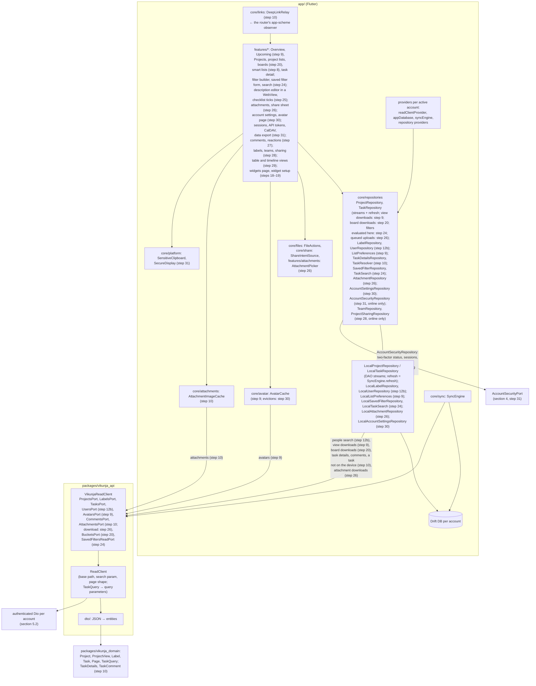

**Ports and `ReadClient`** (`packages/vikunja_api/lib/src/read/`):
- `VikunjaReadClient` exposes `projects`, `labels`, `tasks`, since step 12b `users`, since step 16 `notifications`, since step 14 `subscriptions`, since step 9 `avatars`, since step 10 `comments` and `attachments`, since step 20 `buckets` [exists, step 20] and, since step 24, `savedFilters` [exists, step 24]. `createReadClient(dio:, connection:)` takes the account's authenticated `Dio` and picks `/api/v2` or `/api/v1` from `connection.preferredApiVersion`.
- Both versions share the entity JSON, so one codec layer (`lib/src/dto/`) parses it. The client hides the rest: the base path, the search parameter (`s` on v1, `q` on v2) and the page shape (v1: a bare array plus `x-pagination-total-pages` and `x-pagination-result-count` headers, so `Page.total` is null; v2: `{items, total, page, per_page, total_pages}`).
- `TaskQuery` becomes `filter`, `filter_timezone`, `filter_include_nulls`, repeated `sort_by` and `order_by` (paired by position), `expand`, `page` and `per_page`. URLs are built from query parameters, never by string concatenation, because filters contain `&&`, quotes and spaces; dio sends the lists as `sort_by=a&sort_by=b` (`ListFormat.multi`). A sort by `position` is dropped on `GET /tasks` and `GET /projects/{p}/tasks`, because positions live per view and the server rejects the sort there (error 4026); it stays on the view endpoint, where step 9's view downloads and step 20's further pages of a bucket use it (section 7.2).
- The server caps `per_page` at its `max_items_per_page` (50 by default), so paging follows the response. `listAll` walks `page < totalPages` and de-duplicates the pseudo projects (Favorites `-1`, saved filters `≤ -2`) that the server appends to every page.
- Parsing rules: the zero date `0001-01-01T00:00:00Z` is null and every date is parsed to UTC; `null` arrays are empty; `hex_color` is normalised to six lowercase hex digits without `#`; unknown keys are ignored; v2's `ETag` is ignored for now, and so was `max_permission` until step 27, when the details read began to take it (section 4) [exists, step 27]; since step 27 `comment_count` and `is_unread` fill every `Task`, 0 and false without their expands [exists, step 27]; since step 28 `max_permission` fills `Project.maxPermission` from the project list, which asks for it with `expand=permissions`, and from a single read, where v1's `x-max-permission` header wins, null when neither says (section 4) [exists, step 28].
- Endpoints: `GET /tasks` (all projects), `GET /projects/{p}/tasks` (no view filter, so done tasks are included unless filtered out), `GET /projects/{p}/views/{v}/tasks` (the view's filter is AND-ed server-side; on a kanban view v1 answers with the board instead, which only `BucketsPort` reads, since step 20, [D30](decisions.md#d30-kanban-board-reads-deferred-to-step-20)), `GET /projects` (archived only with `is_archived=true`), `GET /projects/{id}` (with views), `GET /labels`, `GET /tasks/{id}`; since step 12b the people of a project for the people picker, `GET /projects/{id}/users/search?q=` on v2 (an envelope with every result in one page) and `GET /projects/{id}/projectusers?s=` on v1 (a bare array), the parameter left out for an empty query; the user JSON carries no email. Since step 9 the view endpoint serves the view downloads (section 7.2), `GET /projects/{p}/tasks` with a saved filter's pseudo project id (`p ≤ -2`) the Overview's saved filter (section 7.3), and `GET /avatar/{username}?size=` the avatars, as an image, not JSON [exists, step 9]. Since step 10 `GET /tasks/{id}` also with the repeated `expand` of the detail read, `GET /projects/{id or identifier}/tasks/by-index/{n}` (with the one followed v2 307), `GET /tasks/{id}/comments` and `GET /tasks/{id}/attachments/{id}` with `preview_size`, streamed as bytes (section 4) [exists, step 10]. Since step 20 a kanban view's board, v2 `GET /projects/{p}/views/{v}/buckets/tasks` and v1 the view endpoint, and one more page of a bucket through the view endpoint with `filter=bucket_id = N` (section 4) [exists, step 20]. Since step 24 `GET /filters/{id}`, a saved filter with its definition (section 4) [exists, step 24]. Since step 26 `GET /tasks/{id}/attachments/{id}` without a preview size, streamed into a file and resumed with `Range` (section 4) [exists, step 26]. Since step 27 the task lists take `expand=comment_count&expand=is_unread`, which the sync asks for on every page it stores (sections 4 and 7.3) [exists, step 27].
- Errors go through `normalizeError`; a cancelled request rethrows its `DioException`; JSON the codecs cannot read ends as `UnexpectedResponse`.
- Tests: unit tests with a fake HTTP adapter, parsing tests on JSON captured from the 2.7.0 server (`test/fixtures/read/`, captured by `tool/capture_read_fixtures.dart` with the user name redacted), and a contract test that seeds data and checks that v1 and v2 give equal domain objects except `Page.total`. The seed project gets a per-run identifier (`CT` plus four hex digits), because identifiers are unique per server and the server outlives a run; the sign-in helper retries a 500, because the SQLite test server loses a write race when two contract files register at once. Since step 20 `test/read/buckets_read_test.dart` reads boards recorded from 2.7.0 by `tool/capture_kanban_fixtures.dart` on both versions (counts and limits, server order, null collections, filter mode, a view that is not a kanban view, a further page with the bucket from the request, v1 and v2 equal) [exists, step 20]. Since step 24 `test/write/saved_filters_write_test.dart` reads saved filters recorded from 2.7.0 by `tool/capture_saved_filter_fixtures.dart` through the read client too [exists, step 24]. Since step 26 `test/read/attachment_download_test.dart` downloads originals recorded from 2.7.0 by `tool/capture_attachment_fixtures.dart` (section 7.5) [exists, step 26]. Since step 27 `read_client_test.dart` reads the count and the flag of list items on both versions and `task_details_read_test.dart` the permission from v2's body and from v1's header [exists, step 27].

**Repositories** (`app/lib/core/repositories/`):
- `ProjectRepository`: `watchAll()`, `refresh()`, `find(id)`. `TaskRepository`: `watchOpenTasks()` and `refreshOpenTasks()`; until step 9 also `watchProjectTasks(projectId, showDone:)` (a `PagedList`: the items loaded so far and whether the server has more), `refreshProjectTasks(...)` and `loadMoreProjectTasks(...)`, which step 9 removed with `PagedList`. Since step 11 `TaskRepository` also has the writes `setDone(id, done:)`, `setFavorite(id, favorite:)` and `deleteTask(id)`, which change the local row at once and queue the server call, and `watchPendingChanges()`, `watchSyncProblems()`, `retrySyncProblem(opId)`, `discardSyncProblem(opId)` and `sendPendingChanges()` for the Account tab (section 7.5). Since step 12a it has `watchTask(id)` (one task, following the id change a queued create gets when it is sent; null once the task is gone), `createTask(NewTask)` (the row is there at once under a temporary negative id, which the call returns) and `updateTask(id, TaskChanges)`, which since step 12b also takes label and assignee deltas and the reminder list. Step 14 added relation deltas to `updateTask`, `duplicateTask(taskId)`, which copies the task on the server, online, and returns the copy's id, and `watchSearchableTasks()`, every task without its child rows, which the add-relation search reads with done tasks shown [exists, step 14]. Step 9 adds the list reads ([D43](decisions.md#d43-task-lists-from-the-local-database-like-the-webs-a-view-snapshot-for-positions-and-server-only-filters-the-overviews-saved-filter-downloaded-by-the-sync-upcoming-with-the-web-presets-and-a-pinned-overdue-part)) [exists, step 9]: `watchActiveOpenTasks()`, the open tasks outside archived projects and their subprojects (which `GET /tasks` leaves out too), nearest due date first, undated last, then newest first, Upcoming's source; `watchOverviewTasks()`, an `OverviewTasks`: those tasks or, while the user's `filter_id_used_on_overview` names a saved filter the last project list named, the open tasks of that filter's last download with this device's changes on top (a task done or deleted here leaves at once, one created here appears after the next download), with the filter (`SavedFilterRef`) and the download time, null before the first download; `watchProjectList(projectId, viewId:, includeDone:)`, a `ProjectListSource`: the project's tasks (without `includeDone`, without the done ones the view's last download does not have), every task reachable from them as a subtask in any project, the view's `ListSnapshot` (task ids, positions, download time) and whether done tasks were left out; and `refreshProjectList(projectId, viewId:)`, the sync followed by the view's download (section 7.2), which throws the `VikunjaFailure` of either; a `viewId` of 0 stands for a project without a list view and only syncs. Step 8 adds the smart lists' reads ([D45](decisions.md#d45-app-shell-on-wide-android-screens-the-colour-scheme-and-dynamic-colour-the-webs-display-settings-applied-only-when-set-translated-default-names-the-project-tree-with-favourites-saved-filters-and-archived-projects-smart-lists-a-sticky-offline-banner)) [exists, step 8]: `watchFavoriteTasks()`, the open favourite tasks outside archived projects and their subprojects, ordered like `watchActiveOpenTasks` (the server's Favorites keep the archived ones); `watchSavedFilterTasks(pseudoProjectId)`, a `SavedFilterTasks`: the open tasks of the saved filter's last download with this device's changes on top, as the Overview's, and the download time, null before the first download; and `refreshSavedFilter(pseudoProjectId)`, the sync followed by the filter's download (section 7.2), which throws the `VikunjaFailure` of either. `ProjectRepository` gains `watchSavedFilters()`, the saved filters the last project list named (`SavedFilterRef`, since step 8 with `isFavorite`), by title. Step 20 adds the board ([D47](decisions.md#d47-kanban-board-from-per-view-board-snapshots-moves-and-positions-through-the-outbox-with-the-done-buckets-rules-accessible-drag-and-drop)) [exists, step 20]: `watchBoard(projectId, viewId)`, a `BoardSource` (`task_lists.dart`): the view, its buckets and cards (`BoardSlot`: bucket and position by task id) as of the last board download and when that was (null: never), the project's open tasks and the done ones the board can show, newest first, the placements queued for the view by task id and the tasks whose move into the project is not sent yet, which `buildBoard` turns into columns; `refreshBoard(projectId, viewId)`, the sync followed by the board's download (section 7.2), which throws the `VikunjaFailure` of either; `loadMoreOfBucket(projectId, viewId, bucketId)`, the next page of one bucket, online only; and `placeTask(taskId, viewId:, placement:, done:)`, which queues a `BucketPlacement` on the view, with the done state the move changes, like any other write (section 7.5). Step 22 adds manual ordering ([D49](decisions.md#d49-manual-ordering-list-views-by-drag-through-the-outbox-projects-reordered-and-nested-online-never-a-project-position-below-01)) [exists, step 22]: the `ProjectListSource` of `watchProjectList` also carries the positions queued for the view and not sent yet (`queuedPositions`, by task id), which win over the snapshot's in the manual order (`effectivePositionsOf`; which tasks a view only the server can evaluate lists stays the download's); `positionTask(taskId, viewId:, position:)` queues a task's position in a list view like any other write (section 7.5); and `ProjectRepository.moveProject(projectId, position:, parentProjectId:)` moves a project to a position under a parent (0: the top level) on the server, online and outside the outbox like `BucketRepository`: once answered, the stored project takes the server's position and parent at once and a sync runs quietly; it throws the `VikunjaFailure` (offline a `NetworkFailure`) with nothing changed, and a position below 0.1 is an `ArgumentError` before any request. Step 23 adds project management ([D50](decisions.md#d50-project-management-and-views-online-applied-to-the-local-database-at-once-from-the-project-screens-menu)) [exists, step 23]: `ProjectRepository.createProject(NewProject)` returns the new id once the project is stored with its views; `updateProject(projectId, ProjectChanges)` sends only the set fields and nothing for none (a title trimmed and required, an identifier trimmed and at most 10 code points, else an `ArgumentError`; archiving the user's default project a `DomainError` 3013 and unarchiving under an archived parent 3016, both before any request; a `ProjectChanges.position` is ignored, section 7.2); `deleteProject(projectId)`; and `duplicateProject(projectId, parentProjectId:, copyShares:)` returns the copy's id once a sync stored it with its tasks (a pseudo project is an `ArgumentError`). They are online and outside the outbox like `moveProject`: each throws the `VikunjaFailure` (offline a `NetworkFailure`) with nothing changed and, on success, writes the answer into the database at once (section 7.2) and syncs quietly. Step 24 evaluates filters on the device ([D51](decisions.md#d51-one-filter-engine-on-the-device-with-the-servers-semantics-saved-filter-definitions-synced-on-change-and-managed-online-a-filter-builder-offline-search)) [exists, step 24]: the `ProjectListSource` of `watchProjectList` carries `matchingIds`, the project's tasks the view's filter and search match with the server's rules (the project's tasks only, an archived project's included), null without either and where the device cannot evaluate them (the engine refuses the filter, or it names `bucket_id`), when the snapshot decides as before; without `includeDone` the done tasks it matches come along. The `BoardSource` of `watchBoard` carries the same for a kanban view (null for a filter-mode board), and then holds every matching task the board can show. `watchOverviewTasks` and `watchSavedFilterTasks` evaluate the saved filter from its stored definition in the server's scope (the tasks outside archived projects and the favourite ones anywhere; the stored search left out, as the server does), marked `FilterEvaluation.local` and without a download time, and fall back to the download (`FilterEvaluation.snapshot`) while the definition is unknown or the device cannot evaluate it; `refreshSavedFilter` downloads only such a filter, after the sync. `watchLabelTasks(labelId)` lists the open tasks a saved filter `done = false && labels in <id>` would. `ProjectRepository.watchSavedFilters` gives each `SavedFilterRef` its description, the `updated` of the last project list and its `definition` (`SavedFilterDefinition`: the `ViewFilter`, the saved filter's own timezone and the `updated` it was read at; null while unknown). Step 25 adds the description writes ([D52](decisions.md#d52-descriptions-edited-in-a-bundled-tiptap-page-in-a-locked-down-webview-with-a-native-toolbar-checklists-ticked-in-place-no-silent-overwrite-of-a-description-changed-on-the-web)) [exists, step 25]: `updateDescription(taskId, html, base:)` queues an edit from the editor with the description it started from (nothing for an unchanged one, `''` and the editor's `

` both counting as empty; false when the task is not on the device or queued for deletion); `toggleChecklistItem(taskId, html:, item:, checked:)` ticks one `RichTaskItem` of the HTML the view was built from and queues that, false with nothing changed when the stored description is no longer that HTML or the item cannot be toggled in it (a stale view); `webDescription(operationId)`, `keepMyDescription(operationId, webDescription:)` and `useWebDescription(operationId)` resolve a `DescriptionConflict` (section 7.5). `ProjectRepository.updateDescription(projectId, html, base:)` saves online like `updateProject`, only while the server still has `base` (or `html` already, or an empty one like `base`); otherwise it stores the server's description, writes nothing and returns it; it throws the `VikunjaFailure` like `updateProject`. Step 26 adds the queued uploads ([D53](decisions.md#d53-attachments-uploaded-through-the-outbox-in-their-own-lane-opened-shared-and-saved-through-the-platform-cover-and-delete-online-and-an-own-android-share-target)) [exists, step 26]: `queueUpload(taskId, sourcePath:, fileName:, mimeType:, moveSource:)` copies the file (moves it with `moveSource`, for a picker's or the share inbox's copy, which is gone afterwards whether queued or not) into the account's uploads folder under a random name and queues its upload, behind the task's create while that is queued, offline too, and returns the op's id: null with nothing kept for a task that is not on the device or queued for deletion, `UploadTooLarge` above the upload limit before anything is stored; `watchPendingUploads(taskId)` streams the task's queued uploads as `PendingUpload`s (the name, size, type and state, `waiting`, `sending` or `failed`, with the last failure), oldest first, across the create's remap, one a run that died left `sending` shown as waiting; `uploadedAttachments` gives every attachment a queued upload created as the server answered, which the detail sheet adds without a read, because an upload bumps no `updated`; `cancelUpload(operationId)` drops the op and its stored copy and aborts one on its way (what the server already stored stays). Step 29 adds the timeline's request ([D61](decisions.md#d61-the-table-view-as-a-detailed-list-sorted-like-the-server-and-the-gantt-view-as-a-read-only-timeline-with-the-webs-filter-range-rows-bars-and-arrows-both-from-the-local-database)) [exists, step 29]: `watchProjectList(projectId, viewId:, includeDone:, request:)` takes a `ViewFilter` that a client would send the view's tasks endpoint (a timeline's range filter, with "Show undated" as include-nulls); its `matchingIds` are then what the server would answer, the request ANDed with the view's filter, and never null: where the device cannot evaluate the view's filter, the tasks of the view's last download that the request matches. `refreshProjectList` downloads a table or Gantt view only when the device cannot evaluate its filter; otherwise it only syncs.
- `LabelRepository` (step 12b): `watchAll()` (the account's labels from the database, ordered by title, case-insensitively) and `create(NewLabel)`, which goes to the server at once (`LabelsWritePort.create`), so it needs a connection, stores the answer locally and throws the `VikunjaFailure` otherwise. `UserRepository` (step 12b): `searchAssignees(projectId, query)` (`UsersPort.searchProjectUsers`, online, the users it returns stored in `users`, so assigning one works offline afterwards; throws the `VikunjaFailure`) and `knownUsers()` (everyone the database knows from synced tasks and earlier searches, the offline fallback of the people picker). Implemented by `LocalLabelRepository` and `LocalUserRepository` over the account's database and the write or read client. Since step 28 `LabelRepository` also has `update(id, LabelChanges)` and `delete(id)`, online like the create, stored at once from the answer (section 7.2), a blank title or one above 250 code points an `ArgumentError` before any request, beside `isOwnLabel(label, userId)` for the gating; `UserRepository.search(query)` is the global user search, storing the users it finds like `searchAssignees` ([D60](decisions.md#d60-labels-managed-online-and-applied-locally-teams-project-shares-and-link-shares-online-only-the-project-permission-stored-and-every-screen-shaped-by-it)) [exists, step 28].
- `SubscriptionRepository` (step 14): `forTask(id)`, `forProject(id)`, `setTaskSubscribed(id, subscribed:)` and `setProjectSubscribed(id, subscribed:)`, online only, each returning the subscription that covers the task or project as the server has it (its own or an inherited one, null for none) and throwing the `VikunjaFailure` otherwise; nothing is stored. Implemented by `LocalSubscriptionRepository` over the read and write clients (`subscriptionRepositoryProvider` for the active account, `accountSubscriptionRepositoryProvider(accountId)`) [exists, step 14].
- `BucketRepository` (step 21, [D48](decisions.md#d48-bucket-management-online-applied-to-the-local-board-at-once-from-a-column-menu-with-a-guard-against-the-servers-orphaned-tasks)): `create(projectId, viewId, title)` (rightmost), `rename`, `setLimit` (0 removes it; one below the count is accepted), `move(projectId, viewId, bucketId, toIndex:)`, `delete`, `setDoneBucket` and `setDefaultBucket` (null clears), online only like `LabelRepository.create`: each calls the server and throws its `VikunjaFailure` with nothing changed here (a blank title is an `ArgumentError`, a bucket the stored board no longer has a `NotFound` 10001, both without a request); on success the stored board and view follow at once and a quiet board download follows. Beside it the pure plans the board shares: `planBucketDeletion` (where the tasks go, `BucketDeletion` with `isFallback` and `defaultFirst`), `columnHoldsTasks` and `planBucketMove`. Implemented by `LocalBucketRepository` (section 7.2; `bucketRepositoryProvider` for the active account, null while nobody is signed in, `accountBucketRepositoryProvider(accountId)`) [exists, step 21].
- `ProjectViewRepository` (step 23, [D50](decisions.md#d50-project-management-and-views-online-applied-to-the-local-database-at-once-from-the-project-screens-menu)): `createView(projectId, ViewDraft)` returns the new view's id (last unless the draft has a position), `updateView(projectId, viewId, ViewDraft)`, `moveView(projectId, viewId, toIndex:)` (the index in `sortedViews`, by position, then id; the position between the new neighbours from `planViewMove`, nothing sent where the view is already or no position puts it) and `deleteView` (the project's only view a `LastViewNotDeletable`), online only like `BucketRepository`: a blank title is an `ArgumentError` and a project or view the database no longer has a `NotFound` 3001 or 3014, both without a request; a refusal throws its `VikunjaFailure` with nothing changed; on success the stored views follow at once and a quiet sync follows. Implemented by `LocalProjectViewRepository` (section 7.2; `projectViewRepositoryProvider` for the active account, null while nobody is signed in, `accountProjectViewRepositoryProvider(accountId)`) [exists, step 23].
- `SavedFilterRepository` (step 24, [D51](decisions.md#d51-one-filter-engine-on-the-device-with-the-servers-semantics-saved-filter-definitions-synced-on-change-and-managed-online-a-filter-builder-offline-search)): `create(SavedFilterDraft)` returns the new saved filter's pseudo project id, `update(pseudoProjectId, draft)` replaces title, description, filter and favourite, `setFavorite(pseudoProjectId, favorite:)`, `delete(pseudoProjectId)` (one already gone counts as deleted; its downloads go, and an Overview that showed it falls back to every open task) and `read(pseudoProjectId)` (the saved filter as the server has it, for an edit form while the stored definition is unknown), online only like `ProjectViewRepository`: a blank title is an `ArgumentError` before any request; a refusal throws its `VikunjaFailure` with nothing changed (4024, 4019, 4016 for the filter, 2002, `Forbidden` for another user's, `NotFound` 11001); on success the stored saved filters follow at once, definition included, and a quiet sync follows. Implemented by `LocalSavedFilterRepository` (section 7.2; `savedFilterRepositoryProvider` for the active account, null while nobody is signed in, `accountSavedFilterRepositoryProvider(accountId)`) [exists, step 24].
- `TaskSearch` (step 24): `watch(query)`, `SearchResults` again whenever the local data changes: the tasks whose title or description text contains the query ignoring case, `#12` (index 12 in any project) and an identifier like `PROJ-12`, open before done, then nearest due date (none last), then newest first, at most 100 (`maxTasks`) with the count of all; the projects, saved filters and labels whose title or description text contains it, by title; archived projects and their tasks left out, except favourite tasks; an empty query finds nothing. `countMatches(filter, projectId:, timezone:)`: how many tasks a filter matches here, in a project as its view would list them or, without one, in a saved filter's scope; null where the device cannot evaluate it. Offline and without a request. Implemented by `LocalTaskSearch` (section 7.2; `taskSearchProvider` for the active account, null while nobody is signed in, `accountTaskSearchProvider(accountId)`) [exists, step 24].
- `ListPreferences` (step 9): how the user last left each list, per account, as the web keeps it per view in its local storage: `watchView(listKey)` and `saveView` (`ViewPreferences`: the sort, `TaskListSort.manual` by default, and show done, off), `lastViewOf(projectId)` and `rememberView` (the list view last shown; since step 20 a Kanban view as well [exists, step 20]), `watchUpcoming()` and `saveUpcoming` (`UpcomingPreferences`: a `DateRangePreset`, by default the next 7 days, or a custom range of local dates with both days included; show overdue, on by default; show without date, off), since step 8 `watchProjectTree()` and `saveProjectTree` (`ProjectTreePreferences`: show archived projects, off by default, and the ids of the collapsed projects, none by default) [exists, step 8]. `listKeyFor` names a view's list `view:<id>` and the list of a project without a list view `project:<id>`. Implemented by `LocalListPreferences` over the `list_preferences` table, one JSON value per key; a value this version cannot read is the default, field by field (`listPreferencesProvider` for the active account, `accountListPreferencesProvider(accountId)`) [exists, step 9]. Step 29 adds the table and the timeline ([D61](decisions.md#d61-the-table-view-as-a-detailed-list-sorted-like-the-server-and-the-gantt-view-as-a-read-only-timeline-with-the-webs-filter-range-rows-bars-and-arrows-both-from-the-local-database)) [exists, step 29]: `ViewPreferences.tableSort` (a `TableSort`, `index:desc` by default) for a table view and `timeline` (`TimelinePreferences`: a custom `GanttRange`, or null for the default range, which follows today; "Show undated", off; the day width, 36 dp from 20 to 72) for a Gantt view; and `watchTableColumns()` and `saveTableColumns`, the columns of every table view, one choice for the account like the web's, `TableColumn.defaults` until chosen and for an empty choice.
- `TaskDetailsRepository` (step 10): `details(taskId)` (the one expanded read of `TasksPort.readDetails`), `comments(taskId, page:, newestFirst:)` (one page, sorted by `(created, id)`, oldest first unless `newestFirst`) and `markRead(taskId)` (idempotent; callers ignore its failure). Online only, like `SubscriptionRepository`: nothing is stored, a failure is the request's `VikunjaFailure` (offline a `NetworkFailure`), and a task whose create is still queued throws `TaskNotSyncedYet` without a request. Implemented by `LocalTaskDetailsRepository` over the read and write clients, which resolves a temporary id through the remap (`taskDetailsRepositoryProvider` for the active account, `accountTaskDetailsRepositoryProvider(accountId)`) [exists, step 10]. Since step 27 it also writes, online and at once, never queued ([D57](decisions.md#d57-comments-written-in-the-app-online-with-a-draft-kept-on-the-device-reactions-on-tasks-and-comments-comment-counts-and-the-unread-dot-on-rows)): `addComment(taskId, CommentDraft)` returns the comment as stored (a draft without visible content is an `ArgumentError` before any request; not idempotent); `editComment(taskId, comment, draft)` the comment with the new body and `updated`, its author, `created` and reactions kept; `deleteComment(taskId, commentId)` counts one already gone as deleted, while a `ServerFailure` 404 means the server still has it; `addReaction` and `removeReaction(kind, id, value)` take a task by its local id and a comment by its own, an added value of 1 to 20 code points (a longer one stored through v1 can still be removed); and `watchServerChanges(taskId)` streams each newer server `updated` the synced row shows from then on, following a queued create to its server id. The synced row keeps the comment count and the unread flag in step: `details` stores what it read, because the sync cannot see a task read elsewhere, `markRead` clears the flag before its request, and a comment added or deleted here counts up or down once the server accepted it (section 7.2) [exists, step 27].
- `TaskResolver` (step 10): `resolve(TaskReference)` finds the task a link or a typed reference names, by id or by project identifier and index, in the local database first and otherwise online, and stores a task it read online (section 7.2); `findLocal(reference)` answers from the database only, without a request, so a caller can choose among accounts before going online. It throws the `VikunjaFailure`: `NotFound` for a task or project that does not exist, `Forbidden` for one the user cannot read, `NetworkFailure` for a task that is not local while the device is offline. Implemented by `LocalTaskResolver` (`taskResolverProvider` for the active account, `accountTaskResolverProvider(accountId)`) [exists, step 10].
- `AttachmentRepository` (step 26, [D53](decisions.md#d53-attachments-uploaded-through-the-outbox-in-their-own-lane-opened-shared-and-saved-through-the-platform-cover-and-delete-online-and-an-own-android-share-target)): `uploadsEnabled` (the stored `/info`'s `task_attachments_enabled`; when false the server has no upload, delete or cover routes), `maxUploadBytes` (`maxUploadBytesOf`: the server's limit as it enforces it, else its default 20 MiB, at most the app's 50 MiB), `delete(taskId, attachmentId, isCover:)` (for the cover the cover is cleared through the task update first, because the server would keep pointing at the deleted id and refuse every later edit of the task; one already gone counts as deleted; its downloaded copy goes too), `setCover(taskId, attachmentId)` (null clears it), `download(taskId, attachment, cancel:)` (the original as a file of the download cache, reused while its size matches, named after the attachment, sanitised) and `uploadNow(taskId, file, fileName:, mimeType:, cancel:)` (one upload at once, for the description editor, which needs the attachment's id; `UploadTooLarge` before any request above the limit, `FileTooLarge` when the server refuses the size). Online only, like `BucketRepository`: nothing is queued or stored, a failure is the request's `VikunjaFailure` (offline a `NetworkFailure`), and a task whose create is still queued throws `TaskNotSyncedYet` without a request; queued uploads go through `TaskRepository.queueUpload` instead. Implemented by `LocalAttachmentRepository` (section 7.2; `attachmentRepositoryProvider` for the active account, null while nobody is signed in, `accountAttachmentRepositoryProvider(accountId)`) [exists, step 26].
- `AccountSettingsRepository` (step 30, [D54](decisions.md#d54-account-settings-and-profile-edited-in-the-app-with-writes-that-never-wipe-the-webs-settings-the-avatar-managed-password-and-email-left-to-the-web)): `watch()` streams the stored `AccountSettingsState`, offline too: the settings, the `UserProfile` (null until a sync of this version or a refresh stored it) and the `AvatarProvider` (null until the account settings read or wrote it, since the sync does not read it); `refresh()` reads the settings, the profile and the avatar provider from the server and stores them; `update(UserSettingsChanges)` (empty changes send nothing), `setAvatarProvider` (one of the choices but `upload`, anything else an `ArgumentError` before any request) and `uploadAvatar(File)` (the picture as it is, cropped and rotated by the caller, which also makes it the avatar) go to the server at once, one at a time in the order called, and are never queued: each throws the server's `VikunjaFailure` (offline a `NetworkFailure`; for a refused value a `DomainError` 1025 or 3017 or a `ValidationFailed`, for a refused picture a `ValidationFailed`, a `DomainError` 4032 or `FileTooLarge`) with nothing changed here; on success the stored settings and profile take the answer at once, the name goes into the account registry, the user's cached avatars go when the avatar or the name changed, and a sync runs quietly. Implemented by `LocalAccountSettingsRepository` (section 7.2; `accountSettingsRepositoryProvider` for the active account, null while nobody is signed in, `accountSettingsRepositoryForProvider(accountId)`) [exists, step 30].
- `AccountSecurityRepository` (step 31, [D55](decisions.md#d55-security-and-integration-settings-two-factor-status-sessions-and-tokens-in-the-app-a-new-token-shown-once-export-and-deletion-through-the-web)): `totpStatus()`, `sessions()`, `revokeSession(id)`, `apiTokens()`, `apiPermissions()`, `createApiToken(NewApiToken)`, `deleteApiToken(id)`, `caldavTokens()`, `createCaldavToken()`, `deleteCaldavToken(id)` and `dataExport()` go to the server every time and store nothing; each throws the server's `VikunjaFailure` (offline a `NetworkFailure`). `currentSessionId()` is the `sid` of the account's stored access token (section 5.3; null when signed out), and `revokeSession` refuses it with an `ArgumentError` before any request, since signing out ends it. `revokeOtherSessions()` reads the list and ends every other session one after the other, returning how many ended; the first failure stops it as `OtherSessionsNotAllEnded` with the counts of ended and remaining sessions, and without a session of its own it ends nothing and throws `SessionEnded`. `createApiToken` refuses a blank title, no permission and an expiry that is not in the future before any request, because the server would make a token that never works. A new token's value is only in the create answer, which the caller shows once. Implemented by `OnlineAccountSecurityRepository` over the account security port (`core/repositories/online/`; `accountSecurityRepositoryProvider` for the active account, null while nobody is signed in, `accountSecurityRepositoryForProvider(accountId)`) [exists, step 31].
- `TeamRepository` (step 28, [D60](decisions.md#d60-labels-managed-online-and-applied-locally-teams-project-shares-and-link-shares-online-only-the-project-permission-stored-and-every-screen-shaped-by-it)): `list(query:, includePublic:)`, `read(id)`, `create(NewTeam)`, `update(id, TeamChanges)`, `delete(id)`, `addMember`, `removeMember`, `toggleAdmin` and `leave(teamId)`, online only like `AccountSecurityRepository`: nothing is stored, a refusal throws its `VikunjaFailure`. A blank or too long name, and removing or toggling oneself, are an `ArgumentError` before any request; `leave` reads the team first and refuses what `TeamGuards` does not allow (the only admin while others stay, the last member). After `leave` and `delete` a quiet `refreshAfterWrite` follows, so projects reached through the team go. Implemented by `OnlineTeamRepository` over the teams port (`core/repositories/online/`; `teamRepositoryProvider` for the active account, null while nobody is signed in, `teamRepositoryForProvider(accountId)`) [exists, step 28].
- `ProjectSharingRepository` (step 28, [D60](decisions.md#d60-labels-managed-online-and-applied-locally-teams-project-shares-and-link-shares-online-only-the-project-permission-stored-and-every-screen-shaped-by-it)): `userShares`, `shareWithUser`, `setUserPermission`, `removeUserShare`, `teamShares`, `shareWithTeam`, `setTeamPermission`, `removeTeamShare`, `linkShares`, `createLinkShare` and `deleteLinkShare`, online only: nothing is stored. A change of the user's own share and every change or removal of a team share start a quiet `refreshAfterWrite`, so the stored permission follows (whether the user is in the team would cost a request of its own); a link share that is gone (3006) counts as deleted. Implemented by `OnlineProjectSharingRepository` over the project sharing port (`projectSharingRepositoryProvider`, `projectSharingRepositoryForProvider(accountId)`) [exists, step 28].
- The contract is streams of the current local state plus explicit refresh (and, until step 9, load-more). A failed first load is the stream's error; a failed refresh throws the `VikunjaFailure` and leaves the stale data in the stream. Database streams and a sync trigger satisfy it as well.
- Since step 6 the implementations are the local ones of section 7.2: streams from the DAOs, refresh through the sync engine. The step 5 `online/` implementations (an in-memory cache per account, filled through `VikunjaReadClient`, with the overview capped at 5 pages) were removed with step 6; git history keeps them. Since step 31 `online/` holds `OnlineAccountSecurityRepository`, for what is never stored (above) [exists, step 31], and since step 28 `OnlineTeamRepository` and `OnlineProjectSharingRepository` [exists, step 28].

**Providers** (`core/repositories/repository_providers.dart`): `accountDioProvider(accountId)` builds the account's authenticated `Dio` over `createAuthenticatedDio`, rebuilt only when the account's root URL or API versions change; its token source (`AccountTokens`, public since step 17, because the realtime connection takes its tokens the same way [exists, step 17]) looks the session manager up on every request, so a client built before a new sign-in uses the new session; in debug builds it logs one line per request (method, URL without query, status), never headers or bodies. `readClientProvider(accountId)` and, since step 11, `writeClientProvider(accountId)` share it. `outboxSenderProvider(accountId)` is kept alive per account like the engine: it drains when built, when the app comes back to the front and after every local write, pauses while the account needs a new sign-in and resumes with the sign-in; sign-out disposes it before the engine and the database, and a request still in flight then changes nothing any more. `projectRepositoryProvider` and `taskRepositoryProvider` (and, since step 12b, `labelRepositoryProvider` and `userRepositoryProvider`, over the `accountLabelRepositoryProvider` and `accountUserRepositoryProvider` families) follow the active account id: null while nobody is signed in, rebuilt and the old one disposed on a switch, gone on sign-out, so an account switch never shows another account's data; since step 6 they are built over `appDatabase(accountId)` and `syncEngine(accountId)` (section 7.4); since step 9 the account's task repository also gets the read client and the server's `max_items_per_page` (from the stored `/info`) for the view downloads. The screens watch stream providers over them (`projectsProvider`, `projectByIdProvider`, `openTasksProvider`; since step 9 `overviewTasksProvider`, `activeOpenTasksProvider` and `projectListSourceProvider` in place of `projectTasksProvider`, and `viewPreferencesProvider` and `upcomingPreferencesProvider` over `listPreferencesProvider`), which stay loading without an account; the two preference providers give the defaults instead. Since step 9 `minimumPriorityProvider` reads the user settings, and `accountAvatarCacheProvider(accountId)` keeps an account's `AvatarCache` for the session over its read client [exists, step 9]. Since step 10 `accountAttachmentImagesProvider(accountId)` keeps an account's `AttachmentImageCache` for the session the same way (`attachmentImagesProvider` for the active account), and the account wiper drops both caches when the account goes (section 5.6); `activeLinkBasesProvider` gives the active account's server root and http(s) `frontend_url`, which rich text needs for its attachment images and task links, and `activeUserIdProvider` the signed-in user's id; `deepLinkRelayProvider`, `deepLinkSourceProvider` and `taskOpenerProvider` are kept alive for the app's life (below) [exists, step 10]. Since step 8 `savedFiltersProvider`, `favoriteTasksProvider` and `savedFilterTasksProvider(pseudoProjectId)` (`features/smart_lists/application/`) and `projectTreePreferencesProvider` read the step 8 repository methods, `displaySettingsProvider` the user's display settings, and `offlineProvider` keeps the last outcome of the active account's sync (below) [exists, step 8]. Since step 20 `boardSourceProvider(projectId, viewId)` streams `watchBoard`, loading while nobody is signed in [exists, step 20]. Since step 21 `bucketRepositoryProvider`, over the `accountBucketRepositoryProvider` family, follows the active account like the repositories above [exists, step 21]. Since step 22 the account's project repository also gets the write client, for `moveProject` [exists, step 22]. Since step 23 `projectViewRepositoryProvider`, over the `accountProjectViewRepositoryProvider` family, follows the active account like the repositories above, with the read client and the server's `max_items_per_page` for the downloads after a view change [exists, step 23]. Since step 24 `savedFilterRepositoryProvider` and `taskSearchProvider`, over the `accountSavedFilterRepositoryProvider` and `accountTaskSearchProvider` families, follow the active account like the repositories above; `labelTasksProvider(labelId)` (`features/smart_lists/application/`), `searchResultsProvider(query)` and `lastSearchQueryProvider` (`features/search/application/`, the page's last query, empty again for another account) read them [exists, step 24]. `clockTickProvider` supplies "now" for the due-date grouping and relative dates: it re-reads `clockProvider` (which tests pin) when the app returns to the foreground and every minute while it is in front, so sections and labels do not freeze overnight; since step 24 `accountTaskRepositoryProvider` listens to its ticks rather than watching it and hands them to the repository as `clockTicks`, a broadcast stream, so a tick evaluates the filters with relative dates again without rebuilding the repository and every list [exists, step 24]. Since step 25 `editorBridgeFactoryProvider` hands the editor page a new `WebViewEditorBridge` per page load (tests put in `FakeEditorBridges`), and `descriptionDraftsProvider` gives `DescriptionDrafts` over the preferences store [exists, step 25]. Since step 26 `accountUploadFilesProvider(accountId)` gives the account's `UploadFiles`, which its task repository and its outbox sender share, so a copy being queued is never swept as an orphan; `attachmentDownloadsProvider` the `AttachmentDownloads` of every account, which deletes downloads unused for three days when it is first read; `attachmentRepositoryProvider`, over the `accountAttachmentRepositoryProvider` family, follows the active account like the repositories above, with `uploadsEnabled` and `maxUploadBytes` from the stored `/info`; `pendingUploadsProvider(taskId)` (`features/attachments/application/`) streams `watchPendingUploads`; and `attachmentPickerProvider`, `fileActionsProvider` and `shareIntentSourceProvider` (the Android channel, nothing elsewhere until the iOS share extension) are kept alive for the app's life (tests put in `FakeAttachmentPicker`, `FakeFileActions` and `FakeShareIntentSource`) [exists, step 26]. Since step 30 `userSettingsWritePortProvider(accountId)` builds the account's `UserSettingsWritePort` over the same `Dio` and connection as the write client; `accountSettingsRepositoryForProvider(accountId)` builds the account's repository over its database, its sync engine, that port, a `GET /user` through the account gateway, the registry's `updateDisplayName` and its avatar cache, whose own user it evicts after an avatar or name change, also in the caches of the other accounts on the same server, which may show the user as an assignee; `accountSettingsRepositoryProvider` follows the active account (kept alive, null while nobody is signed in) and `accountSettingsProvider` streams its state; the sync engine's `GET /user` tells `accountAvatarCacheProvider(accountId)` the user's `updated` (`noteUpdated`) and the registry the name; `avatarGenerationProvider(accountId, username)` is the user's generation in that cache, rebuilt on every eviction; `avatarFilesProvider` keeps the picked photo and the cropped avatar in temporary files (tests put in `FakeAccountSettingsRepository`, which `SyncFakes` overrides per account, and `FakeAvatarFiles`) [exists, step 30]. Since step 31 `accountSecurityPortProvider(accountId)` builds the account's `AccountSecurityPort` over the same `Dio` and connection; `accountSecurityRepositoryForProvider(accountId)` builds the repository over it, the token store and the account's session manager for `currentSessionId`, and the clock; `accountSecurityRepositoryProvider` follows the active account (kept alive, null while nobody is signed in); `sensitiveClipboardProvider` and `secureDisplayProvider` are kept alive for the app's life (tests put in `FakeAccountSecurityRepository`, which `SyncFakes` overrides per account, `FakeSensitiveClipboard` and `FakeSecureDisplay`) [exists, step 31]. Since step 27 `commentDraftsProvider` gives `CommentDrafts` over the preferences store and `taskWriteAccessProvider` the in-memory `TaskWriteAccess`, both kept alive for the app's life; `activeUserProvider` gives the active account's user as the server lists people (among those who reacted), `activeServerOffersCommentsProvider` whether its server has `Capability.taskComments`, and `systemConfirmsCopiesProvider` whether Android 13 or later confirms a copy itself (tests put in `FakeCommentsWritePort` and `FakeReactionsWritePort` behind the fake write client) [exists, step 27].

**Screens** (`app/lib/features/`, material_ui and cupertino_ui, `.adaptive` where available):
- `/home` is a `StatefulShellRoute.indexedStack` (`HomeShell` in `features/home/`) with the tabs Overview (`/home/overview`), Upcoming (`/home/upcoming`, since step 9), Projects (`/home/projects`, `/home/projects/:id`) and Account (`/home/account`: the step 2+3 home content, now `AccountTab`). `/home` itself redirects to the overview; the splash, connect and home redirects stay; each tab keeps its stack. The shell runs the session check on the first frame, on resume and when the active account changes, and blocks system back while a sign-in or sign-out runs; that sign-out progress lives in `SignOutController` (`features/session/`), because the shell and the Account tab both need it. It keeps `foregroundSyncSchedulerProvider`, since step 17 `realtimeConnectionProvider`, `inactiveOutboxesProvider` and `accountNotificationSchedulersProvider` alive with `ref.listenManual` from `initState`; until step 17 it listened with `ref.listen` in `build`, so every rebuild, a tab switch among them, paused and restarted them: the 60 s timer started over and the activity of every account was pulled again [exists, step 17]. The tab bar is Material 3 on Android and a `CupertinoTabBar` on iOS. Since step 8 ([D45](decisions.md#d45-app-shell-on-wide-android-screens-the-colour-scheme-and-dynamic-colour-the-webs-display-settings-applied-only-when-set-translated-default-names-the-project-tree-with-favourites-saved-filters-and-archived-projects-smart-lists-a-sticky-offline-banner)) [exists, step 8] a window at least 600 dp wide on a platform other than iOS and macOS (`usesNavigationRail` in `app/widgets/adaptive_navigation_bar.dart`) gets an `AdaptiveNavigationRail` instead of the bar, with every label and the bar's 1.3 text clamp; `HomeShell` builds one `Row` either way, with the rail beside and outside the `Scaffold`, so snackbars stay beside it and a rotation keeps the content; iOS keeps the `CupertinoTabBar` at every width. Below the tabs' content sits the offline banner (below). The screens under `/home/projects/:id` are keyed by the id, so going from one project or saved filter straight to another builds a new screen instead of reusing the previous one's state.
- Overview (`features/overview/`) groups the open tasks into Overdue, Today, Next 7 days, Later and No due date in device local time, computed at build time. A row (`TaskRow` in `features/tasks/`) shows the done indicator, title, `displayIdentifier`, project title, relative due date (overdue in the error colour), priority chip for high and above, label chips (text colour by luminance, like the web's `getTextColor`) and the favourite star; step 9 gives it the web's row content (below). Since step 6 its pull-to-refresh, like every refresh, runs `SyncEngine.refresh()`, which updates every list at once; since step 7 that is the incremental run (section 7.3). Since step 11 the circle is a 48 dp control that marks the task done (haptic, strikethrough at once, a "Marked done · Undo" snackbar for 3 s) and the star toggles the favourite; a row whose task has unsent changes shows a small cloud-off icon ("Not yet synced"). Since step 12a a "New task" FAB opens the new-task sheet. Since step 9 it reads `watchOverviewTasks()` ([D43](decisions.md#d43-task-lists-from-the-local-database-like-the-webs-a-view-snapshot-for-positions-and-server-only-filters-the-overviews-saved-filter-downloaded-by-the-sync-upcoming-with-the-web-presets-and-a-pinned-overdue-part)) [exists, step 9]: every open task outside archived projects and their subprojects (before, the archived ones showed too) or, when the user picked a saved filter for the Overview on the web (since step 30 also in the account settings [exists, step 30]), that filter's open tasks as of its last download, under the note "Filter: *title*, as of *time*. Tasks created here show after the next sync." ("My Open Tasks", the saved filter every user has, translated); before the first download its empty state says that the filter loads once the device is online or, online, that it has not downloaded yet. The grouping by due date stays. Since step 24 ([D51](decisions.md#d51-one-filter-engine-on-the-device-with-the-servers-semantics-saved-filter-definitions-synced-on-change-and-managed-online-a-filter-builder-offline-search)) [exists, step 24] that filter is evaluated on the device from its stored definition (`FilterEvaluation.local`): its open tasks follow every change at once, offline too, under the note "Filter: *title*" without a time, and without any the empty state says that the saved filter has no open tasks; the download, its note and its states stay for a filter the device cannot evaluate. A search button in the app bar opens the search (below).
- Projects (`features/projects/`) shows favourites first, then the tree from `parentProjectId` (sorted by position, then title; archived and pseudo projects hidden; collapsible children with a colour dot and child count). A project opens its task list: until step 9 one list with a "Show done tasks" toggle in the overflow menu (a separate list per setting), since step 9 one list per list view (below). The load-more of step 5 is gone since step 6: the database holds every task. Since step 12a the list has a FAB that opens the new-task sheet with the project preselected. Since step 8 ([D45](decisions.md#d45-app-shell-on-wide-android-screens-the-colour-scheme-and-dynamic-colour-the-webs-display-settings-applied-only-when-set-translated-default-names-the-project-tree-with-favourites-saved-filters-and-archived-projects-smart-lists-a-sticky-offline-banner)) [exists, step 8] the tab has the web sidebar's sections: Favourites ("Favourite tasks", the Favorites list, with its open task count while it has any, then the favourite saved filters and the favourite projects), Saved filters (every saved filter by title) and All projects (the tree; equal positions ordered by title ignoring case and accents, `compareTitles`). "Show archived projects" in the overflow menu adds the archived projects to the tree (`buildProjectTree(includeArchived:)`), each with an archive icon; that choice and the collapsed projects are saved per account (`ListPreferences.watchProjectTree`), so they survive a restart and an account switch shows the other account's. Pickers, defaults and quick add still leave archived projects out. "Favourite tasks" and a saved filter open their smart list (below). Since step 22 the projects of "All projects" can be reordered and nested by drag and with screen-reader actions (manual ordering, below) [exists, step 22]. Since step 23 an add button in the app bar ("New project") and a "New project" button in the empty state, which no longer sends the user to the web, open the new-project sheet (project management, below) [exists, step 23]. Since step 24 the app bar has the search button (search, below), Refresh moves into the overflow menu, which leaves the title room on a narrow phone, and "New saved filter" is in that menu, ends the Saved filters section and shows in the empty state; it opens the saved filter form (saved filters, below) [exists, step 24].
- Project lists (`ProjectTasksScreen`, `features/projects/application/project_list_model.dart`, [D43](decisions.md#d43-task-lists-from-the-local-database-like-the-webs-a-view-snapshot-for-positions-and-server-only-filters-the-overviews-saved-filter-downloaded-by-the-sync-upcoming-with-the-web-presets-and-a-pinned-overdue-part)) [exists, step 9]: one list per list view of the project, read from `watchProjectList` (until step 20 Kanban views did not show, since then they open as a board, below; until step 29 Gantt and Table views did not either, since then they open as a timeline and a table, below). With several list views (since step 20 list and Kanban views, `shownViewsOf` in place of `listViewsOf`), chips above the list switch between them, in the web's tab order, the server's default title "List" translated; the view last shown is remembered per project. `classifyViewFilter` decides how the view's tasks are found: without a filter every task, the done top-level ones in a Done part below the open ones; `done = false` (the default List view) the open tasks, and with "Show done tasks" in the overflow menu (offered only on such views, saved per view, off by default) as without a filter; `done = true` the done tasks; any other filter or a search the tasks of the view's last download that are still on the device, under a note that the server applies the filter, as of when, and before the first download an empty state that says the view is downloading, loads once the device is online, or could not be downloaded. The nesting follows the web's List view (`buildTaskTree`): the matching tasks whose parent does not match are the top-level rows, each followed by all its subtasks, open or done and from any project, in the parent's relation order, indented per level (four levels at most) and read as "Subtask of *parent*"; a subtask with two parents shows under both. The sort button opens a sheet with the web's 17 sorts, "Manually" first and the rest by label, saved per view; "Manually" (`compareTasksForList`) uses the positions of the view's last download (since step 22 with the positions queued here on top [exists, step 22]), with the tasks the download did not have first, newest first, and the Done part goes by done time, newest first; since step 22 the user puts it in order by drag (manual ordering, below) [exists, step 22]. When a view opens with a snapshot that is missing or older than 5 minutes, the screen downloads it quietly once (`refreshProjectList`); pull-to-refresh does the same with the usual notices. A subtask from another project shows that project's title and colour. Since step 8 [exists, step 8]: without a remembered view the first list view of the user's `default_view` kind shows, else the first (`resolveViewId`; until step 20 that was always the first list view, since then a `kanban` default opens the first Kanban view, and since step 29 a `gantt` or `table` default the first view of its kind [exists, step 29]); the server's default view titles are translated; an archived project shows the web's note that its tasks cannot be created or edited, no FAB and its rows without the done and star controls, which the server would refuse (since step 22 also a project below an archived one, `isArchivedInTree`, which the server treats alike [exists, step 22]); and when the sync reaches the server again, a view whose quiet download failed offline or whose snapshot is stale downloads again. Since step 24 ([D51](decisions.md#d51-one-filter-engine-on-the-device-with-the-servers-semantics-saved-filter-definitions-synced-on-change-and-managed-online-a-filter-builder-offline-search)) [exists, step 24] any other filter and a search are evaluated on the device too (`ProjectListSource.matchingIds`), with the server's rules and scope, so a task created or changed here enters or leaves the list at once, offline too, the view's snapshot only orders a manual list, and "No task matches this view's filter" stands in for an empty one; the note that the server applies the filter and the states of a view never downloaded stay only for a filter the engine refuses or one naming `bucket_id`.
- Kanban boards (`ProjectBoard`, `BoardColumnView` and `BoardCard` in `features/projects/presentation/board/`, `board_moves.dart` in `features/projects/application/`, [D47](decisions.md#d47-kanban-board-from-per-view-board-snapshots-moves-and-positions-through-the-outbox-with-the-done-buckets-rules-accessible-drag-and-drop)) [exists, step 20]:
  - Views: `shownViewsOf` offers a project's list and Kanban views by position, then id (since step 29 every kind, through `isShownInApp` [exists, step 29]); the chips show the server's default title "Kanban" translated like the others; a `kanban` `default_view` opens the first Kanban view, and a project with only a Kanban view opens it without chips. A Kanban view's body in `ProjectTasksScreen` is the board (`boardSourceProvider`, `buildBoard`) instead of the list; the app bar keeps refresh and the overflow menu's follow toggle (since step 23 among the project's items, project management below [exists, step 23]), without the sort button and "Show done tasks"; the FAB stays and adds to the view's default column, where the server puts a new task. Before the first download the empty state has the words of a list view never downloaded (downloading, loads once online, could not be downloaded) with a second line of its own; a board downloaded without buckets says "No columns". The notes above (the chips, the notice, the archived note and, on a filter-mode board, that its columns come from filters, so its cards can't be moved here) take what the board can spare on a short screen and scroll on their own.
  - Layout: columns as wide as the board less 48 dp, at most 340 dp, 8 dp apart, in a horizontal scroll clear of the horizontal safe-area insets; where fewer than two columns fit (a phone) it snaps to a column, where more fit (the rail, tablets, landscape) they stand side by side. The board fills the height below the notes, at least min(320 dp, 60 % of the height). A column is one scroll view: a pinned header (the bucket's title as the server names it, untranslated as on the web; the done column's double check with the web's hint as tooltip; the count, `count/limit` when a limit is set, in the error colour when the column is full; one header node for screen readers with the title, "3 tasks" or "3 of at most 5 tasks", "Full" and the hint; since step 21 the column's options button at its end, a node of its own, below [exists, step 21]), the cards, "Load more" while the server holds more (scrolling to within a quarter of the column's height of its end loads the next page too, online and once per card count; a failure says so in a snackbar), "Add a task" ("Add another task" below cards; disabled with the web's limit text as tooltip when the column is full; hidden on a read-only board) and room for the FAB. Pull-to-refresh starts on a column too: `RefreshableList.buildRefreshable` takes a `notificationPredicate`, and the board's accepts any vertical scroll.
  - Card (`BoardCard`): the web card's content from `TaskSummary` (`features/tasks/presentation/task_summary.dart`), which the row now shares: the done badge ("Done"), the identifier, the due date through `MomentFormatter` (in the error colour when overdue and open), the task colour as a dot before the title, the title, a progress bar above 0 %, the labels, the priority chip by the row's rules, the description and repeat icons, the cloud-off mark of unsent changes, assignee avatars and the checklist summary; no done control and no star, as on the web. One semantics node with the row's label; a tap opens the detail sheet. Cover images and attachment icons are not built; since step 27 the card shows the comment count like the row (`CommentCount`, task rows below) [exists, step 27].
  - Drag and drop: a long press lifts the card (`LongPressDraggable`, tilted and raised under the finger, the original dimmed in place); one `DragTarget` over the board finds the column under the finger (the gap counts half to each) and the insertion index (before the first card whose middle lies below the finger, taken no higher than the pinned header), which a line between the cards shows; the board scrolls near its sides and the column near its ends (`EdgeDraggingAutoScroller`); the snapping is off while a card is held, and after a drop the board settles on the column that took it. `planCardMove` turns a drop into what is queued: the position from the neighbours as shown (`calculateItemPosition`; `buildBoard` gives every card one), never below the last loaded card of a column with more; a full column refuses a card from elsewhere (`ColumnFull`: no drop line, a heavy haptic and a snackbar with the web's limit text); a drop into the done column queues `done: true` with the placement, one out of it `done: false` with it, a reorder only the placement (`PlaceCard`), and a repeating task dropped into the done column `done: true` with a placement in the default column without a position (`MarkCardDone`), as the server reopens it there. A task whose create is still queued moves like any other.
  - Screen readers: every card offers the custom actions "Move to *column*" for every other column, the done column included ("*title* (n)" by place when two columns share a title, because actions of one label are one action to the semantics tree), "Move up" and "Move down" within its column (not for a repeating task in the done column, and not below the last loaded card of a column with more); the result is announced ("Moved to Doing", "Moved up", "Moved down"). Since step 22 these four strings are the ones a list view and the project tree use too (`moveUp`, `moveDown`, `movedUp`, `movedDown`) [exists, step 22].
  - Add a task per column: the button opens the new-task sheet with a `NewTaskColumn` (the view, the bucket, the default bucket, the column's top position, whether it is the done column and the room its limit leaves); after quick add the created tasks of the board's project are placed on top of the column (`positionsOnTop`: half the top position for one task, spread below it for several, 2^16 apart in an empty column), done in the done column (a repeating one as a drop there); the tasks beyond the room stay in the default column, which the server fills whatever its limit, and the snackbar names it; a line that names another project leaves its task there.
  - Read-only (`boardIsReadOnly`): a filter-mode board, whose moves the server refuses, and an archived project's board have no drag, no move actions and no "Add a task"; the archived project has no FAB either. Since step 21 neither has the column menus, their screen-reader actions or "Create a column" [exists, step 21]. Since step 22 a project below an archived one counts as archived here too (`isArchivedInTree`) [exists, step 22].
  - Columns ([D48](decisions.md#d48-bucket-management-online-applied-to-the-local-board-at-once-from-a-column-menu-with-a-guard-against-the-servers-orphaned-tasks)) [exists, step 21]: each header ends in an options button (`ColumnMenuButton`, a 48 dp target outside the header's semantics node, tooltip "Options for “*column*”") with, in the web's order, Rename, Limit ("Limit: 5", "Not set" without one), Done column and Default column (checked when they are, with the web's hints; choosing a checked one clears it), Move left and Move right (only where a position can put the column) and Delete (disabled for the last column, saying why). Rename and "Create a column" open an input sheet on `showPickerSheet` and `PickerHeader` (`showColumnTitleSheet`, prefilled for a rename): the title is trimmed and an empty one refused inline, stricter than the web; an unchanged title sends nothing. Limit opens the same kind of sheet with a digits-only field (`showColumnLimitSheet`; empty or 0 is none) that tells the column's count and allows a limit below it with a warning, after which the header shows the count in the error colour. Delete asks first (`confirmDeleteColumn`, the web's question): the column and, when it holds tasks, "Its tasks aren't deleted but move to “*column*”" with the column `planBucketDeletion` names, and, when the guard of section 7.2 makes that column the default first, that it becomes the default column. "Create a column" is a tile after the last column (`NewColumnTile`), as wide as a column, so a phone's board still snaps column by column; the new column goes rightmost. Move left and Move right are also custom actions of the header's semantics node; the other items are the button's. One change goes to the server at a time, through `BucketRepository` (repositories, above): the column's button turns into a progress indicator ("Saving the column…") and the other buttons and the tile are disabled; a success gives a selection haptic and an announcement ("Column created", "Column moved left", "Done column saved", …), and a moved column is brought into view (a phone's board settles on it); a failure gives a heavy haptic and a snackbar from `columnChangeFailureText` (no connection; a timeout, after which the change may have happened; only project admins choose the done or default column, or delete the column new tasks go to while it holds tasks; no permission; the last column; the column no longer exists; the project is archived; a title or limit the server refused; the server's message), and nothing changes locally. Collapsing and dragging columns are not built: a phone shows one column at a time, and a column drag would compete with card drags and the snapping. Strings in en and de (the web's texts for the hints and the delete question, "column" and "Spalte", informal "du"), semantics on every new control, dark mode and 200 % text scale.
  - Filter ([D51](decisions.md#d51-one-filter-engine-on-the-device-with-the-servers-semantics-saved-filter-definitions-synced-on-change-and-managed-online-a-filter-builder-offline-search)) [exists, step 24]: the view's filter is evaluated on the device (`BoardSource.matchingIds`, `buildBoard(matchingIds:)`), so a card that stops matching leaves at once and a matching task created or changed here shows on top of the default column (done ones in the done column) under any filter, not only under the three the classifier knows; older tasks are still those of the downloaded pages, and a filter-mode board stays its download.
  - Downloads, like a list view's: quietly when the board opens with a snapshot missing or older than 5 minutes, on pull and the refresh button with the usual notices, and when the sync reaches the server again after a quiet download failed offline or with the snapshot stale; and quietly 2 s after one of the board's own placements left the queue (sent or discarded) with no other leaving meanwhile, so the server's positions and done-column effects show; a placement left failed holds back nothing.
  - Strings in en and de (informal "du"; the web's wording for the done hint and the limit text), semantics on every new control, dark mode, 200 % text scale (the header wraps, the count stays) and the landscape and rail layouts.
  - Tests: `test/features/projects/board_moves_test.dart` (positions within and between columns, equal neighbours, an empty column, full columns and the counts of cards moved here, the done column with a repeating task and without a default column, a column with more, read-only boards, tasks added on top) and `project_board_test.dart` (the switcher and `default_view`, rendering and the header's semantics, the snapping and landscape, drags between and within columns, into and out of the done column, a refused drop, the board holding still under a held card and its edge scrolling, the screen-reader actions with same-titled columns, paging, add a task per column with its limit, read-only boards, every download trigger), and in `accessibility_smoke_test.dart` a board at 200 % in dark mode, en and de, on a small phone, beside the rail on a phone in landscape and on a tablet, and in landscape the columns of a project's and an archived project's board ending above the tab bar or at the screen's bottom beside the rail. Step 21 adds `test/features/projects/board_columns_test.dart` (every header's button with the web's items, a limit in the menu, the only column without delete; rename prefilled and trimmed, an empty title refused also from the keyboard, the same title sending nothing; the limit sheet with the count, digits only, below the count, 0 as none; done and default chosen and cleared; Move left and Move right, the header's screen-reader actions, a move no position can make not offered, the moved column brought into view on a phone and on a wider board; the delete confirmation naming the target and the new default, cancelled, an empty column; the tile creating rightmost, a blank title, the tile a column wide with the snapping unchanged; progress while a change is on its way; failures with the heavy haptic and their wording per failure and change; the header still one heading node beside the button), in `project_board_test.dart` an open task downloaded in the done column staying there until it is reopened here and the tile clear of the notch in landscape, and in `accessibility_smoke_test.dart` a column's menu, sheets and delete confirmation at 200 % in dark mode with the keyboard up, en and de, and the tile on screen and the tap targets in landscape [exists, step 21].
- Manual ordering (`ProjectListBody` in `features/projects/presentation/project_list_body.dart`, `list_moves.dart` and `project_moves.dart` in `features/projects/application/`, the tree's moves in `ProjectsScreen`, [D49](decisions.md#d49-manual-ordering-list-views-by-drag-through-the-outbox-projects-reordered-and-nested-online-never-a-project-position-below-01)) [exists, step 22]:
  - Lists that can be reordered (`listIsReorderable`): a list view of the project (not the stand-in of a project without one, not a smart list), sorted "Manually", downloaded at least once (until then its order is made up), in a project that is not archived itself or above (`isArchivedInTree`); a view only the server can evaluate is reordered like any other, as on the web. Only the top-level rows of the open part move, each with the rows nested under it as one block (`ListGroup`); the Done part, a nested subtask on its own and the copy of a task just marked done whose Undo is still offered stay where they are.
  - List drag, like the board's: a long press lifts a top-level row with its subtasks (`LongPressDraggable`; the lifted rows, `LiftedRows`, hang a row's height above the finger by `liftedAboveFinger`, so they hide neither the drop line nor the place under the finger, and the original is faded in place by `ReorderSlot`); `LiftableRow` keeps a long press on the row's done control and star from showing their tooltips, so it lifts the row there too; a line between the groups (`DropLine`) shows where it would go, none where no position can put it; the list scrolls near its ends (`DragEdgeScroller` over `EdgeDraggingAutoScroller`); no row moves while one is held. A drop gives a selection haptic and is queued at once. `listGroupsOf` and `planListMove` give the positions: the dropped task's between its new neighbours as the web computes it (`calculateItemPosition`: half the first on top, 2^16 past the last at the end), a neighbour's own when both share it and the task's id sorts between theirs, nothing where it already is. Tasks the download has no position for (they sort first) get made-up positions below the first placed one, 2^16 apart when none has one, as the board places its cards; those that end up below the dropped task get theirs queued too, first, so the list keeps the order shown until the server answers and the server gets that order. The screen queues each with `positionTask` (`ProjectListBody.onReorder`); a queued position shows at once (`effectivePositionsOf`), a discarded one puts the row back, and the view downloads quietly 2 s after its own positions left the queue (section 7.3).
  - List screen readers: the row's one semantics node (`TaskRow.actions`) offers "Move up" and "Move down", to the previous or next top-level slot, only where the order changes; the result is announced ("Moved up", "Moved down").
  - Project tree: the projects of "All projects" (Favourites and Saved filters stay as they are), one move at a time, online through `ProjectRepository.moveProject`. A long press lifts a project with its subprojects (their rows faded in place); in a row's top or bottom quarter a drop goes beside it, in its middle into it (the row tinted and outlined, `ReorderSlot.dropsInto`), below the last row to the end of the top level (the list makes room there while a project is held). Between two rows the drop line's indent (`ProjectRow.indentOf`) shows the level it lands on: the lower row's, or the upper row's after the last row of an open branch. A drop into a project makes it the last subproject (a collapsed one expands). Let go on or right around its own row, the project stays without a refusal.
  - Project positions (`ProjectTreeMoves.plan`, a `ProjectMovePlan`: `MoveProject`, `ProjectStays` or `ProjectMoveRefused`): between the new siblings as shown (by position, then title, `compareTitles`) as the web computes it, or a neighbour's own when both share it and the title sorts between theirs; a project whose parent is not shown (a shared subproject) put among the top-level projects keeps that parent, as the web does, since its user may lack the right to detach it. Refused with a heavy haptic and without a request (no drop line shows): onto itself or below itself, a project archived in the tree moved or taking one (an archived row lifts nothing and has no actions), and a place whose position would fall below 0.1 (`minProjectPosition`) or not sort between its neighbours.
  - While a move is on its way the project shows in its new place at once, faded with its subtree, until the server took it; another lift gives a heavy haptic, another screen-reader move also the announcement "A project is still being moved". A success gives a selection haptic and an announcement ("Moved up", "Moved down", "Moved into *project*", "Moved out of *project*", "Moved to the top level"); a failure gives a heavy haptic, puts the project back and shows a snackbar from `projectMoveFailureText`: needs a connection; couldn't confirm the move after a timeout (the server may have moved it); only project admins can move a project under another one (a 403 on a parent change); no permission (a 403 on a reorder); archived; can't be moved there (3009, 3010, 3011); the project or its new parent no longer exists; the server's message.
  - Project screen readers: each project's title node (`ProjectRow.actions`) offers "Move up" and "Move down" among its siblings, "Move out of *parent*" (right after its parent, on the parent's level) and "Move into *previous sibling*" (as its last subproject, which then shows), each only where a position can put it; an archived project offers none.
  - Archived: `isArchivedInTree` (archived itself or below an archived project, which the server treats alike) decides, on the project screen, the note, the FAB, the rows' done and star controls, the read-only board and whether a list can be reordered, and in smart lists the rows' controls.
  - Strings in en and de (informal "du"), semantics on every new control, dark mode and 200 % text scale.
  - Tests: `test/features/projects/list_moves_test.dart` (which lists, the groups, made-up positions, moves between neighbours, on top and at the end, ties by id, the made-up positions queued along, the list after a move), `project_list_reorder_test.dart` (drags with the positions from the neighbours, the lifted rows above the finger, a long press on the controls, the drop line, edge scrolling, a drop in place, tasks without a downloaded position, nested rows, the Done part and a just-done copy staying put, a server-only filter view, the download 2 s after the send, a queued position shown and discarded; not under another sort, in an archived project or one below it, before the first download or without a list view; the actions with their announcements, in German), `project_moves_test.dart` (the tree as shown, siblings, an orphan keeping its parent, nesting, out to the top level, the refusals, the 0.1 floor, shared positions), `projects_screen_moves_test.dart` (drops beside, onto and below a branch and at the end of the top level, the line's indent and the outline, the lifted rows, the expand button, a drop in place, refusals without a request, the 0.1 floor not offered, edge scrolling, the favourites unchanged, a move on its way faded with another lift refused, a refusal putting it back, the actions with a collapsed target expanding, none on an archived project, in German, every failure's words in en and de), `project_list_model_test.dart` (a queued position over the downloaded one, none adding a task to a view only the server evaluates), `smart_list_screen_test.dart` (a project below an archived one), and in `accessibility_smoke_test.dart` a list and the project tree put in order by drag and by the actions at 200 % in dark mode, en and de.
- Project management (`features/projects/presentation/manage/`, `project_management.dart` in `features/projects/application/`, the menu of `ProjectTasksScreen`, [D50](decisions.md#d50-project-management-and-views-online-applied-to-the-local-database-at-once-from-the-project-screens-menu)) [exists, step 23]:
  - Menu: the project screen's overflow menu (`ProjectManagementActions` with `projectMenuItem`, `project_actions.dart`) offers, in the web's order for what the app has, Edit, Views, Duplicate, Archive, Follow (step 14), New subproject, "Add to favourites" or "Remove from favourites" and Delete in the error colour; for the user's default project (`userSettingsProvider`) Archive is disabled with the web's reason and Delete is left out; a project archived in the tree (`isArchivedInTree`) offers only Unarchive, disabled with "Unarchive the parent project first" under an archived parent, and Follow. Smart lists offer none of it; background, sharing and webhooks stay on the web.
  - One change at a time, online through `ProjectRepository`: while one is on its way the menu button is a progress indicator ("Saving…"); a success gives a selection haptic and a snackbar ("Added to favourites", "Project archived", "Project deleted", …), a failure a heavy haptic and a snackbar from `projectChangeFailureText` (`project_change_failure.dart`, by `ProjectChange`: needs a connection; couldn't confirm after a timeout, on a form with the warning that it may have gone through; no permission, or only admins, for a delete, a parent change and view changes; the default project (3012, 3013); archived, or the parent archived (3008, 3016); the identifier taken (3007); an invalid filter (4024, 4019, 4016) with the server's message; gone; a stored title over the limit; the server's message), and nothing changes locally.
  - New project (`NewProjectSheet` on `showPickerSheet`, opened by `createProjectAndOpen` from the Projects tab and, with the project as parent, from New subproject): title (trimmed and required, stricter than the server; at most 250 code points through `CodePointLimitFormatter`, as the server counts, where Flutter's own limit counts characters as shown), parent ("None (top level)" or a project, from `pickParentProject` over `parentCandidates`, without archived and pseudo projects) and colour (`ColorRow`, the web's six, none by default). Create waits for the server with progress and keeps a refusal in the sheet; on success the app goes to the new project with "Project created", also when the sheet was dragged shut meanwhile, which then says a refusal in a snackbar (`showFailureAfterClose`).
  - Edit page (`ProjectEditPage`, route `/home/project/:id/edit`, pushed over the shell like the task's): title (the stored title, never the translated "Inbox"; one over the limit, as a duplicate's can be, has to be shortened before anything saves, because the server checks it on every change), identifier (typed upper-case as the server stores it, at most 10 code points, with the hint that the tasks' identifiers start with it and change with it; a 3007 shows at the field and is announced), colour (clearable) and parent (`pickParentProject` without the project, its subprojects and archived projects; the position stays, [D49](decisions.md#d49-manual-ordering-list-views-by-drag-through-the-outbox-projects-reordered-and-nested-online-never-a-project-position-below-01)). Save is enabled once something changed and the title is valid, sends only what differs (`ProjectChanges`), waits, and pops with "Project saved"; a refusal keeps the page with a snackbar; leaving with changes asks (`confirmDiscardProjectChanges`); a project that is gone says so. Until step 25 the description was not shown; since then a Description row shows its text (three lines at most, "No description" without one) and opens the description editor, which saves it on its own (below); it cannot be opened while saving or for a project archived in the tree [exists, step 25].
  - Favourite: the menu's item sends `isFavorite`, and the Favourites section follows from the local write.
  - Archive and unarchive ask first with the web's texts (`confirmArchiveProject`), which say that the subprojects follow and name the user's default project when it lies below and would be archived along.
  - Delete asks first (`confirmDeleteProject`, destructive): "Delete “*project*”?" with every task it would delete counted over the project and all its subprojects from the local tasks (`projectSubtreeIds`; the web counts the direct children only), "This deletes N tasks and M subprojects, for everyone." (the tasks alone without subprojects, a general sentence when they could not be counted), the default project when it lies below, and that it can't be undone. After the delete every sheet and dialog closes (`rootModalRoutesProvider`), the pages over the shell pop and the Projects tab shows. A project screen whose project disappears after it was shown, deleted here or on the web, says "This project no longer exists".
  - Duplicate (`DuplicateProjectSheet`, `duplicateProjectAndOpen`): the parent, by default the source's (the top level when that cannot hold the copy), and "Also copy its shares", on as on the web, with the hint that each link share becomes a new public link; Duplicate waits for the server and a sync with progress, then the app goes to the copy with its tasks ("Project duplicated"), also when the sheet was dragged shut meanwhile.
  - Views page (`ProjectViewsPage`, route `/home/project/:id/views`, pushed over the shell): the project's views by position, then id (`sortedViews`), every kind, each with its translated title, its kind and an icon (`view_labels.dart`), under a line that says they are in the order the app and the web show them (until step 29 Table and Gantt were marked as shown on the web only, and the line said so [exists, step 29]); a tap edits; each row's options button has Edit, Move up and Move down (only where `planViewMove` can put it) and Delete (disabled for the only view, saying why; it asks first, `confirmDeleteView`); "New view" sits in the app bar. One change at a time: the row shows progress and the others are disabled; the results are announced ("View created", "View saved", "View deleted", "Moved up", …), failures come in a snackbar, a 403 as "Only project admins can change views."
  - View form (`ViewFormSheet` on `showPickerSheet`, `showViewFormSheet`): title (required, 250 code points), kind (`showOptionSheet`), for a list "Show done tasks", which stands for the web's default `done = false` in the filter (`splitListFilter`, `joinListFilter`; a new list starts with it off), the filter in the web's syntax with an example and the hint that the server checks it (a filter left alone is sent as it was, its search, sort and spelling kept; a 4024, 4019 or 4016 shows at the field as "This filter isn't valid: …" with the server's message and is announced) and, for a board, its columns, Manual or From filters, whose filters are set up on the web, as the form says. Save waits, closes and announces, also when the sheet was dragged shut meanwhile. Since step 24 the filter is the filter builder (below) in place of the plain field and its hint: labels and projects by title, sent as ids, the engine's verdict on every change, Save disabled while an edited filter has an error, and the count of the project's tasks that match with "Show done tasks" applied; the server's refusal still shows at the field [exists, step 24].
  - Strings in en and de (informal "du"; the web's archive texts), semantics on every new control, dark mode, 200 % text scale and iOS adaptivity (Cupertino alerts and sheets).
  - Tests: `test/features/projects/project_create_test.dart` (New project with title, parent and colour, a blank title, progress, dragged shut while it is created, the 250 code points, a refusal in the sheet, the empty state's button), `project_edit_page_test.dart` (the stored values, only what changed sent, the identifier's 10 upper-case characters, a stored title over the limit, 3007 at its field, the parent picker without the subtree and archived projects, the colour cleared, a blank title, a refusal, leaving with changes, a project gone), `project_menu_test.dart` (the web's items, an archived project's, the default project's, Edit and Views, the favourite, a stored title over the limit, offline, a change on its way; archive asked first, cancelled, under an archived parent, naming the default project, unarchiving the parent; delete counting every task and subproject, naming the default project, without tasks, cancelled, refused, deleted elsewhere while open; New subproject; duplicate with the source's parent, to the top level without the shares, progress, dragged shut; iOS), `project_views_page_test.dart` (the views in order, a new list hiding done tasks, a board with filter columns, editing a list's filter, a filter left alone, an invalid filter at its field, dragged shut while saving, Move up and Move down, delete, the last view, the admin refusal, a change on its way), `project_management_test.dart` (`projectSubtreeIds`, `parentCandidates`, the list filter split and join, every failure's wording), the two routes in `router_test.dart`, and in `accessibility_smoke_test.dart` the new-project sheet with its parent picker, the menu with its confirmations and the duplicate sheet, the edit page, and the views page with the view form at 200 % in dark mode, en and de.
- Smart lists (`features/smart_lists/`, `SmartListScreen` for a negative id under `/home/projects/:id`, [D45](decisions.md#d45-app-shell-on-wide-android-screens-the-colour-scheme-and-dynamic-colour-the-webs-display-settings-applied-only-when-set-translated-default-names-the-project-tree-with-favourites-saved-filters-and-archived-projects-smart-lists-a-sticky-offline-banner)) [exists, step 8]: the open tasks grouped by due date like the Overview. "Favourite tasks" (`-1`) reads `watchFavoriteTasks` from the local database and works offline; its pull-to-refresh runs the sync. A saved filter (`≤ -2`) shows the open tasks of its last download (`watchSavedFilterTasks`), archived projects' tasks included as the server answers, under the note that the server applies the filter, as of when; the quiet download (`refreshSavedFilter`) runs when the list opens with its snapshot missing or older than 5 minutes, again when its tasks go while the sync still lists the filter (the sync purged them), and when the sync reaches the server again with the tasks missing or stale; pull-to-refresh downloads too. Before the first download the empty state says that the filter is downloading, loads once the device is online, or could not be downloaded; a filter the sync no longer lists says that it is gone. Rows show their project; done and star work, except on a task of an archived project (since step 22 also of a project below an archived one, `isArchivedInTree` [exists, step 22]); the FAB opens the new-task sheet without a project. Since step 24 ([D51](decisions.md#d51-one-filter-engine-on-the-device-with-the-servers-semantics-saved-filter-definitions-synced-on-change-and-managed-online-a-filter-builder-offline-search)) [exists, step 24] a saved filter is evaluated on the device from its stored definition, in the server's scope (projects that are not archived, favourite tasks anywhere), so it works offline and follows every change at once, without the note and the downloads, and its pull-to-refresh only syncs; only a filter the device cannot evaluate (its definition unknown, refused by the engine, or naming `bucket_id`) keeps the download with its note and its states. The rows come from `DueSectionsList`, shared with a label's tasks. A saved filter's app bar has a menu with Edit, favourite and Delete (saved filters, below).
- Filter builder (`FilterField` in `features/filters/presentation/`, `filter_syntax.dart` and `filter_check.dart` in `features/filters/application/`, [D51](decisions.md#d51-one-filter-engine-on-the-device-with-the-servers-semantics-saved-filter-definitions-synced-on-change-and-managed-online-a-filter-builder-offline-search)) [exists, step 24], in the views form and the saved filter form:
  - Text: the web's syntax in one wrapping field. `FilterTextEditingController` shows fields, operators, values and joins each in their own colour and weight or underline (`filterSpans`, a value running to the next `&`, `|`, `(` or `)` as on the server, so the highlight shows how far it reaches) and a word in a field's place that names no field with a wavy underline; never a background, which would cover the selection and the caret, never colour alone, and plain while the field is disabled.
  - Suggestions: a row of chips right under the text for what the caret is in (`filterCompletionContext`): the fields as the web spells them (`dueDate`, `labels`; `fieldSuggestions` finds `due_date` from `dued`; not `uid` and `position`, which never match, nor `bucket_id`, which needs a board), the operators of the field's kind, `true` and `false`, the priorities, the named date shortcuts (`filterDateShortcuts`: now, the start of today, of tomorrow, of this week, of next week and of this month, in 7 days, 7 days ago), label and project titles, people by name from the users the device knows (inserted as usernames), and "and" and "or" after a complete value; a tap replaces the word at the caret (`completeFilter`, quoting a value that would otherwise lose something); at most 30, only while the field has the focus, kept in view above the keyboard.
  - Titles and ids: a stored filter shows label and project titles (`FilterLookups.fromApi` over `filterFromApi`), and the text goes to the form with ids again (`filterForApi`), as the web transforms it; an id nothing here has a title for stays that id (`untitledFilterIds`), and a title two labels or projects share, or one a value cannot hold, goes as its id.
  - Verdict: the engine checks the filter on every change (`filterErrorOf`); its message (`filterErrorText`, by code with the field and value it names, in the builder's spelling: an unknown field, no label or project of that title, a value that does not fit its field, an unfinished filter, one too long or nested too deeply) shows once typing pauses for 700 ms or the field loses the focus, so half-typed conditions get none; an edited filter with an error blocks saving (`FilterInput.blocksSaving`), a stored one left alone never does, and the server's refusal shows in the same place.
  - Count: 250 ms after a change, "N tasks match on this device" from `TaskSearch.countMatches` (a view's project with the form's "Show done tasks" and the view's search and include-nulls; a saved filter's scope with its include-nulls and timezone), announced when it changes, and where the device cannot evaluate the filter that the server applies it.
- Saved filters (`SavedFilterFormPage`, the menu of `SmartListScreen`, `saved_filter_failure.dart` in `features/smart_lists/presentation/`, [D51](decisions.md#d51-one-filter-engine-on-the-device-with-the-servers-semantics-saved-filter-definitions-synced-on-change-and-managed-online-a-filter-builder-offline-search)) [exists, step 24]:
  - "New saved filter" ends the Projects tab's Saved filters section and is in its overflow menu and its empty state; it pushes the form over the shell (`/home/filters/new`). A saved filter's list has a menu (`/home/filters/:id/edit` for Edit).
  - Form: title (required, 250 code points), description (plain text: the web's rich text shows as text and goes back unchanged when untouched, as paragraphs otherwise, `plainTextToHtml`), the filter builder, "Include tasks which don't have a value set" (`filter_include_nulls`, the web's wording, with a hint) and favourite. A new one starts as the web's does: `done = false`, tasks without a value included, sorted by done, then newest first; an edit keeps the stored search and sort, which the form does not show, and reads the saved filter first when its definition is not stored here (`SavedFilterRepository.read`, with progress and Retry). Save needs a title and a filter text without an error from the engine (for an edit, also a change), waits for the server, then opens the new saved filter's list or pops the edit, with "Saved filter created" or "Saved filter saved"; a refusal keeps the page, a filter the server refuses at its field and announced, the rest in a snackbar from `savedFilterFailureText` (needs a connection; couldn't confirm after a timeout; only the person who made it can change it; gone; not accepted; the server's message); leaving with edits asks (`confirmDiscardChanges`, shared with the project edit page).
  - Menu: Edit, "Add to favourites" or "Remove from favourites" and Delete in the error colour, which asks first ("Delete “*title*”?", that no task is deleted, only the filter and its views, and that it can't be undone) and then goes back to the Projects tab. One change at a time: the menu button turns into a progress indicator; a success gives a selection haptic and a snackbar, a failure a heavy haptic and its words, and nothing changes locally.
- Search (`features/search/`, `LabelTasksScreen` in `features/smart_lists/presentation/`, [D51](decisions.md#d51-one-filter-engine-on-the-device-with-the-servers-semantics-saved-filter-definitions-synced-on-change-and-managed-online-a-filter-builder-offline-search)) [exists, step 24]:
  - The search button (`SearchButton`) in the app bars of the Overview, Upcoming and Projects pushes `SearchPage` over the shell (`/home/search`): one autofocused field with the last query selected (`lastSearchQueryProvider`), "Preparing the search" until the index is built, then results as the user types from `TaskSearch.watch`, offline and without a request.
  - Results in groups: Tasks (the task rows, open before done, then nearest due date, then newest first; tasks match by the title or the description's text with full case folding, by `#12` and, as an app addition, by an identifier like `PROJ-12`; "N more tasks match" beyond the 100 shown), Projects, Saved filters and Labels (matched by the title or the description's text, ordered by title); archived projects and their tasks stay out, except favourite tasks. Start, no-match and clear states; the number of results is announced 800 ms after typing pauses.
  - Opening: a task opens its detail sheet over the search; a project or a saved filter its list in the Projects tab, which leaves the search (opened again, it shows the query); a label the open tasks with it (`LabelTasksScreen`, `/home/labels/:id`, over `watchLabelTasks`): what `done = false && labels in <id>` finds in a saved filter's scope, grouped by due date, with an empty state and one for a label that is gone.
  - Strings of the builder, the saved filters and the search in en and de (informal "du"; the web's wording for include-nulls), semantics on every new control (named date chips, the count and the results announced, the menu's progress), dark mode, 200 % text scale with the keyboard up, iOS adaptivity, and tab titles that fit beside their actions on a 360 dp phone, which is why Refresh left the app bars of Upcoming and Projects.
  - Tests of the three: `test/features/filters/filter_syntax_test.dart` (the spans, the completion contexts, field suggestions, completions, quoting), `filter_field_test.dart` (the highlight, suggestions from field to operator to label titles, a title that has to go as its id, projects by title saved as ids, people by username, relative dates, priorities and joins, the delayed verdict, half-typed conditions, named date chips and the count announced, the count like a saved filter and within a view's project with its switch, a stored filter shown with titles and sent back with ids, an id without a title kept, the suggestions above the keyboard in both forms at 100 % and 200 %, none without the focus), `test/features/search/search_page_test.dart` (the three entry points, the groups and their order, `#12` and `OFF-12`, nothing found, clearing, offline, the tasks beyond those shown, the announcement, the preparation, opening each kind, a label without open tasks), `test/features/smart_lists/saved_filter_management_test.dart` (the entry points; a new one with the web's defaults, created with the web's sort and opened, a title and a filter required, offline, a refused filter at its field, leaving with edits; an edit with what is stored, the rich-text description, a definition read first, a failed read; the favourite, the delete with its confirmation, offline, another user's), `test/app/tab_titles_test.dart`, the filter cases in `overview_screen_test.dart`, `smart_list_screen_test.dart` and `project_tasks_screen_test.dart`, Refresh in the menus in `projects_screen_test.dart` and `upcoming_screen_test.dart`, the routes in `router_test.dart`, and in `accessibility_smoke_test.dart` the search with every kind of result and a label opened, the saved filter form with the builder, its suggestions and its error, and a saved filter's list with its menu, confirmation and edit form at 200 % in dark mode, en and de.
- Description editor (`features/description_editor/`, the checklist taps of the detail sheet, the conflict in Sync problems, [D52](decisions.md#d52-descriptions-edited-in-a-bundled-tiptap-page-in-a-locked-down-webview-with-a-native-toolbar-checklists-ticked-in-place-no-silent-overwrite-of-a-description-changed-on-the-web)) [exists, step 25]:
  - Entry points: in the detail sheet an Edit button ("Edit description") beside the Description heading while there is a description, and "Add description" in place of "No description" without one; the Description rows of the task and the project edit page (above). Each pushes the page over the shell on the root navigator (`/home/tasks/:id/description`, `/home/project/:id/description`) and says "Description saved" when it comes back after a save. Not for a task or project archived in the tree (`isArchivedInTree`), nor for a task the sheet shows only from the server, which has no row to queue on. Saved filter descriptions stay plain text (step 24).
  - Page (`DescriptionEditorPage`): the WebView (`EditorBridge.buildView`) between the app bar with Save and the native toolbar above the keyboard; "Opening the editor…" until the page reports its first state, and after a failed load or 20 s "The editor could not be opened." with Retry. The page starts from the description as stored when it opened; its `init` carries the HTML, the colours from the app's colour scheme with dark mode and the app's text scale (`editorThemeOf`, sent again with `setTheme` when they change), the placeholder, the editor's accessible name, the image label and the language tag in the app's language, and the account's task-link bases and API root (`editorLinksOf`), so pasted task URLs become the web's task links.
  - Toolbar (`EditorToolbar`): one horizontally scrolling row of buttons in groups: bold, italic, underline, strikethrough, inline code; the text style menu (Paragraph, Heading 1 to 3); bulleted, numbered and checklist; quote, code block; link; the table menu (outside a table "Insert table", 3 × 3 with a header row; inside one add row, add column, delete row, delete column, delete table); divider; undo and redo, enabled as the page reports; clear formatting. A toggle shows the mark or block at the cursor from the page's `state` and is one semantics node with its toggled state; the menus leave the focus with the WebView, so the keyboard and the caret stay. No highlight button: the web's schema has no highlight mark, and the protocol's `highlight` does nothing.
  - Images ([D53](decisions.md#d53-attachments-uploaded-through-the-outbox-in-their-own-lane-opened-shared-and-saved-through-the-platform-cover-and-delete-online-and-an-own-android-share-target)) [exists, step 26]: a task's toolbar has an Image button ("Insert image") with Photos, Take a photo and Files (one image each, `imagesOnly`), shown only online, for a task the server has, outside projects archived in the tree, on a server that takes attachments, never for a project's description. The picked image is uploaded at once as an attachment of the task (`AttachmentRepository.uploadNow`, too large with the limit before any request), meanwhile a progress line under the app bar ("Uploading the image…", a live region) and Save disabled, since the image goes in first; then the page gets the command `insertImage` with the attachment's v2 address under the account's API root (`attachmentImageSrc`) and the web's id `tiptap-image-{task}-{attachment}` (`attachmentImageId`), which the page inserts as the web's image (`data-src`, `src="#"`) and shows as a labelled placeholder like every image, never loaded; "Image inserted" is announced. A failure gives a heavy haptic and a snackbar from `attachmentFailureText`; leaving the page cancels the upload; the picker's copy is deleted either way. The image is an attachment from then on, saved or not, so the detail sheet reads its details again when the editor closes. Pasting and dropping images stay off. Tests: `description_editor_image_test.dart` (a photo uploaded and inserted the web's way, the camera and files, the progress line and Save, a refusal, a file left uncopied as too large, the picker's copy deleted, a cancelled pick; no button offline, for a task whose create is queued, in an archived project, for a project and with attachments off), the command in `editor_protocol_test.dart` and the details read again in `description_entry_points_test.dart`.
  - Links: the link button opens a native sheet (`showLinkSheet`), "Add link", or at a link "Edit link" with its address (`linkHref` of the state); Apply links the selection, or at a cursor outside a link inserts the address as linked text; an emptied address or "Remove link" removes it; the page refuses `javascript:` and other schemes the web refuses. A tap on a link while editing places the cursor and opens nothing.
  - Mentions (`MentionController`, `MentionBar`): an `@` in the page reports its query; a list above the toolbar offers the project's people from `UserRepository.searchAssignees` 300 ms after the query last changed (at most 10, 5 for an empty query, only people with a username), the people the device knows when the server cannot be asked ("No connection: people this device knows"), else "No one found"; a tap inserts the web's mention (the username as its id, the display name as its label), and screen readers hear how many people were found. The list takes what the editor can spare, at most half the room above the toolbar.
  - Saving: Save is enabled while the page reports a change. It makes the page read-only, asks it for its HTML (`getHtml`, whose answer says whether the document differs from the one loaded) and writes only a change: an unchanged editor, or an emptied description that was never written (`

` against `''`), closes without a write, so the stored HTML stays byte for byte. A task's description goes through `updateDescription` with the description the page opened as its base, offline too (a task gone meanwhile says so); a project's through `ProjectRepository.updateDescription`, whose refusal keeps the page with `projectChangeFailureText`. When the stored description changed meanwhile (a sync brought the web's, or the project's check answered it), Save asks first: Overwrite (that one becomes the base), Reload (the page opens it and the edit is lost) or Keep editing. No autosave; leaving with changes asks Save, Discard or Keep editing (no Save once the task or project is gone).
  - Stopped WebView and drafts: the page keeps a copy of the edit 1 s after each change; when the WebView's process ends (iOS ends it under memory pressure) the page says so and Reload goes on from the copy, or says the latest changes are lost when there was none yet. When the app goes to the background an unsaved edit is kept as a draft (`DescriptionDrafts`: one slot in the preferences, `description_editor.draft`, with the account, the task or project, the HTML and its base), which the next editor of the same description offers back ("Restore unsaved changes?"); closing the editor drops it.
  - Checklist taps: where the description can be edited, `RichHtml` hands a tap on a checkbox that has a source offset, with the exact HTML it parsed, to `toggleChecklistItem`. The checkbox is a 48 dp target, and the item one semantics node with its checked state and the tap (the checkbox a node of its own, named by the item's text, when the text holds a link). The stored description changes at once, with a selection haptic and the announcement "Checked" or "Unchecked"; a tap the repository refuses (a stale view, such as a second tap before the view caught up) changes nothing, and the view follows the row. Items without an offset, comments (since step 27 the user's own are edited in this page, ticks included; comments and reactions below [exists, step 27]) and archived projects stay read-only; a task whose create is still queued can be ticked.
  - Conflict (`description_conflict_sheet.dart`): in Sync problems a change that failed with `DescriptionConflict` reads "The description was changed on the web too." and offers Compare versions instead of Retry and Discard: it reads the server's description (`webDescription`) and shows both rendered, "Your version" and "Web version" (`showDescriptionConflictSheet`), with Keep my version and Use the web version (section 7.5); for a task the server no longer has only Discard. A read that fails keeps the card and says why in a snackbar.
  - Strings in en and de (informal "du"), semantics on every new control (the editor named "Description" and read in the app's language), dark mode, 200 % text scale and iOS adaptivity.
  - Tests: `test/features/description_editor/` (`editor_protocol_test.dart`, every message both ways with the token; `webview_editor_bridge_test.dart` over `FakeWebViewPlatform`: the asset load, navigation prevented, the token, a stopped process, the lockdown on both platforms; `description_editor_page_test.dart` through `FakeEditorBridges`: the init payload at 200 % in dark mode and in German, the toolbar's commands and states, links, mentions online and offline, saving and leaving, a description changed meanwhile, a stopped WebView, drafts, the project variant; `description_entry_points_test.dart`, `mention_suggestions_test.dart`, `description_drafts_test.dart`), `test/features/tasks/checklist_taps_test.dart`, `test/features/home/description_conflict_test.dart`, the two routes in `router_test.dart`, and in `accessibility_smoke_test.dart` the editor with its toolbar, menus, mention suggestions, link sheet and dialogs and a description conflict compared at 200 % in dark mode, en and de.
- Attachments (`TaskAttachmentsSection`, `PendingUploadRow` and `AttachmentRow` in `features/tasks/presentation/details/`, `features/attachments/`, [D53](decisions.md#d53-attachments-uploaded-through-the-outbox-in-their-own-lane-opened-shared-and-saved-through-the-platform-cover-and-delete-online-and-an-own-android-share-target)) [exists, step 26]:
  - Section: the detail sheet's Attachments section lists the task's queued uploads above the attachments the details read lists, and shows, even while it is empty, for a task on the device that may change (not archived in the tree; a task the sheet shows only from the server has no row to queue on) on a server that takes attachments (`uploadsEnabled`); otherwise only while there is something to list. The heading has an add button ("Add attachment") with Files, Photos and Take a photo (`attachmentSourceItems`).
  - Adding: Files is Android's own document picker (`ChannelDocumentPicker`, section 8; `file_selector` on iOS), Photos the photo picker for photos and videos and Take a photo the camera (`image_picker`, without full metadata, so iOS asks for no library permission; a shot named `IMG_<date>_<time>.jpg`, `cameraFileName`), several files at once. A file the picker knows to be above `maxUploadBytes` is not copied; every picked copy moves into the uploads folder through `queueAttachments`, one `queueUpload` per file, offline too and for a task whose create is still queued, and a snackbar says "N files will be uploaded", names each file that is too large with the limit ("attachments can be up to …") and each that could not be added. A cancelled picker changes nothing, one that cannot open says so.
  - Queued uploads (`PendingUploadRow`): the file's icon, name and size with "Waiting to upload" (offline, behind the create, in a backoff), "Uploading…" with an indeterminate progress bar (the native adapter sends the body in one piece), or in the error colour "Not uploaded: too large" or "Not uploaded: see Sync problems in the Account tab", and a close button ("Cancel upload of *name*"), which drops it with its stored copy. A finished upload joins the list from `uploadedAttachments` without a read.
  - Menu per attachment (`AttachmentAction`, a button "Options for *name*" beside the row's one semantics node): Open, Share and Save to device for everyone; for one who may change them Make cover (only for an image the server can preview, which the web's cards draw) or Remove cover, and Delete attachment in the error colour. A tap on the row is Open: an image in the full-screen viewer of step 10, another file downloaded and handed to another app (`FileActions.openWith`, "No app on this device can open this file." without one). Share hands the downloaded file to the share sheet, Save to device to the system's "save as" ("Saved.", nothing for a cancel); each is anchored at the row, for an iPad's share sheet.
  - Downloads: through `AttachmentRepository.download`, one per attachment at a time, the row saying "Downloading…" in place of the size, taking no taps and offering a close button ("Cancel download of *name*") that stops it silently; closing the sheet cancels every download; a failure says why without speaking of changes (no connection, gone, attachments off).
  - Cover and delete, online like a column change: Delete asks with the web's words ("Are you sure you want to delete the attachment *name*? This cannot be undone!"), and deleting the cover clears the cover first; the row says "Deleting…" or "Saving…", a success changes the sheet's details at once ("The attachment was deleted.", "The cover image was changed.", "The cover image was removed.") and reads them again, a failure says why from `attachmentFailureText` (no connection; a timeout, after which the change may have happened; no permission, which also stands for a read share without a permission model; archived; gone; attachments off; the server's message) and changes nothing. A cover id that names none of the listed attachments, as the server keeps after a delete on the web, marks nothing.
  - Who may change them: in a project archived in the tree and on a server with attachments switched off files open, share and save, but nothing is added, deleted or made the cover; downloads are always offered.
  - Strings in en and de (informal "du"; the web's delete question), semantics on every new control (the add and options buttons named, the statuses in the rows' nodes), dark mode, 200 % text scale and iOS adaptivity.
  - Tests: `test/features/tasks/task_attachments_test.dart` (Files queuing one upload per file as waiting rows, Photos and the camera, a file above the limit refused with it, files the picker left uncopied, a cancelled picker and one that cannot open, offline, a task whose create is queued; an upload on its way and a refused one, a finished one joining without a read; an image in the viewer, another file in another app, no app, Share and Save anchored at the row, a cancelled save, a failed download, the downloading row, a download cancelled from its row and by closing the sheet, the busy rows of a delete and a cover change, the cover made and removed, the delete question with the cover cleared first, a refusal; an archived project, attachments off, a task not synced), `test/features/attachments/` (`attachment_messages_test.dart`, `channel_document_picker_test.dart`, `plugin_attachment_picker_test.dart`), the changes at once and the refresh in `details_controllers_test.dart`, the upload wording in `sync_problem_message_test.dart`, Discard alone for a lost copy in `account_outbox_test.dart`, and in `accessibility_smoke_test.dart` the section with queued uploads, the add and row menus and the delete question at 200 % in dark mode, en and de.
- Share to Rurana (`features/share/`, `ShareIntentListener` around the router's child next to the tap listener, [D53](decisions.md#d53-attachments-uploaded-through-the-outbox-in-their-own-lane-opened-shared-and-saved-through-the-platform-cover-and-delete-online-and-an-own-android-share-target)) [exists, step 26], Android only until the iOS share extension:
  - Arrival: the listener reads the share that started the app (`ShareIntentSource.pending`) and listens for later ones (`shares`); it waits until the router has left the splash, the first sync and the notification setup, like the "New task" shortcut, and since step 35a while the app lock is up, the share staying with the platform meanwhile (section 8) [exists, step 35a]. Signed out it says "Sign in to Rurana first, then share again." With several accounts the account picker asks first ("Share to which account?", "What you share goes to that account's server.", `pickAccount` with a title and a body), and the chosen account becomes active through `TaskOpener.activate`; closing the question drops the share. A newer share closes the sheet or question of the one on screen and replaces it; the share is cleared at the end whatever happened (`ShareIntentSource.clear`), which deletes the inbox copies that did not move into uploads.
  - Sheet (`showShareSheet`, "Share to Rurana", a Cupertino sheet on iOS, a bottom sheet elsewhere): the account it goes to, then **New task** or **Add to task**. New task: the title from the subject (a browser's page title, a mail's subject), else the first line of the text, else the one file's name (`sharedTaskText`); the rest of the text as the description, escaped paragraphs with line breaks and http(s) addresses as the web's links (`sharedTextHtml`); the project, by default the user's default project (`defaultProjectFor`), with the project picker; Create task needs a title. Add to task: a search over the account's open tasks outside archived projects by title or identifier, at most 50 (`shareTargets`), and the shared text (the subject first unless the text starts with it, `sharedTextToAppend`) in a field that says it goes at the end of the task's description, appended with `updateDescription` and the description it starts from as its base ([D52](decisions.md#d52-descriptions-edited-in-a-bundled-tiptap-page-in-a-locked-down-webview-with-a-native-toolbar-checklists-ticked-in-place-no-silent-overwrite-of-a-description-changed-on-the-web)), so a web edit meanwhile is not lost.
  - Files (`ShareFilesController`): at most 20, the rest left out with a note; each copied in turn into the share inbox with the server's limit (`ShareIntentSource.copy`), its row saying "Preparing…", too large with the limit (also from the size the other app reported, without a copy), "Couldn't be read", or, on a server without attachments, that they are left out while the text still goes; each row can remove its file; the buttons wait for the copies. On Create or Add the ready copies move into uploads through `queueAttachments` and are queued for the task, offline too, behind the new task's create.
  - Outcome: everything goes through the outbox, offline included. While Create or Add runs the sheet stays; dragged away meanwhile the work goes on. A snackbar says "Task created" or "Added to the task" with how many files will be uploaded and what could not be added, with Open (`TaskOpener.showTask`); Cancel writes nothing.
  - Links (step 32): a shared text that is a share link brings up `OpenSharedLinkSheet` ("Open as guest", signed in also "Make it a new task instead") before the signed-in and signed-out branches, and an invite link goes to the invite check; both run on the Connect screen (in Add account when signed in). A share with files is never taken for a link [exists, step 32].
  - Strings in en and de (informal "du"), semantics on every new control, dark mode, 200 % text scale and iOS adaptivity.
  - Tests: `test/app/share_intent_test.dart` (a share that started the app made into a new task with its files, a browser's page title, waiting for the first sync, signed out, Cancel deleting the inbox copies, a drag while Create runs, Add to task keeping the emptied text field, finding a task and appending the text, a file removed and one unreadable, a server without attachments, offline, no title, more than 20 files, a newer share; with several accounts the choice first, which becomes active, and a closed question), `test/features/share/` (`share_text_test.dart`: titles, escaping, links and punctuation, paragraphs, the appended text; `share_files_test.dart`: one copy after the other with the limit, a size known too large, a file removed while another copies, no attachments, past 20), and in `accessibility_smoke_test.dart` the sheet in both modes with files in every state and the account question at 200 % in dark mode, en and de.
- Account settings (`features/account_settings/`, the Account tab's header, [D54](decisions.md#d54-account-settings-and-profile-edited-in-the-app-with-writes-that-never-wipe-the-webs-settings-the-avatar-managed-password-and-email-left-to-the-web); the security and integration settings, [D55](decisions.md#d55-security-and-integration-settings-two-factor-status-sessions-and-tokens-in-the-app-a-new-token-shown-once-export-and-deletion-through-the-web)) [exists, step 30; the security and integration settings exists, step 31]:
  - Account tab: the header is the account's avatar (`UserAvatar` from its server, 72 dp), its name as a heading and `@username` when the name differs, one button ("open the account settings") with a chevron that pushes the Account settings page, and below it an "Account settings" row ("Name, avatar, colour scheme and preferences, saved on the server for all your devices"); both are disabled while a sign-in or a sign-out runs, so an account on its way out is neither changed nor read again. Then the Accounts section, the sync status with the pending changes and the sync problems, and, under the heading "On this device" with the line that these settings stay on the phone, the Notifications and Appearance sections, whose hint now says that light or dark is the account's colour scheme, in Account settings. Since step 31 the note of a scheduled deletion shows below the header (Delete account, below) [exists, step 31].
  - Page (`AccountSettingsPage`, route `/home/account-settings`, pushed over the shell on the root navigator and bound to its account like the other pages there): a line that the settings are saved to the account on *host* and apply on the web and on every device, then, in the web's order where it has the same ones, Profile (the avatar with its source, which opens the avatar page; the name), Password and email, Defaults (default project from `pickDefaultProject`, "None" or a project, archived ones left out since the server refuses them; default view, "First view" or a kind; Quick Add Magic, off, Vikunja or Todoist; "Priorities shown from", the minimum priority; "Overview shows", all open tasks or a saved filter; the first day of the week), Time and language (time zone; language; date format with a live example and "As on this device"; time format with an example time), Email notifications (task reminders by email; the daily overdue summary and, while it is on, its time; a note when the server sends no reminder emails, the settings kept for when it does), Privacy (findable by name, findable by email) and Appearance (the colour scheme: light, system or dark). Only what means something for the account is shown; every other setting stays on the server untouched. Since step 31 Security follows Password and email, Integrations follow Appearance, then Your data, and Delete account comes last, below a divider (below) [exists, step 31].
  - Saving: a switch or a pick saves at once, the name on Done or its check button (an unsaved name asks before leaving), and the same choice again sends nothing. One change goes at a time through `AccountSettingsRepository.update`: a progress bar under the app bar (`SavingProgressBar`, named "Saving", its height kept while idle so the page does not jump), the control showing the new value meanwhile and the others disabled; a success is announced ("Saved"; "Name saved" in a snackbar). A refused value shows at its control and is announced (`accountSettingsFieldError`: the unknown time zone named, a default project the server refuses, a summary time it refuses, another value), the stored value back; any other failure is a snackbar from `accountSettingsFailureText` (needs a connection; a timeout, after which the change may have been saved; sign in again; the server's message), each with a heavy haptic.
  - States: the page reads the account again when it opens and whenever the app returns to the front, which also brings a pending email change; while the page's own last request, or before one the last sync, could not reach the server it only shows the stored settings under "Offline: account settings can be changed once the server can be reached again." with Retry; a session that ended offers "Sign in again"; until a sync of this version has stored the profile nothing only a local account may change is offered ("Available once the server has said how you sign in."). Since step 31 the security parts (the two-factor status, the session and token counts, the export's status) are read when the page opens, each on its own and never failing the page, a part that cannot be read keeping what it showed, and again on resume and whenever a page it opened closes (`pushPage`, below); the two-factor status only on opening and after its own web page, since up to 2.6 and during a setup its answer carries the secret. Offline the rows that open the app's pages still open them, and those pages show their own offline state [exists, step 31].
  - Password and email ([D14](decisions.md#d14-browser-sign-in-only) kept): for a local account "Change password" ("Opens the web in your browser. Afterwards, sign in here again; changes not sent yet are kept.") and "Change email address" open the web's own pages through `ExternalLinkOpener` (`webSettingsPageUri`: `user/settings/password-update` and `user/settings/email-update` under the `frontend_url` the server reports, else under its root), a browser that does not open saying so; a pending email change shows as "Waiting for confirmation of *address*"; the password row first asks for the session check after the return (section 5.5). For an OIDC or LDAP account (`UserProfile.isLocalUser` false) both rows give way to "Managed by your sign-in provider (*provider*)" (`signInProviderName`: LDAP, or the OIDC provider's configured name), and the name is read-only with the reason that the provider sets it at every sign-in. Since step 31 every web page opens through `openWebSettingsPage` (the session check asked for before the password and the two-factor page) and `openExternalOrSay`, and `webSettingsPageUri` never takes an `http` frontend address for an `https` server, the guard of the sign-in's authorize page (section 5.1) [exists, step 31].
  - Time zone and language: a searchable sheet (`showSearchableOptionSheet`) over every zone of the bundled database by name with its offset now (`timeZoneChoices`, `formatUtcOffset`; found by name and offset, a typed `-` finding the `−`), with the device's zone on top: the account's zone when it keeps the device's time, else the zone `TZ` names, else every zone whose offsets equal the device's all year, old aliases left out (`zonesWithDeviceOffsets`, `suggestedTimeZones`), because Dart knows the device's zone only by its offsets; the row explains that the zone is for saved filters and for the emails and reminders the server sends, while the app shows times in the device's zone. The language is picked the same way from the web's list by the languages' own names (`serverLanguages`), with the note that it is for emails and the web while the app follows the device's language.
  - The summary time: a time-only picker (`pickTimeOfDay`: the Material time picker, or a Cupertino wheel of hours and minutes in `showCupertinoPickerSheet`, which `pickDateTime` now shares) with the account's 12 or 24 hours.
  - Avatar page (`AvatarPage`, route `/home/account-settings/avatar`): the current avatar large, then the web's providers in its order with previews, the current one checked. Default, Initials, Gravatar and Marble save at once (`setAvatarProvider`, "Avatar changed"); "Your photo" asks for Choose a photo or Take a photo (the pickers of step 26, one image), opens the crop page and uploads, which also makes the photo the avatar, so `upload` is never chosen before an image exists. The crop page (`AvatarCropPage`) shows the photo, decoded at most 4096 px on its longer side with its orientation applied, under a square to move and pinch-zoom, as the web crops it; Upload sends the square as a PNG of at most 1024 px (`encodeSquareAvatar`) from a temporary `avatar.png` (`AvatarFiles`), a refusal keeps the page with the reason (`avatarUploadFailureText`: too large, unusable), and a picture the device cannot decode is never uploaded. An avatar from LDAP or the sign-in provider is explained instead of the choices, and a note says that the app shows initials for the default, initials and marble avatars, which the server draws as SVG. Offline, a session that ended and a change on its way as on the settings page.
  - Own avatars: `UserAvatar` takes the account (`accountId`, else the active one) and `primary`, the own accounts' colours, so the Account tab's header, the switcher button and each of the switcher's tiles, from its own server, show the account's avatar; it keys its request on `avatarGenerationProvider`, so an eviction fetches the avatar again while the old picture stays until the new one has arrived. The name follows the registry everywhere (section 5.7).
  - Security ([D14](decisions.md#d14-browser-sign-in-only) kept) [exists, step 31]: "Two-factor authentication" only where the server offers it (`Capability.totp`) and for a local account (`offersTotp`), with its status: On, Off, "Setup not finished", "Not offered by this server" for a route the server lacks, "Not available for this account" for a 1021, "Could not be checked" after another failure, and over plain `http` to a server before 2.7 "Not checked over an unencrypted connection" without a request (`canReadTotpStatus`), because the answer would carry the secret; the row opens the web's two-factor page (`WebSettingsPage.totp`) with the note that turning it on signs out everywhere, this app included, and that the browser then asks for the code (while it is on: that turning it off needs the password), and asks for the session check first (section 5.5). "Sessions" with their count opens the Sessions page.
  - Integrations, Your data and Delete account [exists, step 31]: "API tokens" with their count and "CalDAV" where the server offers it (`Capability.caldav`), each opening its page; "Export your data" with its status ("Ready to download until *date*", "No export yet") opening the Data export page; "Delete account" last, in the error colour, where the server allows it (`Capability.userDeletion`, which v2 does not enforce) or a deletion is scheduled: a dialog (`confirmAccountDeletion`) says that deleting is permanent, that the projects and tasks one owns go with it while what was shared passes to the others, that the server mails a link to confirm and the account goes three days after the confirmation, that on a server without email its administrator is the one to ask, and for a local account that the web asks for the password; "Continue in the browser" opens the web's deletion page. A scheduled deletion (`UserProfile.deletionScheduledAt`) shows as an emphasized note (`DeletionScheduledNote`) at the top of the page and below the Account tab's header, "Your account will be deleted on *date*." with "Cancel deletion", which opens the same web page, and in the row; a date that has passed reads as due since then, because the server's hourly deletion can fail and retry.
  - Sessions page (`SessionsPage`, route `/home/account-settings/sessions`) [exists, step 31]: an intro (ending a session signs that device or browser out, which can take up to 10 minutes), then the sessions, the most recently active first, each with a device line from `describeUserAgent` (`sessionDeviceLine`: "Rurana 0.31.0 · Android 15", "Firefox on Linux", "An app without a name" for a Dart client, else the text the server stored) and an icon, the IP address and "Last active *relative*"; "This device" marks the app's own (`currentSessionId`), which offers no end ("To end this session, sign out of the account in this app."). A row's menu ends another session after asking; its details sheet adds when it signed in. "End all other sessions" asks with the count and ends them one by one, then says how many ended, or how far it got and why it stopped; "No other sessions" once only this device is left. A failure says why (`accountSecurityFailureText`: no connection; the answer lost, so refresh to see whether it worked; sign in again; not offered by this server; busy; the server's message); a list that cannot be read offers a retry, offline too, and pull to refresh reads it again.
  - API tokens page (`ApiTokensPage`, route `/home/account-settings/api-tokens`) [exists, step 31]: an intro with a link to the server's API documentation (`apiDocsUri`, `/api/v1/docs`), then the tokens with their title, "Expires *date*" or, in the error colour, "Expired *relative*", and their permission count; a token opens a sheet with its permissions by group, when it was created and its expiry, and Delete, which asks first, naming the token and that apps using it stop working. "New token", in the app bar and in the empty state, opens the form, and the list is read again when the form closes.
  - Token form (`ApiTokenFormPage`, route `/home/account-settings/api-tokens/new`) [exists, step 31]: a title (required, trimmed, at most 255 code points through `CodePointLimitFormatter`), the expiry (in 30, 60 or 90 days, 30 by default, or "Pick a day…" through `pickDay`, a date-only picker, the Material date picker or a Cupertino date wheel, valid through the end of that day in the device's zone and sent in UTC, a day that has passed refused; no "never", as on the web), and the permissions `apiPermissions` offers: the web's four presets (read only, task management, project management, full access), each replacing the selection and leaving out what this server does not offer, and per group a `PermissionGroupTile`, collapsed at first, with a checkbox for the whole group that is mixed while only some are picked, the count picked and the group's own checkboxes, `other` last and the server's names made readable but untranslated, as on the web. Create waits for a title and a permission; a refusal stays on the form, scrolled into view; leaving a started form asks first. The server's answer turns the page into the token's one-time view.
  - One-time secrets (`OneTimeSecretView`, in the form's place; for a CalDAV token on `OneTimeSecretPage`) [exists, step 31]: the value of the create answer lives only in the `State` of the page that received it and of the view, never in a provider that outlives them, the database, `sync_state`, the registry, a log, a route or the strings, and goes with the page. It shows in a selectable monospace text with Copy, which goes through `SensitiveClipboard` (on Android a clip marked sensitive, whose preview Android 13 and later hide), is announced ("Copied") and turns into a check; the selection's menu keeps only Copy and Select all, and its Copy and the copy shortcut take the same path, since the plain clipboard is previewed and remembered by keyboards. "You won't see it again" says to store it safely, and a line says how to use it (a bearer token; the password of a CalDAV app with the username). `SecureDisplay` keeps the screen out of screenshots, recordings and the Recents thumbnail (`FLAG_SECURE`) while the view is shown (since step 35a through a `SecureHold`, so that the Block screenshots switch and the view never clear each other's protection, section 8 [exists, step 35a]), and leaving without copying asks once ("Leave without copying?").
  - CalDAV page (`CaldavPage`, route `/home/account-settings/caldav`) [exists, step 31]: the address (`caldavPrincipalUri`: `dav/principals/*username*/` under the server's own address, not the web's) and the username, each with Copy and a check for a moment; which password works, by the account's kind and its two-factor status (from the Account settings page as the route's `extra`, else read, never over plain `http` before 2.7): a CalDAV token or the account password for a local account without two-factor authentication, only a token with it on or for a sign-in provider's account, and the cautious text while that is unknown; that an API token with the CalDAV permission works too, one tap from its page; a link to Vikunja's CalDAV documentation; and the tokens ("Token *id*" with its creation), "New CalDAV token", whose value opens the one-time view over the page, and Delete, which asks first, as the web does not.
  - Data export page (`DataExportPage`, route `/home/account-settings/data-export`) [exists, step 31]: what the export holds (projects, tasks, comments, attachments and saved filters, which any Vikunja server can import), the status ("Ready to download" with the size and until when, and Download, which opens the web's download page; else "No export yet", an expired export counting as none) and "Request a new export", which opens the web's export page, with the note that the server mails when the export is ready and the page shows it too, and for a local account that the web asks for the password; read again on every return from the browser and on pull to refresh.
  - Waiting for a page it opened (`PagePush.pushPage`, `app/router/pushed_pages.dart`) [exists, step 31]: go_router's `push` futures never complete once go_router has decoded the route list again, as on a state restoration or a refresh (flutter/flutter#128122). Every screen that waits for a page it opened therefore waits for the pushed route's own `popped`, which survives that rebuild, with go_router's future as the other way to finish: the Account settings page and the API tokens page, which read again, and, since step 25's description editor, the task detail sheet (its "Saved" and its details read again), the task edit page and the project edit page (their "Saved"). `PushedPages` among the router's observers names the page route a push creates.
  - Strings in en and de (informal "du"; the written date formats labelled with today's date, as on the web), semantics on every new control (the header one button named by the account's name, the progress bar named, saves and refusals announced, the crop square named), dark mode, 200 % text scale and iOS adaptivity; the texts that sent the user to the web's settings (the quick-add help, the note of the Overview's saved filter) now name the account settings. Since step 31 the security strings in en and de (informal "du", close to the web's wording), semantics on every new control (the one-time value named, copies, ends and deletes announced, a new token announced as it shows, each group checkbox with its state and count), dark mode, 200 % text scale with the pages clear of the navigation bar, and iOS adaptivity (Cupertino alerts, the date wheel) [exists, step 31].
  - Tests: `test/features/account_settings/account_settings_page_test.dart` (opening from the header and its row; the stored settings in the web's order; each control's write and the progress bar; the same choice sending nothing; refusals at their rows; no connection, a lost answer, offline and a refresh that gets through; before the profile; a session that ended; OIDC and LDAP accounts; the web pages, a pending email, a browser that does not open, the session check after the password page and none after the email page; German), `avatar_page_test.dart` (the providers in order, one saved, a refusal, a photo cropped and uploaded, the camera, a cancelled pick and a picker that cannot open, an undecodable picture, refused uploads, the sign-in providers, offline), `account_settings_helpers_test.dart` (the web pages' addresses, the languages, the time zones and their suggestions, the searchable sheet, the avatar square, the failure wording), `test/features/accounts/own_avatar_test.dart`, `test/features/tasks/time_picker_test.dart`, the header, the row and the order in `account_tab_test.dart` and `account_outbox_test.dart`, the generation and another account's server in `user_avatar_test.dart`, the hint in `theme_test.dart`, and in `accessibility_smoke_test.dart` the settings page with every section and its sheets, a sign-in provider's account offline, and the avatar page with the photo sheet and the crop page at 200 % in dark mode, en and de. Since step 31: `account_security_sections_test.dart` (the sections' order and visibility by capability, account kind and two-factor state, the status not read over `http` before 2.7 and only on opening and after its own page, the web pages with the session check after the two-factor page, the counts and the export's status, the rows offline, the deletion dialog, the scheduled and overdue notes on the page and on the Account tab, the routes), `sessions_page_test.dart` (this device, ending one, ending all others and a stop halfway, failures, offline, pull to refresh, the device lines), `api_tokens_page_test.dart` (the list, a token's sheet and Delete, the form's validation, the presets, the mixed group checkbox, `other` last, a passed day refused and a picked day sent as its end in UTC, the token shown once, protected and copied, leaving without copying, refusals, the reload after the app was opened again during the form, no value in a log or a provider), `caldav_page_test.dart` (the address and the username copied, the password text by account kind, the sensitive clipboard from the selection's menu and the shortcut, the two-factor status taken from the settings page and not read over `http` before 2.7, a new token shown once, Delete, offline), `data_export_page_test.dart`, `api_token_permissions_test.dart` (the presets, the order sent, the names, the expiry, the addresses), `web_settings_pages_test.dart` (the new pages and the https guard), `test/core/repositories/account_security_repository_test.dart` (everything read every time, ending the others with a stop halfway and a session gone meanwhile, the own session never ended, the refusals before a request, the current session from the `sid`, signed out), `test/core/platform/device_channel_test.dart`, `test/core/network/token_exchange_user_agent_test.dart` (the code exchange and the refresh send the app's User-Agent, which names its session), `redaction_test.dart` (TOTP secrets, setup links and the values in create answers), and in `accessibility_smoke_test.dart` the new sections with the scheduled note and the deletion dialog, the Account tab with a scheduled deletion, the sessions page, the API tokens page with a token sheet, the form and the one-time token, the CalDAV page with a new token and the data export page at 200 % in dark mode, en and de [exists, step 31].
- Comments and reactions (`features/tasks/presentation/details/`, the detail sheet and a comment page of the description editor, [D57](decisions.md#d57-comments-written-in-the-app-online-with-a-draft-kept-on-the-device-reactions-on-tasks-and-comments-comment-counts-and-the-unread-dot-on-rows)) [exists, step 27]:
  - Who may write: the permission of the details read (`TaskDetails.maxPermission`; unknown counts as writable, the server refusing what it must), remembered per account and task for the app's run (`TaskWriteAccess`), so that a sheet opened again knows it before its read arrives, also offline. On a server with `Capability.taskComments` the comments section is always there once the details are read, "No comments yet" without any. A user who may only read sees the comments, the reaction chips disabled and "You can only read this task." in place of the field; in a project archived in the tree a note says that its comments can't be changed; a task whose create is still queued has neither section nor field.
  - Composer (`CommentComposer` with `CommentComposerController` and `CommentTextController`): pinned below the sheet's list, a rounded "Write a comment…" field with Send beside it, up to five lines (fewer where the room above the keyboard is short; what is above the field then scrolls, so that the field and Send stay in view) and at most 20,000 characters; on Android the sheet grows to its full height when the field gets the focus. Send is off for blank text and while sending, and offline, where "Needs a connection. What you wrote stays here." shows; while the first read is under way the field shows disabled. An `@` suggests the project's people like the editor's mentions (`UserRepository.searchAssignees`, the people this device knows when the server cannot be asked, `MentionBar`); a pick inserts "@name" as one mention in the primary colour, which an edit inside turns back into text. Send writes `commentHtmlFromText`: the web's escaped paragraphs, linked addresses and mention nodes, byte for byte. The comment shows at once where the server's order puts it, the count goes up, "Comment sent" is announced and the details are read again quietly; a failure keeps the text and says why (`commentFailureText`: no connection, an archived project, no permission, too long, and after a timeout "The server didn't answer. Check the comments before sending again.", because a comment is not idempotent).
  - Drafts (`CommentDrafts` in `core/storage/`): the composer's text, its mentions and the comment it replies to are kept per account and task half a second after each change and when the sheet closes, in one preferences entry per account with its 50 most recently changed drafts; a draft comes back when the task opens again, unless something was typed meanwhile, and goes once sent or emptied, and with the account at sign-out (section 5.6). A send still on its way when the sheet closes ends its draft all the same and says below the sheet what happened.
  - Each comment: the author's avatar and name, the time, "edited" once `updated` is more than 3 s past `created` (`TaskComment.editedAfter`), the text through the sheet's renderer, its reactions and a menu ("Options for the comment by *name*"). Reply puts "Replying to *name*" with "Don't reply" above the field, moves the focus there and quotes the comment the web's way, rebuilt from what the editor's schema keeps with its mentions as text, so that hostile markup in it is never posted again; Copy link copies the web's `…/tasks/{id}#comment-{id}` under the frontend URL (else the server's root), "Link copied" only announced where Android 13 and later confirm a copy themselves (`systemConfirmsCopies`); the user's own comments add Edit and Delete. Delete asks first ("Delete this comment?"), removes the comment and counts down, and the next "Load more" reads the last loaded page again, so that nothing is skipped; a failure the server answers as a missing comment reads the shown pages again, which decide whether the comment stays.
  - Edit: the description editor page (above) with a `CommentTarget` (the task, its project for the mentions, the comment as the sheet showed it), titled "Edit comment", pushed on `/home/tasks/:id/comments/:commentId/edit` (`AppRoutes.commentEdit`). Save writes through `editComment` online without comparing, since only the author can change a comment, refuses an emptied one ("A comment can't be empty") and comes back with the stored comment, which the sheet shows with "Comment saved"; an unsaved edit is kept like a description's (`DescriptionDrafts`); there is no Image button. go_router drops a push's `extra` that is not JSON once it decodes the route list again (flutter/flutter#128122), so the router keeps the comment the route was pushed with (`_CommentEdits`) and sends the route without one to the Overview. The field's focus is dropped before the page opens, so the keyboard stays down on return.
  - Reactions (`ReactionChips`, `pickReaction`): on the task under its title and on each comment, "👍 2" chips highlighted where the user reacted; a tap toggles the own reaction at once (`toggledReaction`, in the web's order) and undoes it with a message when the server refuses; a long press shows who reacted in the web's wording; "Add reaction" opens a sheet with eight quick emoji (👍 👎 😄 🎉 😕 ❤️ 🚀 👀) and a field for any other, up to 20 code points. Offline the chips and the add chip are disabled with the reason; a user who may only read gets disabled chips and no add chip.
  - Live and linked: the open sheet follows `watchServerChanges` and reads its details and the shown comment pages again whenever the task's `updated` advances (a comment by anyone, brought by a sync or a pushed notification), keeping what it shows until they arrive; a read that may have started before a write made here is dropped and repeated after it, and one that finds the task unread marks it read again. `showTaskDetail(commentId:)` loads the comments and scrolls to the comment, tinted for 2 s, when it is on the first page, else to the comments' heading.
  - Strings in en and de (informal "du"), semantics on every new control (the composer, the menu button, the chips with their counts and who reacted, a reply set up or dropped announced), dark mode, 200 % text scale and iOS adaptivity.
  - Tests: `test/features/tasks/task_detail_comments_test.dart` (the empty section and the first comment, Send off while blank, sending and offline, a failed send keeping the text, the draft back after closing, sends under way when the sheet closes, mentions sent as the web's nodes, no section on a server without comments; read-only, offline and archived; the menu, a link that cannot be copied and the system's confirmation, Reply and dropping it, Edit and the keyboard after it, Delete with its confirmation, its paging and a refusal; reactions toggled, undone, kept apart, long-pressed, added from the sheet and on comments; the live thread; opening at a comment and at one not on the first page), `comment_composer_controller_test.dart`, `reaction_toggle_test.dart`, `comment_count_test.dart` (rows and cards, muted and unread, 200 % dark in en and de), `test/features/description_editor/comment_editor_page_test.dart` (the comment's texts and people, a save online coming back with the stored comment, unchanged, emptied and refused saves, the route list decoded again, the route without a comment), the controllers' writes and refreshes in `details_controllers_test.dart`, the comment taps in `notification_tap_listener_test.dart`, and in `accessibility_smoke_test.dart` the field with a reply and suggestions, a comment's menu, reactions and the add-reaction sheet at 200 % in dark mode, en and de, and the field replying with the keyboard up in landscape and in portraits at 200 %.
- Labels, teams and sharing (`features/labels/`, `features/teams/`, `features/sharing/`, [D60](decisions.md#d60-labels-managed-online-and-applied-locally-teams-project-shares-and-link-shares-online-only-the-project-permission-stored-and-every-screen-shaped-by-it)) [exists, step 28]:
  - Account tab: an "Organise" section (`OrganiseSection`) after the account settings row and before Accounts, with Labels (the count of stored labels) and Teams; both open pages on the root navigator, bound to their account.
  - Labels page (`LabelsPage`, route `/home/labels`): the stored labels by title in "Your labels" and "From others" (the second only when not empty), each with its colour dot, title, the description's first line and, for another's label, "By *name*"; a tap opens the label's tasks (`/home/labels/:id`, as before); the user's own labels have a menu with Edit and Delete (off while offline), and Delete asks first; above 12 labels a search field filters on the device; "New label" is off while offline (`OnlineOnlyFab`); pull to refresh runs the sync.
  - Label form (`LabelFormPage`, `/home/labels/new` and `/home/labels/:id/edit`): the title (at most 250 code points), the colour (`ColorRow` with the web's palette, "No colour" and a custom hex value; a new label starts with a random palette colour) and the description, shown rendered, with "Edit description" opening the editor page through `LabelDescriptionTarget`, saved online with nothing compared; Save sends only what changed; another person's label opened by a link shows read-only with a note, and a label found gone is removed and the page closes. The task sheet's label pills (`LabelPill.onTap`) open the label's tasks.
  - Teams (`TeamsPage`, `/home/teams`; `TeamPage`, `/home/teams/:id`): read online on open and on pull to refresh, the latest read winning; `PageReachability` decides offline from the page's own last request, before one from the sync. Rows with the team's initials (`TeamAvatar`), name, member count and the badges (`TeamBadge`) below. `showNewTeamSheet` and `showTeamEditSheet` for the name and the public switch, "Edit description" through `TeamDescriptionTarget`, the members with their row menu, "Add member" through `pickPerson`, Leave and Delete with the confirmations of `team_confirmations.dart` and the cleanup notice of `share_texts.dart` (three bullets where `serverCleansUpAccess`, from 2.7.0).
  - Share page (`ProjectSharePage`, `/home/project/:id/share`, from Share in the project menu): People, Teams and, for admins on a server with `Capability.linkSharing`, Links, with Refresh in the app bar; `pickPerson` (300 ms debounce, the latest query wins, off with a note while offline) and `pickTeam` to add; `showLinkShareSheet` with the view choice (`linkViewChoices`), Share (`shareLinkShareUrl` over `LinkShareActions`), Copy (`copyLinkShareText` through `SensitiveClipboard`, also from the selection menu of `LinkShareText`), QR code (`showLinkQrSheet`, `QrCodeView` over `linkQrImage`, version 10 at most) and Delete; `LinkShareFormSheet` for a new link, whose password lives only in its field and the request. Removing one's own share ends on "You no longer have access to this project".
  - Gating (`projectAccessProvider`): the project menu, the favourite star, the FAB and the "Read only" note of `ProjectTasksScreen`; `listIsReorderable(writable:)` and the board's `writable` and `canChangeView`; `writableProjects` in the pickers and `defaultProjectFor`; the task detail sheet (its actions, the description, checklist ticks, relations, attachments and the favourite; comments and reactions from the stored permission before `TaskWriteAccess`); `TaskRow`'s checkbox and star, the checkbox with the tooltip and label "Read only"; `SubtasksSection.isReadOnly` per subtask.
  - Strings in en and de (informal "du"), semantics on every new control (the label count read as "*n* labels", each label pill a button of its own, "Share *name*" on a link row, "QR code for the link"), dark mode, 200 % text scale and iOS adaptivity.
  - Tests: `test/features/labels/`, `test/features/teams/` (with `organise_route_report_test.dart` for the results after go_router decodes the route list again, with a canary that the test helper still makes it do so since step 35c), `test/features/sharing/`, `test/features/home/organise_section_test.dart`, `test/features/projects/project_access_test.dart` and `board_columns_test.dart`, and the accessibility smoke tests: `accessibility_smoke_organise_test.dart`, and the share page and a read-only project in `accessibility_smoke_test.dart`, at 200 % in dark mode, en and de.
- Table and timeline views (`ProjectTasksScreen`, `table_model.dart` in `features/projects/application/`, `ProjectTableBody`, `table_columns_sheet.dart` and `features/projects/presentation/timeline/`, [D61](decisions.md#d61-the-table-view-as-a-detailed-list-sorted-like-the-server-and-the-gantt-view-as-a-read-only-timeline-with-the-webs-filter-range-rows-bars-and-arrows-both-from-the-local-database)) [exists, step 29]:
  - Project screen: the tabs show every view. A switch on the view's kind picks the source (`projectListSourceProvider` for a list or a table, `timelineSourceProvider` for a Gantt view with its range from `todayProvider`, `boardSourceProvider` for a board), the controls and the body. The quiet download on open runs only for a view that has one (`downloadsSnapshot`, or a board); pull to refresh goes through `refreshProjectList`, a vertical pull only on a timeline, as on a board. The FAB is the same for every kind.
  - Table: `ProjectTableControls` (`project_header.dart`) with the Sort chip, Columns and "Show done", the last only for a `done = false` filter. The Sort sheet lists "Default (Highest number first)" and the other 21 pairs of column and direction (`tableSortsInMenuOrder`, `tableSortLabel`), saved per view; a sort on a hidden column applies as the default (`TableSort.forColumns`), and picking one shows its column. `showTableColumnsSheet` lists the 16 columns with their icons in the web's order, the title always checked, and "Default columns"; each change is saved for the account at once. `buildTableRows` gives the flat rows in `compareTasksForTable`'s order, a task marked done keeping its place while its Undo is offered, and `ProjectTableBody` shows them as `TaskRow`s with `columns`, with the empty states it shares with lists (`ViewEmptyState`).
  - Row fields (`TaskSummary` with `columns`, `task_meta.dart`): `TablePriorityLabel` (every value, Unset and done tasks included, in three colours), `TableDateItem` (each date after its column's icon, in a neutral colour), `PercentDoneItem` (a ring and a whole percent), `CreatedByItem` (avatar and name) and `DoneBadge`, which the board card now shares; the row stays one screen-reader node that names every shown field.
  - Timeline: `ProjectTimelineControls` with the Date range chip and its sheet (Default, "Custom range…" through `pickDayRange`, now in `features/common/presentation/`, and "Reset to defaults"), "Show undated", zoom − and + and "Go to today" (`TimelineTodayRequests`); the range, "Show undated" and the zoom are saved per view. `ProjectTimelineBody` lays out `layoutGantt` once per source, range, day, "Show undated" and collapsed rows (kept in its state only), keyed by the view, with the empty and download states and the filter note. `TimelineChart` is one horizontal scroll: `TimelineHeader` (the month and day rows, today filled, text up to 150 %), `TimelineGridPainter` (day lines, weekends tinted), the rows built lazily (`TimelineRow`: 48 dp, the bar painted with its fade, dashes and end markers, the group bands, the title and the chevron following the visible part, one semantics node from `TimelineSemantics`) and `TimelineOverlayPainter` (today's line and the arrows). A pinch sets the day width, saved when the fingers lift, and holds the outer scroll meanwhile.
  - Strings in en and de (informal "du"), semantics on every new control, dark mode and 200 % text scale.
  - Tests: `test/features/projects/project_table_test.dart`, `table_model_test.dart`, `project_timeline_test.dart` and `timeline_performance_test.dart`, `test/features/tasks/task_row_table_test.dart`, and a table with every column and a timeline in `accessibility_smoke_test.dart`, at 200 % in dark mode, en and de.
- Onboarding extras and guests (`features/onboarding/`, `features/home/`, `features/accounts/`, [D62](decisions.md#d62-create-account-password-reset-and-invite-links-through-the-browser-sign-in-page-link-share-guests-as-an-account-kind-with-token-renewal-and-a-reduced-ui)) [exists, step 32]:
  - Server overview: under "Continue to sign-in", "Create account" (`Capability.registration`; a dialog with the hint, Cancel and "Continue to sign-in", then the normal sign-in) and "Forgot password?" (`Capability.localAuth`; `passwordResetPageUri` in the external browser), both off while a sign-in runs; "Registration needs an invitation." on a server with invite links but no registration; the sign-in methods card says what the sign-in page offers besides (`BrowserSignInMethod`). The action bar stays pinned only on a screen at least 480 dp times the text scale tall, else it scrolls with the content.
  - Connect screen, at first start and in Add account: a pasted share or invite link is recognised before the probe (`ConnectTarget`), and the progress line shows the link shortened or the invite's web address without its token. States for the invite (`ConnectServerInviteFound` with `InviteCheck` passed, unavailable or failed), the share's password (`ConnectServerSharePasswordNeeded`), the server a share needs (`ConnectServerShareNeedsServer`, "Which server is it?", the address field focused) and a link that failed (`ConnectServerLinkFailed`, `describeLinkFailure`: a gone link, sharing off, an invalid invite). "Open a shared link" under "Try the public demo" opens `SharedLinkSheet` (a field, Paste, a check that the text is a share or invite link). Only the address field, Continue and the known-server chips carry a pending share on (`forPendingShare`); the demo button forgets it.
  - Invite card (`InviteCard`): the invite's name, its teams, whether the email needs confirming, "Create account in the browser" (the invite's web address in the external browser) and "Continue to sign-in" to the overview.
  - Password sheet (`SharePasswordSheet`): obscured with show and hide, no autofill, "Wrong password" inline and announced, the field read-only during the request so it keeps focus and the keyboard comes back, the note that the password is not saved.
  - Landing: `GuestLandingListener` around the router's child opens the shared project, in the link's view when it has one, once the new guest reaches the shell after its first sync (two frames later, after the switch's tab reset).
  - Guest identity (`account_identity.dart`, `accountTitle`): a link icon instead of the avatar (`AccountAvatar`), the guest's name and "Guest · {host}" (`accountSubtitleOf`) on the account tile, the switcher button ("Accounts, guest in … on …"), the Account tab's header, the Accounts section and its snackbars and the share sheet's account line; the tile's badge "Open the link again".
  - A guest's Account tab: no Edit, header tap, account settings, Organise or deletion note; `GuestNote` under the header (the share's permission as stored, what it allows, what needs an account); `GuestReauthBanner` in place of "Sign in again"; Sign out reads "Remove guest access". For every account the Server section shows `ServerNotices`: a demo-server note, the MOTD card and the legal links from the stored `/info`.
  - Gates (`activeAccountIsGuestProvider`): the Overview's bell and its greeting's name, Upcoming's inbox item, the activity switch, the Projects tab's new project and saved filter, the project screen's star and its menu's Edit, Archive or Unarchive, Share, Favourite, Follow, Duplicate, New subproject, Views and Delete, the rows' star, the task sheet's Follow, Favourite and reactions, the label picker's "Create label" (with a note), quick add's label creation and user lookup, and the online people search of the assignee picker, quick add's suggestions, the comment composer and the description editor; `AppRoutes.isClosedToGuests` in the router's redirect.
  - The sync's failure cards and snackbars, the pending-changes line and the sync problems take a `guest` flag and say "Open the link again" instead of "Sign in again".
  - Strings in en and de (informal "du"), semantics on every new control, dark mode and 200 % text scale.
  - Tests: `test/features/onboarding/` (`connect_server_links_test.dart`, `connect_server_links_screen_test.dart`, `guest_sign_in_test.dart`, `account_pages_test.dart`, `overview_account_pages_test.dart`), `test/app/share_intent_links_test.dart` and `guest_gates_test.dart`, `test/features/home/guest_account_tab_test.dart` and `server_notices_test.dart`, and the accessibility smoke test.
- Home-screen widgets (`features/widgets/`, [D63](decisions.md#d63-home-screen-widgets-from-json-snapshots-the-app-writes-through-an-in-repo-plugin-glance-widgets-on-android-with-done-through-a-headless-dart-worker-a-widgetkit-extension-on-ios-with-an-app-group-outbox-and-no-token)) [in review, steps 18–19]:
  - Account tab: a "Home screen" section (`WidgetsSection`, on this device, above Notifications) with "Widgets", which pushes `/home/widgets`.
  - Widgets page (`WidgetsPage`): what a widget shows, the steps for Android or iOS, the note that the home screen shows task titles, and on Android the placed widgets (`WidgetHost.configs()`, a list widget not set up included, "Not set up yet – shows the active account") each opening its setup, and, where the launcher can pin (`canRequestPin`), "Add a widget" with Today, Upcoming 7 days, Overdue, Favourites and the New task button for the active account: `publish` first, then `requestPin` with the config. A launcher that declines is a note on the page, announced; a snackbar did not fit above the tab bar at 200 %.
  - Setup page (`WidgetConfigurePage`, `/home/widgets/configure?appWidgetId=…`, behind the sign-in, the first sync and the notification setup like every page; native code reaches it through the `widget/configure` link, because a plain route path would be lost on a cold start): the account when there are several, the list, the days, or a project (from the tree, archived ones left out), label or saved filter from a picker (`widget_choices.dart`; no saved filters for a guest), a live preview (`WidgetRefresher.preview`), and Save (`saveConfig`, then `publish`, "Widget set up"). Opened from the launcher (`&from=widget`), Save moves the app to the back (`AppBackgrounding`, `moveTaskToBack` on the device channel; `SystemNavigator.pop()` would finish the activity and lose its state); from the widgets page it closes the page. Since step 35c the form opens only when `WidgetHost.configs()` answers and lists the id among the placed widgets; otherwise, and always on iOS, which sets its widgets up through App Intents, "This widget can't be set up here", because any app can send the link [exists, step 35c].
  - Strings in en and de (informal "du"), semantics on every new control, dark mode and 200 % text scale.
  - Tests: `test/features/widgets/` (`widgets_page_test.dart`, `widget_configure_page_test.dart`), `test/app/widget_link_test.dart`, `test/core/links/widget_link_test.dart` and `test/core/links/deep_link_relay_test.dart`, and `accessibility_smoke_widgets_test.dart` with both pages at 200 % text in dark mode on a small phone, en and de.
- App lock and privacy (`features/privacy/`; the gate and the lock screen are in section 8, [D64](decisions.md#d64-an-app-lock-over-the-ui-not-encryption-with-biometrics-or-the-devices-screen-lock-device-privacy-settings-for-the-app-switcher-screenshots-notification-content-and-widget-titles)) [exists, step 35a]:
  - Account tab: a "Privacy" section (`PrivacySection`, on this device, between Notifications and Appearance) with "App lock and privacy" and the lock's state ("App lock: Off", "App lock: On · after 1 minute"), which pushes `/home/privacy` (`AppRoutes.privacy`, on the root navigator, open to guests).
  - Privacy page (`PrivacyPage`): the app lock switch, on and off through `AppLockController.setAppLock` after a prompt, disabled with "Set a screen lock on this device first" while the device has none and the lock is off; "Lock after" while the lock is on (an option sheet: immediately, 1, 5 or 15 minutes, 1 hour) with "Rurana always locks after a restart"; a line on the app switcher (best effort on Android 12 and older or an unknown version, `appSwitcherBestEffortProvider`); "Block screenshots" on Android; the notification content as three radio choices (on iOS "Hide on the lock screen" adds the hint to set Show Previews to When Unlocked, with "Open settings"); "Show task titles in widgets". A note says when the stored settings could not be read; a lockout, a failed prompt or a failed save shows under its switch, announced.
  - Strings in en and de (informal "du"), semantics on every new control, dark mode and 200 % text scale.
  - Tests: `test/features/privacy/privacy_page_test.dart`, `accessibility_smoke_privacy_test.dart` and `accessibility_smoke_app_lock_test.dart` (the lock screen), and the guest gates.
- About and licences (`features/about/`, `app/legal.dart`, `core/legal/`, [D67](decisions.md#d67-agpl-30-or-later-with-an-app-store-permission-contributions-under-the-dco-the-name-and-the-logo-reserved-no-f-droid-the-legal-notices-on-an-about-page-and-the-licence-page-the-source-code-published-before-the-first-store-release)) [in review, licence]:
  - `AboutPage` at `/about`, outside the shell like `/connection`, so it opens signed out, for guests and for users: from the Account tab's version line (a labelled button) and, signed out, from a button under the Connect screen's form (not in Add account). It shows the logo, the name, the version and `copyrightNotice`; the licence with the app store permission and no warranty; Licences; the source code; the name and the logo. `sourceCodeUrl` is null while the repository is not public, and the page then says that the source code will be published with the first release; with an address it is a row that opens it through `ExternalLinkOpener`, with a snack bar when that fails.
  - Licences opens Flutter's `LicensePage` with the app's name, version, logo and copyright line, under `Localizations.override` with `licencePageLocalizations`: in English its title and counts say "Licences"; German keeps Flutter's texts.
  - Tests: `test/features/about/about_page_test.dart` (signed in, as a guest, signed out; the null source text and the published link; the licence page), `test/app/accessibility_smoke_about_test.dart`, `test/app/guest_gates_test.dart` (the route is open to guests).
- Connection settings (`features/connection/`, the Connect screen's actions in `features/onboarding/presentation/connect/`; the transport is in section 3.1, [D65](decisions.md#d65-connection-settings-per-server-address-in-the-apps-transport-a-certificate-pinned-in-the-tls-handshake-or-a-trusted-ca-certificate-a-client-certificate-access-headers-and-unencrypted-connections-only-with-consent-failing-closed)) [exists, step 35b]:
  - Route `/connection?origin=<origin key>` with an optional `edit=certificate|headers|clientCertificate` (`AppRoutes.connectionFor`), outside `/home`, so no redirect sends it away, signed out, before the first sync or signed in; the origin travels in the query, never in `extra`, and an invalid one closes the page. Opened with `pushPage` from the Account tab's Server section (`ConnectionTile` "Connection", for users and guests, with what is stored or what needs attention: "Certificate changed", "Needs re-entry", "Not available yet", "Settings could not be read"), from the Connect screen, and from `ConnectionSettingsAction` ("Open connection settings", or "Reset connection settings" with a confirmation for damaged settings) on `DataFailureCard`, the sync status, the first-sync screen, the server overview and the guest banner.
  - `ConnectionPage` for an `https` origin: the trusted certificate (fingerprint, "Trusted since"), the trusted CA certificate (file name and date, the iOS hint on 825 days) or "Check the server's certificate"; the client certificate with Replace and Remove; the access headers with hidden values, Edit and Remove; "Forget connection settings". For an `http` origin: the consent with Revoke, or "Allow unencrypted connection"; headers only with the consent, listed as not sent after a revoke. Notices for a changed certificate (Review), settings that need re-entry, settings not available yet (Try again) and damaged settings (only the reset). Removals and Forget ask first.
  - `CertificatePage` in trust, review and CA mode over `CertificateProbe` (through `certificateChecksProvider`, which tests replace): `FingerprintView` with the 32 pairs in rows of four, one screen-reader label and a plain copy; the warning for a certificate valid for less than 100 days and the note for one the device already trusts; the four outcomes of `verifyWithCa`.
  - `ClientCertificatePage` and `HeadersPage`: the file through `pickCertificateFile` (the attachment picker, at most 64 KB, the picked copy always deleted); the header presets; `SecretTextField` (hidden, no suggestions, autocorrect or autofill, no copy or cut, `SecureDisplay` held while a value shows); `HeaderRules`' problems under each field; the hint on service-token-only Cloudflare Access apps.
  - Connect screen: `ConnectFailureCard` puts the action of `connectionFixFor` on the error card; the controller keeps the target and runs it again after a change (`retryAfterConnectionChange`), so a shared link is not sent again; `ConnectionOptionsButton` under the address field ("Settings for …", "Saved settings"); the consent is written before the connection goes on.
  - Browser hint: `confirmBrowserLeg` before "Continue to sign-in" and `signInAgainAfterHint` at the four "Sign in again" places; its text joins the "Create account" question (section 5.1).
  - Strings in en and de (informal "du"), semantics on every new control, dark mode and 200 % text scale.
  - Tests: `test/features/connection/`, `connect_connection_fixes_test.dart`, `connect_server_retry_test.dart`, `remove_last_account_test.dart` and `accessibility_smoke_connection_test.dart`.
- Display settings ([D45](decisions.md#d45-app-shell-on-wide-android-screens-the-colour-scheme-and-dynamic-colour-the-webs-display-settings-applied-only-when-set-translated-default-names-the-project-tree-with-favourites-saved-filters-and-archived-projects-smart-lists-a-sticky-offline-banner)) [exists, step 8]: the web's `date_display` and `time_format` apply only once the user has set them (`DisplaySettings`, `displaySettingsProvider`); until then the formats of step 5 stay. Since step 30 they are set in the account settings too, where "As on this device" unsets them again [exists, step 30]. `MomentFormatter` (`features/tasks/presentation/moment_formatter.dart`, in place of `moment_format.dart`) formats every moment: `relative` where the app says how far away it is (the rows, the metadata line, comments, the inbox), `absolute` where it shows the moment (the detail sheet's dates and reminders, the edit page, the new-task sheet, the quick-add preview). An absolute `date_display` (six numeric patterns, two written forms) applies at both, `relative` keeps the relative places with "just now" under a minute, screen readers then hear the long date with the weekday, and a set `time_format` is every time's clock. `pickerFormatsBuilder` (`app/l10n/picker_localizations.dart`) gives the Material date and time pickers, Upcoming's day range included, a `MaterialLocalizations` override for en and de with `week_start` 1–6 as the first day of the week (0, the server's default, keeps the locale's) and the set 12 or 24 hours; the Cupertino picker takes the hours. Upcoming's headers and presets, the Overview's groups and the "as of" and "last synced" notes keep their formats. The colour scheme and dynamic colour are in section 8.
- Translated names [exists, step 8]: `projectDisplayTitle` and `Project.displayTitle` (`core/text/project_titles.dart`) show the Favorites pseudo project and the exact titles `Inbox` and `My Open Tasks` in the user's language wherever a project title shows, the local and activity notifications included; matching, defaults and storage keep the server's title. `compareTitles` (`core/text/title_order.dart`) orders titles ignoring case and accents, as the web's `localeCompare` does, for the saved filters and for projects of equal position.
- Upcoming (`features/upcoming/`, route `/home/upcoming`, the second tab, [D43](decisions.md#d43-task-lists-from-the-local-database-like-the-webs-a-view-snapshot-for-positions-and-server-only-filters-the-overviews-saved-filter-downloaded-by-the-sync-upcoming-with-the-web-presets-and-a-pinned-overdue-part)) [exists, step 9]: the open tasks outside archived projects (`watchActiveOpenTasks`), selected on the device by `selectUpcoming` with the web's strict bounds and shown in sections: Overdue, pinned on top, with every overdue open task, never repeated below ("Show overdue tasks" in the overflow menu, on by default; the web drops the lower bound instead); one section per day in device local time (Today, Tomorrow, then the date); and No due date ("Show tasks without date", off by default). A range button at the top of the list names the range and its days and opens a sheet with the web's 14 presets (`DateRangePreset`, evaluated by `evaluateDatemath` in the device's zone, weeks from Monday) and "Custom…", a day-range picker; the default is the next 7 days. The range and both switches are saved per account (`ListPreferences`). Pull-to-refresh runs the sync; the app bar has the refresh button, the bell and the avatar button, and a FAB opens the new-task sheet. Since step 24 the search button takes the refresh button's place in the app bar, and Refresh is an item of the overflow menu [exists, step 24].
- Task rows (`TaskRow`, [D43](decisions.md#d43-task-lists-from-the-local-database-like-the-webs-a-view-snapshot-for-positions-and-server-only-filters-the-overviews-saved-filter-downloaded-by-the-sync-upcoming-with-the-web-presets-and-a-pinned-overdue-part)) [exists, step 9]: the web's row content in every list. The priority chip shows on open tasks at or above the user's `minimum_priority` (medium when unset, `minimumPriorityProvider`), low, medium and high and up in three colours; the detail sheet keeps showing high and up. A task colour shows as a dot before the title. The labels are de-duplicated and sorted by title. Up to three assignee avatars overlap, then "+N" (`UserAvatar`: the server's avatar through `AvatarsPort`, in a size bucket of 32, 64, 128 or 256 px; the account's `AvatarCache` keeps the 100 most recently used for the session and asks once per user and size at a time; the initials stand in while it loads, for an SVG and after a failure, which is asked again after 2 minutes unless the server answered not found or forbidden; since step 30 asked again once the cache evicts the user, which a change of the own avatar or name and a new `updated` of the signed-in user from the sync do, the old picture staying until the new one has arrived [exists, step 30]). Icons mark a description and a repeat, the description's checkboxes show as a ring with "2 of 5 tasks" (`checklistStatistics`), and a bar shows the percent done. The identifier, the project with its colour dot and the cloud-off marker stay. The texts are one semantics node that also names the parent of a nested subtask. Since step 20 the row takes its content and that label from `TaskSummary`, which the board's cards share [exists, step 20]. Since step 22 it takes `actions`, custom semantics actions on that node, which a list sorted manually fills with its moves [exists, step 22]. Since step 27 the meta line shows the comment count (`CommentCount` in `task_meta.dart`): a speech-bubble icon with the number, muted while read, in the primary colour and with a dot on the icon while a comment by someone else is unread, and the row's label says "3 comments" or "3 comments, unread"; a task without comments shows nothing [exists, step 27].
- Task detail (`TaskDetailSheet` in `features/tasks/`) is a modal sheet over the task from the list (a `DraggableScrollableSheet`, `showCupertinoSheet` on iOS) that follows the task's row while it is open: title, identifier and project, done state, dates (absolute, localised), priority, percent done, labels, assignees, reminders and repeat summary; until step 10 the description showed as plain text (`htmlToPlainText`, which the activity texts still use, and since step 25 the Description rows of the edit pages). Since step 11 it has the done control, the favourite toggle and Delete in its overflow menu behind an adaptive confirmation; after the delete the sheet closes and a snackbar confirms. Since step 12a an Edit action, and a tap on the title, open the edit page, and the identifier is hidden while the task still has a temporary id. Step 10 completes it ([D44](decisions.md#d44-task-detail-complete-rich-text-from-an-own-parser-of-the-web-editors-schema-details-and-comments-online-on-demand-deep-links-on-the-app-scheme)) [exists, step 10]:
  - What the device knows: the task's colour as a dot before the identifier, which is computed from the local project and the task's index (`taskIdentifierIn`), because the server keeps echoing the identifier a task had before it moved; the project path from the root as a breadcrumb (`ProjectBreadcrumb`, as far up as the device has the parents), each project a link to its screen; the description's checklist summary ("2 of 5 tasks"); labels de-duplicated and sorted like the rows'; assignees with their avatars (`UserAvatar`); and at the end a metadata line (`TaskMetadataLine`) in place of the separate "Done at" row: "Created 2 days ago by Anna", "Updated 1 hour ago" when that differs, "Done 5 minutes ago" once done, with the absolute dates for screen readers. The sheet watches the task's project itself, so the Overview, Upcoming and the project lists hand it only the task.
  - Rich text: `RichHtml` parses the description with `parseRichText` against the active account's server root and frontend URL, once per change, and `RichTextView` draws the tree with material_ui and cupertino_ui widgets inside a `SelectionArea`: headings with header semantics, lists, task lists with read-only checkboxes that carry the checked state (since step 25 the description's checkboxes take taps, description editor below [exists, step 25]), quotes, code blocks and wide tables in horizontal scrollers (tables beyond 50 columns or 5,000 cells row by row), rules, mention pills (avatar and name) and task-link pills (the local task's project when it is another one, its identifier and title, checked and struck through once done; the href while the task is not on the device). "No description" stands in for a description without visible content. Nothing in the text loads or opens by itself. A tap on a link goes through `linkTargetOf`: a task URL of the account (`parseTaskIdFromUrl` against the server root and the `frontend_url`) opens that task in a sheet over this one, read online through `TaskOpener.resolve` when it is not local, with a progress bar meanwhile; other http(s) links open in the browser, relative ones resolved against the frontend URL; `mailto`, `tel`, `sms` and the web's other link schemes go to the app that handles them through the allowlist of `ExternalLinkOpener`; anything else says "Can't open this link". Attachment images of this server load through the account's `AttachmentImages` at the `xl` preview size, and a tap opens a zoomable full-screen viewer with the original, over everything on the root navigator (the larger preview stands in while the original loads, when it is in memory). An image on another site is never loaded: it shows as a link that names the site and opens the image in the browser. SVG is never decoded.
  - What only the server has: when the sheet opens, `TaskDetailsController` reads `TaskDetailsRepository.details` once, again on Retry and when a queued create gets its server id; nothing is asked for a task whose create is still queued. The follow bell takes its state from the same read (`FollowController.load(id, pending:)`), so opening a task costs one request. When the result says the task is unread, `markRead` follows, fire and forget. The reactions show as read-only chips below the description, each the reaction and its count, highlighted where the user reacted, with a label that names who reacted the way the web's tooltip does. The attachments list a thumbnail (`md` preview) for an image the server can preview (`canPreviewImage`) and an icon of its kind otherwise, with the name, the size (`humanSize`, with the locale's decimal separator) and a "Cover image" badge; an image opens in the viewer, other files are only listed; since step 26 the list is the Attachments section with the queued uploads, an add menu and a menu per attachment (attachments, below) [exists, step 26]. Offline, or when the read fails, one quiet line with Retry stands in ("Attachments, comments and reactions need a connection"), and the rest of the sheet is complete; Retry also lets images that failed for a reason that may pass ask again. Since step 27 the chips toggle the user's own reaction, the read also brings the user's permission, which decides what the sheet offers, and a later read that finds the task unread again marks it read too (comments and reactions above) [exists, step 27].
  - Comments: when the details read counts any, a "Comments (N)" section with "Show comments", which loads the first page (`CommentsController`); then an order toggle ("Oldest first" or "Newest first", starting with the user's `comment_sort_order` and kept for the sheet), the comments, and "Load more comments" while pages remain. A comment shows the author's avatar and name, when it was written and, when it was edited, when that was; its text through the same renderer; and its reactions. A quote that replies to a comment (`data-comment-id`) is headed "Reply to *author*" when the quoted comment is loaded. A failed page shows a notice with Retry and keeps the pages before it; a screen reader hears how many comments arrived or why none did. Since step 27 the section is there whenever the server offers comments, "No comments yet" without any, each comment has its menu and reactions, and the composer is pinned below the list (comments and reactions above) [exists, step 27].
  - Strings in en and de (informal "du"), semantics on every new control, dark mode, 200 % text scale and iOS adaptivity.
- Edit page (`features/tasks/presentation/edit/`, route `/home/tasks/:id/edit`, pushed over the shell) [exists, step 12a]: the task comes from `watchTask(id)`, so the page follows a remap while it is open and says "Task not found" once the row is gone. Sections with native-feeling controls: title (multiline, required, with a validation message); project (an adaptive picker over the project tree without archived projects; a change is a move); due, start and end date rows (tap: adaptive date picker, then time picker; Clear; the shortcut chips Today, Tomorrow, Next Monday, This weekend, Later this week, Next week, Next weekend, End of month and In a month from a port of the web's `buildDateShortcuts(now)` with its rules: two shortcuts on the same day keep the first, Today is hidden from 21:00 (another shortcut landing on today still shows), This weekend on Sunday, In a month is clamped to the month's last day; a selected chip tapped again clears the date; a date-only pick takes the next breakpoint among 9, 12, 15, 18 and 21, where "at HH:00 exactly" counts and after 21:00 it is 9 the same day, and a date change keeps a time already set); priority 0..5; percent done as a slider in 10 % steps with a label; colour as the six web defaults, "No colour" and the current custom colour if any; repeat as Never, Every… (amount with hours, days or weeks and the presets every day, every week, every 30 days), Monthly and From completion, with `repeat_after` in seconds on the wire (30 days is 2592000) and Never sent as `repeat_after 0, repeat_mode 0`. Save in the app bar is disabled while nothing changed or the title is empty, sends the diff as `updateTask(id, TaskChanges)` and pops with a "Saved" snackbar; back with unsaved changes asks through an adaptive dialog. Since step 25 a Description row shows the stored description's text (three lines at most, "No description" without one) and opens the description editor, which saves on its own and is not part of the page's diff (below); not for a task in a project archived in the tree [exists, step 25].
- New-task sheet (`features/tasks/presentation/create/`) [exists, step 12a]: a modal bottom sheet that grows with the keyboard, opened by the FABs: a title field (autofocused; the keyboard action adds too), a project chip (the current project, else the project titled Inbox, because the server's `default_project_id` was not synced before step 13, else the first project of the tree; tap for the picker), the due shortcut chips Today, Tomorrow and Next week plus "Pick date…" (wrapped, so all fit a narrow phone; a selected chip tapped again clears), Add (enabled with a non-empty title; `createTask`, the sheet closes, a snackbar names the title) and "More options", which creates the task and opens the edit page on it. Since step 13 the title field is the quick-add composer (below), and the user's `default_project_id` comes after the current project and before the Inbox, when the task can live there [exists, step 13]. Since step 20 a board's "Add a task" opens it with a `NewTaskColumn`, and the tasks it creates in the board's project are then placed on top of that column (Kanban boards, above) [exists, step 20].
- Labels, assignees and reminders on the edit page ([D36](decisions.md#d36-labels-and-assignees-as-id-set-deltas-in-the-task-update-sent-through-their-endpoints-after-a-read-before-write-diff-reminders-as-the-whole-list-label-creation-online-only)) [exists, step 12b]: the sections are Title, Project, **Labels**, **Assignees**, Due, Start, End, **Reminders**, Priority, Progress, Colour and Repeat. `TaskDraft` holds the labels, the assignees and the reminders; its diff emits `labels` and `assignees` as `IdSetChange`s by id (null when equal) and `reminders` as the whole list when it differs from the original as a multiset (order does not matter). Every new control has semantics, en and de strings, dark mode and 200 % text scale.
  - Labels: chips in the label's colour (text colour by the existing contrast rule), each with a remove button ("Remove label X"), and an "Add label" chip that opens the label picker (`features/tasks/presentation/pickers/label_picker.dart`): an adaptive sheet that fits the keyboard, an autofocused search over `LabelRepository.watchAll()` by case-insensitive substring, rows with colour dot, title and checkbox (multi-select), and, when the trimmed query is not empty and no label has exactly that title, a first row "Create label "X"" that calls `LabelRepository.create` with a random colour of the web's palette and selects the new label; a failure says inline that creating a label needs a connection, or shows the server's message; a title over 250 characters is refused inline. Done returns the selection, dismissing keeps the previous one.
  - Assignees: chips with an initials avatar and the display name (name, else username), each with a remove button ("Unassign X"), and an "Assign" chip that opens the people picker (`pickers/assignee_picker.dart`): a search field, `UserRepository.searchAssignees(projectId, query)` on open with an empty query and 300 ms after the last keystroke, only the latest query's answer counting; rows with avatar, display name, `@username` and checkbox, the current assignees always first. A failed search shows `knownUsers()` filtered locally with the notice "Offline — showing people from your synced tasks" (or the server's message when the network was not the problem). Moving the task after picking keeps the assignees; a user without access to the new project becomes a sync problem (7003).
  - Reminders: one row per reminder in the existing `formatReminder` wording; a relative one adds the instant computed from the draft's dates, or a warning that its date is not set; tap to edit, a trailing remove button. "Add reminder" opens the reminder sheet (`pickers/reminder_picker.dart`): the presets relative to the due date (else the start, else the end date) on the date, 2 hours, 1 day, 3 days, 1 week and 30 days before; "Custom…" with an amount (an integer from 0), minutes, hours, days or weeks, before or after, and the due, start or end date (an unset one is marked); "Date and time…" with `pickDateTime` for an absolute reminder (by default tomorrow at the breakpoint time of the default-time rule, or the edited reminder's instant). Editing a relative reminder pre-fills it with the right sign, where the web always shows "before" ([research/client-logic.md](research/client-logic.md) §20), and with the largest whole unit (90 minutes stays 90 minutes, 14 days is 2 weeks). A reminder equal to one already listed is not added again.
- Accounts ([D37](decisions.md#d37-account-switcher-a-sheet-from-an-avatar-button-and-an-accounts-section-a-switch-resets-the-navigation-the-most-recently-active-account-follows-a-removal-inactive-outboxes-drain-in-the-foreground)) [exists, step 4]:
  - Avatar button: the active account's initials (since step 30 its avatar from its server, the initials while it loads [exists, step 30]) at the trailing end of the Overview and Projects app bars (since step 9 also Upcoming's), with the semantics "Accounts, signed in as *name* on *host*"; it opens the account switcher sheet.
  - Account switcher sheet (`features/accounts/presentation/account_switcher_sheet.dart`, an adaptive modal sheet): the accounts in recency order (section 5.7), the active one first and marked as current; each row has the initials avatar (since step 30 the account's avatar, each from its own server [exists, step 30]), the display name (else the username), `@username · <server host>` (the port only when it is not the default), a "Sign in again" badge for `needsReauth` and an "N unsent" badge from `accountPendingChangesProvider` (the queued-op count of any account, which opens its database) when N > 0. A tap on an inactive row calls `AccountSwitcher.switchTo`, closes the sheet and shows "Switched to *name*"; "Add account" opens the adding mode below; "Manage accounts" opens the Account tab.
  - Accounts section on the Account tab, under the header (which shows the server host): the other accounts (a tap switches; a trailing menu with "Remove…") and "Add account". The reauth banner, the sync status, the pending changes and the sync problems stay about the active account.
  - Adding mode of the Connect screen: "Add account" pushes the Connect screen over the shell, with a close button (Android back and the iOS swipe do the same) that returns to the shell without signing in, and the servers of the existing accounts as one-tap chips ("Your servers") under the address field, which fill it in. The server overview's back still returns to Connect; on `SignInSucceeded` the app goes to `/home`, and the router sends a new account to `/sync`. When `isNewAccount` is false, a snackbar says "You're already signed in to this account — switched to it". The browser session is ephemeral, so the server's login page asks for credentials and another user on the same server can be added.
  - Switch transition: when the active account changes, every route above the shell on the root navigator closes (edit page, sheets, dialogs, pickers), every tab returns to its root and the Overview shows, so no frame shows a screen of the previous account over the new account's database. A switch to an account that has synced before never shows the first-sync screen; an account whose first sync has not completed goes to `/sync`.
  - Remove: from the Accounts section's menu (any account) and from the Sign out button (the active one), through the sign-out of section 5.6. The confirmation names the account and its server, says that its local data is deleted and, when `accountPendingChangesProvider` counts unsent changes, that they are lost; while other accounts exist, the active account's button reads "Sign out of this account" and the dialog says that the app switches to the next account. After removing the active account the shell shows the next one through the switch transition, with "Signed out of *name*"; removing the last account goes to Connect as before.
  - Strings in en and de (informal "du"), semantics on every new control, dark mode, 200 % text scale, iOS adaptivity and predictive back, as in every step.
- Quick-add composer (`features/quick_add/`, [D38](decisions.md#d38-quick-add-the-web-grammar-in-vikunja_logic-with-d19s-fixes-weekday-and-ordinal-dates-at-the-default-time-and-an-unknown-project-kept-in-the-title-a-live-composer-labels-created-online-and-assignees-looked-up-on-submit-the-task-through-the-outbox)) [exists, step 13]:
  - Service: `QuickAddService` (`features/quick_add/application/`; `quickAddServiceProvider`, null without an active account). `plan(line, fallbackProjectId:, fallbackDueDate:)` parses with `vikunja_logic` in the user's mode and resolves against in-memory snapshots of the account's projects (not archived; case-insensitive exact title, else identifier), labels (exact title; the others are new) and known users (exact username or name), without a request; its due date and reminders are what submit sends. `submit(text, fallbackProjectId:, fallbackDueDate:)` splits the lines (common indent and the list markers `- `, `* `, `+ `, `[ ] ` stripped when there are several), plans each, looks every name up with `UserRepository.searchAssignees` in the task's project under the web's acceptance rule (the plan's local resolution only on a `NetworkFailure`), creates the missing labels once through `LabelRepository.findOrCreate` (online; adopts a label of that title the server already has; a failure skips the label and is reported), then per line calls `createTask` and, with labels or assignees, `updateTask` behind it (section 7.5), and returns a `QuickAddResult` (the local task ids, the labels not created, the names that stayed in a title), or throws `QuickAddPartlyFailed` with the lines not created when a line fails after earlier ones were queued.
  - Magic field: the new-task sheet's title field parses the line in the user's quick-add mode from `userSettingsProvider` (`vikunja`: `*` label, `+` project, `@` assignee, `!` priority; `todoist`: `@`, `#`, `+`, `!`; `disabled`: a plain field without highlighting, suggestions or toolbar). A `TextEditingController.buildTextSpan` override highlights the recognised parts (labels, project, priority, assignees, the date and the repeat phrase) from the live plan, by colour and weight, never by colour alone.
  - Preview row: chips from the plan for the due date (absolute and relative), the repeat, the project (an unmatched `+project`, which stays in the title, as the warning chip "Project "x" not found"), the labels (new ones marked "new"), the assignees (unresolved ones marked "will be looked up"), the priority and the default reminders. Each chip's remove action deletes its token from the text and keeps the focus; a screen reader hears, for example, "Due tomorrow at 9:00, remove".
  - Suggestions: while the caret is in a token that starts with a prefix, a horizontal strip above the toolbar lists the matching labels, projects (not archived) or people (the known users plus a debounced `UserRepository.searchAssignees` for the effective project, the latest query winning); a tap replaces the token with the full value, quoted when it contains spaces, plus a space.
  - Toolbar above the keyboard: buttons that insert the mode's label, project and assignee prefix at the caret (with a leading space when needed), a priority menu with the five levels that inserts `!n`, each with a tooltip and a semantic label, and a help button that opens the help sheet: the syntax with examples for the current mode in localised prose, the keywords in English, which the sheet says.
  - Fallbacks: the project chip chooses the fallback project and shows the `+project` when one matched; the due chips set a due date unless the text has one, and then show the parsed date as selected, read-only until the date phrase is removed; "More options" creates through the service and opens the edit page on the first created task.
  - Multi-line: pasting several lines makes the field multi-line, the Add button reads "Add N tasks" and the preview shows the count; the keyboard's action key still adds.
  - Submit: `QuickAddService.submit`, the sheet closes, and a snackbar says "Added "title"" or "Added N tasks", with a second line for the labels that could not be created and the names that stayed in a title; no project at all is an inline error.
  - From anywhere: an Android app shortcut and an iOS Home Screen quick action "New task" (`quick_actions`, localised titles) open the composer over the Overview once the app is signed in and synced, and are ignored otherwise.
  - Strings in en and de (informal "du"), semantics on every new control, dark mode, 200 % text scale and iOS adaptivity; the sheet still grows with the keyboard.
- Notifications (`features/notifications/`, [D39](decisions.md#d39-local-notifications-a-scheduler-per-signed-in-account-plans-from-the-local-database-and-diffs-against-a-rolling-window-with-stable-keys-exact-alarms-when-allowed-done-through-the-outbox-from-a-background-isolate-without-a-token-refresh-snooze-local-only-permissions-asked-once-after-the-first-sync); the scheduler behind them is in section 7.7) [exists, step 15]:
  - Setup screen (`presentation/notification_setup_screen.dart`, route `/notifications-setup`): the router sends a signed-in and synced account there once per device, while the preferences flag `notifications.onboarded` is unset; "Not now" sets it as well. It shows the logo, "Stay on top of your tasks", what gets notified (reminders at their time, due dates at the exact time, only your tasks) and "Turn on notifications" (`NotificationGateway.requestPermission()`). On Android 14+ without exact alarms a second step explains that reminders can be minutes late without them and offers "Allow exact alarms" (`openExactAlarmSettings()`) and "Skip"; on resume it checks again and continues when allowed. Then the shell.
  - Notifications section on the Account tab, between the sync status and the pending changes (since step 30 under "On this device", after the sync problems [exists, step 30]): the switches "Reminders" and "Due dates" (per account, `NotificationPreferencesStore`), a status line ("Notifications are off" with "Open settings" when the OS has them off; "Reminders may be late" with "Allow exact alarms" on Android without exact alarms), "N scheduled" from the account's table, and "Send a test notification" (`showNow` with the reserved os id 1 and a payload for task 0, whose tap opens the Account tab).
  - Tap listener (`presentation/notification_tap_listener.dart`, built like `NewTaskShortcutListener`): on a tap payload, from the foreground callback or from `getNotificationAppLaunchDetails()` after a cold start, it waits for the shell, switches the account when the payload's account is not the active one (`AccountSwitcher.switchTo`; refused during a sign-in or sign-out, and the tap is dropped), loads the task from that account's repository (`watchTask`, first value; a missing task gives "This task is gone"), brings a tab back to the Overview (a page over the shell, the edit page with its unsaved changes or the add-account screen, stays and the sheet opens over it) and opens `showTaskDetail`. After a switch it waits until the registry change has reached the providers, which is when the shell closes the previous account's modals (section 5.7), and a tap during an opening waits for it, so the last tap wins. The test notification's tap closes the modals and opens the Account tab, or says "Notifications work" when that tab is already open. Since step 10 the waiting, the switch and the showing are `TaskOpener`'s, shared with deep links and the inbox (below) [exists, step 10]. A reminder that fires while the app is in front is still shown (Android by default, iOS with the alert, banner and sound presentation options). Since step 27 a tap on the notification of a comment opens the task at that comment, which the listener reads from the stored notification (`ActivityRepository.find`, `commentIdOf`), because the payload does not carry it [exists, step 27]. Since step 35c only a payload with the install's widget-link key (`k`, below) switches the account and marks an activity read: on Android any app can send `MainActivity` a made-up tap, so one without the key, or from a notification scheduled before the key existed, opens its task like a task link from outside, which asks before it switches, and anything else only in the account that is active [exists, step 35c].
  - Strings in en and de (informal "du"), semantics on every new control, dark mode, 200 % text scale and iOS adaptivity.
- Inbox and activity (`features/inbox/`, [D40](decisions.md#d40-background-sync-one-periodic-job-for-every-signed-in-account-with-a-deadline-skipped-while-the-app-is-in-front-the-incremental-run-as-the-session-keep-alive-a-one-off-drain-after-a-background-done-server-notifications-synced-into-a-local-inbox-on-their-own-cadence-new-unread-ones-as-activity-notifications-the-first-run-silent); the activity sync behind them is in section 7.8) [exists, step 16]:
  - Bell: a bell button in the Overview app bar (since step 9 also in Upcoming's) with the active account's unread count as a badge (`ActivityRepository.watchUnreadCount()`) and the semantics "Notifications, N unread"; it pushes the inbox over the shell.
  - Inbox (route `/home/inbox`): the active account's server notifications from `server_notifications`, newest first, grouped by Today, Yesterday and Earlier; each row has an icon per kind, the doer's initials avatar, the text in the web's wording, localised, the task's identifier and title and the relative time, bold while unread. A tap marks it read and opens the task's detail sheet when the task is on the device, else a snackbar "This task is not on this device"; since step 10 it opens the task through `TaskOpener`, which reads a task that is not on the device online (opening tasks, below) [exists, step 10]; `project.created` opens the project's screen when the project is local. The overflow has "Mark all as read"; pull-to-refresh runs `ActivityRepository.refresh()`, and a failure shows the usual offline notice; with nothing in it, the inbox says "You're all caught up". It works offline from the table, and reads marked there are sent with the next activity sync. Since step 17 a notification the server pushes over the active account's socket is in the list and on the badge at once (section 7.9) [exists, step 17]. Since step 27 an entry about a comment opens the task at that comment (`ActivityItem.commentId`) [exists, step 27]. Since step 28 an entry about being added to a team opens the team's page (`AppRoutes.team`) when its notification names the team (`ActivityItem.teamId`), and only marks it read otherwise [exists, step 28].
  - Taps: the tap listener above handles the payload keys `activity:<id>` (switch the account when needed, mark read, open the task, or the inbox when the payload's task is 0, as for `team.member.added`) and `session:<account>` (switch to the account and open the Account tab, where the reauth banner is).
  - Account tab: the Notifications section gets an "Activity" switch (comments, assignments, mentions; per account); the sync status shows "Background sync: *time* ago" from `background.lastRunAt.<account>`, or "Background sync has not run yet", on iOS with a one-line hint that the system decides when it runs.
  - Strings in en and de (informal "du"), semantics on every new control, dark mode, 200 % text scale and iOS adaptivity.
- Subtasks, relations, duplicate and follow ([D41](decisions.md#d41-relations-as-deltas-in-the-task-update-sent-through-the-relation-endpoints-after-a-read-before-write-diff-temporary-ids-on-both-ends-resolved-at-send-time-the-inverse-rows-kept-locally-duplicate-and-subscriptions-online-only-subtasks-from-indented-quick-add-lines)) [exists, step 14]:
  - Subtasks: a section of the task detail sheet with the task's `subtask` edges whose other task is local, each row with a done checkbox (`setDone`), the title and the identifier; a tap opens the subtask's detail. An inline "Add subtask" field creates a task in the parent's project (`createTask`) and queues the child's `parenttask` edge to the parent (`updateTask(child, TaskChanges(relations: …))`), so it works offline and on a parent whose create is still queued; the parent shows the new subtask at once through the local inverse row (section 7.5).
  - Parent: a line in the sheet when the task has a `parenttask` edge; a tap opens the parent.
  - Related: the other kinds grouped under localised names (Related to, Blocks, Blocked by, Precedes, Follows, Duplicate of, Duplicated by, Copied from, Copied to), each edge removable behind an adaptive confirmation (`updateTask` with the edge in `removed`). "Add relation" opens a sheet with a kind picker (default `related`; the user's `default_task_relation_type` is not in the synced settings yet) and a search over the account's local tasks by title and identifier, without the task itself and, unless a toggle shows them, done tasks; the choice is queued as `updateTask(task, TaskChanges(relations: …))`.
  - Duplicate: an item of the sheet's overflow menu that calls `duplicateTask`; success shows "Duplicated" with "Open", which opens the copy's detail; with queued changes or without a connection the failure says that duplicating needs a connection, other failures show the usual message.
  - Follow: a bell toggle in the sheet's header whose state `SubscriptionRepository.forTask` reads when the sheet opens (since step 10 the sheet's details read carries it instead, so no second request is made [exists, step 10]); hidden while the state is unknown (offline), with a quiet hint that following needs a connection; shown on, with the hint "Following the project *title*", when the subscription is inherited, and turning an inherited one off asks whether to stop following just this task (the server stores an opt-out). A task whose create is still queued can be followed once it is synced. A project screen's overflow menu has "Follow project" / "Unfollow project" (`forProject`, `setProjectSubscribed`).
  - Quick add: when the pasted text is indented, the composer's count note shows the tree ("3 tasks, 2 as subtasks"); the first line's chips stay as they are.
  - The edit page gets no relation editing. Strings in en and de (informal "du"; "folgen" for following), semantics on every new control, dark mode, 200 % text scale and iOS adaptivity.
- Opening tasks and deep links ([D44](decisions.md#d44-task-detail-complete-rich-text-from-an-own-parser-of-the-web-editors-schema-details-and-comments-online-on-demand-deep-links-on-the-app-scheme)) [exists, step 10]:
  - Opener: `TaskOpener` (`features/tasks/presentation/open/task_opener.dart`, `taskOpenerProvider`) opens a task from outside the screens the same way for the notification tap listener, deep links, the inbox and the task links of the detail sheet. `request(open)` runs an opening once the router has left the splash, the first sync and the notification setup and shows a route under `/home`; one runs at a time, of those that wait only the last runs, and signed out it is dropped. `activate(accountId)` makes the account active through `AccountSwitcher.switchTo` and waits until the providers follow (at most 10 s) and a frame has passed, because the shell closes the previous account's modals then. `resolve(accountId, reference)` asks that account's `TaskResolver`. `showTask` closes the open dialogs and sheets, brings a tab other than the Overview back to it (a page over the shell, such as the edit page with its unsaved changes, stays under the sheet) and opens the detail sheet. A task that is not local is read online with "Opening the task…" meanwhile; a failure says why ("This task wasn't found", "You don't have access to this task", "This task isn't on this device. Connect to open it.", "This task couldn't be opened"). The waiting and the switch moved here from the tap listener of step 15, which still opens local tasks only and keeps its own handling of activity, session and test payloads. Since step 27 `showTask` and `openInActiveAccount` take an optional `commentId`, at which `showTaskDetail` opens the sheet (comments and reactions above) [exists, step 27]. Since step 35a `request` also waits while the app lock is up (`AppLockController.isLockedNow`) and runs again on the unlock (section 8) [exists, step 35a].
  - Links: `<scheme>://task/<id>` and `<scheme>://task/<IDENT-12>` on the app's scheme `vikunja-dev.coderoftime.vikunja`, parsed by `parseTaskDeepLink` (an identifier in any case, split at its last `-`, the index without leading zeros). An optional `?account=<id>` picks a signed-in account; it is meant for links the app makes itself, and no screen makes one yet. Without it the link opens in the active account when that has the task on the device (or, for an identifier, a local project with it), else in the signed-in accounts that have it, else in the active account, which reads it online. Anyone can make a link, so every switch a link triggers is the user's choice: the account picker (`pickAccount`, a Cupertino sheet on iOS, a modal bottom sheet elsewhere) asks "Switch accounts?" for one other account and "Open in which account?" for several, and closing it opens nothing.
  - Delivery: the platform hands a link to Flutter's own deep linking, which passes it to the router as route information. An app-scheme observer in `app_router.dart` (a `WidgetsBindingObserver` registered before go_router's own, so it is asked first) hands every URI of the scheme to `DeepLinkRelay.accept`, which passes `task` links on and drops the rest (an `oauth` callback that arrives after its sign-in ended), and the router never routes one; go_router's `onEnter` would block them too, but it makes every route parse asynchronous, the first one included, and the app's first frame blank. A redirect guard hands a URI of the scheme that still reaches the router to the relay the same way and redirects to the splash. Since step 35c the observer takes every route the platform pushes, not only those of the scheme: Android pushes the data of any intent another app sends to the exported `MainActivity`, another scheme or a bare path too, so it drops every such route, and the redirect also sends a location with a scheme or a host to the splash (`route_injection_test.dart`) [exists, step 35c]. With `overridePlatformDefaultLocation: true` a cold start still begins at the splash, and `DeepLinkRelay.initialLink()` reads the start link once from the platform's default route. A link that arrives before anyone listens waits for the first listener. `DeepLinkListener` (`features/deep_links/presentation/`, around the router's child next to the tap listener) parses each link and asks the opener; a link that names no task is ignored. No link is logged. The platform side is in section 8.
  - Widget links (section 7.10, [D63](decisions.md#d63-home-screen-widgets-from-json-snapshots-the-app-writes-through-an-in-repo-plugin-glance-widgets-on-android-with-done-through-a-headless-dart-worker-a-widgetkit-extension-on-ios-with-an-app-group-outbox-and-no-token)) [in review, steps 18–19]: `DeepLinkRelay.accept` also passes `widget` links on, to a source of their own (`widgetLinks`, `widgetLinkSource`), and still drops every other host. `WidgetLinkListener` (around the router's child, inside `DeepLinkListener`) parses them (`WidgetLink.parse`: `task/<id>`, `new-task`, `list`, `account`, `open` and `configure`) and, through `TaskOpener`, switches to the widget's account without asking when the link carries the install's widget-link key, because a widget belongs to one of the user's own accounts; an unknown account, a malformed link and a signed-out app drop it. It then opens the task sheet or "This task is gone", the New task sheet (`requestNewTask`, which the New task shortcut now uses too; without an account in the active one), the Overview, Upcoming, a project, Favourites, a saved filter, a label's tasks, the account's Account tab or the setup page. No widget link writes; the planned `widget/done` link was dropped, because any app can open the scheme and `MainActivity` is exported. No widget link is logged. Since step 35c every widget link the app and its widgets build carries the key (`k`; `core/links/widget_link_key.dart`: 32 random bytes per install in preferences, created only at the UI start before the install marker is set, compared in constant time, given to Kotlin and Swift in `host.json`), because any app, and on iOS any web page, can send a widget link. Without it, or with a wrong one, a task link goes through the task-link flow, which asks before a switch, the list, Account tab, Open and New task links act only in the active account, and `widget/configure` goes to the setup page, which checks the widget itself; a list link's days are clamped to 1–365 [exists, step 35c].
  - Inbox and pills: the inbox opens a task through `openInActiveAccount`, so a task that is not on the device is read online (above); a task-link pill in a description or comment opens its task in a sheet over the current one (`resolve`, then `showTaskDetail`).
- Pull-to-refresh, a loading placeholder on first load, an error card with retry (`features/common/`, over `StatusCard`) and an empty state on every list. A failed first load fills the screen; a failed refresh is a notice above the stale list, and since step 6 a `NetworkFailure` with saved rows on screen is the quieter "Offline — showing saved data" notice (section 7.4); since step 8 that is the shell's offline banner, and the notice shows only on pages over the shell, such as the inbox [exists, step 8]. Since step 11 done, favourite and delete write through the repository into the outbox (section 7.5); since step 12a creating a task and editing its core properties go the same way, since step 12b labels, assignees and reminders too, quick add (step 13) creates through the same `createTask` and `updateTask`, and a notification's Done (step 15) is the same `setDone` from a background isolate; marking a server notification read (step 16) changes its own table and is sent by the activity sync, not by the outbox; relation changes (step 14) go through `updateTask` as well, while duplicating and following are online calls outside the outbox [exists, step 14]; a board's moves and the placements of tasks added to a column (step 20) go through `placeTask` [exists, step 20], while its column changes (step 21) are online calls outside the outbox through `BucketRepository` [exists, step 21]; a list's reorder (step 22) goes through `positionTask`, while a project's move in the tree is an online call outside the outbox through `ProjectRepository.moveProject` [exists, step 22]; projects and views (step 23) are managed online, outside the outbox, through `ProjectRepository` and `ProjectViewRepository` [exists, step 23]; saved filters (step 24) are managed online, outside the outbox, through `SavedFilterRepository` [exists, step 24]; marking a task read when the detail sheet finds it unread (step 10) is an online call outside the outbox too, fire and forget [exists, step 10]; until step 25 the description stayed read-only, since then a task's description, saved in the editor or ticked in the detail sheet, goes through `updateDescription` and `toggleChecklistItem` into the outbox, while a project's is saved online, outside it, through `ProjectRepository.updateDescription` [exists, step 25]; since step 26 a file added to a task, from the detail sheet or a share, goes through `queueUpload` into the outbox, while deleting an attachment, the cover and the editor's image upload are online calls outside it through `AttachmentRepository`, and a download only fills the cache [exists, step 26]; since step 30 the account's settings, name and avatar are changed online, outside the outbox, through `AccountSettingsRepository` [exists, step 30]; since step 31 sessions are ended and API and CalDAV tokens created and deleted online, outside the outbox, through `AccountSecurityRepository`, whose pages read their lists from the server each time (`SecurityListBody`, with the same states) [exists, step 31]; since step 27 comments are written, edited and deleted and reactions added and removed online, outside the outbox, through `TaskDetailsRepository`, and the open sheet shows the server's answer at once [exists, step 27]; since step 28 labels change online and the Teams, team and share pages read online with the same states, deciding offline from their own last request [exists, step 28].
- Offline banner ([D45](decisions.md#d45-app-shell-on-wide-android-screens-the-colour-scheme-and-dynamic-colour-the-webs-display-settings-applied-only-when-set-translated-default-names-the-project-tree-with-favourites-saved-filters-and-archived-projects-smart-lists-a-sticky-offline-banner)) [exists, step 8]: `offlineProvider` (`features/sync/application/offline_state.dart`, kept alive) keeps the last finished outcome of the active account's sync: a `SyncFailed` with a `NetworkFailure` is offline, with the time the account last synced; any other finished run is online; a run in progress keeps what was, so a retry never makes the banner flicker; an account switch reads it afresh from the new account's status. `OfflineBanner` (`features/sync/presentation/offline_banner.dart`) in `HomeShell`, below the tabs' content (above the bottom bar, or beside the rail), says "Offline — showing saved data" with when the account last synced and runs `refresh()` on a tap, unless a run is going, a sign-out runs or the account needs a new sign-in; it is announced when it appears, its text clamped at 1.3. `RefreshableList` leaves the `OfflineNotice` out under the shell (`OfflineBannerArea`); a list on a page over the shell (the inbox) shows it, from the same state. A failed view or filter download alone does not make the app offline; the lists show their own states. `isOffline` is gone from `sync_status_queries.dart`.
- The screens depend on the repository interfaces and the domain types only. They never see `Page`, the ports or DTOs.

**Planned:** a project's background and webhooks, which step 23's menu leaves to the web; teams in the search, which step 28 leaves out because teams are not stored, share counts in the project menu and offline label creation, deferred by the owner ([D60](decisions.md#d60-labels-managed-online-and-applied-locally-teams-project-shares-and-link-shares-online-only-the-project-permission-stored-and-every-screen-shaped-by-it)); a formatting toolbar in the comment composer (formatting stays with the editor page when editing), images in comments and comment search, which step 27 leaves out ([D57](decisions.md#d57-comments-written-in-the-app-online-with-a-draft-kept-on-the-device-reactions-on-tasks-and-comments-comment-counts-and-the-unread-dot-on-rows)); a card's cover image and the attachment icons of rows and cards wait for attachment metadata stored on the device (a schema version of its own, after step 26, which keeps attachments online, [D53](decisions.md#d53-attachments-uploaded-through-the-outbox-in-their-own-lane-opened-shared-and-saved-through-the-platform-cover-and-delete-online-and-an-own-android-share-target)); the iOS share extension comes with the iOS phase; Table and Gantt views of saved filters and a table sort by several keys, which step 29 leaves out ([D61](decisions.md#d61-the-table-view-as-a-detailed-list-sorted-like-the-server-and-the-gantt-view-as-a-read-only-timeline-with-the-webs-filter-range-rows-bars-and-arrows-both-from-the-local-database)); step 33 bot users' tokens, webhooks, feeds and migration, which the security and integration settings of step 31 leave out.

## 7. Offline-first data layer [database, initial and incremental sync and the write path with creates, labels, assignees and reminders exist, steps 6, 7, 11, 12a and 12b; the drain of inactive accounts' outboxes exists, step 4; the user settings read with the account exist, step 13; the local notification scheduler exists, step 15; background work and the activity sync exist, step 16; relations in the outbox exist, step 14; list snapshots, list preferences and the Overview's saved filter in the sync exists, step 9; tasks found by a link stored like a duplicate, exists, step 10; the saved filters' favourite flag and snapshots and the favourite tasks query, exists, step 8; realtime in the foreground exists, step 17; kanban boards and placements in the outbox exists, step 20; bucket management online, exists, step 21; list positions in the outbox and project moves online exists, step 22; project and view management online exists, step 23; filters evaluated on the device, saved filter definitions in the sync and saved filter management online exists, step 24; description changes in the outbox with a check against the server's and project descriptions online exists, step 25; uploads in the outbox in a lane of their own, the download cache and attachment deletes and the cover online exists, step 26; the account's settings and avatar online and the profile from every sync exists, step 30; the account's security and integration settings online only, never stored, exists, step 31; the comment count and the unread flag stored, comments and reactions online, exists, step 27; label changes and deletes online, teams and a project's shares online only, never stored, and the project permission stored, exists, step 28; table and Gantt views from the local database with a timeline's range request, and the table and timeline preferences, exists, step 29; link-share guests synced with their project's permission from one read, exists, step 32; home-screen widget snapshots written by a publisher per account and the widgets' Done taps imported exactly once into the outbox, in review, steps 18–19]

Step 6 made the database the UI's source ([D31](decisions.md#d31-one-drift-sqlite-file-per-account-shared-across-isolates-deleted-on-sign-out), [D32](decisions.md#d32-initial-sync-by-keyset-paging-with-per-page-checkpoints-full-re-pull-as-refresh-until-step-7)). After sign-in the whole account is pulled into one SQLite file, every screen reads streams from it, and the app works without the server. Step 7 keeps it current ([D33](decisions.md#d33-incremental-sync-watermark-on-updated-with-a-120-s-overlap-keyset-over-updated-id-delete-detection-by-per-project-count-check-and-id-reconcile-daily-full-resync)): `refresh()` is an incremental run that catches web changes, deletions included, and runs on start, on resume, on a foreground timer and on pull-to-refresh; the full pull stays as a daily and manual full resync (section 7.3). Step 11 added the write path ([D34](decisions.md#d34-outbox-local-first-writes-serial-sender-coalescing-retry-classes-sync-interplay-pending-fields-win-until-sent-pending-deletes-hidden-v1-full-replace-emulation)): a change is applied to the local row and queued in an outbox that a serial sender pushes to the server, the UI is optimistic and works offline, and the sync never overwrites a change still on its way (section 7.5). Step 12a added creates to it ([D35](decisions.md#d35-creates-through-the-outbox-temporary-negative-ids-with-remap-createupdatedelete-coalescing-lost-response-recovery-by-title-within-a-1-h-window)): a new task is a row under a temporary negative id until the sender has sent the create and remapped the row to the server's id (section 7.5). Step 12b put label, assignee and reminder changes on the same pipeline ([D36](decisions.md#d36-labels-and-assignees-as-id-set-deltas-in-the-task-update-sent-through-their-endpoints-after-a-read-before-write-diff-reminders-as-the-whole-list-label-creation-online-only)): labels and assignees as id-set deltas in the ordinary update op, reminders as the whole list, with the task's child rows changed in the transaction that queues the op (section 7.5). Step 4 keeps the outboxes of inactive accounts draining while the app is in front (sections 5.7 and 7.5) [exists, step 4]. Step 13 stores the user's settings in the sync's account phase and creates quick-add tasks through the same outbox (sections 7.3 and 7.5) [exists, step 13]. Step 15 schedules the OS notifications for reminders and due dates from the same database, for every signed-in account, and sends a notification's Done through the same outbox from a background isolate ([D39](decisions.md#d39-local-notifications-a-scheduler-per-signed-in-account-plans-from-the-local-database-and-diffs-against-a-rolling-window-with-stable-keys-exact-alarms-when-allowed-done-through-the-outbox-from-a-background-isolate-without-a-token-refresh-snooze-local-only-permissions-asked-once-after-the-first-sync), section 7.7) [exists, step 15]. Step 16 runs the incremental sync, the outbox drain and the scheduler's reconcile for every signed-in account from a periodic background job, and syncs the server's notifications into the same database for an inbox and activity notifications ([D40](decisions.md#d40-background-sync-one-periodic-job-for-every-signed-in-account-with-a-deadline-skipped-while-the-app-is-in-front-the-incremental-run-as-the-session-keep-alive-a-one-off-drain-after-a-background-done-server-notifications-synced-into-a-local-inbox-on-their-own-cadence-new-unread-ones-as-activity-notifications-the-first-run-silent), section 7.8) [exists, step 16]. Step 14 puts relation changes into the same update op, with temporary ids at both ends of an edge and the inverse rows written locally, and adds duplicating and following tasks as online calls ([D41](decisions.md#d41-relations-as-deltas-in-the-task-update-sent-through-the-relation-endpoints-after-a-read-before-write-diff-temporary-ids-on-both-ends-resolved-at-send-time-the-inverse-rows-kept-locally-duplicate-and-subscriptions-online-only-subtasks-from-indented-quick-add-lines), section 7.5) [exists, step 14]. Step 9 keeps two kinds of list state next to the tasks: list snapshots (the tasks and positions of a view's last download, or of the Overview's saved filter's) and the user's list preferences; the sync records the saved filters and downloads the Overview's saved filter in every run, and the project screen downloads the views it shows ([D43](decisions.md#d43-task-lists-from-the-local-database-like-the-webs-a-view-snapshot-for-positions-and-server-only-filters-the-overviews-saved-filter-downloaded-by-the-sync-upcoming-with-the-web-presets-and-a-pinned-overdue-part), sections 7.1 to 7.3) [exists, step 9]. Step 10 adds no table: what only a single task read carries (attachments, reactions, comments, the unread flag) is read online when the detail sheet asks for it, and a task that a link names and the database does not have is read online and stored like a duplicate until the next sync decides ([D44](decisions.md#d44-task-detail-complete-rich-text-from-an-own-parser-of-the-web-editors-schema-details-and-comments-online-on-demand-deep-links-on-the-app-scheme), sections 6 and 7.2) [exists, step 10]. Step 8 adds no table either: the saved filters carry their favourite flag in `sync_state`, a saved filter opened as a list is downloaded into a list snapshot like a view, the Favorites list is a query over the tasks, and the Projects tab's choices are a list preference ([D45](decisions.md#d45-app-shell-on-wide-android-screens-the-colour-scheme-and-dynamic-colour-the-webs-display-settings-applied-only-when-set-translated-default-names-the-project-tree-with-favourites-saved-filters-and-archived-projects-smart-lists-a-sticky-offline-banner), sections 7.1 to 7.3) [exists, step 8]. Step 17 opens one WebSocket for the active account while the app is in front: the notifications the server pushes go into `server_notifications` at once, and those that name a task or project ask for an incremental run; the polling stays, because the socket carries no task changes and no reads ([D46](decisions.md#d46-realtime-in-the-foreground-one-websocket-for-the-active-account-while-the-app-is-in-front-pushed-notifications-stored-at-once-and-a-sync-nudged-for-the-task-they-name-re-auth-on-every-token-change-quiet-fallback-to-polling), section 7.9) [exists, step 17]. Step 20 stores a kanban view's board next to the list snapshots, its buckets in `kanban_buckets` and its cards as the view's snapshot rows with their bucket, downloaded by the project screen and never by the sync, which purges the boards and snapshots of views that are gone; moves and positions are placements in the task's update op, and a sent one moves the card on the stored board at once, since no sync would ([D47](decisions.md#d47-kanban-board-from-per-view-board-snapshots-moves-and-positions-through-the-outbox-with-the-done-buckets-rules-accessible-drag-and-drop), sections 7.1 to 7.3 and 7.5) [exists, step 20]. Step 21 adds no table: a board's columns change online, outside the outbox, and the server's answer is written into `kanban_buckets`, the snapshot rows and `project_views` at once, followed by a quiet board download ([D48](decisions.md#d48-bucket-management-online-applied-to-the-local-board-at-once-from-a-column-menu-with-a-guard-against-the-servers-orphaned-tasks), sections 7.1, 7.2 and 7.5) [exists, step 21]. Step 22 adds no table either: a list view's positions are a field of the task's update op, overlaid on the view's snapshot until sent and written into it once sent, and a project move goes to the server online, outside the outbox, and into `projects` at once, followed by a quiet sync ([D49](decisions.md#d49-manual-ordering-list-views-by-drag-through-the-outbox-projects-reordered-and-nested-online-never-a-project-position-below-01), sections 7.1 to 7.3 and 7.5) [exists, step 22]. Step 23 adds no table either: projects and views are created, changed and deleted online, outside the outbox, and the server's answer goes into `projects` and `project_views` at once, an identifier also into the stored tasks' identifiers and a deleted project as a purge of its stored subtree with its tasks, boards, snapshots and list preferences, followed by a quiet sync in a run that starts after the write ([D50](decisions.md#d50-project-management-and-views-online-applied-to-the-local-database-at-once-from-the-project-screens-menu), sections 7.1 to 7.3 and 7.5) [exists, step 23]. Step 24 adds no table either: the stored tasks are the filter engine's input for every filtered list, board, saved filter and the Overview's saved filter, the saved filters in `sync_state` carry their definitions, which the sync reads only for a saved filter that is new or changed, the downloads of the saved filters the device evaluates are no longer made and old ones are removed, and saved filters are created, changed and deleted online, outside the outbox, with the answer stored at once and a quiet sync after ([D51](decisions.md#d51-one-filter-engine-on-the-device-with-the-servers-semantics-saved-filter-definitions-synced-on-change-and-managed-online-a-filter-builder-offline-search), sections 7.1 to 7.3 and 7.5) [exists, step 24]. Step 25 adds no table either: a task's description, saved in the editor or ticked in a checklist, is the description field of the task's update op, which also keeps the description it started from and the ticks it consists of, never sent, so the sender checks the server's before it writes; a project's description is written online like its other fields, with the same check ([D52](decisions.md#d52-descriptions-edited-in-a-bundled-tiptap-page-in-a-locked-down-webview-with-a-native-toolbar-checklists-ticked-in-place-no-silent-overwrite-of-a-description-changed-on-the-web), sections 7.2 and 7.5) [exists, step 25]. Step 26 adds no table either: a file added to a task is copied into the account's uploads folder beside the database and queued as an `uploadAttachment` op of its own, which a lane of the sender sends beside the queue; the attachments themselves stay online, because an upload bumps no `updated` and the sync could not keep a stored list current; downloads go to the app's cache, and deleting an attachment and setting the cover are online calls outside the outbox ([D53](decisions.md#d53-attachments-uploaded-through-the-outbox-in-their-own-lane-opened-shared-and-saved-through-the-platform-cover-and-delete-online-and-an-own-android-share-target), sections 7.1, 7.2 and 7.5) [exists, step 26]. Step 30 adds no table either: every run's `GET /user` also stores the user's profile beside the settings in `sync_state` and puts the name into the account registry, and the account's settings, name and avatar are changed online, outside the outbox, on 2.7.0 by a merge-patch of the changed fields, before it by a full write built from a fresh read of the server's raw settings, never from the stored ones, with the answer read back and stored at once and a quiet sync after ([D54](decisions.md#d54-account-settings-and-profile-edited-in-the-app-with-writes-that-never-wipe-the-webs-settings-the-avatar-managed-password-and-email-left-to-the-web), sections 7.1 to 7.3 and 7.5) [exists, step 30]. Step 31 adds no table and changes no schema: the two-factor status, the sessions, the API and CalDAV tokens and the data export are read online whenever a page shows them and never stored, a new token's value lives only in the page that created it, and ending a session or creating or deleting a token is an online call outside the outbox; the profile in `sync_state` gains the date of a scheduled deletion from the same `GET /user` ([D55](decisions.md#d55-security-and-integration-settings-two-factor-status-sessions-and-tokens-in-the-app-a-new-token-shown-once-export-and-deletion-through-the-web), sections 7.1, 7.3 and 7.5) [exists, step 31]. Step 27 adds two columns to `tasks` (schema version 8), the comment count and the unread flag, which every task page a sync run stores asks for with the expands `comment_count` and `is_unread`, and which the details read, mark-read and this device's comment writes keep in step; the comments and reactions themselves stay online, written outside the outbox and shown from the server's answer, and an unsent comment is a draft in the preferences ([D57](decisions.md#d57-comments-written-in-the-app-online-with-a-draft-kept-on-the-device-reactions-on-tasks-and-comments-comment-counts-and-the-unread-dot-on-rows), sections 7.1 to 7.3 and 7.5) [exists, step 27].

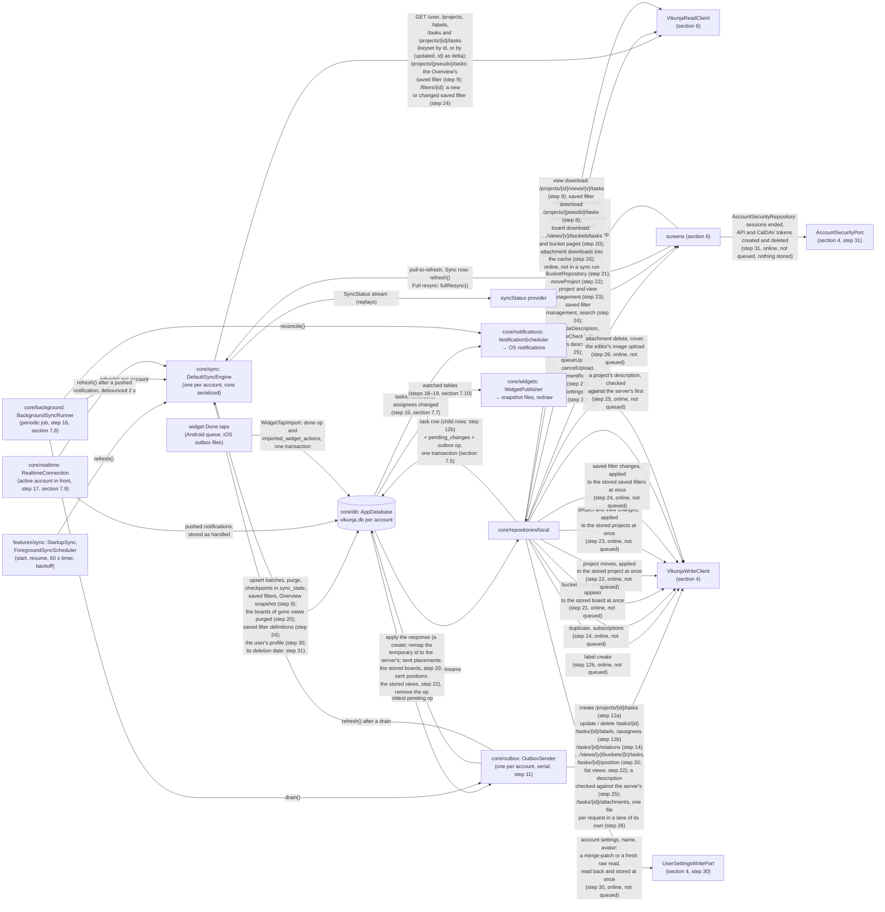

### 7.1 Database (`core/db/`)

`AppDatabase` (`@DriftDatabase`, schema version 2 since step 11, 3 since step 12a, 4 since step 15, 5 since step 16, 6 since step 9, 7 since step 20 [exists, step 20]; step 21 keeps it at 7 [exists, step 21], and so do step 22 [exists, step 22], step 23 [exists, step 23], step 24 [exists, step 24], step 25 [exists, step 25], step 26 [exists, step 26], step 30 [exists, step 30] and step 31 [exists, step 31]; 8 since step 27 [exists, step 27]; 9 since step 28 [exists, step 28]; 10 since steps 18–19 [in review, steps 18–19]) with the tables in `core/db/tables/`. Keys are the server ids, except that a task created on this device carries a negative temporary id until its create is sent (step 12a, section 7.5); dates are nullable UTC epoch milliseconds; every entity keeps the server's `created` and `updated`.

| Table | Columns |
|---|---|
| `projects` | id, title, description, identifier, hex_color, parent_project_id, is_archived, is_favorite, position, owner_id?, created, updated; since step 22 position and parent_project_id are also written alone, as the server answered a move of the project, until the next sync stores the whole project again [exists, step 22]; since step 23 also the fields of an edit as the server answered them and `is_archived` down the stored subtree for an archive or unarchive, both with the stored `updated` kept, so the next sync stores the whole project again, a created project (and a copy the sync after its duplicate missed) whole from the answer, and a deleted project removed with its stored subtree [exists, step 23]; since step 25 also the description alone, as the server answered a save or, when the save found it changed on the web, as the server has it [exists, step 25]; since step 28 max_permission? (the user's `Permission.value`, null while unknown) from the sync's project list, kept when the answer of a write is applied, null for a project created or duplicated here until the next sync [exists, step 28] |
| `project_views` | id, project_id, title, kind, position, filter_json?, bucket_configuration_mode, default_bucket_id, done_bucket_id; since step 21 the two bucket ids are also written alone, as the server answered a done or default bucket change or a delete cleared them, until the next sync stores the whole view again [exists, step 21]; since step 23 also one view as the server answered its create, edit or move, and removed with its board and snapshot after its delete [exists, step 23] |
| `labels` | id, title, description, hex_color, created, updated; since step 28 also a label as the server answered a change, and removed after a delete, its task links through the foreign key and its queued adds with it [exists, step 28] |
| `users` | id, username, name; since step 12b also the users a people search returned; since step 30 the signed-in user's name also as an account settings change answered it [exists, step 30] |
| `tasks` | id, project_id, title, description, done, done_at, due_date, start_date, end_date, priority, percent_done, hex_color, identifier, index, is_favorite, position, repeat_after, repeat_mode, bucket_id, created_by_id?, created, updated, sync_run_id? (the run that last returned the task); since step 11 pending_changes? (JSON of the coalesced `TaskChanges` the server has not accepted yet) and pending_delete; since step 12a a negative id marks a task whose create is still queued; such a row has no `updated` until the server names it; since step 23 the identifiers of a project's server tasks are rewritten when its identifier changes, and a deleted project's tasks go with their queued ops [exists, step 23]; since step 25 the description also as saved in the editor or ticked here, before the server has it [exists, step 25]; since step 27 comment_count (0 by default) and is_unread (false by default), set from the sync's expands and kept when a task arrives without them (a write's answer, a task read on its own), kept in step by the details read, mark-read and this device's comment writes [exists, step 27] |
| `task_labels`, `task_assignees` | task_id + label_id, task_id + user_id; since step 12b also written by a local edit, before the server has it (section 7.5) |
| `task_reminders` | task_id, ordinal (reminders have no server id), reminder, relative_period, relative_to; since step 12b also written by a local edit, with the instant of a relative reminder computed on the device until the server's arrives (section 7.5) |
| `task_relations` | task_id, other_task_id, kind; since step 14 also written by a local edit, together with the inverse row on the other task when that task is local, and other_task_id may be a temporary negative id until the other task's create is sent, when `completeCreate` rewrites it (section 7.5) [exists, step 14]; since step 9 read in the order the rows were stored, which is the server's order for a pulled task (the web nests subtasks in that order), and pulling a task keeps the rows other tasks hold to it in place [exists, step 9] |
| `outbox` (step 11) | id (uuid), sequence (account-local, FIFO), kind (update, delete; since step 12a also create; since step 26 also `uploadAttachment`, one per file [exists, step 26]), task_id (for a create the temporary negative id), payload (JSON `TaskChanges`, since step 14 with `relations` as `{"added": [{"kind", "other"}], "removed": […]}` [exists, step 14], since step 25 with `description_base` and `checklist_toggles` (`[{"item_id", "checked"}]` or `[{"ordinal", "text", "checked"}]`), never sent [exists, step 25], since step 26 with `cover_image_attachment_id` [exists, step 26]; for a create the `NewTask`; since step 26 for an upload `{"file", "name", "size", "mime"}` (`QueuedUpload`: the stored copy's random name in the uploads folder, never a path, the attachment's sanitised name, its size and type) [exists, step 26]), created_at, attempts, next_attempt_at?, last_attempt_at? (when it was last sent; the "failed … ago" of a sync problem), state (pending, sending, failed), last_error? (JSON: failure kind, code, message; since step 25 the kind `description_conflict` [exists, step 25]; since step 26 `file_too_large` [exists, step 26]); since step 12a sent_at? (when a create's request may have reached the server without an answer: the first such attempt's time; null for every other op, section 7.5; since step 26 an upload's too, which a refusal clears [exists, step 26]) |
| `task_id_remaps` (step 12a) | local_id (the temporary negative id), server_id, at: written in the transaction that applies a sent create and read by `watchTask`, which follows a task across its remap; never pruned, because a screen may still hold the old id and temporary ids are never reused |
| `scheduled_notifications` (step 15) | key (`<taskId>:reminder:<ordinal>` or `<taskId>:due`, primary key), os_id (the plugin's 31-bit id, unique), task_id, kind, fire_at, title, body, snoozed_until?, snooze_original_fire_at? (the planned instant a snooze belongs to; a different instant in the plan drops the snooze): what the scheduler handed to the OS last, the mirror the next diff runs against; written by the UI isolate's scheduler and by the background action isolate (section 7.7); since step 35a also hidden_on_lock_screen and done_needs_unlock, the privacy the OS was given, which the diff compares like the texts [exists, step 35a] |
| `server_notifications` (step 16) | id (the server's, primary key), name (the kind, such as `task.comment`; unknown kinds kept), payload (the JSON text of the server's `notification` object), created, read_at? (null while unread), read_pending? (the read state still to send; null when nothing is pending), notified (shown as an OS notification, or suppressed by the account's first activity sync): the newest 200 of the account's server notifications, written by the activity sync in either isolate and by a local mark-read (section 7.8) |
| `list_snapshots` (step 9) | list_key (primary key: `view:<viewId>` for a project view, `overview:<pseudo project id>` for the Overview's saved filter, since step 8 `filter:<pseudo project id>` for a saved filter opened as a list [exists, step 8]; since step 20 `view:<viewId>` also for a kanban view's board, and the sync's project phase removes the `view:` rows of views that no longer exist, which list views left behind before [exists, step 20]; since step 24 an `overview:` or `filter:` row only for a saved filter the device cannot evaluate, the sync removing the others, and a `view:` row decides only the order of a view whose filter the device evaluates [exists, step 24]), loaded_at: when the list was last downloaded; no row means never [exists, step 9] |
| `list_snapshot_tasks` (step 9) | list_key + task_id (primary key), position: the tasks of that download with their positions in the list (for the Overview's filter, and since step 8 a saved filter's, the index in the server's order); no foreign key on task_id, because the server may list a task this device does not have yet; a download replaces a list's rows and its `list_snapshots` row in one transaction [exists, step 9]; since step 20 bucket_id? (on a board the card's bucket, null in a list's snapshot) [exists, step 20]; since step 22 a list position this device sent is written into the row of each downloaded view it names at once, a task the download did not have added, until the next download [exists, step 22] |
| `kanban_buckets` (step 20) | view_id + bucket_id (primary key), title, limit, count (the server's total of the bucket's cards, not only the loaded ones), position, loaded_pages (how many pages of its cards the board holds, which a refresh downloads again): the columns of a kanban view as of its last board download, whose cards are the view's `list_snapshot_tasks` rows; a download replaces them with those rows in one transaction; no foreign key on view_id, because a project's views are rewritten wholesale by every project upsert, so the sync's project phase removes the buckets of views that are gone instead [exists, step 20]; since step 21 also changed one bucket at a time once the server accepted a column change: a created bucket added, a renamed, limited or moved one rewritten with its count kept, a deleted one removed with its snapshot rows moved to the bucket the server put them in [exists, step 21] |
| `imported_widget_actions` (steps 18–19) | id (the id a widget gave its Done tap, primary key), imported_at: the widget taps already applied; the import records one in the transaction that queues its Done, so a tap read again after a crash before its queue entry or file was deleted is skipped and a repeating task never moves twice; ids older than 30 days are forgotten (section 7.10) [in review, steps 18–19] |
| `list_preferences` (step 9) | key (`list:<listKey>`, `last_view:<projectId>`, `upcoming`; since step 8 `projects`, the Projects tab's `{show_archived, collapsed: [ids]}` [exists, step 8]), value (JSON): the `ListPreferences` of section 6 [exists, step 9]; since step 23 the keys of deleted projects and views and their collapsed ids are removed (`LocalListPreferences.forget`) [exists, step 23]; since step 29 the key `table_columns`, the columns of every table view as the web's column keys, and in a view's value `table_sort` (`field:dir`) and `timeline` (`{range: "default" | {from, to}, without_dates, day_width}`) [exists, step 29] |
| `sync_state` | key → value: `run_id`, `phase`, `phase_done`, `phase_total`, `last_id`, `done_filter`, `archived_project_id`, `last_synced_at`; since step 7 also `last_full_sync_at` and `watermark` (the newest task `updated` the database held when a run completed); since step 12a `local_task_ids` (how many temporary ids were handed out); since step 13 the user's settings as JSON (section 7.3) [exists, step 13], since step 9 with `filter_id_used_on_overview` and `minimum_priority`, since step 10 with `comment_sort_order` [exists, step 10], since step 8 with `color_schema` and, once the user set them, `date_display`, `time_format` and `default_view` [exists, step 8], since step 30 with the name, the email reminders, the discoverable flags and the overdue reminders with their time [exists, step 30]; since step 30 `user_profile` (JSON: id, username, name, `is_local_user`, `auth_provider`, `pending_email`, `updated` and, since step 31, `deletion_scheduled_at`, left out while no deletion is scheduled, so a profile stored before reads as none [exists, step 31], from every run's `GET /user` and every account settings change; absent before the first run of this version, a value it cannot read as absent) and `avatar_provider` (the provider's wire name as the account settings last read or wrote it; the sync never reads it) [exists, step 30]; since step 9 `saved_filters` (JSON: the pseudo project id and title of each saved filter the last project list named; absent while it named none) [exists, step 9], since step 8 with `is_favorite` [exists, step 8], since step 24 with the description, the `updated` of the last project list and the `definition` as `GET /filters/{id}` last answered it (`{filter, timezone, updated}`: the filter with include-nulls, search and sort, the saved filter's own timezone when the server sends one, and its `updated` when read), an entry stored before reading as one with an unknown definition [exists, step 24]; `pending_whole_pull` (the projects the next incremental run pulls whole, section 7.3), since step 23 also written by `pullWholeOnNextRun` for projects the app unarchived or stored itself [exists, step 23] |

- Indexes: `tasks(project_id)`, `tasks(done, due_date)`, `project_views(project_id)`, since step 11 `outbox(state, sequence)`, since step 15 the unique `scheduled_notifications(os_id)`, and the list tables of step 9 and `kanban_buckets` of step 20 have only their primary keys; the primary key of `task_labels` covers `task_id`. Foreign keys cascade from the task child tables to `tasks`, from `task_labels` to `labels`, `task_assignees` to `users` and `project_views` to `projects`; `tasks.project_id` and `task_relations.other_task_id` have none, because a task can arrive before its project and the other task may be unreadable.
- Not stored: pseudo projects as projects (Favorites `-1`, saved filters `≤ -2`; the sync skips them, but since step 9 it keeps the saved filters' ids and titles in `sync_state` and the Overview's saved filter as a list snapshot, since step 8 also their favourite flag, and a saved filter opened as a list has a snapshot of its own; Favorites not at all, its list is a query over the favourite tasks; since step 24 the saved filters' definitions in `sync_state` too, and the snapshots only of those the device cannot evaluate [exists, step 24]), comments, attachments and reactions, which the detail sheet reads online since step 10, so step 10 kept the schema at version 6 [exists, step 10]; step 27 stores a task's comment count and unread flag (schema version 8), but still not the comments and reactions, which it writes online, since the thread can only be read online and a reaction bumps no `updated` [exists, step 27]; step 28 stores the user's permission on each project, but not teams, their members and a project's shares, which are read online, since adding a member or toggling admin bumps no `updated` [exists, step 28]; step 26 keeps attachments and the cover online too, because an upload bumps no `updated` and the sync could not keep a stored list current: queued uploads are outbox rows and their files live in the uploads folder (below), so the schema stays at version 7 [exists, step 26]; the account's settings beyond what `UserSettings` models, the web's other `frontend_settings` keys among them, stay on the server only, which is why a write never starts from the stored settings (section 4), and step 30 keeps the schema at version 7 too [exists, step 30]; so does step 31, which stores none of the account's security and integration settings, because they change on the server, the sessions with every refresh anywhere, and a token's value must never reach the database (section 6) [exists, step 31]; buckets are stored since step 20, per view as of the board's last download (`kanban_buckets`, schema version 7), while `tasks.bucket_id`, which every sync run overwrites with 0, stays unused [exists, step 20]; step 21 changes them in place after a column change, without a schema change [exists, step 21]. Positions per view are stored only in the view snapshots of step 9 and, since step 20, the boards, which the project screen downloads and the sync never does; every other endpoint answers `position: 0` [exists, step 9]; since step 22 a list position still queued lives in the task's `pending_changes`, and one sent goes into the downloaded views at once [exists, step 22]. A full resync keeps the list snapshots and preferences, and they go with the account's database at sign-out. Related tasks are relation rows only; the mappers (`core/db/mappers/`) rebuild `Task.relatedTasks` from the rows whose other task is local, because nested related tasks carry no relations of their own.
- DAOs with stream queries: `ProjectsDao.watchAll()`; `TasksDao.watchOpenTasks()` (`done = false`, due date ascending with nulls last, then newest first; since step 12a newest first puts a task created here before every server task, then sorts by id descending); until step 9 `TasksDao.watchProjectTasks(projectId, showDone:)` (position, then newest first, as in step 5). A watched list is hydrated with its labels, assignees, reminders and relations in four batched queries per list (ids chunked by 500), never per task; since step 9 the relations in the order their rows were stored. Upserts run in transactions and batches; `ProjectsDao.purgeNotIn(ids)`, `LabelsDao.purgeNotIn(ids)` and `TasksDao.purgeNotInRun(runId)` serve the full pull; the incremental run of step 7 adds `TasksDao.countInProject`, `countNotInProjects`, `maxUpdated`, `purgeInProjects`, `purgeInProjectExcept(projectId, ids)` and `ProjectsDao.purge(ids)` (section 7.3). Since step 11 every task query and every count leaves out rows with `pending_delete`, and the outbox DAO serves the sender and the Account tab (section 7.5). Since step 12a the local count the probe compares also leaves out the negative ids, which the server does not hold yet, and `OutboxDao` adds `queueCreate` (the temporary id from the `sync_state` counter, the row and the create op), the fold of later edits into an unsent create, `cancelCreate`, `markUncertain` and `completeCreate` (the remap transaction), while `TasksDao` adds `watchTask` with `resolveId`. Step 12b extended `queueUpdate`, `queueCreate`, the fold into an unsent create, `completeCreate` and the sync's `TasksDao.upsertAll` (`_keepQueued`) to the child tables (section 7.5). Step 16 adds the DAO of `server_notifications`: upsert a page (keeping the local `read_pending` and `notified`), watch everything newest first, watch the unread count after the pending reads, mark read locally, list the pending reads, the highest id, prune to the newest 200 (section 7.8) [exists, step 16]. Step 14 extends `queueUpdate`, the fold into an unsent create, `completeCreate` and `TasksDao.upsertAll` to `task_relations`: the local apply with the inverse rows, the rewrite of temporary other-task ids in the rows and in the queued payloads, and the overlay of pending relation deltas (section 7.5) [exists, step 14]. Step 9 adds `TasksDao.watchActiveOpenTasks()` (`watchOpenTasks` without the tasks of archived projects and their subprojects), `watchOpenTasksInList(listKey)` (the open tasks among a list snapshot's, ordered like `watchOpenTasks`, with the snapshot's time; a task done or deleted here leaves at once) and `watchProjectList(projectId, listKey, includeDone:)` (the project's tasks, without `includeDone` only the open ones and the done ones in the view's snapshot, plus every task reachable from them as a subtask, loaded level by level, the snapshot and whether done tasks were left out); `TasksDao.upsertAll` keeps the rows other tasks hold to a pulled task in place while their edge stays; `ListSnapshotsDao` (`replace` a list's snapshot in one transaction, `load`, `watch`, `removeAll(prefix, keep:)`), `ListPreferencesDao` (`watchValue`, `read`, `write`) and `SyncStateDao.watchValues(keys)` [exists, step 9]. Step 10 adds `TasksDao.findByIdentifier(identifier, index)`: the local project whose identifier equals it ignoring case, and its visible task with that index unless that task is not local, null without such a project; compared in Dart, because SQLite's `lower()` folds ASCII only (`ÄB`, `STRAßE`) [exists, step 10]. Step 8 adds `TasksDao.watchFavoriteTasks()` (the open favourite tasks among `watchActiveOpenTasks`, in its order), and `ListSnapshotsDao.removeAll` takes a set of keys to keep [exists, step 8]. Step 20 adds `KanbanDao`: `replaceBoard(viewId, buckets:, slots:, loadedPages:, loadedAt:)` (the view's buckets, its snapshot rows with their bucket and its `list_snapshots` row in one transaction, so a reader sees the old board or the new one), `appendToBucket` (the next page of one bucket: a card listed in another bucket moves here, as the newer answer, and leaves that bucket's count; the count from the page when it reports one, v2 only; after the last page the bucket counts the cards it holds, so a card the server lists in two buckets cannot leave it wanting more; nothing for a bucket the board no longer has), `load` (buckets in position order, then id, and the cards; empty without a download), `loadedPages`, `applySentPlacements(taskId, placements)` (a placement the server accepted moves the card on each downloaded board with that bucket, at the sent position, else its own, else on top of the bucket, and moves one from the count of the bucket it left to the one it entered) and `removeGoneViews()` (the `view:` snapshots and the buckets of views `project_views` no longer has); and `TasksDao.watchBoard(projectId, viewId)` over `loadBoard`: one stream over the task tables, the snapshot tables, `project_views` and `kanban_buckets` that gives the `BoardSource` with the project's open tasks and only the done ones the board can show (listed in the snapshot, under a temporary id, with pending changes, or created or updated after the download), because a long-lived project holds far more done tasks than open ones, and the queued placements and moves into the project read from the rows' `pending_changes` [exists, step 20]. Step 21 adds `KanbanDao.buckets(viewId)` (a view's buckets in board order, which `load` now reads through), `putBucket` (a bucket the server created, with its count and one page; one a download stored already keeps its count), `updateBucket` (title, limit and position as the server stored them, the count and the pages loaded kept; false without the bucket) and `removeBucket(viewId, bucketId, movesTo:)` (the bucket goes, its cards move to `movesTo` with their positions and add to its count, or leave the board until the next download when the board lacks it), `ProjectsDao.loadView(viewId)` and `setViewBuckets(viewId, doneBucketId:, defaultBucketId:)` (only the ids given, 0 for none), and `TasksDao.loadBoard` names the tasks whose queued change carries `done` (`BoardSource.queuedDoneChanges`), for the refined done rule of `buildBoard` [exists, step 21]. Step 22 adds `ListSnapshotsDao.applySentPositions(taskId, positions)` (each sent position into the snapshot of the view it names, a task the download did not have added, a view never downloaded left alone, a board card's bucket kept) and `ProjectsDao.moveProject(projectId, position:, parentProjectId:)` (only those two columns, as the server answered a move); `TasksDao.watchProjectList` and `loadProjectList` take the view id in place of the list key (0 for a project without a list view) and add the positions queued for the view, read from the `pending_changes` of the project's visible tasks (`ProjectListSource.queuedPositions`) [exists, step 22]. Step 23 adds `ProjectsDao.loadProject(projectId)` (one project with its views in order and its owner), `subtreeOf(projectId)` (it and every stored project below it), `updateProject(projectId, title:, identifier:, hexColor:, parentProjectId:, isFavorite:, position:)` (only the fields given, `updated` kept; an identifier also through `TasksDao.renameIdentifiers`, which gives the project's server tasks `IDENT-<index>`, or `#<index>` without one, as the server does without bumping their `updated`, and leaves the tasks created here to the server), `setArchived(projectId, archived:)` (down the stored subtree, whose ids it returns), `purgeSubtree(projectId)` (the projects with their views through the foreign key, their boards and snapshots through `KanbanDao.removeGoneViews`, and their tasks through `TasksDao.purgeInDeletedProjects`, which unlike `purgeInProjects` takes the tasks with queued ops too, cancelling a queued create (`OutboxDao.cancelCreate`) and removing the other ops, except for a server task whose queued change moves it into one of the projects, since the server still has it where it was; the ids of the projects and views returned), `putView` (a view as answered) and `removeView` (with its board and snapshot), and `ListPreferencesDao.removeAll(keys)` [exists, step 23]. Step 24 adds `TasksDao.loadFilterRowsInProject(projectId, openOnly:)` and `loadFilterRowsOfSavedFilters(openOnly:)`, the candidates of a view's scope (the project's visible tasks) and of a saved filter's (the visible tasks outside archived projects and the favourite ones anywhere), only the open ones when asked, each a `FilterRow` with the creator's username, the label ids, the assignees' usernames and the reminder instants, loaded in batched queries (ids chunked by 500), never per task; `loadOpenTasksAmong(ids)` (in the Overview's order), `loadSearchableTasks` (behind `watchSearchableTasks`); `projectListTables`, `boardTables` and `savedFilterTables`, the tables a source reloads on (a project list now also on `project_views`, so a view's changed filter is evaluated at once); `loadProjectList` with the `matchingIds`, which brings the matching done tasks along, and `loadBoard` with them, which on a board never downloaded loads every matching task; and `ListSnapshotsDao.remove(listKey)`. `watchTables` takes `alsoOn`, a stream whose events reload like a table change [exists, step 24]. Step 25 adds `OutboxDao.queueUpdate(ifDescription:)` (queued only while the row's description is still that one, checked in the queueing transaction), `retryOverwritingDescription(id, base:)` (a failed update back in the queue with a new description base) and `dropDescription(id)` (a failed update without its description, back in the queue with the rest or gone when that was all), over the payload helpers `withDescriptionBase` and `withoutDescription` (`apply_task_changes.dart`), and `ProjectsDao.updateProject(description:)` [exists, step 25]. Step 26 adds `OutboxDao.queueUpload` (the op of its own per file, following a temporary id whose create was answered meanwhile; null for a task unknown here or queued for deletion), `takesUploads`, `queuedUploads` (the uploads that may go: not failed, under a server id, oldest first, some possibly `sending`), `uploadFiles` (every stored copy an op names, for the sweep), `removeUpload` (the op whatever its state, answering its copy's name once for the caller to delete) and `watchPendingUploads` (across the remap); for the new kind `nextInLine` leaves uploads out, `queueDelete` drops a task's unsent uploads with its unsent update, `markFailed` marks an upload failed without folding it (`sent_at` cleared after a refusal, kept after a network or server failure), `_newerUnsent` looks only at updates and deletes, so an upload behind a failed update never makes the update look superseded, `resetSending(keep:)` leaves the uploads the caller is still streaming and marks the others it resets uncertain like a create, a cancelled create drops its uploads, and `completeCreate` moves them to the server id like every op behind the create [exists, step 26]. Step 27 adds `TasksDao.storeCommentState(id, commentCount:, isUnread:)` (written only where a value differs, so that the lists do not reload for nothing), `addToCommentCount(id, delta)` (never below 0) and `upsertAll(withCommentState:)`, with which only the sync's pages, read with both expands, set the two columns, while every other upsert keeps the stored ones; a task created here starts at 0 and false [exists, step 27]. Step 28 adds `LabelsDao.remove(id)`: the row, its task links through the foreign key and, through `OutboxDao.forgetLabels`, its queued adds, in one transaction, sharing its body with `purgeNotIn` [exists, step 28].
- Files and opening: `AccountDatabaseFiles.pathFor(accountId)` is `<application support>/accounts/<accountId>/vikunja.db`; `deleteFor` removes it with `-wal`, `-shm` and `-journal`. The `appDatabase(accountId)` provider (keepAlive) opens it through `openAccountDatabase` (drift_flutter, `shareAcrossIsolates: true`, WAL set up in the database isolate) and closes it on dispose and on sign-out through the `OpenDatabases` registry, which lets sign-out await the close before it deletes the files: `AppDatabase.close()` only disconnects this isolate's client, and the database isolate closes sqlite and unregisters itself afterwards on its own, so the registry then polls `IsolateNameServer` (every 20 ms, up to 5 s, logged on timeout) until the `drift-db/account_<id>` mapping is gone (`awaitAccountDatabaseClosed`). A client in another isolate keeps the database isolate alive past that wait; a background connection must therefore be gone before sign-out wipes the files, or the re-opened account would write into an unlinked file; step 16's heartbeat skip (section 7.8) narrows this to a background run that began before the app came to the front, a case [D40](decisions.md#d40-background-sync-one-periodic-job-for-every-signed-in-account-with-a-deadline-skipped-while-the-app-is-in-front-the-incremental-run-as-the-session-keep-alive-a-one-off-drain-after-a-background-done-server-notifications-synced-into-a-local-inbox-on-their-own-cadence-new-unread-ones-as-activity-notifications-the-first-run-silent) leaves open. Never in the iOS App Group container; the widgets read JSON files there (iOS) or in `<application support>/widgets` (Android), never a database (section 7.10) [in review, steps 18–19]. Since step 26 `uploadsDirectoryFor(accountId)` is `<application support>/accounts/<accountId>/uploads`, the stored copies of the account's queued uploads under random names (`UploadFiles`: 32 hex digits, the only names that become paths; copied, or moved for a file the app owns, before the op is queued and counted as being queued until then, deleted after the upload, a Cancel or a Discard, and orphans, such as those of a cancelled create, a deleted task or a killed run, swept by the sender's first drain and after a task's delete), so an upload survives the app's caches being cleared and the picker's copy going; `deleteFor` removes it with the database. Downloaded attachments live in the app's cache instead, `<cache>/attachments/<account>/<task>/<attachment>/<sanitised name>` (`AttachmentDownloads`: a folder per attachment keeps two of the same name apart while the file keeps its name for the app it goes to; reused while the size matches, a use touching it; purged per account on sign-out and after three days unused); Android's shares and picked documents pass through `cache/share-inbox` and `cache/picked` (section 8) [exists, step 26].
- Schema versioning: `app/drift_schemas/drift_schema_v<N>.json` holds the dump of every version (1 since step 6; 2 since step 11: the `outbox` table and the `pending_*` task columns; 3 since step 12a: `task_id_remaps` and `outbox.sent_at`; 4 since step 15: `scheduled_notifications`; 5 since step 16: `server_notifications`; 6 since step 9: `list_snapshots`, `list_snapshot_tasks` and `list_preferences`, and the migration deletes `last_full_sync_at`, so that the first run after the upgrade is a full one, which puts every parent's subtasks back into the server's order (before, a child's pull could move its edge to the end of the parent's relations); 7 since step 20: `kanban_buckets` and `list_snapshot_tasks.bucket_id`, which the migration adds from 6 (an older database gets the snapshot table with it), with nothing to migrate [exists, step 20]; 8 since step 27: `tasks.comment_count` and `tasks.is_unread`, and the migration deletes `last_full_sync_at` again, because the incremental run sees only tasks that change, so that the first run after the upgrade is a full one that fills both for every task [exists, step 27]; 9 since step 28: `projects.max_permission`, the migration again deleting `last_full_sync_at`, so that the first run after the upgrade fills it for every project [exists, step 28]; 10 since steps 18–19: `imported_widget_actions`, which the migration creates, with nothing to migrate [in review, steps 18–19]; 11 since step 35a: `scheduled_notifications.hidden_on_lock_screen` and `done_needs_unlock`, added with false from version 4 on [exists, step 35a]; each migrated from the one before and covered by a migration test with data), `app/test/core/db/generated/` is generated from the dumps, and a test checks that the generated schema still matches the code. Every later schema change bumps the version, adds a dump and a migration test on this harness. The commands are in the [README](../README.md#common-commands).

### 7.2 Local repositories (`core/repositories/local/`)

`LocalProjectRepository` and `LocalTaskRepository` implement the step 5 interfaces (whose project list reads step 9 replaced, section 6):
- `watch*` are the DAO streams, so a row the sync writes is on screen with the next stream event.
- `refresh*` call `SyncEngine.refresh()` and rethrow its `VikunjaFailure`; the stale rows stay in the stream.
- No list is paged: the database holds every task. Until step 9 `loadMoreProjectTasks` was a no-op, `PagedList.hasMore` false and `showDone` a WHERE clause; step 9 removed them.
- `find(id)` answers from the latest snapshot of the stream.
- Since step 11 the writes `setDone`, `setFavorite` and `deleteTask` run one transaction on the task row and the outbox and then ask the sender to drain; `watchPendingChanges`, `watchSyncProblems`, `watchPendingTaskIds`, `retrySyncProblem`, `discardSyncProblem` and `sendPendingChanges` read and change the outbox or drive the sender (section 7.5). Since step 12a: `createTask` (`OutboxDao.queueCreate`: the row under a temporary negative id plus the create op, one transaction, the local id returned, then a drain), `updateTask` (the extended `TaskChanges` through the same queue as `setDone`; an empty change is a no-op) and `watchTask` (`TasksDao.watchTask`: one stream over the task tables and the remap table that resolves the id through the remap on every emission; null once the row is gone or queued for deletion). Since step 12b: `updateTask` takes the label and assignee deltas and the reminder list, which change the child rows in the same transaction (section 7.5); `undoDone` restores a repeating task's reminders; `LocalLabelRepository` and `LocalUserRepository` implement the interfaces of section 6. Step 14: `updateTask` takes relation deltas, which change `task_relations` on both tasks in the same transaction (section 7.5); `duplicateTask` drains the outbox first and refuses while the task still has queued ops, then calls `TasksWritePort.duplicate` with the server id and upserts the copy; `LocalSubscriptionRepository` implements `SubscriptionRepository` over the read and write clients, resolving a temporary task id through the remap and refusing a task whose create is still queued [exists, step 14].
- Step 9 ([D43](decisions.md#d43-task-lists-from-the-local-database-like-the-webs-a-view-snapshot-for-positions-and-server-only-filters-the-overviews-saved-filter-downloaded-by-the-sync-upcoming-with-the-web-presets-and-a-pinned-overdue-part)) [exists, step 9]: `watchActiveOpenTasks` is one DAO stream shared by every listener (`SharedLatest`, which gives a listener that joins the newest list at once), because Upcoming and the Overview watch the same query; `watchOverviewTasks` follows the filter that the stored user settings and saved filters name and switches between that stream and `TasksDao.watchOpenTasksInList('overview:<pseudoId>')` when it changes; `watchProjectList` is `TasksDao.watchProjectList` under the view's list key. `refreshProjectList` runs `SyncEngine.refresh()` and then downloads the view (`downloadViewSnapshot` in `core/sync/list_downloads.dart`): `GET /projects/{p}/views/{v}/tasks` sorted by position, every page at the server's `max_items_per_page`, with `filter_timezone` from the user's timezone setting when it is set, so relative dates in the view's filter round as the web asks for them; the task ids and positions replace the snapshot `view:<viewId>` in one transaction; a failure throws its `VikunjaFailure` and keeps the previous snapshot. The download needs a connection and is never part of a sync run. `LocalListPreferences` implements `ListPreferences`.
- Step 10 ([D44](decisions.md#d44-task-detail-complete-rich-text-from-an-own-parser-of-the-web-editors-schema-details-and-comments-online-on-demand-deep-links-on-the-app-scheme)) [exists, step 10]: `LocalTaskDetailsRepository` implements `TaskDetailsRepository` over the read and write clients, addressed by the task's server id (`TasksDao.resolveId`; a temporary id still without one throws `TaskNotSyncedYet`), and stores nothing. `LocalTaskResolver` implements `TaskResolver`: an id is resolved through the remap and found with `TasksDao.find`, an identifier with `TasksDao.findByIdentifier`. A task that is not local is read online: by id with `TasksPort.read`; by identifier with `readByIndex`, using the local project's numeric id when the project is local and the identifier as typed otherwise; an all-digit identifier that no local project has is `NotFound` without a request, because the server reads such a segment as a project id. The task read online is stored with `TasksDao.upsertAll`, without a sync run, like a duplicate: the next full sync keeps it while the user can see it and purges it otherwise; a row queued for deletion stays hidden through the upsert, and the resolver then answers `NotFound`.
- Step 8 ([D45](decisions.md#d45-app-shell-on-wide-android-screens-the-colour-scheme-and-dynamic-colour-the-webs-display-settings-applied-only-when-set-translated-default-names-the-project-tree-with-favourites-saved-filters-and-archived-projects-smart-lists-a-sticky-offline-banner)) [exists, step 8]: `watchFavoriteTasks` is `TasksDao.watchFavoriteTasks`, `watchSavedFilterTasks` is `TasksDao.watchOpenTasksInList('filter:<pseudoId>')`. `refreshSavedFilter` runs `SyncEngine.refresh()` and then downloads the filter (`downloadSavedFilter` in `core/sync/list_downloads.dart`): the Overview filter's request, `GET /projects/{pseudo}/tasks` with `filter=done = false`, sorted by due date and then by id descending, every page at the server's `max_items_per_page`, plus `filter_timezone` from the user's timezone setting when it is set, so relative dates in the filter round as the web asks for them; the task ids replace the snapshot `filter:<pseudoId>` in one transaction, also when they did not change, so its `loaded_at` says when the list was last checked; a failure throws its `VikunjaFailure` and keeps the previous snapshot. Like a view's, the download needs a connection and is never part of a sync run. `LocalProjectRepository.watchSavedFilters` reads `sync_state` `saved_filters`, by `compareTitles`, then by id; `LocalListPreferences` stores the `ProjectTreePreferences` under the key `projects`.
- Step 20 ([D47](decisions.md#d47-kanban-board-from-per-view-board-snapshots-moves-and-positions-through-the-outbox-with-the-done-buckets-rules-accessible-drag-and-drop)) [exists, step 20]: `watchBoard` is `TasksDao.watchBoard`. `refreshBoard` runs `SyncEngine.refresh()` and then downloads the board (`downloadBoard` in `core/sync/list_downloads.dart`): one `BucketsPort.board` request, the first page of every bucket at the server's `max_items_per_page`, at most 50, with `filter_timezone` from the user's timezone setting when it is set; then, for every bucket of which more pages were loaded before (`loaded_pages`) and the server still has more, those pages again through `bucketTasks`, so what the user scrolled to stays; a card the server lists in two buckets (filter mode) stays in the first; the buckets, the cards and the pages loaded replace the board under `view:<viewId>` in one transaction (`KanbanDao.replaceBoard`); a failure throws its `VikunjaFailure` and keeps the previous board. `loadMoreOfBucket` (`downloadNextBucketPage`) reads the bucket's next page and appends it (`KanbanDao.appendToBucket`), and does nothing while the board has never been downloaded or no longer has the bucket. Like a view's, these downloads need a connection and are never part of a sync run. `placeTask` queues `TaskChanges(kanban: {viewId: placement}, done: done)` through the queue of `updateTask` (section 7.5).
- Step 21 ([D48](decisions.md#d48-bucket-management-online-applied-to-the-local-board-at-once-from-a-column-menu-with-a-guard-against-the-servers-orphaned-tasks)) [exists, step 21]: `LocalBucketRepository` implements `BucketRepository` over the database, the write client and the task repository's `refreshBoard`. `create` sends the trimmed title with the position right of the last stored bucket (`calculateItemPosition(last, null)`, 2^16 on an empty board) and adds the answer with count 0 (`putBucket`); `rename` and `setLimit` send the stored bucket's other two fields along, and `move` the position `planBucketMove` gives for the new index: between the new neighbours as the web computes it, 2^16 below a first neighbour at 0 or less, where halving would not go below it, the shared position of two neighbours when the id sorts between them, and nothing sent when the bucket is there already or no position would put it there; each writes what was sent with `updateBucket`, the stored count kept. `setDoneBucket` and `setDefaultBucket` send `setBuckets` (null as 0) and store the view as answered (`setViewBuckets`), so an unknown id becomes none. `delete` first reads the view from the server and stores it, because a default chosen on the web since the last sync decides where the tasks go, then plans on the board as built (`planBucketDeletion` with `columnHoldsTasks`: cards shown, or a downloaded count above 0): the view's default bucket while it stays, else the leftmost remaining. **The orphan guard:** while no other default is set, the server moves the tasks to the leftmost bucket counted before the delete, so deleting the leftmost strands its tasks outside every bucket (`isFallback`); when it holds tasks (`defaultFirst`), the leftmost remaining becomes the default (`setBuckets(defaultBucketId:)`) before the delete, a refusal of that (a write share is not an admin) leaves the delete unsent, and a failed delete puts the old default back, or throws `DeleteFailedAfterNewDefault` when that fails too; a fallback bucket that looks empty here is checked with a board download first, since a task created elsewhere after the last one is only in the server's count. After the delete one transaction removes the bucket (`removeBucket`, its cards to the planned target) and clears the view's done or default id that named it. After every success the board downloads quietly (`refreshBoard`, not awaited, a failure logged), so counts, placements and a view changed elsewhere settle; an update of a bucket deleted elsewhere (404 code 10001) starts it too, which drops the bucket. Nothing is queued: offline every call throws its `NetworkFailure`. `downloadBoard` now takes its time before the request, so a change the server makes while the board is read counts as newer than the download.
- Step 22 ([D49](decisions.md#d49-manual-ordering-list-views-by-drag-through-the-outbox-projects-reordered-and-nested-online-never-a-project-position-below-01)) [exists, step 22]: `positionTask` queues `TaskChanges(positions: {viewId: position})` through the queue of `updateTask` (section 7.5), and `watchProjectList` hands the DAO the view id, whose queued positions the source carries. `LocalProjectRepository` gets the write client: `moveProject` refuses a position below 0.1, infinite or NaN with an `ArgumentError`, sends `ProjectsWritePort.move`, writes the answer's position and parent (`ProjectsDao.moveProject`) and starts a quiet `SyncEngine.refresh()`, not awaited, a failure only logged, which brings what else the move changed on the server (the project's `updated`). Nothing is queued: offline the call throws its `NetworkFailure`, and any failure leaves the stored project as it was.
- Step 23 ([D50](decisions.md#d50-project-management-and-views-online-applied-to-the-local-database-at-once-from-the-project-screens-menu)) [exists, step 23]: `LocalProjectRepository.createProject` sends the trimmed title (blank: an `ArgumentError`) and stores the answer with its four views (`ProjectsDao.upsertAll`). `updateProject` trims the title and the identifier, refuses before any request what the server would (archiving the user's default project from the stored settings, 3013; unarchiving under an archived stored parent, 3016) and sends only the set fields; a project stored below 0.1, where a create or a duplicate may leave it, gets a position of at least 0.1 between its neighbours under the parent it ends under in the same update, because any update that leaves it there makes the server renumber its siblings, at the top level every user's. The answer's values of the fields sent and its position go into the stored project (`ProjectsDao.updateProject`, an identifier with the tasks'), an archive state down the stored subtree (`setArchived`), and an unarchived subtree is marked to be pulled whole (`pullWholeOnNextRun`), since the next run finds it unarchived already and would not pull its tasks. `deleteProject` sends the delete, then purges the stored subtree (`purgeSubtree`) and forgets its list preferences (`LocalListPreferences.forget`: the lists of its views and projects, the view last shown, the collapsed ids) in one transaction; the scheduled notifications of its tasks follow through the scheduler's watch (section 7.7). `duplicateProject` awaits `SyncEngine.refreshAfterWrite()`, whose run finds the copy new and pulls it whole; when that run fails or misses it, the answer is stored and marked to be pulled whole by the next run, so the copy's id comes back either way. The other writes start `refreshAfterWrite()` without awaiting it, a failure only logged. `LocalProjectViewRepository` implements `ProjectViewRepository` over the database, the sync engine, the write and read clients and the server's `max_items_per_page`: each call loads the stored project (`ProjectsDao.loadProject`) and refuses a project or view it no longer has (`NotFound` 3001 or 3014) and a blank title before any request; `createView` places a view without a position after the last (`calculateItemPosition(last, null)`); `moveView` sends the position from `planViewMove` (between the new neighbours as the web computes it, 2^16 below a first neighbour at 0 or less, a shared position when the id sorts between) through `ProjectViewsWritePort.move`, the position alone, so a title, filter or mode changed elsewhere since the last sync is not written back; `deleteView` refuses the only view (`LastViewNotDeletable`) and removes the view with its board, snapshot and list preferences in one transaction. The answer of a create, an edit or a move is stored with `putView`; after every call `refreshAfterWrite()` runs quietly, after which a created or edited list or Kanban view (since step 29 also a table or Gantt view whose filter the engine refuses, `downloadsSnapshot` [exists, step 29]) downloads (`downloadViewSnapshot`, `downloadBoard`), since its stored tasks were picked by the old filter or kind. Nothing is queued: offline every call throws its `NetworkFailure`, and any failure leaves the database as it was.
- Step 24 ([D51](decisions.md#d51-one-filter-engine-on-the-device-with-the-servers-semantics-saved-filter-definitions-synced-on-change-and-managed-online-a-filter-builder-offline-search)) [exists, step 24]: `LocalTaskRepository` evaluates filters through `LocalFilters` (`core/filters/local_filters.dart`) over the database. `LocalFilter.compile` parses the filter text (`parseTaskFilter`; null when the engine refuses it or it names `bucket_id`, which needs a board's download), binds it to a `FilterContext` with the include-nulls flag and adds the search as the server applies a view's `s` (`matchesTaskSearch`); `matchingInProject` loads the project's candidates (only the open ones when the filter cannot match a done task, `matchesOnlyOpenTasks`) and returns the matching ids, null for a filter that restricts nothing or cannot be evaluated; `matchingOnBoard` does the same for a kanban view, null for a filter-mode one; `matchingForSavedFilter(definition, openOnly:)` uses the saved filter's scope and leaves its stored search out. The zone is `locationForFilters` (`core/filters/filter_zone.dart`, the bundled zone database loaded on first use): the saved filter's own timezone, else the user's timezone setting, else the device's zone (`TZ` where set, otherwise the zone whose offsets equal the device's over the coming year). `watchProjectList` and `watchBoard` evaluate on every reload of their tables and when the timezone setting changes; `watchOverviewTasks` and `watchSavedFilterTasks` switch (`switchLatest`, now in `shared_latest.dart`) between the evaluated open tasks and the snapshot's whenever the picked filter, its stored definition or the timezone setting changes. A filter with a relative date (`usesRelativeDates`, `changesWithTime`) is also evaluated again on every event of `clockTicks` (`watchTables(alsoOn:)`), every minute in front and on resume, so a list turns over at midnight and a task enters a list once it is overdue without any write. `refreshSavedFilter` syncs and downloads only a saved filter the device cannot evaluate. `watchLabelTasks` evaluates `done = false && labels in <id>` in a saved filter's scope. `LocalBucketRepository` plans a column's deletion on the board as shown, its filter evaluated the same way. `LocalSavedFilterRepository` implements `SavedFilterRepository` over the database, the sync engine and the write client: each call goes to the server (a blank title, and a pseudo project id that is no saved filter's, an `ArgumentError` before any request), writes the answer with its definition into the stored saved filters (`storeSavedFilterAnswer`; a delete `forgetSavedFilter`, which also removes its `filter:` and `overview:` snapshots), so its list and the Overview evaluate the new filter at once, and starts `refreshAfterWrite()` without awaiting it, a failure only logged; `read` stores the definition of a listed saved filter only. Nothing is queued: offline every call throws its `NetworkFailure`, and any failure leaves the database as it was. `LocalTaskSearch` implements `TaskSearch`: one `SearchIndex` (`core/filters/search_index.dart`) shared by every query (`SharedLatest`), rebuilt on every change of the tasks, projects, labels or stored saved filters from the previous one, so only the tasks whose title or description changed are folded again (`foldForSearch`: lower case plus the full case foldings it leaves out, such as `ß` and `ss`; a description by its text); a query loads only the tasks it shows, and `countMatches` is `LocalFilters.countMatches`.
- Step 25 ([D52](decisions.md#d52-descriptions-edited-in-a-bundled-tiptap-page-in-a-locked-down-webview-with-a-native-toolbar-checklists-ticked-in-place-no-silent-overwrite-of-a-description-changed-on-the-web)) [exists, step 25]: `updateDescription` queues `TaskChanges(description:, descriptionBase:)` through the queue of `updateTask`, nothing when the HTML equals the base or both are empty (`isRichTextEmpty`), and drains. `toggleChecklistItem` builds the ticked HTML with `toggleTaskItem` (null: the view is stale, false), parses the HTML it was given to record the tick with `checklistToggleFor` (by `data-task-id`, else ordinal and text), and queues `TaskChanges(description: ticked, descriptionBase: html, checklistToggles: [tick])` with `queueUpdate(ifDescription: html)`, so a second tap on a view that has not caught up yet (every later offset moved) cannot land on a neighbour. `webDescription`, `keepMyDescription` and `useWebDescription` hand the conflict to the sender (section 7.5). `LocalProjectRepository.updateDescription` sends `ProjectChanges(description:)` through the path of `updateProject` with a `rebaseDescription` that passes the HTML while the server has the base (or the HTML already, or an empty one like the base) and otherwise throws `DescriptionConflict`, which it catches: the server's description goes into the stored project and is returned, and nothing was written; on success the answer's description is stored and the quiet sync after a project write runs.
- Step 26 ([D53](decisions.md#d53-attachments-uploaded-through-the-outbox-in-their-own-lane-opened-shared-and-saved-through-the-platform-cover-and-delete-online-and-an-own-android-share-target)) [exists, step 26]: `LocalTaskRepository` gets the account's `UploadFiles` and upload limit (`maxUploadBytesOf` the stored `/info`). `queueUpload` checks the size and that the task takes uploads (`OutboxDao.takesUploads`) before it stores anything (a file given with `moveSource` is deleted when it is not queued), stores the copy, queues it with the name through `safeFileName` and drains; a failure deletes the copy again. `deleteTask` sweeps the copies of the uploads its delete dropped. `watchPendingUploads` is `OutboxDao.watchPendingUploads` under the sender's `uploadingOperations`, so only an upload this sender streams shows as sending; `uploadedAttachments` and `cancelUpload` are the sender's. `LocalAttachmentRepository` implements `AttachmentRepository` over the database (only to resolve a temporary id), the read and write clients and `AttachmentDownloads`: `delete` first sends `TaskChanges(coverImageAttachmentId: 0)` for the cover, then `AttachmentsWritePort.delete`, and forgets the download; `setCover` is one task update with the cover alone; `download` answers the cached file or streams the original into it; `uploadNow` checks the limit, then uploads with the sanitised name and the timeouts of `uploadTimeoutFor`. Nothing is queued and nothing is written to the database; the detail sheet changes its copy of the details and reads them again.
- Step 30 ([D54](decisions.md#d54-account-settings-and-profile-edited-in-the-app-with-writes-that-never-wipe-the-webs-settings-the-avatar-managed-password-and-email-left-to-the-web)) [exists, step 30]: `LocalAccountSettingsRepository` implements `AccountSettingsRepository` over the database, the sync engine, the user settings write port and a `GET /user` through the account gateway. `watch` reads `user_settings`, `user_profile` and `avatar_provider` from `sync_state` (`watchValues`, distinct). Every call waits on one queue, so changes go in the order made and a failed one does not hold up the next. `update` (nothing for empty changes) sends `UserSettingsWritePort.update` and stores its answer, the profile and the settings, at once through `storeCurrentUser` (`core/settings/current_user_store.dart`, which the sync's account phase uses too: the user among the known people, the settings, the profile and the avatar provider when given, nothing written that is unchanged); `setAvatarProvider` and `uploadAvatar` (streamed from the file, with the timeouts of `uploadTimeoutFor`) read the user back through the gateway and store the profile with the provider, and when that read fails the change still counts: the provider is stored, the caches go, and the quiet sync brings the profile; `refresh` stores `GET /user` with the avatar provider's read. After storing, the name goes to `AccountRegistry.updateDisplayName`, and the avatar caches hear what happened (`OwnAvatarChange`): an avatar or name change evicts the user, a change that left the avatar records the new `updated` so that it evicts nothing, and a read that may follow a change made elsewhere notes it. Each success starts `refreshAfterWrite()` without awaiting it, a failure only logged. What it writes always starts from the server's own copy of the settings (section 4), never from the stored ones. Nothing is queued: offline every call throws its `NetworkFailure`, and any failure leaves the database as it was.
- Step 31 ([D55](decisions.md#d55-security-and-integration-settings-two-factor-status-sessions-and-tokens-in-the-app-a-new-token-shown-once-export-and-deletion-through-the-web)) [exists, step 31]: no local repository. `AccountSecurityRepository` is implemented online only, by `OnlineAccountSecurityRepository` in `core/repositories/online/` over the account security port, and writes nothing to the database; a scheduled deletion reaches it only inside the profile, through the `GET /user` of the sync and the account settings (`storeCurrentUser`).
- Step 27 ([D57](decisions.md#d57-comments-written-in-the-app-online-with-a-draft-kept-on-the-device-reactions-on-tasks-and-comments-comment-counts-and-the-unread-dot-on-rows)) [exists, step 27]: `LocalTaskDetailsRepository` writes comments and reactions through the write client's `comments` and `reactions` under the task's server id (a comment's reactions under the comment's id), refuses a draft without visible content (`isRichTextEmpty`) and a reaction of 0 or more than 20 code points before any request, and returns what the server answered for the open sheet to show; nothing of them is stored. It keeps the row in step: `details` stores the count and the flag it read (`storeCommentState`), since the sync cannot see a task read elsewhere, `markRead` clears the flag before it calls the server, and `addComment` and `deleteComment` count up and down (`addToCommentCount`) once the server accepted. `watchServerChanges` follows `TasksDao.watchTask` across the remap and passes on each newer `updated` after the first, as a `Stream.multi` whose cancel never waits for a row change. `CommentDrafts` (`core/storage/`) keeps the drafts in the preferences store, one JSON entry per account (`comment_drafts.<account>`), its writes one after the other so that each builds on the one before, an unreadable entry read as none.
- Step 28 ([D60](decisions.md#d60-labels-managed-online-and-applied-locally-teams-project-shares-and-link-shares-online-only-the-project-permission-stored-and-every-screen-shaped-by-it)) [exists, step 28]: `LocalLabelRepository` gets the sync engine. `update` sends `LabelsWritePort.update` and upserts the answer (with the stored creator when the answer has none); an update answered `NotFound` 8002 removes the label (`LabelsDao.remove`) and rethrows; `delete` sends `LabelsWritePort.delete` and removes the label. Each success starts `refreshAfterWrite()` without awaiting it, a failure only logged; any other failure leaves the database as it was. The id-like searches of `findOrCreate` and the lost-answer lookup now go through the label port's fix (section 4). `LocalUserRepository.search` stores the users the global search finds. Teams and shares have no local repository: `OnlineTeamRepository` and `OnlineProjectSharingRepository` (`core/repositories/online/`) write nothing to the database and start `refreshAfterWrite()` after the changes that can change the user's own access (section 6).
- Step 29 ([D61](decisions.md#d61-the-table-view-as-a-detailed-list-sorted-like-the-server-and-the-gantt-view-as-a-read-only-timeline-with-the-webs-filter-range-rows-bars-and-arrows-both-from-the-local-database)) [exists, step 29]: `LocalFilter.compileWithRequest(own, request)` combines a request with a view's filter as the server's tasks endpoint does, `(request) && (own)` with include-nulls if either asks and the view's search kept; with `savedFilter:` it follows the saved-filter rule instead, under which a saved filter whose own include-nulls is off keeps it off for its own conditions (no screen uses it yet). `LocalFilters.matchingInProject` takes the `request`, and `LocalTaskRepository.watchProjectList` passes it on, evaluated again on clock ticks when either filter has a relative date; where the engine refuses the view's filter, the ids are those of the view's snapshot that the request's filter matches, with include-nulls from the request or the view, and none before a download. `refusesViewFilter` and `downloadsSnapshot` (`local_filters.dart`) decide which views download: list views, and table and Gantt views only for a refused filter; `refreshProjectList` only syncs for the others. `LocalListPreferences` stores `table_columns` and a view's `table_sort` and `timeline`, each field decoded on its own: an unknown sort as `index:desc`, a bad range as the default, the day width clamped to 20–72.

### 7.3 Sync engine and status (`core/sync/`)

`SyncEngine` (`status`, `currentStatus`, `ensureInitialSync()`, `refresh()`, since step 23 `refreshAfterWrite()` [exists, step 23], `fullResync()`, `dispose()`) is implemented by `DefaultSyncEngine`: one per account, headless (the read client, the database, a clock and a `GET /user` source are injected; no `BuildContext`, no Riverpod inside), runs serialized per account with concurrent callers joining the running one (a `fullResync()` asked for during an incremental run follows it instead; `refreshAfterWrite()`, for a write the app has just made, joins only a run that has not started yet and otherwise follows the running one, because that run may have read the server before the write and, as a full run, would put back or purge what the write stored [exists, step 23]), and a status stream that replays the current state once the stored state has been read (its events are delivered synchronously, so a status has reached its subscribers when a run's future resolves). `ensureInitialSync()` and `fullResync()` are the full pull of step 6 ([D32](decisions.md#d32-initial-sync-by-keyset-paging-with-per-page-checkpoints-full-re-pull-as-refresh-until-step-7)); `refresh()` is the incremental run of step 7 ([D33](decisions.md#d33-incremental-sync-watermark-on-updated-with-a-120-s-overlap-keyset-over-updated-id-delete-detection-by-per-project-count-check-and-id-reconcile-daily-full-resync)).

| `SyncStatus` | Meaning |
|---|---|
| `SyncNeverRun` | no run has ever completed or started for this account |
| `SyncRunning(phase, done, total?, initial)` | a run is in progress; `total` is null until the server has said; `initial` is true until the first run completes |
| `SyncIdle(lastSyncedAt)` | the last run, full or incremental, completed |
| `SyncFailed(failure, lastSyncedAt?)` | the last run failed; rows from earlier runs stay readable |

**The full pull** (`ensureInitialSync()`, `fullResync()`) goes through the `SyncPhase`s in order:

| Phase | Requests | Database |
|---|---|---|
| `account` | `GET /user` (through `AccountGateway.currentUser`; since step 30 `currentUserWithProfile` [exists, step 30]) | `users`; since step 13 also the user's settings (`parseUserSettings`, [D38](decisions.md#d38-quick-add-the-web-grammar-in-vikunja_logic-with-d19s-fixes-weekday-and-ordinal-dates-at-the-default-time-and-an-unknown-project-kept-in-the-title-a-live-composer-labels-created-online-and-assignees-looked-up-on-submit-the-task-through-the-outbox)) as a JSON entry in `sync_state`, which `userSettingsProvider` streams for the active account, the defaults before the first sync [exists, step 13]; since step 30 also the profile (`currentUserWithProfile`) as `user_profile`, through `storeCurrentUser`, the name into the account registry (`updateDisplayName`) and the user's `updated` into the account's avatar cache, which evicts the own avatar when it moved, the only sign of an avatar changed elsewhere; a source without the profile leaves the stored one [exists, step 30]; since step 31 the profile also carries `deletion_scheduled_at`, and a 404 code 1005, the account deleted, ends the session through a refresh instead of failing the run (section 5.5) [exists, step 31] |
| `projects` | `GET /projects` with `is_archived=true`, all pages; pseudo projects skipped | upsert projects and views; purge projects not returned; since step 9 the saved filters among the pseudo projects (pseudo project id and title) into `sync_state` `saved_filters`, written only when they changed [exists, step 9]; since step 8 with each filter's `is_favorite`, and on every project phase the `filter:` snapshots of the filters the list no longer names are removed, also when it did not change, because a download can finish after the run that dropped its filter (`ListSnapshotsDao.removeAll(keep:)`) [exists, step 8]; since step 20 the `view:` snapshots and the buckets of views no longer stored are removed in the same transaction (`KanbanDao.removeGoneViews()`), list views' included [exists, step 20]; since step 24 each listed saved filter keeps its stored definition, the `filter:` snapshots of those the device evaluates are removed too, and after the transaction `fetchSavedFilterDefinitions` reads `GET /filters/{id}` for every saved filter whose definition is missing or older than the list's `updated` (compared to the second), one request each, renewing the lease; a failed read is logged and keeps the previous definition [exists, step 24] |
| `labels` | `GET /labels`, all pages | upsert; purge labels not returned |
| `tasks` | two `per_page=1` requests for the total and one sorted by `updated` descending for the newest `updated` the server has (the bound of the catch-up pass), then `GET /tasks` by keyset: `filter=done = false && id > <lastId>`, then `done = true`, `sort_by=id&order_by=asc`, `per_page = max_items_per_page`, `page: 1`. A page must be strictly ascending by id and start above the cursor, otherwise the run fails as `UnexpectedResponse` before the page is stored: a server that applied another order would make the cursor skip ids and the purge delete them | upsert batches with labels, assignees, reminders, relations, marked with the run id |
| `archivedTasks` | the same keyset on `GET /projects/{id}/tasks` for every archived project and its descendants, because `/tasks` leaves them out | upsert |
| `finishing` | one more keyset pass over `GET /tasks` with `filter=updated >= '<newest updated at the start of the task phase − 120 s>' && id > <lastId>`: a task reopened after the open pass had passed its id and completed again after the done pass had is in neither list and would be purged as gone (one request in the common case; tasks of archived projects cannot change). The bound is a server time, so a device clock ahead of the server cannot start the pass after the run began; since step 9 then the download of the Overview's saved filter (below) | mark the caught-up tasks with the run id; purge tasks not marked with this run; write `last_synced_at` and, since step 7, `last_full_sync_at` and the task watermark (set afresh, bounded by the device clock plus 1 h); clear the checkpoint |

- After every page the engine writes the checkpoint (run id and start, phase, counts, last id, done filter, archived project id) to `sync_state`. `ensureInitialSync()` resumes an interrupted first run from there and returns at once for an account that has completed one. `fullResync()` starts a new run id, re-pulls everything and purges by "not seen in this run", only in `finishing`, so an interrupted run never deletes.
- The server caps `per_page` silently, so the engine follows the returned page size. Keyset paging makes a run resumable and stable while data changes, which page numbers are not.
- A failed request ends the run as `SyncFailed`; `refresh()` and `fullResync()` rethrow the failure to the caller. The checkpoint of a full pull stays, so the next `ensureInitialSync()` continues where the run stopped. A stored state that cannot be read when the engine is built (unreadable or corrupt file, failed open) is reported the same way, as `SyncFailed(UnexpectedResponse, lastSyncedAt: null)`, and the next call reads it again before anything else, so Retry on the first-sync screen covers it.

**The incremental run** (`refresh()`, [D33](decisions.md#d33-incremental-sync-watermark-on-updated-with-a-120-s-overlap-keyset-over-updated-id-delete-detection-by-per-project-count-check-and-id-reconcile-daily-full-resync)) is serialized with the full pulls and reported as `SyncRunning(initial: false)`. It keys on the **watermark**: the newest task `updated` the database holds when a run completes (`MAX(tasks.updated)`, never lower than before, 1970 for an account without tasks), a server time that the full pull and every delta store in `sync_state`, never the device clock.

| Phase | Requests | Database |
|---|---|---|
| `projects` | `GET /projects` with `is_archived=true`, all pages; when the server's count (`total` on v2, the page count on v1) changes between two pages, the walk starts over, because an item deleted meanwhile has shifted the next page's first item into the page already fetched (three walks at most, then `UnexpectedResponse`) | upsert the projects that differ from the local row by value; purge the projects the server no longer lists, with their tasks (the foreign keys cascade through the task child tables); diff against the local table into *added* (not local before), *un-archived* (local archived, now not) and *changed* (archived, and `updated` differs or newly archived, itself or through a parent: an archive may follow a task edit inside the second a sync last saw, which leaves `updated` as it was); write the ids to pull whole to `sync_state` (`pending_whole_pull`), so a run that fails afterwards leaves them to the next one; note the archived set; since step 9 the saved filters into `sync_state`, as in the full pull; since step 20 on every run, in the same transaction, the `view:` snapshots and the buckets of views no longer stored are removed (`KanbanDao.removeGoneViews()`) [exists, step 20]; a done or default bucket chosen elsewhere moves only the view's `updated`, which `GET /projects` carries, so the run stores it, while bucket changes made elsewhere reach a board only with its download [exists, step 21]; a project moved here or elsewhere has a new `updated`, so the run stores it whole [exists, step 22]; a project edited, archived or unarchived here keeps its old stored `updated`, so the run stores it whole as well, and the ids `pullWholeOnNextRun` added to `pending_whole_pull` (a subtree unarchived here, a copy the run after its duplicate missed) are pulled whole in `reconcile` like added projects [exists, step 23]; since step 24 followed by the definition reads of the full pull, counted in the request log [exists, step 24] |
| `labels` | `GET /labels`, all pages, with the same guard against a change while paging | upsert the labels that differ; purge the labels not returned. Task rows take their labels from `labels` by id, so a rename shows without any task change |
| `delta` | `GET /tasks` by keyset over `(updated, id)` from the watermark minus 120 s: the first page with `filter=updated >= '<W − 120 s>'`, every later page with `filter=(updated > '<U>') \|\| (updated > '<U − 1 s>' && id > <I>)` where `(U, I)` is the last item of the previous page (not `updated = '<U>'`: the server compares a date value as if it sat just above its second, so `=` never matches and `>=` acts as `>`; with whole-second timestamps, one second below is `>= U` either way); always `sort_by=updated&sort_by=id&order_by=asc&order_by=asc` and `per_page` = the server's maximum. A page must be strictly ascending by `(updated, id)`, otherwise the run fails as `UnexpectedResponse` before the page is stored. A *changed* archived project gets the same delta on `GET /projects/{id}/tasks`, because `/tasks` leaves it out | of every page, upsert the rows that differ from the local ones in one transaction (every change bumps `updated`) |
| `reconcile` | an added or un-archived project is pulled whole: keyset by id over `GET /projects/{id}/tasks` without a done filter (its tasks may carry `updated` values older than the watermark; the endpoint returns done tasks without a filter, no view is involved). Then the probe `GET /tasks?per_page=1` gives the server's count of live tasks (`total` on v2, the page count on v1), compared with the local count outside the archived projects; only when they differ is every live project counted with `GET /projects/{id}/tasks?per_page=1` and the mismatching ones pulled whole the same way. `projects.updated` is not the trigger: it has second precision and misses a delete inside the second a sync last saw. A `NotFound` with code 3001 means the project was deleted, a `Forbidden` with code 7003 that it was unshared; both mean it is gone | upsert the rows that differ as they arrive; after a project's last page purge its tasks whose ids were not returned; purge a gone project with its tasks. When the probe matches, no project is counted |
| `finishing` | — | watermark := max(`MAX(tasks.updated)` over the rows not more than 1 h ahead of the device clock, old watermark), a row further ahead is logged and left out; `last_synced_at` := now; clear any checkpoint and `pending_whole_pull`; `SyncIdle` |

- **The Overview's saved filter** (step 9, `downloadOverviewFilter` in `core/sync/list_downloads.dart`, [D43](decisions.md#d43-task-lists-from-the-local-database-like-the-webs-a-view-snapshot-for-positions-and-server-only-filters-the-overviews-saved-filter-downloaded-by-the-sync-upcoming-with-the-web-presets-and-a-pinned-overdue-part)) [exists, step 9]: when the stored user settings name a saved filter (`filter_id_used_on_overview`) that the last project list named, every run downloads that filter's open tasks the way the web's Home asks for them, `GET /projects/{pseudo}/tasks` with `filter=done = false`, sorted by due date and then by id descending, every page: the full pull in `finishing`, after the catch-up pass and before the purge, the incremental run after `reconcile`, the background runs included. The snapshot `overview:<pseudoId>` is rewritten only when the tasks or their order changed, so an unchanged filter leaves the lists on screen alone and keeps its download time; the snapshots of other filters are removed, and so is every `overview:` snapshot while no filter is picked or the picked one is gone. A failure is logged and does not fail the run; the Overview keeps the previous download. The requests renew the run's lease like the others, and the incremental run counts them in its request log. Since step 24 only while the device cannot evaluate the filter (its definition unknown, or refused by the engine); once it can, the `overview:` snapshot is removed and nothing is downloaded ([D51](decisions.md#d51-one-filter-engine-on-the-device-with-the-servers-semantics-saved-filter-definitions-synced-on-change-and-managed-online-a-filter-builder-offline-search)) [exists, step 24].
- **Saved filter definitions** (step 24, `fetchSavedFilterDefinitions` in `core/sync/saved_filters.dart`, [D51](decisions.md#d51-one-filter-engine-on-the-device-with-the-servers-semantics-saved-filter-definitions-synced-on-change-and-managed-online-a-filter-builder-offline-search)) [exists, step 24]: the project list names saved filters without their filter but with their `updated`, so every project phase, full or incremental, foreground or background, reads `GET /filters/{id}` for each saved filter whose stored definition is missing or was read at another second, and stores it with the filter, include-nulls, search, sort and timezone; the project list stays the source of the title, description, favourite and `updated`. A saved filter written here is stored from the server's answer (section 7.2), so the next list finds it current and reads nothing. A failed read is logged, keeps the previous definition (or, without one, the download path) and is tried again by the next run; a saved filter the list no longer names is dropped with its downloads.
- **Why 120 s:** comment, relation and assignee changes and an attachment's delete bump `tasks.updated` through an asynchronous listener, and timestamps have second granularity (an upload bumps nothing, as step 26 found, which is why attachments are read online [exists, step 26]); the overlap re-reads what was committed late, and the rows it returns again are upserted harmlessly. Pure position and bucket moves bump nothing, and no run reads positions or buckets: since step 9 a view's positions and since step 20 a board's buckets and cards come only with their download on the project screen, never with a sync (section 7.2) [exists, step 20]; since step 22 a list position this device sent goes into the stored view at once, as a sent placement goes onto the board (section 7.5) [exists, step 22]; a move into or out of a done bucket changes `done` and bumps `updated`, so the delta sees the task. A moved task is caught by the delta, because the move bumps its `updated`, so the counts of both projects match afterwards.
- **24 h rule:** `refresh()` runs `fullResync()` instead when `last_full_sync_at` is missing or older than 24 h, or when no watermark is stored (a database written by step 6). The daily full pull catches what the delta cannot see, and sets the watermark afresh.
- **Failure:** a failure anywhere keeps the old watermark and the old rows and ends as `SyncFailed`; a project's tasks are purged only after its last page, so a partial run never purges. The incremental run has no checkpoint: it is short and restarts from the watermark.
- **Unsent local changes** (step 11, section 7.5): every upsert, in the full pull as in the delta and the reconcile, overlays the row's `pending_changes` on the incoming task, so a field still on its way keeps the local value and every other field takes the server's; a `pending_delete` row is written but stays hidden and is left out of the local count the probe compares; every purge (the full pull's, the reconcile's, a removed project's) skips rows with a pending op; no run touches the outbox. Since step 12a a row under a temporary negative id (an unsent create) is never purged for the same reason and stays out of the local count the probe compares; once the create is remapped, the next delta sees the server task under its real id and upserts it normally. Since step 12b the overlay covers the child rows too: pending label and assignee deltas are applied to the incoming sets, and a pending reminder list replaces the incoming one, with the instants of relative reminders recomputed. Since step 14 pending relation deltas are applied to the incoming edges the same way [exists, step 14].
- **Comment count and unread** (step 27, [D57](decisions.md#d57-comments-written-in-the-app-online-with-a-draft-kept-on-the-device-reactions-on-tasks-and-comments-comment-counts-and-the-unread-dot-on-rows)) [exists, step 27]: every task page a run stores, in the full pull's keyset passes (open, done, archived projects, the catch-up) as in the delta and the reconcile, asks for `expand=comment_count&expand=is_unread` (`TaskFilters.commentState`), and only these upserts (`withCommentState`) set the row's two columns; a write's answer, a task read on its own and a duplicate keep the stored ones. A comment bumps the task's `updated`, so the delta brings a new count and the dot; mark-read does not, so a task read on the web or on another device keeps its dot here until the task changes, the overlap happens to read it again or the daily full resync runs, unless the detail sheet's read corrects it first (section 7.2). The migration to schema version 8 makes the first run after the upgrade a full one (section 7.1).
- **Project permission** (step 28, [D60](decisions.md#d60-labels-managed-online-and-applied-locally-teams-project-shares-and-link-shares-online-only-the-project-permission-stored-and-every-screen-shaped-by-it)) [exists, step 28]: the `projects` phase of both runs reads `GET /projects` with `expand=permissions`, so every project carries the user's `max_permission` and no request is added (the incremental contract test's request list is unchanged). The full pull writes it with every project; the incremental run's project diff compares projects through `Project ==`, which includes the permission, so a project whose only change is the permission is written although its `updated` did not move: a share change bumps only the shared project, not its children, and a change of team membership bumps nothing. A project the user can no longer read leaves the list and is purged with its tasks as before. The migration to schema version 9 makes the first run after the upgrade a full one (section 7.1).
- **Link-share guests** (step 32, [D62](decisions.md#d62-create-account-password-reset-and-invite-links-through-the-browser-sign-in-page-link-share-guests-as-an-account-kind-with-token-renewal-and-a-reduced-ui)) [exists, step 32]: a guest's engine has no `account` phase (`currentUserWithProfile` is null: the server's pseudo user "Link Share" has no settings, and older servers may not answer it), so no user or settings are stored for it. Its read client is `GuestReadClient`, whose `ProjectsPort.list` and `listAll` read the shared project once (`GET /projects/{id}`: v1's header, v2's body) when the list brings it without a permission, as it always does for a guest, so the stored permission shapes a guest's screens like a user's; one request per run. It also hands the project's title to `AccountRegistry.updateGuestTitle`.
- **Keyset filter:** the parenthesised `||` filter is proven by the contract test on 2.7.0 on both API versions with `per_page=5`, so that several delta pages occur; the test asserts the first page's `updated >=` filter, the parenthesised form of every continuation and the `updated, id` sort. Neither version rejects it, so there is no page-number fallback.
- **Request budget:** a run that finds nothing new costs the current user with its settings (since step 13, [D38](decisions.md#d38-quick-add-the-web-grammar-in-vikunja_logic-with-d19s-fixes-weekday-and-ordinal-dates-at-the-default-time-and-an-unknown-project-kept-in-the-title-a-live-composer-labels-created-online-and-assignees-looked-up-on-submit-the-task-through-the-outbox)), the project pages, one labels page, one empty delta page and the count probe: 5 requests for a small account (4 before step 13), asserted by the contract test (`projects`, `labels`, `tasks` with the delta filter, `tasks?per_page=1`); the engine logs the request count of every run at FINE. Changes add the delta pages (changed tasks / page size), the delta of each changed archived project, one count request per live project when the probe differs, the reconcile pages of a project with a mismatch (its tasks / page size) and the full pull of a new or un-archived project. With the 60 s timer an idle account costs at most 240 requests per hour; the server's optional rate limit is 100 per minute per user, and the login limiter does not apply to authenticated routes. The activity sync of step 16 is outside this budget: one more request every 5 min in the foreground (section 7.8). Since step 17 a pushed notification that names a task or project adds one run (those within 2 s of each other share it), and every connect of the socket one activity sync; the upgrade counts against the per-IP limit of login and register, not the user's (section 7.9) [exists, step 17]. Since step 9 a run costs one more request (one per page of the filter's open tasks) while the Overview shows a saved filter; the view downloads of the project screen are outside the budget: one request per page of the view's tasks when a view opens with a snapshot missing or older than 5 minutes, and on pull-to-refresh ([D43](decisions.md#d43-task-lists-from-the-local-database-like-the-webs-a-view-snapshot-for-positions-and-server-only-filters-the-overviews-saved-filter-downloaded-by-the-sync-upcoming-with-the-web-presets-and-a-pinned-overdue-part)) [exists, step 9]. Since step 8 a saved filter's downloads are outside it too: one request per page of its open tasks when its list opens with a snapshot missing or older than 5 minutes, when the sync reaches the server again with it missing or stale, and on pull-to-refresh ([D45](decisions.md#d45-app-shell-on-wide-android-screens-the-colour-scheme-and-dynamic-colour-the-webs-display-settings-applied-only-when-set-translated-default-names-the-project-tree-with-favourites-saved-filters-and-archived-projects-smart-lists-a-sticky-offline-banner)) [exists, step 8]. Since step 20 a board's downloads are outside it as well: one board request, plus one per further page a bucket had loaded, when the board opens with a snapshot missing or older than 5 minutes, when the sync reaches the server again with it missing or stale, on pull-to-refresh and 2 s after its own placements left the queue; one request per page a column loads on scroll or "Load more"; and each placement costs the requests of section 7.5 ([D47](decisions.md#d47-kanban-board-from-per-view-board-snapshots-moves-and-positions-through-the-outbox-with-the-done-buckets-rules-accessible-drag-and-drop)) [exists, step 20]. Since step 21 a column change costs its request plus that board download; a delete one view read more, a guarded one up to two more requests (the new default, and the old one put back after a failed delete) and, for the column the tasks fall back to when it looks empty, a board download before it ([D48](decisions.md#d48-bucket-management-online-applied-to-the-local-board-at-once-from-a-column-menu-with-a-guard-against-the-servers-orphaned-tasks)) [exists, step 21]. Since step 22 a list reorder costs, per task whose position it queues, the requests of section 7.5 (the port's read and one per view), and the view's download 2 s after its positions left the queue; a project move one request on v2 (two after a 304), two on v1, plus a sync run ([D49](decisions.md#d49-manual-ordering-list-views-by-drag-through-the-outbox-projects-reordered-and-nested-online-never-a-project-position-below-01)) [exists, step 22]. Since step 23 a project or view change costs its request (an update or a view move one on v2, two after a 304, two on v1) plus a sync run, which pulls a new copy or an unarchived subtree whole; a created or edited list or Kanban view also its download ([D50](decisions.md#d50-project-management-and-views-online-applied-to-the-local-database-at-once-from-the-project-screens-menu)) [exists, step 23]. Since step 24 a run costs one more request per saved filter that is new or changed since the last one, or whose earlier read failed (none in the no-change case, so the budget above stands); the Overview's saved filter and a saved filter's list cost nothing while the device evaluates them, the views still download for their order, and a saved filter change costs its request (an update or a favourite one on v2, two after a 304, two on v1) plus a sync run ([D51](decisions.md#d51-one-filter-engine-on-the-device-with-the-servers-semantics-saved-filter-definitions-synced-on-change-and-managed-online-a-filter-builder-offline-search)) [exists, step 24]. Since step 25 a description change, edited or ticked, costs one read more than another task update on v2 for its check (none on v1, whose full replace reads anyway), and several ticks queued together go as one write; a project description save costs the read and the write on both versions (v2 one more after a 304) plus a sync run, and only the read when it finds the description changed on the web ([D52](decisions.md#d52-descriptions-edited-in-a-bundled-tiptap-page-in-a-locked-down-webview-with-a-native-toolbar-checklists-ticked-in-place-no-silent-overwrite-of-a-description-changed-on-the-web)) [exists, step 25]. Since step 26 an upload costs one request, a resend after a lost answer the details read before it; a delete one request (the cover's two: the update first, on v1 with its read), a cover change one task update, an update answered 4020 one more with the cover cleared, and a download one request, none while the cached copy is complete; no sync run follows any of them ([D53](decisions.md#d53-attachments-uploaded-through-the-outbox-in-their-own-lane-opened-shared-and-saved-through-the-platform-cover-and-delete-online-and-an-own-android-share-target)) [exists, step 26]. Since step 30 the profile comes with the run's `GET /user`, so the budget stands; a settings change costs its write and the read-back `GET /user`, two requests on 2.7.0 (also after a 304) and three before, where the full write reads first, an avatar provider change or upload its request and the read-back, opening the account settings (and every return to them) or the avatar page `GET /user` and the avatar provider's read, and each change one sync run after it ([D54](decisions.md#d54-account-settings-and-profile-edited-in-the-app-with-writes-that-never-wipe-the-webs-settings-the-avatar-managed-password-and-email-left-to-the-web)) [exists, step 30]. Step 31 adds nothing to a sync run. Opening the account settings reads, besides `GET /user`, the sessions, the API tokens and the data export, each list page by page, and the two-factor status; every return to the page reads the three again, the two-factor status only after its own web page. Each security page reads its list when it opens and on pull to refresh, the API tokens again when the form closes and the data export on every return from the browser; the token form reads `/routes` once; ending all other sessions costs the list and one request per session ([D55](decisions.md#d55-security-and-integration-settings-two-factor-status-sessions-and-tokens-in-the-app-a-new-token-shown-once-export-and-deletion-through-the-web)) [exists, step 31]. Since step 27 the expands add no request, so the budget stands. Opening a task still costs the details read and, when it is unread, mark-read; the comments one request per page; a comment written, edited or deleted its request and a quiet details read after it (an edit on v1 one more for its read, on v2 one more after a 304; an update or a delete answered 4015 one more read), a reaction one request; no sync run follows any of them, and an open sheet reads its details and its shown comment pages again whenever the task's `updated` advances ([D57](decisions.md#d57-comments-written-in-the-app-online-with-a-draft-kept-on-the-device-reactions-on-tasks-and-comments-comment-counts-and-the-unread-dot-on-rows)) [exists, step 27].
- **Triggers** (`features/sync/application/`), all in the foreground:

| Trigger | Call | Notes |
|---|---|---|
| app start, account switch | `StartupSync` → `refresh()` | skipped during a run, within a minute of the last run, and for an account without a completed first run, which the first-sync screen resumes (section 7.4) |
| resume | `ForegroundSyncScheduler` → `refresh()` | after a pause or hide, when the last run finished more than 60 s ago; a focus change alone (a dialog, the notification shade) is not a resume, so the wait after a failure holds |
| timer | `ForegroundSyncScheduler` → `refresh()` | every 60 s while the app is in front; after a `SyncFailed` with a `NetworkFailure` the interval doubles up to 5 min and resets on success; never overlaps (joins the engine's run); stops when the app is paused or hidden, on sign-out and while nothing listens to its provider (the first-sync screen), because a provider without listeners is not rebuilt either; one per active account, keepAlive; clock and timer injectable; since step 16 every 5th tick also runs the active account's activity sync (section 7.8); the foreground heartbeat has a timer of its own; since step 17 the shell listens from `initState`, so a tab switch no longer restarts the wait [exists, step 17] |
| a pushed notification (step 17) | `RealtimeConnection` → `refresh()` | a `task.comment`, `task.assigned`, `task.mentioned`, `task.created`, `task.deleted` or `project.created` on the active account's live socket, 2 s after the last one; a run in progress is followed by one more at most (section 7.9) [exists, step 17] |
| pull-to-refresh, Refresh buttons | the repositories' `refresh*` → `refresh()` | unchanged since step 6; since step 9 the project screen's `refreshProjectList` also downloads the view it shows, since step 8 a saved filter's list downloads the filter through `refreshSavedFilter` [exists, step 8], since step 20 a board through `refreshBoard`, also when the pull starts on a column [exists, step 20]; since step 24 a saved filter evaluated here only syncs, and Upcoming's and the Projects tab's Refresh is an item of their overflow menu [exists, step 24] |
| a view opens on the project screen (step 9) | `refreshProjectList` → `refresh()`, then the view's download | when the view's snapshot is missing or older than 5 min, once per view while the screen is open; quiet: a failure shows no notice and only picks the words of a never-downloaded view's empty state [exists, step 9]; since step 8 again when the sync reaches the server after the quiet download failed or with the snapshot stale [exists, step 8] |
| a saved filter's list opens (step 8) | `refreshSavedFilter` → `refresh()`, then the filter's download | when its snapshot is missing or older than 5 min; again when its tasks go while the sync still lists the filter, and when the sync reaches the server again with them missing or stale; quiet like a view's [exists, step 8]; since step 24 only for a saved filter the device cannot evaluate [exists, step 24] |
| a board opens on the project screen (step 20) | `refreshBoard` → `refresh()`, then the board's download | as for a view: when its snapshot is missing or older than 5 min, once per view while the screen is open, and again when the sync reaches the server after the quiet download failed or with the snapshot stale; quiet [exists, step 20] |
| a board's own placements leave the queue (step 20) | `refreshBoard` → `refresh()`, then the board's download | 2 s after one of the board's queued placements was sent or discarded, with no other one leaving meanwhile, while the board is still shown; quiet; a placement left failed holds back nothing [exists, step 20] |
| a column scrolled near its end, "Load more" (step 20) | `loadMoreOfBucket`, no sync | the next page of that bucket; on scroll only online and once per card count [exists, step 20] |
| a column change the server accepted (step 21) | `refreshBoard` → `refresh()`, then the board's download | right after the change is written locally, not awaited; quiet, a failure only logged; also after an update of a bucket deleted elsewhere [exists, step 21] |
| a list view's own positions leave the queue (step 22) | `refreshProjectList` → `refresh()`, then the view's download | as for a board's placements: 2 s after one of the view's queued positions was sent or discarded, with no other one leaving meanwhile, while the view is still shown; quiet; a position left failed holds back nothing [exists, step 22] |
| a project move the server accepted (step 22) | `refresh()` | right after the move is written locally, not awaited; quiet, a failure only logged [exists, step 22] |
| a project or view change the server accepted (step 23) | `refreshAfterWrite()`; after a created or edited list or Kanban view, its download | right after the change is written locally, in a run that starts after it (a run under way is followed, not joined); quiet, a failure only logged; not awaited, except by a duplicate, whose copy opens once this run stored it [exists, step 23] |
| a saved filter change the server accepted (step 24) | `refreshAfterWrite()` | right after the answer is stored, in a run that starts after it; quiet, a failure only logged, not awaited [exists, step 24] |
| an account settings or avatar change the server accepted (step 30) | `refreshAfterWrite()` | right after the answer is stored, in a run that starts after it; quiet, a failure only logged, not awaited [exists, step 30] |
| Account tab "Sync now" | `refresh()` | unchanged since step 6 |
| the offline banner (step 8) | `refresh()` | a tap while offline, except during a run, a sign-out or in `needsReauth` [exists, step 8] |
| Account tab "Full resync" | `fullResync()` | secondary button, disabled during a run and in `needsReauth` |
| daily | `refresh()` runs `fullResync()` itself | `last_full_sync_at` missing or older than 24 h |
| background (step 16) | `BackgroundSyncRunner` → `refresh()` for every signed-in account, oldest-synced first | the periodic job of section 7.8 in the background isolate, skipped while the app is in front [exists, step 16] |

- Since step 16 the same `refresh()` runs in the periodic background job for every signed-in account (section 7.8) [exists, step 16]; since step 17 the active account's socket asks for it after a pushed notification that names a task or project, but it carries no task changes, so the timer stays (section 7.9) [exists, step 17].
- Tests: DAOs and streams on `NativeDatabase.memory()`, mapper round trips, the engine with a fake `VikunjaReadClient` that evaluates the exact filter strings the engine emits (the full pull: multi-page keyset, interruption and resume, purge by run id, archived projects, failure mid-run, joined runs, status replay; the incremental run: edits and new tasks, the overlap, a keyset tie on equal `updated` across a page boundary, a moved task, a new, an un-archived, a changed archived and a removed project, a removed label, a count mismatch that purges and a match that does not reconcile, a failure mid-run that keeps the watermark and the rows, the 24 h rule, a state without a watermark, the request count of the no-change case and that it writes nothing, the status before the first request, a pending whole pull across a failed run, a project that answers forbidden, a list that changes while it is paged, a task `updated` ahead of the clock, a full resync asked for during an incremental run, a quiet refresh after an archive, the v1 count path), the scheduler (cadence, backoff, resume with and without a pause, pause, sign-out, the first-sync screen after a sign-out), the local repositories, `deleteFor`, and two contract tests against the live 2.7.0 server (app tests tagged `contract`): the initial sync of step 6 and, on both API versions, the incremental sync of step 7 (`test/contract/incremental_sync_contract_test.dart`: seed, initial sync, then creates, edits, a done, deletes, a move, a new project, an archived project with an edited task, a label deleted and one renamed; one `refresh()` must mirror the server, the parenthesised keyset filter must be accepted with a small `per_page` and at least one page boundary must fall inside a second with the next page opening in that second again, which proves the tie clause on the live server, and a second `refresh()` with nothing changed must issue exactly the 4 requests of the budget, counted by a Dio interceptor). Step 9 adds the sync's saved filters and Overview download (`test/core/sync/overview_filter_sync_test.dart`, with a full resync that keeps the list tables), the list DAOs, the local list sources and preferences, the v5 to v6 migration and, on both API versions, `test/contract/task_lists_contract_test.dart`: the local tree of a List view against the server's, a view only the server can evaluate in the server's order, the Overview's saved filter against the server and Upcoming against the server's filter strings (run with an explicit `TZ`) [exists, step 9]. Step 8 adds the favourite tasks query, the saved filter snapshot with its purge and `is_favorite`, the project tree preferences and, on both API versions, `test/contract/smart_lists_contract_test.dart`: the display settings the web saved, as the sync stores them; the saved filters by title with their favourite flag; a saved filter's tasks through `refreshSavedFilter` against the server's, relative dates included; and a favourite set here against the server's Favorites, which keep the archived projects the app leaves out [exists, step 8]. Step 20 adds `test/core/db/kanban_dao_test.dart` (the board download in position order and its replacement, a list snapshot that is no board, further pages with and without a count, the count after the last page, sent placements between and within buckets, the purge of gone views, the board source with its done tasks, temporary ids, queued placements and a task queued for deletion), `test/core/repositories/local_task_board_test.dart` (a refresh that syncs and downloads the pages loaded before and stops where a bucket ends, load more, failures that keep the previous board, `placeTask` with the done change, an undone drop into the done column dropping its placement, a task whose move into the project is not sent yet), the purge of gone views' downloads in an incremental and a full run (`incremental_sync_test.dart`), the v6 to v7 migration, and, on both API versions, `test/contract/kanban_contract_test.dart`: the local board equals the server's; a placement drained by the outbox moves and positions the task on the server; a drop into the done bucket marks the task done there [exists, step 20]. Step 21 adds the single-bucket changes to `kanban_dao_test.dart` (board order, a created bucket with and without a stored one, an update keeping the count, a delete moving the cards with their positions and count or dropping them without a target, a bucket the board lacks, a watched board following each), the single view and its bucket ids to `projects_dao_test.dart`, `test/core/repositories/bucket_plans_test.dart` (deletion targets, the fallback and the new default first, board order with ties by id, moves between the new neighbours, past the ends, at 0 and on shared positions), `test/core/repositories/local_bucket_repository_test.dart` (each action against the fake write client with the stored board and view after it; trimmed and blank titles and a negative limit without a request; a bucket gone here or elsewhere; refusals that change nothing; the delete's target, the done and the default column, and the guard in every branch: a new default first, a board download for a column that looks empty, a task created here after the download or elsewhere, the server's default over the stored one, a refused new default, the old default put back, `DeleteFailedAfterNewDefault`; a watched board following at once; a failed quiet download swallowed), in `local_task_board_test.dart` the download's time taken before its request and the queued done changes, in `incremental_sync_test.dart` a done or default bucket chosen elsewhere stored by the project phase, and, on both API versions, `test/contract/bucket_management_contract_test.dart`: after each action (create, rename and limit, moves, also in front of a column another client left at 0, done and default set and cleared, deletes) the local board equals a fresh download and the view the server's; deleting the leftmost column with tasks while no default is set, the default leftmost one holding a task synced after the download and one that looks empty here while holding a task created elsewhere keep the tasks on the board; deleting the done column clears it, its tasks staying done [exists, step 21]. Step 22 adds to `task_lists_dao_test.dart` a view's queued positions following the queue, none for a project without a list view, sent positions going into the downloaded views only and keeping a board card's bucket; to `projects_dao_test.dart` a move writing only position and parent; to `local_project_repository_test.dart` moving a project (to the server, then into the stored project, then a quiet sync; to the top level; a failed sync afterwards not failing the move; a refusal and offline changing nothing; a position below 0.1 refused before any request); to `local_task_lists_test.dart` a reorder queued for the view and shown at once, held by the download once sent; and, on both API versions, `test/contract/manual_order_contract_test.dart`: a reorder drained by the outbox leaves the local list in the server's order before and after the next download; a task added after the download, with a task moved above it as the list plans it, ends where it was dropped, here and on the server; a reorder, a nest and an un-nest leave the local projects equal to the server after the sync, every other field kept; a cycle is refused and changes nothing here [exists, step 22]. Step 23 adds `test/core/db/project_management_dao_test.dart` (one project with its views and owner, a subtree, an edit writing only its fields and keeping `updated`, the identifier renaming the project's tasks, the archive cascade both ways, a deleted subtree purged with its views, boards, snapshots and tasks, unsent changes and their ops included, a view put and removed with its board and snapshot), `test/core/repositories/local_project_management_test.dart` (each action against the fake write client and the database after it: a new project stored before its id returns, only what changed sent and stored, the identifier renaming the tasks, the 10-character and blank refusals, a project below 0.1 lifted between its neighbours, also under a new parent, the archive cascade with its refusals before any request, an unarchived subtree pulled whole by the next run, a delete purging the subtree with its list preferences, a duplicate returned after its sync or stored and pulled by the next one, refusals and offline changing nothing), `test/core/repositories/local_project_view_repository_test.dart` (a new view last unless placed and downloaded after the sync, a board without a mode, an edit downloading the list, moves between neighbours sending only the position, the last view refused, a view or project gone here, refusals and offline changing nothing, `planViewMove` and `sortedViews`), in `incremental_sync_test.dart` `refreshAfterWrite` following a run that has started and shared while it waits, and a project stored and marked here pulled whole by the next run, and, on both API versions, `test/contract/project_management_contract_test.dart`: after each action (a new project with a parent and a colour; an edit of title, colour and identifier, which renames the stored tasks; a favourite and a new parent; the archive cascade both ways, with the default project and a child under an archived parent refused; views created, edited, moved and deleted; a move sending only the position, so a title and a filter changed on the web stay; a duplicate returning once its copy is stored with its tasks; a delete purging the whole subtree with its tasks) the local database equals a fresh sync's right away, but for the projects' `updated`, and exactly after the next sync [exists, step 23]. Step 24 adds `test/core/sync/saved_filter_definitions_test.dart` (the stored list across an encode and a decode, an entry from before definitions and one that cannot be read, a definition outdated by another second, a project list keeping the stored definitions; a full run reading every definition after the project list, a refresh reading only those whose `updated` changed, a failed read keeping the previous definition and tried again, a filter that cannot be read staying without one, the Overview's filter and a saved filter's list no longer downloaded once the definition is known, still downloaded while it is not), `test/core/repositories/local_filter_evaluation_test.dart` (a list view's filter over its project with done tasks, its search, an archived project, the fallbacks, a change made here and a change of the view's filter at once; a board's, never downloaded and after a download, a filter-mode board; a saved filter's scope, by username, label id and reminders, the fallbacks, a refresh downloading only what the device cannot evaluate, a changed definition, the user's timezone setting; the Overview with include-nulls; a label's tasks; only the open candidates read; relative dates evaluated again on a tick past midnight and once a task is overdue, and no evaluation on a tick without one; the builder's count; 5,000 tasks of a project in under 150 ms), `local_saved_filter_repository_test.dart` (each call against the fake write client with the stored list after it, a blank title and an id that is no saved filter's refused before any request, a refusal changing nothing and running no sync, a failing sync swallowed), `local_task_search_test.dart` (title and description, the order, case folding beyond lower case, `#12`, an identifier, projects, saved filters and labels with their descriptions as text, an index rebuilt from the previous one folding only what changed, the 100 shown and the count, a change at once), `test/core/filters/filter_zone_test.dart`, in `local_bucket_repository_test.dart` a deletion planned under a filter evaluated here, in `overview_filter_sync_test.dart` the definition read counted in the run, the step 9 and step 8 contract tests expecting the device's evaluation, and, on both API versions, `test/contract/filter_engine_contract_test.dart` with one fresh user seeded like the probe (absolute dates around midnight on 2026-10-20 in Europe/Berlin, two relative ones): the engine's tasks equal the server's for 62 filters (every field and operator family, nulls and include-nulls, the left fold, labels, assignees and reminders, `like` with wildcards and case, dates and times), the 12 dated ones in GMT, Europe/Berlin and America/New_York; a view's filter covers its project, archived included, and never its subprojects; the server refuses what the engine refuses; a saved filter made here lists the server's open tasks in the user's zone, at once and after a sync, and its edits, favourite and delete round-trip; and the user's My Open Tasks on the Overview is evaluated here like the server [exists, step 24]. Step 30 adds `test/core/repositories/local_account_settings_repository_test.dart` (the defaults before anything is stored, then every change; only the changes sent, the answer stored at once and a sync after; a new name reaching the profile, the known people and the account list; clearing; empty changes; a refusal and offline changing nothing; changes one at a time in order, a failed one not holding up the next; the avatar provider stored with the profile and the avatar dropped, a failed read-back still counting; an upload with its name and length, a refused image, a file that is gone; refresh), `account_settings_providers_test.dart` (the sync putting the name into the account list and the user's `updated` into the avatar cache; the repository following the active account; a name change evicting the own avatar, a change that leaves the avatar keeping it unless the `updated` is newer, an upload evicting it and the cache asking again), `test/core/avatar/avatar_cache_test.dart` (every size forgotten, an answer on its way not kept, a passing failure asked again at once, the generation and the announcement, `noteUpdated`, `avatarGenerationProvider`), `test/core/settings/user_profile_json_test.dart`, the new settings in `user_settings_json_test.dart`, `updateDisplayName` in `account_registry_test.dart` (the trimmed name or the username, nothing written for an unchanged name or an unknown account, a name another isolate stored announced here once, the re-authentication flag kept), the profile stored by the account phase in `sync_engine_test.dart`, the check after the web's password page in `session_check_test.dart` (a valid token rotated at once and only on that check, a changed password marking the account, an unreachable server swallowed), and, on both API versions, `test/contract/account_settings_contract_test.dart` with one fresh user whose settings carry what the web and other clients keep (`play_sound_when_done`, `sidebar_width`, a foreign nested key, email settings): a change leaves every other raw setting as it was, foreign keys included; clearing a frontend setting removes only that key; a new name reaches the store, the profile and the account list; refusals are thrown and change nothing here; an avatar upload bumps the user's `updated` and the cache asks again [exists, step 30]. Since step 31: `deletion_scheduled_at` stored with the profile, and a profile stored before read as none, in `user_profile_json_test.dart`; a deleted account's 404 code 1005 ending the session in the sync, the account settings and the session check in `test/core/auth/deleted_account_test.dart` and `session_check_test.dart` [exists, step 31]. Step 27: the v7 to v8 migration keeping the tasks with their queued changes, adding the two columns and making the next run a full one (`migration_test.dart`); in `tasks_dao_test.dart` the two columns taken from a sync and kept by any other upsert and by a queued change, stored on their own only where they differ, and the count moved by a delta never below 0; in `incremental_sync_test.dart` both asked for with every task page and stored, archived projects included, someone else's comment bringing the count and the dot, a task read on the web keeping its dot until it changes unless the overlap reads it again, a reconcile asking for both, and an update sent from here keeping them; `local_task_details_repository_test.dart` (a details read correcting the row, mark-read clearing the flag at once and a failed one leaving it cleared, a comment sent as written and counted, a draft without content never sent, an edit keeping the author, the creation and the reactions, another's comment refused, deletions counted down, never below 0, a task created here written under its server id and one not sent yet refused, a failed write changing nothing, reactions by server and comment id with the length rule, `watchServerChanges`); `test/core/storage/comment_drafts_test.dart` (per account and task with the mentions and the reply, removed when sent or emptied, a reply without text kept, a sign-out dropping one account's, writes in a row, the 50 newest kept, unreadable entries, a failed write); the drafts dropped at sign-out in `task_details_providers_test.dart`; and, on both API versions, `test/contract/comments_contract_test.dart` with one fresh user and a write link share of its project as the other commenter: a comment written here stored in the web's form with its mention, edited, reacted to and deleted, the row counting it, and another's comment arriving with a sync as a count and a dot that marking read clears on both ends [exists, step 27]. Since step 28 the migration from v8 and from v1 to v9, both runs storing the permission and an incremental run writing a project whose only change is the permission (`incremental_sync_test.dart`), the label and user repositories (a change and a delete applied here with the queued adds forgotten and the quiet sync, a failure leaving the row, the user search), `team_and_sharing_repositories_test.dart` (the sync after a change of the user's own access), and, on both API versions, `test/contract/project_permission_sync_contract_test.dart`, the step's acceptance test: a project the owner shares read-only is stored as read after the other user's sync and the gating says read only, raised to write it is stored as write after the next incremental run, also on its child whose `updated` did not move, and unshared it is purged with its child and its task; `label_management_contract_test.dart`, `team_management_contract_test.dart` and `project_sharing_contract_test.dart` run the repositories against the server [exists, step 28]. Since step 29 `local_timeline_source_test.dart` (the range ANDed with the view's filter, include-nulls from either side, the refused-filter fallback, the zone of the timezone setting, relative dates, which views download), `local_filter_request_test.dart`, `gantt_observed_server_test.dart` (the server's observed answers through the app's engine on a test database, with the top-level order), `today_provider_test.dart`, the preferences codec in `local_list_preferences_test.dart`, and, on both API versions, `test/contract/timeline_table_contract_test.dart` with one fresh user and the probe's tasks: the timeline equal to the server's answer to the web's Gantt request in UTC, Europe/Berlin and America/Los_Angeles, for two ranges, with and without undated tasks, a Gantt view's own filter ANDed, 14 table sorts in the server's order and table and Gantt views never downloaded [exists, step 29].

### 7.4 Sign-in → first sync → shell

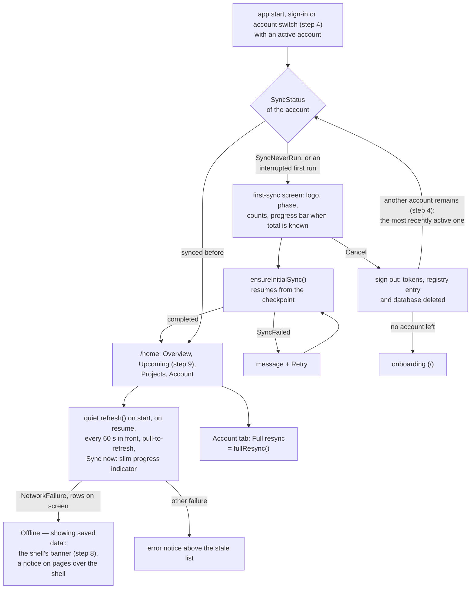

- Providers: `appDatabase(accountId)` and `syncEngine(accountId)` are keepAlive families closed on dispose; `syncStatus` (`core/sync/sync_providers.dart`) follows the active account and has no value until its engine has reported, which the router treats like "needs the first sync" (the screen says "Preparing…"). `bootstrap.dart` waits up to 5 s for that first report behind the launch screen, so a synced account's first frame is the shell; since step 8 it also waits, within the same 5 s, for the account's settings, the system palette and the colour switch, so the first frame has the colours it keeps (section 8) [exists, step 8]. The repository providers of section 6 are built over them. `signOutProvider` lives in `core/auth/sign_out_providers.dart`, because the data wiper it takes (`accountDataWiper`: dispose the engine, close the database, delete the files) builds on the repository providers.
- The router (`app_router.dart`) sends a signed-in account to `/sync` from the splash and from every `/home` route while `needsFirstSync` holds (`features/sync/application/sync_status_queries.dart`: no report yet, `SyncNeverRun`, an initial `SyncRunning` or a `SyncFailed` without `lastSyncedAt`), and from `/sync` to the overview once it no longer does. The first-sync screen (`features/sync/presentation/`) calls `ensureInitialSync()` after its first frame, which is also its Retry; its cancel is a sign-out. Since step 4 a switch to an account that has synced before never passes through `/sync`, also while its engine has not reported yet, and the cancel of an added account's first sync makes the previously active account active again ([D37](decisions.md#d37-account-switcher-a-sheet-from-an-avatar-button-and-an-accounts-section-a-switch-resets-the-navigation-the-most-recently-active-account-follows-a-removal-inactive-outboxes-drain-in-the-foreground)) [exists, step 4]. An account that has synced before opens the shell at once; `StartupSync` (`features/sync/application/`) runs a quiet `refresh()` on the shell's first frame and on an account switch, never blocking. It decides on the engine's first reported status (a freshly built engine reports a placeholder until it has read `sync_state`), and skips a run in progress, an account synced within the last minute, and an account without a completed first run, which the first-sync screen resumes from its checkpoint. Since step 7 that `refresh()` is the incremental run, and `ForegroundSyncScheduler` in the same directory keeps it going on resume and every 60 s while the app is in front (section 7.3).
- The Account tab shows "Last synced <relative time>", a "Sync now" button (incremental) and, since step 7, a secondary "Full resync" button (`fullResync()`), both disabled during a run and in `needsReauth`; the sign-out dialog says that the local data is deleted. Since step 11 it also shows "Pending changes: N" with "Send now" while the outbox holds ops, and a "Sync problems" list with Retry and Discard per failed op, hidden when empty (section 7.5).
- A link-share guest takes the same path from `GuestSignIn` (section 5.1): the first-sync screen, then the shell, where `GuestLandingListener` opens the shared project in the link's view once; a guest whose access ended sees "Guest access ended" with "Open the link again" on the first-sync screen ([D62](decisions.md#d62-create-account-password-reset-and-invite-links-through-the-browser-sign-in-page-link-share-guests-as-an-account-kind-with-token-renewal-and-a-reduced-ui)) [exists, step 32].
- Headless use: the engine needs no widget tree, so the background runs of step 16 run it in the background isolate over the same database (`shareAcrossIsolates`) through the same `ProviderContainer` (principle 4, section 7.8) [exists, step 16]. The status of a run in another isolate is not shared; the Account tab shows the last background run's time from the preferences.

### 7.5 Write path (`core/outbox/`) [exists, steps 11, 12a, 12b, 4 and 14; kanban placements exists, step 20; bucket management outside it exists, step 21; list positions, and project moves outside it, exists, step 22; project and view management outside it exists, step 23; saved filter management outside it exists, step 24; descriptions with their check against the server's, and project descriptions outside it, exists, step 25; uploads in a lane of their own, and attachment deletes and the cover outside it, exists, step 26; account settings and the avatar outside it, exists, step 30; sessions and tokens outside it, exists, step 31; comments and reactions outside it, exists, step 27; label changes and deletes, teams and a project's shares outside it, exists, step 28; a home-screen widget's Done imported into it exactly once, in review, steps 18–19]

Step 11 opened the write path on the most frequent actions, done with undo, favourite and delete, and proved the pipeline every later mutation uses ([D34](decisions.md#d34-outbox-local-first-writes-serial-sender-coalescing-retry-classes-sync-interplay-pending-fields-win-until-sent-pending-deletes-hidden-v1-full-replace-emulation)). A change is applied to the local row and queued in one transaction; a serial sender pushes the queue to the server through the write ports of section 4; the server's answer replaces the row; a refresh follows. Step 12a put creates and the edits of the core properties on the same pipeline ([D35](decisions.md#d35-creates-through-the-outbox-temporary-negative-ids-with-remap-createupdatedelete-coalescing-lost-response-recovery-by-title-within-a-1-h-window)): a new task is a row under a temporary negative id plus a create op; the sender sends the create and remaps the row to the server's id in one transaction; a create whose answer was lost is looked up before it is sent again. Step 12b added labels, assignees and reminders without a new op kind ([D36](decisions.md#d36-labels-and-assignees-as-id-set-deltas-in-the-task-update-sent-through-their-endpoints-after-a-read-before-write-diff-reminders-as-the-whole-list-label-creation-online-only)): label and assignee changes are id-set deltas in the task's update op, which the write port sends through the label and assignee endpoints after reading the task, only for the ids that differ; reminders are the whole list in the same op. The screens call the repository and read its streams as before; of the outbox they see only `SyncProblem`, `OutboxOperationKind` and `PendingTaskIdsSource` from `core/outbox/`, nothing of the DAO or the sender. Step 14 added relations the same way ([D41](decisions.md#d41-relations-as-deltas-in-the-task-update-sent-through-the-relation-endpoints-after-a-read-before-write-diff-temporary-ids-on-both-ends-resolved-at-send-time-the-inverse-rows-kept-locally-duplicate-and-subscriptions-online-only-subtasks-from-indented-quick-add-lines)): edges to add and remove in the same update op, sent through the relation endpoints after the same read, with temporary ids at both ends of an edge and the server's inverse edge written locally [exists, step 14]. Step 20 added kanban moves the same way ([D47](decisions.md#d47-kanban-board-from-per-view-board-snapshots-moves-and-positions-through-the-outbox-with-the-done-buckets-rules-accessible-drag-and-drop)): bucket placements per view in the same update op, sent after everything else through the move and position endpoints, with the done bucket's rules applied when they are queued [exists, step 20]. Step 22 added list positions the same way ([D49](decisions.md#d49-manual-ordering-list-views-by-drag-through-the-outbox-projects-reordered-and-nested-online-never-a-project-position-below-01)): positions per view in the same update op, sent after the placements through the position endpoint, with the stored view following a sent one [exists, step 22]. Step 25 added descriptions the same way ([D52](decisions.md#d52-descriptions-edited-in-a-bundled-tiptap-page-in-a-locked-down-webview-with-a-native-toolbar-checklists-ticked-in-place-no-silent-overwrite-of-a-description-changed-on-the-web)): the description of the same update op, which keeps the description it started from and the checklist ticks it consists of, checked against the server's description right before the write, which carries out the promise of [D34](decisions.md#d34-outbox-local-first-writes-serial-sender-coalescing-retry-classes-sync-interplay-pending-fields-win-until-sent-pending-deletes-hidden-v1-full-replace-emulation) that the description would not stay last write wins [exists, step 25]. Step 26 added the first op kind since step 12a ([D53](decisions.md#d53-attachments-uploaded-through-the-outbox-in-their-own-lane-opened-shared-and-saved-through-the-platform-cover-and-delete-online-and-an-own-android-share-target)): `uploadAttachment`, one per file, which never merges or folds and is sent by a lane of the sender beside the queue, so a large file never holds up an edit; and the sender clears a dangling cover that blocks a task's updates [exists, step 26].

```mermaid
flowchart LR
  UI["task row: circle, star<br/>task detail sheet: done, favourite, Delete, Edit<br/>new-task sheet, edit page (step 12a)<br/>labels, assignees, reminders (step 12b)<br/>board: drops, move actions, add a task (step 20)<br/>list sorted manually: drops, move actions (step 22)<br/>description editor, checklist ticks (step 25)<br/>attachments: add, cancel; share sheet (step 26)<br/>Account tab: Send now, Retry, Discard,<br/>Keep my version, Use the web version (step 25)"] -- "setDone, setFavorite, deleteTask,<br/>createTask, updateTask (step 12a),<br/>placeTask (step 20), positionTask (step 22),<br/>updateDescription, toggleChecklistItem (step 25),<br/>queueUpload, cancelUpload (step 26),<br/>retrySyncProblem, discardSyncProblem" --> REPO["LocalTaskRepository"]
  REPO -- "one transaction: task row (a create: under<br/>a temporary id; child rows: step 12b),<br/>pending_changes, outbox op (coalesced)" --> DB[("AppDatabase<br/>tasks, outbox, task_id_remaps")]
  DB -- "watch…() streams: the change is<br/>on screen at once, offline too" --> UI
  DB -- "oldest pending op;<br/>the oldest ready upload (step 26)" --> SENDER["OutboxSender<br/>(one per account, serial;<br/>an upload lane beside, step 26)"]
  SENDER -- "create(NewTask)<br/>update(id, TaskChanges)<br/>delete(id)<br/>attachments.upload (step 26)" --> WC["VikunjaWriteClient<br/>create: v2 POST, v1 PUT /projects/{id}/tasks<br/>v2: PATCH merge-patch, only the set fields<br/>v1: GET → overlay → POST the whole task<br/>labels, assignees (step 12b): read, then only<br/>the differing adds and removes, read back<br/>kanban (step 20): per view move, then position<br/>list positions (step 22): per view, last<br/>a description with a base (step 25): the server's<br/>checked first (v2 one read, v1 its own read)"]
  WC -- "/projects/{id}/tasks, /tasks/{id},<br/>/tasks/{id}/labels, /tasks/{id}/assignees,<br/>…/views/{v}/buckets/{b}/tasks, /tasks/{id}/position,<br/>/tasks/{id}/attachments (step 26)" --> SRV["Vikunja"]
  SRV -- "the task as stored<br/>(a create: with id, index, identifier;<br/>a repeating task: reopened, dates shifted)" --> WC
  WC --> SENDER
  SENDER -- "apply the response except fields a newer op<br/>still holds, clear the sent fields, remove the op;<br/>a create: insert under the server id, drop the<br/>temporary row, record the remap" --> DB
  SENDER -- "refresh() after a drain that sent something" --> ENGINE["SyncEngine (section 7.3)"]
  ENGINE -- "upserts overlay pending_changes,<br/>pending_delete rows stay hidden,<br/>reconcile never purges a row with a pending op" --> DB
```

**Local write** (`LocalTaskRepository`, one transaction): the task row takes the change (`done` with `done_at`, `is_favorite`, or `pending_delete = true`), the row's `pending_changes` takes the merged `TaskChanges`, and `outbox` gets the op, coalesced: an update for a task whose update is still pending is merged into it (`TaskChanges.merge`, the later value wins per field), an update followed by a delete becomes the delete, a delete is final. The call returns when the transaction has committed and never throws for network reasons; the sender is asked to drain. Rows with `pending_delete` are gone for every DAO query and for the local count the sync's probe compares (section 7.3). A create (step 12a) inserts the row under a negative temporary id (the next value of the `sync_state` counter `local_task_ids`, negated, never reused), without an `updated` and with `pending_changes` null, and a `createTask` op whose payload is the `NewTask`; the call returns that id, and the row is an ordinary task for every query and screen, sorted before every server task. While the create has not left the device (pending and never sent, or rejected), an edit on the temporary id folds into the create by applying the `TaskChanges` onto the stored `NewTask` (favourite included; a rejected create is re-queued by it), `done`, which a create cannot carry, becomes an update queued behind it, and a delete cancels the create with the row: nothing is sent. Once the create may be on the server (in flight, or sent without an answer), later edits and a delete queue behind it as ordinary ops under the temporary id, which the sender takes only after the create is through.

Labels, assignees and reminders (step 12b): the same transaction changes the task's child rows. A label or assignee delta goes onto `task_labels` or `task_assignees` through `IdSetChange.applyTo`; a reminder list replaces `task_reminders`. An id without a local label or user row is skipped for the child rows (their foreign keys) but queued all the same. A relative reminder gets its instant computed on the device from the date it refers to (null while that date is unset), both when the reminders are set and when that date changes; the server's value replaces it with the next answer or pull. On a create that has not left the device, reminders fold into the `NewTask` and travel with the create; labels and assignees, like `done`, stay the update queued behind it, which waits under the temporary id and is rewritten to the server id by `completeCreate`, so they are sent after the remap. `completeCreate` also applies the pending changes of the ops behind the create to the child rows of the upserted server task, so labels and assignees chosen before the remap stay visible. The coalescing is the field-wise `merge` of `TaskChanges`, also when a failed op folds into a newer one.

**`TaskChanges`** (`vikunja_domain`): a nullable field per writable property, `title`, `description`, `done`, `isFavorite`, `priority`, `percentDone`, `hexColor`, `dueDate`, `startDate`, `endDate` and, since step 12a, `repeatAfter` (a `Duration`, seconds on the wire; zero with the default `repeatMode` removes the repeat), `repeatMode` and `projectId` (a move: the server reassigns `index` and `identifier`, which the applied response brings); null is "unchanged"; a date is a `DateChange`, `set(value)` or `clear()`; `merge(later)`, `isEmpty`. It is the outbox payload (JSON) and the argument of the write port. Since step 12b also `labels` and `assignees`, each an `IdSetChange` (the ids `added` and `removed`; `merge(later)` lets the later change win for an id both touch, so add then remove is a remove and remove then add an add; `applyTo(current)`; empty when both sets are), and `reminders`, the task's whole reminder list (empty removes every reminder; the later list wins on merge). Step 11 set `done` and `isFavorite` only; step 12a sets every field but `description` and the step 12b fields. Since step 14 also `relations`, since step 20 `kanban`, the bucket placements by view id (below) [exists, step 20], and since step 22 `positions`, the list positions by view id (below) [exists, step 22]. Since step 25 `description` is set too, with `descriptionBase` and `checklistToggles` (below) [exists, step 25]. Since step 26 also `coverImageAttachmentId` (any attachment of the task, 0 clears; the later wins on merge), which `AttachmentRepository` sends online and the sender's 4020 recovery adds to a send; the payload JSON (`cover_image_attachment_id`) and every rewrite of queued changes keep it, behind an unsent create in the update queued after it, since the attachments exist only afterwards, though nothing queues it yet [exists, step 26]. **`NewTask`** (`vikunja_domain`, step 12a) is the create payload: project, title and the same core properties with their defaults; since step 12b also its reminders.

**Write ports** (`packages/vikunja_api/lib/src/write/`): `TasksWritePort.create(task)` (step 12a) returns the created task with the server's id, `index` and `identifier`, `update(id, changes)` returns the task as the server stored it (since step 12b read back after label or assignee requests, a reminder change or a date change), `delete(id)`; `LabelsWritePort.create(NewLabel)` (step 12b) returns the label the server created; `BucketsWritePort` and `ProjectViewsWritePort.setBuckets` (step 21, section 4) change a board's columns and its done and default bucket [exists, step 21]; `ProjectsWritePort.move` (step 22, section 4) moves a project [exists, step 22]; the rest of `ProjectsWritePort` and `ProjectViewsWritePort.create`, `update`, `move` and `delete` (step 23, section 4) manage projects and views [exists, step 23]; `SavedFiltersPort` (step 24, section 4) manages saved filters [exists, step 24]; `TasksWritePort.update` and `ProjectsWritePort.update` take `rebaseDescription` (step 25, section 4), which decides the description sent from the server's [exists, step 25]; `AttachmentsWritePort` (step 26, section 4) uploads and deletes attachments, and `TaskChanges.coverImageAttachmentId` sets the cover through `update` [exists, step 26]; `UserSettingsWritePort` (step 30, section 4), from `createUserSettingsWritePort` beside the write client, writes the account's settings and avatar [exists, step 30]; `AccountSecurityPort` (step 31, section 4), from `createAccountSecurityPort` beside them, ends sessions and creates and deletes API and CalDAV tokens [exists, step 31]; `VikunjaWriteClient` from `createWriteClient(dio:, connection:)`, v2 when the connection reached it, over the account's authenticated `Dio` (section 5.2). The server facts behind the two adapters are in [research/sync.md](research/sync.md) §4.4, §6 and §8, [research/api-v1.md](research/api-v1.md) §5.1 and §6 and, for the editing rules, [research/client-logic.md](research/client-logic.md) §2.3–§2.5, §3 and §6.

| | v2 adapter | v1 adapter |
|---|---|---|
| Create (step 12a) | `POST /projects/{id}/tasks`, 201 with the task; the body carries `title`, `description`, `priority`, `percent_done`, `hex_color` (without `#`), `repeat_after` (seconds), `repeat_mode` and `is_favorite`, a date only when set (the server stores the zero date for an omitted one) and the project in the path only; never `done`, `assignees`, `bucket_id` or `labels` (ignored on create); since step 12b `reminders` when the task has any | `PUT /projects/{id}/tasks`, 201 with the task; the same body, where a `project_id` would override the path, so it is left out |
| Move (step 12a) | `project_id` in the patch; the server reassigns `index` and `identifier` but answers with the old project's identifier (it builds it before moving), so the adapter reads the task back; a move into an archived project is a 412 code 3008 | `project_id` overlaid into the full `POST` like any other field, then the same read-back |
| Update | `PATCH /tasks/{id}` with `Content-Type: application/merge-patch+json` and only the set fields under their wire names (`due_date`, `is_favorite`, `percent_done`, `hex_color` without `#`); the server merges them onto its current state, field by field; a `DateChange.clear` is the zero date `0001-01-01T00:00:00Z`; a 304 (nothing changed) is a success followed by `GET /tasks/{id}`; an unknown key would be a 422, so only known writable fields are ever sent | `POST /tasks/{id}` is a full replace, so the adapter does `GET /tasks/{id}`, overlays the changes and posts the whole task back, with `assignees` (`{id, username, name}`) and `reminders` exactly as read and never `labels` (the server ignores them); an omitted field would clear it, an omitted list would delete its rows |
| Reminders (step 12b) | `reminders` in the patch, a full replacement (`[]` clears them); absolute `{"reminder": <RFC 3339, UTC>, "relative_period": 0, "relative_to": ""}`, relative `{"relative_period": <signed seconds>, "relative_to": "due_date" \| "start_date" \| "end_date"}`, whose instant the server computes (the zero date when that date is unset); the server stores one reminder per instant and returns the list sorted by instant, but the update's answer echoes the list as sent, so the adapter reads the task back after a reminder change and after any date change | the new list overlaid into the full `POST` when the change sets it, otherwise the list as read goes back |
| Labels and assignees (step 12b) | after the body fields, or after a `GET /tasks/{id}` when there are none, only the requests that differ from the task as the server has it, in this order: label removes (`DELETE /tasks/{id}/labels/{labelId}`), label adds (`POST /tasks/{id}/labels`, `{label_id}`), assignee removes (`DELETE /tasks/{id}/assignees/{userId}`), assignee adds (`POST /tasks/{id}/assignees`, `{user_id}`); then one `GET /tasks/{id}`, the result. A label add answered 400 code 8001 and an assignee add answered 400 code 4021 count as done; a label remove answered 403 is checked with one read and counts as done when the label is no longer attached, else the `Forbidden` propagates; every other failure fails the op as a whole, and a retry reads again and sends only what is still missing | the same, with `PUT` for the adds; the deletes answer 200 |
| Label create (step 12b) | `POST /labels`, `{title, hex_color, description}` (`hex_color` without `#`; empty ones left out), 201 with the label | `PUT /labels`, the same body |
| Buckets (step 21) | `POST /projects/{p}/views/{v}/buckets` (`{title, limit, position}`, no ids), `PUT …/buckets/{b}` always with all three, `DELETE …/buckets/{b}`, 204, a 404 code 10001 counting as deleted; called by `BucketRepository` at once, never queued (section 4) [exists, step 21] | `PUT`, `POST` and `DELETE` (200) on the same paths, the same bodies |
| Done and default bucket (step 21) | `PATCH /projects/{p}/views/{v}` with merge-patch and only `done_bucket_id` and `default_bucket_id`, a 304 followed by `GET` [exists, step 21] | `GET` the view, then `POST` it back whole with the change |
| Kanban placements (step 20) | last, after the body (or the read when there is none) and the label, assignee and relation requests, per view: `PUT /projects/{the task's project after the body}/views/{v}/buckets/{b}/tasks` (`{task_id}`), then, with a position and when the answer's top-level `bucket_id` is the target, `PUT /tasks/{id}/position` (`{project_view_id, position}`); one `GET /tasks/{id}` as the result only when the move's echo of the task has another `updated` (done changed, a repeating task reopened). A full bucket (10004), a missing one (10001, or 3014; a filter-mode view's synthetic buckets as well) and one that is not the view's (10002) fail the op [exists, step 20] | the same with `POST` |
| List positions (step 22) | last, after the kanban placements, per view: `PUT /tasks/{id}/position` (`{project_view_id, position}`), not read back; the first refusal ends the update before the next view; a view the task cannot be placed in (403: a read share, another project's view, a saved filter's view whose filter the task does not match) and one that is gone (404 code 3014) fail the op [exists, step 22] | the same with `POST` |
| Project move (step 22) | `PATCH /projects/{id}` with merge-patch and only `position` and `parent_project_id` (0 for the top level, always sent), a 304 followed by `GET`; a position below 0.1, infinite or NaN refused before any request; called by `ProjectRepository.moveProject` at once, never queued (section 4) [exists, step 22] | `GET` the project, then `POST` it back whole with the two fields changed |
| Projects and views (step 23) | create `POST /projects` and `POST /projects/{p}/views`; update `PATCH` with merge-patch and only the set fields (a view's title, kind and whole filter always), a 304 followed by `GET`; a view's move only its `position`; `DELETE`, 204, a project gone (3001) or a view gone (3014) counting as deleted; duplicate `POST /projects/{id}/duplicate`; called by `ProjectRepository` and `ProjectViewRepository` at once, never queued (section 4) [exists, step 23] | `PUT` to create and to duplicate; `GET`, then `POST` back whole with the changes; `DELETE`, 200 |
| Saved filters (step 24) | create `POST /filters`; update `PATCH /filters/{id}` with merge-patch and every field of the draft, a favourite with `is_favorite` alone, a 304 followed by `GET`; `DELETE`, 204, a saved filter gone (11001) counting as deleted; called by `SavedFilterRepository` at once, never queued (section 4) [exists, step 24] | `PUT /filters`; `GET`, then `POST` back whole with the changes; `DELETE`, 200 |
| Description with a base (step 25) | `GET /tasks/{id}` first, then the `PATCH` with the description the sender's check returns for the server's; a project's the same through `ProjectRepository.updateDescription`, at once, never queued [exists, step 25] | the `GET` of the full replace gives the server's description to the check, then the `POST` with what it returns; a project's the same |
| Attachments (step 26) | `POST /tasks/{id}/attachments`, one multipart part `files` per request, the body read once (`bodyReadOnceKey`), with the timeouts of the upload lane (below), sent by the sender; `DELETE …/attachments/{a}`, 204, a gone one (4011) counting as deleted, and the cover as `cover_image_attachment_id` in the patch, called by `AttachmentRepository` at once, never queued (section 4) [exists, step 26] | `PUT` for the upload; `DELETE`, 200; the cover overlaid into the full `POST` |
| User settings and avatar (step 30) | on 2.7.0 `PATCH /user/settings/general` with merge-patch and only the changed fields, the web's keys inside `frontend_settings` (`null` removes one), a 304 a success and a 405 falling back to the full write; on 2.4 to 2.6, without `Capability.userSettingsMergePatch`, `GET /user`, then `PUT` of the raw settings with the changes applied, every unknown key kept; either way `GET /user` as the result; the provider `PUT /user/settings/avatar/provider`, the upload `PUT /user/settings/avatar` (the part `avatar`); called by `AccountSettingsRepository` at once, one at a time, never queued (section 4) [exists, step 30] | `GET /user`, then `POST /user/settings/general` with the raw settings and the changes, then `GET /user`; the provider `POST /user/settings/avatar`, the upload `PUT /user/settings/avatar/upload` |
| Sessions and tokens (step 31) | `DELETE /user/sessions/{id}`, 204, a 404 code 16001 counting as ended; `POST /tokens`, 201, and `DELETE /tokens/{id}`, 204; `POST /user/settings/token/caldav`, 201, and `DELETE …/caldav/{id}`, 204; called by `AccountSecurityRepository` at once, never queued, the creates never retried, nothing stored; ending all other sessions goes one session at a time and stops at the first failure (section 4) [exists, step 31] | `DELETE /user/sessions/{id}`, 200; `PUT /tokens`, 201, and `DELETE /tokens/{id}`, 200; `PUT /user/settings/token/caldav`, 201, and `DELETE …/caldav/{id}`, 200 |
| Comments and reactions (step 27) | comments `POST /tasks/{id}/comments`, 201, `PATCH …/comments/{c}` with merge-patch, 200 (after a 304 the comment is read), and `DELETE`, 204; reactions `POST /{tasks\|comments}/{id}/reactions`, 201, and `POST …/reactions/delete`, 200; called by `TaskDetailsRepository` at once, never queued and never retried by the app; an update or a delete answered 4015 is followed by a read that tells a gone comment from a write the server did not apply (section 4) [exists, step 27] | comments `PUT`, 201, a `GET` before `POST …/comments/{c}`, 200, and `DELETE`, 200; reactions `PUT`, 201, and the same `POST …/reactions/delete` |
| Delete | `DELETE /tasks/{id}`, 204 | `DELETE /tasks/{id}`, 200 |
| Already gone | a 404 with code 4002 is a success on both versions | |
| Repeating task marked done | the server reopens it (`done: false`), shifts due, start, end and the reminders (mode 0 by `repeat_after`, 1 by a month, 2 from now) and returns that; the sender applies the response | |
| Errors | `normalizeError` (section 4); a cancelled request rethrows its `DioException` | |

**`OutboxSender`** (one per account, headless: the write client, the database, a clock and the `SyncEngine` are injected; nothing in it needs a widget tree, so the notification-action isolate of step 15 runs one of its own (section 7.7), and so does the background runner of step 16 (section 7.8)): drains the ops oldest first (`sequence`), one at a time, each claimed `sending` in a transaction that re-reads it (an edit merged in since the queue was read goes with it), never two sends at once per account. Only the request is guarded: once the server has stored the change, an error while applying the answer locally propagates and leaves the op `sending`, so nothing is re-sent on the spot; the next start resets and re-sends it (at least once, see D34). A drain starts when the sender is built (app start), after every local write, when the app comes back to the front, on "Send now" in the Account tab (which drops every backoff first), when a retry is due and when a paused sender resumes. Since step 4 the senders of inactive accounts with queued ops are asked to drain too while the app is in front, on start, on resume and when the account list changes; a sender is built only for an account that has queued ops and is not in `needsReauth` (section 5.7, [D37](decisions.md#d37-account-switcher-a-sheet-from-an-avatar-button-and-an-accounts-section-a-switch-resets-the-navigation-the-most-recently-active-account-follows-a-removal-inactive-outboxes-drain-in-the-foreground)) [exists, step 4]. The oldest op blocks the queue while it waits for its backoff, so later ops never overtake it; a `failed` op does not block, the drain goes on with the next pending one. On success the server's task replaces the row except for the fields a newer op of the same task still holds pending; those fields leave `pending_changes`; the op is deleted. A repeating task therefore reopens with the shifted dates. After a drain that sent at least one op the sender calls `SyncEngine.refresh()`, so server-computed fields (`done_at`, `updated`, repeat shifts) arrive and the probe's counts agree again.

A create (step 12a) goes through `create(NewTask)`. On success, in one transaction (`OutboxDao.completeCreate`): the create op goes, the ops queued behind it move to the server id, the temporary row is deleted and the server's task upserted under its id (a row the sync pulled meanwhile under that id is replaced), the fields those ops still hold are re-applied on top, and `task_id_remaps` gets `(local_id, server_id, at)`; `watchTask` follows the remap. A `NetworkFailure` or a `ServerFailure` on a create (the connection broke or timed out, or a proxy answered for an upstream still at work: the request may have been processed without this device seeing the answer) records `sent_at` on the op, the first such attempt's time, next to the usual backoff; a create a killed app left in `sending` gets its attempt time as `sent_at` at the next start's reset, instead of the blind resend an update gets. Before the next attempt sends again, the sender asks `listInProject(projectId, TaskQuery(filter: "created >= '<sent_at − 1 h>'", created descending))` (an hour: the clock skew the sync engine tolerates too) and adopts the newest task of the project with the sent title that no earlier create of this device adopted (`task_id_remaps`; of two in the same second the higher id), completing the create as if the answer had arrived; only when none is found is the create sent again. A rejected create is a sync problem that names the title and takes the edit queued behind it (a `done` stays queued), so Retry sends the latest state in one request; a delete behind it cancels the create and the row, because the server never had the task; Discard cancels it the same way, without a server read. An edit or delete under a temporary id whose create was answered meanwhile is followed to the server row.

Labels, assignees and reminders (step 12b) need no new op kind: they are fields of the update op, sent by `update(id, changes)` as the table above says, and a resend after a lost answer changes nothing twice, because the port reads the task first. The requests of one update are not atomic on the server: when one fails for good, the earlier ones stay applied, the op becomes a sync problem that names the task, Retry sends only what is still missing, and Discard reads the task from the server, which restores its labels, assignees and reminders locally. A label is created outside the outbox: `LabelRepository.create` calls `LabelsWritePort.create` at once and stores the answer, and only attaching it is queued.

**Relations (step 14)** ([D41](decisions.md#d41-relations-as-deltas-in-the-task-update-sent-through-the-relation-endpoints-after-a-read-before-write-diff-temporary-ids-on-both-ends-resolved-at-send-time-the-inverse-rows-kept-locally-duplicate-and-subscriptions-online-only-subtasks-from-indented-quick-add-lines)) [exists, step 14]: `TaskChanges.relations` is a `RelationChange`, the edges `added` and `removed` (each a `TaskRelationRef(kind, otherTaskId)`), merged like an `IdSetChange` (the later change wins per edge) and stored in the payload as `{"added": [{"kind", "other"}], "removed": […]}`; there is no new op kind. An edge is queued on the task the user edits, from that task's side, as the server stores it: an added subtask is the child's `parenttask` edge to the parent. The queueing transaction changes the task's `task_relations` rows by `RelationChange.applyTo` and, when the other task is local, its inverse rows (subtask and parenttask, related and related, duplicateof and duplicates, blocking and blocked, precedes and follows, copiedfrom and copiedto), because the server creates the inverse in the same request and deletes both directions; so a parent shows a subtask added offline at once. `update(id, changes)` takes the task as the server has it, sends removes (`DELETE /tasks/{id}/relations/{kind}/{otherId}`) for the edges in `removed` that `related_tasks` lists and adds (v2 `POST`, v1 `PUT /tasks/{id}/relations`) for those in `added` that it does not, then reads the task back; a 409 code 4008 on an add and a 404 code 4009 on a remove count as done. **Temporary ids at both ends:** an edge may be queued on a task whose create is queued (the update waits behind the create and is rewritten by the remap, as labels are) and may name one (a negative `otherTaskId`). The sender resolves every relation ref through `TasksDao.resolveId` at send time and passes only positive ids to the port, which refuses others; an op whose relations still name a temporary id waits like an op under a temporary task id, and the next op in line goes first. FIFO puts the other task's create ahead in practice. `completeCreate` rewrites `task_relations.other_task_id` and the relation refs of every queued payload from the temporary id to the server id in its transaction, and the pending overlay restores the remapped task's own rows. A cycle (409 code 4023), the task itself (400 code 4010), an unknown kind (400 code 4007 on v1, a 422 on v2) and a missing other task (a 404 code 4002 on an add, which the port wraps apart from the 4002 of a gone task, so it never removes the task) are permanent: a sync problem that names the task. The port tries the op's other requests before it throws the missing other task, and `OutboxDao.forgetRelatedTasks` drops the edges naming that task from every queued op and stored row (also when the sync purges a task), so the failed op holds nothing back. Since the server bumps `updated` only on the task a relation was changed on, `TasksDao.upsertAll` also makes the rows other local tasks hold to a pulled task the inverse of its edges, with those tasks' own queued relation changes on top; the v1 update takes `related_tasks` from the read it makes first, as its answer carries them empty. Quick add (step 13) queues the `parenttask` edge of each indented line after both creates. Duplicating and following are online calls outside the outbox: `duplicateTask` refuses while the task has queued ops, and the subscription state is read and toggled on the server (section 6).

**Kanban placements (step 20)** ([D47](decisions.md#d47-kanban-board-from-per-view-board-snapshots-moves-and-positions-through-the-outbox-with-the-done-buckets-rules-accessible-drag-and-drop)) [exists, step 20]: `TaskChanges.kanban` maps a project view id to a `BucketPlacement`, a bucket and a position (null: the server keeps the task's), merged per view with the later placement winning, and stored in the payload as `{"<view id>": {"bucket_id", "position"}}` (`position` absent when null); there is no new op kind. `placeTask` queues it with the done state the move changes; the board decides that when it plans the move (section 6): a drop into the done column queues `done: true` with the placement, one out of it `done: false` with it, a reorder only the placement, and a repeating task dropped into the done column `done: true` with a placement in the default column without a position, because the server reopens it there and a move into the done column would mark it done again. The local row changes only by `done`; the placements stay in `pending_changes`, where `watchBoard` reads them, so `buildBoard` shows the card where it was dropped until the next download after the send. A later project move, or a later `done` that differs from the one the queued change carries (also when that carries none), drops the placements queued before it in `merge`, because they name the previous project's views or would set the done state back after the body; on a create that has not left the device, placements, like labels, stay in the update queued behind it (`changesAfterCreate`), and a project move folded into that create drops them from it (`withoutPlacements`), so a task created into a column and placed there before its create is sent is placed once the server names it. `_rebuilt` and the helpers that forget labels or related tasks keep the placements. The sender sends them through `update(id, changes)` as the table above says: the body with `done` first, so the server's done-bucket effects of the update come before the move, then per view the move and the position. A placement alone costs three requests (the port's read, the move, the position), two without a position. On success, in the transaction that applies the answer, `KanbanDao.applySentPlacements` moves the card on the stored boards with its counts, since neither a move nor a position bumps `updated` and no sync would; the board downloads quietly 2 s after its placements left the queue (section 7.3). A full column (412 code 10004, also for a done update when the done column is full), a missing column (404 code 10001, which a filter-mode view's synthetic buckets get too, or 3014; 400 code 10002 for a bucket that is not the view's), an archived project (412 code 3008) and a read-only share (403) are permanent: a sync problem in its own wording ("This column is full.", "The column no longer exists.", or the existing archived and forbidden wording), and discarding it takes the placement out of `pending_changes`, so the card goes back to its downloaded column.

**List positions (step 22)** ([D49](decisions.md#d49-manual-ordering-list-views-by-drag-through-the-outbox-projects-reordered-and-nested-online-never-a-project-position-below-01)) [exists, step 22]: `TaskChanges.positions` maps a project view id to a position, merged per view with the later position winning, and stored in the payload as `{"<view id>": <position>}`; there is no new op kind, and the field is one of its own beside `kanban`, because a placement always moves a column first, is dropped by a done change and needs a column. `positionTask` queues one without touching the row: the positions stay in `pending_changes`, where `TasksDao.loadProjectList` reads those of the view, so the list shows the task where it was dropped until the next download after the send. A later project move drops the positions queued before it in `merge`, because they name the previous project's views; a later `done` keeps them, since a list position sets no done state back. On a create that has not left the device they stay in the update queued behind it (`changesAfterCreate`), and a project move folded into that create drops them (`withoutPlacements`); `_rebuilt` and the helpers that forget labels or related tasks keep them. The sender sends them through `update(id, changes)` as the table above says, after the body, the label, assignee and relation requests and the placements; a position alone costs the port's read and one request per view. On success, in the transaction that applies the answer, `ListSnapshotsDao.applySentPositions` writes them into the downloaded views, since a position bumps no `updated` and no sync would; the list downloads quietly 2 s after its positions left the queue (section 7.3). A view the task cannot be placed in (403) and one that is gone (404 code 3014) are permanent: a sync problem whose `SyncProblem.changes` (the failed update's `TaskChanges`, null for a create or a delete) picks the wording, "This list can't be reordered." for a 403 on an update that only reorders and "The list no longer exists." for a 3014 when only list positions name a view, else the existing forbidden and column wording; discarding it reads the task from the server, which takes the position out of `pending_changes`, so the row goes back to its downloaded place.

**Descriptions (step 25)** ([D52](decisions.md#d52-descriptions-edited-in-a-bundled-tiptap-page-in-a-locked-down-webview-with-a-native-toolbar-checklists-ticked-in-place-no-silent-overwrite-of-a-description-changed-on-the-web)) [exists, step 25]: `TaskChanges.description` carries the HTML, `descriptionBase` the description the first unsent description change started from, and `checklistToggles` the ticks (`ChecklistToggle`: the item's `data-task-id`, else its ordinal among the parsed items with its text, and the state asked for) while the change consists of ticks only, null after an edit in the editor; the two are stored in the payload as `description_base` and `checklist_toggles` and never sent; there is no new op kind. `merge` keeps the earliest base and appends the ticks while every description change was ticks, so ticks followed by an edit are an edit; ticks a payload cannot read back count as an edit. On a create that has not left the device the description folds into the `NewTask`, base and ticks dropped, since the server has nothing yet to differ from; `_rebuilt` and the helpers that forget labels or related tasks keep all three. The row takes the description in the queueing transaction, and the sync's overlay keeps it until it is sent. **The check:** for a change with a base the sender passes `rebaseDescription` to `update` (section 4), and the server's description right before the write decides: still the base, already the queued one (a resend after a lost answer, or the same change made on the web) or empty like the base however written (`isRichTextEmpty`) → the queued description is sent; changed and ticks only → each tick is applied again to the server's description (`rebaseChecklistToggles`: by `data-task-id`, else by ordinal and text, else that tick is dropped) and that is sent, so a tick on the phone never erases what was written on the web; changed after an edit → `DescriptionConflict`, before any write. A description change without a base is sent unchecked. **The conflict** is permanent: a sync problem "The description was changed on the web too." that blocks no other op and whose card offers Compare versions (section 6): `webDescription` reads the server's description (null for a task the server no longer has); **Keep my version** (`keepMyDescription`, `OutboxDao.retryOverwritingDescription`) puts the op back in the queue with that description as its new base, so it overwrites exactly the web change the user saw and fails again when the web changed once more; **Use the web version** (`useWebDescription`) reads the task, takes the description out of the op (`dropDescription`: the op goes when that was all, otherwise the rest is still sent) and stores the server's task, or removes the row of a task the server no longer has, as Discard does; a failed read throws and changes nothing. **What remains:** the server has no preconditions, so a web change that lands between the check's read and the write (v2's extra read, v1's read for the full replace) is still overwritten.

**Uploads (step 26)** ([D53](decisions.md#d53-attachments-uploaded-through-the-outbox-in-their-own-lane-opened-shared-and-saved-through-the-platform-cover-and-delete-online-and-an-own-android-share-target)) [exists, step 26]: a file is an `uploadAttachment` op of its own, never merged into another op nor folded, whose payload (`QueuedUpload`) names the stored copy in the account's uploads folder (section 7.1), the attachment's sanitised name, its size and its type; it follows its task's id like any other op, so one queued behind an unsent create goes under the server id after the remap, a cancelled create drops it, and a delete of the task drops the unsent ones (one on its way finishes). **The lane:** the queue's head (`nextInLine`) leaves uploads out, and whenever the queue has nothing ready the sender runs its upload lane beside it (`queuedUploads`): the oldest upload that is ready (not failed, under a server id, its own backoff over), one at a time, while the queue goes on, so an edit queued before or during an upload is sent at once; one waiting out its backoff, or left `sending` by a run that died, holds up none of the others; the lane has its own timer and `blockedBy`, and the sender's state is what the two lanes come to. Each upload is one request with timeouts for its size (`uploadTimeoutFor`: half a minute plus the file at 32 KiB/s, at least one and at most four minutes, for sending and again for the answer), below the five minutes after which `resetSending` takes an op `sending` for stuck, and the uploads this sender is still streaming are kept out of that reset (`keep`). The limit is checked again before the request (`maxUploadBytes`, the smaller of the server's and 50 MiB): a file above it by now, queued under a larger limit, is `FileTooLarge` without a request. **A lost answer:** a `NetworkFailure` or `ServerFailure` marks the upload uncertain (`sent_at`, as for a create), and before the next attempt the sender reads the task's details and adopts the newest attachment with the sent name and size, uploaded by this user and created since an hour before the attempt, else sends again. **Failures:** a timeout waits out the usual backoff, but the third in a row (`maxUploadTimeoutsInARow`, counted in `attempts`, which starts again after any other failure) fails it, so a link too slow for the file does not resend it for good, while being offline keeps it waiting; `FileTooLarge`, 3008, a 403, a task gone, a missing route (attachments switched off on the server) and a missing stored copy are sync problems that name the file, worded by `uploadProblemReason`; Retry sends it again (after timeouts it looks for the attachment first), Discard and Cancel drop the op and delete its stored copy without a read, also while it is on its way, whose request is aborted; a lost copy offers only Discard. On success the op goes, its copy is deleted, and the answered attachment goes to `uploadedAttachments`, since no sync would bring it. The copies no op names any more are swept on the sender's first drain, after a discarded create and after a sent delete. A sender without the uploads folder, and the headless ones of the background and the notification-action isolates, leave uploads alone. **The traps fixed for the new kind:** `_newerUnsent` matched any kind, so `markFailed` dropped a failed update as superseded when an upload followed it; `queueDelete` kept a deleted task's unsent uploads; Discard would have read the task back; the Sync problems card assumed three kinds; `resetSending` would have reset an upload still streaming. **The dangling cover:** when the server answers a task update with 400 code 4020, because the task still points at a deleted cover attachment, the sender sends the update once more with `coverImageAttachmentId: 0` merged in, since every update of that task fails until then; a change that sets the cover itself, and a second 4020, are sync problems. The detail sheet ignores a cover id that names none of the attachments.

```mermaid
stateDiagram-v2
  direction LR
  [*] --> pending: local write, in the transaction that changes the row
  pending --> pending: a later update is merged in, update then delete becomes the delete
  pending --> pending: on a temporary id (step 12a) a later edit folds into an unsent create, a delete cancels it; once the create may be on the server, later ops queue behind it
  pending --> sending: oldest op whose next_attempt_at has passed; an upload (step 26): the oldest ready one, in its own lane beside the queue
  pending --> [*]: Cancel of a queued upload, its stored copy deleted (step 26)
  sending --> [*]: 2xx, 304, or 404 code 4002 on a delete (response applied, op removed; a create remapped; an upload's copy deleted)
  sending --> pending: NetworkFailure, ServerFailure, RateLimited (backoff, Retry-After), RefreshRaceLost, TokenRejected, and an answer that is not Vikunja's (UnexpectedResponse below 400, NotFound without a code)
  sending --> uncertain: NetworkFailure or ServerFailure on a create (step 12a) or an upload (step 26), the request may have reached the server
  uncertain --> [*]: the lookup by title within 1 h finds the task (adopted, remapped, op removed); for an upload by name, size and uploader the attachment (step 26)
  uncertain --> sending: the lookup finds nothing (the create is sent again)
  sending --> paused: SessionEnded
  paused --> pending: the account is signed in again
  sending --> failed: Forbidden, NotFound with a code, DomainError (3008, 4001, 4029), ValidationFailed, UnexpectedResponse 4xx/5xx, DescriptionConflict before the write (step 25); for an upload FileTooLarge, a missing route, the third timeout in a row, a lost stored copy (step 26)
  failed --> pending: Retry in the Account tab, Keep my version (step 25), Use the web version of a change that holds more (step 25), or folded into a newer op of the task that is still queued (never an upload, step 26)
  failed --> [*]: Discard (op deleted, task reloaded from the server, or removed on a 404 or 403; an upload's stored copy deleted without a read, step 26), or Use the web version of a change that was only the description (step 25)
  note right of paused
    the sender is paused, the op row stays pending,
    nothing is dropped
  end note
  note right of failed
    a SyncProblem in the Account tab,
    the local edit stays visible
  end note
```

| Answer | Op | Sender |
|---|---|---|
| success, 304, or 404 code 4002 on a delete | the response is applied (a delete removes the row; a create inserts the row under the server id, drops the temporary one and records the remap), the op is removed | next op |
| `NetworkFailure` or `ServerFailure` on a create (step 12a): the request may have reached the server | back to `pending` with the same backoff and `sent_at` set: the next attempt first looks the task up by title within the 1 h window and adopts it, or sends again | waits for it |
| `NetworkFailure`, `ServerFailure`, `RateLimited`, `RefreshRaceLost`, `TokenRejected` (the interceptor's own refresh and retry, section 5.2, did not help: the session was replaced by a new sign-in or the server will take the next token; a session that ended for good arrives as `SessionEnded`), and an answer that is not Vikunja's: `UnexpectedResponse` with no status or one below 400 (a captive portal's page, a proxy's redirect, an empty body), `NotFound` without a Vikunja code (a web server's 404 during a deploy) | back to `pending`; `attempts + 1`; `next_attempt_at` = now + 2 s · 2ⁿ, shortened by up to half at random, at most 15 min; a `Retry-After` above zero wins when the server sends one, capped the same way | waits for it; later ops wait behind it. A sync that reaches the server while the oldest op waits out a `NetworkFailure` drops the backoff and sends at once |
| `SessionEnded` | stays `pending`, untouched | `paused` until the account is signed in again (section 5.5), then drains; nothing is dropped |
| `NotFound` with a Vikunja code (3001 project gone; on an update also 4002, the task itself gone, and since step 12b 8002, a label gone, and 1005, a user gone, neither of which removes the task or the op; since step 14 also a relation add whose other task is missing, a 4002 the port wraps so that it is never read as the task gone; since step 20 10001, a bucket gone, and 3014, a view gone, since step 22 also for a list position), `Forbidden` (no access; since step 12b also 7003 for an assignee without access to the project, and a label the user cannot see; since step 20 a move or position on a read-only share; since step 22 a list position on a view the task cannot be placed in), `DomainError` (3008 project archived; on a create also 4001, an empty title on v1, and 4029, a repeat beyond ten years; since step 14 4023, a relation cycle, 4010, a relation to the task itself, and 4007, an unknown relation kind on v1; since step 20 10004, a full bucket, also on a done update when the done bucket is full, and 10002, a bucket that is not the view's), `ValidationFailed` (v1 412 `invalid_fields`, v2 422, such as an empty title on a v2 create or, since step 14, an unknown relation kind), `UnexpectedResponse` 4xx or 5xx, since step 25 `DescriptionConflict` (raised before the write, when the server's description is no longer the change's base and the change is more than ticks) [exists, step 25], since step 26 for an upload `FileTooLarge` (4012, 4035, or above the limit by now, without a request), a `NotFound` without a code (attachments switched off on the server), the third timeout in a row and a stored copy that is gone, while a 403, 3008 and a task gone fail it like any op; for an update a second 4020, or one for a change that sets the cover itself [exists, step 26] | `failed`, the failure as `last_error`: a `SyncProblem`; when a newer op of the task is still queued the failed op folds into it instead (an update gives it the fields it does not set, a delete makes it moot), so a task never has two ops the sender could send in either order | goes on with the next pending op |

**Sync interplay** (section 7.3): the sync engine's upserts, in the full pull as in the delta and the reconcile, overlay the row's `pending_changes` on the incoming task, so a field still on its way keeps the local value and every other field takes the server's; a `pending_delete` row is written but stays hidden; every purge (the full pull's, the reconcile's, a removed project's) skips rows with a pending op, because the task exists on the server or is being deleted anyway; no run touches the outbox. The local counts the probe compares (section 7.3) include the rows queued for deletion, because the server holds those tasks until the delete is sent; so a pending or failed delete costs no extra probe requests on every refresh. A row under a temporary negative id has a queued op by definition, so it is never purged either, and it stays out of the local count the probe compares (step 12a). Since step 12b the overlay also keeps the pending child rows: pending label and assignee deltas are applied to the incoming sets, a pending reminder list replaces the incoming one (relative instants recomputed); `upsertAll` runs in one transaction, so an edit saved while it runs is not overwritten; the incremental run also rewrites a task whose reminders differ from the local ones; and a label sync that removes labels takes their ids out of every unsent update (`OutboxDao.forgetLabels`).

**Repository and screens:** `TaskRepository.setDone`, `setFavorite`, `deleteTask`; `watchPendingChanges` (every queued op, `sending` included: none of them is accepted yet), `watchSyncProblems` (failed ops joined with the task title), `retrySyncProblem` (back to `pending`), `undoDone(previous)` (`done: false` plus, for a repeating task, the dates `previous` had, as `DateChange.set`; and, since step 12b, the reminders `previous` had, so the server's shift of the absolute ones is taken back, nothing for a task without reminders; the server does not shift an open task, so the undo works whether the done is still queued, in flight or answered), `discardSyncProblem` (the task is read from the server first, `GET /tasks/{id}` through the read client, then the op is deleted and the row replaced, or removed on a 404 or 403, which means the task left the user's projects; a read that fails for another reason throws and changes nothing, and the op is checked again inside the transaction, so a retry or delete that got through meanwhile is not undone), `sendPendingChanges` ("Send now"; returns the failure the oldest op still waits out, which the Account tab shows in a snackbar). `LocalTaskRepository` also implements `PendingTaskIdsSource` (`core/outbox/`): `watchPendingTaskIds()`, the ids with a queued op, which `pendingTaskIdsProvider` turns into the rows' cloud-off mark. The task row's circle is a 48 dp control ("Mark done" / "Mark not done" semantics, `selectionClick` haptic, strikethrough at once, a "Marked done · Undo" snackbar for 3 s, persisting under a screen reader, whose undo is `undoDone(previous)`; in the overview and in a project list without done tasks the done row stays where it was until its own 3 s are up and its snackbar has gone, so a second tap that replaces the snackbar does not pull the earlier row away under the finger; the snackbar undoes the latest task only) and its star toggles the favourite; the sheet has the done control (no snackbar there: the checkbox is its own undo), the favourite toggle and Delete behind an adaptive confirmation; the Account tab shows "Pending changes: N" while N > 0, with "Send now" while some of them are not sync problems (a failed Send now says why in a snackbar), and the "Sync problems" list (title, what failed, when, Retry, Discard; a Discard whose read fails says why and leaves the card), hidden when empty; the sign-out dialog says how many queued changes the wipe would lose; a row whose task has unsent changes shows a cloud-off icon ("Not yet synced"). Strings in ARB (en, de), dark mode and 200 % text scale as in every step. Step 12a added `createTask(NewTask)` (returns the temporary id), `updateTask(id, TaskChanges)` and `watchTask(id)`, the edit page, the new-task sheet, the FABs on the Overview and on a project's list and the Edit action of the detail sheet (section 6, screens). Step 12b added the Labels, Assignees and Reminders sections of the edit page with the label picker, the people picker and the reminder sheet, over `updateTask`, `LabelRepository` and `UserRepository` (section 6). Step 20 added `placeTask(taskId, viewId:, placement:, done:)`, which the board's drops, its screen-reader move actions and its "Add a task" per column call (section 6) [exists, step 20]. Step 22 added `positionTask(taskId, viewId:, position:)`, which a list sorted manually calls for each position a drop or a screen-reader move queues (section 6) [exists, step 22]. Step 25 added `updateDescription(taskId, html, base:)`, which the description editor's Save calls, `toggleChecklistItem(taskId, html:, item:, checked:)`, which a checkbox tap in the detail sheet calls, and `webDescription`, `keepMyDescription` and `useWebDescription`, which a conflict's Compare versions calls; a conflict's card has Compare versions in place of Retry and Discard (section 6) [exists, step 25]. Step 26 added `queueUpload`, `watchPendingUploads`, `uploadedAttachments` and `cancelUpload`, which the Attachments section, the share sheet and the queued upload's Cancel call; an upload's card names the file ("“*name*” could not be uploaded.") and why: too large, the task gone, the project archived, no permission to add attachments, attachments turned off on the server, timed out several times, or the copy kept on the device gone, which offers Discard alone (section 6) [exists, step 26].

**Tests:** the adapters with the fake HTTP adapter (the exact v2 patch body per field, the zero date, 304, the v1 round-trip body with assignees, reminders and the untouched fields, 404 code 4002 on delete, error mapping, cancellation) and `TaskChanges.merge` / `isEmpty` in the packages; in the app the outbox DAO and the coalescing rules, the sender with a fake write client and a fake clock (success applies the response, a repeating task's response reopens it, every retry class with its backoff timing and `Retry-After`, pause and resume, a permanent failure as a problem, discard reloads or removes, retry, FIFO order, no concurrent sends, the refresh after a drain), the sync interplay (a pull does not clobber pending fields, a pending delete stays hidden and is not resurrected, the reconcile keeps rows with pending ops), the repository methods, the migration from schema 1 to 2 with data, and widget tests with the fake repository for each new behaviour. Contract tests against the live 2.7.0 server on both API versions: `packages/vikunja_api/test/contract/write_contract_test.dart` (a task seeded with an assignee, two reminders and a label is marked done and keeps all three, the v1 full-replace regression; undo; favourite on and off; a title change; a repeating task with `repeat_after` of one day comes back open with `due_date` a day later; a delete, then a second delete without a throw) and `app/test/contract/outbox_contract_test.dart` (seed through raw dio, initial sync, `setDone` drained and checked on the server and in the local row, `setFavorite`, `deleteTask` gone on both sides, a write client that fails with a `NetworkFailure` first and then sends, a repeating task reopened locally with the server's shifted date). Step 12a added: in the packages the exact create bodies on v1 and v2 (every field, unset dates omitted, the project only in the path, a local date sent as UTC, the colour without its hash), the response parsing, an empty title as `ValidationFailed` on v2 and `DomainError` 4001 on v1, an unknown and an archived project, the read-back after a move on both versions, the repeat overlaid in seconds and removed on v1, `NewTask` and the extended `merge`; in the app the DAOs (temporary-id allocation, the create op, create + update merged, create + delete cancelled, the remap transaction, the rewrite of later ops), the sender (a create's response remapped and applied, an uncertain create recovered by title, sent again when the lookup finds nothing, a permanent failure as a problem with the title, FIFO with mixed ops), the repository (a negative id visible in the lists at once, `watchTask` across the remap, the `updateTask` diff), the migration from schema 2 to 3, and widget tests (the shortcut vectors, the breakpoint times, the edit page sends only the changed fields, validation, the unsaved-changes guard, the repeat conversions, colour, the sheet's default project, chips, Add and More options, the FABs, the sheet's Edit entry). Contract tests on both API versions: `write_contract_test.dart` (a create with every core field echoed back and the identifier `<PREFIX>-<index>`, a move with the new identifier, repeat changed, switched to monthly and removed, an empty title refused as a 422 `ValidationFailed` on v2 and a 400 `DomainError` 4001 on v1, a repeat beyond ten years refused with 4029) and `outbox_contract_test.dart` (a task created offline, drained, on the server with the right fields and the local row under the server id; create + edit before the send is one request; create + delete is none; a move between projects; repeat removal). Step 12b added: in the packages the exact request sequence and bodies of every update shape (body fields only; labels only on v2 and v1; body fields with labels and assignees; nothing to send because the server already matches, which costs only the read), 8001 and 4021 tolerated, a label remove answered 403 re-read and tolerated or rethrown, failures propagated, the reminder wire form (absolute, relative, the empty list, the v1 overlay replacing the list), a create with reminders, the label create and the user search on both versions, `IdSetChange` (the merge table, `applyTo`, equality) and the extended `TaskChanges`; in the app the storage JSON of the new fields, the local apply on the child rows (labels added and removed, assignees, the foreign-key skip, reminders replaced, relative instants on a date change and on a reminder change), labels picked on an unsent create that are sent to the server id after the remap and survive it locally, merged deltas (add then remove, remove then add, folded into a failed op), the sync overlay of pending child rows, `completeCreate` restoring them, the sender end to end with the fake client (a permanent label failure as a sync problem with the task title, Discard restoring from the server), the undo of a repeating task restoring its reminders, the label and user repositories, and widget tests (the `TaskDraft` diff, the pickers with filter, multi-select, create success and failure, the 250-character limit, debounce and stale answers, the offline fallback, the reminder presets, the custom form, the absolute pick, a positive relative reminder kept as "after", no duplicate, the "date not set" warning, the unsaved-changes guard, 200 % text scale). Contract tests on both API versions: the write client (label create; labels added and removed, each twice without a failure; the user and a second user shared into the project assigned and unassigned; a user without access refused with 7003, a missing label with 8002, another user's label with a `Forbidden`; absolute and relative reminders set and cleared with `[]`; a create with reminders; on v1 a label or reminder change keeps the assignees; the user search returning owner and shared user, filtered by the query) and `outbox_contract_test.dart` (a task created offline with a reminder, then a label and the user as assignee before the send, on the server with all three and the local row under the server id; a label removed and added again; a repeating task with an absolute reminder marked done, then undone, with the reminder back at the original instant). Step 20 added: in the packages the merge, `isEmpty`, equality and `toString` of `kanban` (`task_changes_test.dart`), `Bucket` and `BucketPlacement`, the position vectors and `buildBoard` in every rule, and `test/write/kanban_write_test.dart` on fixtures recorded from 2.7.0 (the read, move and position in order on both verbs, no position without one, after the body into the project the task is in then, after the label requests, every view in turn, 10004 before any position, a no-op move, a done move read back, a repeating task landing in the default bucket without a position and read back, a plain move not read back, a gone and a filter-mode bucket); in the app the payload JSON (a payload from before step 20 places nothing), the outbox DAO (placements kept as pending without touching the row, merged per view, behind an unsent create and across its remap, dropped by a project move also behind the create, dropped by a later change of the done state in every direction and when folded into a failed op, kept when a sync forgets labels or edges, gone with a deleted task) and `test/core/outbox/outbox_sender_kanban_test.dart` (move then position with the board updated, a placement behind a create sent once the server named the task, a full column as a sync problem, the card where it was dropped until the problem is discarded); contract tests on both API versions in `packages/vikunja_api/test/contract/kanban_contract_test.dart` (per-bucket paging and counts, a further page with its bucket, a move with its position, a move into the done bucket marking the task done, a full bucket refusing with 10004, a filter-mode view's synthetic buckets refusing moves, a repeating task reopened in the default bucket) and the app's kanban contract test (section 7.3) [exists, step 20]. Step 21 added: in the packages `test/write/buckets_write_test.dart` on fixtures recorded from 2.7.0 by `tool/capture_bucket_fixtures.dart` (the bucket create, update and delete with each version's verb and body, no position unless given, title, limit and position always together on update, an empty title as `ValidationFailed`, a gone bucket on update and on delete, where it counts as deleted, a missing route still failing, the last bucket's 10003, an archived project's 3008; the v2 merge-patch with only the given ids, 0 clearing one, the 304 read back, a bucket of another view's 10002, a view of an unknown kind; the v1 read posted back with every field and the change, filter and the other id kept; no id given only a read) and the refined done rule in `board_test.dart`; contract tests on both API versions in `packages/vikunja_api/test/contract/buckets_contract_test.dart` (a bucket created without a position rightmost and one with a limit and a position, a rename sent with the limit and the position keeping both, a limit keeping the count, a new position reordering the columns as sent, a delete moving the tasks to the default bucket with their positions, done and default set through each version's request and cleared with 0 leaving the rest of the view and every task as they were, the last bucket refused) and the app's bucket management contract test (section 7.3) [exists, step 21]. Step 22 added: in the packages the merge, `isEmpty`, equality and `toString` of `positions` (`task_changes_test.dart`: per view the later wins, kept by a done change, dropped by a later project move and kept after one, apart from the placements), `test/write/list_positions_write_test.dart` on fixtures recorded from 2.7.0 by `tool/capture_ordering_fixtures.dart` (the read, then the position with each version's verb and no read-back; after the body, the kanban placements and the label requests; every view in turn; after a project move, into the new project with the task read back; a gone view's 3014, another project's view `Forbidden`, a refusal ending the update before the next view, an empty map only the read, the stored task returned) and `test/write/projects_write_test.dart` (the v2 merge-patch with both fields, parent 0 for the top level, the 304 read back, every refusal as captured without a read; the v1 read posted back whole, a favourite kept, the cycle after the read, a gone project on the read; positions below 0.1, infinite and NaN refused before any request, 0.1 sent); in the app the payload JSON (keyed by view beside the placements; a payload from before step 22 has none), the outbox DAO (positions kept as pending without touching the row, merged per view, kept by a done change, dropped by a later project move, behind an unsent create and across its remap, kept by a rejected create and when a sync forgets labels or edges, named in the sync problem), `test/core/outbox/outbox_sender_list_positions_test.dart` (a reorder sent with the downloaded list following and nothing left queued, positions after the body and the kanban moves, a position behind a create sent under the server id, a refusal as a sync problem with the row in place until discarded) and the wording in `sync_problem_message_test.dart`; contract tests on both API versions in `packages/vikunja_api/test/contract/ordering_contract_test.dart` (list positions ordering the view and leaving the task and the other views alone, a hidden done task taking a position and keeping it when it reopens, a missing view's 3014, a reorder among siblings changing only the position, a nest and back to the top level keeping every other field, a project moving with its subtree, the cycle, own-parent and archived-parent refusals changing nothing) and the app's manual order contract test (section 7.3) [exists, step 22]. Step 23 added: in the packages the defaults, equality and `toString` of `NewProject`, `ProjectChanges` and `ViewDraft` and the equality of `ViewFilter` (`test/project/`), and `test/write/project_management_write_test.dart` on fixtures recorded from 2.7.0 by `tool/capture_project_fixtures.dart` (a create with each version's verb, only the title, the parent and the colour without `#`, an archived parent's 3008; the v2 update's merge-patch with only the set fields, empty colour and identifier sent to clear them, a position along, the 304 read back, every refusal as captured without a read; the v1 read posted back whole with the changes, a gone project on the read; positions below 0.1 refused and empty changes a read on both versions; a delete, a gone project counted as deleted, a missing route not, a write share refused; a duplicate with the parent and the share choice on each version, a pseudo project refused before any request, an answer without the copy unexpected; a view create with the whole filter, a board without filter or mode, a mode when given, the filter refusals with their message kept; the view update's merge-patch, its 304, a draft without a filter clearing it, a gone view's 3014, the v1 read posted back; a move with the position alone on both versions; a view delete, a gone view counted as deleted, a gone project not); contract tests on both API versions in `packages/vikunja_api/test/contract/project_management_contract_test.dart` (a project created at the top level with a colour and children under it, each field changing alone with every other one kept, a parent change keeping the position, 3007 changing nothing, a favourite through other edits, the archive cascade with 3016 and 3008, the default project's 3013, a duplicate copying the tasks and views but not the children, a recursive delete counted as deleted when repeated, a list view created with a filter and a board with the default buckets, an update keeping the position, a move keeping a filter changed since the read, a draft without a filter clearing it, a board turned into a list and back keeping its buckets, invalid filters refused with 4024, 4019 and 4016, a write share refused for views and the delete, a view deleted twice, the last view deleted by the server) and the app's project management contract test (section 7.3) [exists, step 23]. Step 24 added: in the packages the pseudo project ids, equality and `toString` of `SavedFilter` and `SavedFilterDraft` (`test/project/saved_filter_test.dart`), and `test/write/saved_filters_write_test.dart` on fixtures recorded from 2.7.0 by `tool/capture_saved_filter_fixtures.dart` (a create with each version's verb and every key of the filter; the filters the server refuses with 4016, 4019 and 4024; v1's 2002 for a filter with nothing set, an empty filter text with every key accepted; a read with the definition, through the read client too, an unknown id's 11001, a timezone the server sends kept; the v2 merge-patch with every field, its 304 read back, a favourite with the flag alone; the v1 read posted back whole with the draft, a favourite keeping everything else; a delete, one already gone counted as deleted, another 404 thrown); contract tests on both API versions in `packages/vikunja_api/test/contract/saved_filters_contract_test.dart` (create, read, replace, favourite and delete, each as the project list then names the saved filter, and filters refused with the server's codes) and the app's filter engine contract test (section 7.3) [exists, step 24]. Step 25 added: in the packages the merge, equality and `toString` of `descriptionBase` and `checklistToggles` (`task_changes_test.dart`), `ChecklistToggle`, `DescriptionConflict` and `ProjectChanges.description`, `test/text/checklist_toggle_test.dart` in `vikunja_logic` (TipTap's shape with the input and the server's Markdown shape without it, stale offsets, a value inside another attribute, a `>` in a quoted value, nested items with tabs, CR LF and emoji, identical items, tables, quotes and the items the web moves, offsets shifted by one, `RichTaskItem.taskId`, `taskItems`, `checklistItemText`, the rebase by id, by position and dropped, taps in order, and two fuzz properties: a tick changes only its item, ticks recorded on one version apply to another), and `test/write/description_write_test.dart` in `vikunja_api` (the base and the taps never sent; v2 reads once and patches what the hook returns, a throwing hook ends after the read; v1 passes the replace's read and posts nothing when the hook throws, a null description passed as empty; the project's on both versions; no read without a description); in the app the payload JSON with the base and the taps and the `description_conflict` failure (`json_codecs_test.dart`), the DAO's `ifDescription`, `retryOverwritingDescription` and `dropDescription` (`outbox_dao_test.dart`), `test/core/outbox/outbox_sender_description_test.dart` (an edit and offline taps sent as queued while the server has the base, empty descriptions alike, no base no check; taps rebased onto a web change and dropped when their item went; an edit as a conflict that writes nothing; a resend the server already has; taps then an edit; Keep mine over the web change seen and failing again over a later one; the web's description read; Use the web's with and without other fields, and a failed read changing nothing; the stored base and taps), `test/core/repositories/local_task_description_test.dart` (shown at once and sent with its base, no change for the base or an empty one, the conflict with both answers, a task not on the device; a tick changing only its checkbox, recorded by id or position and text, refused on a stale view or an item that does not match, into an unsent create) and the project description check in `local_project_management_test.dart`; contract tests on both API versions in `packages/vikunja_api/test/contract/description_contract_test.dart` (the editor's HTML and an emptied description stored byte for byte, a rebase seeing what the server has right before the write and a throwing one writing nothing, a project's description the same) and `app/test/contract/description_contract_test.dart` (an edit round-tripping byte for byte with emoji and CR LF; a tick changing only its checkbox on the server; ticks queued before a change on the web applied to the web's description; an edit after one a conflict, resolved by Keep mine and by Use the web's) [exists, step 25]. Step 26 added: in the packages the merge, equality and `toString` of `coverImageAttachmentId` (`task_changes_test.dart`) and `FileTooLarge` (`vikunja_failure_test.dart`), `test/attachments/safe_file_name_test.dart` in `vikunja_logic` (ordinary and unicode names, both separators, quotes, control and bidirectional characters, whitespace, empty and dot names, the byte limit with the extension, an extension too long to be one), and in `vikunja_api` `test/write/attachments_write_test.dart` and `test/read/attachment_download_test.dart` on fixtures recorded from 2.7.0 by `tool/capture_attachment_fixtures.dart` (the multipart body byte for byte with each version's verb, a unicode name, an empty file, a blank name sent as `file`, a type that does not parse, the timeout and a refused token not repeated; 4012, a 413 with and without a code, a connection closed while sending above and below the request limit and without a known limit, a refused connection, a body without memory; an answer without an attachment, other per-file codes, 3008, attachments switched off, an error of the bytes and a cancel rethrown; deletes on both verbs, a gone attachment counted as deleted, a gone task not; the cover patched alone on v2 and overlaid on v1, and 4020 for a dangling cover on both; downloads byte for byte under the caller's name, a target replaced, a part resumed, replaced on a 200, dropped on a 416 and on a range not asked for, 4011, `Forbidden`, a broken-off body and a cancel keeping the part, a failed write rethrown), a read-once body not repeated after a refresh in `auth_interceptor_test.dart`, and the fake HTTP adapter's byte capture; in the app the payload JSON with the cover and `QueuedUpload` (`json_codecs_test.dart`), `apply_task_changes_test.dart` (the cover through every rewrite), `test/core/db/outbox_dao_uploads_test.dart` (an op of its own, none for a task unknown or queued for deletion, never merged, the queue head skipping uploads, a failed update with a newer upload staying failed, a rejected create with an upload behind it, a failed upload marked failed with `sent_at` cleared, a delete dropping the unsent uploads but not one on its way, a cancelled create dropping its uploads, the remap, the copy answered once, a stuck upload reset uncertain unless still streaming), `test/core/outbox/outbox_sender_upload_test.dart` (one request per file with timeouts for its size and the copy deleted, an upload never holding up an edit queued after it or while it streams, a drain past the stuck-op age leaving a live upload alone, too large by now without a request, three timeouts in a row, timeouts counted from one after other failures, an own backoff, one a dead run left `sending` holding up none, a lost answer adopted by name, size and uploader or sent again, the sync problems, a lost copy without a request, Retry, Discard, Cancel before and while sending, another isolate's upload, a headless sender, the first drain's sweep; the dangling cover cleared and sent again once, a 4020 for a cover the change sets and a second 4020 as problems), `test/core/attachments/` (`upload_files_test.dart`, `upload_policy_test.dart`, `attachment_downloads_test.dart`), `test/core/repositories/local_task_uploads_test.dart` (copied or moved under a safe name, too large before anything is stored, sending only while this sender sends, nothing kept for a task not on the device, cancel, a deleted task's uploads and copies gone), `local_attachment_repository_test.dart` (the cover cleared before its delete, the download forgotten, the cover set and cleared, downloads cached and cancelled, too large before any request, a task not synced, a refusal), `test/core/files/platform_file_actions_test.dart`, `test/core/share/channel_share_intent_source_test.dart` (the channel format, unsafe names and foreign schemes, overlong text, pending, copy, clear, a share while running) and the uploads folder in `account_database_files_test.dart`; contract tests on both API versions in `packages/vikunja_api/test/contract/attachments_contract_test.dart` with one fresh user (a PNG, a text file under a unicode name and an empty file as the task read lists them; a file one MiB above the limit `FileTooLarge` 4012 leaving nothing behind; the original byte for byte and a part resumed with a range; a delete twice; the cover set and cleared, and deleting it leaving the id behind, which refuses a title edit with 4020 until the edit clears it; an archived project refusing upload and delete with 3008 and still downloading) and `app/test/contract/attachments_contract_test.dart` (files queued offline, for a synced task and for one created offline, arriving once the connection is back and equal to the server's attachments byte for byte; a cover deleted on the server no longer blocking an edit made in the app) [exists, step 26]. Step 30 added: in the packages `UserSettingsChanges` with `SettingChange` (`applyTo`, `isEmpty`, equality, a `toString` without the name, timezone or language), `UserProfile`, `AvatarProvider`, `ClockTime` and `UserSettings.copyWith` (`test/account/`), the capability in `server_capabilities_test.dart`, `parseUserProfile` and `currentUserWithProfile` in `user_api_test.dart`, the new settings in `user_settings_codec_test.dart`, and `test/write/user_settings_write_test.dart` on fixtures recorded from 2.7.0 by `tool/capture_user_settings_fixtures.dart` (on 2.7.0 one merge-patch of the changed fields naming no frontend key it does not change and no `frontend_settings` for top-level changes only, a 304, a 405 falling back to the full write, empty changes only a read, every field's wire name, clearing as 0 and `null`; on 2.4 to 2.6 and on 2.3 a fresh read with the changes applied to its JSON, unknown frontend keys and unmodelled settings surviving, a cleared key removed; the refusals 1025, 3017 and the week start and time on both versions, a fresh read that is not a user failing before any write; the avatar provider read, set and refused with 1018, the sign-in providers refused before any request; the upload's multipart part with its name, a blank name, a picture the server cannot read, 4032, `FileTooLarge`, an error of the bytes, the user's `updated` bumped); contract tests on both API versions in `packages/vikunja_api/test/contract/user_settings_write_contract_test.dart` with one fresh user, on the three paths (the v2 merge-patch, the v2 full `PUT` of a connection without the capability, the v1 full `POST`): every field round-trips and only the changed raw keys change; clearing removes the frontend keys and the default project and keeps the rest; refusals carry the server's codes and change nothing; an empty timezone stores the server's default; the avatar provider is read and set, an upload switches it to `upload` and bumps the user; the sign-in providers are refused before any request [exists, step 30]. Step 31: `packages/vikunja_api/test/account/account_security_test.dart` on fixtures recorded from 2.7.0 by `tool/capture_account_security_fixtures.dart`, which scrubs every token, secret, `otpauth` link, password and email and fails on a capture that still holds one, with every method on both API versions (1016 as not set up, a secret never kept, the sessions page by page with no id twice, a gone session counted as ended, the create bodies and the refusals 2002, 422 and 14002, a blank title and a past expiry refused before any request, the export's none on both versions, 20 pages at most); contract tests on both API versions in `packages/vikunja_api/test/contract/account_security_contract_test.dart` with one fresh user over an OAuth session whose code exchange sent a Rurana User-Agent: the current `sid` with that User-Agent and another sign-in's session, whose refresh fails at once after it is ended; an API token created from `/routes`, listed, authenticating a CalDAV `PROPFIND` with the CalDAV permission and deleted; a CalDAV token doing the same; no deletion scheduled in `GET /user`; the export none, then a status after a request; the two-factor status not set up, set up and cancelled again with the password. The app's `test/contract/account_security_contract_test.dart` runs the repository with one fresh user on both versions: the sessions with this app's own among them and another ended, every other one ended, an API token and a CalDAV token created and deleted, a new account with neither two-factor authentication nor an export [exists, step 31]. Step 27: `packages/vikunja_api/test/write/comments_write_test.dart` and `reactions_write_test.dart` on fixtures recorded from 2.7.0 by `tool/capture_comment_fixtures.dart` (one throwaway user renamed `fixtureuser`, no token or real address), on both API versions: a create with a mention, an empty body's 2002, a missing task, an archived project and a read share; a long body's echo dropped and v2's 413; the v2 merge-patch with its answer and a 304 read back, the v1 read before the post keeping the author and `created`; a missing comment, a write not applied although the comment is there, 3008, another author's 403 and an empty edit; a delete, one already gone counting once a read confirms it, one not applied and other failures; comments switched off; reactions added to a task and a comment, added again, removed (also one never added), refused for a missing target, an archived project and a read share, the 20 code points enforced before any request and v1's longer value that v2 refuses to remove; contract tests on both API versions in `packages/vikunja_api/test/contract/comments_reactions_contract_test.dart` with two fresh users: the author writes, edits and deletes a comment, each bumping the task; only the author changes a comment, not even the project's owner; the permission in the details (admin, write, read) and a read share refused for comments and reactions; an archived project refusing every comment and reaction write; reactions on a task and a comment added, added again, removed and removed once more; another user's comment making the task unread for the owner only, in the details and in every task list with its count, and mark-read clearing it. The app's `test/contract/comments_contract_test.dart` is in section 7.3 [exists, step 27].

**Since step 13:** quick add writes through `createTask` and, when a line has labels or assignees, an `updateTask` with their deltas that waits behind the create and goes out after the remap ([D35](decisions.md#d35-creates-through-the-outbox-temporary-negative-ids-with-remap-createupdatedelete-coalescing-lost-response-recovery-by-title-within-a-1-h-window), [D36](decisions.md#d36-labels-and-assignees-as-id-set-deltas-in-the-task-update-sent-through-their-endpoints-after-a-read-before-write-diff-reminders-as-the-whole-list-label-creation-online-only)); the outbox itself did not change ([D38](decisions.md#d38-quick-add-the-web-grammar-in-vikunja_logic-with-d19s-fixes-weekday-and-ordinal-dates-at-the-default-time-and-an-unknown-project-kept-in-the-title-a-live-composer-labels-created-online-and-assignees-looked-up-on-submit-the-task-through-the-outbox)) [exists, step 13].

**Since step 15:** a notification's Done calls `setDone(taskId, done: true)` from the background action isolate (section 5.8) and drains with a sender built in that isolate; the claim-before-send transaction above keeps one send per op whichever isolate's sender takes it, and the sender there asks the session manager for a token without a refresh, so an expired access token leaves the op queued for the next foreground or background run; a repeating task's answer reopens the row as usual, and the scheduler then plans the next occurrence (section 7.7, [D39](decisions.md#d39-local-notifications-a-scheduler-per-signed-in-account-plans-from-the-local-database-and-diffs-against-a-rolling-window-with-stable-keys-exact-alarms-when-allowed-done-through-the-outbox-from-a-background-isolate-without-a-token-refresh-snooze-local-only-permissions-asked-once-after-the-first-sync)). The outbox itself did not change.

**Since step 16:** every background run drains each account's outbox after its sync, with a sender of the background isolate whose session manager refreshes (sections 5.8 and 7.8); a background Done whose drain ends with `TokenRejected` asks `BackgroundScheduler.enqueueDrain()` for a one-off run on Android, so the op leaves within minutes. Reads of server notifications do not use the outbox: they are a column of `server_notifications` that the activity sync sends (section 7.8, [D40](decisions.md#d40-background-sync-one-periodic-job-for-every-signed-in-account-with-a-deadline-skipped-while-the-app-is-in-front-the-incremental-run-as-the-session-keep-alive-a-one-off-drain-after-a-background-done-server-notifications-synced-into-a-local-inbox-on-their-own-cadence-new-unread-ones-as-activity-notifications-the-first-run-silent)). The outbox's one change: an op `sending` in another isolate stops every sender's queue until it is 5 min old (section 7.8).

**Since step 10:** marking a task read when the detail sheet's read says it is unread is an online call through `TasksWritePort.markRead`, fire and forget and outside the outbox: a failure is ignored, and the next opening that finds the task unread sends it again (section 6). The outbox itself did not change [exists, step 10].

**Since step 21:** a board's columns change outside the outbox, like creating a label, duplicating and following ([D48](decisions.md#d48-bucket-management-online-applied-to-the-local-board-at-once-from-a-column-menu-with-a-guard-against-the-servers-orphaned-tasks)): `BucketRepository` calls the bucket and view write ports at once, throws the `VikunjaFailure` with nothing changed, and on success writes the answer into the stored board and view (section 7.2). Queueing would need temporary bucket ids remapped in queued placements and snapshots, a move queued into a column deleted offline would have nowhere to go, and the changes are rare. A placement still queued into a column deleted meanwhile fails as the existing "The column no longer exists." sync problem (10001). The outbox itself did not change [exists, step 21].

**Since step 22:** a project moves outside the outbox, like a board's columns ([D49](decisions.md#d49-manual-ordering-list-views-by-drag-through-the-outbox-projects-reordered-and-nested-online-never-a-project-position-below-01)): `ProjectRepository.moveProject` calls `ProjectsWritePort.move` at once, throws the `VikunjaFailure` with nothing changed, and on success writes the answer's position and parent into the stored project, followed by a quiet sync (section 7.2). Projects have no offline write path (step 23 keeps project management online too), and a parent change queued offline could turn into a cycle or land in a project archived meanwhile. For it the outbox did not change [exists, step 22].

**Since step 23:** projects and views are managed outside the outbox, like a board's columns and a project's move ([D50](decisions.md#d50-project-management-and-views-online-applied-to-the-local-database-at-once-from-the-project-screens-menu)): `ProjectRepository` and `ProjectViewRepository` call the write ports at once, throw the `VikunjaFailure` with nothing changed, and on success write the answer into the stored projects and views (section 7.2), followed by a quiet sync in a run that starts after the write. Queueing would need temporary project and view ids in tasks, views, boards and the outbox itself, and a delete or a duplicate means something only with the server's answer. Deleting a project drops the queued ops of its stored tasks, which would fail: a queued create is cancelled with its row, the other ops are removed, except those of a server task whose queued change moves it into the deleted subtree, which fail as a sync problem whose discard brings the task back. For the rest the outbox did not change [exists, step 23].

**Since step 24:** saved filters are managed outside the outbox, like projects and views ([D51](decisions.md#d51-one-filter-engine-on-the-device-with-the-servers-semantics-saved-filter-definitions-synced-on-change-and-managed-online-a-filter-builder-offline-search)): `SavedFilterRepository` calls `SavedFiltersPort` at once, throws the `VikunjaFailure` with nothing changed, and on success writes the answer, definition included, into the stored saved filters (section 7.2), followed by a quiet sync in a run that starts after the write. Queueing would need temporary saved filter ids in the stored list, in the Overview's setting and in the routes, and only the server's answer says whether it accepts a filter. The outbox did not change [exists, step 24].

**Since step 25:** a project's description is saved outside the outbox, like the project's other fields ([D52](decisions.md#d52-descriptions-edited-in-a-bundled-tiptap-page-in-a-locked-down-webview-with-a-native-toolbar-checklists-ticked-in-place-no-silent-overwrite-of-a-description-changed-on-the-web), [D50](decisions.md#d50-project-management-and-views-online-applied-to-the-local-database-at-once-from-the-project-screens-menu)): `ProjectRepository.updateDescription` calls `ProjectsWritePort.update` at once with the same check as a task's, throws the `VikunjaFailure` with nothing changed, and on success stores the answered description, followed by a quiet sync; when the server's description is no longer the base, nothing is written and the server's is stored and returned, so the editor asks Overwrite or Reload (section 6). There are no ticks to apply again: checklists are ticked only in a task's detail sheet. The outbox gained the description check above [exists, step 25].

**Since step 26:** deleting an attachment, setting or removing the cover and the description editor's image upload go outside the outbox, like a board's columns ([D53](decisions.md#d53-attachments-uploaded-through-the-outbox-in-their-own-lane-opened-shared-and-saved-through-the-platform-cover-and-delete-online-and-an-own-android-share-target), [D48](decisions.md#d48-bucket-management-online-applied-to-the-local-board-at-once-from-a-column-menu-with-a-guard-against-the-servers-orphaned-tasks)): `AttachmentRepository` calls the write ports at once and throws the `VikunjaFailure` with nothing changed; nothing is stored, so the detail sheet changes its copy of the details and reads them again. The attachments they act on are themselves only read online, and the editor needs the attachment's id before it can insert the image. Adding files is offline-first: the outbox gained the `uploadAttachment` kind and its lane above [exists, step 26].

**Since step 30:** the account's settings, name and avatar change outside the outbox, like a saved filter ([D54](decisions.md#d54-account-settings-and-profile-edited-in-the-app-with-writes-that-never-wipe-the-webs-settings-the-avatar-managed-password-and-email-left-to-the-web)): `AccountSettingsRepository` calls `UserSettingsWritePort` at once, one change at a time, throws the `VikunjaFailure` with nothing changed, and on success stores the settings and the profile it reads back (section 7.2), followed by a quiet sync in a run that starts after the write. A refusal belongs at its field, which only the server's answer can give (a time zone it cannot load, a default project it refuses), the changes are rare, and a setting changed offline would show here while the web, the emails and the reminders the server sends still followed the old one. The outbox did not change [exists, step 30].

**Since step 31:** ending sessions and creating and deleting API and CalDAV tokens go outside the outbox too ([D55](decisions.md#d55-security-and-integration-settings-two-factor-status-sessions-and-tokens-in-the-app-a-new-token-shown-once-export-and-deletion-through-the-web)): `AccountSecurityRepository` calls `AccountSecurityPort` at once and throws the `VikunjaFailure`, and nothing is stored, so each page changes its own list. Ending a session acts on another device at once and its refusal belongs where the user acted, and a new token's value exists only in the create answer, which a create queued for later could never show; the creates are never retried, since a second request would make a second token. The outbox did not change [exists, step 31].

**Since step 27:** comments and reactions go outside the outbox too ([D57](decisions.md#d57-comments-written-in-the-app-online-with-a-draft-kept-on-the-device-reactions-on-tasks-and-comments-comment-counts-and-the-unread-dot-on-rows)): `TaskDetailsRepository` calls `CommentsWritePort` and `ReactionsWritePort` at once and throws the `VikunjaFailure`; the open sheet applies the answer to its controllers at once (a reaction already before the request, undone when it fails), and a comment write is followed by a quiet read of the details, not by a sync run. The thread they belong to can only be read online, a queued comment would need a recovery of lost answers like a create's for little gain over the draft the composer keeps on the device, and a reaction bumps no `updated` the sync could follow. The row's comment count and unread flag change here at once (section 7.2), and mark-read, still fire and forget, now clears the stored flag before its request. The outbox did not change [exists, step 27].

**Since step 28:** labels are changed and deleted outside the outbox, like a board's columns and projects ([D60](decisions.md#d60-labels-managed-online-and-applied-locally-teams-project-shares-and-link-shares-online-only-the-project-permission-stored-and-every-screen-shaped-by-it)): `LabelRepository` calls `LabelsWritePort` at once, throws the `VikunjaFailure` with nothing changed (except a label found gone, which is removed), and on success writes the answer, or removes the label with its task links and its queued adds, followed by a quiet sync in a run that starts after the write (section 7.2). Labels are still created online only: temporary label ids would need a second remap ([D36](decisions.md#d36-labels-and-assignees-as-id-set-deltas-in-the-task-update-sent-through-their-endpoints-after-a-read-before-write-diff-reminders-as-the-whole-list-label-creation-online-only)), and the owner deferred offline creation again. Teams, their members and a project's user, team and link shares go outside it too and are never stored: `TeamRepository` and `ProjectSharingRepository` call their ports at once and throw the `VikunjaFailure`, and each page reads its list again; a change that can change the user's own access starts a quiet sync, which brings the new permission or purges the projects that are gone. A queued change in a project whose permission dropped to read meets the server's 403 and becomes a sync problem as before, but the screens no longer offer one: they follow the stored permission (section 6). The outbox did not change [exists, step 28].

**Since steps 18–19:** a home-screen widget's Done enters the outbox like a notification's ([D63](decisions.md#d63-home-screen-widgets-from-json-snapshots-the-app-writes-through-an-in-repo-plugin-glance-widgets-on-android-with-done-through-a-headless-dart-worker-a-widgetkit-extension-on-ios-with-an-app-group-outbox-and-no-token)): `WidgetTapImport` queues `TaskChanges(done: true)` through `OutboxDao.queueUpdate` (a temporary id followed to the server's) and records the tap's id in `imported_widget_actions` in the same transaction, so each tap is applied exactly once, and `ExternalDone.settle` then cancels the task's notifications, redraws the widgets, drains and plans again (section 7.10) [in review, steps 18–19].

**Planned:** offline label creation, deferred by the owner ([D60](decisions.md#d60-labels-managed-online-and-applied-locally-teams-project-shares-and-link-shares-online-only-the-project-permission-stored-and-every-screen-shaped-by-it)), images and attachments in comments, which step 27 leaves out; section 7.6.

### 7.6 Planned

Steps 7, 11, 12a, 12b, 13 to 16, 9, 10, 8, 17, 20, 21, 22, 23, 24, 25, 26, 30, 31, 27, 28, 29, 32, 18 and 19 leave these out: no bucket management offline (until step 20 no buckets at all, [D30](decisions.md#d30-kanban-board-reads-deferred-to-step-20); since then a board's buckets as downloaded, [D47](decisions.md#d47-kanban-board-from-per-view-board-snapshots-moves-and-positions-through-the-outbox-with-the-done-buckets-rules-accessible-drag-and-drop); since step 21 managed online only, [D48](decisions.md#d48-bucket-management-online-applied-to-the-local-board-at-once-from-a-column-menu-with-a-guard-against-the-servers-orphaned-tasks)), no positions outside the view snapshots and the boards, no reordering outside a board's columns and, since step 22, a list view sorted manually and the project tree ([D49](decisions.md#d49-manual-ordering-list-views-by-drag-through-the-outbox-projects-reordered-and-nested-online-never-a-project-position-below-01)), saved filters the device cannot evaluate only as the server's answer (the Overview's download and, since step 8, a filter opened as a list; since step 24 every other one is evaluated on the device, [D51](decisions.md#d51-one-filter-engine-on-the-device-with-the-servers-semantics-saved-filter-definitions-synced-on-change-and-managed-online-a-filter-builder-offline-search)), saved filters managed only online (step 24), comments, attachments and reactions read online in the detail sheet but never stored (step 10; since step 27 a task's comment count and unread flag are) and, until step 26, never written (since then files are added through the outbox and attachments deleted and made the cover online, [D53](decisions.md#d53-attachments-uploaded-through-the-outbox-in-their-own-lane-opened-shared-and-saved-through-the-platform-cover-and-delete-online-and-an-own-android-share-target); since step 27 comments and reactions are written online, [D57](decisions.md#d57-comments-written-in-the-app-online-with-a-draft-kept-on-the-device-reactions-on-tasks-and-comments-comment-counts-and-the-unread-dot-on-rows)), no description edits before step 25, and since then a project's only online ([D52](decisions.md#d52-descriptions-edited-in-a-bundled-tiptap-page-in-a-locked-down-webview-with-a-native-toolbar-checklists-ticked-in-place-no-silent-overwrite-of-a-description-changed-on-the-web)), labels can be created only online, projects and views can be managed only online (step 23, [D50](decisions.md#d50-project-management-and-views-online-applied-to-the-local-database-at-once-from-the-project-screens-menu)), the account's settings and avatar can be changed only online (step 30, [D54](decisions.md#d54-account-settings-and-profile-edited-in-the-app-with-writes-that-never-wipe-the-webs-settings-the-avatar-managed-password-and-email-left-to-the-web)), and its security and integration settings are read and changed only online and never stored (step 31, [D55](decisions.md#d55-security-and-integration-settings-two-factor-status-sessions-and-tokens-in-the-app-a-new-token-shown-once-export-and-deletion-through-the-web)), as are teams and a project's user, team and link shares (step 28, [D60](decisions.md#d60-labels-managed-online-and-applied-locally-teams-project-shares-and-link-shares-online-only-the-project-permission-stored-and-every-screen-shaped-by-it)). Background work, the activity notifications and the inbox are section 7.8 (step 16), realtime in the foreground section 7.9 (step 17).

- **Labels and the remaining task edits:** labels are changed and deleted online since step 28, applied to the database at once ([D60](decisions.md#d60-labels-managed-online-and-applied-locally-teams-project-shares-and-link-shares-online-only-the-project-permission-stored-and-every-screen-shaped-by-it)) [exists, step 28]; offline label creation (temporary label ids would need a second remap, [D36](decisions.md#d36-labels-and-assignees-as-id-set-deltas-in-the-task-update-sent-through-their-endpoints-after-a-read-before-write-diff-reminders-as-the-whole-list-label-creation-online-only)) stays deferred by the owner; quick add (step 13) does not need it: it creates missing labels online and reports the ones it could not create ([D38](decisions.md#d38-quick-add-the-web-grammar-in-vikunja_logic-with-d19s-fixes-weekday-and-ordinal-dates-at-the-default-time-and-an-unknown-project-kept-in-the-title-a-live-composer-labels-created-online-and-assignees-looked-up-on-submit-the-task-through-the-outbox)). The cover is set and removed online since step 26 (section 7.5) [exists, step 26], comments and reactions since step 27 (section 7.5) [exists, step 27]; the description and the checklist ticks go through the outbox since step 25 (section 7.5) [exists, step 25]. Storing attachment metadata for offline lists, which [D44](decisions.md#d44-task-detail-complete-rich-text-from-an-own-parser-of-the-web-editors-schema-details-and-comments-online-on-demand-deep-links-on-the-app-scheme) left to step 26, step 26 left out: an upload bumps no `updated`, so the sync could not keep a stored list current; it needs a schema version of its own, now after version 9, which step 28 took for the project permission ([D53](decisions.md#d53-attachments-uploaded-through-the-outbox-in-their-own-lane-opened-shared-and-saved-through-the-platform-cover-and-delete-online-and-an-own-android-share-target)). Kanban moves queue through the same outbox since step 20, as quick add (step 13) and relations (step 14) do (section 7.5) [exists, step 20].
- **Projects and views:** created, edited, archived, duplicated and deleted, and views created, edited, reordered and deleted, online since step 23 ([D50](decisions.md#d50-project-management-and-views-online-applied-to-the-local-database-at-once-from-the-project-screens-menu)) [exists, step 23]. A project's description is edited since step 25, online with the check against the server's (section 7.5) [exists, step 25]. Since step 28 a project's people, teams and links are shared from its menu, online only, and the menus and screens follow the stored `max_permission` ([D60](decisions.md#d60-labels-managed-online-and-applied-locally-teams-project-shares-and-link-shares-online-only-the-project-permission-stored-and-every-screen-shaped-by-it)) [exists, step 28]. Not built: backgrounds, webhooks, editing the filters of a filter-mode board's columns (set up on the web, as the view form says), managing projects and views offline, share counts in the menu, and gating the reorder and the favourite of projects in the Projects tab.
- **Lists and boards:** a table view as a detailed list and a Gantt view as a read-only timeline, read from the local database like the lists, since step 29 ([D61](decisions.md#d61-the-table-view-as-a-detailed-list-sorted-like-the-server-and-the-gantt-view-as-a-read-only-timeline-with-the-webs-filter-range-rows-bars-and-arrows-both-from-the-local-database)) [exists, step 29]. Every view filter, saved filter and the Overview's saved filter is evaluated on the device since step 24, a download standing in only for a filter the engine refuses, one naming `bucket_id` and a saved filter whose definition is unknown ([D51](decisions.md#d51-one-filter-engine-on-the-device-with-the-servers-semantics-saved-filter-definitions-synced-on-change-and-managed-online-a-filter-builder-offline-search)) [exists, step 24]. A board's columns are created, renamed, limited, reordered and deleted and its done and default column chosen online since step 21 ([D48](decisions.md#d48-bucket-management-online-applied-to-the-local-board-at-once-from-a-column-menu-with-a-guard-against-the-servers-orphaned-tasks)) [exists, step 21]. A list view sorted "Manually" is reordered by drag through the outbox, and the projects of the tree reordered and nested online, since step 22 ([D49](decisions.md#d49-manual-ordering-list-views-by-drag-through-the-outbox-projects-reordered-and-nested-online-never-a-project-position-below-01)) [exists, step 22]. Not planned yet: ordering the favourites and saved filters, dragging in smart lists, reordering in the Table and Gantt views and editing dates in the timeline (left out by step 29, [D61](decisions.md#d61-the-table-view-as-a-detailed-list-sorted-like-the-server-and-the-gantt-view-as-a-read-only-timeline-with-the-webs-filter-range-rows-bars-and-arrows-both-from-the-local-database)), kanban views of saved filters, a read-only board, list or project tree from `max_permission` (a refused move or position is a sync problem, a refused column change or project move a message), collapsing columns, dragging columns and managing them offline (left out by step 21, [D48](decisions.md#d48-bucket-management-online-applied-to-the-local-board-at-once-from-a-column-menu-with-a-guard-against-the-servers-orphaned-tasks)); a card's cover image and its attachment icon wait for attachment metadata stored on the device (left out by step 26), while the comment count shows on cards and rows since step 27 (section 6) [exists, step 27]. The sync never downloads views or boards, nor saved filters other than the Overview's ([D43](decisions.md#d43-task-lists-from-the-local-database-like-the-webs-a-view-snapshot-for-positions-and-server-only-filters-the-overviews-saved-filter-downloaded-by-the-sync-upcoming-with-the-web-presets-and-a-pinned-overdue-part), [D45](decisions.md#d45-app-shell-on-wide-android-screens-the-colour-scheme-and-dynamic-colour-the-webs-display-settings-applied-only-when-set-translated-default-names-the-project-tree-with-favourites-saved-filters-and-archived-projects-smart-lists-a-sticky-offline-banner)), and since step 24 that one only while the device cannot evaluate it; it reads a saved filter's definition when the saved filter is new or changed ([D51](decisions.md#d51-one-filter-engine-on-the-device-with-the-servers-semantics-saved-filter-definitions-synced-on-change-and-managed-online-a-filter-builder-offline-search)) [exists, step 24].
- **Filters and search:** one filter engine with the server's semantics, saved filters managed online with a filter builder, and a search over the local data since step 24 ([D51](decisions.md#d51-one-filter-engine-on-the-device-with-the-servers-semantics-saved-filter-definitions-synced-on-change-and-managed-online-a-filter-builder-offline-search)) [exists, step 24]. Two deviations from the server are deliberate: a date equal to a bound matches as written (a SQLite server is off by one there), and filters the server answers with a 500 (`position`, range comparisons on people, rounding to business days) are refused with 4019; `like` folds ASCII case as SQLite does, where a PostgreSQL server is case-sensitive. Not built: the server's ParadeDB full-text search, `uid` filters, a chip-based filter builder, searching comments and attachments, teams in search (not stored, step 28), saved filters' timezones written by the app (2.7.0 cannot store one), managing saved filters offline, and an in-app page of open-source licences (the notices file is the record until the store release).
- **Descriptions:** edited in our own TipTap bundle in a WebView, a task's through the outbox with ticks applied again and edits checked against a description changed on the web, a project's online with the same check, since step 25 ([D52](decisions.md#d52-descriptions-edited-in-a-bundled-tiptap-page-in-a-locked-down-webview-with-a-native-toolbar-checklists-ticked-in-place-no-silent-overwrite-of-a-description-changed-on-the-web)) [exists, step 25]. Since step 26 an image goes in through the toolbar's Image button, uploaded first (section 6) [exists, step 26]. Not built: pasting and dropping images (every image, old or inserted, stays byte for byte and shows as a placeholder), ticking a comment's checklists in the detail sheet (since step 27 the user's own comments are edited in this page, ticks included, section 6 [exists, step 27]), Markdown paste, slash commands, code highlighting, collaborative editing, a native rich-text editor, autosave, and an in-app licences page that also lists the editor's `NOTICES.md`. The server has no preconditions, so the check leaves a window: a web change that lands between its read and the write (on v2 the extra read, on v1 the read of the full replace) is still overwritten.
- **Attachments and shares:** files, photos and camera shots added through the outbox in a lane of their own, offline too, attachments opened, shared and saved through the platform, deleted and made the cover online, images inserted in the editor, and an own Android share target into a new or an existing task, since step 26 ([D53](decisions.md#d53-attachments-uploaded-through-the-outbox-in-their-own-lane-opened-shared-and-saved-through-the-platform-cover-and-delete-online-and-an-own-android-share-target)) [exists, step 26]. Not built: attachment metadata stored on the device (a schema version of its own; then a card's cover image, attachment icons on rows and cards and the list offline), real upload progress (the native adapter buffers the body), the iOS share extension with the App Group of [D15](decisions.md#d15-app-id-devcoderoftimevikunja) (the iOS phase; only the camera and photo library usage strings so far), HEIC conversion, images and attachments in comments (left out by step 27, [D57](decisions.md#d57-comments-written-in-the-app-online-with-a-draft-kept-on-the-device-reactions-on-tasks-and-comments-comment-counts-and-the-unread-dot-on-rows)), a web-like drag and drop, and recovering a photo when Android kills the app while the camera is open; since step 28 a project the user may only read offers no attachment changes (section 6) [exists, step 28]. Since step 32 a shared link to a shared project brings up "Open as guest" (signed in also "Make it a new task instead"), and a shared invitation link goes to its check (section 6) [exists, step 32].
- **Account and profile:** the account's settings (the web's General settings), its name and its avatar edited on an Account settings page and an avatar page, online, with writes that never wipe the web's settings, the password and the email changed on the web's own pages, the profile from every sync, and the own avatar on the Account tab and in the switcher, since step 30 ([D54](decisions.md#d54-account-settings-and-profile-edited-in-the-app-with-writes-that-never-wipe-the-webs-settings-the-avatar-managed-password-and-email-left-to-the-web)) [exists, step 30]. The account's security and integration settings since step 31: the two-factor status, the sessions with this device marked and the others ended, API tokens with the server's permissions and CalDAV tokens created, shown once and deleted, the data export's status and a scheduled deletion, while two-factor setup, the export's request and download and the deletion's request and cancel stay on the web's own pages ([D55](decisions.md#d55-security-and-integration-settings-two-factor-status-sessions-and-tokens-in-the-app-a-new-token-shown-once-export-and-deletion-through-the-web)) [exists, step 31]. Since step 32 the server overview leads to the web's registration and reset pages ("Create account", "Forgot password?"), and an invite link is checked in the app before the browser registers with it (section 5) [exists, step 32]. Not built: native registration, reset, confirmation, password, email, two-factor, export and deletion forms, which would make the app handle passwords and codes ([D14](decisions.md#d14-browser-sign-in-only)); bot users' tokens, webhooks, feeds and migration (step 33); the web's prefilled token links; a native export download and deletion for accounts of a sign-in provider, which need no password; refreshing the server's capabilities while signed in; screenshot blocking on iOS, and the sensitive clipboard on iOS, written since step 35c but not built (the iOS phase); the frontend keys the app has no use for (the sidebar width, the sound on done, …), which stay on the server untouched and are not shown; settings changed offline; the server's SVG avatars, which show as initials.
- **Widgets:** one list of an account on the home screen, drawn natively from JSON snapshots the app writes, with a widget's Done through the outbox, since steps 18–19 (section 7.10, [D63](decisions.md#d63-home-screen-widgets-from-json-snapshots-the-app-writes-through-an-in-repo-plugin-glance-widgets-on-android-with-done-through-a-headless-dart-worker-a-widgetkit-extension-on-ios-with-an-app-group-outbox-and-no-token)) [in review, steps 18–19]. Not built: editing beyond Done from a widget, a widget per comment or notification, Live Activities, iOS Control Center controls, configuring an iOS widget from inside the app, lock-screen widgets on Android, a project for the Android New task button, lists across accounts, generated previews for Android 15+; a token in the extension is rejected ([D24](decisions.md#d24-tokens-in-secure-storage-readable-after-the-first-unlock) kept).

### 7.7 Local notifications (`core/notifications/`) [exists, step 15]

The server never pushes reminders to a phone: its cron stores an in-app notification for the task's recipients (which also reaches an open socket; since step 17 the app stores it from there without showing it, section 7.9 [exists, step 17]) and sends an e-mail when that is enabled, and a due date has no notification of its own ([research/sync.md](research/sync.md) §4.3). The phone therefore schedules the OS notifications itself from the account's database, which mirrors the server since step 7 ([D17](decisions.md#d17-notification-policy), [D39](decisions.md#d39-local-notifications-a-scheduler-per-signed-in-account-plans-from-the-local-database-and-diffs-against-a-rolling-window-with-stable-keys-exact-alarms-when-allowed-done-through-the-outbox-from-a-background-isolate-without-a-token-refresh-snooze-local-only-permissions-asked-once-after-the-first-sync)). Everything is per account and keyed by the account id (section 5.7): the preferences, the scheduler, the `scheduled_notifications` table (section 7.1) and the os-id namespace. The screens are in section 6 (the setup screen, the Notifications section of the Account tab, the tap listener); the platform configuration is in section 8.

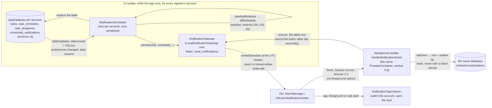

- **The plan** (`planNotifications`, a pure function): the tasks with `done = false`, not queued for deletion, whose `createdById` is the account's user or whose assignees contain the user ([D17](decisions.md#d17-notification-policy)); one entry per reminder with an instant after `now`, keyed `<taskId>:reminder:<ordinal>` (the reminder's position in the task's list; a relative reminder of an unset date has no instant and gives none), when the account's `reminders` preference is on; `<taskId>:due` at the due instant when `dueDates` is on and it is after `now`. A snooze whose `originalFireAt` is the entry's planned instant and whose `until` has not passed moves the entry to `until`; every other snooze is dropped. Sorted by instant, then key. Title: the task title. Body: "Reminder · *project*" or "Due now · *project*", with the identifier when the task has one, localised for the device locale through `lookupAppLocalizations` (no widget tree needed, so the background isolate builds the same texts). Due dates and reminder instants are absolute UTC instants (the server computes a relative reminder's, the app for an unsent edit, section 7.5), so the gateway schedules `tz.TZDateTime.from(instant, tz.UTC)` and no time zone is involved.
- **The diff and the window** (`diffSchedule`, pure and deterministic): only the first *window* entries of the plan go to the OS, 100 on Android and 60 on iOS (under iOS's cap of 64 pending notifications, with slack for snoozes and the test notification). A scheduled entry whose key is not in the window, or whose instant, title or body differs, is cancelled; a window entry not scheduled identically is scheduled; the rest is left alone. Every reconcile refills the window. Exactness is part of the diff: the row records whether the OS was given an exact alarm, so a granted or revoked exact-alarm permission re-registers the whole window on the next reconcile (the plugin's pending list is a cache that does not notice a revocation).
- **OS ids:** a 31-bit positive hash of `<accountId>:<key>` (the first four bytes of its SHA-256, the sign bit cleared), stored in the table. A collision inside the account probes upwards to the next free id. A collision across accounts is accepted: the plugin's id space is one per app, the other account's next reconcile finds its entry gone from `pendingIds()` and schedules it again. Id 1 is reserved for the test notification.
- **The scheduler** (`NotificationScheduler`, one per account; the gateway, the database, the clock, the preferences store, the user id, the `describe` callback and the window are injected): `reconcile()` loads the tasks and the snoozes, plans, diffs, cancels and schedules through the gateway and replaces the table. The write is guarded: inside its transaction the rows are compared with those the run planned from, and when another isolate changed them meanwhile (a background snooze, its reconcile) nothing is written and the run goes once more from the table as it is. Runs are serialized; a call during a run queues one more. When the notification permission is not granted, or no preference is on, it cancels every pending id of the account and clears the table instead. `exact` is `capabilities().exactAlarms`: `AndroidScheduleMode.exactAllowWhileIdle` when Android allows exact alarms, `inexactAllowWhileIdle` otherwise (minutes late in Doze), always exact on iOS. Triggers: a debounced (≈ 700 ms) watch on `tasks`, `task_reminders` and `task_assignees` (drift's `tableUpdates`), the preferences stream, app start and resume, an answer to the permission request inside the app (`NotificationSchedulers.reconcileAll()`, since the OS dialog does not always come with a resume), and the end of a background action. A keep-alive provider the shell listens to builds **one scheduler per signed-in account**, not only for the active one, the way `inactiveOutboxesProvider` keeps the inactive senders (section 5.7); sign-out and account removal dispose the account's scheduler and cancel its pending ids before the database is deleted (`AccountDataWiper`, section 5.6).
- **Preferences** (`NotificationPreferences`: reminders, due dates, both on by default): `NotificationPreferencesStore` over the `PreferencesStore` (key `notifications.<accountId>`, JSON) with a `changes` stream; not in the database, because the scheduler needs them before it is open and they are not sync state. The once-per-device flag `notifications.onboarded` of the setup screen lives there too.
- **The gateway** (`LocalNotificationGateway` over flutter_local_notifications 22.3.2, the only code that touches the plugin; everything above it is tested with a fake): the Android channel `reminders` (importance high, name and description localised at `initialize()`), the three actions on both platforms (Android with `showsUserInterface: false` and `cancelNotification: true`; iOS as the category `task` with `DarwinNotificationAction.plain` and no `foreground` option), `zonedSchedule` with the UTC instant and the schedule mode above, `capabilities()` from `areNotificationsEnabled()`, `canScheduleExactNotifications()` and iOS's `checkPermissions()`, `requestPermission()` (`requestNotificationsPermission()`), `openExactAlarmSettings()` (`requestExactAlarmsPermission()`, the system page of Android 14+; a no-op elsewhere), `openNotificationSettings()` (`openAppNotificationSettings()`), `pendingIds()` from `pendingNotificationRequests()` and `showNow`. A tap in `onDidReceiveNotificationResponse` goes to an injected callback; `getNotificationAppLaunchDetails()` is exposed for the cold-start tap. `bootstrap.dart` hands the plugin both callbacks and calls `initialize()` right after `runApp` (the first frame does not wait for it; every other gateway call runs it first anyway, and a failed attempt is tried again). `tz.UTC` is a built-in location, so the notifications load no timezone database (the filters load the bundled one on first use since step 24, section 7.2 [exists, step 24]).
- **Actions in the background isolate** (`notification_action_handler.dart`; the top-level `@pragma('vm:entry-point')` function in `notification_entry_points.dart` is passed to the plugin at `initialize()`): `handleNotificationAction(NotificationResponse)` builds the container of section 5.8, decodes the `NotificationPayload` (`{account, task, key}`) and, for `mark_done`, calls `LocalTaskRepository.setDone(taskId, done: true)` on that account (a temporary id is resolved through the remap of section 7.5), awaits the drain for at most ≈ 20 s under the no-refresh rule, cancels the task's other notifications and reconciles; for `snooze_10m` and `snooze_1h` the scheduler's `snooze` writes `until = now + 10 min` or `+ 1 h` and `originalFireAt` onto the table row (taken from the task itself when a reconcile has already dropped the fired entry, as every reconcile after a notification fired does: the key names the reminder's ordinal or the due date, and the snooze is a no-op when that instant is unset or has moved ahead), hands the OS the moved entry at once and then reconciles; nothing reaches the server for a snooze. A payload it cannot read is ignored. Errors are logged and never crash the isolate; the container is disposed at the end, which only disconnects its database client (the sign-out's wiper alone waits for the database isolate to close sqlite, `OpenDatabases.closeForDeletion`). iOS completes the notification response before the Dart side runs and may suspend the process within seconds, so the OS is told first (Done cancels the task's notifications before the drain, a snooze schedules before it reconciles) and Done waits at most ≈ 5 s for the drain there (≈ 20 s on Android); the op stays queued either way, and since step 16 a drain that ends with `TokenRejected` (the token had expired) enqueues a one-off background drain on Android (section 7.8) [exists, step 16]. The texts are resolved for the device locale once per isolate (bootstrap and the entry point, `loadDeviceAppLocalizations`); the headless engine on iOS reports no locales, so the UI isolate notes the tag it resolved under `notifications.locale` and an isolate without locales takes that, else English. A running UI sees a Done through its streams; the row's cloud-off mark covers the unsent case, and a repeating task reopens with the server's shifted dates when the op is answered, which the watch turns into the next occurrence.
- **Platform:** Android needs core library desugaring, `POST_NOTIFICATIONS` (13+), `SCHEDULE_EXACT_ALARM` (declared, never `USE_EXACT_ALARM`), `RECEIVE_BOOT_COMPLETED` (the plugin re-registers the pending notifications after a reboot), the plugin's receivers and a monochrome notification icon; iOS the plugin's registrant callback for the background engine in `AppDelegate.swift` and the `UNUserNotificationCenter` delegate, no background modes for notifications (section 8; step 16 added those of the background sync).
- **Since step 16** every background run reconciles each account's scheduler, so the window is refilled while the app is closed, as often as the OS runs the job (before, what fired after the app was last in front was what the window held), and the gateway gains `showActivity` on a second channel `activity` (section 7.8) [exists, step 16]. **Since step 17** the server's `task.reminder` can also arrive over the active account's socket; it is stored like the poll stores it, never shown and not counted by the badge, so nothing needs de-duplicating against the local reminders (section 7.9) [exists, step 17]. **Since step 35a** the device's privacy settings, read anew for every run, shape the notifications (section 8): the describers give generic texts for "Never show task titles", and every entry carries a `NotificationPrivacy` (Android's `secret` visibility for "Hide on the lock screen"; while the app lock is on, the iOS category `task_locked`, registered beside `task` in every `initialize`, whose Done has `authenticationRequired`), which the table records and the diff compares; a change of the content or of the app lock forces a reconcile of every account (every pending entry cancelled and scheduled again, the snoozes kept), and a content that shows less withdraws the account's delivered task notifications [exists, step 35a]. **Not yet:** no grouping, no custom sounds, no overdue digest ([D17](decisions.md#d17-notification-policy)).
- **Since steps 18–19** a notification's Done is `ExternalDone.markDone` (`core/outbox/external_done.dart`), the function the widgets' taps use too: the same steps as before (through the outbox, the task's other notifications cancelled before the drain, at most ≈ 20 s under the no-refresh rule, a rejected token queuing the background drain, a reconcile), plus a redraw of the account's widgets before the drain and after it; the handler's tests pass unchanged (section 7.10) [in review, steps 18–19].
- **Tests:** `planNotifications` (creator, assignee and neither; done, pending delete, past instants, a relative reminder without an instant, a snooze applied, dropped and expired, the preference toggles, the order), `diffSchedule` (the window, unchanged kept, changed rescheduled, removed cancelled), the id hash and the collision probe, the scheduler against a fake gateway and an in-memory database (the table written, the watch triggering after a change, permission denied cancelling everything, exact alarms granted or revoked between runs, a snooze of another scheduler landing during a run, dispose), the action handler with the fake gateway and the fake write client (Done queued, sent and the task's other notifications cancelled before the send; Snooze rescheduled at +10 min, also after a reconcile dropped the fired row; an unknown payload ignored), the preferences store, the migration from schema 3 to 4 with data, the wiper cancelling the ids and forgetting the preferences (from the providers and through the shell), and the widget tests of section 6.

### 7.8 Background work and activity (`core/background/`, `core/activity/`) [exists, step 16]

Vikunja pushes nothing to a phone whose app is not open (since step 17 an open app gets the active account's notifications over a socket, section 7.9 [exists, step 17]), so step 16 polls from the background ([D40](decisions.md#d40-background-sync-one-periodic-job-for-every-signed-in-account-with-a-deadline-skipped-while-the-app-is-in-front-the-incremental-run-as-the-session-keep-alive-a-one-off-drain-after-a-background-done-server-notifications-synced-into-a-local-inbox-on-their-own-cadence-new-unread-ones-as-activity-notifications-the-first-run-silent)): one periodic job for every signed-in account runs, per account, the incremental sync of section 7.3, the outbox drain of section 7.5 and the scheduler's reconcile of section 7.7, and the first request of each run keeps the account's session alive ([D22](decisions.md#d22-session-keep-alive-through-background-sync)). The same runs, and the foreground on a cadence of its own, sync the server's in-app notifications into the account's database: the inbox reads them (section 6), and the new unread ones become activity notifications. The background isolate is the second headless entry point after the action isolate of section 7.7, and the first that refreshes tokens (section 5.8).

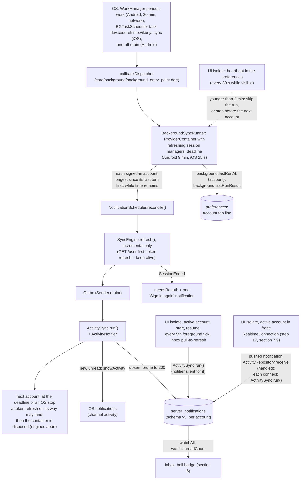

- **The job** (`WorkmanagerBackgroundScheduler`, implementing `BackgroundScheduler` over workmanager 0.10.10; tested against a fake wrapper of `Workmanager`): `registerPeriodicSync()` registers on Android one periodic task every 30 min with `Constraints(networkType: NetworkType.connected)` and `ExistingPeriodicWorkPolicy.update`, so registering again on every start neither duplicates the work nor restarts its period, and on iOS the periodic BGTaskScheduler task `dev.coderoftime.vikunja.sync` with a frequency of 30 min (an earliest begin date, which the system may stretch indefinitely) plus background fetch; `enqueueDrain()` enqueues an ordinary one-off task with the same network constraint on Android, chained after a drain that is running (`ExistingWorkPolicy.append`, natively `APPEND_OR_REPLACE`), never expedited: below Android 12 WorkManager runs expedited work as a foreground service, which the plugin's worker does not provide, and fails it before it starts; it is a no-op on iOS; `cancelAll()` cancels both. `bootstrap.dart` passes the top-level `callbackDispatcher` (`@pragma('vm:entry-point')`, calling `Workmanager().executeTask`) to `Workmanager().initialize` and registers the periodic sync after the first frame while at least one account exists; the last sign-out cancels everything (section 5.6). One job serves every account, not one per account: WorkManager's quota, the standby bucket and iOS's scheduling are per app anyway.
- **The runner** (`BackgroundSyncRunner`, `core/background/background_sync_runner.dart`, headless): builds a `ProviderContainer` like the action handler of section 7.7 (the `ClientIdentity.load()` override included), but with session managers that refresh (section 5.8). It does nothing when the foreground heartbeat, a preferences key the UI isolate writes every 30 s while the app is visible (`ForegroundHeartbeat`, on a timer of its own, so a long foreground run or a backed-off foreground scheduler never lets it age), is younger than 2 min: the foreground already syncs the active account, drains the inactive outboxes and reconciles every scheduler; it checks again before every account and stops once the app came to the front. Otherwise it takes the signed-in accounts by the start of their last turn (`background.lastAttemptAt.<account>`, round-robin, the oldest synced first among equals), so an account that never gets through (an unreachable server) does not starve the others, and, for each while the injected deadline (Android 9 min, under WorkManager's 10 min; iOS 25 s, under the ≈ 30 s) leaves at least 10 s: `NotificationScheduler.reconcile()` first (section 7.7; local only, so the notification window is refilled even when the network steps use up the time) → `SyncEngine.refresh()` → `OutboxSender.drain()` (section 7.5; since step 26 without the queued uploads, which wait for the app in front [exists, step 26]) → `ActivitySync.run()` with the notifier → `reconcile()` again after a sync that got through. Its engines are headless (`runsHeadlessProvider`): a refresh stays incremental even when the daily full resync is due (the app runs that when it is in front; in a background run it would start over every time), and a run another isolate holds is skipped, not waited for (below). A `NetworkFailure` skips the account's remaining network steps, each would wait for its own timeout. A `SessionEnded` marks the account `needsReauth` (section 5.5) and posts the session notification below; any other failure is logged and the run goes on with the next account. At the deadline, and when WorkManager stops the worker (`onTaskStopped`: constraints lost, Doze, standby, quota), a token refresh still on its way gets up to 3 s to land (`SessionManagers.settle()`, D26: a rotation whose answer is dropped ends the session), then the container is disposed: the running engine aborts (`dispose()`) and the incremental run starts from its watermark next time. It writes `background.lastRunAt.<account>` and `background.lastRunResult` to the preferences for the Account tab, never throws out of the callback and returns success to the plugin even when nothing could run: a failure would add WorkManager's retry backoff on top of the period, and the next periodic run comes anyway.
- **One run per account across isolates.** The UI isolate, a background run and a notification action share each account's database, and the heartbeat keeps them apart only in the usual case. Overlapping sync runs are not harmless: a full run purges every task it did not mark itself, so tasks another run marked meanwhile would vanish until the next full run. Every `DefaultSyncEngine` run therefore takes the account's lease in `sync_state` (`sync_lease` = `{owner, until}`, 3 min) in a transaction, renews it on every checkpoint and before every request, checks it in the transaction of the purge and of the completion, and releases it at the end; a run that finds its lease taken (it stalled past 3 min) stops quietly and purges nothing. The app's engine waits for a lease another isolate holds and then adopts the state that run stored; a headless engine skips the sync. Outbox senders of one account coordinate through the queue itself (section 7.5): an op `sending` elsewhere stops the queue until it is 5 min old.
- **Keep-alive** ([D22](decisions.md#d22-session-keep-alive-through-background-sync)): every incremental run starts with `GET /user` (section 7.3); background runs are at least 15 min apart and access tokens live 600 s, so that request finds the token expired, the session manager refreshes it (section 5.4) and the 72 h window slides. No request is spent on the keep-alive itself. On iOS, where runs may never come, a session can still end after 72 h without the app; the next run that reaches the account, or the app's own session check (section 5.5), finds it.
- **Session ended:** an activity notification "Sign in again to *host*" with the payload key `session:<account>`, once per account and ended session (a preferences entry remembers it until the account is signed in again); its tap switches to the account and opens the Account tab with the reauth banner (section 6).
- **Link-share guests** (step 32) [exists, step 32]: a run skips the activity sync for a guest (the server answers 403, which would make every run partial) and keeps the sync, the drain and the reminders; the run's first request renews the guest's token when due, as for a user. The notification for an ended guest reads "Guest access to *name* ended" instead of "Sign in again" with the made-up username. The foreground activity sync skips guests too.
- **Home-screen widgets** (steps 18–19, section 7.10) [in review, steps 18–19]: a run first imports the widgets' Done taps (`importWidgetTaps` without a drain of its own: the accounts' turns drain them, with refreshing session managers), and every account's turn ends by publishing its widgets' snapshots (`WidgetRefresher.refresh`), also for an account that needs a new sign-in, so its widgets show the banner. On iOS these runs are the only refresh of the widgets' lists while the app is closed.
- **Drain after a background Done:** when the drain of a background Done ends with `TokenRejected` (the stored access token had expired, and the action isolate never refreshes, section 7.7), the action handler calls `BackgroundScheduler.enqueueDrain()`; on Android the one-off task runs through the same callback dispatcher in a refreshing container, usually within minutes (Doze defers it to a maintenance window), instead of at the next app open.
- **The activity sync** (`ActivitySync` in `core/activity/`, per account, headless; the read and write clients, the database and a clock injected): `run()` first pulls `NotificationsPort.list` pages newest first until a page contains an id already stored, at most 3 pages, and upserts them (keeping the local `read_pending` and `notified`); then it sends the pending reads, as one `markAllRead()` when more than one read is pending and nothing is left unread, else one `markRead(id)` per id (`read_pending` cleared on success and on a refusal for good, kept on a transient failure, which ends the round), so "mark all as read" goes out as one request only when nothing unread arrived since the user saw the list; then it prunes the table to the newest 200 and returns the unread notifications not handled yet, oldest first. Once an hour, and on the inbox's pull-to-refresh (`refresh(wholeWindow: true)`), the pull goes on past the stored ones while an older stored one is unread here, up to the 200 kept, so a "mark all as read" on the web reaches the badge; what those pages hold that was never stored is old and stored as handled. A notification the pull finds read on the server is withdrawn from the tray. On an empty table (the account's first run) everything is stored as notified, so a sign-in never floods the shade with old activity. It has its own cadence, outside the task sync's request budget:

  | Trigger | Accounts | Runs |
  |---|---|---|
  | background run (periodic, or the drain) | every signed-in account, longest since its last turn first | `reconcile()`, `refresh()`, `drain()`, `ActivitySync.run()` with the notifier, `reconcile()` |
  | app start, resume | the active account, then every other signed-in account that has synced before | `ActivitySync.run()`, next to the task sync of section 7.3; the other accounts' new ones become OS notifications |
  | every 5th tick of `ForegroundSyncScheduler` (≈ 5 min in front) | the same | `ActivitySync.run()` |
  | inbox pull-to-refresh | the active account | `ActivityRepository.refresh()` → `ActivitySync.run()`; a failure is the inbox's offline notice |
  | a notification pushed over the socket (step 17) | the active account, while the app is in front | `ActivityRepository.receive` stores it as handled, without a request; every connect of the socket runs `ActivityRepository.refresh()` once to catch up (section 7.9) [exists, step 17] |

- **The notifier** (`ActivityNotifier`): for each new unread notification of the kinds `task.comment`, `task.assigned`, `task.mentioned`, `task.created`, `task.deleted`, `project.created` and `team.member.added` (never `task.reminder`: the local reminders of section 7.7 cover it), when the account's `activity` preference is on (a new field of `NotificationPreferences`, on by default; a stored entry without it reads as on) and the notification permission is granted, it calls `NotificationGateway.showActivity(osId, title, body, payload, subtitle, group)` and sets `notified`, so nothing is shown twice. A run shows the newest 5 one by one and one "More activity" notification (key `inbox:<account>`, whose tap opens the inbox) for the rest, all in the account's group (`groupKey` on Android, `threadIdentifier` on iOS), and then cancels the account's oldest activity notifications beyond 10 in the tray (`NotificationGateway.delivered()`), because Android drops every post beyond 50 notifications of an app, reminders included. With several accounts signed in each names its account (`@username · host` as Android's `subText` and iOS's `subtitle`). A read in the inbox, a read the pull finds on the server and a new sign-in (for the session notice) withdraw the notification from the tray; sign-out withdraws everything the account has there (`ActivityTray`). The os id is the hash of section 7.7 over `<account>:activity:<id>`; the payload is `NotificationPayload(account, task: <taskId, or 0>, key: 'activity:<id>')`, with task 0 for `task.deleted` (nothing to open; its tap opens the inbox); the title is the task title, else the project or the team; the body follows the web's wording with the doer's name, localised (en, de): "Anna commented: …" (the first 80 characters of the comment as plain text), "Anna assigned you" (German "Anna hat dir diese Aufgabe zugewiesen"), "Anna mentioned you", "Anna created this task in *project*", "Anna deleted this task", "Anna created the project *title*", "Anna added you to the team *team*". While the app is in front nothing is shown for the active account, whose bell badge shows it; the other accounts' notifications are shown.
- **The gateway:** `LocalNotificationGateway.showActivity` shows the notification at once on a second Android channel `activity` (default importance, name and description localised) without actions, and on iOS without a category; a tap reaches the tap listener of section 6 like any other.
- **Inbox data** (`LocalActivityRepository`, implementing `ActivityRepository` over the DAO of section 7.1 and `ActivitySync`; `activityRepositoryProvider` follows the active account, `accountActivityRepositoryProvider(accountId)` serves any account): `watchAll()` newest first, `watchUnreadCount()` (the badge: unread after applying the pending reads, without the server's `task.reminder` copies, which the phone has shown itself; the inbox still lists them and "Mark all as read" takes them), `refresh()` (one `ActivitySync.run()`, throwing its `VikunjaFailure` and keeping the stored rows; what it brings counts as handled, because the inbox shows it), since step 17 `receive(notification)` (a notification the socket pushed, upserted as handled) [exists, step 17], and `markRead(id)` and `markAllRead()`, which change the table at once (`read_pending`) and leave the request to the next activity sync. Since step 27 `find(id)` gives the stored notification, null when this device does not have it, from which a tap on an activity notification takes the comment it is about (`commentIdOf`; `ActivityItem.commentId` for the inbox) [exists, step 27]. Server notification reads never go through the outbox of section 7.5: a read is idempotent and cheap to send again.
- **Tests:** the DAO and the migration from 4 to 5 with data; `ActivitySync` (the first run marks everything notified, later runs return only the new unread ones, the stop at a known id, the 3-page cap, the hourly and pull-to-refresh read-back of the stored window, pending reads sent and kept on failure, the mark-all case); the notifier (the kinds, the preference off, the permission denied, the texts per kind in en and de with their fallbacks, the os id's stability, never twice, five per run and one for the rest, the tray trimmed to ten, the account label); the runner with fakes (the heartbeat skip, the deadline between accounts and the dispose, a session ended → `needsReauth` and one notification, the turn order by the last attempt, the app coming to the front between accounts, an OS stop, an unreachable server skipping the other network steps, every step called); the scheduler adapter against a fake `Workmanager` wrapper (the registration arguments per platform); the action handler enqueueing a drain on `TokenRejected`; and an app contract test against 2.7.0 (user B assigns user A → A's activity sync stores it and the notifier shows one activity notification; a read marked locally reaches the server with the next run).
- **Not yet:** deleting server notifications and project screens; a tap on a `team.member.added` OS notification opens the inbox, whose entry opens the team's page since step 28 (section 6) [exists, step 28]. The inbox shows the comment text a notification carries; since step 27 a comment's notification and inbox entry open the task's detail sheet at that comment, where an answer is written (section 6) [exists, step 27]. Since step 17 the active account's new notifications arrive over its socket while the app is in front; the poll stays for reads, for what a socket missed and for the other accounts (section 7.9) [exists, step 17].

### 7.9 Realtime (`core/realtime/`) [exists, step 17]

While the app is in front, the active account keeps one WebSocket to the server's `/ws` ([D46](decisions.md#d46-realtime-in-the-foreground-one-websocket-for-the-active-account-while-the-app-is-in-front-pushed-notifications-stored-at-once-and-a-sync-nudged-for-the-task-they-name-re-auth-on-every-token-change-quiet-fallback-to-polling)). For every in-app notification it stores, the server pushes a `notification.created` event to every socket of the user, so a comment, an assignment, a mention, a task created or deleted in a followed project, a project created or a team membership is in the inbox and on the badge within a second instead of with the next activity poll (≈ 5 min), and the task it names is synced seconds later instead of with the next 60 s tick. The socket carries nothing else the app could use: no task changes, no reads, no replay of what arrived while no socket was there. It is therefore a fast path into `server_notifications` and a trigger of `refresh()`, never a source of truth: the 60 s timer of section 7.3 and the activity poll of section 7.8 stay, and any failure leaves the app polling as before. Inactive accounts and the background job of section 7.8 have no socket.

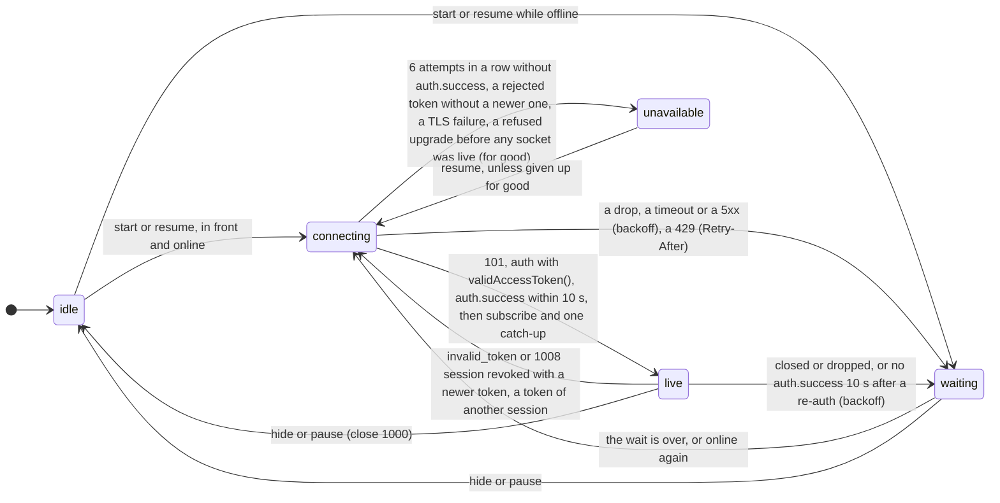

- **Gating** (`realtimeConnectionProvider`, `features/sync/application/realtime_connection_providers.dart`, keepAlive): like `foregroundSyncSchedulerProvider` (section 7.3) it is null while nobody is signed in, while the active account needs a new sign-in and during a sign-out, and also in a background container (`runsHeadlessProvider`), before the account's first sync (`needsFirstSync`) and on a server without `Capability.websocket` (older than 2.3 without v2). The sign-out gate disposes the connection as the sign-out starts, before the logout request (section 5.6). An account switch disposes the connection, which closes the old socket, and builds one for the new account. The lifecycle is the scheduler's: `start()` when built in front, `onResume()` on a resume, `onPause()` on hide and pause, which closes the socket with 1000; while nothing listens the connection rests, and the shell listens from `initState` (section 6). `offlineProvider` feeds `setOffline`.
- Since step 32 a link-share guest gets no connection (`accountIsGuestProvider`): the server's socket takes user tokens only [exists, step 32].
- Since step 35b the connection waits until the server address's connection settings were read once, and it starts again after every edit or revoke of them (`connectionProfileRevisionProvider`), but not after a recorded certificate mismatch [exists, step 35b].
- **Transport:** `realtimeUri` of the account's stored connection, and `realtimeConnectorProvider` (`core/realtime/realtime_providers.dart`, keepAlive), which wraps `IoRealtimeConnector` (section 4) and adds the app's `User-Agent` from `clientIdentityProvider`, never an `Origin`. Tests override it: `SyncFakes` puts in a `FakeRealtimeConnector` that refuses unless a test lets it accept, so no widget test opens a real socket. dart:io ignores the system proxy, VPN-only routes and, on Android, user-installed CAs, so a socket can fail where REST over Cronet or NSURLSession works (section 5.2). Since step 35b `realtimeConnectorProvider` is a `ProfileRealtimeConnector`: per connect it refuses `ws://` without the consent, puts the access headers on the upgrade request (the socket's own headers win, the `User-Agent` comes last) and, for a pin, a CA or a client certificate, hands `IoRealtimeConnector(createHttpClient:)` a `dart:io` client from the profile; a header-only address keeps the default trust, so behind a private CA on Android it still falls back to polling (section 3.1) [exists, step 35b].
- **Sequence** (`RealtimeConnection` in `core/realtime/realtime_connection.dart`, one per active account, headless; the connector, the URL, the headers, an `AccessTokenSource` (`AccountTokens` over the session managers), the account's `SyncEngine` and `ActivityRepository`, a clock, a timer factory and a `Random` are injected): upgrade → `auth` with `validAccessToken()`, asked only after the upgrade, so a refused upgrade costs no refresh → `auth.success` within 10 s (`authTimeout`), else the socket is closed and handled as a drop → `subscribe` to `notification.created` → `live`, with one `ActivityRepository.refresh()` of the account alongside, which catches up with what the server sent while no socket was there (its rows count as handled; a failure leaves the socket live). At most one attempt is in flight; a socket that arrives after a pause is closed.
- **Events:** every `RealtimeNotification` is stored at once, in arrival order, through `ActivityRepository.receive` as a handled row: the active account in front never gets OS notifications (section 7.8), and the inbox and the badge follow their streams. A `task.reminder` is stored the way the poll stores it, never shown and not counted by the badge, so there is nothing to de-duplicate against the local reminders of section 7.7. `task.comment`, `task.assigned`, `task.mentioned`, `task.created`, `task.deleted` and `project.created` ask for one incremental `refresh()` of the account 2 s after the last of them (`syncDebounce`); while a run is going, one more follows it at most, because that run may have started before the change. Since step 27 that run brings a commented task's new `updated`, comment count and unread dot, and an open detail sheet of the task reads its details and comments again (section 6) [exists, step 27]. `team.member.added` and `task.reminder` ask for nothing. Other server errors (`auth_required`, `invalid_event`) are logged and ignored.
- **Re-auth:** while live, every 20 s (`tokenCheckInterval`) the connection asks `validAccessToken()`. The session manager refreshes within 60 s of the expiry, so a check always finds the new token 40 s or more before the server would close the socket with 1008 "token expired". A token that differs from the socket's and has the same session (`sid`, read with `JwtClaims`) goes on the open socket as `auth`, and the server keeps the subscription; one of another session (a new sign-in of the account) closes the socket and connects anew at once. No `auth.success` within 10 s after a re-auth closes the socket and reconnects after the backoff. That covers refreshes made by REST and servers that cannot re-authenticate (before 2.7.0); a check that fails tries again at the next one. The session manager is unchanged.
- **Failures:**

  | Outcome | Then |
  |---|---|
  | `invalid_token`, after the first auth or a re-auth, or a close 1008 "session revoked" | `refreshAfterRejection` with the token the socket used: a newer token connects again at once; none, a throw, or another rejection before an `auth.success` → `unavailable` until the next resume. A session that really ended ends inside the session manager (`needsReauth`, section 5.5), whose change disposes the connection with its provider; a close that arrives after that, such as the revoke of the app's own sign-out, is ignored |
  | any other close (1008 "token expired" or "auth timeout", 1001, 1013, …), a drop without a close frame, a socket or timeout error, no `auth.success` within 10 s, an upgrade answered 5xx, a handshake cut off mid-way (`HandshakeException` "Connection terminated during handshake") | reconnect after the backoff |
  | an upgrade answered 429 | wait for `Retry-After` (without it, the limiter's 60 s window), at least 2 s, doubling with every 429 in a row, at most 5 min, plus up to 25 %; no backoff step and no attempt counted; the wait holds across a pause and the network coming back |
  | an upgrade answered 400, 401, 403, 404, 426 or any other status, or a 101 that is no valid upgrade (a wrong `Sec-WebSocket-Accept`) | before any socket of this connection got to `auth.success`: `unavailable` for as long as the connection lives, until the app starts again or the account changes, so a proxy that cannot upgrade is not asked again; afterwards: reconnect after the backoff, like a 5xx (a reverse proxy answering 404 while the server restarts) |
  | another TLS failure (a certificate, a protocol), a `SessionEnded` from `validAccessToken()` | `unavailable` until the next resume |
  | since step 35b a connection-settings exception (`CleartextBlockedException`, `ConnectionProfileLockedException`, `ConnectionProfileIncompleteException`, `ConnectionProfilesDamagedException`) or a refused client certificate (`ClientCertificateRefusedException`, from the alert's name) | `unavailable` until the next resume; an edit of the settings starts the connection again [exists, step 35b] |

- **Backoff and limits:** 2 s, doubling to 60 s, ±25 % jitter (`initialBackoff`, `maxBackoff`); reset when a socket that was live for 60 s (`stableAfter`) ends, however it ends, and on every resume. 6 attempts in a row that end without an `auth.success` (`maxAttemptsWithoutAuth`; rate-limited ones do not count, and the drop of a live socket is no attempt) → `unavailable` until the next resume, because REST can work where the socket cannot. A resume also starts that count again and lifts an `unavailable` that holds until a resume. While `offlineProvider` says the server is unreachable, no attempt is made (`waiting`); when it says online again, one is made at once unless a rate-limit wait still runs; a live socket stays when the sync runs go offline.
- **No visible UI:** `RealtimeState` (`idle`, `connecting`, `live`, `waiting`, `unavailable`; `state` and the replaying `states`) is for tests and the log only. The badge, the inbox and the lists update sooner; the offline banner stays bound to the sync runs (section 6).
- **Logging:** the connection logs its states, the upgrade statuses and the close codes at FINE (logger `Realtime`), never a frame (the auth frame carries the token) or a token; the connector logs nothing.
- **Tests:** in `vikunja_api` the codec (the frames captured from 2.7.0 in `test/fixtures/realtime/frames_2.7.0.json`, every kind parsed like a notifications list item, unknown and malformed frames, the encoded frames), `realtimeUri` (http and https, ports, sub-paths, IPv6, v1 and v2) and the connector against a loopback server (`test/helpers/loopback_server.dart`: a 101 with the auth round trip, also over IPv6; a 429 with `Retry-After` and with `X-RateLimit-Reset`; other statuses, a 200 and a redirect that is not followed; a wrong or missing `Sec-WebSocket-Accept` and a 101 without `Upgrade`; a server that never answers, a closed port, TLS to a plain port; the close code and reason, `invalid_token` before the close 1000, a drop and a reset without a close code, unanswered pings, `close` sending 1000, sending after a close), and the contract test `test/contract/realtime_contract_test.dart` on both paths (`auth_required` before the auth, `auth.success`, an API token answered `invalid_token` and closed with 1000, another user's comment pushed to every socket equal to the item of `GET /notifications`, the logout's 1008 "session revoked"). In `app/` `test/core/realtime/realtime_connection_test.dart` (the sequence, pushed notifications with the debounced and coalesced sync, re-auth, rejected tokens, drops with the backoff, its jitter and its reset, the attempts without `auth.success`, the rate limit, `unavailable` and its reset, offline, the lifecycle, the log without a token or a frame), `realtime_connection_provider_test.dart` (the gates, the v1 and v2 URLs, the lifecycle, an account switch, a refused upgrade leaving the app polling), `realtime_io_test.dart` (the real connector: the `User-Agent` and no `Origin`, a pause closing with 1000), the shell (the socket kept across tab switches and closed before the logout request, a revoke elsewhere reaching the session manager, a tab switch neither restarting the timer nor pulling the activity again), the bell counting a pushed notification at once, `receive` in the activity repository tests, `FakeRealtimeConnector` and `FakeRealtimeSocket` in `test/helpers/realtime_fakes.dart`, and the contract test `test/contract/realtime_contract_test.dart` on both API versions: over the real connector, another user's comment (an assignment when the server has comments off) reaches the reader's inbox repository within 3 s without a pull, and a sync is requested.
- **Left out** ([D46](decisions.md#d46-realtime-in-the-foreground-one-websocket-for-the-active-account-while-the-app-is-in-front-pushed-notifications-stored-at-once-and-a-sync-nudged-for-the-task-they-name-re-auth-on-every-token-change-quiet-fallback-to-polling)): sockets for inactive accounts and in the background, showing the server's `task.reminder`, the licensed `timer.*` events, a settings switch, and user CAs for the socket (since step 35b a pin or a CA in the connection settings covers such a server, section 3.1).

### 7.10 Home-screen widgets (`core/widgets/`, `plugins/rurana_widgets`, Glance, `RuranaWidgets`) [in review, steps 18–19]

Steps 18 and 19 put one list of an account on the home screen ([D63](decisions.md#d63-home-screen-widgets-from-json-snapshots-the-app-writes-through-an-in-repo-plugin-glance-widgets-on-android-with-done-through-a-headless-dart-worker-a-widgetkit-extension-on-ios-with-an-app-group-outbox-and-no-token)). Dart builds every text from the account's database and writes small JSON files; Kotlin and Swift only draw them and store taps. A widget's Done comes back to Dart and goes through the outbox (section 7.5), exactly once. Nothing native talks to the server or holds a token (principle 5, [D24](decisions.md#d24-tokens-in-secure-storage-readable-after-the-first-unlock)). Android is checked on the emulator; iOS is built, and its device test comes at the end of the project.

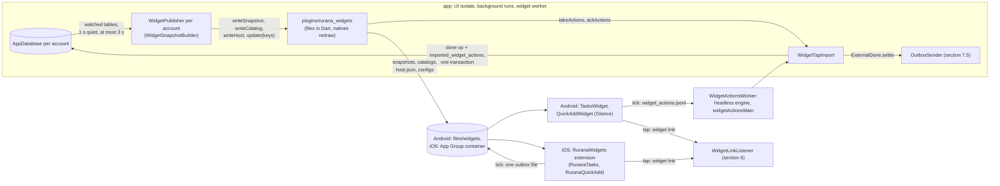

- **What a widget shows** (`WidgetKind`, `WidgetConfig`): Today (overdue and due today, like the Overview's first sections, and through the Overview's saved filter when one is picked), Upcoming 3, 7 or 14 days (the overdue tasks and those due within the days, through `selectUpcoming`), Overdue, Favourites, a project (its first list view's filter and the sort last left there in `list_preferences`, done tasks hidden), a label (its open tasks through the filter engine), a saved filter (the engine of section 7.3, or its last download for one the engine refuses; none for a guest), and the New task button (`QuickAddKind`). An Android widget's config is a file per instance; an iOS widget keeps its choice in its own `AppIntentConfiguration`.
- **Files** (`R` is `<application support>/widgets` on Android, which is `filesDir/widgets`, and `<App Group container>/widgets` on iOS; JSON in UTF-8, dates as epoch milliseconds, every write a temp file and a rename, unchanged content not rewritten):
  - `R/snapshots/<key>.json` (`WidgetSnapshot`): `v`, the state (`ok`, `needsReauth`, `guestEnded`, `accountRemoved`, `gone`), title, subtitle, `generatedAt`, `validUntil` (the next local midnight at the latest), `changesAt` (the due instants inside the range), at most 30 rows (`WidgetRow`: id, title, a day-level due label with `dueAt` and its tone, the priority with its level, the project with its colour, `canDone`, a screen-reader label, the row's link), the total and the "more" label, the count label, the empty and message texts with their links, the header's and the "+" button's links. The fingerprint ignores `generatedAt`. Keys are `<accountId>.<part>`: `today`, `overdue`, `favorites`, `quick_add`, `upcoming_<days>`, `project_<id>`, `label_<id>`, `filter_<id>`; a key keeps naming its list while a widget shows it, so a deleted project's `gone` snapshot is found.
  - `R/catalogs/<accountId>.json` (`WidgetCatalog`): the account (id, name, host, guest flag), whether it can add tasks, the Quick add key, and the lists with their keys and sections: the smart lists, the projects without archived ones (a nested one with its parents' titles joined by " › ", and whether it takes tasks), the labels and, except for guests, the saved filters.
  - `R/host.json`: the active account and the "Use system colours" switch; since step 35c also the widget-link key (`linkKey`), which the native link builders add as `k` (section 6) [exists, step 35c].
  - Android: `R/configs/<appWidgetId>.json` (`{"version":1,"key",…WidgetConfig}`, written by `saveConfig` or natively from the pin callback, deleted with its widget); `<filesDir>/widget_actions.jsonl`, the Done queue Kotlin writes, which the app claims by renaming it to `widget_actions.<n>.claimed`; `R/android-pending.json`, Kotlin's own list of hidden rows.
  - iOS: `R/outbox/<uuid>.json`, one per Done tap, which only the app deletes; `R/requests/<key>`, empty markers the extension leaves for the lists it shows; `R/ios-pending.json`, the extension's own list of hidden rows.
  - No file holds a token or other secret; snapshots hold task titles, and `host.json` the widget-link key, which guards no data. Since step 35c iOS keeps `R` out of backups, and Android backs up nothing of the app (section 8) [exists, step 35c].
- **The builder** (`WidgetSnapshotBuilder`, pure and headless): reads one account's database once per run and builds every requested snapshot and the catalog with that account's display settings (`DisplaySettings`, `MomentFormatter`), translated names and stored permission (`ProjectAccess`: no Done in a read-only or archived project). A project, label or saved filter that is gone gives a `gone` snapshot; an account that needs a new sign-in keeps its rows with a `needsReauth` or `guestEnded` message. `WidgetTexts` holds the device's localizations and the 24-hour switch, which the app notes under a preferences key for headless isolates; due labels change only at midnight ("Today, 14:30", "Tomorrow", a weekday, a date) or follow the absolute format picked on the web. The builder imports from `features/` (section 2).
- **The publisher** (`WidgetPublisher`, one per signed-in account; `WidgetPublishers`, `accountWidgetPublishersProvider`, listened by the shell like the notification schedulers): watches the account's tables, its registry entry and its sync state, publishes when built, 1 s after the last change and at most 3 s after the first, on resume and when its snapshots go stale at midnight; writes only what changed and redraws only the widgets that show a changed key. It publishes the keys on screen (`displayedSnapshotKeys`: the Android configs plus the active account's Today for a widget not set up; the iOS request markers) and, on iOS, the smart lists and the Quick add key always (`widgetAlwaysPublishedKinds`). `WidgetRefresher` serves the rest: `refresh(accountId)` for the background runs and `ExternalDone`, `refreshAll` for the worker, `publish(config)`, which writes one list although no widget shows it yet and always redraws it (Save on the setup page, "Add" before the pin), and `preview(config)` for the setup page. `widgetHostSettingsProvider` writes `host.json` when the active account or the colour switch changes and publishes the new account's Today. A sign-out or removal (`accountDataWiper`) deletes the account's snapshots, catalog and waiting taps and writes "Account removed" for the keys still on screen.
- **The plugin** (`plugins/rurana_widgets`, `RuranaWidgets` behind the app's `WidgetHost`, `PluginWidgetHost` on Android and iOS, `NoWidgetHost` elsewhere): the file work in `dart:io`; the channel `dev.coderoftime.rurana_widgets` only asks for the directories, the placed Android widgets (`configs()`, which also lists a list widget not set up, and deletes the configs of removed ones), a redraw (`update(keys)`, `updateAll()`) and a pin (`canRequestPin()`, `requestPin(provider, snapshotKey, config)`). On Android a redraw is an explicit `ACTION_APPWIDGET_UPDATE` broadcast with the widget ids to `TasksWidgetReceiver` or `QuickAddWidgetReceiver`, so the plugin has no Glance dependency; on iOS `reloadTimelines(ofKind:)` for `RuranaTasks` and `RuranaQuickAdd`, and `reloadAllTimelines()`. Without a native side (tests, desktop) every call gives a neutral value. `MemoryRuranaWidgets` (`testing.dart`) is the fake.
- **Done from a widget:**
  - `takeActions()` reads the Android queue (claimed by rename, leftovers of a crash included) or the iOS outbox, sorted by `createdAt`, malformed entries dropped (a fractional `createdAt` is rounded); nothing is removed before `ackActions(ids)`.
  - `WidgetTapImport` queues each tap's `TaskChanges(done: true)` through `OutboxDao.queueUpdate` and records its id in `imported_widget_actions` in one transaction of the account's database; a tap already recorded is skipped, one of an account that is not signed in is dropped, one whose write fails stays for the next import. Then `ExternalDone.settle` per account (section 7.7: notifications cancelled, widgets redrawn, the drain, the plan), then `ackActions`, then `updateAll`: the widgets hide a row while its tap waits, so a redraw before the acknowledgement would keep it hidden.
  - In the app `widgetTapImporterProvider` imports once the accounts are loaded and on every resume, one import at a time; the background runs import before the accounts' turns, without a drain of their own (section 7.8).
  - Android: the row's checkbox runs `MarkDoneAction` (an untick does nothing). `WidgetActionQueue.add`, under an in-process lock, refuses a row already hidden (queued, claimed, or pending from a list newer than the row's) and otherwise rewrites the whole queue file (a temp file and a rename; an append could land in a file the app has already claimed and read), hides the row through `android-pending.json` (a row stays hidden while its tap is queued or newer than the snapshot) and redraws; a failed write still redraws, so the checkbox clears. `WidgetActionsWorker` (unique work `rurana_widget_actions`, `APPEND_OR_REPLACE`, expedited on Android 12+, ordinary work once the quota is used up) starts a headless `FlutterEngine` with the plugins and `DartEntrypoint(…, "package:vikunja_mobile/core/widgets/widget_entry_points.dart", "widgetActionsMain")`, waits up to 3 minutes for `finished` on `dev.coderoftime.vikunja/widget_worker`, redraws both widgets and destroys the engine. `widgetActionsMain` (re-exported by `main.dart`, so the AOT build keeps it) builds the container of section 5.8, imports the taps, publishes every account and always tells the worker. The same worker runs with an empty queue to publish: once per key and process when a list widget finds no snapshot, and once per `validUntil` when it draws a stale one. `WidgetSchedule` sets an inexact `RTC` alarm (it does not wake the device) at the earliest `changesAt` or `validUntil` of the shown snapshots, whose `WidgetRedrawReceiver` redraws, so a task due today turns overdue on time.
  - iOS: `MarkDoneIntent` (`Button(intent:)`, iOS 17, compiled only into the extension) writes `outbox/<uuid>.json` (`{"version":1,"id","accountId","taskId","createdAt"}`, `createdAt` in whole milliseconds) as `<uuid>.json.tmp` and a rename, records the entry in `ios-pending.json` (a row stays hidden while its file exists or its tap is newer than the snapshot) and reloads the timeline; a second tap on the same task while its file exists is ignored, so a repeating task cannot move twice. No network, no keychain, no lock.
  - There is no `widget/done` link: any app, and on iOS any web page, can open the app scheme, and an account id can be derived. After a force-stop on Android 14 or earlier the row opens the task, which the user marks done in the app; on Android 15 and later the launcher greys a force-stopped app's widgets out until the app is opened.
- **Android widgets** (`app/android/app/src/main/kotlin/dev/coderoftime/vikunja/widgets/`):
  - `TasksWidget` (the list; `SizeMode.Responsive` with four sizes; the smallest shows only the header, centred) and `QuickAddWidget` (the New task button; without a config it opens `widget/new-task` in the active account), with their receivers.
  - The header: title, subtitle, the count (a native plural "%d tasks" when the spoken label is missing) and "+". Rows at least 48 dp: a 48 dp checkbox where `canDone`, the title, and a line with the due label in its tone's colour (an overdue date after a tinted warning icon; a `today` row whose `dueAt` has passed draws as overdue), the priority and the project with its colour dot; "+N more", the empty state, the message states and a sign-in banner above the rows; on a configured widget "Account removed" and "gone" open its setup. Text sizes in `sp`.
  - `WidgetStateDefinition` reads the files on every update (Glance's session key `appWidget-<id>` names the widget), so a new snapshot shows at once; a widget without a config shows `<activeAccountId>.today`. `WidgetModel`, `WidgetFiles` and `WidgetState` parse and decide in plain Kotlin, which the JVM tests cover.
  - `WidgetTheme`: the system colours on Android 12+ unless "Use system colours" is off, else the brand scheme of `AppTheme.brandScheme` in light and dark.
  - `WidgetConfigureActivity` checks that the widget id belongs to the app, sets `RESULT_OK` and opens `widget/configure?appWidgetId=` in `MainActivity`; `WidgetLinks` opens only the app's own widget links, in `MainActivity` in the app's own task (`NEW_TASK`, `SINGLE_TOP`, `CLEAR_TOP`). Since step 35c `configureLink`, `openLink` and `newTaskLink` are plain string functions that add the key from `host.json` (`WidgetLinksTest.kt`) [exists, step 35c].
- **iOS extension** (`app/ios/RuranaWidgets/`, plain Swift, no Flutter, no plugin, no SQLite, no network): `RuranaTasks` (an `AppIntentConfiguration`: the account, the list kind and its days, project, label or saved filter, each from the catalogs, a nested project with "in *parent*"; a new widget shows the app's active account from `host.json`) and `RuranaQuickAdd` (the account and an optional project that takes tasks). It takes every key from the catalog and never builds one; it leaves `requests/<key>` for the list it shows and removes a marker older than 24 h whose widget is gone (`WidgetCenter.getCurrentConfigurations`). Timeline entries now, at each `changesAt` and at `validUntil`, reloaded `.after(validUntil)` (an hour later when that has passed); a `today` row whose `dueAt` has passed draws as overdue. Small, medium, large, the iPad's extra large and three lock-screen sizes; dark mode, tinted rendering and Dynamic Type, with fewer rows rather than smaller text, the header fixed and "+N more" (a native string) right under the rows. A list it has no snapshot for says "Open Rurana to load this list".
- **Privacy** (section 8) [exists, step 35a]: with the device switch "Show task titles in widgets" off, the builder writes a list's title, count, links and "+" but no rows, no "+N more" and no `changesAt`, and a non-empty list shows the count and "Open Rurana to see them" as its empty text, which both renderers already draw; the publishers republish when the switch changes and, while it is off, delete the account's snapshots outside the current set (`WidgetHost.deleteSnapshotsExcept`). The extension marks the rows, the small widget and the Done button `.privacySensitive()`, after their accessibility labels, and `MarkDoneIntent` requires authentication.
- **Tests:** `test/core/widgets/` (the model, the builder, the publisher, the plugin-backed host, the container: the shared Done, the import, the sign-out, the host file, the 24-hour switch), `background_sync_runner_test.dart`, the v10 migration and schema tests, and the page and link tests of section 6; the plugin's `test/` (20, a fake channel, the extension's exact outbox file); the Kotlin JVM tests in `app/android/app/src/test/` (`WidgetModelTest`, `WidgetActionQueueTest`, `ListContentTest`: 28); the extension compiles in `flutter build ios --simulator --debug` and `--no-codesign`.
- **Not yet:** a token in the extension (rejected, D24 kept); editing beyond Done from a widget; widgets per comment or notification; Live Activities and Control Center controls; configuring an iOS widget from inside the app; lock-screen widgets on Android; a project for the Android New task button; lists across accounts; generated previews for Android 15+. iOS lists are refreshed while the app is closed only by the background runs, so a list configured meanwhile shows "Open Rurana to load this list" and day labels can be stale after midnight until the next publish.

## 8. Cross-cutting

- **UI:** material_ui and cupertino_ui instead of the in-SDK libraries ([D2](decisions.md#d2-material_ui-and-cupertino_ui)); since step 25 the WebView plugin (`webview_flutter` and its Android and WebKit packages) imports the legacy Material library internally, while the app's own code still never does [exists, step 25]; of the plugins of step 26 none imports it, and only `file_selector_android`, which the app never calls, imports the legacy Cupertino library (section 2) [exists, step 26]; dark mode and 200 % text scale in every step. Since step 8 ([D45](decisions.md#d45-app-shell-on-wide-android-screens-the-colour-scheme-and-dynamic-colour-the-webs-display-settings-applied-only-when-set-translated-default-names-the-project-tree-with-favourites-saved-filters-and-archived-projects-smart-lists-a-sticky-offline-banner)) [exists, step 8] the theme follows the active account's `color_schema` (`themeModeProvider` in `app/theme/theme_providers.dart`: light, dark, or the system's for `auto` and while nobody is signed in), and on Android 12 and later the system palette (`systemColorsProvider`, dynamic_color's `getCorePalette()`, read at start and on every resume; null elsewhere) replaces the brand blue in the light and dark schemes (`appColorSchemesProvider`, into `AppTheme.light` and `dark` as `colorScheme`), unless the device-wide "Use system colours" switch is off (`useSystemColorsProvider`, the preferences key `appearance.system_colors`, on by default), which the Account tab's Appearance section (`appearance_section.dart`) shows only where a palette exists (since step 30 under "On this device", with the hint that light or dark is the account's colour scheme, which the account settings change [exists, step 30]); iOS keeps the brand blue. `bootstrap.dart` waits for the settings, the palette and the switch behind the launch screen within its 5 s (section 7.4). Relative dates in list rows and absolute, localised dates in the detail come from intl, in device local time [exists, step 5]; since step 8 that stays so while the user has not set `date_display` and `time_format` on the web (since step 30 also in the account settings [exists, step 30]), and once set they apply as [D45](decisions.md#d45-app-shell-on-wide-android-screens-the-colour-scheme-and-dynamic-colour-the-webs-display-settings-applied-only-when-set-translated-default-names-the-project-tree-with-favourites-saved-filters-and-archived-projects-smart-lists-a-sticky-offline-banner) says, through `MomentFormatter`, with `week_start` and the clock in the pickers (section 6) [exists, step 8].
- **Design language** ([D56](decisions.md#d56-design-language-after-the-owners-mockups-a-blue-tonal-scheme-with-an-amber-accent-grouped-cards-one-task-row-for-every-list)): `AppTheme` builds the brand scheme (primary roles from `#1973FF`, cool grey-blue surfaces, amber tertiary; `HighlightColors` for the amber of stars and high-priority flags; `AppTheme.monospace` for identifiers) and sets only the component themes that differ from Material 3's defaults (bold selected navigation labels, the switch's thumb check, flat cards, sheets on `surfaceContainer`, transparent app-bar tint, floating snack bars). The shared widgets live in `features/common/presentation/` (`SectionCard`/`SliverSectionCard`, `ListSectionHeader`, `SettingsSection`, `SearchPill`, `CountBadge`, `AvatarStack`, `IdentifierText`) and `features/tasks/presentation/` (`TaskRow`, `task_meta.dart` with `PriorityFlag`, `DueBadge`, `LabelPill` and, since step 27, `CommentCount` [exists, step 27]); every list and settings page uses them.
- **Accessibility** ([D68](decisions.md#d68-screen-readers-heading-levels-on-screen-titles-and-section-headers-one-announcer-with-the-apps-own-live-region-on-android-high-contrast-and-reduce-motion-followed-and-a-route-sweep-that-every-route-pushed-page-and-overlay-must-pass-wcag-22-aa-as-the-yardstick-with-written-deviations)) [in review, step 36a]:
  - Yardstick: WCAG 2.2 AA, internal, with the deviations D68 lists; no public conformance claim. The manual pass with TalkBack, Switch Access, Accessibility Scanner and VoiceOver is in the [accessibility checklist](accessibility-checklist.md).
  - Headings: Android and iOS take a node as a heading only with a heading level. App bar titles are level 1 through `ScreenTitle` (`features/common/presentation/screen_title.dart`), which puts the level on the app bar's own title node; the titles the app draws itself (sheets, pickers, the lock screen, the Overview's header, the connect and first-sync screens) are level 1, the section headers level 2 (`ListSectionHeader`, `FormSectionTitle`, `DetailSectionHeader`, `SectionHeading`, `EmptyState` and others), and the rich-text view keeps the description's h1–h6. `SectionSemantics` keeps a heading a node of its own above its section (`SettingsSection`, a titled `SectionCard`, Upcoming's days, the task sheet's sections), so it never merges into the section's first row. The search field is no heading but names its route on Android.
  - Announcements: `announce(context, text)`, or `Announcer.of(context)` taken before an `await` and `say` after it. Where the platform announces (iOS), `say` calls `SemanticsService.sendAnnouncement`; on Android, which reports no announce support on any version, the text goes to `AnnouncerHost`, a 1×1 polite live region mounted once in `MaterialApp.router`'s `builder` inside `AppLockGate` and painted after the routes, so sheets and dialogs leave it in place and the lock hides it. A repeated message is cleared for a frame and set again; the region empties after 5 s. A new or changed error that a live region shows already (a field's `errorText` on Android, a `FormErrorText`) is left to it (`onlyIfPlatformAnnounces`); the announcer speaks an error that stays the same. Without a host, in a widget test of a page alone, it falls back to `sendAnnouncement`.
  - Themes: `AppTheme.highContrastLight` and `highContrastDark` as `highContrastTheme` and `highContrastDarkTheme`, used when the platform asks for more contrast (iOS Increase Contrast; Android 14+'s Contrast at medium or high): the brand scheme at `contrastLevel` 1 with its amber, or with system colours a scheme seeded from the system's primary at contrast level 1. The iOS tab bar's inactive labels use `onSurfaceVariant`.
  - Motion: `reduceMotionOf(context)` (`motion.dart`) reads Android's Remove animations (`disableAnimations`) and iOS Reduce Motion (`accessibilityFeatures.reduceMotion`); the board's settle and follow, Gantt's "Go to today", the task sheet's growth, the scroll to a comment, the filter suggestions, the connect error card and the server overview's scroll then jump.
  - Text size: no global clamp, iOS up to 3.12×. The deliberate clamps (the navigation labels at 1.15× and 1.3×, the offline banner, Upcoming's date column and day strip, the Gantt header, Flutter's app bar title at 1.34×) and the 2.0× cap of `AppBarTextAction` and of the iOS picker and day-range sheet headers are among D68's deviations.
  - Signals: an overdue date shows `Icons.error_outline` as the widgets do (rows, cards, Upcoming and the task sheet's due row, which says "Overdue"); Gantt rows name the relations their arrows draw, at both ends, and one node over the header reads today and the range; the session, API token and CalDAV lists have a Refresh button.
  - Tests: `app/test/a11y/`: one scenario per route and route variant, overlay and state in `scenarios_*.dart`, run by the five `*_sweep_test.dart` files that `sweep_suites.dart` lists, on Android and iOS, light and dark, en and de, with Flutter's guidelines and the project's own (`sweep_guidelines.dart`); the completeness checks (`route_walk.dart`, `overlay_sites.dart` with `overlay_inventory.dart`), which fail for a route, pushed page or overlay call without a scenario or a written exemption; the six core screens at 3.12× (`text_scale_312_test.dart`); the static rules for heading levels and announcements (`source_rules_test.dart`). About 40 s for the 828 sweep tests.
- **Localisation:** gen-l10n with ARB files, English and German, which is also the first-release scope ([D21](decisions.md#d21-languages-english-and-german)). Generated code lives in `app/lib/l10n/generated/`. Since step 25 the editor page takes its texts (placeholder, accessible name, image label) and its language tag from the app in `init`, and TipTap's English checkbox label gives way to the item's own text [exists, step 25]. Since step 26 the iOS usage strings for the camera and the photo library are in `Info.plist` (English) and `de.lproj/InfoPlist.strings` [exists, step 26]. Since step 30 the account's `language` setting, for the server's emails and the web, is picked from the web's list by the languages' own names and never changes the app's language, which follows the device [exists, step 30]. Since step 31 the permission names of API tokens stay as the server sends them, made readable but untranslated, as on the web, and a session's device line keeps the names of browsers and systems [exists, step 31].
- **Licence and notices** ([D67](decisions.md#d67-agpl-30-or-later-with-an-app-store-permission-contributions-under-the-dco-the-name-and-the-logo-reserved-no-f-droid-the-legal-notices-on-an-about-page-and-the-licence-page-the-source-code-published-before-the-first-store-release)) [in review, licence]: the repository is AGPL-3.0-or-later with an additional permission under section 7 for app stores; the name and the logo are not under the AGPL (`NOTICE.md`). The app shows its legal notices on the About page (section 6) and on Flutter's licence page. Flutter's build collects the Dart packages, the engine and the root `LICENSE`, which it lists under the workspace root's package name `rurana`; no workspace member carries a `LICENSE` or `NOTICES` file, or its internal name would show up there too. `registerAppLicenses` (called once by `bootstrap.dart`) adds the rest from committed files, read only when the page asks and each skipped when unreadable: the app's notice (`app/assets/legal/rurana.md`, worded as `NOTICE.md`), the editor's npm packages (`app/assets/editor/NOTICES.md`, from the editor's build: 44 MIT packages, TipTap, ProseMirror, linkifyjs and Floating UI with their helpers), the code `vikunja_logic` translates (`packages/vikunja_logic/THIRD_PARTY_NOTICES.md`, a package asset: fexpr v0.6.0, BSD 3-Clause; go-datemath at 640a500, ISC; prosemirror-model 1.25.11, MIT), the Material Icons font with the three Material icon shapes in the native resources (`app/assets/legal/material_icons.md`, CC BY 4.0) and, on Android only, `app/assets/legal/android.md`. `parseNotices` reads them all: a fenced block is one licence for the `## ` heading or the `- ` list above it, an item naming its package by its first word or by the words in backticks it starts with. `tool/build_android_notices.py` writes `android.md` from the release classpath of `app/android/app/gradle.lockfile` and the core library desugaring of `build.gradle.kts`, with the licence texts in `tool/android_notices/`: 140 libraries, no Google Play services library (refused); the written offer for desugar_jdk_libs' source (GPL-2.0 with the Classpath exception); and the code of other projects in embedded Cronet's native library, from the licence file Chromium publishes for that Cronet build, which `--refresh-cronet` copies into `tool/android_notices/cronet/` (43 components, 25 texts; those with the text of a section above join it), plus libc++, libc++abi and the Rust standard library, which the library links statically but that file does not name (`CRONET_SUPPLEMENT`). `android.md` is 214 KB, about 26 KB compressed in the APK. The editor page's configuration is our own, written from the web's behaviour because the web frontend is AGPL; the parts that followed the web's TipTap code too closely (the task link, the task item ids, the image attributes, the quote's comment id, the task and attachment URLs) were written again in the licence step, with the stored HTML unchanged. Tests: `test/core/legal/app_licenses_test.dart`, `test/app/legal_files_test.dart`, `test/app/embedded_cronet_test.dart`, the generators' `--self-test`s, and `test/app/release_source_code_test.dart`, which runs only for releases (tag `release`) and fails while `sourceCodeUrl` is null.
- **Logging:** `package:logging` with redaction of auth headers and tokens, of `code=`, `state=`, `access_token`, `refresh_token` and `Bearer` values, and of callback URLs [exists]; deep links are never logged [exists, step 10]; the realtime connection logs states, upgrade statuses and close codes, never a frame or a token (section 7.9) [exists, step 17]; the description editor logs no document, token or message: the page's console only by level, its errors only by the step that failed, and the bridge's failures by type (section 6) [exists, step 25]; nothing picked, shared, uploaded or downloaded is logged by name or content, neither in Dart nor in the Kotlin channels: task ids, counts, failure types and error codes only [exists, step 26]; the account settings log failures by type and a change by the fields it sets, never the name, the time zone, the language or a picture (`UserSettingsChanges.toString`) [exists, step 30]. Since step 31 `redactSecrets` also covers a `secret` key or parameter and `otpauth` links, beside the `tk_` tokens it caught before; the security pages log failures by type only, and every type that carries a token's value prints `[redacted]` in its place (`CreatedApiToken`, `CreatedCaldavToken`), `NewApiToken` without its title [exists, step 31]. Since step 27 no comment text, draft, mention or reaction is logged: the composer, the drafts, the sheet and the controllers log failures by type, `CommentDraft` and `CommentComposerDraft` print only their length, and v1's refusal of a body that is too long, which repeats the body, loses that message before the port throws it [exists, step 27]. Since step 28 no link share hash, link or link password is logged: `LinkShare` and `NewLinkShare` print neither, the share pages and repositories log failures by type, and the request logger never writes bodies or query strings [exists, step 28]. Since step 32 no link share hash, guest token, share password or invite token is logged: `describeUriForLog` replaces the segment after `share/` and `shares/` (the web's link and the API's sign-in path; a numeric share id stays), `redactSecrets` also the `"hash"` JSON key, the link-share client's `Dio` never logs bodies, and `ParsedLinkShareUrl`, `ParsedInviteLink`, `StoredLinkShare`, `LinkShareToken` and `LinkShareAuth` print none of them [exists, step 32]. Since steps 18–19 no task title, snapshot or widget link is logged: the widget code logs counts and failure types in Dart and failure types in Kotlin, and the iOS extension logs nothing [in review, steps 18–19]. Since step 35a the app lock logs no settings value, prompt text or task title: failures by type, local_auth's by its code name [exists, step 35a]. Since step 35b no header value, certificate byte or password of the connection settings is logged, failures by type, and the redaction also covers `CF-Access-Client-Id`, `CF-Access-Client-Secret` and `CF-Access-Token` with their values [exists, step 35b]. A ring buffer, file rotation and a diagnostics export come later; the owner took the export out of step 35 (2026-10-27), and the threat model sets their rules ([threat-model.md §10](threat-model.md#10-constraints-for-the-later-diagnostics-buffer)). Since step 35c `configureLogging` (all four entry points) also installs `FlutterError.onError` and `PlatformDispatcher.instance.onError` in every build: they log the error redacted through `Logger('Flutter')` and `Logger('Uncaught')`, so a release build prints nothing and a debug build one redacted line with its stack; `FlutterError.presentError` is never called, and the dispatcher hook returns true even when logging fails, so the engine prints nothing itself. `redactSecrets` also covers e-mail addresses, `invite-link=` and `share-auth-token=`, a link's fragment, the widget-link key, and JWTs and JSON secrets cut off in a `FormatException`; the domain's `toString`s print ids, not titles; Kotlin logs failure types only. `app/test/security/token_leak_test.dart` and `log_hygiene_test.dart` guard all of it [exists, step 35c].
- **App lock and privacy** (`core/security/`, `app/widgets/app_lock_gate.dart`; the page is in section 6; [D64](decisions.md#d64-an-app-lock-over-the-ui-not-encryption-with-biometrics-or-the-devices-screen-lock-device-privacy-settings-for-the-app-switcher-screenshots-notification-content-and-widget-titles)) [exists, step 35a]:
  - A gate over the UI, not encryption (principle 5): nothing without a UI reads the lock, so the background runs, the notification action isolate, the widget worker and the realtime connection work while the app is locked.
  - Settings: `PrivacySettings` under the device key `privacy.settings` (`PrivacySettingsStore`, JSON version 1, kept on sign-out). `privacySettingsControllerProvider` holds them with an `unreadable` flag for the page; everything else follows `privacySettingsProvider`, the effective values, which while unreadable are the most private ones (the lock on, Block screenshots on, no titles in notifications and widgets). Headless containers read them anew for every run. `bootstrap.dart` awaits them (at most 5 s) before `runApp` and listens to `appLockControllerProvider`, and to `screenProtectionProvider` once the app runs.
  - Controller: `AppLockController` (`enabled`, `locked`, `authenticating`, `covered`, an error and a one-time notice) follows one `AppLifecycleListener`: locked on every cold start and until the settings are read, and after `lockAfter` out of sight by the wall clock; lifecycle events during a prompt neither lock nor cover; it prompts on its own once per return, once the app has stayed resumed. `isLockedNow()` evaluates the time out of sight at once. It unlocks through `DeviceAuthenticator` (local_auth with biometrics or the device credential, Android's prompt texts through `AndroidAuthMessages`), turns the lock off with a notice when the device has no screen lock any more, and turns it on or off for the page after a successful prompt. The timings are in D64.
  - Excursions: `AppExcursions` (plain Dart, so headless code may use it) counts the app's own round trips, during which leaving the app does not lock it, for 10 minutes at most (`AppExcursions.cap`). `AppRoundTrips.roundTrip` (until the app is resumed again) wraps the browser sign-in (`FlutterWebAuthenticator`), the pickers and the camera (`PluginAttachmentPicker`, `ChannelDocumentPicker`), "save as" and the share sheet (`PlatformFileActions`, `PlatformLinkShareActions`) and the notification and exact-alarm permission requests; `launchAway` (until the app has left and is back, ended at once when nothing opened) wraps "open with", the notification settings page and the widget pin dialog. External links and the web's settings pages are no excursions.
  - Gate: `AppLockGate` is the outermost widget of `MaterialApp.router`'s `builder` (`vikunja_app.dart`), around the announcer's `AnnouncerHost` (since step 36a, section 8, Accessibility), `NotificationTapListener` and the other listeners: a `Stack` with the app below, mounted but without pointers, semantics, focus and tickers while locked (pointers and semantics also while covered), so open sheets and unsaved edits survive, and above it the lock screen (the logo, "Rurana is locked", the error as a live region, Unlock pinned at the bottom) or the privacy cover (the logo on the launch background), each with status bar icons for its own background; the notice is a snack bar after the unlock. `TaskOpener` and `ShareIntentListener` wait while `isLockedNow()` and run again on the unlock (section 6).
  - Back: the gate's `didPopRoute` is asked before the router's back button dispatcher, which registers only when the router below mounts, and moves the app to the back. From Android 14, or with an unknown version (`systemBackArrivesAsPopProvider`), back can come as a predictive back gesture, which a page route takes itself; while locked the gate then holds back the navigators' `NavigationNotification`s, reports `canHandlePop: false` to the platform and switches on `MainActivity`'s own back callback (`AppBackgrounding.setBackMovesToBack`), which moves the task to the back.
  - Screen protection (`screenProtectionProvider`): `RecentsScreenshots.setEnabled(!enabled)` on every change of the lock; its answer, true on Android 13+, sets `recentsHiddenNativelyProvider`, so the controller covers only where the system does not hide the app (Android 7–12, iOS), on `inactive` and on a hide, never during a prompt or an excursion. `SecureDisplay` over `SecureWindow` sets `FLAG_SECURE` while `setAlways` (Block screenshots) is on or any `SecureHold` (`OneTimeSecretView`) is held.
  - Notifications (section 7.7) and widgets (section 7.10) follow the effective settings.
  - Tests: `test/core/security/`, `test/core/platform/` (`secure_display_test.dart`, `app_round_trips_test.dart`, `excursion_call_sites_test.dart`, `device_channel_test.dart`), `test/app/app_lock_gate_test.dart`, the notification, activity and widget tests of sections 7.7 and 7.10, and the fakes in `test/helpers/app_lock_fakes.dart`.
  - Not yet: the iOS device test at the end of the project (Face ID and the passcode, the cover, `task_locked` and `authenticationPolicy` asking for the unlock, the redaction in StandBy); a native `SceneDelegate` cover on iOS, should the Flutter cover come too late for the app switcher's snapshot; the Account tab's test notification ignores the settings.
- **Description editor page** (`app/editor/`, `app/assets/editor/`, [D52](decisions.md#d52-descriptions-edited-in-a-bundled-tiptap-page-in-a-locked-down-webview-with-a-native-toolbar-checklists-ticked-in-place-no-silent-overwrite-of-a-description-changed-on-the-web)) [exists, step 25]:
  - Build: `tool/build_editor.sh` (bash 3.2) runs `npm ci --ignore-scripts` and `npm test` in `app/editor/`, then `build.mjs`: esbuild bundles `src/main.js` into one minified script for Chrome 87 and Safari 15, which goes with the minified stylesheet into `template.html` (refused when it would end its element early); `--check` builds in memory and fails when the committed `editor.html` (≈ 480 KB) or `NOTICES.md` differ. Node comes from `.nvmrc`; Flutter builds need none. `.gitattributes` marks `editor.html` as generated without diffs and `package-lock.json` as generated. `polyfills.js` adds `Array.prototype.at` and `findLast` for iOS before 15.4.
  - Schema: the web editor's extensions in its order with the options that decide the stored HTML, its custom nodes written anew (mentions, task links from pasted task URLs of the account's bases, task items with `data-task-id`, eight characters for a missing or repeated one, quotes with `data-comment-id`, attachment images with `data-src`, coloured table cells), tables not resizable; a description is loaded with `preserveWhitespace` outside the undo history, so one opened and not changed is clean (`dirty` false) and never written back.
  - Acceptance and tests (`node --test`, jsdom): the 123 oracle vectors of step 10 (`packages/vikunja_logic/test/fixtures/sanitizer_oracle.json`) come out of the built page as the web recorded them, generated ids normalised, and so do the task-link upgrade vectors (`oracle.test.mjs`); the schema order (`schema.test.mjs`); the protocol with its tokens, `dirty`, the commands, links, mentions and init options, since step 26 with `insertImage` (written the web's way, an alt text, a placeholder never loaded, only this server's attachment with its own id, nothing while read-only) [exists, step 26] (`bridge.test.mjs`); task links with the bases, images untouched and never loaded, pasted and dropped files swallowed, task item ids and keys (`content.test.mjs`); the built page: one file whose only script its hash allows, UTF-8 first, a channel injected late, the polyfills, the notices (`page.test.mjs`). Since step 27 `comment_html.test.mjs` loads the comment HTML vectors of `vikunja_logic` (`test/fixtures/comment_html_vectors.json`) into the built page and expects each back byte for byte, but the one marked `editorFixedPoint: false`, so that what the composer sends is what this editor, the web's schema, writes itself [exists, step 27].
  - Protocol: the channel `RuranaEditor` carries the page's JSON to the app, and the app calls `window.rurana.receive(…)` through `runJavaScript`. The page posts `ready`; after `init` every message carries its token, both ways. App to page: `init` (`token`, `html`, `readOnly`, `theme` with `dark`, `colors` and `fontScale`, `l10n` with `placeholder`, `label`, `image` and `locale`, `links` with `taskLinkBases` and `apiRoot`), `command` (`name`, `args`; since step 26 also `insertImage` with `src`, `id` and `alt`, which the page takes only for an attachment URL under the account's API root, with the web's id `tiptap-image-{task}-{attachment}` when one is given, and inserts as the web's image, `data-src` and `src="#"`, never loaded, nothing while read-only [exists, step 26]), `insertMention`, `getHtml` (`requestId`), `setTheme`, `setReadOnly`, `focus`. Page to app: `state` (`dirty`, `canUndo`, `canRedo`, `active` with the marks, the blocks, `heading`, `link`, `linkHref` and `table`; after 50 ms, at once when `dirty` changes), `mentionQuery` (`query`, `caret`) and `mentionEnd`, `html` (`requestId`, `html`, `dirty`), `error` (the failing step, no content). A message without the token, unknown or malformed is ignored; `window.rurana` is frozen against page script.
  - Security: the page loads from the app's assets (`loadFlutterAsset`); its CSP (`default-src 'none'; script-src 'sha256-…'; style-src 'unsafe-inline'; img-src data:; base-uri 'none'; form-action 'none'`) allows only its own hashed script and no network at all, which a navigation delegate could not enforce for subresources, and keeps the app's cleartext permission for LAN servers away from the page; images are labelled placeholders and never loaded, so no token, cookie or credential reaches the page. The navigation delegate lets through only the page's own first load (`isEditorPage`) and prevents every later navigation, and the page swallows link clicks. The JavaScript channel carries no origin, so a random token per load (24 bytes from `Random.secure`) is checked both ways. `lockDownWebView` turns off file and content access and geolocation on Android, requires a gesture for media, pins the text zoom at 100 (the page applies the app's text scale) and allows debugging only in debug builds; on iOS it turns off the back and forward gestures and link previews and makes the page inspectable only in debug builds. [D18](decisions.md#d18-tiptap-description-editor-in-a-webview) left these protections (no remote loads, a check of the channel's sender) to step 35; step 25 builds them, the token standing in for an origin check, and step 35c reviewed the WebView with the other audits and pinned it by tests: a `window.open` main-frame navigation after the page is ready is prevented (`webview_editor_bridge_test.dart`), and `editor_page_policy_test.dart` checks the page's CSP, its script hash and that it loads nothing from the network; the channel still has no native origin or frame check (threat model R30) [exists, step 35c].
- **Platform configuration:**
  - Android: `android.uniquePackageNames=false` for Cronet ([D5](decisions.md#d5-dio-with-native_dio_adapter)).
  - Android has a network security config that trusts system and user CAs and permits cleartext. iOS has `NSAllowsArbitraryLoads` and `NSLocalNetworkUsageDescription` [exists, D8].
  - Browser sign-in: on Android, flutter_web_auth_2's `CallbackActivity`, exported, with a `BROWSABLE` intent filter for the scheme `vikunja-dev.coderoftime.vikunja`; since step 10 the filter also names the host `oauth` and the path `/callback`, because the activity completes a pending sign-in with whatever URI of the scheme it receives, and task links of the same scheme must not reach it [exists, step 10]. ASWebAuthenticationSession on iOS needs no URL type for the callback, verified on the simulator in step 2+3 ([D23](decisions.md#d23-browser-sign-in-through-flutter_web_auth_2-client-id-and-redirect-uri)); since step 10 the app declares one anyway, for task links, and the session still catches its own callback ([D44](decisions.md#d44-task-detail-complete-rich-text-from-an-own-parser-of-the-web-editors-schema-details-and-comments-online-on-demand-deep-links-on-the-app-scheme)) [exists, step 10].
  - Task links (section 6, [D44](decisions.md#d44-task-detail-complete-rich-text-from-an-own-parser-of-the-web-editors-schema-details-and-comments-online-on-demand-deep-links-on-the-app-scheme)) [exists, step 10]:
    - Android: `TaskLinkActivity`, exported, translucent, `noHistory`, `excludeFromRecents` and with an empty `taskAffinity`, owns a `BROWSABLE` filter for the scheme with the host `task`. It starts `MainActivity` with the link (`ACTION_VIEW`, `FLAG_ACTIVITY_NEW_TASK`, `SINGLE_TOP` and `CLEAR_TOP`) and finishes: a link tapped in another app would otherwise start its activity in that app's task, and `singleTop` reuses `MainActivity` only on top of its own task, so a second `MainActivity` with a second Flutter engine on the same databases would start there. `MainActivity.onCreate` drops the link data when the activity is reopened from Recents, where it already dropped the extras of a quick action (step 13), and when it is restored after the process died, because both replay the launch intent and would open the task again.
    - iOS: a `CFBundleURLTypes` entry in `Info.plist` with the scheme `vikunja-dev.coderoftime.vikunja` (role Viewer, name `dev.coderoftime.vikunja`).
    - Flutter's built-in deep linking stays on (neither `flutter_deeplinking_enabled` nor `FlutterDeepLinkingEnabled` is set, so Flutter's default applies): it hands the start link and later links to the router as route information, where the router's app-scheme observer takes them before go_router can route them (section 6). No `app_links` or other native plugin is involved. Since step 35c the observer takes every route the platform pushes and drops all but the app's scheme, because Android pushes the data of any intent sent to the exported `MainActivity` [exists, step 35c].
  - The "New task" app shortcut on Android and Home Screen quick action on iOS come from the `quick_actions` package, with localised titles [exists, step 13].
  - Notifications (section 7.7, [D39](decisions.md#d39-local-notifications-a-scheduler-per-signed-in-account-plans-from-the-local-database-and-diffs-against-a-rolling-window-with-stable-keys-exact-alarms-when-allowed-done-through-the-outbox-from-a-background-isolate-without-a-token-refresh-snooze-local-only-permissions-asked-once-after-the-first-sync)) [exists, step 15]:
    - Android: core library desugaring in the Gradle build (`isCoreLibraryDesugaringEnabled`, `desugar_jdk_libs`), which flutter_local_notifications 22.x needs; the permissions `POST_NOTIFICATIONS` (the runtime permission of Android 13+, asked on the setup screen), `SCHEDULE_EXACT_ALARM` (denied by default on Android 14+ for a new install; the user allows it on the system page the setup screen and the Account tab open; without it the scheduler falls back to inexact alarms) and `RECEIVE_BOOT_COMPLETED` (the plugin re-registers the pending notifications after a reboot); never `USE_EXACT_ALARM`, which Play policy reserves for alarm and calendar apps; the plugin's receivers from its README; a monochrome notification icon (`@drawable/ic_notification`, `res/drawable-*dpi/ic_notification.png`, white on transparent: the llama head of the logo's glyph, see [branding/README.md](../branding/README.md#using-the-assets-in-the-app)). The store release (step 37) needs the Play Console exact-alarm declaration ([D17](decisions.md#d17-notification-policy)).
    - iOS: the notification permission is asked on the same setup screen; `AppDelegate.swift` registers the plugin registrant callback for the background engine that runs Done and Snooze (`setPluginRegistrantCallback`, under the UIScene lifecycle) and sets the `UNUserNotificationCenter` delegate as the plugin's README says; the category `task` carries the three actions without the `foreground` option; no background modes for notifications.
  - Background work (section 7.8, [D40](decisions.md#d40-background-sync-one-periodic-job-for-every-signed-in-account-with-a-deadline-skipped-while-the-app-is-in-front-the-incremental-run-as-the-session-keep-alive-a-one-off-drain-after-a-background-done-server-notifications-synced-into-a-local-inbox-on-their-own-cadence-new-unread-ones-as-activity-notifications-the-first-run-silent)) [exists, step 16]:
    - Android: the workmanager plugin over WorkManager, whose manifest entries come merged from the library; the app runs no foreground service of its own and does not opt into workmanager's `FOREGROUND_SERVICE_DATA_SYNC`. The periodic work (30 min, network constraint, `ExistingPeriodicWorkPolicy.update`) and the one-off drain are registered from Dart.
    - iOS: `UIBackgroundModes` with `fetch` and `BGTaskSchedulerPermittedIdentifiers` with `dev.coderoftime.vikunja.sync` in `Info.plist` (the Dart task name must match it exactly, or BGTaskScheduler refuses the task with code 3); in `AppDelegate.swift`, next to the notification plugin's registrant callback, `WorkmanagerPlugin.setPluginRegistrantCallback` for the background engine, `WorkmanagerPlugin.registerPeriodicTask(withIdentifier:frequency:)` and, under the UIScene lifecycle, `WorkmanagerPlugin.registerLaunchHandlers()` in `didFinishLaunchingWithOptions`. Runs need Background App Refresh on and come at the system's discretion, never after a force-quit.
  - Description editor (section 6) [exists, step 25]: `webview_flutter` 4.14.1 with `webview_flutter_android` 4.14.1 (Android's system WebView, minSdk 24) and `webview_flutter_wkwebview` held at 3.27.0 (WKWebView, iOS 15, through Swift Package Manager like the other plugins), 3.27.1 having appeared a day before step 25; no manifest or `Info.plist` entries; the page is the asset `assets/editor/editor.html`.
  - Attachments and shares (section 6, [D53](decisions.md#d53-attachments-uploaded-through-the-outbox-in-their-own-lane-opened-shared-and-saved-through-the-platform-cover-and-delete-online-and-an-own-android-share-target)) [exists, step 26]:
    - Android, share target: `ShareTargetActivity`, exported, translucent, `noHistory`, `excludeFromRecents` and with an empty `taskAffinity`, owns the filters for `SEND` (`text/*`, `image/*`, `video/*`, `*/*`) and `SEND_MULTIPLE` (`image/*`, `video/*`, `*/*`). Like `TaskLinkActivity` it starts `MainActivity` in the app's own task (`ShareInbox.ACTION_SHARE`, `NEW_TASK`, `SINGLE_TOP`, `CLEAR_TOP`) and finishes, passing on the subject, the text and the shared streams that are other apps' `content://` URIs (`ShareInbox.isForeignContent`: never `file://`, never an authority of the app's package or one that resolves to it, another Android user's `10@…` authority judged by the provider it names) in the forwarded intent's `ClipData` with a read grant, so `MainActivity` holds its own grants once the activity is gone. Only a grant the activity holds can be passed on, and the system throws a `SecurityException` for any other, which a sender naming a file it did not grant would turn into a crash: the activity tries again with only the files granted to it, then with the text alone.
    - Android, taking a share: `MainActivity` takes the share once (`ShareInbox.receive` in `onCreate` and `onNewIntent`, applying the same checks, because `MainActivity` is exported and anyone may send it the action) and strips it from its intent (`withoutShare`), so neither Recents nor a restore after the process died offers it again; `ShareInbox` keeps it in the process until Dart clears it (at most 50 files and 100,000 characters of text, extras that cannot be unparcelled dropped) and offers it on the channel `dev.coderoftime.vikunja/share` (`pending`, `copy`, `clear`, and `shared` for a share that arrives while the app runs). `copy` reads only a file of the pending share, off the main thread, in 64 KiB pieces capped at the size given (`ContentFiles.kt`: `describeContent` for name, size and type, `copyCapped`), into `cache/share-inbox` under a random name; `clear` empties that folder, and copies left by a killed app go after a day. Nothing shared is logged.
    - Android, files: `DocumentPickerChannel` (`dev.coderoftime.vikunja/documents`) opens `ACTION_OPEN_DOCUMENT` (`*/*` or `image/*`, several files), describes the picked `content://` files off the main thread and copies only those Dart asks for, capped, into `cache/picked` (left-overs go after a day), in place of `file_selector_android`, which reads every picked file whole into memory on the main thread. `FileActionsChannel` (`dev.coderoftime.vikunja/files`) hands out only files under `cache/attachments`, checked by their canonical path: "open with" is `ACTION_VIEW` of a `content://` URI from `AttachmentFileProvider` (authority `<applicationId>.files`, not exported, `grantUriPermissions`, `@xml/attachment_paths` with the one `cache-path` `attachments/`) with a read grant for the app that opens it, and "save as" `ACTION_CREATE_DOCUMENT` with the attachment's name, the copy written off the main thread. `androidx.core` 1.18.0 is declared for `FileProvider` and `IntentCompat`. No permission is added: the photo picker, the camera through `image_picker` and the document picker need none.
    - iOS: `NSCameraUsageDescription` and `NSPhotoLibraryUsageDescription` in `Info.plist`, their German texts in `de.lproj/InfoPlist.strings`; `file_selector` picks files, `image_picker` photos without full metadata, so the photo picker needs no library permission, and `share_plus` shares, opens in another app and saves to Files through the share sheet, anchored at the row on an iPad; all through Swift Package Manager like the other plugins. No share extension yet: it comes with the App Group of [D15](decisions.md#d15-app-id-devcoderoftimevikunja) in the iOS phase. Since steps 18–19 the App Group exists for the widget extension (below) [in review, steps 18–19].
  - Secrets on screen (section 6, [D55](decisions.md#d55-security-and-integration-settings-two-factor-status-sessions-and-tokens-in-the-app-a-new-token-shown-once-export-and-deletion-through-the-web)) [exists, step 31]:
    - Android: `MainActivity`'s device channel (`dev.coderoftime.vikunja/device`, which until then only gave the OS version for the User-Agent and is now `deviceChannel` in `core/platform/`) gains `copySensitive`, a plain-text clip whose description carries `android.content.extra.IS_SENSITIVE` (`ClipDescription.EXTRA_IS_SENSITIVE` of API 33: Android 13 and later hide its preview, older versions ignore it), and `setSecure`, which adds or clears `FLAG_SECURE` on the window while a one-time token shows; no permission and no manifest entry.
    - iOS: no screen protection until the iOS phase. Since step 35c the app's own channel on the UI engine (`DeviceChannel` in `AppDelegate.swift`, registered in `didInitializeImplicitFlutterEngine` through the `applicationRegistrar`) has `copySensitive`, which copies with `localOnly` and a 2-minute expiry; `PlatformSensitiveClipboard` falls back to a plain `Clipboard.setData` when the channel does not answer. Written, built in the iOS phase [exists, step 35c].
  - Home-screen widgets (section 7.10, [D63](decisions.md#d63-home-screen-widgets-from-json-snapshots-the-app-writes-through-an-in-repo-plugin-glance-widgets-on-android-with-done-through-a-headless-dart-worker-a-widgetkit-extension-on-ios-with-an-app-group-outbox-and-no-token)) [in review, steps 18–19]:
    - Android: the Compose compiler plugin `org.jetbrains.kotlin.plugin.compose` 2.4.0 (equal to the Kotlin version) in `settings.gradle.kts`, applied in the app with `buildFeatures.compose`; `androidx.glance:glance-appwidget:1.2.0` and `androidx.work:work-runtime:2.11.2` declared, no `glance-material3`; test-only `junit:junit:4.13.2` and `org.json:json:20260814`; `proguard-rules.pro` in the release build type keeps every Glance `ActionCallback`'s no-argument constructor, which R8 removed although Glance creates the callback by reflection. The manifest declares `TasksWidgetReceiver` and `QuickAddWidgetReceiver` (exported for the launcher, `APPWIDGET_UPDATE`, with `widget_tasks_info.xml` and `widget_quick_add_info.xml`: 3 × 2 and 2 × 1 target cells, resizable, no update period, static preview layouts and images; the list widget with `WidgetConfigureActivity` and `reconfigurable|configuration_optional`), `WidgetRedrawReceiver` (not exported, for the redraw alarm) and `WidgetConfigureActivity` (exported, translucent, `noHistory`, `excludeFromRecents`, an empty `taskAffinity`, `APPWIDGET_CONFIGURE`), which hands over to `MainActivity` like `TaskLinkActivity`. `MainActivity`'s device channel gains `moveTaskToBack`. Fixed strings in `res/values/strings.xml` and `res/values-de/strings.xml`. The in-repo plugin's Gradle file has no `buildscript` or `allprojects` block; its repositories come from the app's settings.
    - iOS: the extension target `RuranaWidgets` (bundle id `dev.coderoftime.vikunja.RuranaWidgets`, iOS 17.0 while the app stays at 15.0, `APPLICATION_EXTENSION_API_ONLY`, the versions from the Flutter xcconfigs, embedded through "Embed Foundation Extensions" before "Thin Binary"), added and kept in sync by `tool/add_widget_extension.rb` (the xcodeproj gem of CocoaPods; idempotent); the App Group `group.dev.coderoftime.vikunja` in `Runner/Runner.entitlements` and `RuranaWidgets/RuranaWidgets.entitlements`; no keychain group, and no plain-HTTP exception in the extension's `Info.plist`, since it makes no requests; fixed strings in `en.lproj` and `de.lproj` `Localizable.strings`. `flutter build ios --simulator --debug` signs both locally with simulated App Group entitlements; `--no-codesign` embeds none, so the container is unavailable at runtime there. A device build needs a development team with the App Group registered (the device test at the end of the project).
  - App lock and privacy (section 8, [D64](decisions.md#d64-an-app-lock-over-the-ui-not-encryption-with-biometrics-or-the-devices-screen-lock-device-privacy-settings-for-the-app-switcher-screenshots-notification-content-and-widget-titles)) [exists, step 35a]:
    - Android: `MainActivity` extends `FlutterFragmentActivity`, which local_auth's BiometricPrompt needs; `LaunchTheme` and `NormalTheme` have AppCompat parents (`Theme.AppCompat.Light.NoActionBar`, at night `Theme.AppCompat.NoActionBar`), and `androidx.appcompat:appcompat` 1.8.0 is declared, because biometric 1.1.0 would pull in 1.2.0; the manifest declares `USE_BIOMETRIC`. The device channel gains `setRecentsScreenshotEnabled` (applied, and answered true, on API 33+; false below) and `setBackMovesTaskToBack`, which switches the activity's own `OnBackPressedCallback` (`moveTaskToBack`). `onPostResume` turns `defaultFocusHighlightEnabled` off on the `FlutterView` (API 26+): under the AppCompat theme Android drew its grey focus highlight over the whole app once a key press left touch mode.
    - iOS: `NSFaceIDUsageDescription` in `Info.plist` and `de.lproj/InfoPlist.strings`; in the widget extension `.privacySensitive()` on the task rows, the small widget and the Done button, and `MarkDoneIntent`'s `authenticationPolicy` `.requiresAuthentication`. No native cover for the app switcher yet.
  - Connection settings (section 3.1, [D65](decisions.md#d65-connection-settings-per-server-address-in-the-apps-transport-a-certificate-pinned-in-the-tls-handshake-or-a-trusted-ca-certificate-a-client-certificate-access-headers-and-unencrypted-connections-only-with-consent-failing-closed)) [exists, step 35b]: no platform configuration. The OS keys of D8 stay open, and the consent per server address is enforced in the app's transport. Pinned, CA-trusted and client-certificate addresses use `dart:io` (HTTP/1.1, no system proxy, Android's user-installed CAs ignored); header-only ones stay on Cronet and NSURLSession.
  - Backups ([D66](decisions.md#d66-a-threat-model-uncaught-errors-redacted-and-never-printed-in-release-builds-the-apps-data-out-of-backups-and-device-transfer-routes-pushed-by-the-platform-taken-only-as-app-scheme-links-widget-links-and-notification-taps-switching-accounts-only-with-a-per-install-key-exported-components-and-dependencies-checked-in-ci)) [exists, step 35c]:
    - Android: `allowBackup="false"` and `dataExtractionRules="@xml/data_extraction_rules"`, which exclude all nine domains from cloud backup and from device-to-device transfer, with no `<include>` and no `<cross-platform-transfer>` (`app/test/app/backup_rules_test.dart`); no `fullBackupContent`, since below Android 12 `allowBackup="false"` covers both.
    - iOS: `DeviceChannel.excludeFromBackup` sets `isExcludedFromBackup` on `Library/Application Support/accounts` and the App Group's `widgets/`, called by `excludeAppDataFromBackup` after the first frame of every UI start; the preferences stay in backups (threat model R21).
  - Exported components [exists, step 35c]: `tool/check_exported_components.py` compares the exported components of the merged release manifest with its allowlist (11: 7 open, 4 behind a permission, each with its permission and intent filters) and checks `allowBackup` and the rules attribute; CI runs it, with its self-test, after the release APK.
- **CI:** analyze, format and tests; a check that the committed generated code is current; the Docker contract tests against the latest release; release builds (Android APK, unsigned iOS device build) ([.github/workflows/ci.yaml](../.github/workflows/ci.yaml)). The contract job starts every service of `test_servers/` and waits for all of them. Since step 25 the job `editor` sets up Node from `app/editor/.nvmrc` and runs `tool/build_editor.sh --check`: the editor's tests, then a fresh build compared with the committed page and notices [exists, step 25]. Since steps 18–19 `tool/check_format.sh` also covers `plugins/`, the test job runs the tests of `plugins/rurana_widgets` and the Android build job the widgets' Kotlin JVM tests (`./gradlew :app:testDebugUnitTest -x compileFlutterBuildDebug`); both commands pass locally, the CI run itself is untested [in review, steps 18–19]. Since step 35c the analyze-and-test job lists outdated dependencies (`flutter pub outdated --no-dev-dependencies`, informational), the editor job runs `npm audit --package-lock-only --audit-level=high`, and the Android build job runs the exported-components check after the release APK. A workflow of its own, [.github/workflows/osv.yaml](../.github/workflows/osv.yaml), scans `pubspec.lock`, the editor's `package-lock.json` and `app/android/app/gradle.lockfile` with OSV on pushes, pull requests and weekly, failing on any advisory that `osv-scanner.toml` does not accept with a reason and an expiry. The Gradle wrapper pins its distribution's SHA-256, and `:app` locks its runtime classpaths (`io.flutter:*` aside; after a dependency change `./gradlew :app:dependencies --write-locks` in `app/android` writes the lock again). `app/test/ci/workflows_test.dart` checks the pins, credentials and permissions of the workflows. No workflow has run yet: there is no GitHub remote [exists, step 35c]. Since the licence step the analyze-and-test job runs `tool/build_android_notices.py --self-test` and `--check`, both release build jobs run the release-only source-link test on tag builds (CI runs on no tags yet), and a workflow of its own, [.github/workflows/dco.yaml](../.github/workflows/dco.yaml), checks on pull requests that every commit, merges included, is signed off by its author, with the base commit's copy of `tool/check_dco.py` [in review, licence]. Since step 36a the app's tests include the accessibility sweep (`app/test/a11y/`, section 8, Accessibility), with no switch of its own [in review, step 36a].
- **Test servers:** `test_servers/docker-compose.yaml` runs one server, the latest Vikunja release (2.7.0 on port 34527), for the contract tests of `vikunja_api` (negotiation, OAuth, the read client and, since step 11, the write client, which step 12a extended by creates and moves, step 12b by labels, assignees, reminders and the project user search and step 13 by the user settings, step 16 by the server notifications with two users, step 14 by relations, duplicate and subscriptions, and step 9 by avatars, view positions, the default saved filter's open tasks and the two list settings [exists, step 9], and step 10 by the task details, unread and mark read, comment pages in both orders, attachment previews (a PNG, and the original of a text file and of an SVG) and by-index reads by id and identifier with v2's 307 after a move and v1's 404 [exists, step 10], and step 8 by the display settings `date_display`, `time_format`, `color_schema` and `default_view` [exists, step 8], and step 17 by the realtime socket on `/api/v1/ws` and `/api/v2/ws`: `auth_required` before the auth, `auth.success`, an API token refused, another user's comment pushed as the notifications list item, the logout's 1008 [exists, step 17], and step 20 by the kanban reads and writes: per-bucket paging and counts, a further page of a bucket, a move with its position, a move into the done bucket, a full bucket's 10004, a filter-mode view's synthetic buckets and a repeating task moved into the done bucket [exists, step 20], and step 21 by the bucket writes: a create rightmost and one with a limit and a position, a rename keeping limit and position, a limit, a reorder, a delete moving the tasks to the default bucket, the last bucket refused, done and default set and cleared through each version's request without changing the rest of the view or any task [exists, step 21], and step 22 by manual ordering: list positions ordering a view, a hidden done task keeping its position, a missing view's 3014, a project reordered, nested and moved back to the top level keeping every other field, a project moving with its subtree, the cycle, own-parent and archived-parent refusals [exists, step 22], and step 23 by project and view management: a project created with a colour and children, each field changed alone, a parent change keeping the position, 3007, a favourite through other edits, the archive cascade with 3016, 3008 and 3013, a duplicate with its tasks and views, a recursive delete, views created, updated, moved, cleared of their filter and switched between list and board keeping the buckets, invalid filters refused, a write share refused, the last view deleted by the server [exists, step 23], and step 24 by saved filters: create, read, replace, favourite and delete on each version with the project list following, and filters refused with the server's codes [exists, step 24], and step 25 by descriptions: the editor's HTML and an emptied description stored byte for byte, a rebase seeing what the server has right before the write and a throwing one writing nothing, a project's description the same [exists, step 25], and step 26 by attachments: a PNG, a text file under a unicode name and an empty file uploaded, a file one MiB above the limit refused with 4012, the original downloaded byte for byte and a part resumed with a range, a delete twice, the cover set and cleared and its id left by a delete refusing a title edit with 4020, an archived project's 3008 with downloads still working [exists, step 26], step 30 by the account's settings: on the v2 merge-patch, a v2 full `PUT` and the v1 full `POST` every field round-tripping with only the changed raw keys changed, clearing, the refusals 1025, 3017 and the week start changing nothing, an empty timezone, the avatar provider and an upload [exists, step 30], and step 31 by the account's security settings on both versions: the current `sid` with the app's User-Agent and another sign-in's session ended with its refresh, API and CalDAV tokens created, listed, authenticating a CalDAV `PROPFIND` and deleted, no deletion scheduled, the export and the two-factor status [exists, step 31], and step 27 by comments and reactions with two users: a comment written, edited and deleted by its author, each bumping the task, the project's owner refused another's, the permission in the details, a read share and an archived project refused, reactions on a task and a comment added, added again and removed, and another user's comment making the task unread in the details and every task list until mark-read [exists, step 27], and step 28 by labels, teams and sharing with up to three users: a label changed field by field with another client's colour kept, refused for another user and deleted twice, a numeric title found, a team created, read by a member as member, staffed, toggled, emptied down to its last member (6006) and deleted, with 6005 and 1005, its public flag kept and its description cleared as `

`, the user search, user, team and link shares with their refusals, and the acceptance on the ports [exists, step 28]), the sync, outbox, quick-add, activity, relations, task-list, task-details, smart-list, realtime, kanban, bucket management, manual order, project management, filter engine, description, attachments, account settings, account security, comments, label, team, sharing, permission, timeline and table contract tests of `app/` (steps 6, 7, 11, 12a, 12b, 13, 16, 14, 9, 10, 8, 17, 20, 21, 22, 23, 24, 25, 26, 30, 31, 27, 28 and 29, the quick-add one with a line online and one offline, the activity one with an assignment by a second user, step 14's with an indented quick add, a relation through the outbox, duplicate and subscriptions, step 9's with a List view's tree, the Overview's saved filter and Upcoming against the server [exists, step 9], step 10's with the resolver online, by identifier and through the 307, and the details, comments, mark read and attachment images through the app's clients [exists, step 10], step 8's with the display settings the web saved, the saved filters with their favourite flag, a saved filter's tasks and the Favorites against the server [exists, step 8], step 17's with another user's comment in the inbox within 3 s over the real connector, without a pull [exists, step 17], step 20's with the local board against the server's, a placement drained by the outbox and a drop into the done bucket [exists, step 20], step 21's with every column change leaving the local board equal to a fresh download and the guard keeping a deleted column's tasks on the board [exists, step 21], step 22's with a reordered list drained by the outbox in the server's order and moved projects equal to the server after the sync [exists, step 22], step 23's with every project and view change leaving the local database equal to a fresh sync, a duplicate returning once its copy is stored with its tasks and a delete purging the whole subtree [exists, step 23], step 24's "local equals server" with one fresh user seeded like the probe: the engine's tasks equal the server's for 62 filters, the dated ones in GMT, Europe/Berlin and America/New_York, a view's filter over its project, the refusals, a saved filter made here against its server list with its round trip, and My Open Tasks on the Overview [exists, step 24], step 25's with one fresh user: an edit round-tripping byte for byte, a tick changing only its checkbox on the server, ticks queued before a change on the web applied to the web's description, and an edit after one a conflict resolved by Keep mine and by Use the web's [exists, step 25], step 26's with one fresh user: files queued offline, for a synced task and for one created offline, arriving equal to the server's attachments byte for byte, and an edit made in the app after the cover was deleted on the server [exists, step 26], step 30's with one fresh user whose settings carry what the web and other clients keep: a change leaving every other raw setting as it was, clearing a frontend setting removing only that key, a new name reaching the account list, refusals changing nothing, an avatar upload bumping the user and the cache asking again [exists, step 30], step 31's with one fresh user: the sessions with this app's own among them and another ended, every other one ended, an API token and a CalDAV token created, shown once and deleted, a new account with neither two-factor authentication nor an export [exists, step 31], step 27's with one fresh user and a write link share of its project as the other commenter: a comment written here stored in the web's form with its mention, edited, reacted to and deleted, the row counting it, and another's comment arriving with a sync as a count and a dot that marking read clears on both ends [exists, step 27], step 28's with two fresh users per file: labels, teams and shares through the repositories and the acceptance test, a share read-only, raised to write and removed followed through the other user's syncs (section 7.3) [exists, step 28], step 29's with one fresh user: the timeline against the server's answer to the web's Gantt request in three zones and the table's sorts against the server's order (section 7.3) [exists, step 29], step 32's with one fresh user per file and the share sign-ins paced for the server's limit: in `vikunja_api` the link-share sign-in, renewal and a deleted share on both versions, the invite check's 404 code 2005 and the `/info` notice fields, in the app a read guest stored read-only, a write guest with its password editing through the outbox, the renewal and a deleted share ending the session (sections 5.4 and 7.3) [exists, step 32]) and manual sign-in ([D28](decisions.md#d28-test-only-the-latest-vikunja-release)). The iOS simulator uses it directly; the Android emulator after `adb reverse tcp:34527 tcp:34527`. `tool/seed_e2e_user.sh` creates the sign-in test user from `test_servers/seed/e2e-user.env`; the [README](../README.md#sign-in-on-a-device-end-to-end) has the manual run. Since step 35b the opt-in compose profile `tls` adds a second 2.7.0 behind Caddy for the connection settings: 34528 with a self-signed leaf, 34529 requiring a client certificate, 34530 with an access-header gate like Cloudflare Access, and 34531 in plain HTTP for seeding; CI, a plain `up -d` and `tool/contract_tests.sh` never start it. `tool/gen_tls_test_certs.sh` generates its dummy certificates and values into the gitignored `test_servers/tls/generated/`, `tool/wait_for_test_servers.sh --tls` checks its gates, `tool/tls_e2e.py` seeds a link share and hands it to the emulator, and [test_servers/tls/README.md](../test_servers/tls/README.md) has the steps and the matrix (section 3.1) [exists, step 35b].
