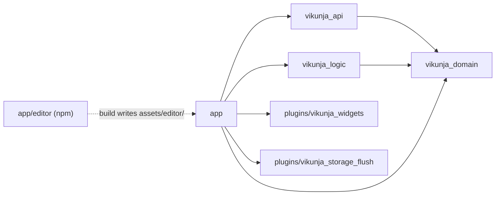
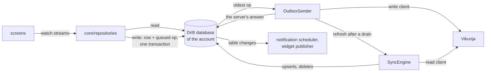

# Architecture

How the app is built, for a maintainer who is new to it. This describes the design as it is. Why each part is as it is lives in [decisions.md](decisions.md): the topic links below point there. What each step built, in full detail with the reasons of the day, is in the git history: `git show 3044f4d:docs/archive/architecture-by-step.md`. The research it started from is in [research/synthesis.md](research/synthesis.md).

## 1. Principles

1. **The local database is the single source of truth for the UI.** Screens read database streams. The network only feeds the database ([Stack and structure](decisions.md#stack-and-structure), [Sync](decisions.md#sync)).
2. **One domain-level API, two transports.** `/api/v1` and `/api/v2` sit behind the same ports. The adapter is chosen from the server's negotiated capabilities, never from a version string.
3. **Every task write goes through the outbox, even when online, and so does a label's create.** The UI, notification actions and widgets share one retry, ordering and conflict path ([Outbox](decisions.md#outbox)). The few areas that are online only are listed in section 5.4.
4. **Every entry point builds the same object graph** in a Riverpod `ProviderContainer`: the UI, the background task, the notification-action isolate and the Android widget worker (section 6).
5. **Secrets live only in the Keychain or Keystore.** Extensions, widgets and the notification-action isolate never refresh a user's tokens; a guest's token may be renewed there, and a guest is signed in again at most once. The description editor's WebView gets no token and loads nothing from the network.
6. **Pure logic lives in pure-Dart packages** and is pinned by test vectors, many ported from the web frontend's own tests.

## 2. The repository

A Dart pub workspace with one shared lockfile ([Stack and structure](decisions.md#stack-and-structure)).

| Path | Kind | What it holds |
|---|---|---|
| `app/` | Flutter app (Dart package `vikunja_mobile`) | Everything the user sees, the database, sync, outbox, notifications, background work, widgets' Dart side. Android and iOS projects under `app/android/` and `app/ios/`. |
| `app/editor/` | npm package, outside the workspace | The TipTap description editor. Its build, `app/assets/editor/editor.html`, is committed, so a Flutter build needs no Node (section 7). |
| `packages/vikunja_domain` | pure Dart | Entities (`Task`, `Project`, …), change objects (`TaskChanges`, `NewTask`), `ServerCapabilities`, the failure types. No I/O. |
| `packages/vikunja_api` | pure Dart | The server connection: address checks, `/info` negotiation, the read and write clients over v1 and v2, the JSON codecs, OAuth with PKCE, error normalisation, the realtime socket. |
| `packages/vikunja_logic` | pure Dart | What the web computes and the app must compute the same way: the Quick Add grammar, date math and presets, list sorts and the subtask tree, the filter language and its evaluation, the rich-text parser, link rules. |
| `plugins/vikunja_widgets` | Flutter plugin (Dart, Kotlin, Swift) | The file and redraw bridge to the home-screen widgets (section 6.4). |
| `plugins/vikunja_storage_flush` | Flutter plugin (Dart, Kotlin), Android only | Waits until secure storage's pending writes are on disk, after every token write (section 4.2). |
| `test_servers/` | Docker Compose | A local Vikunja (the latest release, pinned by digest), also behind TLS, for the contract tests. |
| `tool/`, `tool/ci/` | shell and Python | Every check CI runs, runnable locally: `checks.sh`, `test.sh`, `contract.sh`, `android.sh`, `ios.sh`, the release scripts. See [CONTRIBUTING.md](../CONTRIBUTING.md). |

**The dependency rule:**



- `vikunja_logic` never uses `vikunja_api`.
- Nothing under `packages/*/lib` depends on Flutter, directly or through a dependency; `tool/check_pure_dart_packages.sh` enforces it.
- The app's own code uses `material_ui` and `cupertino_ui`, never the SDK's widget libraries ([Stack and structure](decisions.md#stack-and-structure)).

## 3. Inside the app

```
app/lib/
  main.dart        the UI entry point: calls bootstrap()
  bootstrap/       builds the UI's ProviderContainer, loads the start state, starts the long-lived listeners
  app/             the app widget, router (go_router), theme, shared widgets, layout
  core/            everything below the screens, shared by every feature and entry point
  features/<name>/ one area of the app: presentation/ (widgets) and application/ (Riverpod providers, controllers)
  l10n/            ARB files; English is the source
```

**Layers:** presentation → application → repositories → DAOs and `vikunja_api` ports. The UI never imports wire DTOs or API adapters. Two exceptions are intended: onboarding and session code call `vikunja_api` directly because they run before an account exists, and `core/widgets/` reuses feature code (grouping, formatting) to build the widgets' texts exactly as the screens show them.

Between the folders, `core/` sits below `features/` and `app/`, which use each other, and `bootstrap/` above them all. `app/test/app/layer_imports_test.dart` checks it ([Stack and structure](decisions.md#stack-and-structure)): `core/` imports nothing from `features/`, `app/` or `bootstrap/` but the localisation in `app/l10n/`, and nothing by a relative path; `app/l10n/` and `app/layout/` import nothing of the app but the generated localisations and each other; only `bootstrap/` and `main.dart` import `bootstrap/`. Its allowlist holds `core/widgets/`'s imports of feature code, each with its reason, and fails on an entry that no import uses. What has to know every store, such as the sign-out's wipe of an account (`features/session/application/sign_out_providers.dart`), lives in `features/`, not in `core/`.

**Riverpod** with code generation ([Stack and structure](decisions.md#stack-and-structure)); the generated `*.g.dart` files are committed and CI checks that they are current. A provider no one listens to is paused, its `ref.listen` included, so the providers that must react while no screen shows them are kept alive by `container.listen` in `bootstrap.dart`. A screen that is not visible (another tab, or under a full-screen page) pauses what it watches; the app's own database streams (`watchTables`, `SharedLatest`, `switchLatest`) then load nothing and give the newest state once when it shows again, as drift's own `watch()` does.

**Routing** with go_router ([Stack and structure](decisions.md#stack-and-structure)). Screens that belong to one account are bound to it (`account_bound_screen.dart`); switching the account resets the navigation. A page over the tab bar is declared with `overShell` in `app_router.dart`, which puts it on the root navigator and binds it to the account unless it is device-wide (`accountBound: false`); `app/test/app/router_structure_test.dart` pins which pages those are and how many.

**The important parts of `core/`:**

| Folder | Role |
|---|---|
| `auth/` | Browser sign-in, token store, account registry, session manager, link-share guests, sign-out (its wipe of the account's data is in `features/session/`). Section 4. |
| `network/` | Dio factory, connection settings per server address, certificates. Section 4.3. |
| `db/` | The Drift database per account: tables, DAOs, mappers. Section 5.1. |
| `sync/` | The sync engine and its status. Section 5.2. |
| `outbox/` | The write path of tasks and of labels created here. Section 5.3. |
| `repositories/` | The interfaces the screens use; `local/` backs them by the database and outbox, `online/` by the server alone. |
| `notifications/`, `background/`, `activity/`, `realtime/`, `widgets/` | Work outside the screens. Section 6. |
| `filters/` | The filter language evaluated on the device ([Tasks](decisions.md#tasks)). |
| `attachments/`, `files/`, `share/` | Attachment images (kept on disk with the avatars, section 5.5) and downloads, the platform's file pickers, the Android share target ([Descriptions, comments, attachments](decisions.md#descriptions-comments-attachments)). |
| `security/`, `logging/`, `storage/` | App lock and screen protection ([Security and privacy](decisions.md#security-and-privacy)), logging that redacts secrets and personal data (set up in every entry point by `configureLogging`), local preferences. |
| `settings/`, `text/`, `time/`, `async/` | The user's settings as stored and the device's appearance preferences (`appearance_settings.dart`); shared helpers for text (the server's address as shown), the clock and today, and streams. |

## 4. Server, accounts and sessions

### 4.1 Connecting

`ServerConnector.connect` normalises the address the user typed, reads `/info`, and turns the version and the advertised features into `ServerCapabilities`, which pick the v1 or v2 adapter and switch features on or off. A link share or invite link is recognised first, and only its base is probed, never the link with its secret.

### 4.2 Accounts and tokens

- **Sign-in** is browser OAuth 2.0 with PKCE only, in an ephemeral browser session, so local, LDAP, OIDC and two-factor accounts all sign in through the server's own web login; the app never handles a password ([Accounts and sign-in](decisions.md#accounts-and-sign-in)).
- **A link-share guest** is a second account kind: signed in with the link's hash and, for a protected share, its password, which is stored only when the user chooses to remember it ([Accounts and sign-in](decisions.md#accounts-and-sign-in)).
- **Tokens** are in secure storage, readable after the first unlock so background work can use them ([Sessions](decisions.md#sessions)). The account registry, without secrets, is in SharedPreferences ([Accounts and sign-in](decisions.md#accounts-and-sign-in)). On Android storage that cannot decrypt a value reports an error instead of wiping itself (except in an app still open since a sign-in repaired a lost key), and every token write is flushed to disk through `plugins/vikunja_storage_flush`; storage that refuses to read is a transient failure, and only reads that keep failing at app starts for a day ask for a new sign-in ([Sessions](decisions.md#sessions)).
- **Refresh:** Vikunja rotates the refresh token on every refresh without a grace period, so `SessionManager` refreshes single-flight, re-reads the stored tokens before it refreshes and adopts what another isolate wrote ([Sessions](decisions.md#sessions)). Sign-out, account removal and a new sign-in retire an account's manager for good, and a retired one hands out no token, also none from a refresh still running; whether a manager is live, ended or retired, what it noted about the refresh it sent, and how it judges failures and restores are sealed types and pure functions in `session_manager_states.dart`. A session the server ended marks the account as needing a new sign-in; its local data stays. A rotation race lost to a sibling re-reads storage for about 16 s and then only defers the refresh, and the retry after a server error asks the refresh gate first. A manager that ended a session takes tokens another isolate stores later, unless it saw their refresh token refused or rotated away. `SessionManagers.tryRestore` tries an account's stored tokens again when they changed since it ended or could not be read, but never a refresh token a refresh had rotated away, and `LinkShareSessions.tryRestore` unmarks a guest marked for unreadable storage once its link reads. A request that got no token (a deferred refresh, storage that refused to read the tokens or a guest's link) never left the device: it brings no offline banner, and unreadable storage leaves a banner shown before; no page that reads the server itself takes it for an outage, and the outbox counts it neither as possibly sent nor toward an upload's timeouts ([Sessions](decisions.md#sessions)).
- **Why a session ended:** `SessionDiagnostics` keeps per account and guest, in the preferences and without secrets and only while the account is registered (a registry that cannot be read counts as listing it), a user's refresh in flight and the last ended session with its cause, time, code, part of the app, the refused token's fingerprint, the fingerprint of the token storage still held when its rotated successor could not be stored, the refresh whose answer was most likely lost and what became of it; every end, a guest's included, is recorded before the account is marked. The reauth banners (built only once the record read under the mark arrives), the Account tab, a guest's notification and the home-screen widgets tell it ([Sessions](decisions.md#sessions)). The support details keep their own short record of each end.
- **Keep-alive:** every sync starts with a request that refreshes an access token about to expire, so the background sync keeps a session alive; a local notification asks the user to open the app before a session would run out unused ([Sessions](decisions.md#sessions)).
- **Several accounts:** each has its own database, scheduler, outbox and sync. One account is active in the UI; the others still sync in the background and keep their notifications.

### 4.3 Network

`vikunja_api` receives a configured `Dio` and never picks a transport itself ([Stack and structure](decisions.md#stack-and-structure)):

- On Android requests go through an embedded Cronet, on iOS through NSURLSession, both through `native_dio_adapter`, so the system's certificate store and proxy apply.
- `NetworkProfileAdapter` applies the connection settings a user set for a server address (extra headers, a pinned certificate, a private CA, a client certificate). Addresses with a pin, a CA or a client certificate go through `dart:io`, one adapter per address; header values and keys never reach an interceptor.
- `BodyCapAdapter` wraps it and refuses a body over its request's cap (`maxBodyBytesKey` in `Options.extra`, 64 MiB by default, null for none); `createAuthenticatedDio` borrows the whole chain.
- The realtime WebSocket runs on `dart:io`; on Android it gets the user-installed CAs and the system proxy through a platform channel.
- Tests use dio's default `dart:io` adapter.

## 5. Data



### 5.1 Database

One Drift SQLite file per account, opened by every isolate that works for that account ([Sync](decisions.md#sync)). Signing out deletes it.

- Keys are the server's ids. A task created on the device has a negative temporary id until its create is sent; `task_id_remaps` lets a screen follow it to the server's id ([Outbox](decisions.md#outbox)); labels created on the device do the same with `label_id_remaps`.
- Dates are UTC epoch milliseconds; every row keeps the server's `created` and `updated`.
- Besides the server's entities there are the `outbox`, `list_snapshots` (the server's order for lists the device cannot compute), `scheduled_notifications` (what the OS was last given), `server_notifications` (the inbox), `imported_widget_actions` and `sync_state` (the sync's watermark and checkpoint, user settings, saved filters).
- The task sheet's last reads of what the sync does not bring are kept per task for offline (`TaskDetailsDao`): `task_detail_loads` (when, and the cover), `task_attachments`, `task_reactions`, `task_comments` and `task_comment_reactions`, with the people in each row. A read replaces them, a write the server took or a cover change queued here changes them, and a read shows a queued cover over the server's; they go with their task. A read that started before such a write stores nothing, so a slow answer cannot bring back what the write changed (an in-memory count of writes per task, per isolate).
- The account's settings and profile in `sync_state` come from the sync's `GET /user` and from the answers to account settings changes. A change counts up a number there in the same transaction, and a sync read that began before it stores nothing, in any isolate, so an answer the server gave before the change cannot bring the old values back.
- `schemaVersion` is 3. Every schema change bumps it, adds a migration and a new schema dump under `app/drift_schemas/`, from which drift_dev generates the migration tests' schemas (see the [developer guide](development.md#generated-code)).

### 5.2 Sync

`DefaultSyncEngine` is one headless object per account, without Riverpod or a `BuildContext` inside, so the background isolate runs the same code. Runs are serialised per account; a lease in the database keeps two isolates from syncing one account at once.

- **The full pull** reads the user and settings, all projects with views, labels, then every task by an id cursor, and purges what the server no longer has. It is resumable from a checkpoint and runs at the first sign-in, on "Full resync" and once a day.
- **The incremental run** asks only for tasks `updated` since a watermark (with an overlap), and finds deletes by comparing counts ([Sync](decisions.md#sync)).
- **Triggers:** the foreground scheduler (every minute while the app is used, backing off to five minutes while nothing changes, [Sync](decisions.md#sync)), a drained outbox, a realtime event, the background task, and pull-to-refresh or "Sync now".
- Saved filters and view filters are evaluated on the device from the database, so they work offline; a filter the device cannot evaluate falls back to the server's list, stored as a snapshot ([Tasks](decisions.md#tasks)).
- `SyncStatus` (never run, running, idle, failed) drives the first-sync screen and the quiet indicator; rows from earlier runs stay readable after a failure.

### 5.3 Outbox

A task write changes the local row and queues an op in the same transaction, so it is on screen at once, offline too ([Outbox](decisions.md#outbox)).

- **Coalescing:** a newer change to a task merges into its queued update; `pending_changes` on the row holds what the server has not accepted, and a sync never overwrites it.
- **One serial sender per account** sends the oldest op through the write client: v2 as a merge-patch, v1 by reading the task and posting it whole. The server's answer replaces the row, except fields a newer op still holds. A create inserts the task under the server's id and records the remap. It lives as long as the account's database and takes the account's current clients and sync engine for each request, so a changed server version, which rebuilds those, leaves it and its queue as they are ([Outbox](decisions.md#outbox)).
- **Retries** fall into three classes: waiting for what is not the server's word (network, rate limit, session), counted failures with a backoff, and failures that become a sync problem at once. Sync problems are listed in the Account tab, where the user retries, discards or, for a conflicting description, chooses a version.
- **Uploads** run in a lane of their own beside the serial queue, at most 50 MiB per file. Both lanes run on one `_Lane` helper in `outbox_sender.dart` (the state, the failure waited on, the run and the retry timer); their loops stay apart, as the queue's oldest op holds back those behind it while the upload lane takes the oldest ready upload. `OutboxDao.storeRewritten` is the one rule for rewriting a queued task update or deleting it once nothing is left, and `OutboxOperationKind.createsOnServer` names the ops that may leave something on the server without an answer. When the server makes a task's delete, its uploads leave the queue for as long as the Undo is offered instead of going at once, kept in `sync_state` with their copies (an Undo kept up under a screen reader holds them in the sender's memory), and a restore from the trash queues them again.
- **Labels created here** ([Outbox](decisions.md#outbox)): `createLabel`, `updateLabel` and `deleteLabel` share the queue's order, with the label in `outbox.label_id` and task id 0. A task update naming a label whose create is queued waits for it. The create's answer moves the label, its tasks, the queued task edits and the label's own ops to the server id in one transaction; a lost answer is looked for by exact title, creator and time before a second create, and a delete queued behind a create cancels both without a request.
- **Descriptions** are sent with the version they were edited from and checked against the server's first, so neither side's edit is silently overwritten ([Descriptions, comments, attachments](decisions.md#descriptions-comments-attachments)).

### 5.4 Online-only areas

These writes go straight to the server and are applied to the database from its answer, so they need a connection: projects, views and kanban columns, saved filters, labels (except creating one, and changing or deleting one with something of it still queued), comments and reactions, attachment deletes, restores from the trash, account settings and the avatar. Some are never stored at all: security settings (two-factor status, sessions, API tokens), teams, a project's shares and the trash.

The pages that read the server themselves (the teams, a team, a project's shares, the trash, the sessions, API and CalDAV tokens, the data export, the Add team sheet, and each part of the security overview on Account settings) keep what they read in `LatestRead` (`features/common/presentation/latest_read.dart`): the latest read wins, a failure keeps what was shown, and a change made on the page while a read is on its way reads again after it ([Stack and structure](decisions.md#stack-and-structure)).

A task's attachments, reactions and comments are read by the task sheet, not synced. What it last read is stored (section 5.1) and stands in while a read is under way, and, with the time of that read, when the read fails for a reason that may pass: no connection, a server error, a rate limit, an answer that is not the server's (a captive portal's page), a lost token-refresh race or a rejected token. A task gone or no longer allowed shows as such. A change made while comment pages were loading reads them again. Offline, the stored attachments can be opened, shared and saved when their file is in the download cache or kept in the image cache (section 5.5); deleting one, comments and reactions are off and say why, while the cover is queued like a task edit.

### 5.5 Images

Attachment images and avatars are loaded with the account's session from its own server, never by a WebView, and go through a memory cache per account in front (`AttachmentImageCache`, 32 MB; `AvatarCache`).

- Behind both sits one `ImageDiskCache` per account in `<cache>/images/<account>/`: every attachment image the memory cache loads (the list's previews, the `xl` previews of the detail sheet and the description editor, originals opened in the full-screen viewer) and avatars. Every load from the server writes it; an attachment image kept already is only marked as used, as attachments never change. It answers when the server cannot be asked (no connection, a server error, a session problem), and for an attachment also when the server sends no image (a login or maintenance page in front of it), so these images show offline and after a restart. Where only the original is kept, it stands in for the `xl` preview for the session. A missing or forbidden attachment and a missing user are not read from it and leave it; an attachment deleted in the app leaves memory and disk in every size.
- At most 100 MB per account, the least recently used first out, and none unused for 30 days (checked when the account's index loads at its first use after a start, and whenever an image is found in use; a read counts as use). Only raster images (`image/*`, never SVG) up to 25 MB whose header names at most 40 megapixels, the memory cache's own limits, checked when written and again when read. An answer the rules refuse leaves the attachment image kept; a new avatar they refuse (an SVG) replaces the kept one, an answer that is no image does not.
- A row showing an avatar from disk, or initials after a failure that may pass, asks again when the 2-minute retry is due; rows of the same user and size share one request.
- The cache folder is out of backups on both platforms. Sign-out and account removal close the account's disk cache, which skips what was asked of it and has not started, and delete the folder; a folder that cannot be deleted leaves the account to the next start's wipe. After the start's wipes, folders of accounts the registry knows neither as registered nor as still to delete go too (`AccountDeletions.finishAll`), unless the registry cannot be read.
- The editor page still loads nothing: the app hands it these images as `data:` URLs (section 7).

## 6. Work outside the screens

Each entry point builds its own `ProviderContainer` from the same providers:

| Entry point | Started by | Does |
|---|---|---|
| `main()` → `bootstrap()` | the user | the UI, the foreground sync, realtime, the notification scheduler, the widget publisher |
| `callbackDispatcher()` | WorkManager (Android), BGTaskScheduler (iOS) | the background sync of every account |
| `onNotificationActionInBackground()` | a notification action while the app is not running | Done or snooze, through the outbox; on iOS it first imports the widgets' waiting Done taps |
| `widgetActionsMain()` | the Android widget worker | imports a widget's Done taps into the outbox |

Background containers never send queued uploads; those are left to the UI.

### 6.1 Local notifications

The server sends no push to phones, so the app schedules reminders and due dates itself from the database ([Notifications and widgets](decisions.md#notifications-and-widgets)). A scheduler per account diffs the soonest notifications, and every snoozed one, against `scheduled_notifications` and hands the OS only the difference. iOS allows 64 pending notifications per app, so the accounts share 60 there, each share leaving room for its session reminder and one snoozed entry, the rest for the test notification; Android refuses alarms past 500 per app, so the accounts share 480 there, at most 100 each, with the same room per share, the rest for the widget's redraw alarm and WorkManager's own. Actions are Done, snooze for an hour and snooze until tomorrow, on iOS also snooze for ten minutes; a task in a read-only or archived project gets only the snoozes, and the test notification none. A Done runs through the outbox, in the background isolate when the app is closed.

### 6.2 Background sync and the inbox

One periodic job (about every 30 minutes, as the OS allows) runs for every signed-in account: drain the outbox, sync incrementally, reconcile the notification schedule and read the server's notifications into the inbox, showing new ones as OS notifications ([Sync](decisions.md#sync), [Notifications and widgets](decisions.md#notifications-and-widgets)).

Its first request renews each session, so a rotation whose answer the run loses would end it. The run's `RefreshCutoff` lets a token refresh start only while its answer, connect time included, can arrive before the container goes, and on Android none once the OS stopped the run; after every run the container waits a few seconds for refreshes on their way and tokens still to be stored. An account waiting for a new sign-in first gets a restore (`SessionManagers.tryRestore`, for a guest `LinkShareSessions.tryRestore`); one restored in a sync run sends its queue in its turn, before it syncs. Each account's turn notes how it ended, an OS stop with Android's raw stop reason, in `background.lastOutcome.<account>`, which the Account tab shows; a turn whose sync went through counts as synced at once, and a session that ends during the settle after the deadline or a stop is noted as ended, not as stopped ([Sessions](decisions.md#sessions)).

### 6.3 Realtime

While the app is in front, the active account keeps one WebSocket to the server's `/ws` when the server supports it ([Sync](decisions.md#sync)). A pushed notification lands in the inbox within a second, and the task it names is synced right after.

### 6.4 Home-screen widgets

Dart builds every text of a widget from the account's database and writes small JSON files through `plugins/vikunja_widgets`; Glance (Android) and a WidgetKit extension (iOS) only draw them and record taps; the iOS extension also removes a tapped task's notifications. A Done tap comes back to Dart and enters the outbox exactly once. Nothing native talks to the server or holds a token ([Notifications and widgets](decisions.md#notifications-and-widgets)).

## 7. Description editor

Descriptions are edited in the web's own editor, TipTap, so the HTML stays what the web writes ([Descriptions, comments, attachments](decisions.md#descriptions-comments-attachments)).

- `app/editor/` builds one self-contained page with a strict content security policy; the WebView loads nothing from the network and gets no token.
- The app and the page talk through one JavaScript channel with a token new for every load; `editor_protocol.dart` defines the messages, `bridge.js` the page's side.
- The page asks for its attachment images by URL; the app loads them with the account's session, offline from the images it kept (section 5.5), and sends them back as `data:` URLs.
- Reading a task does not use the WebView: `vikunja_logic` parses the stored HTML and Flutter renders it.

## 8. Cross-cutting

- **Localisation:** English ARB strings are the source; other languages come through Vikunja's Crowdin project, and contributors change only the English ([Languages](decisions.md#languages)).
- **Logging:** `package:logging` throughout. A record is redacted when it is made; the diagnostics log the user can add to a support request keeps warnings and errors, an error only by its type and a stack only by the app's own frames.
- **Crash reports:** only in a build made with the Vikunja project's Sentry key and only after the user allows them, `core/crash_reports/` hands uncaught errors and the log's errors to Sentry, with its warnings as breadcrumbs, scrubbed on the device; on Android the app starts Sentry's native SDK itself so that its own reports are scrubbed too, while on iOS the native SDK reports nothing of its own; background isolates use Sentry's Dart SDK alone and read the stored choice before each report ([Diagnostics](decisions.md#diagnostics)).
- **Privacy:** app lock and screen protection over the UI, lock-screen privacy for notifications, the app's folders kept out of backups ([Security and privacy](decisions.md#security-and-privacy)).
- **Licence:** MIT, with Vikunja's contribution rules ([Identity and scope](decisions.md#identity-and-scope)); the AGPL code of Vikunja's server and web is read for its behaviour only.

## 9. Tests

| Kind | Where | Runs |
|---|---|---|
| Unit and widget tests | `app/test/`, `packages/*/test/` | `tool/ci/test.sh` |
| Contract tests against a real server | `packages/vikunja_api/test/contract/`, `app/test/contract/` (tag `contract`) | `tool/ci/contract.sh`, with `test_servers/` |
| Parity scenarios: the same cases against the fakes and the real server | `app/test/parity/`, run by `app/test/contract/parity_contract_test.dart` (tag `contract`) | the fakes' group in `tool/ci/test.sh`, both groups in `tool/ci/contract.sh` |
| Editor page tests | `app/editor/test/` | `tool/ci/editor.sh` |
| Format, analysis, generated code, the pure-Dart rule, licence notices, the scripts' own tests | `tool/`, `tool/ci/` | `tool/ci/checks.sh` |
| Builds | | `tool/ci/android.sh`, `tool/ci/ios.sh` |

Test vectors ported from the web pin the shared logic. Accessibility tests live under `app/test/a11y/` and `app/test/app/`, a large-account performance test under `app/test/performance/`. `app/test/app/layer_imports_test.dart` checks the layers (section 3), and `app/test/security/account_wipe_test.dart` that a sign-out leaves nothing of the account on the device but its widgets' "Account removed".

## 10. Where to start

- **A new task field:** the domain entity and `TaskChanges` (`vikunja_domain`), both codecs and both write adapters (`vikunja_api`, with a contract test), the `tasks` table with a migration, the mappers, the outbox payload JSON, then the UI.
- **A new screen on stored data:** a repository method that returns a stream from a DAO, a provider in the feature's `application/`, the widget in `presentation/`.
- **A new online-only action:** a port in `vikunja_api`, an online repository in `core/repositories/online/`, and a local write of the server's answer so the screens update.
- Before changing behaviour, search [decisions.md](decisions.md) for the decision behind it; entries marked "(owner)" are the owner's and are not reversed without asking.
