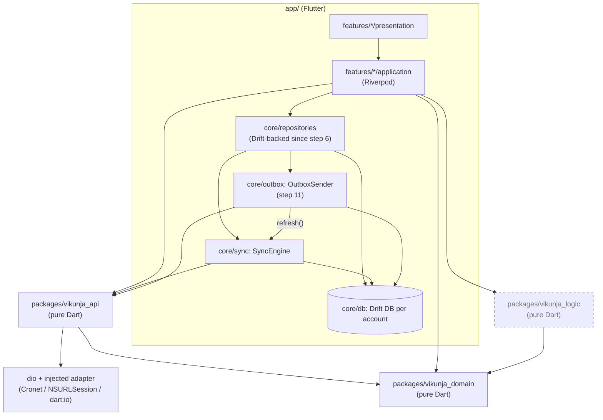
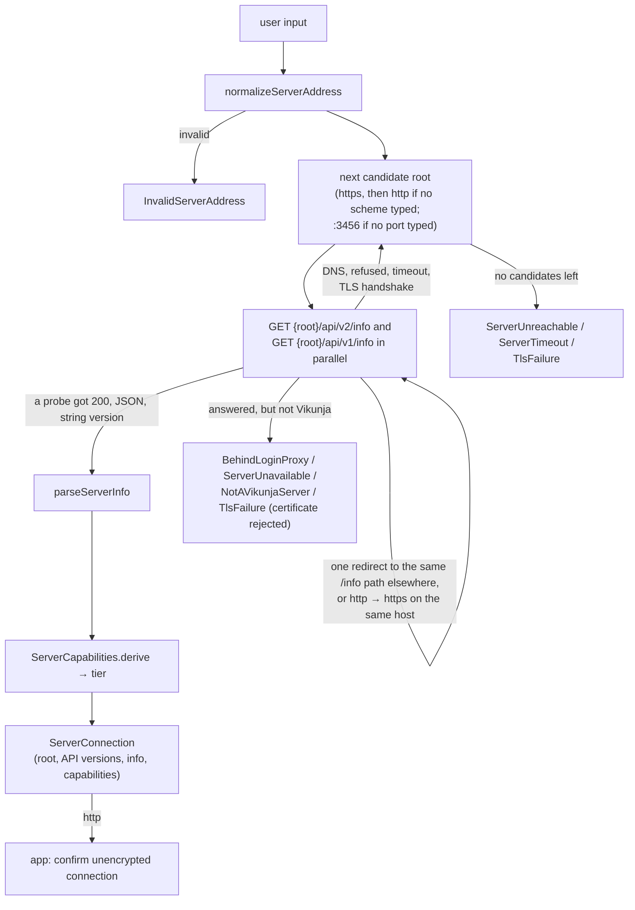
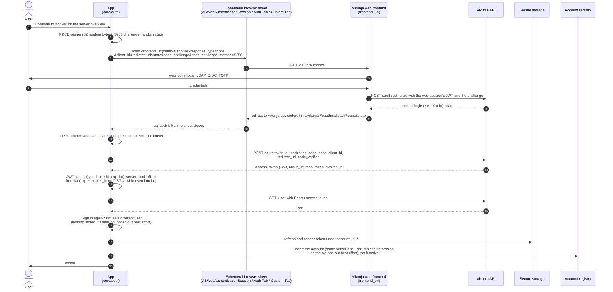
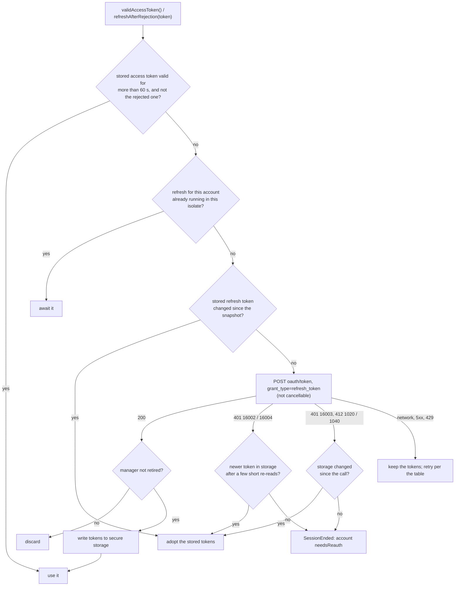
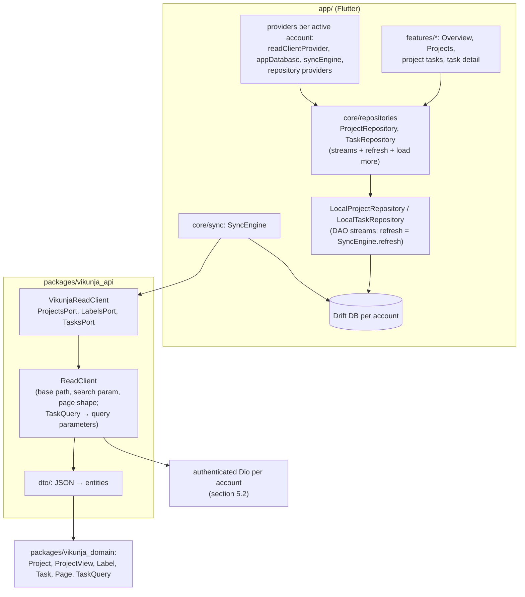
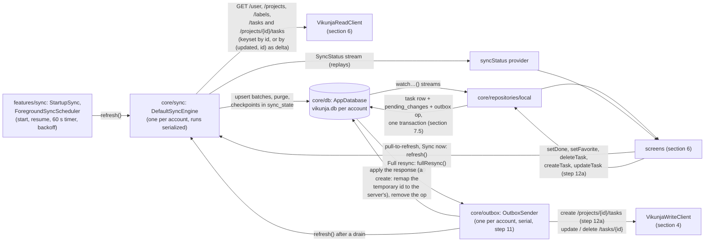
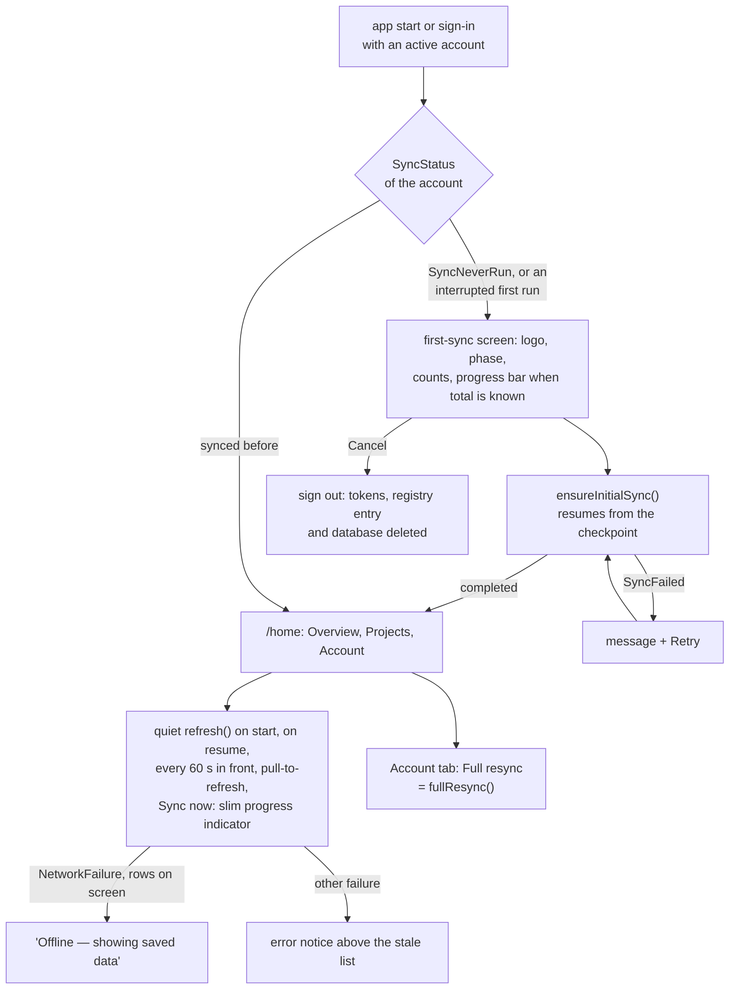
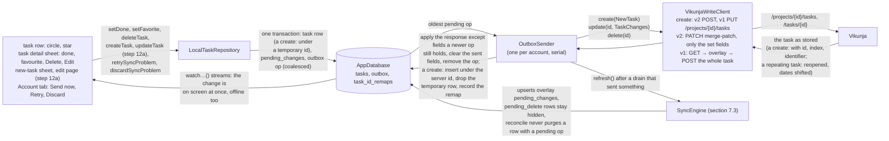

# Architecture

This is the current, condensed architecture. It is derived from [research/synthesis.md](research/synthesis.md) §2, which has the full reasoning and the Vikunja source references. Status markers:

- **[exists]**: built in step 1, in the combined step 2+3 (HTTP core, browser sign-in, session manager), in step 5 (read client, repository interfaces, the first screens), in step 6 (the Drift database per account, the local repositories, the initial sync), in step 7 (the incremental sync with delete reconciliation, its triggers, the full resync) or in step 11 (the outbox, the serial sender, the task write ports and the first mutations: done with undo, favourite, delete).
- **[in progress, step 12a]**: being built in step 12a (creates through the outbox with temporary ids and the remap, the remaining core properties of `TaskChanges`, the edit page and the new-task sheet).
- **[planned, step N]**: designed, not built. N is the [roadmap](roadmap.md) step.

This page reflects the owner's decisions of 2026-10-09 ([D13](decisions.md#d13-support-floor-230)–[D22](decisions.md#d22-session-keep-alive-through-background-sync)), the step 2+3 decisions ([D23](decisions.md#d23-browser-sign-in-through-flutter_web_auth_2-client-id-and-redirect-uri)–[D27](decisions.md#d27-paging-and-the-query-builder-move-to-step-5)) the step 5 decisions ([D29](decisions.md#d29-ui-reads-through-repository-interfaces-the-online-implementation-is-replaced-by-drift-in-step-6-without-ui-changes), [D30](decisions.md#d30-kanban-board-reads-deferred-to-step-20)) the step 6 decisions ([D31](decisions.md#d31-one-drift-sqlite-file-per-account-shared-across-isolates-deleted-on-sign-out), [D32](decisions.md#d32-initial-sync-by-keyset-paging-with-per-page-checkpoints-full-re-pull-as-refresh-until-step-7)) the step 7 decision ([D33](decisions.md#d33-incremental-sync-watermark-on-updated-with-a-120-s-overlap-keyset-over-updated-id-delete-detection-by-per-project-count-check-and-id-reconcile-daily-full-resync)), the step 11 decision ([D34](decisions.md#d34-outbox-local-first-writes-serial-sender-coalescing-retry-classes-sync-interplay-pending-fields-win-until-sent-pending-deletes-hidden-v1-full-replace-emulation)) and the step 12a decision ([D35](decisions.md#d35-creates-through-the-outbox-temporary-negative-ids-with-remap-createupdatedelete-coalescing-lost-response-recovery-by-title-within-a-1-h-window)).

## 1. Principles

1. **The local database is the single source of truth for the UI.** Screens read database streams. The network only feeds the database. [repository interfaces with streams exist, step 5; the database and the initial sync behind them exist, step 6 ([D29](decisions.md#d29-ui-reads-through-repository-interfaces-the-online-implementation-is-replaced-by-drift-in-step-6-without-ui-changes), [D31](decisions.md#d31-one-drift-sqlite-file-per-account-shared-across-isolates-deleted-on-sign-out)); the incremental sync exists, step 7 ([D33](decisions.md#d33-incremental-sync-watermark-on-updated-with-a-120-s-overlap-keyset-over-updated-id-delete-detection-by-per-project-count-check-and-id-reconcile-daily-full-resync)); the first writes change the same database before the server hears of them, step 11 ([D34](decisions.md#d34-outbox-local-first-writes-serial-sender-coalescing-retry-classes-sync-interplay-pending-fields-win-until-sent-pending-deletes-hidden-v1-full-replace-emulation)); a created task lives in it under a temporary id until the server has assigned one, in progress, step 12a ([D35](decisions.md#d35-creates-through-the-outbox-temporary-negative-ids-with-remap-createupdatedelete-coalescing-lost-response-recovery-by-title-within-a-1-h-window))]
2. **One domain-level API interface, two transport adapters** (`/api/v1`, `/api/v2`). The adapter is chosen from the negotiated **capabilities**, never from a version string. [negotiation, error model, authenticated transport, read client and the task write adapters exist; the create adapter in progress, step 12a; the routed client with route-absent downgrade planned]
3. **Every mutation goes through the outbox, even when online.** The UI, notification actions and widgets share one retry, ordering and conflict path. [exists, step 11: the outbox, the sender and the task writes of the UI ([D34](decisions.md#d34-outbox-local-first-writes-serial-sender-coalescing-retry-classes-sync-interplay-pending-fields-win-until-sent-pending-deletes-hidden-v1-full-replace-emulation), section 7.5); creates through the same outbox in progress, step 12a ([D35](decisions.md#d35-creates-through-the-outbox-temporary-negative-ids-with-remap-createupdatedelete-coalescing-lost-response-recovery-by-title-within-a-1-h-window)); the notification and widget actions follow in steps 15 and 18–19]
4. **Every entry point builds the same object graph** with a Riverpod `ProviderContainer`. The entry points are the UI isolate, background tasks, the notification-action isolate and the widget callback. [UI exists, and the step 6 sync engine runs without a widget tree; the other entry points are planned, steps 15–18]
5. **Secrets live only in the Keychain/Keystore.** Extensions and widgets never refresh tokens. [exists]
6. **Pure logic lives in pure-Dart packages** and is pinned by test vectors, many ported from the web frontend's tests. [exists for domain and api]

## 2. Workspace packages and the dependency rule

The repository is a Dart pub workspace with one shared lockfile.

| Package | Kind | Exists (steps 1, 2+3, 5, 6, 7 and 11) | In progress, step 12a | Planned |
|---|---|---|---|---|
| `app/` | Flutter | the "Connect to server" feature (connect, server overview); `core/auth/` (token store, account registry, session manager, browser sign-in, sign-out); router guards; theming, en/de localisation, redacting logging; `core/repositories/` (`ProjectRepository`, `TaskRepository`); `/home` as a three-tab shell: Overview, Projects (tree, project tasks, task detail), Account; `core/db/` (`AppDatabase`, tables, DAOs, mappers, `AccountDatabaseFiles`), `core/sync/` (`SyncEngine`, `SyncStatus`, `DefaultSyncEngine`), `core/repositories/local/`; the first-sync screen, the quiet sync indicator, "last synced" and "Sync now" in the Account tab, database deletion on sign-out; the incremental `refresh()` and `fullResync()` in `core/sync/`, `ForegroundSyncScheduler` in `features/sync/application/`, "Full resync" in the Account tab; `core/outbox/` (the `outbox` table and the `pending_*` task columns of schema version 2, `OutboxSender`, `SyncProblem`), the write methods of `TaskRepository`, done with Undo and the favourite star on the rows, done, favourite and Delete in the task detail sheet, "Pending changes" with "Send now" and the "Sync problems" list in the Account tab | the create path: `createTask`, `updateTask` and `watchTask` on `TaskRepository`, temporary negative task ids, the `task_id_remaps` table of schema version 3, the create op and the lost-response lookup in `OutboxSender`; the edit page and the new-task sheet in `features/tasks/presentation/`, the FABs on the Overview and on a project's list, Edit in the detail sheet | all other screens, `core/` services (notifications, widgets, background) |
| `packages/vikunja_domain` | pure Dart | `ServerVersion`, `ApiVersion`, `ServerInfo`, `Capability`, `ServerCapabilities` + `SupportTier`, `ServerConnection`, sealed `ServerConnectionFailure`, sealed `VikunjaFailure`, `User`, `Account`, `TokenSet`; `Project`, `ProjectView`, `Label`, `Task`, `TaskReminder`, `TaskRelationKind`, `Page<T>`, `TaskQuery`; `TaskChanges` with `DateChange` (`SetDate`, `ClearDate`) | `NewTask`; `TaskChanges` gains `repeatAfter`, `repeatMode` and `projectId` | buckets (step 20), saved filters (step 24) |
| `packages/vikunja_api` | pure Dart | `normalizeServerAddress`, `parseServerInfo`, `ServerConnector` / `DioServerConnector`, `normalizeError`, retry interceptor, PKCE, `AuthorizationRequest`, `OAuthTokenClient`, `JwtClaims`, auth interceptor + `AccessTokenSource`, `AccountApi`, `createAuthenticatedDio`, `serverInfoToJson`; `VikunjaReadClient` (`ProjectsPort`, `LabelsPort`, `TasksPort`) and `ReadClient` over v1 and v2, JSON codecs (`dto/`), paging, query builder; `/info`, error, OAuth and read fixtures and contract tests; `VikunjaWriteClient` (`TasksWritePort`: update by `TaskChanges`, delete) from `createWriteClient` over v2 merge-patch and v1 full-replace emulation (`write/`), write contract tests | `TasksWritePort.create(NewTask)` over v2 `POST` and v1 `PUT /projects/{id}/tasks`, the new `TaskChanges` fields in both adapters, the create and move contract tests | the routed client with route-absent downgrade, kanban reads (step 20), realtime (step 17) |
| `packages/vikunja_logic` | pure Dart | — | — | quick-add, filters, positions, checklists (steps 13, 22, 24); the date shortcuts and colour rules of steps 5 and 12a stay in `app/` until the package exists |

**Dependency rule:**
- `app` → `vikunja_api` → `vikunja_domain`.
- `app` also uses `vikunja_domain` directly.
- `packages/*/lib` never depend on Flutter, directly or through a dependency. CI enforces this with `tool/check_pure_dart_packages.sh`.

**Layers inside `app`:**
- The layers are presentation → application → repositories → (DAOs, `vikunja_api` ports).
- The UI never imports wire DTOs or adapters.
- Since step 5, the project and task screens read through `core/repositories` (section 6); since step 6 those repositories read the account's database, which the sync engine feeds (section 7). Onboarding and session code call `vikunja_api` directly (`ServerConnector`, `AccountApi`, the token client), because they run before an account exists.

`vikunja_api` receives a configured `Dio`, so it never chooses a transport itself:
- The app injects `NativeAdapter`: Cronet on Android, NSURLSession on iOS.
  - Without Play services Android falls back to `dart:io`, which loses user-CA trust (see [D5](decisions.md#d5-dio-with-native_dio_adapter)).
- Tests and contract tests use dio's default `dart:io` adapter.

Dashed nodes are planned. The repository interfaces exist since step 5; step 6 put the database and the sync engine behind them ([D29](decisions.md#d29-ui-reads-through-repository-interfaces-the-online-implementation-is-replaced-by-drift-in-step-6-without-ui-changes), [D31](decisions.md#d31-one-drift-sqlite-file-per-account-shared-across-isolates-deleted-on-sign-out)); step 7 made `refresh()` incremental ([D33](decisions.md#d33-incremental-sync-watermark-on-updated-with-a-120-s-overlap-keyset-over-updated-id-delete-detection-by-per-project-count-check-and-id-reconcile-daily-full-resync)); step 11 added the outbox behind the same interfaces, so a write is a row change plus a queued op that the sender pushes through the write ports ([D34](decisions.md#d34-outbox-local-first-writes-serial-sender-coalescing-retry-classes-sync-interplay-pending-fields-win-until-sent-pending-deletes-hidden-v1-full-replace-emulation), section 7.5); step 12a adds creates to it, rows under a temporary id that the sender remaps to the server's ([D35](decisions.md#d35-creates-through-the-outbox-temporary-negative-ids-with-remap-createupdatedelete-coalescing-lost-response-recovery-by-title-within-a-1-h-window)).

## 3. Server connection and v1/v2 negotiation [exists]

`ServerConnector.connect(input)` either returns a `ServerConnection` or throws a `ServerConnectionFailure`. The implementation is `DioServerConnector`.

1. **Normalise the address** (`normalizeServerAddress`):
   - Remove invisible characters that copy and paste brings along (zero-width spaces and joiners, soft hyphens).
   - Accept only `http` and `https`.
   - Convert an international host name to its `xn--` (punycode) form.
   - Cut the path at its last `/api/v1` or `/api/v2`, so a pasted `…/api/v1/info` works. Strip trailing `/` and keep any sub-path.
   - Record whether the user typed a scheme and a port.
   - Invalid input → `InvalidServerAddress`.
   - Based on the web frontend's `apiUrl.ts` and `checkAndSetApiUrl.ts`.
2. **Build the candidate roots, in order:**
   - The address as typed. Without a typed scheme, try `https` first, then `http`.
   - Without a typed port, also try Vikunja's default port 3456, but only after the default port could not be reached at all.
   - Candidates overlap to bound the wait: each one starts when the one before it could not connect, or 2.5 s after that one started. Their outcomes are still used strictly in this order.
   - Each probe waits at most 5 s to connect and 5 s for the response, so an address where nothing answers fails after at most 17.5 s.
3. **Probe each candidate.** Send `GET {root}/api/v2/info` and `GET {root}/api/v1/info` in parallel.
   - A probe counts only if the answer is a 200, JSON, and has a string `version`.
   - Servers older than 2.4.0 answer the v2 probe with 404 and `{"message":"Not Found"}`. That means "no v2", not "not Vikunja".
   - The API versions whose probe counted become `ServerConnection.apiVersions`.
   - If v1 reports 2.4.0 or newer (or an unparseable version) while the v2 probe got no HTTP response, v2 is probed once more. If that also gets no response, the connection fails with that error instead of quietly using v1.
4. **Stop at the first candidate where something answered over HTTP:**
   - At most one redirect is followed per connection attempt. It must keep the probe path (`…/api/v1/info` or `…/api/v2/info`) under another origin or sub-path, or be a same-host `http` → `https` redirect. The root derived from it is probed like any other candidate. A redirect from `https` to `http` is never followed.
   - If the address is a route of the Vikunja web app (the answer is the web app's HTML), up to four parent paths are probed.
   - Only connection-level failures (DNS, connection refused, timeout, a TLS handshake failure) move on to the next candidate. A rejected certificate is not one of them: a TLS server answered, so it ends the search with `TlsFailure`. A server that answers is never second-guessed on another port or scheme.
   - If nothing counts, the most informative failure is thrown:

   | Failure | Cause |
   |---|---|
   | `ServerUnreachable` | DNS or connection failure |
   | `ServerTimeout` | timeout |
   | `TlsFailure` | certificate or handshake problem |
   | `ServerUnavailable` | a 5xx or 429 instead of `/info` (Vikunja down, restarting or rate limiting, or the proxy cannot reach it) |
   | `BehindLoginProxy` | any other redirect off the host, or to a login-like path; 401; 403 with `WWW-Authenticate`; 407; an HTML login form |
   | `NotAVikunjaServer` | anything else that answers without a Vikunja `/info` |

5. **Parse `/info`** (`parseServerInfo`). The version is parsed leniently:
   - `v2.7.0` and `v2.7.0-6-ge7d7f173` are both accepted.
   - `dev`, `unstable` and similar sort above every release.
6. **Derive `ServerCapabilities`** from:
   - the reachable API versions;
   - version thresholds;
   - the `/info` flags;
   - `enabled_pro_features` (licence).

   A Vikunja server older than 2.3.0, the support floor ([D13](decisions.md#d13-support-floor-230)), is **not a failure**. It yields a connection with `SupportTier.unsupported`, so the UI can say what it found: the overview shows the header, the badges and a blocking banner that says browser sign-in needs 2.3.0, but no sign-in methods and no server features.
7. **Ask before using `http://`.** If the connection uses `http` (`ServerConnection.isInsecure`), the app shows an "Unencrypted connection" dialog. It uses the server only after the user confirms ([D8](decisions.md#d8-cleartext-policy)).

**Support tiers** (`SupportTier`):

| Tier | Servers | Meaning |
|---|---|---|
| `unsupported` | < 2.3.0, or an unparseable version without v2 | Shown, but not usable: browser sign-in needs 2.3.0. No legacy tier is planned. |
| `oauth` | ≥ 2.3.0 (dev builds included) without a reachable `/api/v2`, e.g. 2.3.x, or a newer server whose proxy hides v2 | `/api/v1`; OAuth 2.0 + PKCE sign-in, WebSocket |
| `full` | any server with a reachable `/api/v2` (2.4.0+) | + v2 adapter (PATCH, ETag, envelopes, problem+json) |

**Capability gating rules:**
- Features check a `Capability` and never compare version strings.
  - Development builds report `dev`/`unstable`.
  - A proxy can hide `/api/v2`.
  - Admins can switch features off.
- Licensed features (time tracking, admin panel, audit logs, invites) come only from `enabled_pro_features`. Their routes return a plain 404 when unlicensed.
- `concurrent_writes`:
  - It is reported since 2.4.0 and is `false` on SQLite.
  - A missing value means "unknown", so writes are serialized.
- Re-negotiation [planned; the step 6 sync does not re-negotiate] happens at login, every 24 h, on app update, and after a "route absent" 404.

**Transport rules that already apply:**
- Only `http` and `https`.
- No credentials in URLs.
- `Authorization`, `Cookie`, `Set-Cookie` and tokens are never logged.
- Plain `http://` needs explicit confirmation in the app (step 7 above).

## 4. API abstraction [read client exists, step 5; task write ports exist, step 11; create in progress, step 12a; routed client planned]

Step 5 built the read half: `VikunjaReadClient` with the ports `ProjectsPort`, `LabelsPort` and `TasksPort`, created by `createReadClient(dio:, connection:)` over the account's authenticated `Dio` (section 5.2). It uses `/api/v2` when the connection reached it and `/api/v1` otherwise, and hides the version differences inside one `ReadClient` (section 6).

Step 11 added the first write half: `VikunjaWriteClient` with `TasksWritePort` (`update(id, TaskChanges)`, which returns the task as the server stored it, and `delete(id)`), created by `createWriteClient(dio:, connection:)` over the same `Dio` and chosen the same way, v2 when the connection reached it (section 7.5). Step 12a adds `create(NewTask)` to the port, which returns the created task with the server's id, `index` and `identifier` [in progress, step 12a]. The remaining per-area ports (projects, views, labels, comments, …) come with the steps that need them. A `RoutedVikunjaClient` that picks the v2 or the v1 adapter per `ApiGroup` is still planned:
- **v2 wins whenever it exists.** It offers PATCH (no full-replace hazard), totals, ETag and problem+json.
- **A 404 without a Vikunja error `code`** on a core group means the route is absent. That group is downgraded to v1 and the request is re-sent.
- **On licence-gated groups** the same 404 means `FeatureUnavailable`.

**Key differences the adapters hide:**

| | v1 | v2 |
|---|---|---|
| Create | `PUT /projects/{id}/tasks`, 201 with the task | `POST /projects/{id}/tasks`, 201 with the task; on both versions the server assigns `id`, `index` and `identifier`, ignores `labels` in the body and refuses an empty title (v1: 400 code 4001, v2: a 422 validation error) |
| Update | `POST` = full replace, so the v1 adapter does GET → overlay → POST and round-trips assignees and reminders | `PATCH` with merge-patch of the changed fields only |
| Update that changes nothing | 200 with the task | 304 with an empty body, so the adapter re-reads the task |
| Delete | `DELETE`, 200 | `DELETE`, 204; on both versions a 404 with code 4002 means already gone and counts as success |
| Lists | bare arrays with pagination headers | `{items,total,…}` envelopes |
| Errors | `{code,message}` | RFC 9457 problem+json |

**Errors [exists]:** `normalizeError` turns every error into a sealed `VikunjaFailure`. It reads all four error shapes: v1 `{code, message}`, v2 problem+json `{status, title, detail, code?, errors?}`, Echo `{message}` and the 429 `{message}`.

| `VikunjaFailure` | Cause |
|---|---|
| `NetworkFailure` | offline, timeout or TLS problem |
| `TokenRejected` | 401 code 11: the access token is missing, malformed or expired |
| `SessionEnded` | the refresh says the session is gone: 16002 after re-reading storage, 16003, 412 code 1020 or 1040 |
| `RefreshRaceLost` | 401 code 16004: a concurrent refresh with the same token won |
| `OAuthFailure` | 17001–17007 from the OAuth endpoints |
| `Forbidden`, `NotFound` | 403, 404 (`routeAbsent` when there is no Vikunja code) |
| `ValidationFailed` | v1 412 with `invalid_fields`, v2 422 with `errors[]` |
| `RateLimited` | 429, with `Retry-After` |
| `ServerFailure` | 5xx |
| `DomainError`, `UnexpectedResponse` | any other Vikunja code; any unknown shape |

A version-aware code map for the error codes renumbered in 2.7.0 is planned.

**Paging and query builder [exists, step 5]:** `Page<T>` (`items`, `page`, `perPage`, `totalPages`, `hasMore`; `total` on v2 only) over v1 pagination headers and v2 envelopes, and `TaskQuery` (filter, sorts, expands, paging) with its translation into query parameters, are built with the read client that first uses them ([D27](decisions.md#d27-paging-and-the-query-builder-move-to-step-5); details in section 6).

**DTOs:** one hand-written codec layer (`lib/src/dto/`) serves both versions, because the server models are identical. It is tested against JSON captured from the 2.7.0 server and against the live server. The DTO-vs-OpenAPI contract test of [D12](decisions.md#d12-hand-written-api-adapters-and-an-openapi-spec-for-contract-tests) is still planned.

## 5. Auth and session [exists, step 2+3]

Step 2+3 built sign-in, token storage, refresh and sign-out for several accounts. The account switcher UI is step 4, the keep-alive scheduling is step 16 ([D22](decisions.md#d22-session-keep-alive-through-background-sync)).

**Sign-in:** browser OAuth 2.0 + PKCE only (≥ 2.3), which covers local, LDAP, OIDC and TOTP accounts through the web login ([D14](decisions.md#d14-browser-sign-in-only), [D23](decisions.md#d23-browser-sign-in-through-flutter_web_auth_2-client-id-and-redirect-uri)). Guests use link shares (step 32). Password, TOTP and API-token login are not planned for now.

| | Value |
|---|---|
| `client_id` | `dev.coderoftime.vikunja` |
| `redirect_uri` | `vikunja-dev.coderoftime.vikunja://oauth/callback` (Vikunja accepts only schemes that start with `vikunja-`) |
| Authorize page | `{frontend_url}oauth/authorize` from `/info`; the server root + `/` when `frontend_url` is empty. An `http://` `frontend_url` is never used for an `https://` server; the server root + `/` is used instead |
| Token endpoint | `POST /api/v2/oauth/token` when `/api/v2` is reachable, otherwise `POST /api/v1/oauth/token` (2.3.x); JSON body, public. 60 requests per minute per IP on 2.7.0; before that the v1 endpoint shares the login limit of 10 per minute ([research/README.md](research/README.md) item 6) |
| Current user | `GET /api/v{2,1}/user` |
| Logout | `POST /api/v2/logout` or `POST /api/v1/user/logout`; needs a valid access token |

The protocol facts are verified against the Vikunja source in [research/auth.md](research/auth.md) §3–§7 and §12.

### 5.1 Browser sign-in

- Every attempt has a fresh verifier and state.
- The browser session is ephemeral ([D23](decisions.md#d23-browser-sign-in-through-flutter_web_auth_2-client-id-and-redirect-uri)). Vikunja shows no consent screen and its callback carries no `iss` ([RFC 9207](https://www.rfc-editor.org/rfc/rfc9207)), so a reused web login would let a malicious server get a code for another server without the user noticing (a mix-up). In an ephemeral session the user has to type that server's credentials into its login page.
  - Every sign-in shows the login form. OIDC and SSO users sign in at their identity provider again each time. iOS shows no "… Wants to Use … to Sign In" prompt.
  - On Android, flutter_web_auth_2 5.1.0 opens a Custom Tab instead of an Auth Tab for Chrome and Edge before 141, Samsung Internet before 28 and Firefox before 143. It treats these versions as lacking ephemeral support, so the sheet can share the browser's cookies; other browsers may ignore the flag as well. Chrome 133 on the test emulator gets such a Custom Tab.
  - Signing out of the app does not end a web login the user has in the browser. Only the fallback browsers above would reuse it.
- "Sign in again" accepts only the account's own user. Another user is refused before anything is stored, its new session is logged out best effort, and the home screen shows a message.
- Closing the sheet cancels silently. A wrong state, a missing code, an `error` parameter and token endpoint errors (17001–17007) end in an inline message on the overview.
- While a sign-in runs (and on `/home` while a sign-out runs), back navigation is blocked and the buttons are disabled, so leaving the screen cannot strand a code exchange half way. On Android before 12, back on the root route would finish the activity and the isolate with it.
- The router sends the app to `/home` when an active account exists, and to onboarding (`/`) otherwise.

### 5.2 Authenticated requests

- `createAuthenticatedDio` builds one `Dio` per account:
  - base URL `connection.apiBaseUri(connection.preferredApiVersion)`;
  - adapter, timeouts and `User-Agent` from the app's base `Dio` ([D5](decisions.md#d5-dio-with-native_dio_adapter));
  - a retry interceptor and the auth interceptor.
- The auth interceptor asks an `AccessTokenSource` for the token. The session manager implements it, so `vikunja_api` holds no refresh policy and no storage.
  - `validAccessToken()` refreshes proactively when `exp − serverNow < 60 s`.
  - `refreshAfterRejection(rejectedToken)` runs after a 401 with code 11. The request is retried once with the new token; a second 401 is not retried.
  - The `Authorization` header is never added to absolute URLs on another origin.
- The retry interceptor retries only GET and HEAD, on network errors, 502, 503, 504 and 429. It makes at most 2 retries with exponential backoff and jitter, and honours `Retry-After` up to a cap. Writes are retried by the outbox sender (section 7.5), never by the transport.
- `OAuthTokenClient` uses a separate `Dio` without the auth interceptor, because the token endpoint is public and a refresh must never trigger a refresh.
- Redirects are not followed: the token client, the account `Dio` and every request the auth interceptor adds a token to use `followRedirects: false`, so neither a code, a refresh token nor an access token reaches the host a redirect names. A 3xx ends as `UnexpectedResponse`.
- `normalizeError` turns every error into a `VikunjaFailure` (section 4).

### 5.3 Token storage

([D24](decisions.md#d24-tokens-in-secure-storage-readable-after-the-first-unlock))

- `flutter_secure_storage` 11, per account: `account.<id>.refresh_token` and `account.<id>.access_token`.
- iOS: Keychain with `first_unlock_this_device` and `synchronizable: false`. Background isolates can read the tokens while the device is locked, once it has been unlocked after a restart. The items never reach iCloud Keychain or another device.
- Android: the plugin's v11 defaults (AES-GCM, with the key wrapped by an Android Keystore RSA key). `android:allowBackup="false"` keeps them out of Auto Backup.
- The access token is stored too, so another isolate can adopt a refresh result instead of refreshing again.
- `TokenSet` keeps `exp` and `iat` in server time. The server clock offset comes from `iat` when a token arrives, and every expiry check uses server time.
- The offset is kept per account in preferences (`auth.server_clock_offset.<id>`; not a secret), written after the tokens and only when it moved by 5 s or more. A cold start or another isolate therefore judges stored tokens in server time before its first response. Sign-out deletes it.
- iOS keeps Keychain items when the app is deleted, but not its preferences. The first UI start that finds neither the install marker (`auth.install_marker`) nor a registry wipes secure storage once, so a reinstall never inherits refresh tokens ([D24](decisions.md#d24-tokens-in-secure-storage-readable-after-the-first-unlock)). Deleting the app never logs its sessions out on the server; they end after 72 h without a refresh.
- Secrets appear nowhere else: not in SharedPreferences, not in the database, not in logs. `toString()` of `TokenSet` redacts the tokens.

### 5.4 Refresh

Vikunja rotates the refresh token on **every** refresh and has **no grace period**: the old token is dead as soon as the server commits the rotation. Reusing it gives 401 code 16002, and a concurrent refresh with the same token that loses the race gets 16004. Every rule below follows from that ([D26](decisions.md#d26-refresh-concurrency-single-flight-re-read-and-adopt-write-ahead-epoch)).

- **When:** proactively 60 s before `exp` (server time), and reactively once after a 401 with code 11 for a user JWT.
- **Single-flight:** one refresh per account and isolate at a time; concurrent callers await the same future.
- **Re-read, then adopt:** before calling the server, the session manager re-reads the stored refresh token. If it differs from the caller's snapshot, another isolate or process has refreshed, and the stored tokens are adopted without a server call.
- **Cross-isolate safety:** `RandomAccessFile.lock` does not serialise isolates of one process (POSIX record locks are per process; verified by `app/test/core/auth/file_lock_isolates_test.dart`). Re-reading and adopting are the cross-isolate mechanism, as documented in `app/lib/core/auth/session_manager.dart`.
- **Write-ahead:** the rotated refresh token (with the new access token) is written to secure storage **before** the new access token is used for anything.
- **Not cancellable:** the refresh request is not tied to a UI cancel token and has a generous timeout. A response lost after the server rotated leaves only a dead token.
- **Adoption on 16002 and 16004:** the session manager re-reads storage a few times with short delays, because a sibling may be about to persist the winning tokens. Losing again to a newer stored token keeps it looking. Only when nothing newer appears is the session ended.
- **Re-read on 16003 and 412:** these answers are about the session of the token that was sent. Storage is re-read first, and a session that another isolate stored meanwhile (a new sign-in) is adopted. Only when storage is unchanged does the session end.
- **Write failure:** if the secure write after a successful refresh fails, the new tokens stay in memory and are written again before the next refresh; newer tokens in storage win. Only the error type is logged.
- **Retirement and auth epoch:** sign-out and account removal retire the account's session manager first, then wipe its storage. A retired manager hands out no token and never writes storage; it stays retired in this isolate until a new sign-in replaces it. `retire()` waits only for a storage write that has already started, never for a refresh still on the network, whose result is discarded. Guarding a sibling isolate against writing tokens back after a sign-out in another isolate is open for step 16.

| Refresh outcome | Failure | Action |
|---|---|---|
| 200 | — | persist (write-ahead), then use |
| network error or timeout | `NetworkFailure` | keep the tokens, retry later |
| 5xx | `ServerFailure` | re-read storage (SQLite servers answer a lost race with 500) and adopt a newer token; otherwise retry once, then keep the tokens |
| 429 | `RateLimited` | wait for `Retry-After`, capped at 10 min |
| 401 16004, 16002, or 401 without a code (2.3.0, 2.4.0) | `RefreshRaceLost` / `SessionEnded` | re-read and adopt; otherwise session ended |
| 401 16003, 412 1020 or 1040 | `SessionEnded` | re-read and adopt a newer session; otherwise session ended |

### 5.5 Session end and `needsReauth`

- A `SessionEnded` failure marks the account `needsReauth` in the registry. Its local data stays.
- `/home` (its Account tab since step 5) then shows a "Sign in again" banner. It runs the browser sign-in for the same server; signing in as the same user replaces the account's tokens and clears the flag.
- `/home` checks the active session with `GET /user` after its first frame, when the app resumes and when the active account changes: at most once a minute per account, never for an account in `needsReauth`, and never while a sign-in or sign-out runs. A session the server ended shows the banner right away. An unreachable server shows nothing. A sign-in counts as a check.
- The server ends an OAuth session after 72 h without a refresh (`service.jwtttl`), and there is no long-session option for the code grant. The check above refreshes an expiring access token, so opening the app moves that window. Background runs will refresh every account at least about every 24 h (step 16).
- The outbox sender of an account in `needsReauth` is paused and resumes with the next sign-in; nothing queued is dropped (section 7.5) [exists, step 11]. From step 16 on, a "Sign in again" notification appears.

### 5.6 Sign-out

1. Best-effort logout: make sure the access token is valid (refresh first if needed), then `POST` logout. Network errors are ignored.
2. Retire the account's session manager (section 5.4), so nothing in this isolate writes its tokens again.
3. Wipe the account's secure entries, its server clock offset and its registry entry.
4. Since step 6: close the account's database and delete its file with the WAL and journal files ([D31](decisions.md#d31-one-drift-sqlite-file-per-account-shared-across-isolates-deleted-on-sign-out)). The confirmation dialog says that the local data is deleted.

When no active account remains, the router returns to onboarding. Cancelling the account's notifications comes with step 15 ([D16](decisions.md#d16-multi-account-in-the-first-release)).

### 5.7 Multi-account registry

([D25](decisions.md#d25-account-registry-in-sharedpreferences-without-secrets))

- The registry lives in `SharedPreferencesAsync` as JSON and holds no secrets:
  - the accounts (`Account`: id, server root, user id, username, display name, `addedAt`, `needsReauth`);
  - the active account id;
  - each account's last server connection, with `/info` re-serialised by `serverInfoToJson`, so start-up and headless refreshes need no probe.
- Account id: the first 32 hex characters of `sha256("${serverRoot}|${userId}")`. The same user on the same server is always the same account, so signing in again replaces its session instead of adding a duplicate.
- Per-account objects are keyed by the account id: the session manager, the authenticated `Dio`, the database and the sync engine (step 6), the outbox sender (step 11), and later the notification namespace (step 15).
- The registry and secure storage are written separately. An account without tokens is handled like `needsReauth`: the accounts provider marks it at start (`flagAccountsWithoutTokens`), and a session manager that finds no tokens ends the session. Unreadable storage (the Keychain before the first unlock) is not taken as missing tokens.
- Entries that cannot be decoded are left out of the state but written back unchanged; a readable entry with the same id replaces one. A registry that cannot be decoded at all is copied to `auth.account_registry.unreadable` before it is first overwritten ([D25](decisions.md#d25-account-registry-in-sharedpreferences-without-secrets)).
- `bootstrap.dart` loads the registry before `runApp`, behind the native launch screen, so the first route is already the right one. The token-presence check runs afterwards without blocking start-up.
- The account switcher UI (add, switch, remove) is step 4.

### 5.8 Headless use

- The token store, the registry, the session manager and the token client need no `BuildContext` and no widget tree. A background isolate builds them through the same Riverpod `ProviderContainer` as the UI (principle 4).
- What makes that work:
  - the Keychain accessibility above, so tokens are readable while the device is locked;
  - `SharedPreferencesAsync`, which has no in-memory cache that could go stale across isolates;
  - the re-read and adoption rules of section 5.4.
- Extensions and widgets never refresh tokens (principle 5). Step 16 schedules the background refreshes; step 2+3 only has to make them possible.

## 6. Read path [exists, step 5]

Step 5 put the first real data on screen, read-only and online, and shaped every layer below the screens so that step 6 could put Drift under the repositories without touching the UI ([D29](decisions.md#d29-ui-reads-through-repository-interfaces-the-online-implementation-is-replaced-by-drift-in-step-6-without-ui-changes)). This section has the read client, the repository contract and the screens; the database, the local repositories and the sync engine are in section 7.

**Ports and `ReadClient`** (`packages/vikunja_api/lib/src/read/`):
- `VikunjaReadClient` exposes `projects`, `labels` and `tasks`. `createReadClient(dio:, connection:)` takes the account's authenticated `Dio` and picks `/api/v2` or `/api/v1` from `connection.preferredApiVersion`.
- Both versions share the entity JSON, so one codec layer (`lib/src/dto/`) parses it. The client hides the rest: the base path, the search parameter (`s` on v1, `q` on v2) and the page shape (v1: a bare array plus `x-pagination-total-pages` and `x-pagination-result-count` headers, so `Page.total` is null; v2: `{items, total, page, per_page, total_pages}`).
- `TaskQuery` becomes `filter`, `filter_timezone`, `filter_include_nulls`, repeated `sort_by` and `order_by` (paired by position), `expand`, `page` and `per_page`. URLs are built from query parameters, never by string concatenation, because filters contain `&&`, quotes and spaces; dio sends the lists as `sort_by=a&sort_by=b` (`ListFormat.multi`). A sort by `position` is dropped on `GET /tasks` and `GET /projects/{p}/tasks`, because positions live per view and the server rejects the sort there (error 4026); it stays on the view endpoint.
- The server caps `per_page` at its `max_items_per_page` (50 by default), so paging follows the response. `listAll` walks `page < totalPages` and de-duplicates the pseudo projects (Favorites `-1`, saved filters `≤ -2`) that the server appends to every page.
- Parsing rules: the zero date `0001-01-01T00:00:00Z` is null and every date is parsed to UTC; `null` arrays are empty; `hex_color` is normalised to six lowercase hex digits without `#`; unknown keys are ignored; v2's `max_permission` and `ETag` are ignored for now.
- Endpoints: `GET /tasks` (all projects), `GET /projects/{p}/tasks` (no view filter, so done tasks are included unless filtered out), `GET /projects/{p}/views/{v}/tasks` (the view's filter is AND-ed server-side; never used with kanban views, [D30](decisions.md#d30-kanban-board-reads-deferred-to-step-20)), `GET /projects` (archived only with `is_archived=true`), `GET /projects/{id}` (with views), `GET /labels`, `GET /tasks/{id}`.
- Errors go through `normalizeError`; a cancelled request rethrows its `DioException`; JSON the codecs cannot read ends as `UnexpectedResponse`.
- Tests: unit tests with a fake HTTP adapter, parsing tests on JSON captured from the 2.7.0 server (`test/fixtures/read/`, captured by `tool/capture_read_fixtures.dart` with the user name redacted), and a contract test that seeds data and checks that v1 and v2 give equal domain objects except `Page.total`. The seed project gets a per-run identifier (`CT` plus four hex digits), because identifiers are unique per server and the server outlives a run; the sign-in helper retries a 500, because the SQLite test server loses a write race when two contract files register at once.

**Repositories** (`app/lib/core/repositories/`):
- `ProjectRepository`: `watchAll()`, `refresh()`, `find(id)`. `TaskRepository`: `watchOpenTasks()`, `watchProjectTasks(projectId, showDone:)` (a `PagedList`: the items loaded so far and whether the server has more), `refreshOpenTasks()`, `refreshProjectTasks(...)`, `loadMoreProjectTasks(...)`. Since step 11 `TaskRepository` also has the writes `setDone(id, done:)`, `setFavorite(id, favorite:)` and `deleteTask(id)`, which change the local row at once and queue the server call, and `watchPendingChanges()`, `watchSyncProblems()`, `retrySyncProblem(opId)`, `discardSyncProblem(opId)` and `sendPendingChanges()` for the Account tab (section 7.5). Step 12a adds `watchTask(id)` (one task, following the id change a queued create gets when it is sent; null once the task is gone), `createTask(NewTask)` (the row is there at once under a temporary negative id, which the call returns) and `updateTask(id, TaskChanges)` [in progress, step 12a].
- The contract is streams of the current local state plus explicit refresh and load-more. A failed first load is the stream's error; a failed refresh or load-more throws the `VikunjaFailure` and leaves the stale data in the stream. Database streams and a sync trigger satisfy it as well.
- Since step 6 the implementations are the local ones of section 7.2: streams from the DAOs, refresh through the sync engine. The step 5 `online/` implementations (an in-memory cache per account, filled through `VikunjaReadClient`, with the overview capped at 5 pages) were removed with step 6; git history keeps them.

**Providers** (`core/repositories/repository_providers.dart`): `accountDioProvider(accountId)` builds the account's authenticated `Dio` over `createAuthenticatedDio`, rebuilt only when the account's root URL or API versions change; its token source looks the session manager up on every request, so a client built before a new sign-in uses the new session; in debug builds it logs one line per request (method, URL without query, status), never headers or bodies. `readClientProvider(accountId)` and, since step 11, `writeClientProvider(accountId)` share it. `outboxSenderProvider(accountId)` is kept alive per account like the engine: it drains when built, when the app comes back to the front and after every local write, pauses while the account needs a new sign-in and resumes with the sign-in; sign-out disposes it before the engine and the database, and a request still in flight then changes nothing any more. `projectRepositoryProvider` and `taskRepositoryProvider` follow the active account id: null while nobody is signed in, rebuilt and the old one disposed on a switch, gone on sign-out, so an account switch never shows another account's data; since step 6 they are built over `appDatabase(accountId)` and `syncEngine(accountId)` (section 7.4). The screens watch stream providers over them (`projectsProvider`, `projectByIdProvider`, `projectTasksProvider`, `openTasksProvider`), which stay loading without an account. `clockTickProvider` supplies "now" for the due-date grouping and relative dates: it re-reads `clockProvider` (which tests pin) when the app returns to the foreground and every minute while it is in front, so sections and labels do not freeze overnight.

**Screens** (`app/lib/features/`, material_ui and cupertino_ui, `.adaptive` where available):
- `/home` is a `StatefulShellRoute.indexedStack` (`HomeShell` in `features/home/`) with the tabs Overview (`/home/overview`), Projects (`/home/projects`, `/home/projects/:id`) and Account (`/home/account`: the step 2+3 home content, now `AccountTab`). `/home` itself redirects to the overview; the splash, connect and home redirects stay; each tab keeps its stack. The shell runs the session check on the first frame, on resume and when the active account changes, and blocks system back while a sign-in or sign-out runs; that sign-out progress lives in `SignOutController` (`features/session/`), because the shell and the Account tab both need it. The tab bar is Material 3 on Android and a `CupertinoTabBar` on iOS.
- Overview (`features/overview/`) groups the open tasks into Overdue, Today, Next 7 days, Later and No due date in device local time, computed at build time. A row (`TaskRow` in `features/tasks/`) shows the done indicator, title, `displayIdentifier`, project title, relative due date (overdue in the error colour), priority chip for high and above, label chips (text colour by luminance, like the web's `getTextColor`) and the favourite star. Since step 6 its pull-to-refresh, like every refresh, runs `SyncEngine.refresh()`, which updates every list at once; since step 7 that is the incremental run (section 7.3). Since step 11 the circle is a 48 dp control that marks the task done (haptic, strikethrough at once, a "Marked done · Undo" snackbar for 3 s) and the star toggles the favourite; a row whose task has unsent changes shows a small cloud-off icon ("Not yet synced"). Since step 12a a "New task" FAB opens the new-task sheet [in progress, step 12a].
- Projects (`features/projects/`) shows favourites first, then the tree from `parentProjectId` (sorted by position, then title; archived and pseudo projects hidden; saved filters come with step 24; collapsible children with a colour dot and child count). A project opens its task list with a "Show done tasks" toggle in the overflow menu (a separate list per setting). The load-more of step 5 is gone since step 6: the database holds every task. Since step 12a the list has a FAB that opens the new-task sheet with the project preselected [in progress, step 12a].
- Task detail (`TaskDetailSheet` in `features/tasks/`) is a modal sheet over the task from the list (a `DraggableScrollableSheet`, `showCupertinoSheet` on iOS): title, identifier and project, done state, dates (absolute, localised), priority, percent done, labels, assignees, reminders, repeat summary and the description as plain text (`htmlToPlainText` strips tags and decodes the basic entities; rich rendering is step 10). Since step 11 it has the done control, the favourite toggle and Delete in its overflow menu behind an adaptive confirmation; after the delete the sheet closes and a snackbar confirms. Since step 12a an Edit action, and a tap on the title, open the edit page, and the identifier is hidden while the task still has a temporary id [in progress, step 12a].
- Edit page (`features/tasks/presentation/edit/`, route `/home/tasks/:id/edit`, pushed over the shell) [in progress, step 12a]: the task comes from `watchTask(id)`, so the page follows a remap while it is open and says "Task not found" once the row is gone. Sections with native-feeling controls: title (multiline, required, with a validation message); project (an adaptive picker over the project tree without archived projects; a change is a move); due, start and end date rows (tap: adaptive date picker, then time picker; Clear; the shortcut chips Today, Tomorrow, Next Monday, This weekend, Later this week, Next week, Next weekend, End of month and In a month from a port of the web's `buildDateShortcuts(now)` with its rules: two shortcuts on the same day keep the first, Today is hidden from 21:00 (another shortcut landing on today still shows), This weekend on Sunday, In a month is clamped to the month's last day; a selected chip tapped again clears the date; a date-only pick takes the next breakpoint among 9, 12, 15, 18 and 21, where "at HH:00 exactly" counts and after 21:00 it is 9 the same day, and a date change keeps a time already set); priority 0..5; percent done as a slider in 10 % steps with a label; colour as the six web defaults, "No colour" and the current custom colour if any; repeat as Never, Every… (amount with hours, days or weeks and the presets every day, every week, every 30 days), Monthly and From completion, with `repeat_after` in seconds on the wire (30 days is 2592000) and Never sent as `repeat_after 0, repeat_mode 0`. Save in the app bar is disabled while nothing changed or the title is empty, sends the diff as `updateTask(id, TaskChanges)` and pops with a "Saved" snackbar; back with unsaved changes asks through an adaptive dialog.
- New-task sheet (`features/tasks/presentation/create/`) [in progress, step 12a]: a modal bottom sheet that grows with the keyboard, opened by the FABs: a title field (autofocused; the keyboard action adds too), a project chip (the current project, else the project titled Inbox, because the server's `default_project_id` is not synced before step 30, else the first project of the tree; tap for the picker), the due shortcut chips Today, Tomorrow and Next week plus "Pick date…" (wrapped, so all fit a narrow phone; a selected chip tapped again clears), Add (enabled with a non-empty title; `createTask`, the sheet closes, a snackbar names the title) and "More options", which creates the task and opens the edit page on it.
- Pull-to-refresh, a loading placeholder on first load, an error card with retry (`features/common/`, over `StatusCard`) and an empty state on every list. A failed first load fills the screen; a failed refresh is a notice above the stale list, and since step 6 a `NetworkFailure` with saved rows on screen is the quieter "Offline — showing saved data" notice (section 7.4). Since step 11 done, favourite and delete write through the repository into the outbox (section 7.5); step 12a adds creating a task and editing its core properties the same way [in progress, step 12a]; labels, assignees and reminders stay read-only until step 12b, the description until step 25.
- The screens depend on the repository interfaces and the domain types only. They never see `Page`, the ports or DTOs.

**In progress and planned:** step 12a adds the edit page and the new-task sheet over the create path of section 7.5; step 9 serves the lists offline and adds the Upcoming presets; step 10 renders the description; step 20 adds the kanban reads ([D30](decisions.md#d30-kanban-board-reads-deferred-to-step-20)); step 24 the saved filters.

## 7. Offline-first data layer [database, initial and incremental sync and the write path exist, steps 6, 7 and 11; creates in progress, step 12a; background and realtime planned]

Step 6 made the database the UI's source ([D31](decisions.md#d31-one-drift-sqlite-file-per-account-shared-across-isolates-deleted-on-sign-out), [D32](decisions.md#d32-initial-sync-by-keyset-paging-with-per-page-checkpoints-full-re-pull-as-refresh-until-step-7)). After sign-in the whole account is pulled into one SQLite file, every screen reads streams from it, and the app works without the server. Step 7 keeps it current ([D33](decisions.md#d33-incremental-sync-watermark-on-updated-with-a-120-s-overlap-keyset-over-updated-id-delete-detection-by-per-project-count-check-and-id-reconcile-daily-full-resync)): `refresh()` is an incremental run that catches web changes, deletions included, and runs on start, on resume, on a foreground timer and on pull-to-refresh; the full pull stays as a daily and manual full resync (section 7.3). Step 11 added the write path ([D34](decisions.md#d34-outbox-local-first-writes-serial-sender-coalescing-retry-classes-sync-interplay-pending-fields-win-until-sent-pending-deletes-hidden-v1-full-replace-emulation)): a change is applied to the local row and queued in an outbox that a serial sender pushes to the server, the UI is optimistic and works offline, and the sync never overwrites a change still on its way (section 7.5). Step 12a adds creates to it ([D35](decisions.md#d35-creates-through-the-outbox-temporary-negative-ids-with-remap-createupdatedelete-coalescing-lost-response-recovery-by-title-within-a-1-h-window)): a new task is a row under a temporary negative id until the sender has sent the create and remapped the row to the server's id (section 7.5). Background runs and realtime are still planned (section 7.6).

### 7.1 Database (`core/db/`)

`AppDatabase` (`@DriftDatabase`, schema version 2 since step 11, 3 with step 12a) with the tables in `core/db/tables/`. Keys are the server ids, except that a task created on this device carries a negative temporary id until its create is sent (step 12a, section 7.5); dates are nullable UTC epoch milliseconds; every entity keeps the server's `created` and `updated`.

| Table | Columns |
|---|---|
| `projects` | id, title, description, identifier, hex_color, parent_project_id, is_archived, is_favorite, position, owner_id?, created, updated |
| `project_views` | id, project_id, title, kind, position, filter_json?, bucket_configuration_mode, default_bucket_id, done_bucket_id |
| `labels` | id, title, description, hex_color, created, updated |
| `users` | id, username, name |
| `tasks` | id, project_id, title, description, done, done_at, due_date, start_date, end_date, priority, percent_done, hex_color, identifier, index, is_favorite, position, repeat_after, repeat_mode, bucket_id, created_by_id?, created, updated, sync_run_id? (the run that last returned the task); since step 11 pending_changes? (JSON of the coalesced `TaskChanges` the server has not accepted yet) and pending_delete; since step 12a a negative id marks a task whose create is still queued; such a row has no `updated` until the server names it |
| `task_labels`, `task_assignees` | task_id + label_id, task_id + user_id |
| `task_reminders` | task_id, ordinal (reminders have no server id), reminder, relative_period, relative_to |
| `task_relations` | task_id, other_task_id, kind |
| `outbox` (step 11) | id (uuid), sequence (account-local, FIFO), kind (update, delete; since step 12a also create), task_id (for a create the temporary negative id), payload (JSON `TaskChanges`; for a create the `NewTask`), created_at, attempts, next_attempt_at?, last_attempt_at? (when it was last sent; the "failed … ago" of a sync problem), state (pending, sending, failed), last_error? (JSON: failure kind, code, message); since step 12a sent_at? (when a create's request may have reached the server without an answer: the first such attempt's time; null for every other op, section 7.5) |
| `task_id_remaps` (step 12a) | local_id (the temporary negative id), server_id, at: written in the transaction that applies a sent create and read by `watchTask`, which follows a task across its remap; never pruned, because a screen may still hold the old id and temporary ids are never reused |
| `sync_state` | key → value: `run_id`, `phase`, `phase_done`, `phase_total`, `last_id`, `done_filter`, `archived_project_id`, `last_synced_at`; since step 7 also `last_full_sync_at` and `watermark` (the newest task `updated` the database held when a run completed); since step 12a `local_task_ids` (how many temporary ids were handed out) |

- Indexes: `tasks(project_id)`, `tasks(done, due_date)`, `project_views(project_id)` and, since step 11, `outbox(state, sequence)`; the primary key of `task_labels` covers `task_id`. Foreign keys cascade from the task child tables to `tasks`, from `task_labels` to `labels`, `task_assignees` to `users` and `project_views` to `projects`; `tasks.project_id` and `task_relations.other_task_id` have none, because a task can arrive before its project and the other task may be unreadable.
- Not stored: pseudo projects (Favorites `-1`, saved filters `≤ -2`; the sync skips them, step 24 decides), buckets and positions per view (step 20), comments and attachments. Related tasks are relation rows only; the mappers (`core/db/mappers/`) rebuild `Task.relatedTasks` from the rows whose other task is local, because nested related tasks carry no relations of their own.
- DAOs with stream queries: `ProjectsDao.watchAll()`; `TasksDao.watchOpenTasks()` (`done = false`, due date ascending with nulls last, then newest first); `TasksDao.watchProjectTasks(projectId, showDone:)` (position, then newest first, as in step 5; since step 12a newest first puts a task created here before every server task, then sorts by id descending). A watched list is hydrated with its labels, assignees, reminders and relations in four batched queries per list (ids chunked by 500), never per task. Upserts run in transactions and batches; `ProjectsDao.purgeNotIn(ids)`, `LabelsDao.purgeNotIn(ids)` and `TasksDao.purgeNotInRun(runId)` serve the full pull; the incremental run of step 7 adds `TasksDao.countInProject`, `countNotInProjects`, `maxUpdated`, `purgeInProjects`, `purgeInProjectExcept(projectId, ids)` and `ProjectsDao.purge(ids)` (section 7.3). Since step 11 every task query and every count leaves out rows with `pending_delete`, and the outbox DAO serves the sender and the Account tab (section 7.5). Since step 12a the local count the probe compares also leaves out the negative ids, which the server does not hold yet, and `OutboxDao` adds `queueCreate` (the temporary id from the `sync_state` counter, the row and the create op), the fold of later edits into an unsent create, `cancelCreate`, `markUncertain` and `completeCreate` (the remap transaction), while `TasksDao` adds `watchTask` with `resolveId` [in progress, step 12a].
- Files and opening: `AccountDatabaseFiles.pathFor(accountId)` is `<application support>/accounts/<accountId>/vikunja.db`; `deleteFor` removes it with `-wal`, `-shm` and `-journal`. The `appDatabase(accountId)` provider (keepAlive) opens it through `openAccountDatabase` (drift_flutter, `shareAcrossIsolates: true`, WAL set up in the database isolate) and closes it on dispose and on sign-out through the `OpenDatabases` registry, which lets sign-out await the close before it deletes the files: `AppDatabase.close()` only disconnects this isolate's client, and the database isolate closes sqlite and unregisters itself afterwards on its own, so the registry then polls `IsolateNameServer` (every 20 ms, up to 5 s, logged on timeout) until the `drift-db/account_<id>` mapping is gone (`awaitAccountDatabaseClosed`). A client in another isolate keeps the database isolate alive past that wait; step 16 must stop its background connection before sign-out wipes the files, or the re-opened account would write into an unlinked file. Never in the iOS App Group container.
- Schema versioning: `app/drift_schemas/drift_schema_v<N>.json` holds the dump of every version (1 since step 6; 2 since step 11: the `outbox` table and the `pending_*` task columns; 3 with step 12a: `task_id_remaps` and `outbox.sent_at`; each migrated from the one before and covered by a migration test with data), `app/test/core/db/generated/` is generated from the dumps, and a test checks that the generated schema still matches the code. Every later schema change bumps the version, adds a dump and a migration test on this harness. The commands are in the [README](../README.md#common-commands).

### 7.2 Local repositories (`core/repositories/local/`)

`LocalProjectRepository` and `LocalTaskRepository` implement the step 5 interfaces unchanged:
- `watch*` are the DAO streams, so a row the sync writes is on screen with the next stream event.
- `refresh*` call `SyncEngine.refresh()` and rethrow its `VikunjaFailure`; the stale rows stay in the stream.
- `loadMoreProjectTasks` is a no-op and `PagedList.hasMore` is false: the database holds every task. `showDone` is a WHERE clause.
- `find(id)` answers from the latest snapshot of the stream.
- Since step 11 the writes `setDone`, `setFavorite` and `deleteTask` run one transaction on the task row and the outbox and then ask the sender to drain; `watchPendingChanges`, `watchSyncProblems`, `watchPendingTaskIds`, `retrySyncProblem`, `discardSyncProblem` and `sendPendingChanges` read and change the outbox or drive the sender (section 7.5). Step 12a adds `createTask` (`OutboxDao.queueCreate`: the row under a temporary negative id plus the create op, one transaction, the local id returned, then a drain), `updateTask` (the extended `TaskChanges` through the same queue as `setDone`; an empty change is a no-op) and `watchTask` (`TasksDao.watchTask`: one stream over the task tables and the remap table that resolves the id through the remap on every emission; null once the row is gone or queued for deletion) [in progress, step 12a].

### 7.3 Sync engine and status (`core/sync/`)

`SyncEngine` (`status`, `currentStatus`, `ensureInitialSync()`, `refresh()`, `fullResync()`, `dispose()`) is implemented by `DefaultSyncEngine`: one per account, headless (the read client, the database, a clock and a `GET /user` source are injected; no `BuildContext`, no Riverpod inside), runs serialized per account with concurrent callers joining the running one (a `fullResync()` asked for during an incremental run follows it instead), and a status stream that replays the current state once the stored state has been read (its events are delivered synchronously, so a status has reached its subscribers when a run's future resolves). `ensureInitialSync()` and `fullResync()` are the full pull of step 6 ([D32](decisions.md#d32-initial-sync-by-keyset-paging-with-per-page-checkpoints-full-re-pull-as-refresh-until-step-7)); `refresh()` is the incremental run of step 7 ([D33](decisions.md#d33-incremental-sync-watermark-on-updated-with-a-120-s-overlap-keyset-over-updated-id-delete-detection-by-per-project-count-check-and-id-reconcile-daily-full-resync)).

| `SyncStatus` | Meaning |
|---|---|
| `SyncNeverRun` | no run has ever completed or started for this account |
| `SyncRunning(phase, done, total?, initial)` | a run is in progress; `total` is null until the server has said; `initial` is true until the first run completes |
| `SyncIdle(lastSyncedAt)` | the last run, full or incremental, completed |
| `SyncFailed(failure, lastSyncedAt?)` | the last run failed; rows from earlier runs stay readable |

**The full pull** (`ensureInitialSync()`, `fullResync()`) goes through the `SyncPhase`s in order:

| Phase | Requests | Database |
|---|---|---|
| `account` | `GET /user` (through `AccountGateway.currentUser`) | `users` |
| `projects` | `GET /projects` with `is_archived=true`, all pages; pseudo projects skipped | upsert projects and views; purge projects not returned |
| `labels` | `GET /labels`, all pages | upsert; purge labels not returned |
| `tasks` | two `per_page=1` requests for the total and one sorted by `updated` descending for the newest `updated` the server has (the bound of the catch-up pass), then `GET /tasks` by keyset: `filter=done = false && id > <lastId>`, then `done = true`, `sort_by=id&order_by=asc`, `per_page = max_items_per_page`, `page: 1`. A page must be strictly ascending by id and start above the cursor, otherwise the run fails as `UnexpectedResponse` before the page is stored: a server that applied another order would make the cursor skip ids and the purge delete them | upsert batches with labels, assignees, reminders, relations, marked with the run id |
| `archivedTasks` | the same keyset on `GET /projects/{id}/tasks` for every archived project and its descendants, because `/tasks` leaves them out | upsert |
| `finishing` | one more keyset pass over `GET /tasks` with `filter=updated >= '<newest updated at the start of the task phase − 120 s>' && id > <lastId>`: a task reopened after the open pass had passed its id and completed again after the done pass had is in neither list and would be purged as gone (one request in the common case; tasks of archived projects cannot change). The bound is a server time, so a device clock ahead of the server cannot start the pass after the run began | mark the caught-up tasks with the run id; purge tasks not marked with this run; write `last_synced_at` and, since step 7, `last_full_sync_at` and the task watermark (set afresh, bounded by the device clock plus 1 h); clear the checkpoint |

- After every page the engine writes the checkpoint (run id and start, phase, counts, last id, done filter, archived project id) to `sync_state`. `ensureInitialSync()` resumes an interrupted first run from there and returns at once for an account that has completed one. `fullResync()` starts a new run id, re-pulls everything and purges by "not seen in this run", only in `finishing`, so an interrupted run never deletes.
- The server caps `per_page` silently, so the engine follows the returned page size. Keyset paging makes a run resumable and stable while data changes, which page numbers are not.
- A failed request ends the run as `SyncFailed`; `refresh()` and `fullResync()` rethrow the failure to the caller. The checkpoint of a full pull stays, so the next `ensureInitialSync()` continues where the run stopped. A stored state that cannot be read when the engine is built (unreadable or corrupt file, failed open) is reported the same way, as `SyncFailed(UnexpectedResponse, lastSyncedAt: null)`, and the next call reads it again before anything else, so Retry on the first-sync screen covers it.

**The incremental run** (`refresh()`, [D33](decisions.md#d33-incremental-sync-watermark-on-updated-with-a-120-s-overlap-keyset-over-updated-id-delete-detection-by-per-project-count-check-and-id-reconcile-daily-full-resync)) is serialized with the full pulls and reported as `SyncRunning(initial: false)`. It keys on the **watermark**: the newest task `updated` the database holds when a run completes (`MAX(tasks.updated)`, never lower than before, 1970 for an account without tasks), a server time that the full pull and every delta store in `sync_state`, never the device clock.

| Phase | Requests | Database |
|---|---|---|
| `projects` | `GET /projects` with `is_archived=true`, all pages; when the server's count (`total` on v2, the page count on v1) changes between two pages, the walk starts over, because an item deleted meanwhile has shifted the next page's first item into the page already fetched (three walks at most, then `UnexpectedResponse`) | upsert the projects that differ from the local row by value; purge the projects the server no longer lists, with their tasks (the foreign keys cascade through the task child tables); diff against the local table into *added* (not local before), *un-archived* (local archived, now not) and *changed* (archived, and `updated` differs or newly archived, itself or through a parent: an archive may follow a task edit inside the second a sync last saw, which leaves `updated` as it was); write the ids to pull whole to `sync_state` (`pending_whole_pull`), so a run that fails afterwards leaves them to the next one; note the archived set |
| `labels` | `GET /labels`, all pages, with the same guard against a change while paging | upsert the labels that differ; purge the labels not returned. Task rows take their labels from `labels` by id, so a rename shows without any task change |
| `delta` | `GET /tasks` by keyset over `(updated, id)` from the watermark minus 120 s: the first page with `filter=updated >= '<W − 120 s>'`, every later page with `filter=(updated > '<U>') \|\| (updated > '<U − 1 s>' && id > <I>)` where `(U, I)` is the last item of the previous page (not `updated = '<U>'`: the server compares a date value as if it sat just above its second, so `=` never matches and `>=` acts as `>`; with whole-second timestamps, one second below is `>= U` either way); always `sort_by=updated&sort_by=id&order_by=asc&order_by=asc` and `per_page` = the server's maximum. A page must be strictly ascending by `(updated, id)`, otherwise the run fails as `UnexpectedResponse` before the page is stored. A *changed* archived project gets the same delta on `GET /projects/{id}/tasks`, because `/tasks` leaves it out | of every page, upsert the rows that differ from the local ones in one transaction (every change bumps `updated`) |
| `reconcile` | an added or un-archived project is pulled whole: keyset by id over `GET /projects/{id}/tasks` without a done filter (its tasks may carry `updated` values older than the watermark; the endpoint returns done tasks without a filter, no view is involved). Then the probe `GET /tasks?per_page=1` gives the server's count of live tasks (`total` on v2, the page count on v1), compared with the local count outside the archived projects; only when they differ is every live project counted with `GET /projects/{id}/tasks?per_page=1` and the mismatching ones pulled whole the same way. `projects.updated` is not the trigger: it has second precision and misses a delete inside the second a sync last saw. A `NotFound` with code 3001 means the project was deleted, a `Forbidden` with code 7003 that it was unshared; both mean it is gone | upsert the rows that differ as they arrive; after a project's last page purge its tasks whose ids were not returned; purge a gone project with its tasks. When the probe matches, no project is counted |
| `finishing` | — | watermark := max(`MAX(tasks.updated)` over the rows not more than 1 h ahead of the device clock, old watermark), a row further ahead is logged and left out; `last_synced_at` := now; clear any checkpoint and `pending_whole_pull`; `SyncIdle` |

- **Why 120 s:** comment, attachment, relation and assignee changes bump `tasks.updated` through an asynchronous listener, and timestamps have second granularity; the overlap re-reads what was committed late, and the rows it returns again are upserted harmlessly. Pure position and bucket moves bump nothing and wait for the full resync (they are not stored yet, [D30](decisions.md#d30-kanban-board-reads-deferred-to-step-20)). A moved task is caught by the delta, because the move bumps its `updated`, so the counts of both projects match afterwards.
- **24 h rule:** `refresh()` runs `fullResync()` instead when `last_full_sync_at` is missing or older than 24 h, or when no watermark is stored (a database written by step 6). The daily full pull catches what the delta cannot see, and sets the watermark afresh.
- **Failure:** a failure anywhere keeps the old watermark and the old rows and ends as `SyncFailed`; a project's tasks are purged only after its last page, so a partial run never purges. The incremental run has no checkpoint: it is short and restarts from the watermark.
- **Unsent local changes** (step 11, section 7.5): every upsert, in the full pull as in the delta and the reconcile, overlays the row's `pending_changes` on the incoming task, so a field still on its way keeps the local value and every other field takes the server's; a `pending_delete` row is written but stays hidden and is left out of the local count the probe compares; every purge (the full pull's, the reconcile's, a removed project's) skips rows with a pending op; no run touches the outbox. Since step 12a a row under a temporary negative id (an unsent create) is never purged for the same reason and stays out of the local count the probe compares; once the create is remapped, the next delta sees the server task under its real id and upserts it normally.
- **Keyset filter:** the parenthesised `||` filter is proven by the contract test on 2.7.0 on both API versions with `per_page=5`, so that several delta pages occur; the test asserts the first page's `updated >=` filter, the parenthesised form of every continuation and the `updated, id` sort. Neither version rejects it, so there is no page-number fallback.
- **Request budget:** a run that finds nothing new costs the project pages, one labels page, one empty delta page and the count probe: 4 requests for a small account, asserted by the contract test (`projects`, `labels`, `tasks` with the delta filter, `tasks?per_page=1`); the engine logs the request count of every run at FINE. Changes add the delta pages (changed tasks / page size), the delta of each changed archived project, one count request per live project when the probe differs, the reconcile pages of a project with a mismatch (its tasks / page size) and the full pull of a new or un-archived project. With the 60 s timer an idle account costs at most 240 requests per hour; the server's optional rate limit is 100 per minute per user, and the login limiter does not apply to authenticated routes.
- **Triggers** (`features/sync/application/`), all in the foreground:

| Trigger | Call | Notes |
|---|---|---|
| app start, account switch | `StartupSync` → `refresh()` | skipped during a run, within a minute of the last run, and for an account without a completed first run, which the first-sync screen resumes (section 7.4) |
| resume | `ForegroundSyncScheduler` → `refresh()` | after a pause or hide, when the last run finished more than 60 s ago; a focus change alone (a dialog, the notification shade) is not a resume, so the wait after a failure holds |
| timer | `ForegroundSyncScheduler` → `refresh()` | every 60 s while the app is in front; after a `SyncFailed` with a `NetworkFailure` the interval doubles up to 5 min and resets on success; never overlaps (joins the engine's run); stops when the app is paused or hidden, on sign-out and while nothing listens to its provider (the first-sync screen), because a provider without listeners is not rebuilt either; one per active account, keepAlive; clock and timer injectable |
| pull-to-refresh, Refresh buttons | the repositories' `refresh*` → `refresh()` | unchanged since step 6 |
| Account tab "Sync now" | `refresh()` | unchanged since step 6 |
| Account tab "Full resync" | `fullResync()` | secondary button, disabled during a run and in `needsReauth` |
| daily | `refresh()` runs `fullResync()` itself | `last_full_sync_at` missing or older than 24 h |

- Not yet: nothing runs while the app is in the background (step 16) and there is no WebSocket (step 17); section 7.6.
- Tests: DAOs and streams on `NativeDatabase.memory()`, mapper round trips, the engine with a fake `VikunjaReadClient` that evaluates the exact filter strings the engine emits (the full pull: multi-page keyset, interruption and resume, purge by run id, archived projects, failure mid-run, joined runs, status replay; the incremental run: edits and new tasks, the overlap, a keyset tie on equal `updated` across a page boundary, a moved task, a new, an un-archived, a changed archived and a removed project, a removed label, a count mismatch that purges and a match that does not reconcile, a failure mid-run that keeps the watermark and the rows, the 24 h rule, a state without a watermark, the request count of the no-change case and that it writes nothing, the status before the first request, a pending whole pull across a failed run, a project that answers forbidden, a list that changes while it is paged, a task `updated` ahead of the clock, a full resync asked for during an incremental run, a quiet refresh after an archive, the v1 count path), the scheduler (cadence, backoff, resume with and without a pause, pause, sign-out, the first-sync screen after a sign-out), the local repositories, `deleteFor`, and two contract tests against the live 2.7.0 server (app tests tagged `contract`): the initial sync of step 6 and, on both API versions, the incremental sync of step 7 (`test/contract/incremental_sync_contract_test.dart`: seed, initial sync, then creates, edits, a done, deletes, a move, a new project, an archived project with an edited task, a label deleted and one renamed; one `refresh()` must mirror the server, the parenthesised keyset filter must be accepted with a small `per_page` and at least one page boundary must fall inside a second with the next page opening in that second again, which proves the tie clause on the live server, and a second `refresh()` with nothing changed must issue exactly the 4 requests of the budget, counted by a Dio interceptor).

### 7.4 Sign-in → first sync → shell

- Providers: `appDatabase(accountId)` and `syncEngine(accountId)` are keepAlive families closed on dispose; `syncStatus` (`core/sync/sync_providers.dart`) follows the active account and has no value until its engine has reported, which the router treats like "needs the first sync" (the screen says "Preparing…"). `bootstrap.dart` waits up to 5 s for that first report behind the launch screen, so a synced account's first frame is the shell. The repository providers of section 6 are built over them. `signOutProvider` lives in `core/auth/sign_out_providers.dart`, because the data wiper it takes (`accountDataWiper`: dispose the engine, close the database, delete the files) builds on the repository providers.
- The router (`app_router.dart`) sends a signed-in account to `/sync` from the splash and from every `/home` route while `needsFirstSync` holds (`features/sync/application/sync_status_queries.dart`: no report yet, `SyncNeverRun`, an initial `SyncRunning` or a `SyncFailed` without `lastSyncedAt`), and from `/sync` to the overview once it no longer does. The first-sync screen (`features/sync/presentation/`) calls `ensureInitialSync()` after its first frame, which is also its Retry; its cancel is a sign-out. An account that has synced before opens the shell at once; `StartupSync` (`features/sync/application/`) runs a quiet `refresh()` on the shell's first frame and on an account switch, never blocking. It decides on the engine's first reported status (a freshly built engine reports a placeholder until it has read `sync_state`), and skips a run in progress, an account synced within the last minute, and an account without a completed first run, which the first-sync screen resumes from its checkpoint. Since step 7 that `refresh()` is the incremental run, and `ForegroundSyncScheduler` in the same directory keeps it going on resume and every 60 s while the app is in front (section 7.3).
- The Account tab shows "Last synced <relative time>", a "Sync now" button (incremental) and, since step 7, a secondary "Full resync" button (`fullResync()`), both disabled during a run and in `needsReauth`; the sign-out dialog says that the local data is deleted. Since step 11 it also shows "Pending changes: N" with "Send now" while the outbox holds ops, and a "Sync problems" list with Retry and Discard per failed op, hidden when empty (section 7.5).
- Headless use: the engine needs no widget tree, so step 16 can run it in a background isolate over the same database (`shareAcrossIsolates`) through the same `ProviderContainer` (principle 4). The status of a run in another isolate is not shared yet.

### 7.5 Write path (`core/outbox/`) [exists, step 11; creates and the core-property edits in progress, step 12a]

Step 11 opened the write path on the most frequent actions, done with undo, favourite and delete, and proved the pipeline every later mutation uses ([D34](decisions.md#d34-outbox-local-first-writes-serial-sender-coalescing-retry-classes-sync-interplay-pending-fields-win-until-sent-pending-deletes-hidden-v1-full-replace-emulation)). A change is applied to the local row and queued in one transaction; a serial sender pushes the queue to the server through the write ports of section 4; the server's answer replaces the row; a refresh follows. Step 12a puts creates and the edits of the core properties on the same pipeline ([D35](decisions.md#d35-creates-through-the-outbox-temporary-negative-ids-with-remap-createupdatedelete-coalescing-lost-response-recovery-by-title-within-a-1-h-window)): a new task is a row under a temporary negative id plus a create op; the sender sends the create and remaps the row to the server's id in one transaction; a create whose answer was lost is looked up before it is sent again. The screens call the repository and read its streams as before; of the outbox they see only `SyncProblem`, `OutboxOperationKind` and `PendingTaskIdsSource` from `core/outbox/`, nothing of the DAO or the sender.

**Local write** (`LocalTaskRepository`, one transaction): the task row takes the change (`done` with `done_at`, `is_favorite`, or `pending_delete = true`), the row's `pending_changes` takes the merged `TaskChanges`, and `outbox` gets the op, coalesced: an update for a task whose update is still pending is merged into it (`TaskChanges.merge`, the later value wins per field), an update followed by a delete becomes the delete, a delete is final. The call returns when the transaction has committed and never throws for network reasons; the sender is asked to drain. Rows with `pending_delete` are gone for every DAO query and for the local count the sync's probe compares (section 7.3). A create (step 12a) inserts the row under a negative temporary id (the next value of the `sync_state` counter `local_task_ids`, negated, never reused), without an `updated` and with `pending_changes` null, and a `createTask` op whose payload is the `NewTask`; the call returns that id, and the row is an ordinary task for every query and screen, sorted before every server task. While the create has not left the device (pending and never sent, or rejected), an edit on the temporary id folds into the create by applying the `TaskChanges` onto the stored `NewTask` (favourite included; a rejected create is re-queued by it), `done`, which a create cannot carry, becomes an update queued behind it, and a delete cancels the create with the row: nothing is sent. Once the create may be on the server (in flight, or sent without an answer), later edits and a delete queue behind it as ordinary ops under the temporary id, which the sender takes only after the create is through.

**`TaskChanges`** (`vikunja_domain`): a nullable field per writable property, `title`, `description`, `done`, `isFavorite`, `priority`, `percentDone`, `hexColor`, `dueDate`, `startDate`, `endDate` and, since step 12a, `repeatAfter` (a `Duration`, seconds on the wire; zero with the default `repeatMode` removes the repeat), `repeatMode` and `projectId` (a move: the server reassigns `index` and `identifier`, which the applied response brings); null is "unchanged"; a date is a `DateChange`, `set(value)` or `clear()`; `merge(later)`, `isEmpty`. It is the outbox payload (JSON) and the argument of the write port. Step 11 set `done` and `isFavorite` only; step 12a sets every field but `description`; reminders come with step 12b. **`NewTask`** (`vikunja_domain`, step 12a) is the create payload: project, title and the same core properties with their defaults.

**Write ports** (`packages/vikunja_api/lib/src/write/`): `TasksWritePort.create(task)` (step 12a) returns the created task with the server's id, `index` and `identifier`, `update(id, changes)` returns the task as the server stored it, `delete(id)`; `VikunjaWriteClient` from `createWriteClient(dio:, connection:)`, v2 when the connection reached it, over the account's authenticated `Dio` (section 5.2). The server facts behind the two adapters are in [research/sync.md](research/sync.md) §4.4, §6 and §8, [research/api-v1.md](research/api-v1.md) §5.1 and §6 and, for the editing rules, [research/client-logic.md](research/client-logic.md) §2.3–§2.5, §3 and §6.

| | v2 adapter | v1 adapter |
|---|---|---|
| Create (step 12a) | `POST /projects/{id}/tasks`, 201 with the task; the body carries `title`, `description`, `priority`, `percent_done`, `hex_color` (without `#`), `repeat_after` (seconds), `repeat_mode` and `is_favorite`, a date only when set (the server stores the zero date for an omitted one) and the project in the path only; never `done`, `reminders`, `assignees`, `bucket_id` or `labels` (ignored on create) | `PUT /projects/{id}/tasks`, 201 with the task; the same body, where a `project_id` would override the path, so it is left out |
| Move (step 12a) | `project_id` in the patch; the server reassigns `index` and `identifier` but answers with the old project's identifier (it builds it before moving), so the adapter reads the task back; a move into an archived project is a 412 code 3008 | `project_id` overlaid into the full `POST` like any other field, then the same read-back |
| Update | `PATCH /tasks/{id}` with `Content-Type: application/merge-patch+json` and only the set fields under their wire names (`due_date`, `is_favorite`, `percent_done`, `hex_color` without `#`); the server merges them onto its current state, field by field; a `DateChange.clear` is the zero date `0001-01-01T00:00:00Z`; a 304 (nothing changed) is a success followed by `GET /tasks/{id}`; an unknown key would be a 422, so only known writable fields are ever sent | `POST /tasks/{id}` is a full replace, so the adapter does `GET /tasks/{id}`, overlays the changes and posts the whole task back, with `assignees` (`{id, username, name}`) and `reminders` exactly as read and never `labels` (the server ignores them); an omitted field would clear it, an omitted list would delete its rows |
| Delete | `DELETE /tasks/{id}`, 204 | `DELETE /tasks/{id}`, 200 |
| Already gone | a 404 with code 4002 is a success on both versions | |
| Repeating task marked done | the server reopens it (`done: false`), shifts due, start, end and the reminders (mode 0 by `repeat_after`, 1 by a month, 2 from now) and returns that; the sender applies the response | |
| Errors | `normalizeError` (section 4); a cancelled request rethrows its `DioException` | |

**`OutboxSender`** (one per account, headless: the write client, the database, a clock and the `SyncEngine` are injected; nothing in it needs a widget tree, so steps 15 and 16 can run it in another isolate): drains the ops oldest first (`sequence`), one at a time, each claimed `sending` in a transaction that re-reads it (an edit merged in since the queue was read goes with it), never two sends at once per account. Only the request is guarded: once the server has stored the change, an error while applying the answer locally propagates and leaves the op `sending`, so nothing is re-sent on the spot; the next start resets and re-sends it (at least once, see D34). A drain starts when the sender is built (app start), after every local write, when the app comes back to the front, on "Send now" in the Account tab (which drops every backoff first), when a retry is due and when a paused sender resumes. The oldest op blocks the queue while it waits for its backoff, so later ops never overtake it; a `failed` op does not block, the drain goes on with the next pending one. On success the server's task replaces the row except for the fields a newer op of the same task still holds pending; those fields leave `pending_changes`; the op is deleted. A repeating task therefore reopens with the shifted dates. After a drain that sent at least one op the sender calls `SyncEngine.refresh()`, so server-computed fields (`done_at`, `updated`, repeat shifts) arrive and the probe's counts agree again.

A create (step 12a) goes through `create(NewTask)`. On success, in one transaction (`OutboxDao.completeCreate`): the create op goes, the ops queued behind it move to the server id, the temporary row is deleted and the server's task upserted under its id (a row the sync pulled meanwhile under that id is replaced), the fields those ops still hold are re-applied on top, and `task_id_remaps` gets `(local_id, server_id, at)`; `watchTask` follows the remap. A `NetworkFailure` or a `ServerFailure` on a create (the connection broke or timed out, or a proxy answered for an upstream still at work: the request may have been processed without this device seeing the answer) records `sent_at` on the op, the first such attempt's time, next to the usual backoff; a create a killed app left in `sending` gets its attempt time as `sent_at` at the next start's reset, instead of the blind resend an update gets. Before the next attempt sends again, the sender asks `listInProject(projectId, TaskQuery(filter: "created >= '<sent_at − 1 h>'", created descending))` (an hour: the clock skew the sync engine tolerates too) and adopts the newest task of the project with the sent title that no earlier create of this device adopted (`task_id_remaps`; of two in the same second the higher id), completing the create as if the answer had arrived; only when none is found is the create sent again. A rejected create is a sync problem that names the title and takes the edit queued behind it (a `done` stays queued), so Retry sends the latest state in one request; a delete behind it cancels the create and the row, because the server never had the task; Discard cancels it the same way, without a server read. An edit or delete under a temporary id whose create was answered meanwhile is followed to the server row.

```mermaid
stateDiagram-v2
  direction LR
  [*] --> pending: local write, in the transaction that changes the row
  pending --> pending: a later update is merged in, update then delete becomes the delete
  pending --> pending: on a temporary id (step 12a) a later edit folds into an unsent create, a delete cancels it; once the create may be on the server, later ops queue behind it
  pending --> sending: oldest op whose next_attempt_at has passed
  sending --> [*]: 2xx, 304, or 404 code 4002 on a delete (response applied, op removed; a create remapped)
  sending --> pending: NetworkFailure, ServerFailure, RateLimited (backoff, Retry-After), RefreshRaceLost, TokenRejected, and an answer that is not Vikunja's (UnexpectedResponse below 400, NotFound without a code)
  sending --> uncertain: NetworkFailure or ServerFailure on a create (step 12a), the request may have reached the server
  uncertain --> [*]: the lookup by title within 1 h finds the task (adopted, remapped, op removed)
  uncertain --> sending: the lookup finds nothing (the create is sent again)
  sending --> paused: SessionEnded
  paused --> pending: the account is signed in again
  sending --> failed: Forbidden, NotFound with a code, DomainError (3008, 4001, 4029), ValidationFailed, UnexpectedResponse 4xx/5xx
  failed --> pending: Retry in the Account tab, or folded into a newer op of the task that is still queued
  failed --> [*]: Discard (op deleted, task reloaded from the server, or removed on a 404 or 403)
  note right of paused
    the sender is paused, the op row stays pending,
    nothing is dropped
  end note
  note right of failed
    a SyncProblem in the Account tab,
    the local edit stays visible
  end note
```

| Answer | Op | Sender |
|---|---|---|
| success, 304, or 404 code 4002 on a delete | the response is applied (a delete removes the row; a create inserts the row under the server id, drops the temporary one and records the remap), the op is removed | next op |
| `NetworkFailure` or `ServerFailure` on a create (step 12a): the request may have reached the server | back to `pending` with the same backoff and `sent_at` set: the next attempt first looks the task up by title within the 1 h window and adopts it, or sends again | waits for it |
| `NetworkFailure`, `ServerFailure`, `RateLimited`, `RefreshRaceLost`, `TokenRejected` (the interceptor's own refresh and retry, section 5.2, did not help: the session was replaced by a new sign-in or the server will take the next token; a session that ended for good arrives as `SessionEnded`), and an answer that is not Vikunja's: `UnexpectedResponse` with no status or one below 400 (a captive portal's page, a proxy's redirect, an empty body), `NotFound` without a Vikunja code (a web server's 404 during a deploy) | back to `pending`; `attempts + 1`; `next_attempt_at` = now + 2 s · 2ⁿ, shortened by up to half at random, at most 15 min; a `Retry-After` above zero wins when the server sends one, capped the same way | waits for it; later ops wait behind it. A sync that reaches the server while the oldest op waits out a `NetworkFailure` drops the backoff and sends at once |
| `SessionEnded` | stays `pending`, untouched | `paused` until the account is signed in again (section 5.5), then drains; nothing is dropped |
| `NotFound` with a Vikunja code (3001 project gone; on an update also 4002, the task itself gone), `Forbidden` (no access), `DomainError` (3008 project archived; on a create also 4001, an empty title on v1, and 4029, a repeat beyond ten years), `ValidationFailed` (v1 412 `invalid_fields`, v2 422, such as an empty title on a v2 create), `UnexpectedResponse` 4xx or 5xx | `failed`, the failure as `last_error`: a `SyncProblem`; when a newer op of the task is still queued the failed op folds into it instead (an update gives it the fields it does not set, a delete makes it moot), so a task never has two ops the sender could send in either order | goes on with the next pending op |

**Sync interplay** (section 7.3): the sync engine's upserts, in the full pull as in the delta and the reconcile, overlay the row's `pending_changes` on the incoming task, so a field still on its way keeps the local value and every other field takes the server's; a `pending_delete` row is written but stays hidden; every purge (the full pull's, the reconcile's, a removed project's) skips rows with a pending op, because the task exists on the server or is being deleted anyway; no run touches the outbox. The local counts the probe compares (section 7.3) include the rows queued for deletion, because the server holds those tasks until the delete is sent; so a pending or failed delete costs no extra probe requests on every refresh. A row under a temporary negative id has a queued op by definition, so it is never purged either, and it stays out of the local count the probe compares (step 12a).

**Repository and screens:** `TaskRepository.setDone`, `setFavorite`, `deleteTask`; `watchPendingChanges` (every queued op, `sending` included: none of them is accepted yet), `watchSyncProblems` (failed ops joined with the task title), `retrySyncProblem` (back to `pending`), `undoDone(previous)` (`done: false` plus, for a repeating task, the dates `previous` had, as `DateChange.set`; the server does not shift an open task, so the undo works whether the done is still queued, in flight or answered), `discardSyncProblem` (the task is read from the server first, `GET /tasks/{id}` through the read client, then the op is deleted and the row replaced, or removed on a 404 or 403, which means the task left the user's projects; a read that fails for another reason throws and changes nothing, and the op is checked again inside the transaction, so a retry or delete that got through meanwhile is not undone), `sendPendingChanges` ("Send now"; returns the failure the oldest op still waits out, which the Account tab shows in a snackbar). `LocalTaskRepository` also implements `PendingTaskIdsSource` (`core/outbox/`): `watchPendingTaskIds()`, the ids with a queued op, which `pendingTaskIdsProvider` turns into the rows' cloud-off mark. The task row's circle is a 48 dp control ("Mark done" / "Mark not done" semantics, `selectionClick` haptic, strikethrough at once, a "Marked done · Undo" snackbar for 3 s, persisting under a screen reader, whose undo is `undoDone(previous)`; in the overview and in a project list without done tasks the done row stays where it was until its own 3 s are up and its snackbar has gone, so a second tap that replaces the snackbar does not pull the earlier row away under the finger; the snackbar undoes the latest task only) and its star toggles the favourite; the sheet has the done control (no snackbar there: the checkbox is its own undo), the favourite toggle and Delete behind an adaptive confirmation; the Account tab shows "Pending changes: N" while N > 0, with "Send now" while some of them are not sync problems (a failed Send now says why in a snackbar), and the "Sync problems" list (title, what failed, when, Retry, Discard; a Discard whose read fails says why and leaves the card), hidden when empty; the sign-out dialog says how many queued changes the wipe would lose; a row whose task has unsent changes shows a cloud-off icon ("Not yet synced"). Strings in ARB (en, de), dark mode and 200 % text scale as in every step. Step 12a adds `createTask(NewTask)` (returns the temporary id), `updateTask(id, TaskChanges)` and `watchTask(id)`, the edit page, the new-task sheet, the FABs on the Overview and on a project's list and the Edit action of the detail sheet (section 6, screens) [in progress, step 12a].

**Tests:** the adapters with the fake HTTP adapter (the exact v2 patch body per field, the zero date, 304, the v1 round-trip body with assignees, reminders and the untouched fields, 404 code 4002 on delete, error mapping, cancellation) and `TaskChanges.merge` / `isEmpty` in the packages; in the app the outbox DAO and the coalescing rules, the sender with a fake write client and a fake clock (success applies the response, a repeating task's response reopens it, every retry class with its backoff timing and `Retry-After`, pause and resume, a permanent failure as a problem, discard reloads or removes, retry, FIFO order, no concurrent sends, the refresh after a drain), the sync interplay (a pull does not clobber pending fields, a pending delete stays hidden and is not resurrected, the reconcile keeps rows with pending ops), the repository methods, the migration from schema 1 to 2 with data, and widget tests with the fake repository for each new behaviour. Contract tests against the live 2.7.0 server on both API versions: `packages/vikunja_api/test/contract/write_contract_test.dart` (a task seeded with an assignee, two reminders and a label is marked done and keeps all three, the v1 full-replace regression; undo; favourite on and off; a title change; a repeating task with `repeat_after` of one day comes back open with `due_date` a day later; a delete, then a second delete without a throw) and `app/test/contract/outbox_contract_test.dart` (seed through raw dio, initial sync, `setDone` drained and checked on the server and in the local row, `setFavorite`, `deleteTask` gone on both sides, a write client that fails with a `NetworkFailure` first and then sends, a repeating task reopened locally with the server's shifted date). Step 12a adds [in progress]: in the packages the exact create bodies on v1 and v2 (every field, unset dates omitted, the project only in the path, a local date sent as UTC, the colour without its hash), the response parsing, an empty title as `ValidationFailed` on v2 and `DomainError` 4001 on v1, an unknown and an archived project, the read-back after a move on both versions, the repeat overlaid in seconds and removed on v1, `NewTask` and the extended `merge`; in the app the DAOs (temporary-id allocation, the create op, create + update merged, create + delete cancelled, the remap transaction, the rewrite of later ops), the sender (a create's response remapped and applied, an uncertain create recovered by title, sent again when the lookup finds nothing, a permanent failure as a problem with the title, FIFO with mixed ops), the repository (a negative id visible in the lists at once, `watchTask` across the remap, the `updateTask` diff), the migration from schema 2 to 3, and widget tests (the shortcut vectors, the breakpoint times, the edit page sends only the changed fields, validation, the unsaved-changes guard, the repeat conversions, colour, the sheet's default project, chips, Add and More options, the FABs, the sheet's Edit entry). Contract tests on both API versions: `write_contract_test.dart` (a create with every core field echoed back and the identifier `<PREFIX>-<index>`, a move with the new identifier, repeat changed, switched to monthly and removed, an empty title refused as a 422 `ValidationFailed` on v2 and a 400 `DomainError` 4001 on v1, a repeat beyond ten years refused with 4029) and `outbox_contract_test.dart` (a task created offline, drained, on the server with the right fields and the local row under the server id; create + edit before the send is one request; create + delete is none; a move between projects; repeat removal).

**Planned:** labels, assignees and reminders (step 12b; their ops on a temporary id wait for the create's remap), the description (step 25), quick add (step 13), relations (step 14), the notification and widget actions through the same outbox (steps 15, 18–19), background drains (step 16), a conflict UI for descriptions (step 25); section 7.6.

### 7.6 Planned

Steps 7, 11 and 12a leave these out: nothing runs while the app is in the background, no WebSocket, no kanban positions and buckets ([D30](decisions.md#d30-kanban-board-reads-deferred-to-step-20)), no saved filters, no comments and attachments, no edits of labels, assignees, reminders or the description.

- **Labels, assignees, reminders (step 12b):** label and assignee changes get op kinds of their own on `/tasks/{id}/labels` and `/tasks/{id}/assignees` (v2 `POST` and `DELETE`, v1 `PUT` and `DELETE`); on a task whose create is still queued they are sent after its remap, resolved through `task_id_remaps`. `TaskChanges` gains reminders, so step 11's undo on a repeating task restores absolute reminders with the dates. The cover image follows with attachments (step 26), the description with the editor (step 25). Quick add (step 13), relations (step 14) and kanban moves (step 20) queue through the same outbox.
- **Realtime (step 17):** WebSocket in the foreground only, used as a trigger of `refresh()` (section 7.3) in place of the 60 s timer while connected, never as a source of truth. Reconnects are capped, because the upgrade shares the login rate limiter.
- **Notifications (step 15):**
  - Reminders are scheduled locally from the database, because the server does not push them.
  - Policy ([D17](decisions.md#d17-notification-policy)): only undone tasks where the user is the creator or an assignee; reminders at their time and due dates at the exact due time, as exact alarms on Android; notification and exact-alarm permissions asked during onboarding; no overdue digest.
  - The scheduler diffs the desired set against what is scheduled, keeps a rolling window (iOS ≤ 60 pending) and uses deterministic ids.
  - "Mark done" runs in a background isolate through the outbox of section 7.5.
- **Background (step 16):** WorkManager periodic sync and expedited drains on Android; BGAppRefresh and BGProcessing on iOS; a session keep-alive for every account at least every 24 h. The background isolate opens the same database and runs the same engine: the incremental `refresh()` of section 7.3, a drain of the outbox of section 7.5 when a write was queued offline, and the daily full resync moves there where the OS gives it the time.
- **Widgets (steps 18–19):**
  - Snapshot JSON is written after every sync or local change.
  - Android uses Glance with a Dart callback.
  - On iOS, mark-done is a native Swift AppIntent that uses an App Group outbox file. It never opens SQLite and never refreshes tokens.

## 8. Cross-cutting

- **UI:** material_ui and cupertino_ui instead of the in-SDK libraries ([D2](decisions.md#d2-material_ui-and-cupertino_ui)); dynamic colour on Android [planned, step 8]; dark mode and 200 % text scale in every step. Relative dates in list rows and absolute, localised dates in the detail come from intl, in device local time [exists, step 5].
- **Localisation:** gen-l10n with ARB files, English and German, which is also the first-release scope ([D21](decisions.md#d21-languages-english-and-german)). Generated code lives in `app/lib/l10n/generated/`.
- **Logging:** `package:logging` with redaction of auth headers and tokens, of `code=`, `state=`, `access_token`, `refresh_token` and `Bearer` values, and of callback URLs [exists]. A ring buffer, file rotation and diagnostics export are planned (step 35).
- **Platform configuration:**
  - Android: `android.uniquePackageNames=false` for Cronet ([D5](decisions.md#d5-dio-with-native_dio_adapter)).
  - Android has a network security config that trusts system and user CAs and permits cleartext. iOS has `NSAllowsArbitraryLoads` and `NSLocalNetworkUsageDescription` [exists, D8].
  - Browser sign-in: on Android, flutter_web_auth_2's `CallbackActivity`, exported, with a `BROWSABLE` intent filter for the scheme `vikunja-dev.coderoftime.vikunja`. iOS needs no URL type for ASWebAuthenticationSession, verified on the simulator in step 2+3 ([D23](decisions.md#d23-browser-sign-in-through-flutter_web_auth_2-client-id-and-redirect-uri)).
  - Per-server TLS pinning, mTLS and custom headers are planned for step 35.
- **CI:** analyze, format and tests; a check that the committed generated code is current; the Docker contract tests against the latest release; release builds (Android APK, unsigned iOS device build) ([.github/workflows/ci.yaml](../.github/workflows/ci.yaml)). The contract job starts every service of `test_servers/` and waits for all of them.
- **Test servers:** `test_servers/docker-compose.yaml` runs one server, the latest Vikunja release (2.7.0 on port 34527), for the contract tests of `vikunja_api` (negotiation, OAuth, the read client and, since step 11, the write client, which step 12a extends by creates and moves), the sync and outbox contract tests of `app/` (steps 6, 7, 11 and 12a) and manual sign-in ([D28](decisions.md#d28-test-only-the-latest-vikunja-release)). The iOS simulator uses it directly; the Android emulator after `adb reverse tcp:34527 tcp:34527`. `tool/seed_e2e_user.sh` creates the sign-in test user from `test_servers/seed/e2e-user.env`; the [README](../README.md#sign-in-on-a-device-end-to-end) has the manual run.
