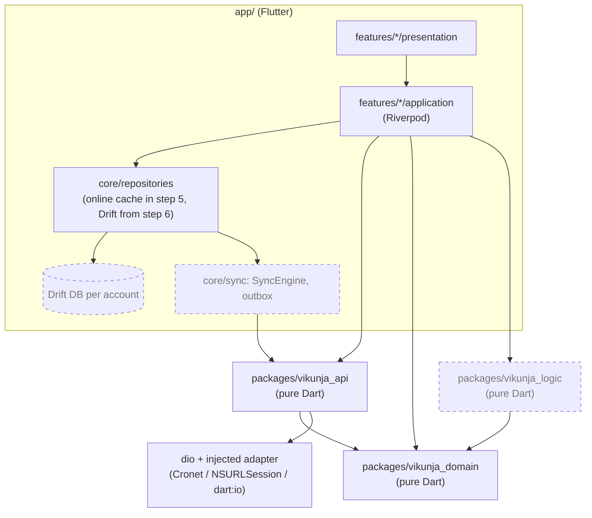
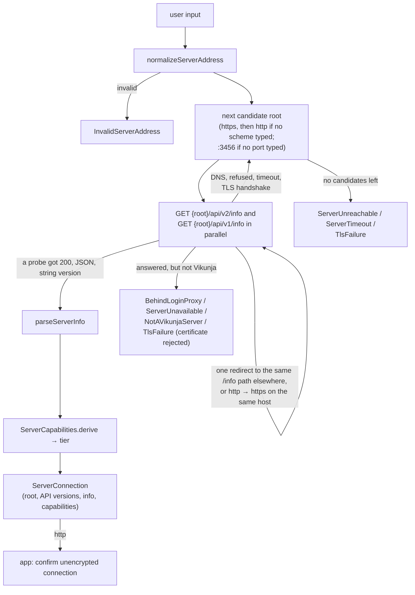
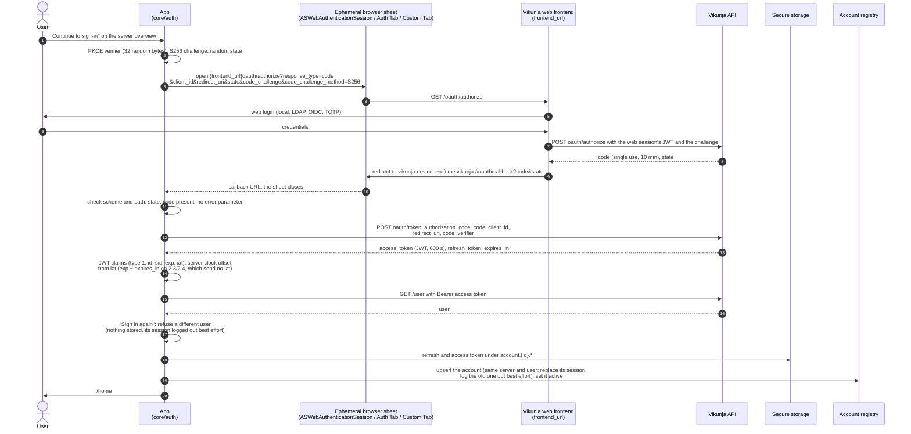
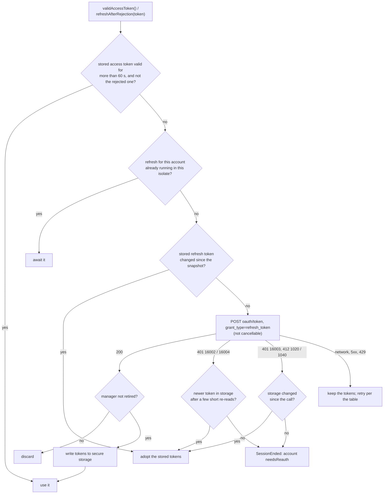
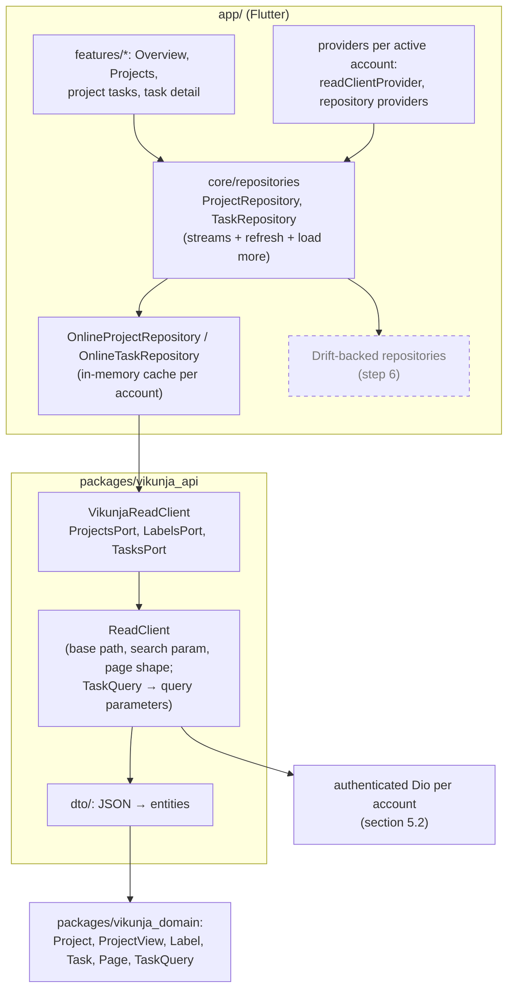

# Architecture

This is the current, condensed architecture. It is derived from [research/synthesis.md](research/synthesis.md) §2, which has the full reasoning and the Vikunja source references. Status markers:

- **[exists]**: built in step 1 or in the combined step 2+3 (HTTP core, browser sign-in, session manager; in review).
- **[in progress, step 5]**: being built in step 5 (read client, online repositories, the first screens).
- **[planned, step N]**: designed, not built. N is the [roadmap](roadmap.md) step.

This page reflects the owner's decisions of 2026-10-09 ([D13](decisions.md#d13-support-floor-230)–[D22](decisions.md#d22-session-keep-alive-through-background-sync)), the step 2+3 decisions ([D23](decisions.md#d23-browser-sign-in-through-flutter_web_auth_2-client-id-and-redirect-uri)–[D27](decisions.md#d27-paging-and-the-query-builder-move-to-step-5)) and the step 5 decisions ([D29](decisions.md#d29-ui-reads-through-repository-interfaces-the-online-implementation-is-replaced-by-drift-in-step-6-without-ui-changes), [D30](decisions.md#d30-kanban-board-reads-deferred-to-step-20)).

## 1. Principles

1. **The local database is the single source of truth for the UI.** Screens read database streams. The network only feeds the database. [repository interfaces with streams in progress, step 5; the database behind them planned, steps 6–7, [D29](decisions.md#d29-ui-reads-through-repository-interfaces-the-online-implementation-is-replaced-by-drift-in-step-6-without-ui-changes)]
2. **One domain-level API interface, two transport adapters** (`/api/v1`, `/api/v2`). The adapter is chosen from the negotiated **capabilities**, never from a version string. [negotiation, error model and authenticated transport exist; read client in progress, step 5; write adapters and the routed client planned, step 11]
3. **Every mutation goes through the outbox, even when online.** The UI, notification actions and widgets share one retry, ordering and conflict path. [planned, step 11]
4. **Every entry point builds the same object graph** with a Riverpod `ProviderContainer`. The entry points are the UI isolate, background tasks, the notification-action isolate and the widget callback. [UI exists; others planned, steps 15–18]
5. **Secrets live only in the Keychain/Keystore.** Extensions and widgets never refresh tokens. [exists]
6. **Pure logic lives in pure-Dart packages** and is pinned by test vectors, many ported from the web frontend's tests. [exists for domain and api]

## 2. Workspace packages and the dependency rule

The repository is a Dart pub workspace with one shared lockfile.

| Package | Kind | Exists (steps 1 and 2+3) | In progress, step 5 | Planned |
|---|---|---|---|---|
| `app/` | Flutter | the "Connect to server" feature (connect, server overview); `core/auth/` (token store, account registry, session manager, browser sign-in, sign-out); the signed-in `/home`; router guards; theming, en/de localisation, redacting logging | `core/repositories/` (`ProjectRepository`, `TaskRepository`, their online implementations); `/home` as a three-tab shell: Overview, Projects (tree, project tasks, task detail), Account | all other screens, `core/` services (db, sync, notifications, widgets, background) |
| `packages/vikunja_domain` | pure Dart | `ServerVersion`, `ApiVersion`, `ServerInfo`, `Capability`, `ServerCapabilities` + `SupportTier`, `ServerConnection`, sealed `ServerConnectionFailure`, sealed `VikunjaFailure`, `User`, `Account`, `TokenSet` | `Project`, `ProjectView`, `Label`, `Task`, `TaskReminder`, `TaskRelationKind`, `Page<T>`, `TaskQuery` | `TaskChanges` and the write-side types (step 11), buckets (step 20), saved filters (step 24) |
| `packages/vikunja_api` | pure Dart | `normalizeServerAddress`, `parseServerInfo`, `ServerConnector` / `DioServerConnector`, `normalizeError`, retry interceptor, PKCE, `AuthorizationRequest`, `OAuthTokenClient`, `JwtClaims`, auth interceptor + `AccessTokenSource`, `AccountApi`, `createAuthenticatedDio`, `serverInfoToJson`; `/info`, error and OAuth fixtures and contract tests | `VikunjaReadClient` (`ProjectsPort`, `LabelsPort`, `TasksPort`) and `ReadClient` over v1 and v2, JSON codecs (`dto/`), paging, query builder; read fixtures and contract tests | write adapters and the routed client with route-absent downgrade (step 11), kanban reads (step 20), realtime (step 17) |
| `packages/vikunja_logic` | pure Dart | — | — | quick-add, filters, dates, positions, colours, checklists (steps 12, 13, 22, 24) |

**Dependency rule:**
- `app` → `vikunja_api` → `vikunja_domain`.
- `app` also uses `vikunja_domain` directly.
- `packages/*/lib` never depend on Flutter, directly or through a dependency. CI enforces this with `tool/check_pure_dart_packages.sh`.

**Layers inside `app`:**
- The layers are presentation → application → repositories → (DAOs, `vikunja_api` ports).
- The UI never imports wire DTOs or adapters.
- Since step 5, the project and task screens read through `core/repositories` (section 6). Onboarding and session code call `vikunja_api` directly (`ServerConnector`, `AccountApi`, the token client), because they run before an account exists.

`vikunja_api` receives a configured `Dio`, so it never chooses a transport itself:
- The app injects `NativeAdapter`: Cronet on Android, NSURLSession on iOS.
  - Without Play services Android falls back to `dart:io`, which loses user-CA trust (see [D5](decisions.md#d5-dio-with-native_dio_adapter)).
- Tests and contract tests use dio's default `dart:io` adapter.

Dashed nodes are planned. The repositories exist from step 5 on with an in-memory cache; the database behind them comes in step 6 ([D29](decisions.md#d29-ui-reads-through-repository-interfaces-the-online-implementation-is-replaced-by-drift-in-step-6-without-ui-changes)).

## 3. Server connection and v1/v2 negotiation [exists]

`ServerConnector.connect(input)` either returns a `ServerConnection` or throws a `ServerConnectionFailure`. The implementation is `DioServerConnector`.

1. **Normalise the address** (`normalizeServerAddress`):
   - Remove invisible characters that copy and paste brings along (zero-width spaces and joiners, soft hyphens).
   - Accept only `http` and `https`.
   - Convert an international host name to its `xn--` (punycode) form.
   - Cut the path at its last `/api/v1` or `/api/v2`, so a pasted `…/api/v1/info` works. Strip trailing `/` and keep any sub-path.
   - Record whether the user typed a scheme and a port.
   - Invalid input → `InvalidServerAddress`.
   - Based on the web frontend's `apiUrl.ts` and `checkAndSetApiUrl.ts`.
2. **Build the candidate roots, in order:**
   - The address as typed. Without a typed scheme, try `https` first, then `http`.
   - Without a typed port, also try Vikunja's default port 3456, but only after the default port could not be reached at all.
   - Candidates overlap to bound the wait: each one starts when the one before it could not connect, or 2.5 s after that one started. Their outcomes are still used strictly in this order.
   - Each probe waits at most 5 s to connect and 5 s for the response, so an address where nothing answers fails after at most 17.5 s.
3. **Probe each candidate.** Send `GET {root}/api/v2/info` and `GET {root}/api/v1/info` in parallel.
   - A probe counts only if the answer is a 200, JSON, and has a string `version`.
   - Servers older than 2.4.0 answer the v2 probe with 404 and `{"message":"Not Found"}`. That means "no v2", not "not Vikunja".
   - The API versions whose probe counted become `ServerConnection.apiVersions`.
   - If v1 reports 2.4.0 or newer (or an unparseable version) while the v2 probe got no HTTP response, v2 is probed once more. If that also gets no response, the connection fails with that error instead of quietly using v1.
4. **Stop at the first candidate where something answered over HTTP:**
   - At most one redirect is followed per connection attempt. It must keep the probe path (`…/api/v1/info` or `…/api/v2/info`) under another origin or sub-path, or be a same-host `http` → `https` redirect. The root derived from it is probed like any other candidate. A redirect from `https` to `http` is never followed.
   - If the address is a route of the Vikunja web app (the answer is the web app's HTML), up to four parent paths are probed.
   - Only connection-level failures (DNS, connection refused, timeout, a TLS handshake failure) move on to the next candidate. A rejected certificate is not one of them: a TLS server answered, so it ends the search with `TlsFailure`. A server that answers is never second-guessed on another port or scheme.
   - If nothing counts, the most informative failure is thrown:

   | Failure | Cause |
   |---|---|
   | `ServerUnreachable` | DNS or connection failure |
   | `ServerTimeout` | timeout |
   | `TlsFailure` | certificate or handshake problem |
   | `ServerUnavailable` | a 5xx or 429 instead of `/info` (Vikunja down, restarting or rate limiting, or the proxy cannot reach it) |
   | `BehindLoginProxy` | any other redirect off the host, or to a login-like path; 401; 403 with `WWW-Authenticate`; 407; an HTML login form |
   | `NotAVikunjaServer` | anything else that answers without a Vikunja `/info` |

5. **Parse `/info`** (`parseServerInfo`). The version is parsed leniently:
   - `v2.7.0` and `v2.7.0-6-ge7d7f173` are both accepted.
   - `dev`, `unstable` and similar sort above every release.
6. **Derive `ServerCapabilities`** from:
   - the reachable API versions;
   - version thresholds;
   - the `/info` flags;
   - `enabled_pro_features` (licence).

   A Vikunja server older than 2.3.0, the support floor ([D13](decisions.md#d13-support-floor-230)), is **not a failure**. It yields a connection with `SupportTier.unsupported`, so the UI can say what it found: the overview shows the header, the badges and a blocking banner that says browser sign-in needs 2.3.0, but no sign-in methods and no server features.
7. **Ask before using `http://`.** If the connection uses `http` (`ServerConnection.isInsecure`), the app shows an "Unencrypted connection" dialog. It uses the server only after the user confirms ([D8](decisions.md#d8-cleartext-policy)).

**Support tiers** (`SupportTier`):

| Tier | Servers | Meaning |
|---|---|---|
| `unsupported` | < 2.3.0, or an unparseable version without v2 | Shown, but not usable: browser sign-in needs 2.3.0. No legacy tier is planned. |
| `oauth` | ≥ 2.3.0 (dev builds included) without a reachable `/api/v2`, e.g. 2.3.x, or a newer server whose proxy hides v2 | `/api/v1`; OAuth 2.0 + PKCE sign-in, WebSocket |
| `full` | any server with a reachable `/api/v2` (2.4.0+) | + v2 adapter (PATCH, ETag, envelopes, problem+json) |

**Capability gating rules:**
- Features check a `Capability` and never compare version strings.
  - Development builds report `dev`/`unstable`.
  - A proxy can hide `/api/v2`.
  - Admins can switch features off.
- Licensed features (time tracking, admin panel, audit logs, invites) come only from `enabled_pro_features`. Their routes return a plain 404 when unlicensed.
- `concurrent_writes`:
  - It is reported since 2.4.0 and is `false` on SQLite.
  - A missing value means "unknown", so writes are serialized.
- Re-negotiation [planned, with the sync engine] happens at login, every 24 h, on app update, and after a "route absent" 404.

**Transport rules that already apply:**
- Only `http` and `https`.
- No credentials in URLs.
- `Authorization`, `Cookie`, `Set-Cookie` and tokens are never logged.
- Plain `http://` needs explicit confirmation in the app (step 7 above).

## 4. API abstraction [read client in progress, step 5; routed client and writes planned, step 11]

Step 5 builds the read half: `VikunjaReadClient` with the ports `ProjectsPort`, `LabelsPort` and `TasksPort`, created by `createReadClient(dio:, connection:)` over the account's authenticated `Dio` (section 5.2). It uses `/api/v2` when the connection reached it and `/api/v1` otherwise, and hides the version differences inside one `ReadClient` (section 6).

The full `VikunjaClient` with per-area ports (tasks, projects, views, labels, comments, …) comes with the write path. A `RoutedVikunjaClient` then picks the v2 or the v1 adapter per `ApiGroup` [planned, step 11]:
- **v2 wins whenever it exists.** It offers PATCH (no full-replace hazard), totals, ETag and problem+json.
- **A 404 without a Vikunja error `code`** on a core group means the route is absent. That group is downgraded to v1 and the request is re-sent.
- **On licence-gated groups** the same 404 means `FeatureUnavailable`.

**Key differences the adapters hide:**

| | v1 | v2 |
|---|---|---|
| Create | `PUT` | `POST` |
| Update | `POST` = full replace, so the v1 adapter does GET → overlay → POST and round-trips assignees and reminders | `PATCH` with merge-patch of the changed fields only |
| Lists | bare arrays with pagination headers | `{items,total,…}` envelopes |
| Errors | `{code,message}` | RFC 9457 problem+json |

**Errors [exists]:** `normalizeError` turns every error into a sealed `VikunjaFailure`. It reads all four error shapes: v1 `{code, message}`, v2 problem+json `{status, title, detail, code?, errors?}`, Echo `{message}` and the 429 `{message}`.

| `VikunjaFailure` | Cause |
|---|---|
| `NetworkFailure` | offline, timeout or TLS problem |
| `TokenRejected` | 401 code 11: the access token is missing, malformed or expired |
| `SessionEnded` | the refresh says the session is gone: 16002 after re-reading storage, 16003, 412 code 1020 or 1040 |
| `RefreshRaceLost` | 401 code 16004: a concurrent refresh with the same token won |
| `OAuthFailure` | 17001–17007 from the OAuth endpoints |
| `Forbidden`, `NotFound` | 403, 404 (`routeAbsent` when there is no Vikunja code) |
| `ValidationFailed` | v1 412 with `invalid_fields`, v2 422 with `errors[]` |
| `RateLimited` | 429, with `Retry-After` |
| `ServerFailure` | 5xx |
| `DomainError`, `UnexpectedResponse` | any other Vikunja code; any unknown shape |

A version-aware code map for the error codes renumbered in 2.7.0 is planned.

**Paging and query builder [in progress, step 5]:** `Page<T>` (`items`, `page`, `perPage`, `totalPages`, `hasMore`; `total` on v2 only) over v1 pagination headers and v2 envelopes, and `TaskQuery` (filter, sorts, expands, paging) with its translation into query parameters, are built with the read client that first uses them ([D27](decisions.md#d27-paging-and-the-query-builder-move-to-step-5); details in section 6).

**DTOs:** one hand-written codec layer (`lib/src/dto/`) serves both versions, because the server models are identical. Step 5 tests it against JSON captured from the 2.7.0 server and against the live server. The DTO-vs-OpenAPI contract test of [D12](decisions.md#d12-hand-written-api-adapters-and-an-openapi-spec-for-contract-tests) is still planned.

## 5. Auth and session [exists, step 2+3]

Step 2+3 built sign-in, token storage, refresh and sign-out for several accounts. The account switcher UI is step 4, the keep-alive scheduling is step 16 ([D22](decisions.md#d22-session-keep-alive-through-background-sync)).

**Sign-in:** browser OAuth 2.0 + PKCE only (≥ 2.3), which covers local, LDAP, OIDC and TOTP accounts through the web login ([D14](decisions.md#d14-browser-sign-in-only), [D23](decisions.md#d23-browser-sign-in-through-flutter_web_auth_2-client-id-and-redirect-uri)). Guests use link shares (step 32). Password, TOTP and API-token login are not planned for now.

| | Value |
|---|---|
| `client_id` | `dev.coderoftime.vikunja` |
| `redirect_uri` | `vikunja-dev.coderoftime.vikunja://oauth/callback` (Vikunja accepts only schemes that start with `vikunja-`) |
| Authorize page | `{frontend_url}oauth/authorize` from `/info`; the server root + `/` when `frontend_url` is empty. An `http://` `frontend_url` is never used for an `https://` server; the server root + `/` is used instead |
| Token endpoint | `POST /api/v2/oauth/token` when `/api/v2` is reachable, otherwise `POST /api/v1/oauth/token` (2.3.x); JSON body, public. 60 requests per minute per IP on 2.7.0; before that the v1 endpoint shares the login limit of 10 per minute ([research/README.md](research/README.md) item 6) |
| Current user | `GET /api/v{2,1}/user` |
| Logout | `POST /api/v2/logout` or `POST /api/v1/user/logout`; needs a valid access token |

The protocol facts are verified against the Vikunja source in [research/auth.md](research/auth.md) §3–§7 and §12.

### 5.1 Browser sign-in

- Every attempt has a fresh verifier and state.
- The browser session is ephemeral ([D23](decisions.md#d23-browser-sign-in-through-flutter_web_auth_2-client-id-and-redirect-uri)). Vikunja shows no consent screen and its callback carries no `iss` ([RFC 9207](https://www.rfc-editor.org/rfc/rfc9207)), so a reused web login would let a malicious server get a code for another server without the user noticing (a mix-up). In an ephemeral session the user has to type that server's credentials into its login page.
  - Every sign-in shows the login form. OIDC and SSO users sign in at their identity provider again each time. iOS shows no "… Wants to Use … to Sign In" prompt.
  - On Android, flutter_web_auth_2 5.1.0 opens a Custom Tab instead of an Auth Tab for Chrome and Edge before 141, Samsung Internet before 28 and Firefox before 143. It treats these versions as lacking ephemeral support, so the sheet can share the browser's cookies; other browsers may ignore the flag as well. Chrome 133 on the test emulator gets such a Custom Tab.
  - Signing out of the app does not end a web login the user has in the browser. Only the fallback browsers above would reuse it.
- "Sign in again" accepts only the account's own user. Another user is refused before anything is stored, its new session is logged out best effort, and the home screen shows a message.
- Closing the sheet cancels silently. A wrong state, a missing code, an `error` parameter and token endpoint errors (17001–17007) end in an inline message on the overview.
- While a sign-in runs (and on `/home` while a sign-out runs), back navigation is blocked and the buttons are disabled, so leaving the screen cannot strand a code exchange half way. On Android before 12, back on the root route would finish the activity and the isolate with it.
- The router sends the app to `/home` when an active account exists, and to onboarding (`/`) otherwise.

### 5.2 Authenticated requests

- `createAuthenticatedDio` builds one `Dio` per account:
  - base URL `connection.apiBaseUri(connection.preferredApiVersion)`;
  - adapter, timeouts and `User-Agent` from the app's base `Dio` ([D5](decisions.md#d5-dio-with-native_dio_adapter));
  - a retry interceptor and the auth interceptor.
- The auth interceptor asks an `AccessTokenSource` for the token. The session manager implements it, so `vikunja_api` holds no refresh policy and no storage.
  - `validAccessToken()` refreshes proactively when `exp − serverNow < 60 s`.
  - `refreshAfterRejection(rejectedToken)` runs after a 401 with code 11. The request is retried once with the new token; a second 401 is not retried.
  - The `Authorization` header is never added to absolute URLs on another origin.
- The retry interceptor retries only GET and HEAD, on network errors, 502, 503, 504 and 429. It makes at most 2 retries with exponential backoff and jitter, and honours `Retry-After` up to a cap. Writes are retried by the outbox (step 11), never by the transport.
- `OAuthTokenClient` uses a separate `Dio` without the auth interceptor, because the token endpoint is public and a refresh must never trigger a refresh.
- Redirects are not followed: the token client, the account `Dio` and every request the auth interceptor adds a token to use `followRedirects: false`, so neither a code, a refresh token nor an access token reaches the host a redirect names. A 3xx ends as `UnexpectedResponse`.
- `normalizeError` turns every error into a `VikunjaFailure` (section 4).

### 5.3 Token storage

([D24](decisions.md#d24-tokens-in-secure-storage-readable-after-the-first-unlock))

- `flutter_secure_storage` 11, per account: `account.<id>.refresh_token` and `account.<id>.access_token`.
- iOS: Keychain with `first_unlock_this_device` and `synchronizable: false`. Background isolates can read the tokens while the device is locked, once it has been unlocked after a restart. The items never reach iCloud Keychain or another device.
- Android: the plugin's v11 defaults (AES-GCM, with the key wrapped by an Android Keystore RSA key). `android:allowBackup="false"` keeps them out of Auto Backup.
- The access token is stored too, so another isolate can adopt a refresh result instead of refreshing again.
- `TokenSet` keeps `exp` and `iat` in server time. The server clock offset comes from `iat` when a token arrives, and every expiry check uses server time.
- The offset is kept per account in preferences (`auth.server_clock_offset.<id>`; not a secret), written after the tokens and only when it moved by 5 s or more. A cold start or another isolate therefore judges stored tokens in server time before its first response. Sign-out deletes it.
- iOS keeps Keychain items when the app is deleted, but not its preferences. The first UI start that finds neither the install marker (`auth.install_marker`) nor a registry wipes secure storage once, so a reinstall never inherits refresh tokens ([D24](decisions.md#d24-tokens-in-secure-storage-readable-after-the-first-unlock)). Deleting the app never logs its sessions out on the server; they end after 72 h without a refresh.
- Secrets appear nowhere else: not in SharedPreferences, not in the database, not in logs. `toString()` of `TokenSet` redacts the tokens.

### 5.4 Refresh

Vikunja rotates the refresh token on **every** refresh and has **no grace period**: the old token is dead as soon as the server commits the rotation. Reusing it gives 401 code 16002, and a concurrent refresh with the same token that loses the race gets 16004. Every rule below follows from that ([D26](decisions.md#d26-refresh-concurrency-single-flight-re-read-and-adopt-write-ahead-epoch)).

- **When:** proactively 60 s before `exp` (server time), and reactively once after a 401 with code 11 for a user JWT.
- **Single-flight:** one refresh per account and isolate at a time; concurrent callers await the same future.
- **Re-read, then adopt:** before calling the server, the session manager re-reads the stored refresh token. If it differs from the caller's snapshot, another isolate or process has refreshed, and the stored tokens are adopted without a server call.
- **Cross-isolate safety:** `RandomAccessFile.lock` does not serialise isolates of one process (POSIX record locks are per process; verified by `app/test/core/auth/file_lock_isolates_test.dart`). Re-reading and adopting are the cross-isolate mechanism, as documented in `app/lib/core/auth/session_manager.dart`.
- **Write-ahead:** the rotated refresh token (with the new access token) is written to secure storage **before** the new access token is used for anything.
- **Not cancellable:** the refresh request is not tied to a UI cancel token and has a generous timeout. A response lost after the server rotated leaves only a dead token.
- **Adoption on 16002 and 16004:** the session manager re-reads storage a few times with short delays, because a sibling may be about to persist the winning tokens. Losing again to a newer stored token keeps it looking. Only when nothing newer appears is the session ended.
- **Re-read on 16003 and 412:** these answers are about the session of the token that was sent. Storage is re-read first, and a session that another isolate stored meanwhile (a new sign-in) is adopted. Only when storage is unchanged does the session end.
- **Write failure:** if the secure write after a successful refresh fails, the new tokens stay in memory and are written again before the next refresh; newer tokens in storage win. Only the error type is logged.
- **Retirement and auth epoch:** sign-out and account removal retire the account's session manager first, then wipe its storage. A retired manager hands out no token and never writes storage; it stays retired in this isolate until a new sign-in replaces it. `retire()` waits only for a storage write that has already started, never for a refresh still on the network, whose result is discarded. Guarding a sibling isolate against writing tokens back after a sign-out in another isolate is open for step 16.

| Refresh outcome | Failure | Action |
|---|---|---|
| 200 | — | persist (write-ahead), then use |
| network error or timeout | `NetworkFailure` | keep the tokens, retry later |
| 5xx | `ServerFailure` | re-read storage (SQLite servers answer a lost race with 500) and adopt a newer token; otherwise retry once, then keep the tokens |
| 429 | `RateLimited` | wait for `Retry-After`, capped at 10 min |
| 401 16004, 16002, or 401 without a code (2.3.0, 2.4.0) | `RefreshRaceLost` / `SessionEnded` | re-read and adopt; otherwise session ended |
| 401 16003, 412 1020 or 1040 | `SessionEnded` | re-read and adopt a newer session; otherwise session ended |

### 5.5 Session end and `needsReauth`

- A `SessionEnded` failure marks the account `needsReauth` in the registry. Its local data stays.
- `/home` (its Account tab since step 5) then shows a "Sign in again" banner. It runs the browser sign-in for the same server; signing in as the same user replaces the account's tokens and clears the flag.
- `/home` checks the active session with `GET /user` after its first frame, when the app resumes and when the active account changes: at most once a minute per account, never for an account in `needsReauth`, and never while a sign-in or sign-out runs. A session the server ended shows the banner right away. An unreachable server shows nothing. A sign-in counts as a check.
- The server ends an OAuth session after 72 h without a refresh (`service.jwtttl`), and there is no long-session option for the code grant. The check above refreshes an expiring access token, so opening the app moves that window. Background runs will refresh every account at least about every 24 h (step 16).
- From step 11 on, the outbox of an account in `needsReauth` pauses; from step 16 on, a "Sign in again" notification appears.

### 5.6 Sign-out

1. Best-effort logout: make sure the access token is valid (refresh first if needed), then `POST` logout. Network errors are ignored.
2. Retire the account's session manager (section 5.4), so nothing in this isolate writes its tokens again.
3. Wipe the account's secure entries, its server clock offset and its registry entry.

When no active account remains, the router returns to onboarding. From step 6 on, sign-out also deletes the account's database and cancels its notifications ([D16](decisions.md#d16-multi-account-in-the-first-release)).

### 5.7 Multi-account registry

([D25](decisions.md#d25-account-registry-in-sharedpreferences-without-secrets))

- The registry lives in `SharedPreferencesAsync` as JSON and holds no secrets:
  - the accounts (`Account`: id, server root, user id, username, display name, `addedAt`, `needsReauth`);
  - the active account id;
  - each account's last server connection, with `/info` re-serialised by `serverInfoToJson`, so start-up and headless refreshes need no probe.
- Account id: the first 32 hex characters of `sha256("${serverRoot}|${userId}")`. The same user on the same server is always the same account, so signing in again replaces its session instead of adding a duplicate.
- Per-account objects are keyed by the account id: the session manager, the authenticated `Dio`, and later the database (step 6), the outbox (step 11) and the notification namespace (step 15).
- The registry and secure storage are written separately. An account without tokens is handled like `needsReauth`: the accounts provider marks it at start (`flagAccountsWithoutTokens`), and a session manager that finds no tokens ends the session. Unreadable storage (the Keychain before the first unlock) is not taken as missing tokens.
- Entries that cannot be decoded are left out of the state but written back unchanged; a readable entry with the same id replaces one. A registry that cannot be decoded at all is copied to `auth.account_registry.unreadable` before it is first overwritten ([D25](decisions.md#d25-account-registry-in-sharedpreferences-without-secrets)).
- `bootstrap.dart` loads the registry before `runApp`, behind the native launch screen, so the first route is already the right one. The token-presence check runs afterwards without blocking start-up.
- The account switcher UI (add, switch, remove) is step 4.

### 5.8 Headless use

- The token store, the registry, the session manager and the token client need no `BuildContext` and no widget tree. A background isolate builds them through the same Riverpod `ProviderContainer` as the UI (principle 4).
- What makes that work:
  - the Keychain accessibility above, so tokens are readable while the device is locked;
  - `SharedPreferencesAsync`, which has no in-memory cache that could go stale across isolates;
  - the re-read and adoption rules of section 5.4.
- Extensions and widgets never refresh tokens (principle 5). Step 16 schedules the background refreshes; step 2+3 only has to make them possible.

## 6. Read path [in progress, step 5]

Step 5 puts the first real data on screen, read-only and online. Every layer below the screens is shaped so that step 6 can put Drift under the repositories without touching the UI ([D29](decisions.md#d29-ui-reads-through-repository-interfaces-the-online-implementation-is-replaced-by-drift-in-step-6-without-ui-changes)).

**Ports and `ReadClient`** (`packages/vikunja_api/lib/src/read/`):
- `VikunjaReadClient` exposes `projects`, `labels` and `tasks`. `createReadClient(dio:, connection:)` takes the account's authenticated `Dio` and picks `/api/v2` or `/api/v1` from `connection.preferredApiVersion`.
- Both versions share the entity JSON, so one codec layer (`lib/src/dto/`) parses it. The client hides the rest: the base path, the search parameter (`s` on v1, `q` on v2) and the page shape (v1: a bare array plus `x-pagination-total-pages` and `x-pagination-result-count` headers, so `Page.total` is null; v2: `{items, total, page, per_page, total_pages}`).
- `TaskQuery` becomes `filter`, `filter_timezone`, `filter_include_nulls`, repeated `sort_by` and `order_by` (paired by position), `expand`, `page` and `per_page`. URLs are built from query parameters, never by string concatenation, because filters contain `&&`, quotes and spaces; dio sends the lists as `sort_by=a&sort_by=b` (`ListFormat.multi`). A sort by `position` is dropped on `GET /tasks` and `GET /projects/{p}/tasks`, because positions live per view and the server rejects the sort there (error 4026); it stays on the view endpoint.
- The server caps `per_page` at its `max_items_per_page` (50 by default), so paging follows the response. `listAll` walks `page < totalPages` and de-duplicates the pseudo projects (Favorites `-1`, saved filters `≤ -2`) that the server appends to every page.
- Parsing rules: the zero date `0001-01-01T00:00:00Z` is null and every date is parsed to UTC; `null` arrays are empty; `hex_color` is normalised to six lowercase hex digits without `#`; unknown keys are ignored; v2's `max_permission` and `ETag` are ignored for now.
- Endpoints: `GET /tasks` (all projects), `GET /projects/{p}/tasks` (no view filter, so done tasks are included unless filtered out), `GET /projects/{p}/views/{v}/tasks` (the view's filter is AND-ed server-side; never used with kanban views, [D30](decisions.md#d30-kanban-board-reads-deferred-to-step-20)), `GET /projects` (archived only with `is_archived=true`), `GET /projects/{id}` (with views), `GET /labels`, `GET /tasks/{id}`.
- Errors go through `normalizeError`; a cancelled request rethrows its `DioException`; JSON the codecs cannot read ends as `UnexpectedResponse`.
- Tests: unit tests with a fake HTTP adapter, parsing tests on JSON captured from the 2.7.0 server (`test/fixtures/read/`, captured by `tool/capture_read_fixtures.dart` with the user name redacted), and a contract test that seeds data and checks that v1 and v2 give equal domain objects except `Page.total`. The seed project gets a per-run identifier (`CT` plus four hex digits), because identifiers are unique per server and the server outlives a run; the sign-in helper retries a 500, because the SQLite test server loses a write race when two contract files register at once.

**Repositories** (`app/lib/core/repositories/`):
- `ProjectRepository`: `watchAll()`, `refresh()`, `find(id)`. `TaskRepository`: `watchOpenTasks()`, `watchProjectTasks(projectId, showDone:)` (a `PagedList`: the items loaded so far and whether the server has more), `refreshOpenTasks()`, `refreshProjectTasks(...)`, `loadMoreProjectTasks(...)`.
- The contract is streams of the current local state plus explicit refresh and load-more. A failed first load is the stream's error; a failed refresh or load-more throws the `VikunjaFailure` and leaves the stale data in the stream. Database streams and a sync trigger satisfy it as well.
- The step 5 implementations (`online/`) keep an in-memory cache per account, filled on first subscription and on refresh through `VikunjaReadClient`; a load that is already running is joined, not repeated. The overview reads `GET /tasks` with `done = false`, sorted by due date, up to 5 pages (logged when capped); project tasks are read page by page from `GET /projects/{p}/tasks`, newest first, with `showDone` deciding the filter and one list per `(project, showDone)`; a task that moves between pages while loading is kept once.
- Nothing survives a restart. Offline comes with step 6.

**Providers** (`core/repositories/repository_providers.dart`): `readClientProvider(accountId)` builds the read client over `createAuthenticatedDio` with the account's session manager as token source, rebuilt only when the account's root URL or API versions change; in debug builds it logs one line per request (method, URL without query, status), never headers or bodies. `projectRepositoryProvider` and `taskRepositoryProvider` follow the active account id: null while nobody is signed in, rebuilt and the old one disposed on a switch, gone on sign-out, so an account switch never shows another account's data. The screens watch stream providers over them (`projectsProvider`, `projectByIdProvider`, `projectTasksProvider`, `openTasksProvider`), which stay loading without an account. `clockTickProvider` supplies "now" for the due-date grouping and relative dates: it re-reads `clockProvider` (which tests pin) when the app returns to the foreground and every minute while it is in front, so sections and labels do not freeze overnight.

**Screens** (`app/lib/features/`, material_ui and cupertino_ui, `.adaptive` where available):
- `/home` is a `StatefulShellRoute.indexedStack` (`HomeShell` in `features/home/`) with the tabs Overview (`/home/overview`), Projects (`/home/projects`, `/home/projects/:id`) and Account (`/home/account`: the step 2+3 home content, now `AccountTab`). `/home` itself redirects to the overview; the splash, connect and home redirects stay; each tab keeps its stack. The shell runs the session check on the first frame, on resume and when the active account changes, and blocks system back while a sign-in or sign-out runs; that sign-out progress lives in `SignOutController` (`features/session/`), because the shell and the Account tab both need it. The tab bar is Material 3 on Android and a `CupertinoTabBar` on iOS.
- Overview (`features/overview/`) groups the open tasks into Overdue, Today, Next 7 days, Later and No due date in device local time, computed at build time. A row (`TaskRow` in `features/tasks/`) shows the done indicator, title, `displayIdentifier`, project title, relative due date (overdue in the error colour), priority chip for high and above, label chips (text colour by luminance, like the web's `getTextColor`) and the favourite star. Its pull-to-refresh also refreshes the projects for the titles and reports only the task failure.
- Projects (`features/projects/`) shows favourites first, then the tree from `parentProjectId` (sorted by position, then title; archived and pseudo projects hidden; saved filters come with step 24; collapsible children with a colour dot and child count). A project opens its task list with a "Show done tasks" toggle in the overflow menu (a separate list per setting) and load more at the end of the list.
- Task detail (`TaskDetailSheet` in `features/tasks/`) is a modal sheet over the task from the list (a `DraggableScrollableSheet`, `showCupertinoSheet` on iOS): title, identifier and project, done state, dates (absolute, localised), priority, percent done, labels, assignees, reminders, repeat summary and the description as plain text (`htmlToPlainText` strips tags and decodes the basic entities; rich rendering is step 10).
- Pull-to-refresh, a loading placeholder on first load, an error card with retry (`features/common/`, over `StatusCard`) and an empty state on every list. A failed first load fills the screen; a failed refresh is a notice above the stale list; a failed load-more sits where the next page would be. Read-only: no action changes anything on the server.
- The screens depend on the repository interfaces and the domain types only. They never see `Page`, the ports or DTOs.

**Planned:** step 6 replaces the online repositories with Drift-backed ones behind the same interfaces and feeds the database through the same ports; step 7 adds the incremental sync; step 9 serves the lists offline and adds the Upcoming presets; step 10 renders the description; step 20 adds the kanban reads ([D30](decisions.md#d30-kanban-board-reads-deferred-to-step-20)); step 24 the saved filters.

## 7. Offline-first data layer [planned]

- **Database (step 6):** one Drift SQLite file per account, opened with `shareAcrossIsolates`. It is never placed in the iOS App Group container. Its DAOs sit behind the repository interfaces of section 6 ([D29](decisions.md#d29-ui-reads-through-repository-interfaces-the-online-implementation-is-replaced-by-drift-in-step-6-without-ui-changes)). Tasks carry:
  - a stable `local_id` and a nullable `server_id`;
  - `base_json` and `dirty_fields` for 3-way merges;
  - a `sync_status`.
- **Outbox (step 11):**
  - One local transaction updates the row and appends an op. Ops are coalesced:

    | Ops in the outbox | Sent as |
    |---|---|
    | patch + patch | one patch with the union of fields |
    | create + patch | one create |
    | create + delete | nothing |

  - Ops are sent serially in FIFO order.
  - Retry uses backoff and honours `Retry-After`.
  - Permanent failures go to a "Sync problems" list.
  - A create that timed out is looked up before it is re-sent.
- **Sync engine (steps 6–7):**
  - Initial keyset sync, undone tasks first.
  - Incremental `(updated, id)` delta with a 120 s overlap.
  - The project diff fully pulls new and un-archived projects.
  - Count checks and id reconciliation catch deletes, because Vikunja leaves no tombstones.
  - A cheap probe (about 2 requests) decides whether a full delta is needed.
- **Realtime (step 17):** WebSocket in the foreground only, used as a hint to sync, never as a source of truth. Reconnects are capped, because the upgrade shares the login rate limiter.
- **Notifications (step 15):**
  - Reminders are scheduled locally from the database, because the server does not push them.
  - Policy ([D17](decisions.md#d17-notification-policy)): only undone tasks where the user is the creator or an assignee; reminders at their time and due dates at the exact due time, as exact alarms on Android; notification and exact-alarm permissions asked during onboarding; no overdue digest.
  - The scheduler diffs the desired set against what is scheduled, keeps a rolling window (iOS ≤ 60 pending) and uses deterministic ids.
  - "Mark done" runs in a background isolate through the outbox.
- **Background (step 16):** WorkManager periodic sync and expedited drains on Android; BGAppRefresh and BGProcessing on iOS; a session keep-alive for every account at least every 24 h.
- **Widgets (steps 18–19):**
  - Snapshot JSON is written after every sync or local change.
  - Android uses Glance with a Dart callback.
  - On iOS, mark-done is a native Swift AppIntent that uses an App Group outbox file. It never opens SQLite and never refreshes tokens.

## 8. Cross-cutting

- **UI:** material_ui and cupertino_ui instead of the in-SDK libraries ([D2](decisions.md#d2-material_ui-and-cupertino_ui)); dynamic colour on Android [planned, step 8]; dark mode and 200 % text scale in every step. Relative dates in list rows and absolute, localised dates in the detail come from intl, in device local time [in progress, step 5].
- **Localisation:** gen-l10n with ARB files, English and German, which is also the first-release scope ([D21](decisions.md#d21-languages-english-and-german)). Generated code lives in `app/lib/l10n/generated/`.
- **Logging:** `package:logging` with redaction of auth headers and tokens, of `code=`, `state=`, `access_token`, `refresh_token` and `Bearer` values, and of callback URLs [exists]. A ring buffer, file rotation and diagnostics export are planned (step 35).
- **Platform configuration:**
  - Android: `android.uniquePackageNames=false` for Cronet ([D5](decisions.md#d5-dio-with-native_dio_adapter)).
  - Android has a network security config that trusts system and user CAs and permits cleartext. iOS has `NSAllowsArbitraryLoads` and `NSLocalNetworkUsageDescription` [exists, D8].
  - Browser sign-in: on Android, flutter_web_auth_2's `CallbackActivity`, exported, with a `BROWSABLE` intent filter for the scheme `vikunja-dev.coderoftime.vikunja`. iOS needs no URL type for ASWebAuthenticationSession, verified on the simulator in step 2+3 ([D23](decisions.md#d23-browser-sign-in-through-flutter_web_auth_2-client-id-and-redirect-uri)).
  - Per-server TLS pinning, mTLS and custom headers are planned for step 35.
- **CI:** analyze, format and tests; a check that the committed generated code is current; the Docker contract tests against the latest release; release builds (Android APK, unsigned iOS device build) ([.github/workflows/ci.yaml](../.github/workflows/ci.yaml)). The contract job starts every service of `test_servers/` and waits for all of them.
- **Test servers:** `test_servers/docker-compose.yaml` runs one server, the latest Vikunja release (2.7.0 on port 34527), for the contract tests and manual sign-in ([D28](decisions.md#d28-test-only-the-latest-vikunja-release)). The iOS simulator uses it directly; the Android emulator after `adb reverse tcp:34527 tcp:34527`. `tool/seed_e2e_user.sh` creates the sign-in test user from `test_servers/seed/e2e-user.env`; the [README](../README.md#sign-in-on-a-device-end-to-end) has the manual run.
