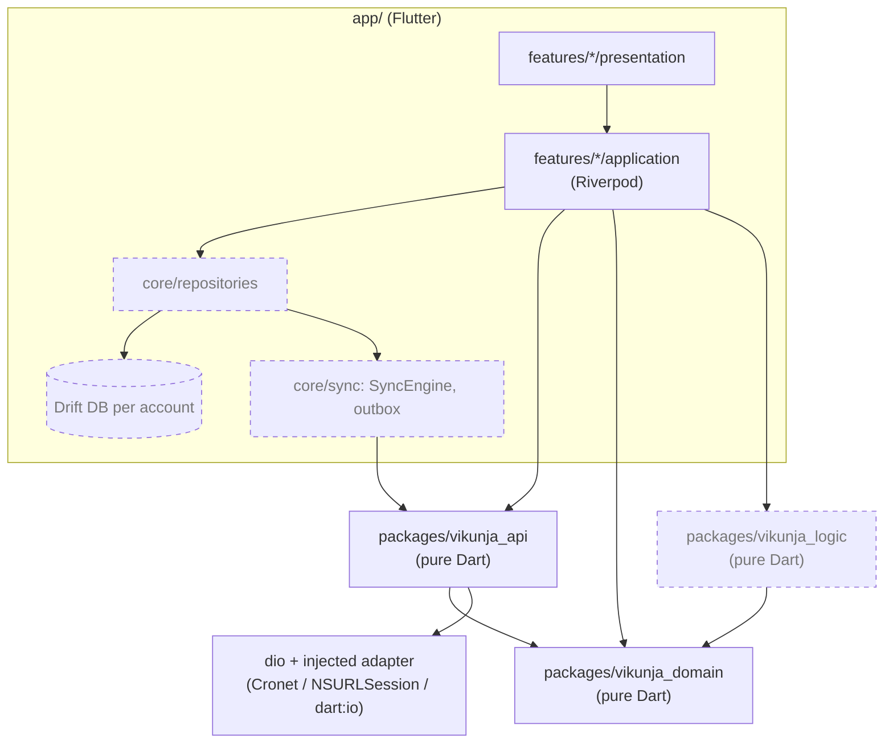
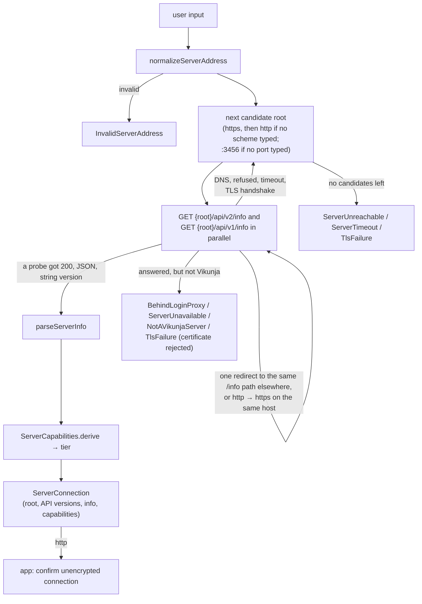

# Architecture

This is the current, condensed architecture. It is derived from [research/synthesis.md](research/synthesis.md) §2, which has the full reasoning and the Vikunja source references. Status markers:

- **[exists]**: built in step 1, which is in review.
- **[planned, step N]**: designed, not built. N is the [roadmap](roadmap.md) step.

This page reflects the owner's decisions of 2026-10-09 ([D13](decisions.md#d13-support-floor-230)–[D22](decisions.md#d22-session-keep-alive-through-background-sync)).

## 1. Principles

1. **The local database is the single source of truth for the UI.** Screens read database streams. The network only feeds the database. [planned, steps 6–7]
2. **One domain-level API interface, two transport adapters** (`/api/v1`, `/api/v2`). The adapter is chosen from the negotiated **capabilities**, never from a version string. [negotiation exists; adapters planned, steps 2 and 5]
3. **Every mutation goes through the outbox, even when online.** The UI, notification actions and widgets share one retry, ordering and conflict path. [planned, step 11]
4. **Every entry point builds the same object graph** with a Riverpod `ProviderContainer`. The entry points are the UI isolate, background tasks, the notification-action isolate and the widget callback. [UI exists; others planned, steps 15–18]
5. **Secrets live only in the Keychain/Keystore.** Extensions and widgets never refresh tokens. [planned, step 3]
6. **Pure logic lives in pure-Dart packages** and is pinned by test vectors, many ported from the web frontend's tests. [exists for domain and api]

## 2. Workspace packages and the dependency rule

The repository is a Dart pub workspace with one shared lockfile.

| Package | Kind | Exists after step 1 | Planned |
|---|---|---|---|
| `app/` | Flutter | the "Connect to server" feature; app shell with two routes (go_router: connect, server overview), theming, en/de localisation, logging scaffold | all screens, `core/` services (auth, db, sync, notifications, widgets, background) |
| `packages/vikunja_domain` | pure Dart | `ServerVersion`, `ApiVersion`, `ServerInfo`, `Capability`, `ServerCapabilities` + `SupportTier`, `ServerConnection`, sealed `ServerConnectionFailure` | entities, `TaskChanges`, `Page<T>`, `VikunjaFailure` (steps 2, 5) |
| `packages/vikunja_api` | pure Dart | `normalizeServerAddress`, `parseServerInfo`, `ServerConnector` / `DioServerConnector`, `/info` fixtures, contract tests | `VikunjaClient` ports, routed client, v1/v2 adapters, auth protocol, realtime (steps 2–5, 17) |
| `packages/vikunja_logic` | pure Dart | — | quick-add, filters, dates, positions, colours, checklists (steps 12, 13, 22, 24) |

**Dependency rule:**
- `app` → `vikunja_api` → `vikunja_domain`.
- `app` also uses `vikunja_domain` directly.
- `packages/*/lib` never depend on Flutter, directly or through a dependency. CI enforces this with `tool/check_pure_dart_packages.sh`.

**Layers inside `app`:**
- The layers are presentation → application → repositories → (DAOs, `vikunja_api` ports).
- The UI never imports wire DTOs or adapters.
- Step 1 has no repositories yet. Its application layer calls `ServerConnector` directly.

`vikunja_api` receives a configured `Dio`, so it never chooses a transport itself:
- The app injects `NativeAdapter`: Cronet on Android, NSURLSession on iOS.
  - Without Play services Android falls back to `dart:io`, which loses user-CA trust (see [D5](decisions.md#d5-dio-with-native_dio_adapter)).
- Tests and contract tests use dio's default `dart:io` adapter.

Dashed nodes are planned. In step 1 the application layer talks to `vikunja_api` directly.

## 3. Server connection and v1/v2 negotiation [exists]

`ServerConnector.connect(input)` either returns a `ServerConnection` or throws a `ServerConnectionFailure`. The implementation is `DioServerConnector`.

1. **Normalise the address** (`normalizeServerAddress`):
   - Remove invisible characters that copy and paste brings along (zero-width spaces and joiners, soft hyphens).
   - Accept only `http` and `https`.
   - Convert an international host name to its `xn--` (punycode) form.
   - Cut the path at its last `/api/v1` or `/api/v2`, so a pasted `…/api/v1/info` works. Strip trailing `/` and keep any sub-path.
   - Record whether the user typed a scheme and a port.
   - Invalid input → `InvalidServerAddress`.
   - Based on the web frontend's `apiUrl.ts` and `checkAndSetApiUrl.ts`.
2. **Build the candidate roots, in order:**
   - The address as typed. Without a typed scheme, try `https` first, then `http`.
   - Without a typed port, also try Vikunja's default port 3456, but only after the default port could not be reached at all.
   - Candidates overlap to bound the wait: each one starts when the one before it could not connect, or 2.5 s after that one started. Their outcomes are still used strictly in this order.
   - Each probe waits at most 5 s to connect and 5 s for the response, so an address where nothing answers fails after at most 17.5 s.
3. **Probe each candidate.** Send `GET {root}/api/v2/info` and `GET {root}/api/v1/info` in parallel.
   - A probe counts only if the answer is a 200, JSON, and has a string `version`.
   - Servers older than 2.4.0 answer the v2 probe with 404 and `{"message":"Not Found"}`. That means "no v2", not "not Vikunja".
   - The API versions whose probe counted become `ServerConnection.apiVersions`.
   - If v1 reports 2.4.0 or newer (or an unparseable version) while the v2 probe got no HTTP response, v2 is probed once more. If that also gets no response, the connection fails with that error instead of quietly using v1.
4. **Stop at the first candidate where something answered over HTTP:**
   - At most one redirect is followed per connection attempt. It must keep the probe path (`…/api/v1/info` or `…/api/v2/info`) under another origin or sub-path, or be a same-host `http` → `https` redirect. The root derived from it is probed like any other candidate. A redirect from `https` to `http` is never followed.
   - If the address is a route of the Vikunja web app (the answer is the web app's HTML), up to four parent paths are probed.
   - Only connection-level failures (DNS, connection refused, timeout, a TLS handshake failure) move on to the next candidate. A rejected certificate is not one of them: a TLS server answered, so it ends the search with `TlsFailure`. A server that answers is never second-guessed on another port or scheme.
   - If nothing counts, the most informative failure is thrown:

   | Failure | Cause |
   |---|---|
   | `ServerUnreachable` | DNS or connection failure |
   | `ServerTimeout` | timeout |
   | `TlsFailure` | certificate or handshake problem |
   | `ServerUnavailable` | a 5xx or 429 instead of `/info` (Vikunja down, restarting or rate limiting, or the proxy cannot reach it) |
   | `BehindLoginProxy` | any other redirect off the host, or to a login-like path; 401; 403 with `WWW-Authenticate`; 407; an HTML login form |
   | `NotAVikunjaServer` | anything else that answers without a Vikunja `/info` |

5. **Parse `/info`** (`parseServerInfo`). The version is parsed leniently:
   - `v2.7.0` and `v2.7.0-6-ge7d7f173` are both accepted.
   - `dev`, `unstable` and similar sort above every release.
6. **Derive `ServerCapabilities`** from:
   - the reachable API versions;
   - version thresholds;
   - the `/info` flags;
   - `enabled_pro_features` (licence).

   A Vikunja server older than 2.3.0, the support floor ([D13](decisions.md#d13-support-floor-230)), is **not a failure**. It yields a connection with `SupportTier.unsupported`, so the UI can say what it found: the overview shows the header, the badges and a blocking banner that says browser sign-in needs 2.3.0, but no sign-in methods and no server features.
7. **Ask before using `http://`.** If the connection uses `http` (`ServerConnection.isInsecure`), the app shows an "Unencrypted connection" dialog. It uses the server only after the user confirms ([D8](decisions.md#d8-cleartext-policy)).

**Support tiers** (`SupportTier`):

| Tier | Servers | Meaning |
|---|---|---|
| `unsupported` | < 2.3.0, or an unparseable version without v2 | Shown, but not usable: browser sign-in needs 2.3.0. No legacy tier is planned. |
| `oauth` | ≥ 2.3.0 (dev builds included) without a reachable `/api/v2`, e.g. 2.3.x, or a newer server whose proxy hides v2 | `/api/v1`; OAuth 2.0 + PKCE sign-in, WebSocket |
| `full` | any server with a reachable `/api/v2` (2.4.0+) | + v2 adapter (PATCH, ETag, envelopes, problem+json) |

**Capability gating rules:**
- Features check a `Capability` and never compare version strings.
  - Development builds report `dev`/`unstable`.
  - A proxy can hide `/api/v2`.
  - Admins can switch features off.
- Licensed features (time tracking, admin panel, audit logs, invites) come only from `enabled_pro_features`. Their routes return a plain 404 when unlicensed.
- `concurrent_writes`:
  - It is reported since 2.4.0 and is `false` on SQLite.
  - A missing value means "unknown", so writes are serialized.
- Re-negotiation [planned, steps 3 and 5] happens at login, every 24 h, on app update, and after a "route absent" 404.

**Transport rules that already apply:**
- Only `http` and `https`.
- No credentials in URLs.
- `Authorization`, `Cookie`, `Set-Cookie` and tokens are never logged.
- Plain `http://` needs explicit confirmation in the app (step 7 above).

## 4. API abstraction [planned, steps 2 and 5]

There is one `VikunjaClient` with per-area ports (tasks, projects, views, labels, comments, …). A `RoutedVikunjaClient` picks the v2 or the v1 adapter per `ApiGroup`:
- **v2 wins whenever it exists.** It offers PATCH (no full-replace hazard), totals, ETag and problem+json.
- **A 404 without a Vikunja error `code`** on a core group means the route is absent. That group is downgraded to v1 and the request is re-sent.
- **On licence-gated groups** the same 404 means `FeatureUnavailable`.

**Key differences the adapters hide:**

| | v1 | v2 |
|---|---|---|
| Create | `PUT` | `POST` |
| Update | `POST` = full replace, so the v1 adapter does GET → overlay → POST and round-trips assignees and reminders | `PATCH` with merge-patch of the changed fields only |
| Lists | bare arrays with pagination headers | `{items,total,…}` envelopes |
| Errors | `{code,message}` | RFC 9457 problem+json |

**Errors:** all errors are normalised into a sealed `VikunjaFailure`. A version-aware code map covers the error codes renumbered in 2.7.0.

**DTOs:** one hand-written DTO set serves both adapters, because the server models are identical. A contract test checks them against the OpenAPI spec of the pinned 2.7.0 image ([D12](decisions.md#d12-hand-written-api-adapters-and-an-openapi-spec-for-contract-tests)).

## 5. Auth and session [planned, steps 3, 4 and 16]

**Sign-in:** browser OAuth 2.0 + PKCE only (≥ 2.3), which covers local, LDAP, OIDC and TOTP accounts through the web login ([D14](decisions.md#d14-browser-sign-in-only)). Guests use link shares (step 32). Password, TOTP and API-token login are not planned for now.

**Accounts:** several accounts from the first release ([D16](decisions.md#d16-multi-account-in-the-first-release)). Each account (server + user) has its own tokens, database, outbox and sync state. Step 3 builds a multi-account registry; step 4 adds, switches and removes accounts.

**Token handling:**
- Refresh tokens rotate on every use, with no grace period. Refresh is therefore:
  - single-flight per isolate;
  - file-locked across isolates;
  - re-reads storage before calling the server;
  - persists the new refresh token before using the new access token.
- Proactive refresh 60 s before expiry; reactive refresh once on 401 code 11 (user JWTs only).
- A dead session keeps local data and pauses the outbox until the user signs in again.
- Tokens live in `flutter_secure_storage` with `first_unlock_this_device`, so background isolates can read them.
- OAuth sessions end after 72 h without a refresh, and there is no 30-day option. Background runs refresh every account's session at least about every 24 h ([D22](decisions.md#d22-session-keep-alive-through-background-sync), step 16).

## 6. Offline-first data layer [planned]

- **Database (step 6):** one Drift SQLite file per account, opened with `shareAcrossIsolates`. It is never placed in the iOS App Group container. Tasks carry:
  - a stable `local_id` and a nullable `server_id`;
  - `base_json` and `dirty_fields` for 3-way merges;
  - a `sync_status`.
- **Outbox (step 11):**
  - One local transaction updates the row and appends an op. Ops are coalesced:

    | Ops in the outbox | Sent as |
    |---|---|
    | patch + patch | one patch with the union of fields |
    | create + patch | one create |
    | create + delete | nothing |

  - Ops are sent serially in FIFO order.
  - Retry uses backoff and honours `Retry-After`.
  - Permanent failures go to a "Sync problems" list.
  - A create that timed out is looked up before it is re-sent.
- **Sync engine (steps 6–7):**
  - Initial keyset sync, undone tasks first.
  - Incremental `(updated, id)` delta with a 120 s overlap.
  - The project diff fully pulls new and un-archived projects.
  - Count checks and id reconciliation catch deletes, because Vikunja leaves no tombstones.
  - A cheap probe (about 2 requests) decides whether a full delta is needed.
- **Realtime (step 17):** WebSocket in the foreground only, used as a hint to sync, never as a source of truth. Reconnects are capped, because the upgrade shares the login rate limiter.
- **Notifications (step 15):**
  - Reminders are scheduled locally from the database, because the server does not push them.
  - Policy ([D17](decisions.md#d17-notification-policy)): only undone tasks where the user is the creator or an assignee; reminders at their time and due dates at the exact due time, as exact alarms on Android; notification and exact-alarm permissions asked during onboarding; no overdue digest.
  - The scheduler diffs the desired set against what is scheduled, keeps a rolling window (iOS ≤ 60 pending) and uses deterministic ids.
  - "Mark done" runs in a background isolate through the outbox.
- **Background (step 16):** WorkManager periodic sync and expedited drains on Android; BGAppRefresh and BGProcessing on iOS; a session keep-alive for every account at least every 24 h.
- **Widgets (steps 18–19):**
  - Snapshot JSON is written after every sync or local change.
  - Android uses Glance with a Dart callback.
  - On iOS, mark-done is a native Swift AppIntent that uses an App Group outbox file. It never opens SQLite and never refreshes tokens.

## 7. Cross-cutting

- **UI:** material_ui and cupertino_ui instead of the in-SDK libraries ([D2](decisions.md#d2-material_ui-and-cupertino_ui)); dynamic colour on Android [planned, step 8]; dark mode and 200 % text scale in every step.
- **Localisation:** gen-l10n with ARB files, English and German, which is also the first-release scope ([D21](decisions.md#d21-languages-english-and-german)). Generated code lives in `app/lib/l10n/generated/`.
- **Logging:** `package:logging` with redaction of auth headers and tokens [scaffold exists]. A ring buffer, file rotation and diagnostics export are planned (steps 2 and 35).
- **Platform configuration:**
  - Android: `android.uniquePackageNames=false` for Cronet ([D5](decisions.md#d5-dio-with-native_dio_adapter)).
  - Android has a network security config that trusts system and user CAs and permits cleartext. iOS has `NSAllowsArbitraryLoads` and `NSLocalNetworkUsageDescription` [exists, D8].
  - Per-server TLS pinning, mTLS and custom headers are planned for step 35.
- **CI:** analyze, format and tests; a check that the committed generated code is current; the Docker contract matrix; release builds (Android APK, unsigned iOS device build) ([.github/workflows/ci.yaml](../.github/workflows/ci.yaml)).
