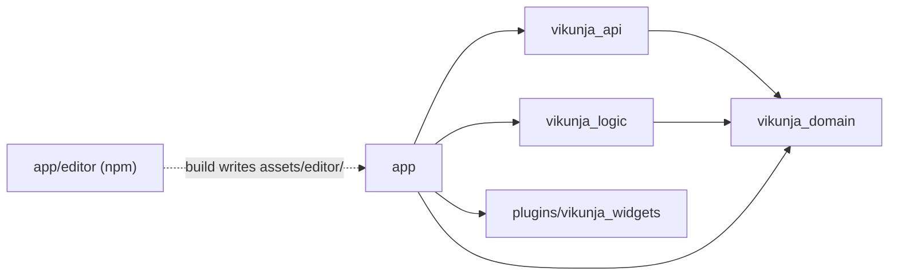
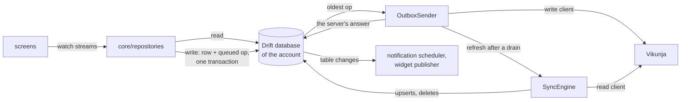

# Architecture

How the app is built, for a maintainer who is new to it. This describes the design as it is. Why each part is as it is lives in [decisions.md](decisions.md): the D numbers below link there. What each roadmap step built, in full detail with the reasons of the day, is in [archive/architecture-by-step.md](archive/architecture-by-step.md); the research it started from is in [research/synthesis.md](research/synthesis.md). A code comment that cites "architecture §" with a section number means a section of the archive.

## 1. Principles

1. **The local database is the single source of truth for the UI.** Screens read database streams. The network only feeds the database ([D29](decisions.md#d29-screens-read-and-write-through-repository-interfaces), [D31](decisions.md#d31-one-drift-sqlite-file-per-account-shared-across-isolates)).
2. **One domain-level API, two transports.** `/api/v1` and `/api/v2` sit behind the same ports. The adapter is chosen from the server's negotiated capabilities, never from a version string.
3. **Every task write goes through the outbox, even when online.** The UI, notification actions and widgets share one retry, ordering and conflict path ([D34](decisions.md#d34-outbox-local-first-task-writes-one-serial-sender-coalescing-retry-classes)). The few areas that are online only are listed in section 5.4.
4. **Every entry point builds the same object graph** in a Riverpod `ProviderContainer`: the UI, the background task, the notification-action isolate and the Android widget worker (section 6).
5. **Secrets live only in the Keychain or Keystore.** Extensions, widgets and the notification-action isolate never refresh a user's tokens; a guest's token may be renewed there, and a guest is signed in again at most once. The description editor's WebView gets no token and loads nothing from the network.
6. **Pure logic lives in pure-Dart packages** and is pinned by test vectors, many ported from the web frontend's own tests.

## 2. The repository

A Dart pub workspace with one shared lockfile ([D1](decisions.md#d1-flutter-pub-workspace-with-pure-dart-packages)).

| Path | Kind | What it holds |
|---|---|---|
| `app/` | Flutter app (Dart package `vikunja_mobile`) | Everything the user sees, the database, sync, outbox, notifications, background work, widgets' Dart side. Android and iOS projects under `app/android/` and `app/ios/`. |
| `app/editor/` | npm package, outside the workspace | The TipTap description editor. Its build, `app/assets/editor/editor.html`, is committed, so a Flutter build needs no Node (section 7). |
| `packages/vikunja_domain` | pure Dart | Entities (`Task`, `Project`, …), change objects (`TaskChanges`, `NewTask`), `ServerCapabilities`, the failure types. No I/O. |
| `packages/vikunja_api` | pure Dart | The server connection: address checks, `/info` negotiation, the read and write clients over v1 and v2, the JSON codecs, OAuth with PKCE, error normalisation, the realtime socket. |
| `packages/vikunja_logic` | pure Dart | What the web computes and the app must compute the same way: the Quick Add grammar, date math and presets, list sorts and the subtask tree, the filter language and its evaluation, the rich-text parser, link rules. |
| `plugins/vikunja_widgets` | Flutter plugin (Dart, Kotlin, Swift) | The file and redraw bridge to the home-screen widgets (section 6.4). |
| `test_servers/` | Docker Compose | A local Vikunja (the latest release, pinned by digest), also behind TLS, for the contract tests. |
| `tool/`, `tool/ci/` | shell and Python | Every check CI runs, runnable locally: `checks.sh`, `test.sh`, `contract.sh`, `android.sh`, `ios.sh`, the release scripts. See [CONTRIBUTING.md](../CONTRIBUTING.md). |

**The dependency rule:**



- `vikunja_logic` never uses `vikunja_api`.
- Nothing under `packages/*/lib` depends on Flutter, directly or through a dependency; `tool/check_pure_dart_packages.sh` enforces it.
- The app's own code uses `material_ui` and `cupertino_ui`, never the SDK's widget libraries ([D2](decisions.md#d2-material_ui-and-cupertino_ui-instead-of-the-sdks-libraries)).

## 3. Inside the app

```
app/lib/
  main.dart        the UI entry point: calls bootstrap()
  bootstrap/       builds the UI's ProviderContainer, loads the start state, starts the long-lived listeners
  app/             the app widget, router (go_router), theme, shared widgets, layout
  core/            everything below the screens, shared by every feature and entry point
  features/<name>/ one area of the app: presentation/ (widgets) and application/ (Riverpod providers, controllers)
  l10n/            ARB files; English is the source
```

**Layers:** presentation → application → repositories → DAOs and `vikunja_api` ports. The UI never imports wire DTOs or API adapters. Two exceptions are intended: onboarding and session code call `vikunja_api` directly because they run before an account exists, and `core/widgets/` reuses feature code (grouping, formatting) to build the widgets' texts exactly as the screens show them.

**Riverpod** with code generation ([D3](decisions.md#d3-riverpod-3-with-code-generation)); the generated `*.g.dart` files are committed and CI checks that they are current. A provider no one listens to is paused, its `ref.listen` included, so the providers that must react while no screen shows them are kept alive by `container.listen` in `bootstrap.dart`.

**Routing** with go_router ([D4](decisions.md#d4-go_router)). Screens that belong to one account are bound to it (`account_bound_screen.dart`); switching the account resets the navigation.

**The important parts of `core/`:**

| Folder | Role |
|---|---|
| `auth/` | Browser sign-in, token store, account registry, session manager, link-share guests, sign-out. Section 4. |
| `network/` | Dio factory, connection settings per server address, certificates. Section 4.3. |
| `db/` | The Drift database per account: tables, DAOs, mappers. Section 5.1. |
| `sync/` | The sync engine and its status. Section 5.2. |
| `outbox/` | The task write path. Section 5.3. |
| `repositories/` | The interfaces the screens use; `local/` backs them by the database and outbox, `online/` by the server alone. |
| `notifications/`, `background/`, `activity/`, `realtime/`, `widgets/` | Work outside the screens. Section 6. |
| `filters/` | The filter language evaluated on the device ([D51](decisions.md#d51-filter-engine-on-the-device-saved-filters-filter-builder-offline-search)). |
| `attachments/`, `files/`, `share/` | Attachment images and downloads, the platform's file pickers, the Android share target ([D53](decisions.md#d53-attachments-uploaded-through-the-outbox-opened-through-the-platform-android-share-target)). |
| `security/`, `logging/`, `storage/` | App lock and screen protection ([D64](decisions.md#d64-app-lock-over-the-ui-and-device-privacy-settings)), logging that redacts secrets and personal data, local preferences. |

## 4. Server, accounts and sessions

### 4.1 Connecting

`ServerConnector.connect` normalises the address the user typed, reads `/info`, and turns the version and the advertised features into `ServerCapabilities`, which pick the v1 or v2 adapter and switch features on or off. A link share or invite link is recognised first, and only its base is probed, never the link with its secret.

### 4.2 Accounts and tokens

- **Sign-in** is browser OAuth 2.0 with PKCE only, in an ephemeral browser session, so local, LDAP, OIDC and two-factor accounts all sign in through the server's own web login; the app never handles a password ([D14](decisions.md#d14-browser-sign-in-only), [D23](decisions.md#d23-browser-sign-in-through-flutter_web_auth_2-in-an-ephemeral-session)).
- **A link-share guest** is a second account kind: signed in with the link's hash and, for a protected share, its password, which is stored only when the user chooses to remember it ([D62](decisions.md#d62-onboarding-through-the-browser-link-share-guests-as-an-account-kind)).
- **Tokens** are in secure storage, readable after the first unlock so background work can use them ([D24](decisions.md#d24-tokens-in-secure-storage-readable-after-the-first-unlock)). The account registry, without secrets, is in SharedPreferences ([D25](decisions.md#d25-account-registry-in-sharedpreferences-without-secrets)).
- **Refresh:** Vikunja rotates the refresh token on every refresh without a grace period, so `SessionManager` refreshes single-flight, re-reads the stored tokens before it refreshes and adopts what another isolate wrote ([D26](decisions.md#d26-refresh-concurrency-single-flight-re-read-and-adopt-write-ahead-epoch)). A session the server ended marks the account as needing a new sign-in; its local data stays.
- **Keep-alive:** every sync starts with a request that refreshes an access token about to expire, so the background sync keeps a session alive; a local notification asks the user to open the app before a session would run out unused ([D22](decisions.md#d22-session-keep-alive-through-background-sync)).
- **Several accounts:** each has its own database, scheduler, outbox and sync. One account is active in the UI; the others still sync in the background and keep their notifications.

### 4.3 Network

`vikunja_api` receives a configured `Dio` and never picks a transport itself ([D5](decisions.md#d5-dio-with-native_dio_adapter-and-embedded-cronet)):

- On Android requests go through an embedded Cronet, on iOS through NSURLSession, both through `native_dio_adapter`, so the system's certificate store and proxy apply.
- `NetworkProfileAdapter` applies the connection settings a user set for a server address (extra headers, a pinned certificate, a private CA, a client certificate). Addresses with a pin, a CA or a client certificate go through `dart:io`, one adapter per address; header values and keys never reach an interceptor.
- The realtime WebSocket runs on `dart:io`; on Android it gets the user-installed CAs and the system proxy through a platform channel.
- Tests use dio's default `dart:io` adapter.

## 5. Data



### 5.1 Database

One Drift SQLite file per account, opened by every isolate that works for that account ([D31](decisions.md#d31-one-drift-sqlite-file-per-account-shared-across-isolates)). Signing out deletes it.

- Keys are the server's ids. A task created on the device has a negative temporary id until its create is sent; `task_id_remaps` lets a screen follow it to the server's id ([D35](decisions.md#d35-task-creates-through-the-outbox-under-temporary-negative-ids)).
- Dates are UTC epoch milliseconds; every row keeps the server's `created` and `updated`.
- Besides the server's entities there are the `outbox`, `list_snapshots` (the server's order for lists the device cannot compute), `scheduled_notifications` (what the OS was last given), `server_notifications` (the inbox), `imported_widget_actions` and `sync_state` (the sync's watermark and checkpoint, user settings, saved filters).
- `schemaVersion` is 1 since the first public release. Every schema change bumps it, adds a migration and a new schema dump under `app/drift_schemas/`, from which drift_dev generates the migration tests' schemas (see the [README](../README.md)).

### 5.2 Sync

`DefaultSyncEngine` is one headless object per account, without Riverpod or a `BuildContext` inside, so the background isolate runs the same code. Runs are serialised per account; a lease in the database keeps two isolates from syncing one account at once.

- **The full pull** reads the user and settings, all projects with views, labels, then every task by an id cursor, and purges what the server no longer has. It is resumable from a checkpoint and runs at the first sign-in, on "Full resync" and once a day.
- **The incremental run** asks only for tasks `updated` since a watermark (with an overlap), and finds deletes by comparing counts ([D33](decisions.md#d33-incremental-sync-from-an-updated-watermark-deletes-found-by-counts)).
- **Triggers:** the foreground scheduler (every minute while the app is used, backing off to five minutes while nothing changes, [D99](decisions.md#d99-battery-and-data)), a drained outbox, a realtime event, the background task, and pull-to-refresh or "Sync now".
- Saved filters and view filters are evaluated on the device from the database, so they work offline; a filter the device cannot evaluate falls back to the server's list, stored as a snapshot ([D51](decisions.md#d51-filter-engine-on-the-device-saved-filters-filter-builder-offline-search)).
- `SyncStatus` (never run, running, idle, failed) drives the first-sync screen and the quiet indicator; rows from earlier runs stay readable after a failure.

### 5.3 Outbox

A task write changes the local row and queues an op in the same transaction, so it is on screen at once, offline too ([D34](decisions.md#d34-outbox-local-first-task-writes-one-serial-sender-coalescing-retry-classes)).

- **Coalescing:** a newer change to a task merges into its queued update; `pending_changes` on the row holds what the server has not accepted, and a sync never overwrites it.
- **One serial sender per account** sends the oldest op through the write client: v2 as a merge-patch, v1 by reading the task and posting it whole. The server's answer replaces the row, except fields a newer op still holds. A create inserts the task under the server's id and records the remap.
- **Retries** fall into three classes: waiting for what is not the server's word (network, rate limit, session), counted failures with a backoff, and failures that become a sync problem at once. Sync problems are listed in the Account tab, where the user retries, discards or, for a conflicting description, chooses a version.
- **Uploads** run in a lane of their own beside the serial queue, at most 50 MiB per file.
- **Descriptions** are sent with the version they were edited from and checked against the server's first, so neither side's edit is silently overwritten ([D52](decisions.md#d52-descriptions-edited-in-a-locked-down-tiptap-webview-never-silently-overwritten)).

### 5.4 Online-only areas

These writes go straight to the server and are applied to the database from its answer, so they need a connection: projects, views and kanban columns, saved filters, labels, comments and reactions, attachment deletes and the cover, restores from the trash, account settings and the avatar. Some are never stored at all: security settings (two-factor status, sessions, API tokens), teams, a project's shares and the trash.

## 6. Work outside the screens

Each entry point builds its own `ProviderContainer` from the same providers:

| Entry point | Started by | Does |
|---|---|---|
| `main()` → `bootstrap()` | the user | the UI, the foreground sync, realtime, the notification scheduler, the widget publisher |
| `callbackDispatcher()` | WorkManager (Android), BGTaskScheduler (iOS) | the background sync of every account |
| `onNotificationActionInBackground()` | a notification action while the app is not running | Done or snooze, through the outbox |
| `widgetActionsMain()` | the Android widget worker | imports a widget's Done taps into the outbox |

Background containers never send queued uploads; those are left to the UI.

### 6.1 Local notifications

The server sends no push to phones, so the app schedules reminders and due dates itself from the database ([D17](decisions.md#d17-notification-policy), [D39](decisions.md#d39-local-notifications-a-scheduler-per-account-with-a-rolling-window)). A scheduler per account diffs the soonest notifications against `scheduled_notifications` and hands the OS only the difference. iOS allows 64 pending notifications per app, so the accounts share 60 there; Android gets 100 per account. Actions are Done, snooze for an hour and snooze until tomorrow, on iOS also snooze for ten minutes; a Done runs through the outbox, in the background isolate when the app is closed.

### 6.2 Background sync and the inbox

One periodic job (about every 30 minutes, as the OS allows) runs for every signed-in account: drain the outbox, sync incrementally, reconcile the notification schedule and read the server's notifications into the inbox, showing new ones as OS notifications ([D40](decisions.md#d40-background-sync-of-every-account-server-notifications-in-an-inbox)).

### 6.3 Realtime

While the app is in front, the active account keeps one WebSocket to the server's `/ws` when the server supports it ([D46](decisions.md#d46-realtime-one-websocket-for-the-active-account-in-the-foreground)). A pushed notification lands in the inbox within a second, and the task it names is synced right after.

### 6.4 Home-screen widgets

Dart builds every text of a widget from the account's database and writes small JSON files through `plugins/vikunja_widgets`; Glance (Android) and a WidgetKit extension (iOS) only draw them and record taps. A Done tap comes back to Dart and enters the outbox exactly once. Nothing native talks to the server or holds a token ([D63](decisions.md#d63-home-screen-widgets-app-written-snapshots-glance-on-android-widgetkit-on-ios)).

## 7. Description editor

Descriptions are edited in the web's own editor, TipTap, so the HTML stays what the web writes ([D52](decisions.md#d52-descriptions-edited-in-a-locked-down-tiptap-webview-never-silently-overwritten)).

- `app/editor/` builds one self-contained page with a strict content security policy; the WebView loads nothing from the network and gets no token.
- The app and the page talk through one JavaScript channel with a token new for every load; `editor_protocol.dart` defines the messages, `bridge.js` the page's side.
- The page asks for its attachment images by URL; the app loads them with the account's session and sends them back as `data:` URLs.
- Reading a task does not use the WebView: `vikunja_logic` parses the stored HTML and Flutter renders it.

## 8. Cross-cutting

- **Localisation:** English ARB strings are the source; other languages come through Vikunja's Crowdin project, and contributors change only the English ([D88](decisions.md#d88-translations-through-vikunjas-crowdin-project)).
- **Logging:** `package:logging` throughout. A record is redacted when it is made; the diagnostics log the user can add to a support request keeps warnings and errors, an error only by its type and a stack only by the app's own frames.
- **Privacy:** app lock and screen protection over the UI, lock-screen privacy for notifications, the app's folders kept out of backups ([D64](decisions.md#d64-app-lock-over-the-ui-and-device-privacy-settings)).
- **Licence:** MIT, with Vikunja's contribution rules ([D87](decisions.md#d87-mit-vikunjas-contribution-rules-and-the-move-into-go-vikunjaapp)); the AGPL code of Vikunja's server and web is read for its behaviour only.

## 9. Tests

| Kind | Where | Runs |
|---|---|---|
| Unit and widget tests | `app/test/`, `packages/*/test/` | `tool/ci/test.sh` |
| Contract tests against a real server | `packages/vikunja_api/test/contract/`, `app/test/contract/` (tag `contract`) | `tool/ci/contract.sh`, with `test_servers/` |
| Editor page tests | `app/editor/test/` | `tool/ci/editor.sh` |
| Format, analysis, generated code, the pure-Dart rule, licence notices, the scripts' own tests | `tool/`, `tool/ci/` | `tool/ci/checks.sh` |
| Builds | | `tool/ci/android.sh`, `tool/ci/ios.sh` |

Test vectors ported from the web pin the shared logic. Accessibility tests live under `app/test/a11y/` and `app/test/app/`, a large-account performance test under `app/test/performance/`.

## 10. Where to start

- **A new task field:** the domain entity and `TaskChanges` (`vikunja_domain`), both codecs and both write adapters (`vikunja_api`, with a contract test), the `tasks` table with a migration, the mappers, the outbox payload JSON, then the UI.
- **A new screen on stored data:** a repository method that returns a stream from a DAO, a provider in the feature's `application/`, the widget in `presentation/`.
- **A new online-only action:** a port in `vikunja_api`, an online repository in `core/repositories/online/`, and a local write of the server's answer so the screens update.
- Before changing behaviour, search [decisions.md](decisions.md) for the decision behind it; entries marked "(owner)" are the owner's and are not reversed without asking.
