# Architecture

This is the current, condensed architecture. It is derived from [research/synthesis.md](research/synthesis.md) §2, which has the full reasoning and the Vikunja source references. Status markers:

- **[exists]**: built in step 1, in the combined step 2+3 (HTTP core, browser sign-in, session manager), in step 5 (read client, repository interfaces, the first screens), in step 6 (the Drift database per account, the local repositories, the initial sync), in step 7 (the incremental sync with delete reconciliation, its triggers, the full resync), in step 11 (the outbox, the serial sender, the task write ports and the first mutations: done with undo, favourite, delete), in step 12a (creates through the outbox with temporary ids and the remap, the remaining core properties of `TaskChanges`, the edit page and the new-task sheet), in step 12b (labels and assignees as id-set deltas in `TaskChanges`, sent through the task's label and assignee endpoints; reminders as the whole list; the label create and the project user search; the Labels, Assignees and Reminders sections of the edit page with their pickers), in step 4 (the account switcher sheet behind an avatar button, the Accounts section of the Account tab, adding an account through the Connect screen, the switch transition, the recency order in the account registry, removing any account, the drain of inactive accounts' outboxes) in step 13 (the `vikunja_logic` package with the Quick Add Magic parser, the day intervals and the default time; the user settings read with the account in the sync; `QuickAddService`; the composer in the new-task sheet; the "New task" app shortcut and quick action), in step 15 (`core/notifications/`: the plan and the diff, the scheduler per signed-in account, the `scheduled_notifications` table of schema version 4, the gateway over flutter_local_notifications, the background action isolate for Done and Snooze; `features/notifications/`: the setup screen, the Notifications section of the Account tab, the tap listener; the Android and iOS notification configuration), in step 16 (`core/background/`: the periodic job for every signed-in account over workmanager, the runner with its deadline and heartbeat skip, the drain after a background Done; `core/activity/`: the activity sync and the notifier; the `server_notifications` table of schema version 5; the notifications ports in `vikunja_api` and `ServerNotification` in `vikunja_domain`; `features/inbox/`: the inbox and the bell with its badge; the Activity switch, the background line and the activity and session taps; the workmanager setup on Android and iOS) or in step 14 (`RelationChange` and `TaskRelationRef` in `TaskChanges` and `Subscription` in `vikunja_domain`; relation changes in `TasksWritePort.update`, `duplicate`, `SubscriptionsPort` and `SubscriptionsWritePort` in `vikunja_api`; `parseSubtasksViaIndention` in `vikunja_logic`; relation deltas in the outbox with temporary ids at both ends of an edge and the inverse rows, `duplicateTask`, `SubscriptionRepository`, quick add's subtasks by indentation; the Subtasks, Parent and Related sections of the detail sheet, the add-relation sheet, Duplicate and the follow toggle).
- **[in review, step 9]**: built in step 9 and in review (`evaluateDatemath`, `DateRangePreset`, `selectUpcoming`, `showsAtTopLevel` and `buildTaskTree`, `TaskListSort` and `compareTasksForList`, `classifyViewFilter` and `checklistStatistics` in `vikunja_logic`; `AvatarsPort` and the settings `filter_id_used_on_overview` and `minimum_priority` in `vikunja_api`; the `list_snapshots`, `list_snapshot_tasks` and `list_preferences` tables of schema version 6 with their DAOs, `watchActiveOpenTasks`, `watchOverviewTasks`, `watchProjectList` and `refreshProjectList` on `TaskRepository` in place of the paged project list, `ListPreferences`, the saved filters and the download of the Overview's saved filter in the sync, the avatar cache in `core/avatar/`; the Upcoming tab, the Overview's saved filter, the project screen per list view and the web's task row).
- **[in review, step 10]**: built in step 10 and in review (`parseRichText` with `RichDocument`, `parseTaskIdFromUrl`, `parseTaskReference` and the task deep links, `parseAttachmentUrl`, the attachment preview rules and `humanSize` in `vikunja_logic`; `TaskAttachment`, `TaskComment`, `Reactions`, `TaskDetails` and `CommentSortOrder` in `vikunja_domain`; `TasksPort.readDetails` and `readByIndex`, `CommentsPort`, `AttachmentsPort`, `TasksWritePort.markRead` and the setting `comment_sort_order` in `vikunja_api`; `TaskDetailsRepository`, `TaskResolver`, the attachment image cache in `core/attachments/` and the deep-link relay in `core/links/`; the rewritten task detail sheet with the rich-text renderer, `TaskOpener` and the deep links on the app's scheme with their Android and iOS configuration).
- **[planned, step N]**: designed, not built. N is the [roadmap](roadmap.md) step.

This page reflects the owner's decisions of 2026-10-09 ([D13](decisions.md#d13-support-floor-230)–[D22](decisions.md#d22-session-keep-alive-through-background-sync)), the step 2+3 decisions ([D23](decisions.md#d23-browser-sign-in-through-flutter_web_auth_2-client-id-and-redirect-uri)–[D27](decisions.md#d27-paging-and-the-query-builder-move-to-step-5)) the step 5 decisions ([D29](decisions.md#d29-ui-reads-through-repository-interfaces-the-online-implementation-is-replaced-by-drift-in-step-6-without-ui-changes), [D30](decisions.md#d30-kanban-board-reads-deferred-to-step-20)) the step 6 decisions ([D31](decisions.md#d31-one-drift-sqlite-file-per-account-shared-across-isolates-deleted-on-sign-out), [D32](decisions.md#d32-initial-sync-by-keyset-paging-with-per-page-checkpoints-full-re-pull-as-refresh-until-step-7)) the step 7 decision ([D33](decisions.md#d33-incremental-sync-watermark-on-updated-with-a-120-s-overlap-keyset-over-updated-id-delete-detection-by-per-project-count-check-and-id-reconcile-daily-full-resync)), the step 11 decision ([D34](decisions.md#d34-outbox-local-first-writes-serial-sender-coalescing-retry-classes-sync-interplay-pending-fields-win-until-sent-pending-deletes-hidden-v1-full-replace-emulation)), the step 12a decision ([D35](decisions.md#d35-creates-through-the-outbox-temporary-negative-ids-with-remap-createupdatedelete-coalescing-lost-response-recovery-by-title-within-a-1-h-window)), the step 12b decision ([D36](decisions.md#d36-labels-and-assignees-as-id-set-deltas-in-the-task-update-sent-through-their-endpoints-after-a-read-before-write-diff-reminders-as-the-whole-list-label-creation-online-only)), the step 4 decision ([D37](decisions.md#d37-account-switcher-a-sheet-from-an-avatar-button-and-an-accounts-section-a-switch-resets-the-navigation-the-most-recently-active-account-follows-a-removal-inactive-outboxes-drain-in-the-foreground)) the step 13 decision ([D38](decisions.md#d38-quick-add-the-web-grammar-in-vikunja_logic-with-d19s-fixes-weekday-and-ordinal-dates-at-the-default-time-and-an-unknown-project-kept-in-the-title-a-live-composer-labels-created-online-and-assignees-looked-up-on-submit-the-task-through-the-outbox)) the step 15 decision ([D39](decisions.md#d39-local-notifications-a-scheduler-per-signed-in-account-plans-from-the-local-database-and-diffs-against-a-rolling-window-with-stable-keys-exact-alarms-when-allowed-done-through-the-outbox-from-a-background-isolate-without-a-token-refresh-snooze-local-only-permissions-asked-once-after-the-first-sync)), the step 16 decision ([D40](decisions.md#d40-background-sync-one-periodic-job-for-every-signed-in-account-with-a-deadline-skipped-while-the-app-is-in-front-the-incremental-run-as-the-session-keep-alive-a-one-off-drain-after-a-background-done-server-notifications-synced-into-a-local-inbox-on-their-own-cadence-new-unread-ones-as-activity-notifications-the-first-run-silent)), the step 14 decision ([D41](decisions.md#d41-relations-as-deltas-in-the-task-update-sent-through-the-relation-endpoints-after-a-read-before-write-diff-temporary-ids-on-both-ends-resolved-at-send-time-the-inverse-rows-kept-locally-duplicate-and-subscriptions-online-only-subtasks-from-indented-quick-add-lines)), the step 9 decision ([D43](decisions.md#d43-task-lists-from-the-local-database-like-the-webs-a-view-snapshot-for-positions-and-server-only-filters-the-overviews-saved-filter-downloaded-by-the-sync-upcoming-with-the-web-presets-and-a-pinned-overdue-part)) and the step 10 decision ([D44](decisions.md#d44-task-detail-complete-rich-text-from-an-own-parser-of-the-web-editors-schema-details-and-comments-online-on-demand-deep-links-on-the-app-scheme)).

## 1. Principles

1. **The local database is the single source of truth for the UI.** Screens read database streams. The network only feeds the database. [repository interfaces with streams exist, step 5; the database and the initial sync behind them exist, step 6 ([D29](decisions.md#d29-ui-reads-through-repository-interfaces-the-online-implementation-is-replaced-by-drift-in-step-6-without-ui-changes), [D31](decisions.md#d31-one-drift-sqlite-file-per-account-shared-across-isolates-deleted-on-sign-out)); the incremental sync exists, step 7 ([D33](decisions.md#d33-incremental-sync-watermark-on-updated-with-a-120-s-overlap-keyset-over-updated-id-delete-detection-by-per-project-count-check-and-id-reconcile-daily-full-resync)); the first writes change the same database before the server hears of them, step 11 ([D34](decisions.md#d34-outbox-local-first-writes-serial-sender-coalescing-retry-classes-sync-interplay-pending-fields-win-until-sent-pending-deletes-hidden-v1-full-replace-emulation)); a created task lives in it under a temporary id until the server has assigned one, step 12a ([D35](decisions.md#d35-creates-through-the-outbox-temporary-negative-ids-with-remap-createupdatedelete-coalescing-lost-response-recovery-by-title-within-a-1-h-window)); the lists build the web's nesting and order from it, with downloaded snapshots for a view's positions and for filters the device cannot evaluate, step 9, in review ([D43](decisions.md#d43-task-lists-from-the-local-database-like-the-webs-a-view-snapshot-for-positions-and-server-only-filters-the-overviews-saved-filter-downloaded-by-the-sync-upcoming-with-the-web-presets-and-a-pinned-overdue-part)); what only a single task read carries (attachments, reactions, comments, the unread flag) is read online when the detail sheet asks for it and never stored, step 10, in review ([D44](decisions.md#d44-task-detail-complete-rich-text-from-an-own-parser-of-the-web-editors-schema-details-and-comments-online-on-demand-deep-links-on-the-app-scheme))]
2. **One domain-level API interface, two transport adapters** (`/api/v1`, `/api/v2`). The adapter is chosen from the negotiated **capabilities**, never from a version string. [negotiation, error model, authenticated transport, read client and the task write adapters exist, creates included (step 12a), and so do the label and assignee requests of the update, the label create and the project user search (step 12b), the server notification ports (step 16), the relation requests of the update, duplicate and the subscription ports (step 14), the avatar port (step 9, in review) and the task details, by-index, comment, attachment and mark-read requests (step 10, in review); the routed client with route-absent downgrade planned]
3. **Every mutation goes through the outbox, even when online.** The UI, notification actions and widgets share one retry, ordering and conflict path. [exists, step 11: the outbox, the sender and the task writes of the UI ([D34](decisions.md#d34-outbox-local-first-writes-serial-sender-coalescing-retry-classes-sync-interplay-pending-fields-win-until-sent-pending-deletes-hidden-v1-full-replace-emulation), section 7.5); creates through the same outbox since step 12a ([D35](decisions.md#d35-creates-through-the-outbox-temporary-negative-ids-with-remap-createupdatedelete-coalescing-lost-response-recovery-by-title-within-a-1-h-window)); labels, assignees and reminders through it since step 12b ([D36](decisions.md#d36-labels-and-assignees-as-id-set-deltas-in-the-task-update-sent-through-their-endpoints-after-a-read-before-write-diff-reminders-as-the-whole-list-label-creation-online-only)); the Done of a notification goes through it from a background isolate since step 15 ([D39](decisions.md#d39-local-notifications-a-scheduler-per-signed-in-account-plans-from-the-local-database-and-diffs-against-a-rolling-window-with-stable-keys-exact-alarms-when-allowed-done-through-the-outbox-from-a-background-isolate-without-a-token-refresh-snooze-local-only-permissions-asked-once-after-the-first-sync), section 7.7), and the background runs drain it for every account since step 16 (section 7.8); relation changes go through it as deltas of the task update since step 14 ([D41](decisions.md#d41-relations-as-deltas-in-the-task-update-sent-through-the-relation-endpoints-after-a-read-before-write-diff-temporary-ids-on-both-ends-resolved-at-send-time-the-inverse-rows-kept-locally-duplicate-and-subscriptions-online-only-subtasks-from-indented-quick-add-lines), section 7.5); the widget actions follow in steps 18–19]
4. **Every entry point builds the same object graph** with a Riverpod `ProviderContainer`. The entry points are the UI isolate, background tasks, the notification-action isolate and the widget callback. [UI exists, and the step 6 sync engine runs without a widget tree; the notification-action isolate builds the same container since step 15 (section 5.8); the background tasks do too since step 16 (sections 5.8 and 7.8); the widget callback is planned, steps 18–19]
5. **Secrets live only in the Keychain/Keystore.** Extensions, widgets and the notification-action isolate never refresh tokens. [exists; the action isolate's "no refresh" rule since step 15 (section 5.8); the background sync isolate of step 16 does refresh, through the same session manager, because its runs are the keep-alive (section 5.8, [D40](decisions.md#d40-background-sync-one-periodic-job-for-every-signed-in-account-with-a-deadline-skipped-while-the-app-is-in-front-the-incremental-run-as-the-session-keep-alive-a-one-off-drain-after-a-background-done-server-notifications-synced-into-a-local-inbox-on-their-own-cadence-new-unread-ones-as-activity-notifications-the-first-run-silent))]
6. **Pure logic lives in pure-Dart packages** and is pinned by test vectors, many ported from the web frontend's tests. [exists for domain, api and, since step 13, `vikunja_logic` with the quick-add parser ([D38](decisions.md#d38-quick-add-the-web-grammar-in-vikunja_logic-with-d19s-fixes-weekday-and-ordinal-dates-at-the-default-time-and-an-unknown-project-kept-in-the-title-a-live-composer-labels-created-online-and-assignees-looked-up-on-submit-the-task-through-the-outbox)), to which step 9 (in review) adds the list logic: the server's date math, the web's date-range presets, the Upcoming selection, the List view's subtask tree and sorts, the view filter classes and the checklist counts ([D43](decisions.md#d43-task-lists-from-the-local-database-like-the-webs-a-view-snapshot-for-positions-and-server-only-filters-the-overviews-saved-filter-downloaded-by-the-sync-upcoming-with-the-web-presets-and-a-pinned-overdue-part)), and step 10 (in review) the rich-text parser of the web editor's schema, pinned by an oracle of the web's own output, and the task link, task reference, deep link, attachment URL and attachment preview rules ([D44](decisions.md#d44-task-detail-complete-rich-text-from-an-own-parser-of-the-web-editors-schema-details-and-comments-online-on-demand-deep-links-on-the-app-scheme))]

## 2. Workspace packages and the dependency rule

The repository is a Dart pub workspace with one shared lockfile.

| Package | Kind | Exists (steps 1, 2+3, 4, 5, 6, 7, 11, 12a, 12b and 13 to 16) | In review, step 9 | In review, step 10 | Planned |
|---|---|---|---|---|---|
| `app/` | Flutter | the "Connect to server" feature (connect, server overview); `core/auth/` (token store, account registry, session manager, browser sign-in, sign-out); router guards; theming, en/de localisation, redacting logging; `core/repositories/` (`ProjectRepository`, `TaskRepository`); `/home` as a tab shell: Overview, Projects (tree, project tasks, task detail), Account; `core/db/` (`AppDatabase`, tables, DAOs, mappers, `AccountDatabaseFiles`), `core/sync/` (`SyncEngine`, `SyncStatus`, `DefaultSyncEngine`), `core/repositories/local/`; the first-sync screen, the quiet sync indicator, "last synced" and "Sync now" in the Account tab, database deletion on sign-out; the incremental `refresh()` and `fullResync()` in `core/sync/`, `ForegroundSyncScheduler` in `features/sync/application/`, "Full resync" in the Account tab; `core/outbox/` (the `outbox` table and the `pending_*` task columns of schema version 2, `OutboxSender`, `SyncProblem`), the write methods of `TaskRepository`, done with Undo and the favourite star on the rows, done, favourite and Delete in the task detail sheet, "Pending changes" with "Send now" and the "Sync problems" list in the Account tab; the create path: `createTask`, `updateTask` and `watchTask` on `TaskRepository`, temporary negative task ids, the `task_id_remaps` table of schema version 3, the create op and the lost-response lookup in `OutboxSender`; the edit page and the new-task sheet in `features/tasks/presentation/`, the FABs on the Overview and on a project's list, Edit in the detail sheet; `LabelRepository` and `UserRepository` in `core/repositories/` (`LocalLabelRepository`, `LocalUserRepository`, `labelRepositoryProvider`, `userRepositoryProvider`); label, assignee and reminder changes on the task's child rows in the outbox DAO, in `completeCreate` and in the sync overlay; `undoDone` restoring reminders; the Labels, Assignees and Reminders sections of the edit page, the label picker, the people picker and the reminder sheet in `features/tasks/presentation/pickers/`; `features/accounts/` (`AccountSwitcher`, `accountPendingChangesProvider`, the account switcher sheet), the avatar button on the Overview and Projects app bars and the Accounts section of the Account tab, the recency order in `AccountRegistry`, `isNewAccount` on `SignInSucceeded` and the adding mode of the Connect screen, the switch transition (the previous account's routes closed, the tabs reset), the drain of inactive accounts' outboxes in `features/sync/application/` (step 4); `features/quick_add/` (`QuickAddService` with `plan` and `submit`, `quickAddServiceProvider`; the composer in the new-task sheet: the highlighting title field, the preview chips, the suggestions, the prefix toolbar and the help sheet), `core/settings/` (`userSettingsProvider`) and the user settings stored by the sync's account phase, `defaultProjectFor` with the user's default project, `date_shortcuts.dart` delegating to `vikunja_logic`, the "New task" app shortcut and quick action (`AppShortcuts` in `core/platform/` over `quick_actions`) (step 13); `core/notifications/` (`planNotifications` and `diffSchedule`, `NotificationScheduler` per signed-in account with its keep-alive provider, the `scheduled_notifications` table and DAO of schema version 4, `LocalNotificationGateway` over flutter_local_notifications, `NotificationPreferencesStore` over the preferences, `handleNotificationAction` with its `@pragma('vm:entry-point')` entry point, the account wiper cancelling the account's ids); `features/notifications/` (the setup screen at `/notifications-setup`, the Notifications section of the Account tab, the tap listener); the Android manifest, Gradle and iOS `AppDelegate` configuration for notifications (step 15); `core/background/` (`BackgroundScheduler` with `WorkmanagerBackgroundScheduler`, the `callbackDispatcher` entry point, `BackgroundSyncRunner` with its deadline and the foreground heartbeat skip); `core/activity/` (`ActivitySync`, `ActivityNotifier`); the `server_notifications` table and DAO of schema version 5; `LocalActivityRepository` and its providers in `core/repositories/`; `showActivity` and the `activity` channel in `LocalNotificationGateway`, the `activity` preference, the background drain from the action handler; `features/inbox/` (the inbox at `/home/inbox`, the bell with its unread badge on the Overview), the Activity switch and the background line on the Account tab, the activity and session taps; the workmanager setup in the Android and iOS projects (step 16); relation deltas in the outbox (the `relations` payload JSON, the local apply with the inverse rows on a local other task, relation refs resolved through the remap at send time and rewritten by `completeCreate`, the sync overlay of pending relation deltas), `duplicateTask` in `LocalTaskRepository`, `SubscriptionRepository` with `LocalSubscriptionRepository` and its providers, quick add's subtasks by indentation in `QuickAddService.submit`; in the task detail sheet the Subtasks, Parent and Related sections, the add-relation sheet, Duplicate in its overflow and the follow toggle in its header, the follow toggle in a project's overflow, the tree in the multi-line preview's count (step 14) | `core/db/`: the `list_snapshots`, `list_snapshot_tasks` and `list_preferences` tables of schema version 6 (`tables/lists.dart`), `ListSnapshotsDao`, `ListPreferencesDao`, `TasksDao.watchActiveOpenTasks`, `watchOpenTasksInList` and `watchProjectList`, relations hydrated in the order they were stored; `TaskRepository.watchActiveOpenTasks`, `watchOverviewTasks`, `watchProjectList` and `refreshProjectList` with `OverviewTasks`, `ListSnapshot` and `ProjectListSource` (`task_lists.dart`) in place of `watchProjectTasks`, `refreshProjectTasks`, `loadMoreProjectTasks` and `PagedList`, `SharedLatest`; `ListPreferences` with `LocalListPreferences` and its providers; in `core/sync/` the saved filters of the project list in `sync_state` (`saved_filters.dart`) and the downloads of the Overview's saved filter and of a view (`list_downloads.dart`); `core/avatar/` (`AvatarCache`, `accountAvatarCacheProvider`); `features/upcoming/` (the Upcoming tab at `/home/upcoming`: the range button, the preset sheet, the custom day range, the overdue and without-date switches, the sections); the Overview over `overviewTasksProvider` with the saved filter's note; the project screen per list view (`project_list_model.dart`, `project_view_labels.dart`: the view chips, the sort sheet, show done per view, the nested subtasks, the Done part, the note for a view only the server can evaluate, the quiet download); the web's task row (`minimumPriorityProvider`, `task_row_content.dart`, `task_row_parts.dart`, `UserAvatar`); `ListNote` and `showOptionSheet` in `features/common/` | `TaskDetailsRepository` with `LocalTaskDetailsRepository` and its providers, `TaskResolver` with `LocalTaskResolver` (`resolve`, `findLocal`) and its providers in `core/repositories/`, `TasksDao.findByIdentifier`; `core/attachments/` (`AttachmentImages`, `AttachmentImageCache`, `accountAttachmentImagesProvider`), dropped from memory together with the avatar cache when an account is removed; in `core/links/` `DeepLinkRelay`, `DeepLinkSource` and their providers, and the scheme allowlist of `ExternalLinkOpener`; `comment_sort_order` in the stored settings JSON; in `app_router.dart` an app-scheme `WidgetsBindingObserver`, a redirect guard and `overridePlatformDefaultLocation: true`; the rewritten task detail sheet with `features/tasks/presentation/details/` (`TaskDetailsController`, `CommentsController` and the comments section, `AttachmentRow`, `ReactionChips`, `ProjectBreadcrumb`, `TaskMetadataLine`, `DetailsNotice`) and `features/tasks/presentation/rich_text/` (`RichHtml`, `RichTextView`, the mention and task-link pills, the attachment images and the full-screen viewer), `link_targets.dart`, `task_identifier.dart` and `account_context_providers.dart` in `features/tasks/application/`; `TaskOpener` and the account picker in `features/tasks/presentation/open/`, which the notification tap listener, the inbox, deep links and task links share; `features/deep_links/` (`DeepLinkListener`); `TaskLinkActivity`, the narrowed `CallbackActivity` filter and the dropped link data in `MainActivity` on Android, `CFBundleURLTypes` on iOS | all other screens, `core/` services (widgets) |
| `packages/vikunja_domain` | pure Dart | `ServerVersion`, `ApiVersion`, `ServerInfo`, `Capability`, `ServerCapabilities` + `SupportTier`, `ServerConnection`, sealed `ServerConnectionFailure`, sealed `VikunjaFailure`, `User`, `Account`, `TokenSet`; `Project`, `ProjectView`, `Label`, `Task`, `TaskReminder`, `TaskRelationKind`, `Page<T>`, `TaskQuery`; `TaskChanges` with `DateChange` (`SetDate`, `ClearDate`); `NewTask`; `TaskChanges` gains `repeatAfter`, `repeatMode` and `projectId` (step 12a); `IdSetChange`; `TaskChanges` gains `labels`, `assignees` (`IdSetChange`) and `reminders`, `NewTask` its reminders; `NewLabel` (step 12b); `UserSettings`, `QuickAddMagicMode` (step 13); `ServerNotification` (id, name, payload, created, read time, `taskId`, `projectId`) (step 16); `TaskRelationRef`, `RelationChange` (`added`, `removed`, `merge`, `applyTo`, `mapTaskIds`, `isEmpty`) and `TaskChanges.relations`; `Subscription` with `SubscriptionEntity` (step 14) | `UserSettings.filterIdUsedOnOverview`, `minimumPriority` and `effectiveMinimumPriority` (medium when unset) | `TaskDetails` (attachments, the cover attachment id, reactions, comment count, unread flag, subscription), `TaskAttachment`, `TaskComment` (with `isEdited`), `Reactions`; `CommentSortOrder` and `UserSettings.commentSortOrder` | buckets (step 20), saved filters (step 24) |
| `packages/vikunja_api` | pure Dart | `normalizeServerAddress`, `parseServerInfo`, `ServerConnector` / `DioServerConnector`, `normalizeError`, retry interceptor, PKCE, `AuthorizationRequest`, `OAuthTokenClient`, `JwtClaims`, auth interceptor + `AccessTokenSource`, `AccountApi`, `createAuthenticatedDio`, `serverInfoToJson`; `VikunjaReadClient` (`ProjectsPort`, `LabelsPort`, `TasksPort`) and `ReadClient` over v1 and v2, JSON codecs (`dto/`), paging, query builder; `/info`, error, OAuth and read fixtures and contract tests; `VikunjaWriteClient` (`TasksWritePort`: update by `TaskChanges`, delete) from `createWriteClient` over v2 merge-patch and v1 full-replace emulation (`write/`), write contract tests; `TasksWritePort.create(NewTask)` over v2 `POST` and v1 `PUT /projects/{id}/tasks`, the step 12a `TaskChanges` fields in both adapters, the create and move contract tests; `TasksWritePort.update` with reminders in the body and label and assignee deltas through `/tasks/{id}/labels` and `/tasks/{id}/assignees` after a read-before-write diff, `LabelsWritePort.create(NewLabel)` (`VikunjaWriteClient.labels`), `UsersPort.searchProjectUsers` (`VikunjaReadClient.users`), the label, assignee, reminder and user search contract tests (step 12b); `parseUserSettings` (the `settings` of `GET /user`, read with the current user), the settings contract test (step 13); `NotificationsPort.list` (`VikunjaReadClient.notifications`) and `NotificationsWritePort.markRead` / `markAllRead` (`VikunjaWriteClient.notifications`) over v1 and v2, the notifications contract test with two users (step 16); `TasksWritePort.update` with relation deltas through `/tasks/{id}/relations` after a read-before-write diff (4008 and 4009 tolerated, a missing other task wrapped apart from a gone task), `TasksWritePort.duplicate`, `SubscriptionsPort.forTask` / `forProject` (`VikunjaReadClient.subscriptions`) and `SubscriptionsWritePort.subscribe` / `unsubscribe` (`VikunjaWriteClient.subscriptions`) over v1 and v2, the relation, duplicate and subscription contract tests (step 14) | `AvatarsPort.fetch` (`VikunjaReadClient.avatars`, `GET /avatar/{username}?size=`, the bytes and their media type as `AvatarImage`); `parseUserSettings` reads `filter_id_used_on_overview` and `minimum_priority`; the lists contract test (avatars, view positions, the default saved filter and its open tasks, the two settings) | `TasksPort.readDetails` (one `GET /tasks/{id}` with the expands `reactions`, `comment_count` and `is_unread`) and `TasksPort.readByIndex` (follows a v2 307 once, on the account's base); `CommentsPort.list` (`VikunjaReadClient.comments`); `AttachmentsPort.fetch` (`VikunjaReadClient.attachments`, `AttachmentPreviewSize`, `AttachmentBlob`, streamed and refused above `maxAttachmentBytes`); `TasksWritePort.markRead`; `parseUserSettings` reads `comment_sort_order`; the task details contract test | the routed client with route-absent downgrade, kanban reads (step 20), realtime (step 17), attachment uploads (step 26), comment and reaction writes (step 27) |
| `packages/vikunja_logic` | pure Dart | the Quick Add Magic parser (`parseTaskText`, `quickAddPrefixes`, `cleanupItemText`, `ParsedTaskText`, `QuickAddRepeat` with `toTaskRepeat`) with the ported golden cases; the day intervals and the default time, moved from `app/` (step 13, [D38](decisions.md#d38-quick-add-the-web-grammar-in-vikunja_logic-with-d19s-fixes-weekday-and-ordinal-dates-at-the-default-time-and-an-unknown-project-kept-in-the-title-a-live-composer-labels-created-online-and-assignees-looked-up-on-submit-the-task-through-the-outbox)); `parseSubtasksViaIndention` with `IndentedLine`, pinned by the web's test vectors (step 14) | `evaluateDatemath` (go-datemath, weeks from Monday), `DateRangePreset` (the web's 14 presets) with `DateRange`, `selectUpcoming` with `UpcomingSelection`, `showsAtTopLevel` and `buildTaskTree` with `TaskTreeNode` (the web's List-view nesting), `TaskListSort` (the web's 17 sorts) and `compareTasksForList`, `classifyViewFilter` with `ViewFilterKind` (none, open only, done only, other), `checklistStatistics`, pinned by the web's test vectors | `parseRichText` (the web editor's TipTap/ProseMirror schema on `package:html` as a typed tree: `RichDocument` of `RichBlock`s and `RichInline`s; pinned by an oracle of the web's own output and by fuzz tests; markup nested deeper than 96 elements reduced to its text) and `isRichTextEmpty`; `parseTaskIdFromUrl`, pinned by the web's test vectors and more of its own; `parseTaskReference` with `TaskReference` (`TaskById`, `TaskByIdentifier`), `TaskDeepLink` with `parseTaskDeepLink` and `buildTaskDeepLink`; `parseAttachmentUrl` with `AttachmentRef`; the attachment preview rules (`canPreviewImage`, `attachmentPreviewKind` and the rest), pinned by the web's test vectors, and `humanSize` (the web's `getHumanSize`); the dependency `html` (pure Dart) | drag reordering (step 22), the filter engine (step 24), interactive checklists (step 25); `buildDateShortcuts` and the colour rules of step 5 stay in `app/` |

**Dependency rule:**
- `app` → `vikunja_api` → `vikunja_domain`.
- `app` also uses `vikunja_domain` directly.
- `app` → `vikunja_logic` → `vikunja_domain` (since step 13); `vikunja_logic` does not use `vikunja_api`. Since step 10 it uses `html`, a pure Dart HTML5 parser, for the rich-text parser [in review, step 10].
- `packages/*/lib` never depend on Flutter, directly or through a dependency. CI enforces this with `tool/check_pure_dart_packages.sh`.

**Layers inside `app`:**
- The layers are presentation → application → repositories → (DAOs, `vikunja_api` ports).
- The UI never imports wire DTOs or adapters.
- Since step 5, the project and task screens read through `core/repositories` (section 6); since step 6 those repositories read the account's database, which the sync engine feeds (section 7). Onboarding and session code call `vikunja_api` directly (`ServerConnector`, `AccountApi`, the token client), because they run before an account exists.

`vikunja_api` receives a configured `Dio`, so it never chooses a transport itself:
- The app injects `NativeAdapter`: Cronet on Android, NSURLSession on iOS.
  - Without Play services Android falls back to `dart:io`, which loses user-CA trust (see [D5](decisions.md#d5-dio-with-native_dio_adapter)).
- Tests and contract tests use dio's default `dart:io` adapter.

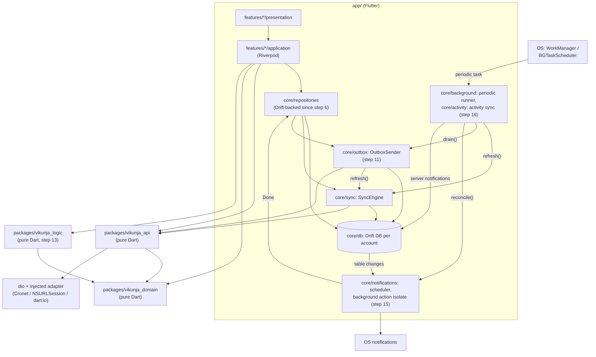

The repository interfaces exist since step 5; step 6 put the database and the sync engine behind them ([D29](decisions.md#d29-ui-reads-through-repository-interfaces-the-online-implementation-is-replaced-by-drift-in-step-6-without-ui-changes), [D31](decisions.md#d31-one-drift-sqlite-file-per-account-shared-across-isolates-deleted-on-sign-out)); step 7 made `refresh()` incremental ([D33](decisions.md#d33-incremental-sync-watermark-on-updated-with-a-120-s-overlap-keyset-over-updated-id-delete-detection-by-per-project-count-check-and-id-reconcile-daily-full-resync)); step 11 added the outbox behind the same interfaces, so a write is a row change plus a queued op that the sender pushes through the write ports ([D34](decisions.md#d34-outbox-local-first-writes-serial-sender-coalescing-retry-classes-sync-interplay-pending-fields-win-until-sent-pending-deletes-hidden-v1-full-replace-emulation), section 7.5); step 12a added creates to it, rows under a temporary id that the sender remaps to the server's ([D35](decisions.md#d35-creates-through-the-outbox-temporary-negative-ids-with-remap-createupdatedelete-coalescing-lost-response-recovery-by-title-within-a-1-h-window)); step 12b put label, assignee and reminder changes into the same update op ([D36](decisions.md#d36-labels-and-assignees-as-id-set-deltas-in-the-task-update-sent-through-their-endpoints-after-a-read-before-write-diff-reminders-as-the-whole-list-label-creation-online-only)); step 13 added `vikunja_logic`, whose quick-add parser the app's quick-add service uses, and the service creates its tasks through the same outbox ([D38](decisions.md#d38-quick-add-the-web-grammar-in-vikunja_logic-with-d19s-fixes-weekday-and-ordinal-dates-at-the-default-time-and-an-unknown-project-kept-in-the-title-a-live-composer-labels-created-online-and-assignees-looked-up-on-submit-the-task-through-the-outbox)); step 15 schedules the OS notifications from the same database and sends a notification's Done through the same outbox from a background isolate ([D39](decisions.md#d39-local-notifications-a-scheduler-per-signed-in-account-plans-from-the-local-database-and-diffs-against-a-rolling-window-with-stable-keys-exact-alarms-when-allowed-done-through-the-outbox-from-a-background-isolate-without-a-token-refresh-snooze-local-only-permissions-asked-once-after-the-first-sync), section 7.7); step 16 runs the same engine, outbox and scheduler for every account from a periodic background job and stores the server's notifications in the same database ([D40](decisions.md#d40-background-sync-one-periodic-job-for-every-signed-in-account-with-a-deadline-skipped-while-the-app-is-in-front-the-incremental-run-as-the-session-keep-alive-a-one-off-drain-after-a-background-done-server-notifications-synced-into-a-local-inbox-on-their-own-cadence-new-unread-ones-as-activity-notifications-the-first-run-silent), section 7.8); step 14 puts relation changes into the same update op, with temporary ids at both ends of an edge, and duplicates and follows tasks online ([D41](decisions.md#d41-relations-as-deltas-in-the-task-update-sent-through-the-relation-endpoints-after-a-read-before-write-diff-temporary-ids-on-both-ends-resolved-at-send-time-the-inverse-rows-kept-locally-duplicate-and-subscriptions-online-only-subtasks-from-indented-quick-add-lines), section 7.5); step 9 builds the lists from the same database the web's way, with view snapshots that the project screen downloads and a download of the Overview's saved filter in every sync run, in review ([D43](decisions.md#d43-task-lists-from-the-local-database-like-the-webs-a-view-snapshot-for-positions-and-server-only-filters-the-overviews-saved-filter-downloaded-by-the-sync-upcoming-with-the-web-presets-and-a-pinned-overdue-part), sections 6, 7.2 and 7.3); step 10 reads what only a single task read carries online and on demand without storing it, renders descriptions and comments from the rich-text parser of `vikunja_logic`, and opens tasks from links, notifications and the inbox through one opener, in review ([D44](decisions.md#d44-task-detail-complete-rich-text-from-an-own-parser-of-the-web-editors-schema-details-and-comments-online-on-demand-deep-links-on-the-app-scheme), sections 4, 6 and 8).

## 3. Server connection and v1/v2 negotiation [exists]

`ServerConnector.connect(input)` either returns a `ServerConnection` or throws a `ServerConnectionFailure`. The implementation is `DioServerConnector`.

1. **Normalise the address** (`normalizeServerAddress`):
   - Remove invisible characters that copy and paste brings along (zero-width spaces and joiners, soft hyphens).
   - Accept only `http` and `https`.
   - Convert an international host name to its `xn--` (punycode) form.
   - Cut the path at its last `/api/v1` or `/api/v2`, so a pasted `…/api/v1/info` works. Strip trailing `/` and keep any sub-path.
   - Record whether the user typed a scheme and a port.
   - Invalid input → `InvalidServerAddress`.
   - Based on the web frontend's `apiUrl.ts` and `checkAndSetApiUrl.ts`.
2. **Build the candidate roots, in order:**
   - The address as typed. Without a typed scheme, try `https` first, then `http`.
   - Without a typed port, also try Vikunja's default port 3456, but only after the default port could not be reached at all.
   - Candidates overlap to bound the wait: each one starts when the one before it could not connect, or 2.5 s after that one started. Their outcomes are still used strictly in this order.
   - Each probe waits at most 5 s to connect and 5 s for the response, so an address where nothing answers fails after at most 17.5 s.
3. **Probe each candidate.** Send `GET {root}/api/v2/info` and `GET {root}/api/v1/info` in parallel.
   - A probe counts only if the answer is a 200, JSON, and has a string `version`.
   - Servers older than 2.4.0 answer the v2 probe with 404 and `{"message":"Not Found"}`. That means "no v2", not "not Vikunja".
   - The API versions whose probe counted become `ServerConnection.apiVersions`.
   - If v1 reports 2.4.0 or newer (or an unparseable version) while the v2 probe got no HTTP response, v2 is probed once more. If that also gets no response, the connection fails with that error instead of quietly using v1.
4. **Stop at the first candidate where something answered over HTTP:**
   - At most one redirect is followed per connection attempt. It must keep the probe path (`…/api/v1/info` or `…/api/v2/info`) under another origin or sub-path, or be a same-host `http` → `https` redirect. The root derived from it is probed like any other candidate. A redirect from `https` to `http` is never followed.
   - If the address is a route of the Vikunja web app (the answer is the web app's HTML), up to four parent paths are probed.
   - Only connection-level failures (DNS, connection refused, timeout, a TLS handshake failure) move on to the next candidate. A rejected certificate is not one of them: a TLS server answered, so it ends the search with `TlsFailure`. A server that answers is never second-guessed on another port or scheme.
   - If nothing counts, the most informative failure is thrown:

   | Failure | Cause |
   |---|---|
   | `ServerUnreachable` | DNS or connection failure |
   | `ServerTimeout` | timeout |
   | `TlsFailure` | certificate or handshake problem |
   | `ServerUnavailable` | a 5xx or 429 instead of `/info` (Vikunja down, restarting or rate limiting, or the proxy cannot reach it) |
   | `BehindLoginProxy` | any other redirect off the host, or to a login-like path; 401; 403 with `WWW-Authenticate`; 407; an HTML login form |
   | `NotAVikunjaServer` | anything else that answers without a Vikunja `/info` |

5. **Parse `/info`** (`parseServerInfo`). The version is parsed leniently:
   - `v2.7.0` and `v2.7.0-6-ge7d7f173` are both accepted.
   - `dev`, `unstable` and similar sort above every release.
6. **Derive `ServerCapabilities`** from:
   - the reachable API versions;
   - version thresholds;
   - the `/info` flags;
   - `enabled_pro_features` (licence).

   A Vikunja server older than 2.3.0, the support floor ([D13](decisions.md#d13-support-floor-230)), is **not a failure**. It yields a connection with `SupportTier.unsupported`, so the UI can say what it found: the overview shows the header, the badges and a blocking banner that says browser sign-in needs 2.3.0, but no sign-in methods and no server features.
7. **Ask before using `http://`.** If the connection uses `http` (`ServerConnection.isInsecure`), the app shows an "Unencrypted connection" dialog. It uses the server only after the user confirms ([D8](decisions.md#d8-cleartext-policy)).

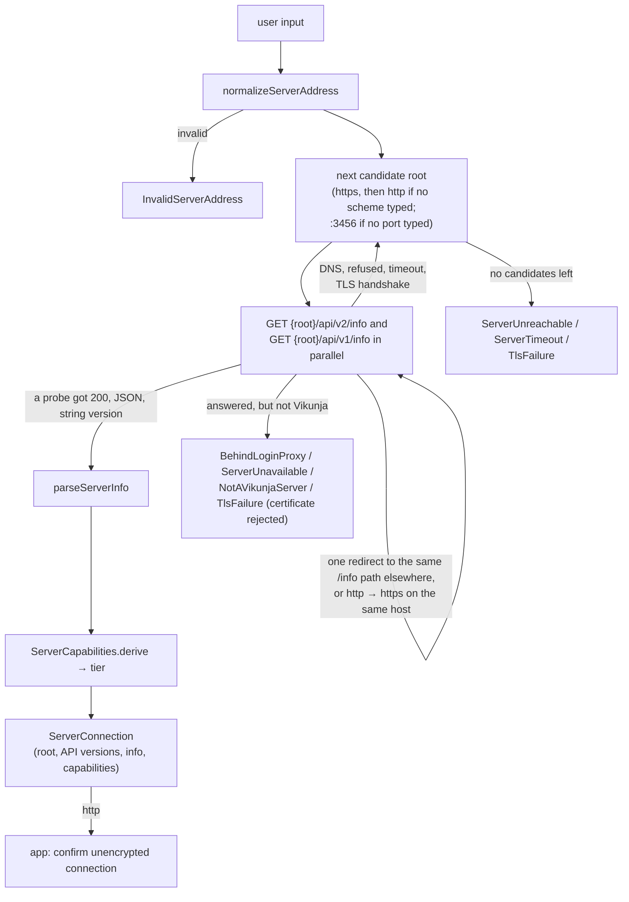

**Support tiers** (`SupportTier`):

| Tier | Servers | Meaning |
|---|---|---|
| `unsupported` | < 2.3.0, or an unparseable version without v2 | Shown, but not usable: browser sign-in needs 2.3.0. No legacy tier is planned. |
| `oauth` | ≥ 2.3.0 (dev builds included) without a reachable `/api/v2`, e.g. 2.3.x, or a newer server whose proxy hides v2 | `/api/v1`; OAuth 2.0 + PKCE sign-in, WebSocket |
| `full` | any server with a reachable `/api/v2` (2.4.0+) | + v2 adapter (PATCH, ETag, envelopes, problem+json) |

**Capability gating rules:**
- Features check a `Capability` and never compare version strings.
  - Development builds report `dev`/`unstable`.
  - A proxy can hide `/api/v2`.
  - Admins can switch features off.
- Licensed features (time tracking, admin panel, audit logs, invites) come only from `enabled_pro_features`. Their routes return a plain 404 when unlicensed.
- `concurrent_writes`:
  - It is reported since 2.4.0 and is `false` on SQLite.
  - A missing value means "unknown", so writes are serialized.
- Re-negotiation [planned; the step 6 sync does not re-negotiate] happens at login, every 24 h, on app update, and after a "route absent" 404.

**Transport rules that already apply:**
- Only `http` and `https`.
- No credentials in URLs.
- `Authorization`, `Cookie`, `Set-Cookie` and tokens are never logged.
- Plain `http://` needs explicit confirmation in the app (step 7 above).

## 4. API abstraction [read client exists, step 5; task write ports exist, steps 11 and 12a; label and assignee requests, label create and user search exist, step 12b; notification ports exist, step 16; relation requests, duplicate and subscription ports exist, step 14; avatar port in review, step 9; task details, by-index, comment, attachment and mark-read requests in review, step 10; routed client planned]

Step 5 built the read half: `VikunjaReadClient` with the ports `ProjectsPort`, `LabelsPort` and `TasksPort`, created by `createReadClient(dio:, connection:)` over the account's authenticated `Dio` (section 5.2). It uses `/api/v2` when the connection reached it and `/api/v1` otherwise, and hides the version differences inside one `ReadClient` (section 6). Step 12b added `UsersPort.searchProjectUsers(projectId, {query})` as `VikunjaReadClient.users`, for the people picker: everyone with access to the project (owner, shares, teams) matching the query, in one page, never paged; an empty query is left out and lists them all. Step 16 added `NotificationsPort.list` as `VikunjaReadClient.notifications`, the user's server notifications, newest first (section 7.8). Step 14 added `SubscriptionsPort` as `VikunjaReadClient.subscriptions`: `forTask(id)` and `forProject(id)` return the subscription that covers the task or project (its own, or one inherited from a parent project, which it then names), null when there is none, from `GET /tasks/{id}` and `GET /projects/{id}`, the only reads that carry it [exists, step 14]. Step 9 adds `AvatarsPort` as `VikunjaReadClient.avatars`: `fetch(username, size:)` reads `GET /avatar/{username}?size=` as bytes with their media type (`AvatarImage`: PNG, JPEG or, for some avatar providers, SVG); an unknown username gets the server's placeholder, and an answer that is not an image or is empty throws `UnexpectedResponse` [in review, step 9]. Step 10 adds what the detail sheet reads ([D44](decisions.md#d44-task-detail-complete-rich-text-from-an-own-parser-of-the-web-editors-schema-details-and-comments-online-on-demand-deep-links-on-the-app-scheme)) [in review, step 10]:
- `TasksPort.readDetails(id)`: one `GET /tasks/{id}` with the repeated `expand=reactions`, `comment_count` and `is_unread`, parsed into `TaskDetails`: the attachments (`TaskAttachment`, from the task's `attachments` with `file.*` flattened), the cover attachment id (0 for none; it may name an attachment that is gone), the reactions (`Reactions`, each value with the users who gave it), the comment count, the unread flag (the server sends `is_unread` only when it is true) and the subscription.
- `TasksPort.readByIndex(project, index)`: `GET /projects/{project}/tasks/by-index/{index}`, where `project` is a numeric project id or an identifier in any case, percent-encoded by the port. On v2 an index the task had before it moved to another project answers a 307; the port follows it once (section 5.2). An unknown project or index is `NotFound`, an unreadable project `Forbidden`; the identifiers `.` and `..` cannot be put in a path and are `NotFound` without a request.
- `CommentsPort.list(taskId, page:, newestFirst:)` as `VikunjaReadClient.comments`: one page of `GET /tasks/{id}/comments` with `order_by` `asc` or `desc` (at most the server's `max_items_per_page`), each `TaskComment` with its author, times and reactions. The server sorts by `created`, which it keeps to the second, so the port sorts each page by `(created, id)` itself. A task on a server with comments switched off answers `NotFound`.
- `AttachmentsPort.fetch(taskId, attachmentId, preview:)` as `VikunjaReadClient.attachments`: `GET /tasks/{task}/attachments/{id}`, the original or, with an `AttachmentPreviewSize` (`sm`, `md`, `lg`, `xl`: 100, 200, 400 or 800 px wide), a PNG preview. The server answers the original for anything it cannot preview (SVG included), so the caller checks `AttachmentBlob.contentType`. The body streams in and is refused with `UnexpectedResponse` above `maxAttachmentBytes` (25 MB), by its `Content-Length` or by what arrives; the connection is then cancelled. A missing attachment is `NotFound`, a foreign one `Forbidden`.

Step 11 added the first write half: `VikunjaWriteClient` with `TasksWritePort` (`update(id, TaskChanges)`, which returns the task as the server stored it, and `delete(id)`), created by `createWriteClient(dio:, connection:)` over the same `Dio` and chosen the same way, v2 when the connection reached it (section 7.5). Step 12a added `create(NewTask)` to the port, which returns the created task with the server's id, `index` and `identifier`. Step 12b extended `update` by `reminders` in the body and by the task's label and assignee endpoints, which it calls after reading the task, only for the ids whose state differs, then reads the task back; and it added `LabelsWritePort.create(NewLabel)` as `VikunjaWriteClient.labels` (section 7.5). Step 16 added `NotificationsWritePort` (`markRead`, `markAllRead`) as `VikunjaWriteClient.notifications` (section 7.8). Step 14 extended `update` by relation changes, sent through the task's relation endpoints after the same read, only for the edges that differ; added `duplicate(id)`, which returns the server's copy of the task; and added `SubscriptionsWritePort` (`subscribe` and `unsubscribe` of a task or a project) as `VikunjaWriteClient.subscriptions` (section 7.5, [D41](decisions.md#d41-relations-as-deltas-in-the-task-update-sent-through-the-relation-endpoints-after-a-read-before-write-diff-temporary-ids-on-both-ends-resolved-at-send-time-the-inverse-rows-kept-locally-duplicate-and-subscriptions-online-only-subtasks-from-indented-quick-add-lines)) [exists, step 14]. Step 10 adds `TasksWritePort.markRead(id)`, v2 `PUT` and v1 `POST /tasks/{id}/read`, which clears the task's unread flag; the server answers 200 for a read, a missing and an inaccessible task alike, so there is nothing to tolerate [in review, step 10]. The remaining per-area ports (projects, views, label editing, writing comments, …) come with the steps that need them. A `RoutedVikunjaClient` that picks the v2 or the v1 adapter per `ApiGroup` is still planned:
- **v2 wins whenever it exists.** It offers PATCH (no full-replace hazard), totals, ETag and problem+json.
- **A 404 without a Vikunja error `code`** on a core group means the route is absent. That group is downgraded to v1 and the request is re-sent.
- **On licence-gated groups** the same 404 means `FeatureUnavailable`.

**Key differences the adapters hide:**

| | v1 | v2 |
|---|---|---|
| Create | `PUT /projects/{id}/tasks`, 201 with the task | `POST /projects/{id}/tasks`, 201 with the task; on both versions the server assigns `id`, `index` and `identifier`, ignores `labels` in the body and refuses an empty title (v1: 400 code 4001, v2: a 422 validation error) |
| Update | `POST` = full replace, so the v1 adapter does GET → overlay → POST and round-trips assignees and reminders | `PATCH` with merge-patch of the changed fields only |
| Update that changes nothing | 200 with the task | 304 with an empty body, so the adapter re-reads the task |
| Delete | `DELETE`, 200 | `DELETE`, 204; on both versions a 404 with code 4002 means already gone and counts as success |
| Task labels and assignees (step 12b) | `PUT /tasks/{id}/labels` (`{label_id}`) and `PUT /tasks/{id}/assignees` (`{user_id}`), 201; `DELETE /tasks/{id}/labels/{labelId}` and `DELETE /tasks/{id}/assignees/{userId}`, 200 | `POST` on the same paths, 201; `DELETE`, 204; on both versions an add that is already in place is a 400 (8001, 4021), removing a label that is not attached a 403, removing an assignee idempotent |
| Label create (step 12b) | `PUT /labels`, 201 with the label | `POST /labels`, 201 with the label |
| Project users (step 12b) | `GET /projects/{id}/projectusers?s=`, a bare array | `GET /projects/{id}/users/search?q=`, an envelope with every result in one page |
| Server notifications (step 16) | `GET /notifications`, a bare array with pagination headers; one marked with `POST /notifications/{id}` (`{read}`) | `GET /notifications`, an envelope; one marked with `PUT /notifications/{id}`; on both versions all are marked with `POST /notifications` |
| Task relations (step 14) | `PUT /tasks/{id}/relations` (`{other_task_id, relation_kind}`), 201; `DELETE /tasks/{id}/relations/{kind}/{otherId}`, 200 | `POST` on the same path, 201; `DELETE`, 204; on both versions the server stores the inverse edge on the other task and a delete removes both directions; an edge already there is a 409 code 4008, a missing one on delete a 404 code 4009, a cycle a 409 code 4023, the task itself a 400 code 4010, a missing other task a 404 code 4002, an unknown kind a 400 code 4007 on v1 and a 422 on v2 |
| Duplicate (step 14) | `PUT /tasks/{id}/duplicate`, 201 with `{duplicated_task}` | `POST` on the same path; on both versions the copy carries `copiedfrom` to the source, and every request makes another copy |
| Subscriptions (step 14) | `PUT /subscriptions/{task\|project}/{id}`, 201; `DELETE`, 200 | `POST`, 201; `DELETE`, 204; on both versions an existing subscription is a 412 code 12002, unsubscribing without one a 403, and unsubscribing an inherited one stores an opt-out; the state is on the single reads of a task or project only |
| Task by index (step 10) | `GET /projects/{id or identifier}/tasks/by-index/{n}`; an index the task had before it moved is a 404 | the same path; such an index answers a 307 whose root-relative `Location` hard-codes `/api/v2`; on both versions an all-digit segment is read as a project id, so a project with such an identifier is reachable only by its id |
| Mark a task read (step 10) | `POST /tasks/{id}/read` | `PUT /tasks/{id}/read`; on both versions idempotent, 200 also for a missing or foreign task |
| Lists | bare arrays with pagination headers | `{items,total,…}` envelopes |
| Errors | `{code,message}` | RFC 9457 problem+json |

**Errors [exists]:** `normalizeError` turns every error into a sealed `VikunjaFailure`. It reads all four error shapes: v1 `{code, message}`, v2 problem+json `{status, title, detail, code?, errors?}`, Echo `{message}` and the 429 `{message}`.

| `VikunjaFailure` | Cause |
|---|---|
| `NetworkFailure` | offline, timeout or TLS problem |
| `TokenRejected` | 401 code 11: the access token is missing, malformed or expired |
| `SessionEnded` | the refresh says the session is gone: 16002 after re-reading storage, 16003, 412 code 1020 or 1040 |
| `RefreshRaceLost` | 401 code 16004: a concurrent refresh with the same token won |
| `OAuthFailure` | 17001–17007 from the OAuth endpoints |
| `Forbidden`, `NotFound` | 403, 404 (`routeAbsent` when there is no Vikunja code) |
| `ValidationFailed` | v1 412 with `invalid_fields`, v2 422 with `errors[]` |
| `RateLimited` | 429, with `Retry-After` |
| `ServerFailure` | 5xx |
| `DomainError`, `UnexpectedResponse` | any other Vikunja code; any unknown shape |

A version-aware code map for the error codes renumbered in 2.7.0 is planned.

**Paging and query builder [exists, step 5]:** `Page<T>` (`items`, `page`, `perPage`, `totalPages`, `hasMore`; `total` on v2 only) over v1 pagination headers and v2 envelopes, and `TaskQuery` (filter, sorts, expands, paging) with its translation into query parameters, are built with the read client that first uses them ([D27](decisions.md#d27-paging-and-the-query-builder-move-to-step-5); details in section 6).

**DTOs:** one hand-written codec layer (`lib/src/dto/`) serves both versions, because the server models are identical. It is tested against JSON captured from the 2.7.0 server and against the live server. The DTO-vs-OpenAPI contract test of [D12](decisions.md#d12-hand-written-api-adapters-and-an-openapi-spec-for-contract-tests) is still planned.

## 5. Auth and session [exists, step 2+3; the account switcher, step 4]

Step 2+3 built sign-in, token storage, refresh and sign-out for several accounts. Step 4 built the account switcher on them (section 5.7, [D37](decisions.md#d37-account-switcher-a-sheet-from-an-avatar-button-and-an-accounts-section-a-switch-resets-the-navigation-the-most-recently-active-account-follows-a-removal-inactive-outboxes-drain-in-the-foreground)) [exists, step 4]; the keep-alive scheduling exists since step 16 ([D22](decisions.md#d22-session-keep-alive-through-background-sync), [D40](decisions.md#d40-background-sync-one-periodic-job-for-every-signed-in-account-with-a-deadline-skipped-while-the-app-is-in-front-the-incremental-run-as-the-session-keep-alive-a-one-off-drain-after-a-background-done-server-notifications-synced-into-a-local-inbox-on-their-own-cadence-new-unread-ones-as-activity-notifications-the-first-run-silent), section 7.8).

**Sign-in:** browser OAuth 2.0 + PKCE only (≥ 2.3), which covers local, LDAP, OIDC and TOTP accounts through the web login ([D14](decisions.md#d14-browser-sign-in-only), [D23](decisions.md#d23-browser-sign-in-through-flutter_web_auth_2-client-id-and-redirect-uri)). Guests use link shares (step 32). Password, TOTP and API-token login are not planned for now.

| | Value |
|---|---|
| `client_id` | `dev.coderoftime.vikunja` |
| `redirect_uri` | `vikunja-dev.coderoftime.vikunja://oauth/callback` (Vikunja accepts only schemes that start with `vikunja-`) |
| Authorize page | `{frontend_url}oauth/authorize` from `/info`; the server root + `/` when `frontend_url` is empty. An `http://` `frontend_url` is never used for an `https://` server; the server root + `/` is used instead |
| Token endpoint | `POST /api/v2/oauth/token` when `/api/v2` is reachable, otherwise `POST /api/v1/oauth/token` (2.3.x); JSON body, public. 60 requests per minute per IP on 2.7.0; before that the v1 endpoint shares the login limit of 10 per minute ([research/README.md](research/README.md) item 6) |
| Current user | `GET /api/v{2,1}/user`; since step 13 its `settings` are parsed too (`parseUserSettings`: the default project, the quick-add mode and the default reminders, among others; since step 9 also the saved filter the Overview shows, `filter_id_used_on_overview`, and the lowest priority a row labels, `minimum_priority`; since step 10 the order of comments, `comment_sort_order`, oldest first unless the web stored `desc`) and stored by the sync (section 7.3) [exists, step 13; the two list settings in review, step 9; the comment order in review, step 10] |
| Logout | `POST /api/v2/logout` or `POST /api/v1/user/logout`; needs a valid access token |

The protocol facts are verified against the Vikunja source in [research/auth.md](research/auth.md) §3–§7 and §12.

### 5.1 Browser sign-in

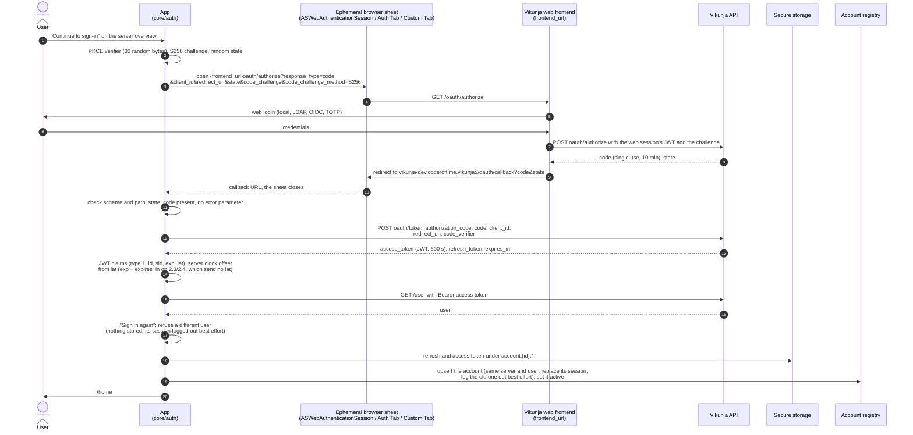

- Every attempt has a fresh verifier and state.
- The browser session is ephemeral ([D23](decisions.md#d23-browser-sign-in-through-flutter_web_auth_2-client-id-and-redirect-uri)). Vikunja shows no consent screen and its callback carries no `iss` ([RFC 9207](https://www.rfc-editor.org/rfc/rfc9207)), so a reused web login would let a malicious server get a code for another server without the user noticing (a mix-up). In an ephemeral session the user has to type that server's credentials into its login page.
  - Every sign-in shows the login form. OIDC and SSO users sign in at their identity provider again each time. iOS shows no "… Wants to Use … to Sign In" prompt.
  - On Android, flutter_web_auth_2 5.1.0 opens a Custom Tab instead of an Auth Tab for Chrome and Edge before 141, Samsung Internet before 28 and Firefox before 143. It treats these versions as lacking ephemeral support, so the sheet can share the browser's cookies; other browsers may ignore the flag as well. Chrome 133 on the test emulator gets such a Custom Tab.
  - Signing out of the app does not end a web login the user has in the browser. Only the fallback browsers above would reuse it.
- "Sign in again" accepts only the account's own user. Another user is refused before anything is stored, its new session is logged out best effort, and the home screen shows a message.
- Closing the sheet cancels silently. A wrong state, a missing code, an `error` parameter and token endpoint errors (17001–17007) end in an inline message on the overview.
- While a sign-in runs (and on `/home` while a sign-out runs), back navigation is blocked and the buttons are disabled, so leaving the screen cannot strand a code exchange half way. On Android before 12, back on the root route would finish the activity and the isolate with it.
- The router sends the app to `/home` when an active account exists, and to onboarding (`/`) otherwise. Since step 4 the same screens add another account while one is active: "Add account" pushes the Connect screen in an adding mode (section 6, screens) [exists, step 4].

### 5.2 Authenticated requests

- `createAuthenticatedDio` builds one `Dio` per account:
  - base URL `connection.apiBaseUri(connection.preferredApiVersion)`;
  - adapter, timeouts and `User-Agent` from the app's base `Dio` ([D5](decisions.md#d5-dio-with-native_dio_adapter));
  - a retry interceptor and the auth interceptor.
- The auth interceptor asks an `AccessTokenSource` for the token. The session manager implements it, so `vikunja_api` holds no refresh policy and no storage.
  - `validAccessToken()` refreshes proactively when `exp − serverNow < 60 s`.
  - `refreshAfterRejection(rejectedToken)` runs after a 401 with code 11. The request is retried once with the new token; a second 401 is not retried.
  - The `Authorization` header is never added to absolute URLs on another origin.
- The retry interceptor retries only GET and HEAD, on network errors, 502, 503, 504 and 429. It makes at most 2 retries with exponential backoff and jitter, and honours `Retry-After` up to a cap. Writes are retried by the outbox sender (section 7.5), never by the transport.
- `OAuthTokenClient` uses a separate `Dio` without the auth interceptor, because the token endpoint is public and a refresh must never trigger a refresh.
- Redirects are not followed: the token client, the account `Dio` and every request the auth interceptor adds a token to use `followRedirects: false`, so neither a code, a refresh token nor an access token reaches the host a redirect names. A 3xx ends as `UnexpectedResponse`. One read follows a redirect by hand since step 10 [in review, step 10]: on v2, `TasksPort.readByIndex` accepts a 307 and follows it once, only when the `Location` is the server's own `/api/v2/projects/{id}/tasks/by-index/{n}` (the server writes that prefix whatever path it is served under). The port keeps only the part after `/api/v2` and joins it to the account's base URL, so the second request goes to the same server and sub-path with the token; any other `Location` is `UnexpectedResponse`.
- Attachment downloads (step 10) stream the body and cancel the request once it is longer than the port's cap, so a huge file is never held in memory (section 4) [in review, step 10].
- `normalizeError` turns every error into a `VikunjaFailure` (section 4).

### 5.3 Token storage

([D24](decisions.md#d24-tokens-in-secure-storage-readable-after-the-first-unlock))

- `flutter_secure_storage` 11, per account: `account.<id>.refresh_token` and `account.<id>.access_token`.
- iOS: Keychain with `first_unlock_this_device` and `synchronizable: false`. Background isolates can read the tokens while the device is locked, once it has been unlocked after a restart. The items never reach iCloud Keychain or another device.
- Android: the plugin's v11 defaults (AES-GCM, with the key wrapped by an Android Keystore RSA key). `android:allowBackup="false"` keeps them out of Auto Backup.
- The access token is stored too, so another isolate can adopt a refresh result instead of refreshing again.
- `TokenSet` keeps `exp` and `iat` in server time. The server clock offset comes from `iat` when a token arrives, and every expiry check uses server time.
- The offset is kept per account in preferences (`auth.server_clock_offset.<id>`; not a secret), written after the tokens and only when it moved by 5 s or more. A cold start or another isolate therefore judges stored tokens in server time before its first response. Sign-out deletes it.
- iOS keeps Keychain items when the app is deleted, but not its preferences. The first UI start that finds neither the install marker (`auth.install_marker`) nor a registry wipes secure storage once, so a reinstall never inherits refresh tokens ([D24](decisions.md#d24-tokens-in-secure-storage-readable-after-the-first-unlock)). Deleting the app never logs its sessions out on the server; they end after 72 h without a refresh.
- Secrets appear nowhere else: not in SharedPreferences, not in the database, not in logs. `toString()` of `TokenSet` redacts the tokens.

### 5.4 Refresh

Vikunja rotates the refresh token on **every** refresh and has **no grace period**: the old token is dead as soon as the server commits the rotation. Reusing it gives 401 code 16002, and a concurrent refresh with the same token that loses the race gets 16004. Every rule below follows from that ([D26](decisions.md#d26-refresh-concurrency-single-flight-re-read-and-adopt-write-ahead-epoch)).

- **When:** proactively 60 s before `exp` (server time), and reactively once after a 401 with code 11 for a user JWT.
- **Single-flight:** one refresh per account and isolate at a time; concurrent callers await the same future.
- **Re-read, then adopt:** before calling the server, the session manager re-reads the stored refresh token. If it differs from the caller's snapshot, another isolate or process has refreshed, and the stored tokens are adopted without a server call.
- **Cross-isolate safety:** `RandomAccessFile.lock` does not serialise isolates of one process (POSIX record locks are per process; verified by `app/test/core/auth/file_lock_isolates_test.dart`). Re-reading and adopting are the cross-isolate mechanism, as documented in `app/lib/core/auth/session_manager.dart`.
- **Write-ahead:** the rotated refresh token (with the new access token) is written to secure storage **before** the new access token is used for anything.
- **Not cancellable:** the refresh request is not tied to a UI cancel token and has a generous timeout. A response lost after the server rotated leaves only a dead token.
- **Adoption on 16002 and 16004:** the session manager re-reads storage a few times with short delays, because a sibling may be about to persist the winning tokens. Losing again to a newer stored token keeps it looking. Only when nothing newer appears is the session ended.
- **Re-read on 16003 and 412:** these answers are about the session of the token that was sent. Storage is re-read first, and a session that another isolate stored meanwhile (a new sign-in) is adopted. Only when storage is unchanged does the session end.
- **Write failure:** if the secure write after a successful refresh fails, the new tokens stay in memory and are written again before the next refresh; newer tokens in storage win. Only the error type is logged.
- **Retirement and auth epoch:** sign-out and account removal retire the account's session manager first, then wipe its storage. A retired manager hands out no token and never writes storage; it stays retired in this isolate until a new sign-in replaces it. `retire()` waits only for a storage write that has already started, never for a refresh still on the network, whose result is discarded. Guarding a sibling isolate against writing tokens back after a sign-out in another isolate is still open: step 16's heartbeat skip keeps background runs away while the app is in front, where sign-outs happen, which narrows it to a run that began before the app came to the front (section 7.8).

| Refresh outcome | Failure | Action |
|---|---|---|
| 200 | — | persist (write-ahead), then use |
| network error or timeout | `NetworkFailure` | keep the tokens, retry later |
| 5xx | `ServerFailure` | re-read storage (SQLite servers answer a lost race with 500) and adopt a newer token; otherwise retry once, then keep the tokens |
| 429 | `RateLimited` | wait for `Retry-After`, capped at 10 min |
| 401 16004, 16002, or 401 without a code (2.3.0, 2.4.0) | `RefreshRaceLost` / `SessionEnded` | re-read and adopt; otherwise session ended |
| 401 16003, 412 1020 or 1040 | `SessionEnded` | re-read and adopt a newer session; otherwise session ended |

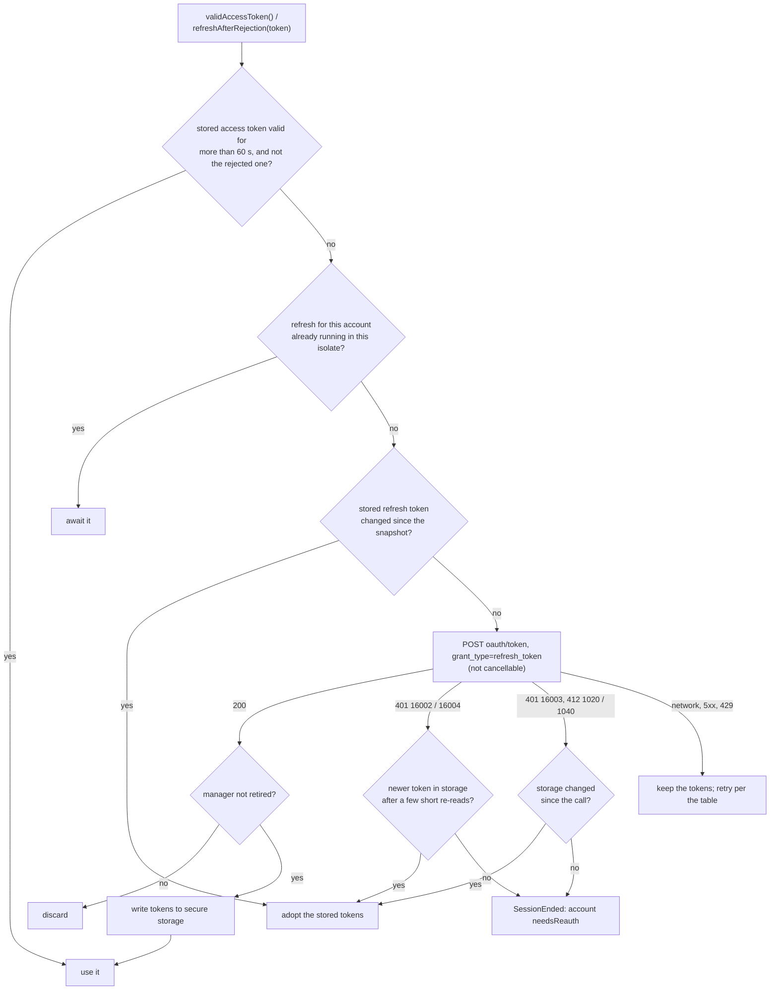

### 5.5 Session end and `needsReauth`

- A `SessionEnded` failure marks the account `needsReauth` in the registry. Its local data stays.
- `/home` (its Account tab since step 5) then shows a "Sign in again" banner. It runs the browser sign-in for the same server; signing in as the same user replaces the account's tokens and clears the flag.
- `/home` checks the active session with `GET /user` after its first frame, when the app resumes and when the active account changes: at most once a minute per account, never for an account in `needsReauth`, and never while a sign-in or sign-out runs. A session the server ended shows the banner right away. An unreachable server shows nothing. A sign-in counts as a check.
- The server ends an OAuth session after 72 h without a refresh (`service.jwtttl`), and there is no long-session option for the code grant. The check above refreshes an expiring access token, so opening the app moves that window. Since step 16 every background run refreshes every account it reaches, as often as the OS runs the job: every 30 min at best on Android, when the system decides on iOS (section 7.8) [exists, step 16].
- The outbox sender of an account in `needsReauth` is paused and resumes with the next sign-in; nothing queued is dropped (section 7.5) [exists, step 11]. Since step 16 a background run that finds the session ended marks the account the same way and posts one "Sign in again to *host*" notification, whose tap opens the Account tab (section 7.8) [exists, step 16].

### 5.6 Sign-out

1. Best-effort logout: make sure the access token is valid (refresh first if needed), then `POST` logout. Network errors are ignored.
2. Retire the account's session manager (section 5.4), so nothing in this isolate writes its tokens again.
3. Wipe the account's secure entries, its server clock offset and its registry entry.
4. Since step 6: close the account's database and delete its file with the WAL and journal files ([D31](decisions.md#d31-one-drift-sqlite-file-per-account-shared-across-isolates-deleted-on-sign-out)). The confirmation dialog says that the local data is deleted.

When no active account remains, the router returns to onboarding. Since step 4 any account can be removed this way, not only the active one; removing the active account while others remain activates the most recently active of them, and the shell stays (section 5.7) [exists, step 4]. Since step 15 the wiper also disposes the account's notification scheduler and cancels its pending OS notifications before it closes the database (section 7.7, [D16](decisions.md#d16-multi-account-in-the-first-release)) [exists, step 15]. Since step 16 `server_notifications` goes with the database, and the last sign-out also cancels the background work (`BackgroundScheduler.cancelAll()`, section 7.8) [exists, step 16]. Since step 10 the wiper also drops the account's avatar cache and attachment image cache from memory (section 6) [in review, step 10].

### 5.7 Multi-account registry

([D25](decisions.md#d25-account-registry-in-sharedpreferences-without-secrets))

- The registry lives in `SharedPreferencesAsync` as JSON and holds no secrets:
  - the accounts (`Account`: id, server root, user id, username, display name, `addedAt`, `needsReauth`);
  - the active account id;
  - each account's last server connection, with `/info` re-serialised by `serverInfoToJson`, so start-up and headless refreshes need no probe.
- Account id: the first 32 hex characters of `sha256("${serverRoot}|${userId}")`. The same user on the same server is always the same account, so signing in again replaces its session instead of adding a duplicate.
- Per-account objects are keyed by the account id: the session manager, the authenticated `Dio`, the database and the sync engine (step 6), the outbox sender (step 11), the notification preferences, scheduler and os-id namespace (step 15, section 7.7), the activity repository and the background run's last-run time (step 16, section 7.8), the avatar cache (step 9, section 6), and the task details repository, the task resolver and the attachment image cache (step 10, section 6).
- The registry and secure storage are written separately. An account without tokens is handled like `needsReauth`: the accounts provider marks it at start (`flagAccountsWithoutTokens`), and a session manager that finds no tokens ends the session. Unreadable storage (the Keychain before the first unlock) is not taken as missing tokens.
- Entries that cannot be decoded are left out of the state but written back unchanged; a readable entry with the same id replaces one. A registry that cannot be decoded at all is copied to `auth.account_registry.unreadable` before it is first overwritten ([D25](decisions.md#d25-account-registry-in-sharedpreferences-without-secrets)).
- `bootstrap.dart` loads the registry before `runApp`, behind the native launch screen, so the first route is already the right one. The token-presence check runs afterwards without blocking start-up.
- Account switching ([D37](decisions.md#d37-account-switcher-a-sheet-from-an-avatar-button-and-an-accounts-section-a-switch-resets-the-navigation-the-most-recently-active-account-follows-a-removal-inactive-outboxes-drain-in-the-foreground)) [exists, step 4]:
  - **Recency:** the registry also stores the activation order, most recent first, as an additional JSON field. `setActive` and `upsert(activate: true)` move the id to the front, `remove` drops it. A registry without the field (written before step 4) reads as the stored account order with the active account first, and entries this version cannot read keep their place untouched. The UI lists the accounts in this order; the stored order of the accounts does not change.
  - **Remove:** when the removed account was active, `remove` activates the most recently active remaining account (before step 4: the first remaining one). Removing any account is the sign-out of section 5.6: removing an inactive one disposes its sender, engine and database and leaves the active account, its sync engine, its scheduler and its screens untouched; the active account's scheduler resumes once the global "signing out" flag clears. Removing the active account while others exist keeps the shell; the router goes to onboarding only after the last one. Cancel on the first-sync screen of an added account is the same sign-out, so the previously active account becomes active again.
  - **Added or existing:** `SignInSucceeded` carries `isNewAccount`, which `SignInController` computes from the registry before the sign-in (`signInAgain` is never new). An account that was already on the device keeps its id, takes the new session and becomes active (section 5.1), and the UI says so.
  - **Switch:** `AccountSwitcher.switchTo(accountId)` (`features/accounts/application/account_switcher.dart`) sets the active id, a no-op for the active and for an unknown id, and refuses (returning false) while a sign-in, a sign-out or another switch runs. A switch, a removal of the active account and re-adding an existing account first wait, at most 5 s, for the target account's engine to report its stored state; each account has its own kept-alive `accountSyncStatusProvider(id)`, and `syncStatusProvider` never returns the previous account's status. The add flow's routes are `/home/accounts/add` and `/home/accounts/add/server`, pushed over the shell; `/sync` has no entrance transition, so a shell → `/sync` → shell round trip never builds two shells with the same navigator keys. Everything keyed by the active account follows the registry, and the shell resets the navigation (section 6, screens).
  - **Inactive outboxes:** `inactiveOutboxesProvider` (`features/sync/application/inactive_outboxes.dart`) runs while the shell is up and, on start, on resume and when the account list changes, asks the outbox sender of every signed-in account other than the active one that is not in `needsReauth` and has queued ops (counted on its database) to drain. It never builds a sender for an account without queued ops, never runs during a sign-out and leaves the active account to the triggers of section 7.3; a sender once built keeps its own backoff timers. Inactive accounts are not synced in the foreground; since step 16 the background runs sync every account ([D22](decisions.md#d22-session-keep-alive-through-background-sync), section 7.8) [exists, step 16].

### 5.8 Headless use

- The token store, the registry, the session manager and the token client need no `BuildContext` and no widget tree. A background isolate builds them through the same Riverpod `ProviderContainer` as the UI (principle 4).
- What makes that work:
  - the Keychain accessibility above, so tokens are readable while the device is locked;
  - `SharedPreferencesAsync`, which has no in-memory cache that could go stale across isolates;
  - the re-read and adoption rules of section 5.4.
- The notification-action isolate is the first such entry point (section 7.7, [D39](decisions.md#d39-local-notifications-a-scheduler-per-signed-in-account-plans-from-the-local-database-and-diffs-against-a-rolling-window-with-stable-keys-exact-alarms-when-allowed-done-through-the-outbox-from-a-background-isolate-without-a-token-refresh-snooze-local-only-permissions-asked-once-after-the-first-sync)) [exists, step 15]: the plugin starts a separate Flutter engine for a Done or Snooze action, and `handleNotificationAction` builds a `ProviderContainer` the way `bootstrap.dart` does (the `ClientIdentity.load()` override included), opens the account's database (shared with the UI isolate through `shareAcrossIsolates`), writes through `LocalTaskRepository` and drains the outbox with a sender of its own; the container is disposed at the end. **It never refreshes tokens:** it asks the session manager for a token with a "no refresh" option and sends only when the stored access token is valid as it is; otherwise the op stays queued for the next foreground or background run, and since step 16 the handler then asks for a background drain on Android (section 7.8) [exists, step 16]. A refresh from a short-lived isolate could lose the race against the UI isolate or be killed mid-request, which ends the session (section 5.4); a queued op costs nothing.
- The background sync isolate is the second such entry point (section 7.8, [D40](decisions.md#d40-background-sync-one-periodic-job-for-every-signed-in-account-with-a-deadline-skipped-while-the-app-is-in-front-the-incremental-run-as-the-session-keep-alive-a-one-off-drain-after-a-background-done-server-notifications-synced-into-a-local-inbox-on-their-own-cadence-new-unread-ones-as-activity-notifications-the-first-run-silent)) [exists, step 16], and unlike the action isolate it **refreshes tokens**, because its runs are the keep-alive of [D22](decisions.md#d22-session-keep-alive-through-background-sync): `BackgroundSyncRunner` builds the container like `handleNotificationAction` (the `ClientIdentity.load()` override included) but with the refreshing session managers, and the first request of each account's incremental run (`GET /user`) finds the 600 s access token expired and refreshes it, which slides the 72 h window. The re-read and adoption rules of section 5.4 make that refresh as safe as one in the UI isolate; the heartbeat skip keeps the two isolates off the same account in the usual case, and the sync lease and the outbox's in-flight stop in every case (section 7.8); the deadline (Android 9 min, iOS 25 s) stays below the OS limit, so a refresh still in flight has a margin to land its write-ahead, and at the deadline or an OS stop it gets up to 3 s before the container is disposed.
- Extensions and widgets never refresh tokens (principle 5).

## 6. Read path [exists, step 5]

Step 5 put the first real data on screen, read-only and online, and shaped every layer below the screens so that step 6 could put Drift under the repositories without touching the UI ([D29](decisions.md#d29-ui-reads-through-repository-interfaces-the-online-implementation-is-replaced-by-drift-in-step-6-without-ui-changes)). This section has the read client, the repository contract and the screens; the database, the local repositories and the sync engine are in section 7.

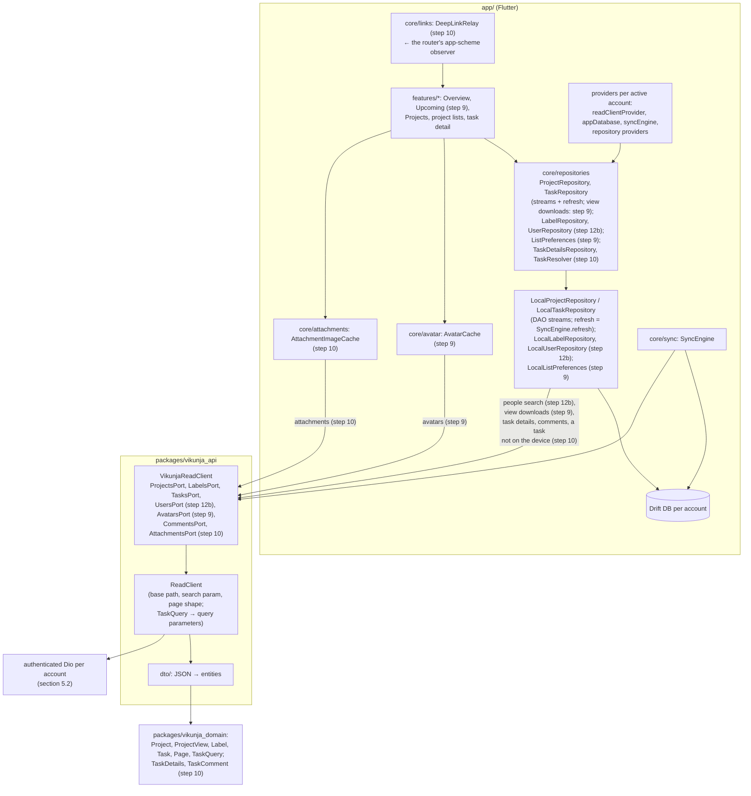

**Ports and `ReadClient`** (`packages/vikunja_api/lib/src/read/`):
- `VikunjaReadClient` exposes `projects`, `labels`, `tasks`, since step 12b `users`, since step 16 `notifications`, since step 14 `subscriptions`, since step 9 `avatars` and, since step 10, `comments` and `attachments`. `createReadClient(dio:, connection:)` takes the account's authenticated `Dio` and picks `/api/v2` or `/api/v1` from `connection.preferredApiVersion`.
- Both versions share the entity JSON, so one codec layer (`lib/src/dto/`) parses it. The client hides the rest: the base path, the search parameter (`s` on v1, `q` on v2) and the page shape (v1: a bare array plus `x-pagination-total-pages` and `x-pagination-result-count` headers, so `Page.total` is null; v2: `{items, total, page, per_page, total_pages}`).
- `TaskQuery` becomes `filter`, `filter_timezone`, `filter_include_nulls`, repeated `sort_by` and `order_by` (paired by position), `expand`, `page` and `per_page`. URLs are built from query parameters, never by string concatenation, because filters contain `&&`, quotes and spaces; dio sends the lists as `sort_by=a&sort_by=b` (`ListFormat.multi`). A sort by `position` is dropped on `GET /tasks` and `GET /projects/{p}/tasks`, because positions live per view and the server rejects the sort there (error 4026); it stays on the view endpoint, where step 9's view downloads use it (section 7.2).
- The server caps `per_page` at its `max_items_per_page` (50 by default), so paging follows the response. `listAll` walks `page < totalPages` and de-duplicates the pseudo projects (Favorites `-1`, saved filters `≤ -2`) that the server appends to every page.
- Parsing rules: the zero date `0001-01-01T00:00:00Z` is null and every date is parsed to UTC; `null` arrays are empty; `hex_color` is normalised to six lowercase hex digits without `#`; unknown keys are ignored; v2's `max_permission` and `ETag` are ignored for now.
- Endpoints: `GET /tasks` (all projects), `GET /projects/{p}/tasks` (no view filter, so done tasks are included unless filtered out), `GET /projects/{p}/views/{v}/tasks` (the view's filter is AND-ed server-side; never used with kanban views, [D30](decisions.md#d30-kanban-board-reads-deferred-to-step-20)), `GET /projects` (archived only with `is_archived=true`), `GET /projects/{id}` (with views), `GET /labels`, `GET /tasks/{id}`; since step 12b the people of a project for the people picker, `GET /projects/{id}/users/search?q=` on v2 (an envelope with every result in one page) and `GET /projects/{id}/projectusers?s=` on v1 (a bare array), the parameter left out for an empty query; the user JSON carries no email. Since step 9 the view endpoint serves the view downloads (section 7.2), `GET /projects/{p}/tasks` with a saved filter's pseudo project id (`p ≤ -2`) the Overview's saved filter (section 7.3), and `GET /avatar/{username}?size=` the avatars, as an image, not JSON [in review, step 9]. Since step 10 `GET /tasks/{id}` also with the repeated `expand` of the detail read, `GET /projects/{id or identifier}/tasks/by-index/{n}` (with the one followed v2 307), `GET /tasks/{id}/comments` and `GET /tasks/{id}/attachments/{id}` with `preview_size`, streamed as bytes (section 4) [in review, step 10].
- Errors go through `normalizeError`; a cancelled request rethrows its `DioException`; JSON the codecs cannot read ends as `UnexpectedResponse`.
- Tests: unit tests with a fake HTTP adapter, parsing tests on JSON captured from the 2.7.0 server (`test/fixtures/read/`, captured by `tool/capture_read_fixtures.dart` with the user name redacted), and a contract test that seeds data and checks that v1 and v2 give equal domain objects except `Page.total`. The seed project gets a per-run identifier (`CT` plus four hex digits), because identifiers are unique per server and the server outlives a run; the sign-in helper retries a 500, because the SQLite test server loses a write race when two contract files register at once.

**Repositories** (`app/lib/core/repositories/`):
- `ProjectRepository`: `watchAll()`, `refresh()`, `find(id)`. `TaskRepository`: `watchOpenTasks()` and `refreshOpenTasks()`; until step 9 also `watchProjectTasks(projectId, showDone:)` (a `PagedList`: the items loaded so far and whether the server has more), `refreshProjectTasks(...)` and `loadMoreProjectTasks(...)`, which step 9 removed with `PagedList`. Since step 11 `TaskRepository` also has the writes `setDone(id, done:)`, `setFavorite(id, favorite:)` and `deleteTask(id)`, which change the local row at once and queue the server call, and `watchPendingChanges()`, `watchSyncProblems()`, `retrySyncProblem(opId)`, `discardSyncProblem(opId)` and `sendPendingChanges()` for the Account tab (section 7.5). Since step 12a it has `watchTask(id)` (one task, following the id change a queued create gets when it is sent; null once the task is gone), `createTask(NewTask)` (the row is there at once under a temporary negative id, which the call returns) and `updateTask(id, TaskChanges)`, which since step 12b also takes label and assignee deltas and the reminder list. Step 14 added relation deltas to `updateTask`, `duplicateTask(taskId)`, which copies the task on the server, online, and returns the copy's id, and `watchSearchableTasks()`, every task without its child rows, which the add-relation search reads with done tasks shown [exists, step 14]. Step 9 adds the list reads ([D43](decisions.md#d43-task-lists-from-the-local-database-like-the-webs-a-view-snapshot-for-positions-and-server-only-filters-the-overviews-saved-filter-downloaded-by-the-sync-upcoming-with-the-web-presets-and-a-pinned-overdue-part)) [in review, step 9]: `watchActiveOpenTasks()`, the open tasks outside archived projects and their subprojects (which `GET /tasks` leaves out too), nearest due date first, undated last, then newest first, Upcoming's source; `watchOverviewTasks()`, an `OverviewTasks`: those tasks or, while the user's `filter_id_used_on_overview` names a saved filter the last project list named, the open tasks of that filter's last download with this device's changes on top (a task done or deleted here leaves at once, one created here appears after the next download), with the filter (`SavedFilterRef`) and the download time, null before the first download; `watchProjectList(projectId, viewId:, includeDone:)`, a `ProjectListSource`: the project's tasks (without `includeDone`, without the done ones the view's last download does not have), every task reachable from them as a subtask in any project, the view's `ListSnapshot` (task ids, positions, download time) and whether done tasks were left out; and `refreshProjectList(projectId, viewId:)`, the sync followed by the view's download (section 7.2), which throws the `VikunjaFailure` of either; a `viewId` of 0 stands for a project without a list view and only syncs.
- `LabelRepository` (step 12b): `watchAll()` (the account's labels from the database, ordered by title, case-insensitively) and `create(NewLabel)`, which goes to the server at once (`LabelsWritePort.create`), so it needs a connection, stores the answer locally and throws the `VikunjaFailure` otherwise. `UserRepository` (step 12b): `searchAssignees(projectId, query)` (`UsersPort.searchProjectUsers`, online, the users it returns stored in `users`, so assigning one works offline afterwards; throws the `VikunjaFailure`) and `knownUsers()` (everyone the database knows from synced tasks and earlier searches, the offline fallback of the people picker). Implemented by `LocalLabelRepository` and `LocalUserRepository` over the account's database and the write or read client.
- `SubscriptionRepository` (step 14): `forTask(id)`, `forProject(id)`, `setTaskSubscribed(id, subscribed:)` and `setProjectSubscribed(id, subscribed:)`, online only, each returning the subscription that covers the task or project as the server has it (its own or an inherited one, null for none) and throwing the `VikunjaFailure` otherwise; nothing is stored. Implemented by `LocalSubscriptionRepository` over the read and write clients (`subscriptionRepositoryProvider` for the active account, `accountSubscriptionRepositoryProvider(accountId)`) [exists, step 14].
- `ListPreferences` (step 9): how the user last left each list, per account, as the web keeps it per view in its local storage: `watchView(listKey)` and `saveView` (`ViewPreferences`: the sort, `TaskListSort.manual` by default, and show done, off), `lastViewOf(projectId)` and `rememberView` (the list view last shown), `watchUpcoming()` and `saveUpcoming` (`UpcomingPreferences`: a `DateRangePreset`, by default the next 7 days, or a custom range of local dates with both days included; show overdue, on by default; show without date, off). `listKeyFor` names a view's list `view:<id>` and the list of a project without a list view `project:<id>`. Implemented by `LocalListPreferences` over the `list_preferences` table, one JSON value per key; a value this version cannot read is the default, field by field (`listPreferencesProvider` for the active account, `accountListPreferencesProvider(accountId)`) [in review, step 9].
- `TaskDetailsRepository` (step 10): `details(taskId)` (the one expanded read of `TasksPort.readDetails`), `comments(taskId, page:, newestFirst:)` (one page, sorted by `(created, id)`, oldest first unless `newestFirst`) and `markRead(taskId)` (idempotent; callers ignore its failure). Online only, like `SubscriptionRepository`: nothing is stored, a failure is the request's `VikunjaFailure` (offline a `NetworkFailure`), and a task whose create is still queued throws `TaskNotSyncedYet` without a request. Implemented by `LocalTaskDetailsRepository` over the read and write clients, which resolves a temporary id through the remap (`taskDetailsRepositoryProvider` for the active account, `accountTaskDetailsRepositoryProvider(accountId)`) [in review, step 10].
- `TaskResolver` (step 10): `resolve(TaskReference)` finds the task a link or a typed reference names, by id or by project identifier and index, in the local database first and otherwise online, and stores a task it read online (section 7.2); `findLocal(reference)` answers from the database only, without a request, so a caller can choose among accounts before going online. It throws the `VikunjaFailure`: `NotFound` for a task or project that does not exist, `Forbidden` for one the user cannot read, `NetworkFailure` for a task that is not local while the device is offline. Implemented by `LocalTaskResolver` (`taskResolverProvider` for the active account, `accountTaskResolverProvider(accountId)`) [in review, step 10].
- The contract is streams of the current local state plus explicit refresh (and, until step 9, load-more). A failed first load is the stream's error; a failed refresh throws the `VikunjaFailure` and leaves the stale data in the stream. Database streams and a sync trigger satisfy it as well.
- Since step 6 the implementations are the local ones of section 7.2: streams from the DAOs, refresh through the sync engine. The step 5 `online/` implementations (an in-memory cache per account, filled through `VikunjaReadClient`, with the overview capped at 5 pages) were removed with step 6; git history keeps them.

**Providers** (`core/repositories/repository_providers.dart`): `accountDioProvider(accountId)` builds the account's authenticated `Dio` over `createAuthenticatedDio`, rebuilt only when the account's root URL or API versions change; its token source looks the session manager up on every request, so a client built before a new sign-in uses the new session; in debug builds it logs one line per request (method, URL without query, status), never headers or bodies. `readClientProvider(accountId)` and, since step 11, `writeClientProvider(accountId)` share it. `outboxSenderProvider(accountId)` is kept alive per account like the engine: it drains when built, when the app comes back to the front and after every local write, pauses while the account needs a new sign-in and resumes with the sign-in; sign-out disposes it before the engine and the database, and a request still in flight then changes nothing any more. `projectRepositoryProvider` and `taskRepositoryProvider` (and, since step 12b, `labelRepositoryProvider` and `userRepositoryProvider`, over the `accountLabelRepositoryProvider` and `accountUserRepositoryProvider` families) follow the active account id: null while nobody is signed in, rebuilt and the old one disposed on a switch, gone on sign-out, so an account switch never shows another account's data; since step 6 they are built over `appDatabase(accountId)` and `syncEngine(accountId)` (section 7.4); since step 9 the account's task repository also gets the read client and the server's `max_items_per_page` (from the stored `/info`) for the view downloads. The screens watch stream providers over them (`projectsProvider`, `projectByIdProvider`, `openTasksProvider`; since step 9 `overviewTasksProvider`, `activeOpenTasksProvider` and `projectListSourceProvider` in place of `projectTasksProvider`, and `viewPreferencesProvider` and `upcomingPreferencesProvider` over `listPreferencesProvider`), which stay loading without an account; the two preference providers give the defaults instead. Since step 9 `minimumPriorityProvider` reads the user settings, and `accountAvatarCacheProvider(accountId)` keeps an account's `AvatarCache` for the session over its read client [in review, step 9]. Since step 10 `accountAttachmentImagesProvider(accountId)` keeps an account's `AttachmentImageCache` for the session the same way (`attachmentImagesProvider` for the active account), and the account wiper drops both caches when the account goes (section 5.6); `activeLinkBasesProvider` gives the active account's server root and http(s) `frontend_url`, which rich text needs for its attachment images and task links, and `activeUserIdProvider` the signed-in user's id; `deepLinkRelayProvider`, `deepLinkSourceProvider` and `taskOpenerProvider` are kept alive for the app's life (below) [in review, step 10]. `clockTickProvider` supplies "now" for the due-date grouping and relative dates: it re-reads `clockProvider` (which tests pin) when the app returns to the foreground and every minute while it is in front, so sections and labels do not freeze overnight.

**Screens** (`app/lib/features/`, material_ui and cupertino_ui, `.adaptive` where available):
- `/home` is a `StatefulShellRoute.indexedStack` (`HomeShell` in `features/home/`) with the tabs Overview (`/home/overview`), Upcoming (`/home/upcoming`, since step 9), Projects (`/home/projects`, `/home/projects/:id`) and Account (`/home/account`: the step 2+3 home content, now `AccountTab`). `/home` itself redirects to the overview; the splash, connect and home redirects stay; each tab keeps its stack. The shell runs the session check on the first frame, on resume and when the active account changes, and blocks system back while a sign-in or sign-out runs; that sign-out progress lives in `SignOutController` (`features/session/`), because the shell and the Account tab both need it. The tab bar is Material 3 on Android and a `CupertinoTabBar` on iOS.
- Overview (`features/overview/`) groups the open tasks into Overdue, Today, Next 7 days, Later and No due date in device local time, computed at build time. A row (`TaskRow` in `features/tasks/`) shows the done indicator, title, `displayIdentifier`, project title, relative due date (overdue in the error colour), priority chip for high and above, label chips (text colour by luminance, like the web's `getTextColor`) and the favourite star; step 9 gives it the web's row content (below). Since step 6 its pull-to-refresh, like every refresh, runs `SyncEngine.refresh()`, which updates every list at once; since step 7 that is the incremental run (section 7.3). Since step 11 the circle is a 48 dp control that marks the task done (haptic, strikethrough at once, a "Marked done · Undo" snackbar for 3 s) and the star toggles the favourite; a row whose task has unsent changes shows a small cloud-off icon ("Not yet synced"). Since step 12a a "New task" FAB opens the new-task sheet. Since step 9 it reads `watchOverviewTasks()` ([D43](decisions.md#d43-task-lists-from-the-local-database-like-the-webs-a-view-snapshot-for-positions-and-server-only-filters-the-overviews-saved-filter-downloaded-by-the-sync-upcoming-with-the-web-presets-and-a-pinned-overdue-part)) [in review, step 9]: every open task outside archived projects and their subprojects (before, the archived ones showed too) or, when the user picked a saved filter for the Overview on the web, that filter's open tasks as of its last download, under the note "Filter: *title*, as of *time*. Tasks created here show after the next sync." ("My Open Tasks", the saved filter every user has, translated); before the first download its empty state says that the filter loads once the device is online or, online, that it has not downloaded yet. The grouping by due date stays.
- Projects (`features/projects/`) shows favourites first, then the tree from `parentProjectId` (sorted by position, then title; archived and pseudo projects hidden; saved filters come with step 24; collapsible children with a colour dot and child count). A project opens its task list: until step 9 one list with a "Show done tasks" toggle in the overflow menu (a separate list per setting), since step 9 one list per list view (below). The load-more of step 5 is gone since step 6: the database holds every task. Since step 12a the list has a FAB that opens the new-task sheet with the project preselected.
- Project lists (`ProjectTasksScreen`, `features/projects/application/project_list_model.dart`, [D43](decisions.md#d43-task-lists-from-the-local-database-like-the-webs-a-view-snapshot-for-positions-and-server-only-filters-the-overviews-saved-filter-downloaded-by-the-sync-upcoming-with-the-web-presets-and-a-pinned-overdue-part)) [in review, step 9]: one list per list view of the project, read from `watchProjectList` (Gantt, Table and Kanban views do not show). With several list views, chips above the list switch between them, in the web's tab order, the server's default title "List" translated; the view last shown is remembered per project. `classifyViewFilter` decides how the view's tasks are found: without a filter every task, the done top-level ones in a Done part below the open ones; `done = false` (the default List view) the open tasks, and with "Show done tasks" in the overflow menu (offered only on such views, saved per view, off by default) as without a filter; `done = true` the done tasks; any other filter or a search the tasks of the view's last download that are still on the device, under a note that the server applies the filter, as of when, and before the first download an empty state that says the view is downloading, loads once the device is online, or could not be downloaded. The nesting follows the web's List view (`buildTaskTree`): the matching tasks whose parent does not match are the top-level rows, each followed by all its subtasks, open or done and from any project, in the parent's relation order, indented per level (four levels at most) and read as "Subtask of *parent*"; a subtask with two parents shows under both. The sort button opens a sheet with the web's 17 sorts, "Manually" first and the rest by label, saved per view; "Manually" (`compareTasksForList`) uses the positions of the view's last download, with the tasks the download did not have first, newest first, and the Done part goes by done time, newest first. When a view opens with a snapshot that is missing or older than 5 minutes, the screen downloads it quietly once (`refreshProjectList`); pull-to-refresh does the same with the usual notices. A subtask from another project shows that project's title and colour.
- Upcoming (`features/upcoming/`, route `/home/upcoming`, the second tab, [D43](decisions.md#d43-task-lists-from-the-local-database-like-the-webs-a-view-snapshot-for-positions-and-server-only-filters-the-overviews-saved-filter-downloaded-by-the-sync-upcoming-with-the-web-presets-and-a-pinned-overdue-part)) [in review, step 9]: the open tasks outside archived projects (`watchActiveOpenTasks`), selected on the device by `selectUpcoming` with the web's strict bounds and shown in sections: Overdue, pinned on top, with every overdue open task, never repeated below ("Show overdue tasks" in the overflow menu, on by default; the web drops the lower bound instead); one section per day in device local time (Today, Tomorrow, then the date); and No due date ("Show tasks without date", off by default). A range button at the top of the list names the range and its days and opens a sheet with the web's 14 presets (`DateRangePreset`, evaluated by `evaluateDatemath` in the device's zone, weeks from Monday) and "Custom…", a day-range picker; the default is the next 7 days. The range and both switches are saved per account (`ListPreferences`). Pull-to-refresh runs the sync; the app bar has the refresh button, the bell and the avatar button, and a FAB opens the new-task sheet.
- Task rows (`TaskRow`, [D43](decisions.md#d43-task-lists-from-the-local-database-like-the-webs-a-view-snapshot-for-positions-and-server-only-filters-the-overviews-saved-filter-downloaded-by-the-sync-upcoming-with-the-web-presets-and-a-pinned-overdue-part)) [in review, step 9]: the web's row content in every list. The priority chip shows on open tasks at or above the user's `minimum_priority` (medium when unset, `minimumPriorityProvider`), low, medium and high and up in three colours; the detail sheet keeps showing high and up. A task colour shows as a dot before the title. The labels are de-duplicated and sorted by title. Up to three assignee avatars overlap, then "+N" (`UserAvatar`: the server's avatar through `AvatarsPort`, in a size bucket of 32, 64, 128 or 256 px; the account's `AvatarCache` keeps the 100 most recently used for the session and asks once per user and size at a time; the initials stand in while it loads, for an SVG and after a failure, which is asked again after 2 minutes unless the server answered not found or forbidden). Icons mark a description and a repeat, the description's checkboxes show as a ring with "2 of 5 tasks" (`checklistStatistics`), and a bar shows the percent done. The identifier, the project with its colour dot and the cloud-off marker stay. The texts are one semantics node that also names the parent of a nested subtask.
- Task detail (`TaskDetailSheet` in `features/tasks/`) is a modal sheet over the task from the list (a `DraggableScrollableSheet`, `showCupertinoSheet` on iOS) that follows the task's row while it is open: title, identifier and project, done state, dates (absolute, localised), priority, percent done, labels, assignees, reminders and repeat summary; until step 10 the description showed as plain text (`htmlToPlainText`, which the activity texts still use). Since step 11 it has the done control, the favourite toggle and Delete in its overflow menu behind an adaptive confirmation; after the delete the sheet closes and a snackbar confirms. Since step 12a an Edit action, and a tap on the title, open the edit page, and the identifier is hidden while the task still has a temporary id. Step 10 completes it ([D44](decisions.md#d44-task-detail-complete-rich-text-from-an-own-parser-of-the-web-editors-schema-details-and-comments-online-on-demand-deep-links-on-the-app-scheme)) [in review, step 10]:
  - What the device knows: the task's colour as a dot before the identifier, which is computed from the local project and the task's index (`taskIdentifierIn`), because the server keeps echoing the identifier a task had before it moved; the project path from the root as a breadcrumb (`ProjectBreadcrumb`, as far up as the device has the parents), each project a link to its screen; the description's checklist summary ("2 of 5 tasks"); labels de-duplicated and sorted like the rows'; assignees with their avatars (`UserAvatar`); and at the end a metadata line (`TaskMetadataLine`) in place of the separate "Done at" row: "Created 2 days ago by Anna", "Updated 1 hour ago" when that differs, "Done 5 minutes ago" once done, with the absolute dates for screen readers. The sheet watches the task's project itself, so the Overview, Upcoming and the project lists hand it only the task.
  - Rich text: `RichHtml` parses the description with `parseRichText` against the active account's server root and frontend URL, once per change, and `RichTextView` draws the tree with material_ui and cupertino_ui widgets inside a `SelectionArea`: headings with header semantics, lists, task lists with read-only checkboxes that carry the checked state, quotes, code blocks and wide tables in horizontal scrollers (tables beyond 50 columns or 5,000 cells row by row), rules, mention pills (avatar and name) and task-link pills (the local task's project when it is another one, its identifier and title, checked and struck through once done; the href while the task is not on the device). "No description" stands in for a description without visible content. Nothing in the text loads or opens by itself. A tap on a link goes through `linkTargetOf`: a task URL of the account (`parseTaskIdFromUrl` against the server root and the `frontend_url`) opens that task in a sheet over this one, read online through `TaskOpener.resolve` when it is not local, with a progress bar meanwhile; other http(s) links open in the browser, relative ones resolved against the frontend URL; `mailto`, `tel`, `sms` and the web's other link schemes go to the app that handles them through the allowlist of `ExternalLinkOpener`; anything else says "Can't open this link". Attachment images of this server load through the account's `AttachmentImages` at the `xl` preview size, and a tap opens a zoomable full-screen viewer with the original, over everything on the root navigator (the larger preview stands in while the original loads, when it is in memory). An image on another site is never loaded: it shows as a link that names the site and opens the image in the browser. SVG is never decoded.
  - What only the server has: when the sheet opens, `TaskDetailsController` reads `TaskDetailsRepository.details` once, again on Retry and when a queued create gets its server id; nothing is asked for a task whose create is still queued. The follow bell takes its state from the same read (`FollowController.load(id, pending:)`), so opening a task costs one request. When the result says the task is unread, `markRead` follows, fire and forget. The reactions show as read-only chips below the description, each the reaction and its count, highlighted where the user reacted, with a label that names who reacted the way the web's tooltip does. The attachments list a thumbnail (`md` preview) for an image the server can preview (`canPreviewImage`) and an icon of its kind otherwise, with the name, the size (`humanSize`, with the locale's decimal separator) and a "Cover image" badge; an image opens in the viewer, other files are only listed (downloads come with step 26). Offline, or when the read fails, one quiet line with Retry stands in ("Attachments, comments and reactions need a connection"), and the rest of the sheet is complete; Retry also lets images that failed for a reason that may pass ask again.
  - Comments: when the details read counts any, a "Comments (N)" section with "Show comments", which loads the first page (`CommentsController`); then an order toggle ("Oldest first" or "Newest first", starting with the user's `comment_sort_order` and kept for the sheet), the comments, and "Load more comments" while pages remain. A comment shows the author's avatar and name, when it was written and, when it was edited, when that was; its text through the same renderer; and its reactions. A quote that replies to a comment (`data-comment-id`) is headed "Reply to *author*" when the quoted comment is loaded. A failed page shows a notice with Retry and keeps the pages before it; a screen reader hears how many comments arrived or why none did.
  - Strings in en and de (informal "du"), semantics on every new control, dark mode, 200 % text scale and iOS adaptivity.
- Edit page (`features/tasks/presentation/edit/`, route `/home/tasks/:id/edit`, pushed over the shell) [exists, step 12a]: the task comes from `watchTask(id)`, so the page follows a remap while it is open and says "Task not found" once the row is gone. Sections with native-feeling controls: title (multiline, required, with a validation message); project (an adaptive picker over the project tree without archived projects; a change is a move); due, start and end date rows (tap: adaptive date picker, then time picker; Clear; the shortcut chips Today, Tomorrow, Next Monday, This weekend, Later this week, Next week, Next weekend, End of month and In a month from a port of the web's `buildDateShortcuts(now)` with its rules: two shortcuts on the same day keep the first, Today is hidden from 21:00 (another shortcut landing on today still shows), This weekend on Sunday, In a month is clamped to the month's last day; a selected chip tapped again clears the date; a date-only pick takes the next breakpoint among 9, 12, 15, 18 and 21, where "at HH:00 exactly" counts and after 21:00 it is 9 the same day, and a date change keeps a time already set); priority 0..5; percent done as a slider in 10 % steps with a label; colour as the six web defaults, "No colour" and the current custom colour if any; repeat as Never, Every… (amount with hours, days or weeks and the presets every day, every week, every 30 days), Monthly and From completion, with `repeat_after` in seconds on the wire (30 days is 2592000) and Never sent as `repeat_after 0, repeat_mode 0`. Save in the app bar is disabled while nothing changed or the title is empty, sends the diff as `updateTask(id, TaskChanges)` and pops with a "Saved" snackbar; back with unsaved changes asks through an adaptive dialog.
- New-task sheet (`features/tasks/presentation/create/`) [exists, step 12a]: a modal bottom sheet that grows with the keyboard, opened by the FABs: a title field (autofocused; the keyboard action adds too), a project chip (the current project, else the project titled Inbox, because the server's `default_project_id` was not synced before step 13, else the first project of the tree; tap for the picker), the due shortcut chips Today, Tomorrow and Next week plus "Pick date…" (wrapped, so all fit a narrow phone; a selected chip tapped again clears), Add (enabled with a non-empty title; `createTask`, the sheet closes, a snackbar names the title) and "More options", which creates the task and opens the edit page on it. Since step 13 the title field is the quick-add composer (below), and the user's `default_project_id` comes after the current project and before the Inbox, when the task can live there [exists, step 13].
- Labels, assignees and reminders on the edit page ([D36](decisions.md#d36-labels-and-assignees-as-id-set-deltas-in-the-task-update-sent-through-their-endpoints-after-a-read-before-write-diff-reminders-as-the-whole-list-label-creation-online-only)) [exists, step 12b]: the sections are Title, Project, **Labels**, **Assignees**, Due, Start, End, **Reminders**, Priority, Progress, Colour and Repeat. `TaskDraft` holds the labels, the assignees and the reminders; its diff emits `labels` and `assignees` as `IdSetChange`s by id (null when equal) and `reminders` as the whole list when it differs from the original as a multiset (order does not matter). Every new control has semantics, en and de strings, dark mode and 200 % text scale.
  - Labels: chips in the label's colour (text colour by the existing contrast rule), each with a remove button ("Remove label X"), and an "Add label" chip that opens the label picker (`features/tasks/presentation/pickers/label_picker.dart`): an adaptive sheet that fits the keyboard, an autofocused search over `LabelRepository.watchAll()` by case-insensitive substring, rows with colour dot, title and checkbox (multi-select), and, when the trimmed query is not empty and no label has exactly that title, a first row "Create label "X"" that calls `LabelRepository.create` with a random colour of the web's palette and selects the new label; a failure says inline that creating a label needs a connection, or shows the server's message; a title over 250 characters is refused inline. Done returns the selection, dismissing keeps the previous one.
  - Assignees: chips with an initials avatar and the display name (name, else username), each with a remove button ("Unassign X"), and an "Assign" chip that opens the people picker (`pickers/assignee_picker.dart`): a search field, `UserRepository.searchAssignees(projectId, query)` on open with an empty query and 300 ms after the last keystroke, only the latest query's answer counting; rows with avatar, display name, `@username` and checkbox, the current assignees always first. A failed search shows `knownUsers()` filtered locally with the notice "Offline — showing people from your synced tasks" (or the server's message when the network was not the problem). Moving the task after picking keeps the assignees; a user without access to the new project becomes a sync problem (7003).
  - Reminders: one row per reminder in the existing `formatReminder` wording; a relative one adds the instant computed from the draft's dates, or a warning that its date is not set; tap to edit, a trailing remove button. "Add reminder" opens the reminder sheet (`pickers/reminder_picker.dart`): the presets relative to the due date (else the start, else the end date) on the date, 2 hours, 1 day, 3 days, 1 week and 30 days before; "Custom…" with an amount (an integer from 0), minutes, hours, days or weeks, before or after, and the due, start or end date (an unset one is marked); "Date and time…" with `pickDateTime` for an absolute reminder (by default tomorrow at the breakpoint time of the default-time rule, or the edited reminder's instant). Editing a relative reminder pre-fills it with the right sign, where the web always shows "before" ([research/client-logic.md](research/client-logic.md) §20), and with the largest whole unit (90 minutes stays 90 minutes, 14 days is 2 weeks). A reminder equal to one already listed is not added again.
- Accounts ([D37](decisions.md#d37-account-switcher-a-sheet-from-an-avatar-button-and-an-accounts-section-a-switch-resets-the-navigation-the-most-recently-active-account-follows-a-removal-inactive-outboxes-drain-in-the-foreground)) [exists, step 4]:
  - Avatar button: the active account's initials at the trailing end of the Overview and Projects app bars (since step 9 also Upcoming's), with the semantics "Accounts, signed in as *name* on *host*"; it opens the account switcher sheet.
  - Account switcher sheet (`features/accounts/presentation/account_switcher_sheet.dart`, an adaptive modal sheet): the accounts in recency order (section 5.7), the active one first and marked as current; each row has the initials avatar, the display name (else the username), `@username · <server host>` (the port only when it is not the default), a "Sign in again" badge for `needsReauth` and an "N unsent" badge from `accountPendingChangesProvider` (the queued-op count of any account, which opens its database) when N > 0. A tap on an inactive row calls `AccountSwitcher.switchTo`, closes the sheet and shows "Switched to *name*"; "Add account" opens the adding mode below; "Manage accounts" opens the Account tab.
  - Accounts section on the Account tab, under the header (which shows the server host): the other accounts (a tap switches; a trailing menu with "Remove…") and "Add account". The reauth banner, the sync status, the pending changes and the sync problems stay about the active account.
  - Adding mode of the Connect screen: "Add account" pushes the Connect screen over the shell, with a close button (Android back and the iOS swipe do the same) that returns to the shell without signing in, and the servers of the existing accounts as one-tap chips ("Your servers") under the address field, which fill it in. The server overview's back still returns to Connect; on `SignInSucceeded` the app goes to `/home`, and the router sends a new account to `/sync`. When `isNewAccount` is false, a snackbar says "You're already signed in to this account — switched to it". The browser session is ephemeral, so the server's login page asks for credentials and another user on the same server can be added.
  - Switch transition: when the active account changes, every route above the shell on the root navigator closes (edit page, sheets, dialogs, pickers), every tab returns to its root and the Overview shows, so no frame shows a screen of the previous account over the new account's database. A switch to an account that has synced before never shows the first-sync screen; an account whose first sync has not completed goes to `/sync`.
  - Remove: from the Accounts section's menu (any account) and from the Sign out button (the active one), through the sign-out of section 5.6. The confirmation names the account and its server, says that its local data is deleted and, when `accountPendingChangesProvider` counts unsent changes, that they are lost; while other accounts exist, the active account's button reads "Sign out of this account" and the dialog says that the app switches to the next account. After removing the active account the shell shows the next one through the switch transition, with "Signed out of *name*"; removing the last account goes to Connect as before.
  - Strings in en and de (informal "du"), semantics on every new control, dark mode, 200 % text scale, iOS adaptivity and predictive back, as in every step.
- Quick-add composer (`features/quick_add/`, [D38](decisions.md#d38-quick-add-the-web-grammar-in-vikunja_logic-with-d19s-fixes-weekday-and-ordinal-dates-at-the-default-time-and-an-unknown-project-kept-in-the-title-a-live-composer-labels-created-online-and-assignees-looked-up-on-submit-the-task-through-the-outbox)) [exists, step 13]:
  - Service: `QuickAddService` (`features/quick_add/application/`; `quickAddServiceProvider`, null without an active account). `plan(line, fallbackProjectId:, fallbackDueDate:)` parses with `vikunja_logic` in the user's mode and resolves against in-memory snapshots of the account's projects (not archived; case-insensitive exact title, else identifier), labels (exact title; the others are new) and known users (exact username or name), without a request; its due date and reminders are what submit sends. `submit(text, fallbackProjectId:, fallbackDueDate:)` splits the lines (common indent and the list markers `- `, `* `, `+ `, `[ ] ` stripped when there are several), plans each, looks every name up with `UserRepository.searchAssignees` in the task's project under the web's acceptance rule (the plan's local resolution only on a `NetworkFailure`), creates the missing labels once through `LabelRepository.findOrCreate` (online; adopts a label of that title the server already has; a failure skips the label and is reported), then per line calls `createTask` and, with labels or assignees, `updateTask` behind it (section 7.5), and returns a `QuickAddResult` (the local task ids, the labels not created, the names that stayed in a title), or throws `QuickAddPartlyFailed` with the lines not created when a line fails after earlier ones were queued.
  - Magic field: the new-task sheet's title field parses the line in the user's quick-add mode from `userSettingsProvider` (`vikunja`: `*` label, `+` project, `@` assignee, `!` priority; `todoist`: `@`, `#`, `+`, `!`; `disabled`: a plain field without highlighting, suggestions or toolbar). A `TextEditingController.buildTextSpan` override highlights the recognised parts (labels, project, priority, assignees, the date and the repeat phrase) from the live plan, by colour and weight, never by colour alone.
  - Preview row: chips from the plan for the due date (absolute and relative), the repeat, the project (an unmatched `+project`, which stays in the title, as the warning chip "Project "x" not found"), the labels (new ones marked "new"), the assignees (unresolved ones marked "will be looked up"), the priority and the default reminders. Each chip's remove action deletes its token from the text and keeps the focus; a screen reader hears, for example, "Due tomorrow at 9:00, remove".
  - Suggestions: while the caret is in a token that starts with a prefix, a horizontal strip above the toolbar lists the matching labels, projects (not archived) or people (the known users plus a debounced `UserRepository.searchAssignees` for the effective project, the latest query winning); a tap replaces the token with the full value, quoted when it contains spaces, plus a space.
  - Toolbar above the keyboard: buttons that insert the mode's label, project and assignee prefix at the caret (with a leading space when needed), a priority menu with the five levels that inserts `!n`, each with a tooltip and a semantic label, and a help button that opens the help sheet: the syntax with examples for the current mode in localised prose, the keywords in English, which the sheet says.
  - Fallbacks: the project chip chooses the fallback project and shows the `+project` when one matched; the due chips set a due date unless the text has one, and then show the parsed date as selected, read-only until the date phrase is removed; "More options" creates through the service and opens the edit page on the first created task.
  - Multi-line: pasting several lines makes the field multi-line, the Add button reads "Add N tasks" and the preview shows the count; the keyboard's action key still adds.
  - Submit: `QuickAddService.submit`, the sheet closes, and a snackbar says "Added "title"" or "Added N tasks", with a second line for the labels that could not be created and the names that stayed in a title; no project at all is an inline error.
  - From anywhere: an Android app shortcut and an iOS Home Screen quick action "New task" (`quick_actions`, localised titles) open the composer over the Overview once the app is signed in and synced, and are ignored otherwise.
  - Strings in en and de (informal "du"), semantics on every new control, dark mode, 200 % text scale and iOS adaptivity; the sheet still grows with the keyboard.
- Notifications (`features/notifications/`, [D39](decisions.md#d39-local-notifications-a-scheduler-per-signed-in-account-plans-from-the-local-database-and-diffs-against-a-rolling-window-with-stable-keys-exact-alarms-when-allowed-done-through-the-outbox-from-a-background-isolate-without-a-token-refresh-snooze-local-only-permissions-asked-once-after-the-first-sync); the scheduler behind them is in section 7.7) [exists, step 15]:
  - Setup screen (`presentation/notification_setup_screen.dart`, route `/notifications-setup`): the router sends a signed-in and synced account there once per device, while the preferences flag `notifications.onboarded` is unset; "Not now" sets it as well. It shows the logo, "Stay on top of your tasks", what gets notified (reminders at their time, due dates at the exact time, only your tasks) and "Turn on notifications" (`NotificationGateway.requestPermission()`). On Android 14+ without exact alarms a second step explains that reminders can be minutes late without them and offers "Allow exact alarms" (`openExactAlarmSettings()`) and "Skip"; on resume it checks again and continues when allowed. Then the shell.
  - Notifications section on the Account tab, between the sync status and the pending changes: the switches "Reminders" and "Due dates" (per account, `NotificationPreferencesStore`), a status line ("Notifications are off" with "Open settings" when the OS has them off; "Reminders may be late" with "Allow exact alarms" on Android without exact alarms), "N scheduled" from the account's table, and "Send a test notification" (`showNow` with the reserved os id 1 and a payload for task 0, whose tap opens the Account tab).
  - Tap listener (`presentation/notification_tap_listener.dart`, built like `NewTaskShortcutListener`): on a tap payload, from the foreground callback or from `getNotificationAppLaunchDetails()` after a cold start, it waits for the shell, switches the account when the payload's account is not the active one (`AccountSwitcher.switchTo`; refused during a sign-in or sign-out, and the tap is dropped), loads the task from that account's repository (`watchTask`, first value; a missing task gives "This task is gone"), brings a tab back to the Overview (a page over the shell, the edit page with its unsaved changes or the add-account screen, stays and the sheet opens over it) and opens `showTaskDetail`. After a switch it waits until the registry change has reached the providers, which is when the shell closes the previous account's modals (section 5.7), and a tap during an opening waits for it, so the last tap wins. The test notification's tap closes the modals and opens the Account tab, or says "Notifications work" when that tab is already open. Since step 10 the waiting, the switch and the showing are `TaskOpener`'s, shared with deep links and the inbox (below) [in review, step 10]. A reminder that fires while the app is in front is still shown (Android by default, iOS with the alert, banner and sound presentation options).
  - Strings in en and de (informal "du"), semantics on every new control, dark mode, 200 % text scale and iOS adaptivity.
- Inbox and activity (`features/inbox/`, [D40](decisions.md#d40-background-sync-one-periodic-job-for-every-signed-in-account-with-a-deadline-skipped-while-the-app-is-in-front-the-incremental-run-as-the-session-keep-alive-a-one-off-drain-after-a-background-done-server-notifications-synced-into-a-local-inbox-on-their-own-cadence-new-unread-ones-as-activity-notifications-the-first-run-silent); the activity sync behind them is in section 7.8) [exists, step 16]:
  - Bell: a bell button in the Overview app bar (since step 9 also in Upcoming's) with the active account's unread count as a badge (`ActivityRepository.watchUnreadCount()`) and the semantics "Notifications, N unread"; it pushes the inbox over the shell.
  - Inbox (route `/home/inbox`): the active account's server notifications from `server_notifications`, newest first, grouped by Today, Yesterday and Earlier; each row has an icon per kind, the doer's initials avatar, the text in the web's wording, localised, the task's identifier and title and the relative time, bold while unread. A tap marks it read and opens the task's detail sheet when the task is on the device, else a snackbar "This task is not on this device"; since step 10 it opens the task through `TaskOpener`, which reads a task that is not on the device online (opening tasks, below) [in review, step 10]; `project.created` opens the project's screen when the project is local. The overflow has "Mark all as read"; pull-to-refresh runs `ActivityRepository.refresh()`, and a failure shows the usual offline notice; with nothing in it, the inbox says "You're all caught up". It works offline from the table, and reads marked there are sent with the next activity sync.
  - Taps: the tap listener above handles the payload keys `activity:<id>` (switch the account when needed, mark read, open the task, or the inbox when the payload's task is 0, as for `team.member.added`) and `session:<account>` (switch to the account and open the Account tab, where the reauth banner is).
  - Account tab: the Notifications section gets an "Activity" switch (comments, assignments, mentions; per account); the sync status shows "Background sync: *time* ago" from `background.lastRunAt.<account>`, or "Background sync has not run yet", on iOS with a one-line hint that the system decides when it runs.
  - Strings in en and de (informal "du"), semantics on every new control, dark mode, 200 % text scale and iOS adaptivity.
- Subtasks, relations, duplicate and follow ([D41](decisions.md#d41-relations-as-deltas-in-the-task-update-sent-through-the-relation-endpoints-after-a-read-before-write-diff-temporary-ids-on-both-ends-resolved-at-send-time-the-inverse-rows-kept-locally-duplicate-and-subscriptions-online-only-subtasks-from-indented-quick-add-lines)) [exists, step 14]:
  - Subtasks: a section of the task detail sheet with the task's `subtask` edges whose other task is local, each row with a done checkbox (`setDone`), the title and the identifier; a tap opens the subtask's detail. An inline "Add subtask" field creates a task in the parent's project (`createTask`) and queues the child's `parenttask` edge to the parent (`updateTask(child, TaskChanges(relations: …))`), so it works offline and on a parent whose create is still queued; the parent shows the new subtask at once through the local inverse row (section 7.5).
  - Parent: a line in the sheet when the task has a `parenttask` edge; a tap opens the parent.
  - Related: the other kinds grouped under localised names (Related to, Blocks, Blocked by, Precedes, Follows, Duplicate of, Duplicated by, Copied from, Copied to), each edge removable behind an adaptive confirmation (`updateTask` with the edge in `removed`). "Add relation" opens a sheet with a kind picker (default `related`; the user's `default_task_relation_type` is not in the synced settings yet) and a search over the account's local tasks by title and identifier, without the task itself and, unless a toggle shows them, done tasks; the choice is queued as `updateTask(task, TaskChanges(relations: …))`.
  - Duplicate: an item of the sheet's overflow menu that calls `duplicateTask`; success shows "Duplicated" with "Open", which opens the copy's detail; with queued changes or without a connection the failure says that duplicating needs a connection, other failures show the usual message.
  - Follow: a bell toggle in the sheet's header whose state `SubscriptionRepository.forTask` reads when the sheet opens (since step 10 the sheet's details read carries it instead, so no second request is made [in review, step 10]); hidden while the state is unknown (offline), with a quiet hint that following needs a connection; shown on, with the hint "Following the project *title*", when the subscription is inherited, and turning an inherited one off asks whether to stop following just this task (the server stores an opt-out). A task whose create is still queued can be followed once it is synced. A project screen's overflow menu has "Follow project" / "Unfollow project" (`forProject`, `setProjectSubscribed`).
  - Quick add: when the pasted text is indented, the composer's count note shows the tree ("3 tasks, 2 as subtasks"); the first line's chips stay as they are.
  - The edit page gets no relation editing. Strings in en and de (informal "du"; "folgen" for following), semantics on every new control, dark mode, 200 % text scale and iOS adaptivity.
- Opening tasks and deep links ([D44](decisions.md#d44-task-detail-complete-rich-text-from-an-own-parser-of-the-web-editors-schema-details-and-comments-online-on-demand-deep-links-on-the-app-scheme)) [in review, step 10]:
  - Opener: `TaskOpener` (`features/tasks/presentation/open/task_opener.dart`, `taskOpenerProvider`) opens a task from outside the screens the same way for the notification tap listener, deep links, the inbox and the task links of the detail sheet. `request(open)` runs an opening once the router has left the splash, the first sync and the notification setup and shows a route under `/home`; one runs at a time, of those that wait only the last runs, and signed out it is dropped. `activate(accountId)` makes the account active through `AccountSwitcher.switchTo` and waits until the providers follow (at most 10 s) and a frame has passed, because the shell closes the previous account's modals then. `resolve(accountId, reference)` asks that account's `TaskResolver`. `showTask` closes the open dialogs and sheets, brings a tab other than the Overview back to it (a page over the shell, such as the edit page with its unsaved changes, stays under the sheet) and opens the detail sheet. A task that is not local is read online with "Opening the task…" meanwhile; a failure says why ("This task wasn't found", "You don't have access to this task", "This task isn't on this device. Connect to open it.", "This task couldn't be opened"). The waiting and the switch moved here from the tap listener of step 15, which still opens local tasks only and keeps its own handling of activity, session and test payloads.
  - Links: `<scheme>://task/<id>` and `<scheme>://task/<IDENT-12>` on the app's scheme `vikunja-dev.coderoftime.vikunja`, parsed by `parseTaskDeepLink` (an identifier in any case, split at its last `-`, the index without leading zeros). An optional `?account=<id>` picks a signed-in account; it is meant for links the app makes itself, and no screen makes one yet. Without it the link opens in the active account when that has the task on the device (or, for an identifier, a local project with it), else in the signed-in accounts that have it, else in the active account, which reads it online. Anyone can make a link, so every switch a link triggers is the user's choice: the account picker (`pickAccount`, a Cupertino sheet on iOS, a modal bottom sheet elsewhere) asks "Switch accounts?" for one other account and "Open in which account?" for several, and closing it opens nothing.
  - Delivery: the platform hands a link to Flutter's own deep linking, which passes it to the router as route information. An app-scheme observer in `app_router.dart` (a `WidgetsBindingObserver` registered before go_router's own, so it is asked first) hands every URI of the scheme to `DeepLinkRelay.accept`, which passes `task` links on and drops the rest (an `oauth` callback that arrives after its sign-in ended), and the router never routes one; go_router's `onEnter` would block them too, but it makes every route parse asynchronous, the first one included, and the app's first frame blank. A redirect guard hands a URI of the scheme that still reaches the router to the relay the same way and redirects to the splash. With `overridePlatformDefaultLocation: true` a cold start still begins at the splash, and `DeepLinkRelay.initialLink()` reads the start link once from the platform's default route. A link that arrives before anyone listens waits for the first listener. `DeepLinkListener` (`features/deep_links/presentation/`, around the router's child next to the tap listener) parses each link and asks the opener; a link that names no task is ignored. No link is logged. The platform side is in section 8.
  - Inbox and pills: the inbox opens a task through `openInActiveAccount`, so a task that is not on the device is read online (above); a task-link pill in a description or comment opens its task in a sheet over the current one (`resolve`, then `showTaskDetail`).
- Pull-to-refresh, a loading placeholder on first load, an error card with retry (`features/common/`, over `StatusCard`) and an empty state on every list. A failed first load fills the screen; a failed refresh is a notice above the stale list, and since step 6 a `NetworkFailure` with saved rows on screen is the quieter "Offline — showing saved data" notice (section 7.4). Since step 11 done, favourite and delete write through the repository into the outbox (section 7.5); since step 12a creating a task and editing its core properties go the same way, since step 12b labels, assignees and reminders too, quick add (step 13) creates through the same `createTask` and `updateTask`, and a notification's Done (step 15) is the same `setDone` from a background isolate; marking a server notification read (step 16) changes its own table and is sent by the activity sync, not by the outbox; relation changes (step 14) go through `updateTask` as well, while duplicating and following are online calls outside the outbox [exists, step 14]; marking a task read when the detail sheet finds it unread (step 10) is an online call outside the outbox too, fire and forget [in review, step 10]; the description stays read-only until step 25.
- The screens depend on the repository interfaces and the domain types only. They never see `Page`, the ports or DTOs.

**In review and planned:** step 9's lists are in review (above, [D43](decisions.md#d43-task-lists-from-the-local-database-like-the-webs-a-view-snapshot-for-positions-and-server-only-filters-the-overviews-saved-filter-downloaded-by-the-sync-upcoming-with-the-web-presets-and-a-pinned-overdue-part)), and so are step 10's detail sheet, rich text, opener and deep links (above, [D44](decisions.md#d44-task-detail-complete-rich-text-from-an-own-parser-of-the-web-editors-schema-details-and-comments-online-on-demand-deep-links-on-the-app-scheme)); step 8 applies the remaining `frontend_settings` (`date_display`, `time_format`, `default_view`) and adds smart lists; step 20 adds the kanban reads and the Kanban view ([D30](decisions.md#d30-kanban-board-reads-deferred-to-step-20)); step 22 drag reordering; step 24 the filter engine, which evaluates every view filter on the device, and Favorites and saved filters as lists of their own (with step 8's smart lists); step 25 the description editor and interactive checklists; step 26 uploading, downloading and opening files and step 27 writing comments and reactions, each with its icon on the rows; step 29 the Table and Gantt views.

## 7. Offline-first data layer [database, initial and incremental sync and the write path with creates, labels, assignees and reminders exist, steps 6, 7, 11, 12a and 12b; the drain of inactive accounts' outboxes exists, step 4; the user settings read with the account exist, step 13; the local notification scheduler exists, step 15; background work and the activity sync exist, step 16; relations in the outbox exist, step 14; list snapshots, list preferences and the Overview's saved filter in the sync in review, step 9; tasks found by a link stored like a duplicate, in review, step 10; realtime planned]

Step 6 made the database the UI's source ([D31](decisions.md#d31-one-drift-sqlite-file-per-account-shared-across-isolates-deleted-on-sign-out), [D32](decisions.md#d32-initial-sync-by-keyset-paging-with-per-page-checkpoints-full-re-pull-as-refresh-until-step-7)). After sign-in the whole account is pulled into one SQLite file, every screen reads streams from it, and the app works without the server. Step 7 keeps it current ([D33](decisions.md#d33-incremental-sync-watermark-on-updated-with-a-120-s-overlap-keyset-over-updated-id-delete-detection-by-per-project-count-check-and-id-reconcile-daily-full-resync)): `refresh()` is an incremental run that catches web changes, deletions included, and runs on start, on resume, on a foreground timer and on pull-to-refresh; the full pull stays as a daily and manual full resync (section 7.3). Step 11 added the write path ([D34](decisions.md#d34-outbox-local-first-writes-serial-sender-coalescing-retry-classes-sync-interplay-pending-fields-win-until-sent-pending-deletes-hidden-v1-full-replace-emulation)): a change is applied to the local row and queued in an outbox that a serial sender pushes to the server, the UI is optimistic and works offline, and the sync never overwrites a change still on its way (section 7.5). Step 12a added creates to it ([D35](decisions.md#d35-creates-through-the-outbox-temporary-negative-ids-with-remap-createupdatedelete-coalescing-lost-response-recovery-by-title-within-a-1-h-window)): a new task is a row under a temporary negative id until the sender has sent the create and remapped the row to the server's id (section 7.5). Step 12b put label, assignee and reminder changes on the same pipeline ([D36](decisions.md#d36-labels-and-assignees-as-id-set-deltas-in-the-task-update-sent-through-their-endpoints-after-a-read-before-write-diff-reminders-as-the-whole-list-label-creation-online-only)): labels and assignees as id-set deltas in the ordinary update op, reminders as the whole list, with the task's child rows changed in the transaction that queues the op (section 7.5). Step 4 keeps the outboxes of inactive accounts draining while the app is in front (sections 5.7 and 7.5) [exists, step 4]. Step 13 stores the user's settings in the sync's account phase and creates quick-add tasks through the same outbox (sections 7.3 and 7.5) [exists, step 13]. Step 15 schedules the OS notifications for reminders and due dates from the same database, for every signed-in account, and sends a notification's Done through the same outbox from a background isolate ([D39](decisions.md#d39-local-notifications-a-scheduler-per-signed-in-account-plans-from-the-local-database-and-diffs-against-a-rolling-window-with-stable-keys-exact-alarms-when-allowed-done-through-the-outbox-from-a-background-isolate-without-a-token-refresh-snooze-local-only-permissions-asked-once-after-the-first-sync), section 7.7) [exists, step 15]. Step 16 runs the incremental sync, the outbox drain and the scheduler's reconcile for every signed-in account from a periodic background job, and syncs the server's notifications into the same database for an inbox and activity notifications ([D40](decisions.md#d40-background-sync-one-periodic-job-for-every-signed-in-account-with-a-deadline-skipped-while-the-app-is-in-front-the-incremental-run-as-the-session-keep-alive-a-one-off-drain-after-a-background-done-server-notifications-synced-into-a-local-inbox-on-their-own-cadence-new-unread-ones-as-activity-notifications-the-first-run-silent), section 7.8) [exists, step 16]. Step 14 puts relation changes into the same update op, with temporary ids at both ends of an edge and the inverse rows written locally, and adds duplicating and following tasks as online calls ([D41](decisions.md#d41-relations-as-deltas-in-the-task-update-sent-through-the-relation-endpoints-after-a-read-before-write-diff-temporary-ids-on-both-ends-resolved-at-send-time-the-inverse-rows-kept-locally-duplicate-and-subscriptions-online-only-subtasks-from-indented-quick-add-lines), section 7.5) [exists, step 14]. Step 9 keeps two kinds of list state next to the tasks: list snapshots (the tasks and positions of a view's last download, or of the Overview's saved filter's) and the user's list preferences; the sync records the saved filters and downloads the Overview's saved filter in every run, and the project screen downloads the views it shows ([D43](decisions.md#d43-task-lists-from-the-local-database-like-the-webs-a-view-snapshot-for-positions-and-server-only-filters-the-overviews-saved-filter-downloaded-by-the-sync-upcoming-with-the-web-presets-and-a-pinned-overdue-part), sections 7.1 to 7.3) [in review, step 9]. Step 10 adds no table: what only a single task read carries (attachments, reactions, comments, the unread flag) is read online when the detail sheet asks for it, and a task that a link names and the database does not have is read online and stored like a duplicate until the next sync decides ([D44](decisions.md#d44-task-detail-complete-rich-text-from-an-own-parser-of-the-web-editors-schema-details-and-comments-online-on-demand-deep-links-on-the-app-scheme), sections 6 and 7.2) [in review, step 10]. Realtime is still planned (section 7.6).

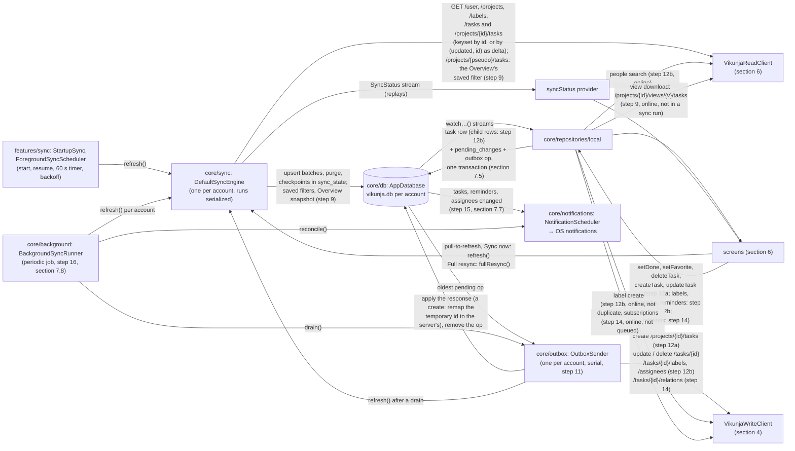

### 7.1 Database (`core/db/`)

`AppDatabase` (`@DriftDatabase`, schema version 2 since step 11, 3 since step 12a, 4 since step 15, 5 since step 16, 6 since step 9) with the tables in `core/db/tables/`. Keys are the server ids, except that a task created on this device carries a negative temporary id until its create is sent (step 12a, section 7.5); dates are nullable UTC epoch milliseconds; every entity keeps the server's `created` and `updated`.

| Table | Columns |
|---|---|
| `projects` | id, title, description, identifier, hex_color, parent_project_id, is_archived, is_favorite, position, owner_id?, created, updated |
| `project_views` | id, project_id, title, kind, position, filter_json?, bucket_configuration_mode, default_bucket_id, done_bucket_id |
| `labels` | id, title, description, hex_color, created, updated |
| `users` | id, username, name; since step 12b also the users a people search returned |
| `tasks` | id, project_id, title, description, done, done_at, due_date, start_date, end_date, priority, percent_done, hex_color, identifier, index, is_favorite, position, repeat_after, repeat_mode, bucket_id, created_by_id?, created, updated, sync_run_id? (the run that last returned the task); since step 11 pending_changes? (JSON of the coalesced `TaskChanges` the server has not accepted yet) and pending_delete; since step 12a a negative id marks a task whose create is still queued; such a row has no `updated` until the server names it |
| `task_labels`, `task_assignees` | task_id + label_id, task_id + user_id; since step 12b also written by a local edit, before the server has it (section 7.5) |
| `task_reminders` | task_id, ordinal (reminders have no server id), reminder, relative_period, relative_to; since step 12b also written by a local edit, with the instant of a relative reminder computed on the device until the server's arrives (section 7.5) |
| `task_relations` | task_id, other_task_id, kind; since step 14 also written by a local edit, together with the inverse row on the other task when that task is local, and other_task_id may be a temporary negative id until the other task's create is sent, when `completeCreate` rewrites it (section 7.5) [exists, step 14]; since step 9 read in the order the rows were stored, which is the server's order for a pulled task (the web nests subtasks in that order), and pulling a task keeps the rows other tasks hold to it in place [in review, step 9] |
| `outbox` (step 11) | id (uuid), sequence (account-local, FIFO), kind (update, delete; since step 12a also create), task_id (for a create the temporary negative id), payload (JSON `TaskChanges`, since step 14 with `relations` as `{"added": [{"kind", "other"}], "removed": […]}` [exists, step 14]; for a create the `NewTask`), created_at, attempts, next_attempt_at?, last_attempt_at? (when it was last sent; the "failed … ago" of a sync problem), state (pending, sending, failed), last_error? (JSON: failure kind, code, message); since step 12a sent_at? (when a create's request may have reached the server without an answer: the first such attempt's time; null for every other op, section 7.5) |
| `task_id_remaps` (step 12a) | local_id (the temporary negative id), server_id, at: written in the transaction that applies a sent create and read by `watchTask`, which follows a task across its remap; never pruned, because a screen may still hold the old id and temporary ids are never reused |
| `scheduled_notifications` (step 15) | key (`<taskId>:reminder:<ordinal>` or `<taskId>:due`, primary key), os_id (the plugin's 31-bit id, unique), task_id, kind, fire_at, title, body, snoozed_until?, snooze_original_fire_at? (the planned instant a snooze belongs to; a different instant in the plan drops the snooze): what the scheduler handed to the OS last, the mirror the next diff runs against; written by the UI isolate's scheduler and by the background action isolate (section 7.7) |
| `server_notifications` (step 16) | id (the server's, primary key), name (the kind, such as `task.comment`; unknown kinds kept), payload (the JSON text of the server's `notification` object), created, read_at? (null while unread), read_pending? (the read state still to send; null when nothing is pending), notified (shown as an OS notification, or suppressed by the account's first activity sync): the newest 200 of the account's server notifications, written by the activity sync in either isolate and by a local mark-read (section 7.8) |
| `list_snapshots` (step 9) | list_key (primary key: `view:<viewId>` for a project view, `overview:<pseudo project id>` for the Overview's saved filter), loaded_at: when the list was last downloaded; no row means never [in review, step 9] |
| `list_snapshot_tasks` (step 9) | list_key + task_id (primary key), position: the tasks of that download with their positions in the list (for the Overview's filter the index in the server's order); no foreign key on task_id, because the server may list a task this device does not have yet; a download replaces a list's rows and its `list_snapshots` row in one transaction [in review, step 9] |
| `list_preferences` (step 9) | key (`list:<listKey>`, `last_view:<projectId>`, `upcoming`), value (JSON): the `ListPreferences` of section 6 [in review, step 9] |
| `sync_state` | key → value: `run_id`, `phase`, `phase_done`, `phase_total`, `last_id`, `done_filter`, `archived_project_id`, `last_synced_at`; since step 7 also `last_full_sync_at` and `watermark` (the newest task `updated` the database held when a run completed); since step 12a `local_task_ids` (how many temporary ids were handed out); since step 13 the user's settings as JSON (section 7.3) [exists, step 13], since step 9 with `filter_id_used_on_overview` and `minimum_priority`, since step 10 with `comment_sort_order` [in review, step 10]; since step 9 `saved_filters` (JSON: the pseudo project id and title of each saved filter the last project list named; absent while it named none) [in review, step 9] |

- Indexes: `tasks(project_id)`, `tasks(done, due_date)`, `project_views(project_id)`, since step 11 `outbox(state, sequence)`, since step 15 the unique `scheduled_notifications(os_id)`, and the list tables of step 9 have only their primary keys; the primary key of `task_labels` covers `task_id`. Foreign keys cascade from the task child tables to `tasks`, from `task_labels` to `labels`, `task_assignees` to `users` and `project_views` to `projects`; `tasks.project_id` and `task_relations.other_task_id` have none, because a task can arrive before its project and the other task may be unreadable.
- Not stored: pseudo projects as projects (Favorites `-1`, saved filters `≤ -2`; the sync skips them, but since step 9 it keeps the saved filters' ids and titles in `sync_state` and the Overview's saved filter as a list snapshot, Favorites not at all; step 24 decides the rest), buckets (step 20), comments, attachments and reactions, which the detail sheet reads online since step 10, so the schema stays at version 6 [in review, step 10]. Positions per view are stored only in the view snapshots of step 9, which the project screen downloads and the sync never does; every other endpoint answers `position: 0` [in review, step 9]. A full resync keeps the list snapshots and preferences, and they go with the account's database at sign-out. Related tasks are relation rows only; the mappers (`core/db/mappers/`) rebuild `Task.relatedTasks` from the rows whose other task is local, because nested related tasks carry no relations of their own.
- DAOs with stream queries: `ProjectsDao.watchAll()`; `TasksDao.watchOpenTasks()` (`done = false`, due date ascending with nulls last, then newest first; since step 12a newest first puts a task created here before every server task, then sorts by id descending); until step 9 `TasksDao.watchProjectTasks(projectId, showDone:)` (position, then newest first, as in step 5). A watched list is hydrated with its labels, assignees, reminders and relations in four batched queries per list (ids chunked by 500), never per task; since step 9 the relations in the order their rows were stored. Upserts run in transactions and batches; `ProjectsDao.purgeNotIn(ids)`, `LabelsDao.purgeNotIn(ids)` and `TasksDao.purgeNotInRun(runId)` serve the full pull; the incremental run of step 7 adds `TasksDao.countInProject`, `countNotInProjects`, `maxUpdated`, `purgeInProjects`, `purgeInProjectExcept(projectId, ids)` and `ProjectsDao.purge(ids)` (section 7.3). Since step 11 every task query and every count leaves out rows with `pending_delete`, and the outbox DAO serves the sender and the Account tab (section 7.5). Since step 12a the local count the probe compares also leaves out the negative ids, which the server does not hold yet, and `OutboxDao` adds `queueCreate` (the temporary id from the `sync_state` counter, the row and the create op), the fold of later edits into an unsent create, `cancelCreate`, `markUncertain` and `completeCreate` (the remap transaction), while `TasksDao` adds `watchTask` with `resolveId`. Step 12b extended `queueUpdate`, `queueCreate`, the fold into an unsent create, `completeCreate` and the sync's `TasksDao.upsertAll` (`_keepQueued`) to the child tables (section 7.5). Step 16 adds the DAO of `server_notifications`: upsert a page (keeping the local `read_pending` and `notified`), watch everything newest first, watch the unread count after the pending reads, mark read locally, list the pending reads, the highest id, prune to the newest 200 (section 7.8) [exists, step 16]. Step 14 extends `queueUpdate`, the fold into an unsent create, `completeCreate` and `TasksDao.upsertAll` to `task_relations`: the local apply with the inverse rows, the rewrite of temporary other-task ids in the rows and in the queued payloads, and the overlay of pending relation deltas (section 7.5) [exists, step 14]. Step 9 adds `TasksDao.watchActiveOpenTasks()` (`watchOpenTasks` without the tasks of archived projects and their subprojects), `watchOpenTasksInList(listKey)` (the open tasks among a list snapshot's, ordered like `watchOpenTasks`, with the snapshot's time; a task done or deleted here leaves at once) and `watchProjectList(projectId, listKey, includeDone:)` (the project's tasks, without `includeDone` only the open ones and the done ones in the view's snapshot, plus every task reachable from them as a subtask, loaded level by level, the snapshot and whether done tasks were left out); `TasksDao.upsertAll` keeps the rows other tasks hold to a pulled task in place while their edge stays; `ListSnapshotsDao` (`replace` a list's snapshot in one transaction, `load`, `watch`, `removeAll(prefix, keep:)`), `ListPreferencesDao` (`watchValue`, `read`, `write`) and `SyncStateDao.watchValues(keys)` [in review, step 9]. Step 10 adds `TasksDao.findByIdentifier(identifier, index)`: the local project whose identifier equals it ignoring case, and its visible task with that index unless that task is not local, null without such a project; compared in Dart, because SQLite's `lower()` folds ASCII only (`ÄB`, `STRAßE`) [in review, step 10].
- Files and opening: `AccountDatabaseFiles.pathFor(accountId)` is `<application support>/accounts/<accountId>/vikunja.db`; `deleteFor` removes it with `-wal`, `-shm` and `-journal`. The `appDatabase(accountId)` provider (keepAlive) opens it through `openAccountDatabase` (drift_flutter, `shareAcrossIsolates: true`, WAL set up in the database isolate) and closes it on dispose and on sign-out through the `OpenDatabases` registry, which lets sign-out await the close before it deletes the files: `AppDatabase.close()` only disconnects this isolate's client, and the database isolate closes sqlite and unregisters itself afterwards on its own, so the registry then polls `IsolateNameServer` (every 20 ms, up to 5 s, logged on timeout) until the `drift-db/account_<id>` mapping is gone (`awaitAccountDatabaseClosed`). A client in another isolate keeps the database isolate alive past that wait; a background connection must therefore be gone before sign-out wipes the files, or the re-opened account would write into an unlinked file; step 16's heartbeat skip (section 7.8) narrows this to a background run that began before the app came to the front, a case [D40](decisions.md#d40-background-sync-one-periodic-job-for-every-signed-in-account-with-a-deadline-skipped-while-the-app-is-in-front-the-incremental-run-as-the-session-keep-alive-a-one-off-drain-after-a-background-done-server-notifications-synced-into-a-local-inbox-on-their-own-cadence-new-unread-ones-as-activity-notifications-the-first-run-silent) leaves open. Never in the iOS App Group container.
- Schema versioning: `app/drift_schemas/drift_schema_v<N>.json` holds the dump of every version (1 since step 6; 2 since step 11: the `outbox` table and the `pending_*` task columns; 3 since step 12a: `task_id_remaps` and `outbox.sent_at`; 4 since step 15: `scheduled_notifications`; 5 since step 16: `server_notifications`; 6 since step 9: `list_snapshots`, `list_snapshot_tasks` and `list_preferences`, and the migration deletes `last_full_sync_at`, so that the first run after the upgrade is a full one, which puts every parent's subtasks back into the server's order (before, a child's pull could move its edge to the end of the parent's relations); each migrated from the one before and covered by a migration test with data), `app/test/core/db/generated/` is generated from the dumps, and a test checks that the generated schema still matches the code. Every later schema change bumps the version, adds a dump and a migration test on this harness. The commands are in the [README](../README.md#common-commands).

### 7.2 Local repositories (`core/repositories/local/`)

`LocalProjectRepository` and `LocalTaskRepository` implement the step 5 interfaces (whose project list reads step 9 replaced, section 6):
- `watch*` are the DAO streams, so a row the sync writes is on screen with the next stream event.
- `refresh*` call `SyncEngine.refresh()` and rethrow its `VikunjaFailure`; the stale rows stay in the stream.
- No list is paged: the database holds every task. Until step 9 `loadMoreProjectTasks` was a no-op, `PagedList.hasMore` false and `showDone` a WHERE clause; step 9 removed them.
- `find(id)` answers from the latest snapshot of the stream.
- Since step 11 the writes `setDone`, `setFavorite` and `deleteTask` run one transaction on the task row and the outbox and then ask the sender to drain; `watchPendingChanges`, `watchSyncProblems`, `watchPendingTaskIds`, `retrySyncProblem`, `discardSyncProblem` and `sendPendingChanges` read and change the outbox or drive the sender (section 7.5). Since step 12a: `createTask` (`OutboxDao.queueCreate`: the row under a temporary negative id plus the create op, one transaction, the local id returned, then a drain), `updateTask` (the extended `TaskChanges` through the same queue as `setDone`; an empty change is a no-op) and `watchTask` (`TasksDao.watchTask`: one stream over the task tables and the remap table that resolves the id through the remap on every emission; null once the row is gone or queued for deletion). Since step 12b: `updateTask` takes the label and assignee deltas and the reminder list, which change the child rows in the same transaction (section 7.5); `undoDone` restores a repeating task's reminders; `LocalLabelRepository` and `LocalUserRepository` implement the interfaces of section 6. Step 14: `updateTask` takes relation deltas, which change `task_relations` on both tasks in the same transaction (section 7.5); `duplicateTask` drains the outbox first and refuses while the task still has queued ops, then calls `TasksWritePort.duplicate` with the server id and upserts the copy; `LocalSubscriptionRepository` implements `SubscriptionRepository` over the read and write clients, resolving a temporary task id through the remap and refusing a task whose create is still queued [exists, step 14].
- Step 9 ([D43](decisions.md#d43-task-lists-from-the-local-database-like-the-webs-a-view-snapshot-for-positions-and-server-only-filters-the-overviews-saved-filter-downloaded-by-the-sync-upcoming-with-the-web-presets-and-a-pinned-overdue-part)) [in review, step 9]: `watchActiveOpenTasks` is one DAO stream shared by every listener (`SharedLatest`, which gives a listener that joins the newest list at once), because Upcoming and the Overview watch the same query; `watchOverviewTasks` follows the filter that the stored user settings and saved filters name and switches between that stream and `TasksDao.watchOpenTasksInList('overview:<pseudoId>')` when it changes; `watchProjectList` is `TasksDao.watchProjectList` under the view's list key. `refreshProjectList` runs `SyncEngine.refresh()` and then downloads the view (`downloadViewSnapshot` in `core/sync/list_downloads.dart`): `GET /projects/{p}/views/{v}/tasks` sorted by position, every page at the server's `max_items_per_page`, with `filter_timezone` from the user's timezone setting when it is set, so relative dates in the view's filter round as the web asks for them; the task ids and positions replace the snapshot `view:<viewId>` in one transaction; a failure throws its `VikunjaFailure` and keeps the previous snapshot. The download needs a connection and is never part of a sync run. `LocalListPreferences` implements `ListPreferences`.
- Step 10 ([D44](decisions.md#d44-task-detail-complete-rich-text-from-an-own-parser-of-the-web-editors-schema-details-and-comments-online-on-demand-deep-links-on-the-app-scheme)) [in review, step 10]: `LocalTaskDetailsRepository` implements `TaskDetailsRepository` over the read and write clients, addressed by the task's server id (`TasksDao.resolveId`; a temporary id still without one throws `TaskNotSyncedYet`), and stores nothing. `LocalTaskResolver` implements `TaskResolver`: an id is resolved through the remap and found with `TasksDao.find`, an identifier with `TasksDao.findByIdentifier`. A task that is not local is read online: by id with `TasksPort.read`; by identifier with `readByIndex`, using the local project's numeric id when the project is local and the identifier as typed otherwise; an all-digit identifier that no local project has is `NotFound` without a request, because the server reads such a segment as a project id. The task read online is stored with `TasksDao.upsertAll`, without a sync run, like a duplicate: the next full sync keeps it while the user can see it and purges it otherwise; a row queued for deletion stays hidden through the upsert, and the resolver then answers `NotFound`.

### 7.3 Sync engine and status (`core/sync/`)

`SyncEngine` (`status`, `currentStatus`, `ensureInitialSync()`, `refresh()`, `fullResync()`, `dispose()`) is implemented by `DefaultSyncEngine`: one per account, headless (the read client, the database, a clock and a `GET /user` source are injected; no `BuildContext`, no Riverpod inside), runs serialized per account with concurrent callers joining the running one (a `fullResync()` asked for during an incremental run follows it instead), and a status stream that replays the current state once the stored state has been read (its events are delivered synchronously, so a status has reached its subscribers when a run's future resolves). `ensureInitialSync()` and `fullResync()` are the full pull of step 6 ([D32](decisions.md#d32-initial-sync-by-keyset-paging-with-per-page-checkpoints-full-re-pull-as-refresh-until-step-7)); `refresh()` is the incremental run of step 7 ([D33](decisions.md#d33-incremental-sync-watermark-on-updated-with-a-120-s-overlap-keyset-over-updated-id-delete-detection-by-per-project-count-check-and-id-reconcile-daily-full-resync)).

| `SyncStatus` | Meaning |
|---|---|
| `SyncNeverRun` | no run has ever completed or started for this account |
| `SyncRunning(phase, done, total?, initial)` | a run is in progress; `total` is null until the server has said; `initial` is true until the first run completes |
| `SyncIdle(lastSyncedAt)` | the last run, full or incremental, completed |
| `SyncFailed(failure, lastSyncedAt?)` | the last run failed; rows from earlier runs stay readable |

**The full pull** (`ensureInitialSync()`, `fullResync()`) goes through the `SyncPhase`s in order:

| Phase | Requests | Database |
|---|---|---|
| `account` | `GET /user` (through `AccountGateway.currentUser`) | `users`; since step 13 also the user's settings (`parseUserSettings`, [D38](decisions.md#d38-quick-add-the-web-grammar-in-vikunja_logic-with-d19s-fixes-weekday-and-ordinal-dates-at-the-default-time-and-an-unknown-project-kept-in-the-title-a-live-composer-labels-created-online-and-assignees-looked-up-on-submit-the-task-through-the-outbox)) as a JSON entry in `sync_state`, which `userSettingsProvider` streams for the active account, the defaults before the first sync [exists, step 13] |
| `projects` | `GET /projects` with `is_archived=true`, all pages; pseudo projects skipped | upsert projects and views; purge projects not returned; since step 9 the saved filters among the pseudo projects (pseudo project id and title) into `sync_state` `saved_filters`, written only when they changed [in review, step 9] |
| `labels` | `GET /labels`, all pages | upsert; purge labels not returned |
| `tasks` | two `per_page=1` requests for the total and one sorted by `updated` descending for the newest `updated` the server has (the bound of the catch-up pass), then `GET /tasks` by keyset: `filter=done = false && id > <lastId>`, then `done = true`, `sort_by=id&order_by=asc`, `per_page = max_items_per_page`, `page: 1`. A page must be strictly ascending by id and start above the cursor, otherwise the run fails as `UnexpectedResponse` before the page is stored: a server that applied another order would make the cursor skip ids and the purge delete them | upsert batches with labels, assignees, reminders, relations, marked with the run id |
| `archivedTasks` | the same keyset on `GET /projects/{id}/tasks` for every archived project and its descendants, because `/tasks` leaves them out | upsert |
| `finishing` | one more keyset pass over `GET /tasks` with `filter=updated >= '<newest updated at the start of the task phase − 120 s>' && id > <lastId>`: a task reopened after the open pass had passed its id and completed again after the done pass had is in neither list and would be purged as gone (one request in the common case; tasks of archived projects cannot change). The bound is a server time, so a device clock ahead of the server cannot start the pass after the run began; since step 9 then the download of the Overview's saved filter (below) | mark the caught-up tasks with the run id; purge tasks not marked with this run; write `last_synced_at` and, since step 7, `last_full_sync_at` and the task watermark (set afresh, bounded by the device clock plus 1 h); clear the checkpoint |

- After every page the engine writes the checkpoint (run id and start, phase, counts, last id, done filter, archived project id) to `sync_state`. `ensureInitialSync()` resumes an interrupted first run from there and returns at once for an account that has completed one. `fullResync()` starts a new run id, re-pulls everything and purges by "not seen in this run", only in `finishing`, so an interrupted run never deletes.
- The server caps `per_page` silently, so the engine follows the returned page size. Keyset paging makes a run resumable and stable while data changes, which page numbers are not.
- A failed request ends the run as `SyncFailed`; `refresh()` and `fullResync()` rethrow the failure to the caller. The checkpoint of a full pull stays, so the next `ensureInitialSync()` continues where the run stopped. A stored state that cannot be read when the engine is built (unreadable or corrupt file, failed open) is reported the same way, as `SyncFailed(UnexpectedResponse, lastSyncedAt: null)`, and the next call reads it again before anything else, so Retry on the first-sync screen covers it.

**The incremental run** (`refresh()`, [D33](decisions.md#d33-incremental-sync-watermark-on-updated-with-a-120-s-overlap-keyset-over-updated-id-delete-detection-by-per-project-count-check-and-id-reconcile-daily-full-resync)) is serialized with the full pulls and reported as `SyncRunning(initial: false)`. It keys on the **watermark**: the newest task `updated` the database holds when a run completes (`MAX(tasks.updated)`, never lower than before, 1970 for an account without tasks), a server time that the full pull and every delta store in `sync_state`, never the device clock.

| Phase | Requests | Database |
|---|---|---|
| `projects` | `GET /projects` with `is_archived=true`, all pages; when the server's count (`total` on v2, the page count on v1) changes between two pages, the walk starts over, because an item deleted meanwhile has shifted the next page's first item into the page already fetched (three walks at most, then `UnexpectedResponse`) | upsert the projects that differ from the local row by value; purge the projects the server no longer lists, with their tasks (the foreign keys cascade through the task child tables); diff against the local table into *added* (not local before), *un-archived* (local archived, now not) and *changed* (archived, and `updated` differs or newly archived, itself or through a parent: an archive may follow a task edit inside the second a sync last saw, which leaves `updated` as it was); write the ids to pull whole to `sync_state` (`pending_whole_pull`), so a run that fails afterwards leaves them to the next one; note the archived set; since step 9 the saved filters into `sync_state`, as in the full pull |
| `labels` | `GET /labels`, all pages, with the same guard against a change while paging | upsert the labels that differ; purge the labels not returned. Task rows take their labels from `labels` by id, so a rename shows without any task change |
| `delta` | `GET /tasks` by keyset over `(updated, id)` from the watermark minus 120 s: the first page with `filter=updated >= '<W − 120 s>'`, every later page with `filter=(updated > '<U>') \|\| (updated > '<U − 1 s>' && id > <I>)` where `(U, I)` is the last item of the previous page (not `updated = '<U>'`: the server compares a date value as if it sat just above its second, so `=` never matches and `>=` acts as `>`; with whole-second timestamps, one second below is `>= U` either way); always `sort_by=updated&sort_by=id&order_by=asc&order_by=asc` and `per_page` = the server's maximum. A page must be strictly ascending by `(updated, id)`, otherwise the run fails as `UnexpectedResponse` before the page is stored. A *changed* archived project gets the same delta on `GET /projects/{id}/tasks`, because `/tasks` leaves it out | of every page, upsert the rows that differ from the local ones in one transaction (every change bumps `updated`) |
| `reconcile` | an added or un-archived project is pulled whole: keyset by id over `GET /projects/{id}/tasks` without a done filter (its tasks may carry `updated` values older than the watermark; the endpoint returns done tasks without a filter, no view is involved). Then the probe `GET /tasks?per_page=1` gives the server's count of live tasks (`total` on v2, the page count on v1), compared with the local count outside the archived projects; only when they differ is every live project counted with `GET /projects/{id}/tasks?per_page=1` and the mismatching ones pulled whole the same way. `projects.updated` is not the trigger: it has second precision and misses a delete inside the second a sync last saw. A `NotFound` with code 3001 means the project was deleted, a `Forbidden` with code 7003 that it was unshared; both mean it is gone | upsert the rows that differ as they arrive; after a project's last page purge its tasks whose ids were not returned; purge a gone project with its tasks. When the probe matches, no project is counted |
| `finishing` | — | watermark := max(`MAX(tasks.updated)` over the rows not more than 1 h ahead of the device clock, old watermark), a row further ahead is logged and left out; `last_synced_at` := now; clear any checkpoint and `pending_whole_pull`; `SyncIdle` |

- **The Overview's saved filter** (step 9, `downloadOverviewFilter` in `core/sync/list_downloads.dart`, [D43](decisions.md#d43-task-lists-from-the-local-database-like-the-webs-a-view-snapshot-for-positions-and-server-only-filters-the-overviews-saved-filter-downloaded-by-the-sync-upcoming-with-the-web-presets-and-a-pinned-overdue-part)) [in review, step 9]: when the stored user settings name a saved filter (`filter_id_used_on_overview`) that the last project list named, every run downloads that filter's open tasks the way the web's Home asks for them, `GET /projects/{pseudo}/tasks` with `filter=done = false`, sorted by due date and then by id descending, every page: the full pull in `finishing`, after the catch-up pass and before the purge, the incremental run after `reconcile`, the background runs included. The snapshot `overview:<pseudoId>` is rewritten only when the tasks or their order changed, so an unchanged filter leaves the lists on screen alone and keeps its download time; the snapshots of other filters are removed, and so is every `overview:` snapshot while no filter is picked or the picked one is gone. A failure is logged and does not fail the run; the Overview keeps the previous download. The requests renew the run's lease like the others, and the incremental run counts them in its request log.
- **Why 120 s:** comment, attachment, relation and assignee changes bump `tasks.updated` through an asynchronous listener, and timestamps have second granularity; the overlap re-reads what was committed late, and the rows it returns again are upserted harmlessly. Pure position and bucket moves bump nothing and wait for the full resync (buckets are not stored yet, [D30](decisions.md#d30-kanban-board-reads-deferred-to-step-20)); since step 9 a view's positions come only with its download on the project screen, never with a sync (section 7.2). A moved task is caught by the delta, because the move bumps its `updated`, so the counts of both projects match afterwards.
- **24 h rule:** `refresh()` runs `fullResync()` instead when `last_full_sync_at` is missing or older than 24 h, or when no watermark is stored (a database written by step 6). The daily full pull catches what the delta cannot see, and sets the watermark afresh.
- **Failure:** a failure anywhere keeps the old watermark and the old rows and ends as `SyncFailed`; a project's tasks are purged only after its last page, so a partial run never purges. The incremental run has no checkpoint: it is short and restarts from the watermark.
- **Unsent local changes** (step 11, section 7.5): every upsert, in the full pull as in the delta and the reconcile, overlays the row's `pending_changes` on the incoming task, so a field still on its way keeps the local value and every other field takes the server's; a `pending_delete` row is written but stays hidden and is left out of the local count the probe compares; every purge (the full pull's, the reconcile's, a removed project's) skips rows with a pending op; no run touches the outbox. Since step 12a a row under a temporary negative id (an unsent create) is never purged for the same reason and stays out of the local count the probe compares; once the create is remapped, the next delta sees the server task under its real id and upserts it normally. Since step 12b the overlay covers the child rows too: pending label and assignee deltas are applied to the incoming sets, and a pending reminder list replaces the incoming one, with the instants of relative reminders recomputed. Since step 14 pending relation deltas are applied to the incoming edges the same way [exists, step 14].
- **Keyset filter:** the parenthesised `||` filter is proven by the contract test on 2.7.0 on both API versions with `per_page=5`, so that several delta pages occur; the test asserts the first page's `updated >=` filter, the parenthesised form of every continuation and the `updated, id` sort. Neither version rejects it, so there is no page-number fallback.
- **Request budget:** a run that finds nothing new costs the current user with its settings (since step 13, [D38](decisions.md#d38-quick-add-the-web-grammar-in-vikunja_logic-with-d19s-fixes-weekday-and-ordinal-dates-at-the-default-time-and-an-unknown-project-kept-in-the-title-a-live-composer-labels-created-online-and-assignees-looked-up-on-submit-the-task-through-the-outbox)), the project pages, one labels page, one empty delta page and the count probe: 5 requests for a small account (4 before step 13), asserted by the contract test (`projects`, `labels`, `tasks` with the delta filter, `tasks?per_page=1`); the engine logs the request count of every run at FINE. Changes add the delta pages (changed tasks / page size), the delta of each changed archived project, one count request per live project when the probe differs, the reconcile pages of a project with a mismatch (its tasks / page size) and the full pull of a new or un-archived project. With the 60 s timer an idle account costs at most 240 requests per hour; the server's optional rate limit is 100 per minute per user, and the login limiter does not apply to authenticated routes. The activity sync of step 16 is outside this budget: one more request every 5 min in the foreground (section 7.8). Since step 9 a run costs one more request (one per page of the filter's open tasks) while the Overview shows a saved filter; the view downloads of the project screen are outside the budget: one request per page of the view's tasks when a view opens with a snapshot missing or older than 5 minutes, and on pull-to-refresh ([D43](decisions.md#d43-task-lists-from-the-local-database-like-the-webs-a-view-snapshot-for-positions-and-server-only-filters-the-overviews-saved-filter-downloaded-by-the-sync-upcoming-with-the-web-presets-and-a-pinned-overdue-part)) [in review, step 9].
- **Triggers** (`features/sync/application/`), all in the foreground:

| Trigger | Call | Notes |
|---|---|---|
| app start, account switch | `StartupSync` → `refresh()` | skipped during a run, within a minute of the last run, and for an account without a completed first run, which the first-sync screen resumes (section 7.4) |
| resume | `ForegroundSyncScheduler` → `refresh()` | after a pause or hide, when the last run finished more than 60 s ago; a focus change alone (a dialog, the notification shade) is not a resume, so the wait after a failure holds |
| timer | `ForegroundSyncScheduler` → `refresh()` | every 60 s while the app is in front; after a `SyncFailed` with a `NetworkFailure` the interval doubles up to 5 min and resets on success; never overlaps (joins the engine's run); stops when the app is paused or hidden, on sign-out and while nothing listens to its provider (the first-sync screen), because a provider without listeners is not rebuilt either; one per active account, keepAlive; clock and timer injectable; since step 16 every 5th tick also runs the active account's activity sync (section 7.8); the foreground heartbeat has a timer of its own |
| pull-to-refresh, Refresh buttons | the repositories' `refresh*` → `refresh()` | unchanged since step 6; since step 9 the project screen's `refreshProjectList` also downloads the view it shows |
| a view opens on the project screen (step 9) | `refreshProjectList` → `refresh()`, then the view's download | when the view's snapshot is missing or older than 5 min, once per view while the screen is open; quiet: a failure shows no notice and only picks the words of a never-downloaded view's empty state [in review, step 9] |
| Account tab "Sync now" | `refresh()` | unchanged since step 6 |
| Account tab "Full resync" | `fullResync()` | secondary button, disabled during a run and in `needsReauth` |
| daily | `refresh()` runs `fullResync()` itself | `last_full_sync_at` missing or older than 24 h |
| background (step 16) | `BackgroundSyncRunner` → `refresh()` for every signed-in account, oldest-synced first | the periodic job of section 7.8 in the background isolate, skipped while the app is in front [exists, step 16] |

- Since step 16 the same `refresh()` runs in the periodic background job for every signed-in account (section 7.8) [exists, step 16]; there is no WebSocket yet (step 17, section 7.6).
- Tests: DAOs and streams on `NativeDatabase.memory()`, mapper round trips, the engine with a fake `VikunjaReadClient` that evaluates the exact filter strings the engine emits (the full pull: multi-page keyset, interruption and resume, purge by run id, archived projects, failure mid-run, joined runs, status replay; the incremental run: edits and new tasks, the overlap, a keyset tie on equal `updated` across a page boundary, a moved task, a new, an un-archived, a changed archived and a removed project, a removed label, a count mismatch that purges and a match that does not reconcile, a failure mid-run that keeps the watermark and the rows, the 24 h rule, a state without a watermark, the request count of the no-change case and that it writes nothing, the status before the first request, a pending whole pull across a failed run, a project that answers forbidden, a list that changes while it is paged, a task `updated` ahead of the clock, a full resync asked for during an incremental run, a quiet refresh after an archive, the v1 count path), the scheduler (cadence, backoff, resume with and without a pause, pause, sign-out, the first-sync screen after a sign-out), the local repositories, `deleteFor`, and two contract tests against the live 2.7.0 server (app tests tagged `contract`): the initial sync of step 6 and, on both API versions, the incremental sync of step 7 (`test/contract/incremental_sync_contract_test.dart`: seed, initial sync, then creates, edits, a done, deletes, a move, a new project, an archived project with an edited task, a label deleted and one renamed; one `refresh()` must mirror the server, the parenthesised keyset filter must be accepted with a small `per_page` and at least one page boundary must fall inside a second with the next page opening in that second again, which proves the tie clause on the live server, and a second `refresh()` with nothing changed must issue exactly the 4 requests of the budget, counted by a Dio interceptor). Step 9 adds the sync's saved filters and Overview download (`test/core/sync/overview_filter_sync_test.dart`, with a full resync that keeps the list tables), the list DAOs, the local list sources and preferences, the v5 to v6 migration and, on both API versions, `test/contract/task_lists_contract_test.dart`: the local tree of a List view against the server's, a view only the server can evaluate in the server's order, the Overview's saved filter against the server and Upcoming against the server's filter strings (run with an explicit `TZ`) [in review, step 9].

### 7.4 Sign-in → first sync → shell

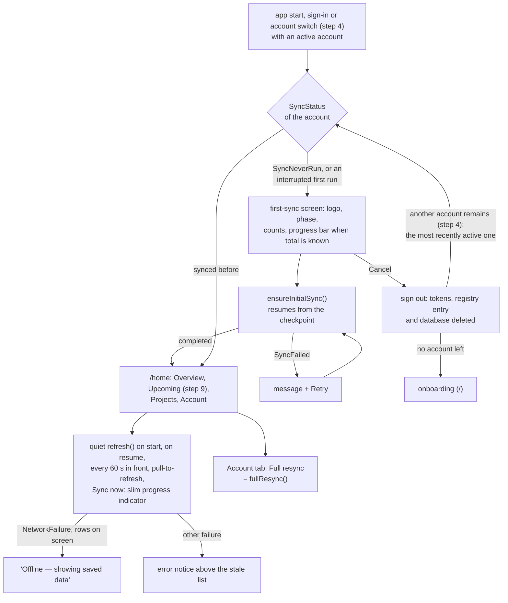

- Providers: `appDatabase(accountId)` and `syncEngine(accountId)` are keepAlive families closed on dispose; `syncStatus` (`core/sync/sync_providers.dart`) follows the active account and has no value until its engine has reported, which the router treats like "needs the first sync" (the screen says "Preparing…"). `bootstrap.dart` waits up to 5 s for that first report behind the launch screen, so a synced account's first frame is the shell. The repository providers of section 6 are built over them. `signOutProvider` lives in `core/auth/sign_out_providers.dart`, because the data wiper it takes (`accountDataWiper`: dispose the engine, close the database, delete the files) builds on the repository providers.
- The router (`app_router.dart`) sends a signed-in account to `/sync` from the splash and from every `/home` route while `needsFirstSync` holds (`features/sync/application/sync_status_queries.dart`: no report yet, `SyncNeverRun`, an initial `SyncRunning` or a `SyncFailed` without `lastSyncedAt`), and from `/sync` to the overview once it no longer does. The first-sync screen (`features/sync/presentation/`) calls `ensureInitialSync()` after its first frame, which is also its Retry; its cancel is a sign-out. Since step 4 a switch to an account that has synced before never passes through `/sync`, also while its engine has not reported yet, and the cancel of an added account's first sync makes the previously active account active again ([D37](decisions.md#d37-account-switcher-a-sheet-from-an-avatar-button-and-an-accounts-section-a-switch-resets-the-navigation-the-most-recently-active-account-follows-a-removal-inactive-outboxes-drain-in-the-foreground)) [exists, step 4]. An account that has synced before opens the shell at once; `StartupSync` (`features/sync/application/`) runs a quiet `refresh()` on the shell's first frame and on an account switch, never blocking. It decides on the engine's first reported status (a freshly built engine reports a placeholder until it has read `sync_state`), and skips a run in progress, an account synced within the last minute, and an account without a completed first run, which the first-sync screen resumes from its checkpoint. Since step 7 that `refresh()` is the incremental run, and `ForegroundSyncScheduler` in the same directory keeps it going on resume and every 60 s while the app is in front (section 7.3).
- The Account tab shows "Last synced <relative time>", a "Sync now" button (incremental) and, since step 7, a secondary "Full resync" button (`fullResync()`), both disabled during a run and in `needsReauth`; the sign-out dialog says that the local data is deleted. Since step 11 it also shows "Pending changes: N" with "Send now" while the outbox holds ops, and a "Sync problems" list with Retry and Discard per failed op, hidden when empty (section 7.5).
- Headless use: the engine needs no widget tree, so the background runs of step 16 run it in the background isolate over the same database (`shareAcrossIsolates`) through the same `ProviderContainer` (principle 4, section 7.8) [exists, step 16]. The status of a run in another isolate is not shared; the Account tab shows the last background run's time from the preferences.

### 7.5 Write path (`core/outbox/`) [exists, steps 11, 12a, 12b, 4 and 14]

Step 11 opened the write path on the most frequent actions, done with undo, favourite and delete, and proved the pipeline every later mutation uses ([D34](decisions.md#d34-outbox-local-first-writes-serial-sender-coalescing-retry-classes-sync-interplay-pending-fields-win-until-sent-pending-deletes-hidden-v1-full-replace-emulation)). A change is applied to the local row and queued in one transaction; a serial sender pushes the queue to the server through the write ports of section 4; the server's answer replaces the row; a refresh follows. Step 12a put creates and the edits of the core properties on the same pipeline ([D35](decisions.md#d35-creates-through-the-outbox-temporary-negative-ids-with-remap-createupdatedelete-coalescing-lost-response-recovery-by-title-within-a-1-h-window)): a new task is a row under a temporary negative id plus a create op; the sender sends the create and remaps the row to the server's id in one transaction; a create whose answer was lost is looked up before it is sent again. Step 12b added labels, assignees and reminders without a new op kind ([D36](decisions.md#d36-labels-and-assignees-as-id-set-deltas-in-the-task-update-sent-through-their-endpoints-after-a-read-before-write-diff-reminders-as-the-whole-list-label-creation-online-only)): label and assignee changes are id-set deltas in the task's update op, which the write port sends through the label and assignee endpoints after reading the task, only for the ids that differ; reminders are the whole list in the same op. The screens call the repository and read its streams as before; of the outbox they see only `SyncProblem`, `OutboxOperationKind` and `PendingTaskIdsSource` from `core/outbox/`, nothing of the DAO or the sender. Step 14 added relations the same way ([D41](decisions.md#d41-relations-as-deltas-in-the-task-update-sent-through-the-relation-endpoints-after-a-read-before-write-diff-temporary-ids-on-both-ends-resolved-at-send-time-the-inverse-rows-kept-locally-duplicate-and-subscriptions-online-only-subtasks-from-indented-quick-add-lines)): edges to add and remove in the same update op, sent through the relation endpoints after the same read, with temporary ids at both ends of an edge and the server's inverse edge written locally [exists, step 14].

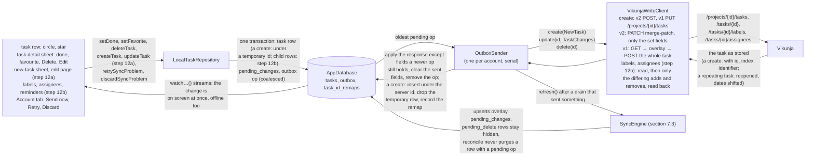

**Local write** (`LocalTaskRepository`, one transaction): the task row takes the change (`done` with `done_at`, `is_favorite`, or `pending_delete = true`), the row's `pending_changes` takes the merged `TaskChanges`, and `outbox` gets the op, coalesced: an update for a task whose update is still pending is merged into it (`TaskChanges.merge`, the later value wins per field), an update followed by a delete becomes the delete, a delete is final. The call returns when the transaction has committed and never throws for network reasons; the sender is asked to drain. Rows with `pending_delete` are gone for every DAO query and for the local count the sync's probe compares (section 7.3). A create (step 12a) inserts the row under a negative temporary id (the next value of the `sync_state` counter `local_task_ids`, negated, never reused), without an `updated` and with `pending_changes` null, and a `createTask` op whose payload is the `NewTask`; the call returns that id, and the row is an ordinary task for every query and screen, sorted before every server task. While the create has not left the device (pending and never sent, or rejected), an edit on the temporary id folds into the create by applying the `TaskChanges` onto the stored `NewTask` (favourite included; a rejected create is re-queued by it), `done`, which a create cannot carry, becomes an update queued behind it, and a delete cancels the create with the row: nothing is sent. Once the create may be on the server (in flight, or sent without an answer), later edits and a delete queue behind it as ordinary ops under the temporary id, which the sender takes only after the create is through.

Labels, assignees and reminders (step 12b): the same transaction changes the task's child rows. A label or assignee delta goes onto `task_labels` or `task_assignees` through `IdSetChange.applyTo`; a reminder list replaces `task_reminders`. An id without a local label or user row is skipped for the child rows (their foreign keys) but queued all the same. A relative reminder gets its instant computed on the device from the date it refers to (null while that date is unset), both when the reminders are set and when that date changes; the server's value replaces it with the next answer or pull. On a create that has not left the device, reminders fold into the `NewTask` and travel with the create; labels and assignees, like `done`, stay the update queued behind it, which waits under the temporary id and is rewritten to the server id by `completeCreate`, so they are sent after the remap. `completeCreate` also applies the pending changes of the ops behind the create to the child rows of the upserted server task, so labels and assignees chosen before the remap stay visible. The coalescing is the field-wise `merge` of `TaskChanges`, also when a failed op folds into a newer one.

**`TaskChanges`** (`vikunja_domain`): a nullable field per writable property, `title`, `description`, `done`, `isFavorite`, `priority`, `percentDone`, `hexColor`, `dueDate`, `startDate`, `endDate` and, since step 12a, `repeatAfter` (a `Duration`, seconds on the wire; zero with the default `repeatMode` removes the repeat), `repeatMode` and `projectId` (a move: the server reassigns `index` and `identifier`, which the applied response brings); null is "unchanged"; a date is a `DateChange`, `set(value)` or `clear()`; `merge(later)`, `isEmpty`. It is the outbox payload (JSON) and the argument of the write port. Since step 12b also `labels` and `assignees`, each an `IdSetChange` (the ids `added` and `removed`; `merge(later)` lets the later change win for an id both touch, so add then remove is a remove and remove then add an add; `applyTo(current)`; empty when both sets are), and `reminders`, the task's whole reminder list (empty removes every reminder; the later list wins on merge). Step 11 set `done` and `isFavorite` only; step 12a sets every field but `description` and the step 12b fields. **`NewTask`** (`vikunja_domain`, step 12a) is the create payload: project, title and the same core properties with their defaults; since step 12b also its reminders.

**Write ports** (`packages/vikunja_api/lib/src/write/`): `TasksWritePort.create(task)` (step 12a) returns the created task with the server's id, `index` and `identifier`, `update(id, changes)` returns the task as the server stored it (since step 12b read back after label or assignee requests, a reminder change or a date change), `delete(id)`; `LabelsWritePort.create(NewLabel)` (step 12b) returns the label the server created; `VikunjaWriteClient` from `createWriteClient(dio:, connection:)`, v2 when the connection reached it, over the account's authenticated `Dio` (section 5.2). The server facts behind the two adapters are in [research/sync.md](research/sync.md) §4.4, §6 and §8, [research/api-v1.md](research/api-v1.md) §5.1 and §6 and, for the editing rules, [research/client-logic.md](research/client-logic.md) §2.3–§2.5, §3 and §6.

| | v2 adapter | v1 adapter |
|---|---|---|
| Create (step 12a) | `POST /projects/{id}/tasks`, 201 with the task; the body carries `title`, `description`, `priority`, `percent_done`, `hex_color` (without `#`), `repeat_after` (seconds), `repeat_mode` and `is_favorite`, a date only when set (the server stores the zero date for an omitted one) and the project in the path only; never `done`, `assignees`, `bucket_id` or `labels` (ignored on create); since step 12b `reminders` when the task has any | `PUT /projects/{id}/tasks`, 201 with the task; the same body, where a `project_id` would override the path, so it is left out |
| Move (step 12a) | `project_id` in the patch; the server reassigns `index` and `identifier` but answers with the old project's identifier (it builds it before moving), so the adapter reads the task back; a move into an archived project is a 412 code 3008 | `project_id` overlaid into the full `POST` like any other field, then the same read-back |
| Update | `PATCH /tasks/{id}` with `Content-Type: application/merge-patch+json` and only the set fields under their wire names (`due_date`, `is_favorite`, `percent_done`, `hex_color` without `#`); the server merges them onto its current state, field by field; a `DateChange.clear` is the zero date `0001-01-01T00:00:00Z`; a 304 (nothing changed) is a success followed by `GET /tasks/{id}`; an unknown key would be a 422, so only known writable fields are ever sent | `POST /tasks/{id}` is a full replace, so the adapter does `GET /tasks/{id}`, overlays the changes and posts the whole task back, with `assignees` (`{id, username, name}`) and `reminders` exactly as read and never `labels` (the server ignores them); an omitted field would clear it, an omitted list would delete its rows |
| Reminders (step 12b) | `reminders` in the patch, a full replacement (`[]` clears them); absolute `{"reminder": <RFC 3339, UTC>, "relative_period": 0, "relative_to": ""}`, relative `{"relative_period": <signed seconds>, "relative_to": "due_date" \| "start_date" \| "end_date"}`, whose instant the server computes (the zero date when that date is unset); the server stores one reminder per instant and returns the list sorted by instant, but the update's answer echoes the list as sent, so the adapter reads the task back after a reminder change and after any date change | the new list overlaid into the full `POST` when the change sets it, otherwise the list as read goes back |
| Labels and assignees (step 12b) | after the body fields, or after a `GET /tasks/{id}` when there are none, only the requests that differ from the task as the server has it, in this order: label removes (`DELETE /tasks/{id}/labels/{labelId}`), label adds (`POST /tasks/{id}/labels`, `{label_id}`), assignee removes (`DELETE /tasks/{id}/assignees/{userId}`), assignee adds (`POST /tasks/{id}/assignees`, `{user_id}`); then one `GET /tasks/{id}`, the result. A label add answered 400 code 8001 and an assignee add answered 400 code 4021 count as done; a label remove answered 403 is checked with one read and counts as done when the label is no longer attached, else the `Forbidden` propagates; every other failure fails the op as a whole, and a retry reads again and sends only what is still missing | the same, with `PUT` for the adds; the deletes answer 200 |
| Label create (step 12b) | `POST /labels`, `{title, hex_color, description}` (`hex_color` without `#`; empty ones left out), 201 with the label | `PUT /labels`, the same body |
| Delete | `DELETE /tasks/{id}`, 204 | `DELETE /tasks/{id}`, 200 |
| Already gone | a 404 with code 4002 is a success on both versions | |
| Repeating task marked done | the server reopens it (`done: false`), shifts due, start, end and the reminders (mode 0 by `repeat_after`, 1 by a month, 2 from now) and returns that; the sender applies the response | |
| Errors | `normalizeError` (section 4); a cancelled request rethrows its `DioException` | |

**`OutboxSender`** (one per account, headless: the write client, the database, a clock and the `SyncEngine` are injected; nothing in it needs a widget tree, so the notification-action isolate of step 15 runs one of its own (section 7.7), and so does the background runner of step 16 (section 7.8)): drains the ops oldest first (`sequence`), one at a time, each claimed `sending` in a transaction that re-reads it (an edit merged in since the queue was read goes with it), never two sends at once per account. Only the request is guarded: once the server has stored the change, an error while applying the answer locally propagates and leaves the op `sending`, so nothing is re-sent on the spot; the next start resets and re-sends it (at least once, see D34). A drain starts when the sender is built (app start), after every local write, when the app comes back to the front, on "Send now" in the Account tab (which drops every backoff first), when a retry is due and when a paused sender resumes. Since step 4 the senders of inactive accounts with queued ops are asked to drain too while the app is in front, on start, on resume and when the account list changes; a sender is built only for an account that has queued ops and is not in `needsReauth` (section 5.7, [D37](decisions.md#d37-account-switcher-a-sheet-from-an-avatar-button-and-an-accounts-section-a-switch-resets-the-navigation-the-most-recently-active-account-follows-a-removal-inactive-outboxes-drain-in-the-foreground)) [exists, step 4]. The oldest op blocks the queue while it waits for its backoff, so later ops never overtake it; a `failed` op does not block, the drain goes on with the next pending one. On success the server's task replaces the row except for the fields a newer op of the same task still holds pending; those fields leave `pending_changes`; the op is deleted. A repeating task therefore reopens with the shifted dates. After a drain that sent at least one op the sender calls `SyncEngine.refresh()`, so server-computed fields (`done_at`, `updated`, repeat shifts) arrive and the probe's counts agree again.

A create (step 12a) goes through `create(NewTask)`. On success, in one transaction (`OutboxDao.completeCreate`): the create op goes, the ops queued behind it move to the server id, the temporary row is deleted and the server's task upserted under its id (a row the sync pulled meanwhile under that id is replaced), the fields those ops still hold are re-applied on top, and `task_id_remaps` gets `(local_id, server_id, at)`; `watchTask` follows the remap. A `NetworkFailure` or a `ServerFailure` on a create (the connection broke or timed out, or a proxy answered for an upstream still at work: the request may have been processed without this device seeing the answer) records `sent_at` on the op, the first such attempt's time, next to the usual backoff; a create a killed app left in `sending` gets its attempt time as `sent_at` at the next start's reset, instead of the blind resend an update gets. Before the next attempt sends again, the sender asks `listInProject(projectId, TaskQuery(filter: "created >= '<sent_at − 1 h>'", created descending))` (an hour: the clock skew the sync engine tolerates too) and adopts the newest task of the project with the sent title that no earlier create of this device adopted (`task_id_remaps`; of two in the same second the higher id), completing the create as if the answer had arrived; only when none is found is the create sent again. A rejected create is a sync problem that names the title and takes the edit queued behind it (a `done` stays queued), so Retry sends the latest state in one request; a delete behind it cancels the create and the row, because the server never had the task; Discard cancels it the same way, without a server read. An edit or delete under a temporary id whose create was answered meanwhile is followed to the server row.

Labels, assignees and reminders (step 12b) need no new op kind: they are fields of the update op, sent by `update(id, changes)` as the table above says, and a resend after a lost answer changes nothing twice, because the port reads the task first. The requests of one update are not atomic on the server: when one fails for good, the earlier ones stay applied, the op becomes a sync problem that names the task, Retry sends only what is still missing, and Discard reads the task from the server, which restores its labels, assignees and reminders locally. A label is created outside the outbox: `LabelRepository.create` calls `LabelsWritePort.create` at once and stores the answer, and only attaching it is queued.

**Relations (step 14)** ([D41](decisions.md#d41-relations-as-deltas-in-the-task-update-sent-through-the-relation-endpoints-after-a-read-before-write-diff-temporary-ids-on-both-ends-resolved-at-send-time-the-inverse-rows-kept-locally-duplicate-and-subscriptions-online-only-subtasks-from-indented-quick-add-lines)) [exists, step 14]: `TaskChanges.relations` is a `RelationChange`, the edges `added` and `removed` (each a `TaskRelationRef(kind, otherTaskId)`), merged like an `IdSetChange` (the later change wins per edge) and stored in the payload as `{"added": [{"kind", "other"}], "removed": […]}`; there is no new op kind. An edge is queued on the task the user edits, from that task's side, as the server stores it: an added subtask is the child's `parenttask` edge to the parent. The queueing transaction changes the task's `task_relations` rows by `RelationChange.applyTo` and, when the other task is local, its inverse rows (subtask and parenttask, related and related, duplicateof and duplicates, blocking and blocked, precedes and follows, copiedfrom and copiedto), because the server creates the inverse in the same request and deletes both directions; so a parent shows a subtask added offline at once. `update(id, changes)` takes the task as the server has it, sends removes (`DELETE /tasks/{id}/relations/{kind}/{otherId}`) for the edges in `removed` that `related_tasks` lists and adds (v2 `POST`, v1 `PUT /tasks/{id}/relations`) for those in `added` that it does not, then reads the task back; a 409 code 4008 on an add and a 404 code 4009 on a remove count as done. **Temporary ids at both ends:** an edge may be queued on a task whose create is queued (the update waits behind the create and is rewritten by the remap, as labels are) and may name one (a negative `otherTaskId`). The sender resolves every relation ref through `TasksDao.resolveId` at send time and passes only positive ids to the port, which refuses others; an op whose relations still name a temporary id waits like an op under a temporary task id, and the next op in line goes first. FIFO puts the other task's create ahead in practice. `completeCreate` rewrites `task_relations.other_task_id` and the relation refs of every queued payload from the temporary id to the server id in its transaction, and the pending overlay restores the remapped task's own rows. A cycle (409 code 4023), the task itself (400 code 4010), an unknown kind (400 code 4007 on v1, a 422 on v2) and a missing other task (a 404 code 4002 on an add, which the port wraps apart from the 4002 of a gone task, so it never removes the task) are permanent: a sync problem that names the task. The port tries the op's other requests before it throws the missing other task, and `OutboxDao.forgetRelatedTasks` drops the edges naming that task from every queued op and stored row (also when the sync purges a task), so the failed op holds nothing back. Since the server bumps `updated` only on the task a relation was changed on, `TasksDao.upsertAll` also makes the rows other local tasks hold to a pulled task the inverse of its edges, with those tasks' own queued relation changes on top; the v1 update takes `related_tasks` from the read it makes first, as its answer carries them empty. Quick add (step 13) queues the `parenttask` edge of each indented line after both creates. Duplicating and following are online calls outside the outbox: `duplicateTask` refuses while the task has queued ops, and the subscription state is read and toggled on the server (section 6).

```mermaid
stateDiagram-v2
  direction LR
  [*] --> pending: local write, in the transaction that changes the row
  pending --> pending: a later update is merged in, update then delete becomes the delete
  pending --> pending: on a temporary id (step 12a) a later edit folds into an unsent create, a delete cancels it; once the create may be on the server, later ops queue behind it
  pending --> sending: oldest op whose next_attempt_at has passed
  sending --> [*]: 2xx, 304, or 404 code 4002 on a delete (response applied, op removed; a create remapped)
  sending --> pending: NetworkFailure, ServerFailure, RateLimited (backoff, Retry-After), RefreshRaceLost, TokenRejected, and an answer that is not Vikunja's (UnexpectedResponse below 400, NotFound without a code)
  sending --> uncertain: NetworkFailure or ServerFailure on a create (step 12a), the request may have reached the server
  uncertain --> [*]: the lookup by title within 1 h finds the task (adopted, remapped, op removed)
  uncertain --> sending: the lookup finds nothing (the create is sent again)
  sending --> paused: SessionEnded
  paused --> pending: the account is signed in again
  sending --> failed: Forbidden, NotFound with a code, DomainError (3008, 4001, 4029), ValidationFailed, UnexpectedResponse 4xx/5xx
  failed --> pending: Retry in the Account tab, or folded into a newer op of the task that is still queued
  failed --> [*]: Discard (op deleted, task reloaded from the server, or removed on a 404 or 403)
  note right of paused
    the sender is paused, the op row stays pending,
    nothing is dropped
  end note
  note right of failed
    a SyncProblem in the Account tab,
    the local edit stays visible
  end note
```

| Answer | Op | Sender |
|---|---|---|
| success, 304, or 404 code 4002 on a delete | the response is applied (a delete removes the row; a create inserts the row under the server id, drops the temporary one and records the remap), the op is removed | next op |
| `NetworkFailure` or `ServerFailure` on a create (step 12a): the request may have reached the server | back to `pending` with the same backoff and `sent_at` set: the next attempt first looks the task up by title within the 1 h window and adopts it, or sends again | waits for it |
| `NetworkFailure`, `ServerFailure`, `RateLimited`, `RefreshRaceLost`, `TokenRejected` (the interceptor's own refresh and retry, section 5.2, did not help: the session was replaced by a new sign-in or the server will take the next token; a session that ended for good arrives as `SessionEnded`), and an answer that is not Vikunja's: `UnexpectedResponse` with no status or one below 400 (a captive portal's page, a proxy's redirect, an empty body), `NotFound` without a Vikunja code (a web server's 404 during a deploy) | back to `pending`; `attempts + 1`; `next_attempt_at` = now + 2 s · 2ⁿ, shortened by up to half at random, at most 15 min; a `Retry-After` above zero wins when the server sends one, capped the same way | waits for it; later ops wait behind it. A sync that reaches the server while the oldest op waits out a `NetworkFailure` drops the backoff and sends at once |
| `SessionEnded` | stays `pending`, untouched | `paused` until the account is signed in again (section 5.5), then drains; nothing is dropped |
| `NotFound` with a Vikunja code (3001 project gone; on an update also 4002, the task itself gone, and since step 12b 8002, a label gone, and 1005, a user gone, neither of which removes the task or the op; since step 14 also a relation add whose other task is missing, a 4002 the port wraps so that it is never read as the task gone), `Forbidden` (no access; since step 12b also 7003 for an assignee without access to the project, and a label the user cannot see), `DomainError` (3008 project archived; on a create also 4001, an empty title on v1, and 4029, a repeat beyond ten years; since step 14 4023, a relation cycle, 4010, a relation to the task itself, and 4007, an unknown relation kind on v1), `ValidationFailed` (v1 412 `invalid_fields`, v2 422, such as an empty title on a v2 create or, since step 14, an unknown relation kind), `UnexpectedResponse` 4xx or 5xx | `failed`, the failure as `last_error`: a `SyncProblem`; when a newer op of the task is still queued the failed op folds into it instead (an update gives it the fields it does not set, a delete makes it moot), so a task never has two ops the sender could send in either order | goes on with the next pending op |

**Sync interplay** (section 7.3): the sync engine's upserts, in the full pull as in the delta and the reconcile, overlay the row's `pending_changes` on the incoming task, so a field still on its way keeps the local value and every other field takes the server's; a `pending_delete` row is written but stays hidden; every purge (the full pull's, the reconcile's, a removed project's) skips rows with a pending op, because the task exists on the server or is being deleted anyway; no run touches the outbox. The local counts the probe compares (section 7.3) include the rows queued for deletion, because the server holds those tasks until the delete is sent; so a pending or failed delete costs no extra probe requests on every refresh. A row under a temporary negative id has a queued op by definition, so it is never purged either, and it stays out of the local count the probe compares (step 12a). Since step 12b the overlay also keeps the pending child rows: pending label and assignee deltas are applied to the incoming sets, a pending reminder list replaces the incoming one (relative instants recomputed); `upsertAll` runs in one transaction, so an edit saved while it runs is not overwritten; the incremental run also rewrites a task whose reminders differ from the local ones; and a label sync that removes labels takes their ids out of every unsent update (`OutboxDao.forgetLabels`).

**Repository and screens:** `TaskRepository.setDone`, `setFavorite`, `deleteTask`; `watchPendingChanges` (every queued op, `sending` included: none of them is accepted yet), `watchSyncProblems` (failed ops joined with the task title), `retrySyncProblem` (back to `pending`), `undoDone(previous)` (`done: false` plus, for a repeating task, the dates `previous` had, as `DateChange.set`; and, since step 12b, the reminders `previous` had, so the server's shift of the absolute ones is taken back, nothing for a task without reminders; the server does not shift an open task, so the undo works whether the done is still queued, in flight or answered), `discardSyncProblem` (the task is read from the server first, `GET /tasks/{id}` through the read client, then the op is deleted and the row replaced, or removed on a 404 or 403, which means the task left the user's projects; a read that fails for another reason throws and changes nothing, and the op is checked again inside the transaction, so a retry or delete that got through meanwhile is not undone), `sendPendingChanges` ("Send now"; returns the failure the oldest op still waits out, which the Account tab shows in a snackbar). `LocalTaskRepository` also implements `PendingTaskIdsSource` (`core/outbox/`): `watchPendingTaskIds()`, the ids with a queued op, which `pendingTaskIdsProvider` turns into the rows' cloud-off mark. The task row's circle is a 48 dp control ("Mark done" / "Mark not done" semantics, `selectionClick` haptic, strikethrough at once, a "Marked done · Undo" snackbar for 3 s, persisting under a screen reader, whose undo is `undoDone(previous)`; in the overview and in a project list without done tasks the done row stays where it was until its own 3 s are up and its snackbar has gone, so a second tap that replaces the snackbar does not pull the earlier row away under the finger; the snackbar undoes the latest task only) and its star toggles the favourite; the sheet has the done control (no snackbar there: the checkbox is its own undo), the favourite toggle and Delete behind an adaptive confirmation; the Account tab shows "Pending changes: N" while N > 0, with "Send now" while some of them are not sync problems (a failed Send now says why in a snackbar), and the "Sync problems" list (title, what failed, when, Retry, Discard; a Discard whose read fails says why and leaves the card), hidden when empty; the sign-out dialog says how many queued changes the wipe would lose; a row whose task has unsent changes shows a cloud-off icon ("Not yet synced"). Strings in ARB (en, de), dark mode and 200 % text scale as in every step. Step 12a added `createTask(NewTask)` (returns the temporary id), `updateTask(id, TaskChanges)` and `watchTask(id)`, the edit page, the new-task sheet, the FABs on the Overview and on a project's list and the Edit action of the detail sheet (section 6, screens). Step 12b added the Labels, Assignees and Reminders sections of the edit page with the label picker, the people picker and the reminder sheet, over `updateTask`, `LabelRepository` and `UserRepository` (section 6).

**Tests:** the adapters with the fake HTTP adapter (the exact v2 patch body per field, the zero date, 304, the v1 round-trip body with assignees, reminders and the untouched fields, 404 code 4002 on delete, error mapping, cancellation) and `TaskChanges.merge` / `isEmpty` in the packages; in the app the outbox DAO and the coalescing rules, the sender with a fake write client and a fake clock (success applies the response, a repeating task's response reopens it, every retry class with its backoff timing and `Retry-After`, pause and resume, a permanent failure as a problem, discard reloads or removes, retry, FIFO order, no concurrent sends, the refresh after a drain), the sync interplay (a pull does not clobber pending fields, a pending delete stays hidden and is not resurrected, the reconcile keeps rows with pending ops), the repository methods, the migration from schema 1 to 2 with data, and widget tests with the fake repository for each new behaviour. Contract tests against the live 2.7.0 server on both API versions: `packages/vikunja_api/test/contract/write_contract_test.dart` (a task seeded with an assignee, two reminders and a label is marked done and keeps all three, the v1 full-replace regression; undo; favourite on and off; a title change; a repeating task with `repeat_after` of one day comes back open with `due_date` a day later; a delete, then a second delete without a throw) and `app/test/contract/outbox_contract_test.dart` (seed through raw dio, initial sync, `setDone` drained and checked on the server and in the local row, `setFavorite`, `deleteTask` gone on both sides, a write client that fails with a `NetworkFailure` first and then sends, a repeating task reopened locally with the server's shifted date). Step 12a added: in the packages the exact create bodies on v1 and v2 (every field, unset dates omitted, the project only in the path, a local date sent as UTC, the colour without its hash), the response parsing, an empty title as `ValidationFailed` on v2 and `DomainError` 4001 on v1, an unknown and an archived project, the read-back after a move on both versions, the repeat overlaid in seconds and removed on v1, `NewTask` and the extended `merge`; in the app the DAOs (temporary-id allocation, the create op, create + update merged, create + delete cancelled, the remap transaction, the rewrite of later ops), the sender (a create's response remapped and applied, an uncertain create recovered by title, sent again when the lookup finds nothing, a permanent failure as a problem with the title, FIFO with mixed ops), the repository (a negative id visible in the lists at once, `watchTask` across the remap, the `updateTask` diff), the migration from schema 2 to 3, and widget tests (the shortcut vectors, the breakpoint times, the edit page sends only the changed fields, validation, the unsaved-changes guard, the repeat conversions, colour, the sheet's default project, chips, Add and More options, the FABs, the sheet's Edit entry). Contract tests on both API versions: `write_contract_test.dart` (a create with every core field echoed back and the identifier `<PREFIX>-<index>`, a move with the new identifier, repeat changed, switched to monthly and removed, an empty title refused as a 422 `ValidationFailed` on v2 and a 400 `DomainError` 4001 on v1, a repeat beyond ten years refused with 4029) and `outbox_contract_test.dart` (a task created offline, drained, on the server with the right fields and the local row under the server id; create + edit before the send is one request; create + delete is none; a move between projects; repeat removal). Step 12b added: in the packages the exact request sequence and bodies of every update shape (body fields only; labels only on v2 and v1; body fields with labels and assignees; nothing to send because the server already matches, which costs only the read), 8001 and 4021 tolerated, a label remove answered 403 re-read and tolerated or rethrown, failures propagated, the reminder wire form (absolute, relative, the empty list, the v1 overlay replacing the list), a create with reminders, the label create and the user search on both versions, `IdSetChange` (the merge table, `applyTo`, equality) and the extended `TaskChanges`; in the app the storage JSON of the new fields, the local apply on the child rows (labels added and removed, assignees, the foreign-key skip, reminders replaced, relative instants on a date change and on a reminder change), labels picked on an unsent create that are sent to the server id after the remap and survive it locally, merged deltas (add then remove, remove then add, folded into a failed op), the sync overlay of pending child rows, `completeCreate` restoring them, the sender end to end with the fake client (a permanent label failure as a sync problem with the task title, Discard restoring from the server), the undo of a repeating task restoring its reminders, the label and user repositories, and widget tests (the `TaskDraft` diff, the pickers with filter, multi-select, create success and failure, the 250-character limit, debounce and stale answers, the offline fallback, the reminder presets, the custom form, the absolute pick, a positive relative reminder kept as "after", no duplicate, the "date not set" warning, the unsaved-changes guard, 200 % text scale). Contract tests on both API versions: the write client (label create; labels added and removed, each twice without a failure; the user and a second user shared into the project assigned and unassigned; a user without access refused with 7003, a missing label with 8002, another user's label with a `Forbidden`; absolute and relative reminders set and cleared with `[]`; a create with reminders; on v1 a label or reminder change keeps the assignees; the user search returning owner and shared user, filtered by the query) and `outbox_contract_test.dart` (a task created offline with a reminder, then a label and the user as assignee before the send, on the server with all three and the local row under the server id; a label removed and added again; a repeating task with an absolute reminder marked done, then undone, with the reminder back at the original instant).

**Since step 13:** quick add writes through `createTask` and, when a line has labels or assignees, an `updateTask` with their deltas that waits behind the create and goes out after the remap ([D35](decisions.md#d35-creates-through-the-outbox-temporary-negative-ids-with-remap-createupdatedelete-coalescing-lost-response-recovery-by-title-within-a-1-h-window), [D36](decisions.md#d36-labels-and-assignees-as-id-set-deltas-in-the-task-update-sent-through-their-endpoints-after-a-read-before-write-diff-reminders-as-the-whole-list-label-creation-online-only)); the outbox itself did not change ([D38](decisions.md#d38-quick-add-the-web-grammar-in-vikunja_logic-with-d19s-fixes-weekday-and-ordinal-dates-at-the-default-time-and-an-unknown-project-kept-in-the-title-a-live-composer-labels-created-online-and-assignees-looked-up-on-submit-the-task-through-the-outbox)) [exists, step 13].

**Since step 15:** a notification's Done calls `setDone(taskId, done: true)` from the background action isolate (section 5.8) and drains with a sender built in that isolate; the claim-before-send transaction above keeps one send per op whichever isolate's sender takes it, and the sender there asks the session manager for a token without a refresh, so an expired access token leaves the op queued for the next foreground or background run; a repeating task's answer reopens the row as usual, and the scheduler then plans the next occurrence (section 7.7, [D39](decisions.md#d39-local-notifications-a-scheduler-per-signed-in-account-plans-from-the-local-database-and-diffs-against-a-rolling-window-with-stable-keys-exact-alarms-when-allowed-done-through-the-outbox-from-a-background-isolate-without-a-token-refresh-snooze-local-only-permissions-asked-once-after-the-first-sync)). The outbox itself did not change.

**Since step 16:** every background run drains each account's outbox after its sync, with a sender of the background isolate whose session manager refreshes (sections 5.8 and 7.8); a background Done whose drain ends with `TokenRejected` asks `BackgroundScheduler.enqueueDrain()` for a one-off run on Android, so the op leaves within minutes. Reads of server notifications do not use the outbox: they are a column of `server_notifications` that the activity sync sends (section 7.8, [D40](decisions.md#d40-background-sync-one-periodic-job-for-every-signed-in-account-with-a-deadline-skipped-while-the-app-is-in-front-the-incremental-run-as-the-session-keep-alive-a-one-off-drain-after-a-background-done-server-notifications-synced-into-a-local-inbox-on-their-own-cadence-new-unread-ones-as-activity-notifications-the-first-run-silent)). The outbox's one change: an op `sending` in another isolate stops every sender's queue until it is 5 min old (section 7.8).

**Since step 10:** marking a task read when the detail sheet's read says it is unread is an online call through `TasksWritePort.markRead`, fire and forget and outside the outbox: a failure is ignored, and the next opening that finds the task unread sends it again (section 6). The outbox itself did not change [in review, step 10].

**Planned:** the description (step 25), offline label creation and label management (step 28), the widget actions through the same outbox (steps 18–19), a conflict UI for descriptions (step 25); section 7.6.

### 7.6 Planned

Steps 7, 11, 12a, 12b, 13 to 16, 9 and 10 leave these out: no WebSocket, no kanban buckets ([D30](decisions.md#d30-kanban-board-reads-deferred-to-step-20)), no positions outside the view snapshots and no reordering, no saved filters beyond the Overview's download, comments, attachments and reactions read online in the detail sheet but never stored and never written (step 10), no edits of the description, and labels can be created only online. Background work, the activity notifications and the inbox are section 7.8 (step 16).

- **Labels and the remaining task edits:** label management and offline label creation (temporary label ids would need a second remap, [D36](decisions.md#d36-labels-and-assignees-as-id-set-deltas-in-the-task-update-sent-through-their-endpoints-after-a-read-before-write-diff-reminders-as-the-whole-list-label-creation-online-only)) come with step 28; quick add (step 13) does not need them: it creates missing labels online and reports the ones it could not create ([D38](decisions.md#d38-quick-add-the-web-grammar-in-vikunja_logic-with-d19s-fixes-weekday-and-ordinal-dates-at-the-default-time-and-an-unknown-project-kept-in-the-title-a-live-composer-labels-created-online-and-assignees-looked-up-on-submit-the-task-through-the-outbox)). The cover image follows with attachments (step 26), the description and the checklist toggles with the editor (step 25; `RichTaskItem.sourceOffset` already records where each `data-checked` sits in the raw HTML), comments and reactions with step 27. Storing attachment metadata for offline lists can come with step 26 ([D44](decisions.md#d44-task-detail-complete-rich-text-from-an-own-parser-of-the-web-editors-schema-details-and-comments-online-on-demand-deep-links-on-the-app-scheme)). Kanban moves (step 20) will queue through the same outbox, as quick add (step 13) and relations (step 14, section 7.5) do.
- **Lists (steps 8, 20, 22, 24, 29):** the filter engine that evaluates every view filter and saved filter on the device, which replaces the snapshots of the views only the server can evaluate, and Favorites and saved filters as lists of their own (step 24, with step 8's smart lists); drag reordering, which writes positions (step 22); the Kanban view (step 20) and the Table and Gantt views (step 29), which the view chips leave out. The sync never downloads views ([D43](decisions.md#d43-task-lists-from-the-local-database-like-the-webs-a-view-snapshot-for-positions-and-server-only-filters-the-overviews-saved-filter-downloaded-by-the-sync-upcoming-with-the-web-presets-and-a-pinned-overdue-part)).
- **Realtime (step 17):** WebSocket in the foreground only, used as a trigger of `refresh()` (section 7.3) in place of the 60 s timer while connected, never as a source of truth. Reconnects are capped, because the upgrade shares the login rate limiter. The server's `task.reminder` event is de-duplicated against the local notification of section 7.7 by task id within about ±2 min.
- **Widgets (steps 18–19, postponed by the owner until after phase 4):**
  - Snapshot JSON is written after every sync or local change.
  - Android uses Glance with a Dart callback.
  - On iOS, mark-done is a native Swift AppIntent that uses an App Group outbox file. It never opens SQLite and never refreshes tokens.

### 7.7 Local notifications (`core/notifications/`) [exists, step 15]

The server never pushes reminders: its cron stores an in-app notification for the task's recipients and sends an e-mail when that is enabled, and a due date has no notification of its own ([research/sync.md](research/sync.md) §4.3). The phone therefore schedules the OS notifications itself from the account's database, which mirrors the server since step 7 ([D17](decisions.md#d17-notification-policy), [D39](decisions.md#d39-local-notifications-a-scheduler-per-signed-in-account-plans-from-the-local-database-and-diffs-against-a-rolling-window-with-stable-keys-exact-alarms-when-allowed-done-through-the-outbox-from-a-background-isolate-without-a-token-refresh-snooze-local-only-permissions-asked-once-after-the-first-sync)). Everything is per account and keyed by the account id (section 5.7): the preferences, the scheduler, the `scheduled_notifications` table (section 7.1) and the os-id namespace. The screens are in section 6 (the setup screen, the Notifications section of the Account tab, the tap listener); the platform configuration is in section 8.

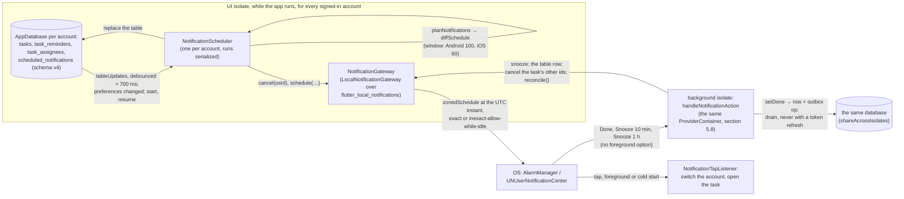

- **The plan** (`planNotifications`, a pure function): the tasks with `done = false`, not queued for deletion, whose `createdById` is the account's user or whose assignees contain the user ([D17](decisions.md#d17-notification-policy)); one entry per reminder with an instant after `now`, keyed `<taskId>:reminder:<ordinal>` (the reminder's position in the task's list; a relative reminder of an unset date has no instant and gives none), when the account's `reminders` preference is on; `<taskId>:due` at the due instant when `dueDates` is on and it is after `now`. A snooze whose `originalFireAt` is the entry's planned instant and whose `until` has not passed moves the entry to `until`; every other snooze is dropped. Sorted by instant, then key. Title: the task title. Body: "Reminder · *project*" or "Due now · *project*", with the identifier when the task has one, localised for the device locale through `lookupAppLocalizations` (no widget tree needed, so the background isolate builds the same texts). Due dates and reminder instants are absolute UTC instants (the server computes a relative reminder's, the app for an unsent edit, section 7.5), so the gateway schedules `tz.TZDateTime.from(instant, tz.UTC)` and no time zone is involved.
- **The diff and the window** (`diffSchedule`, pure and deterministic): only the first *window* entries of the plan go to the OS, 100 on Android and 60 on iOS (under iOS's cap of 64 pending notifications, with slack for snoozes and the test notification). A scheduled entry whose key is not in the window, or whose instant, title or body differs, is cancelled; a window entry not scheduled identically is scheduled; the rest is left alone. Every reconcile refills the window. Exactness is part of the diff: the row records whether the OS was given an exact alarm, so a granted or revoked exact-alarm permission re-registers the whole window on the next reconcile (the plugin's pending list is a cache that does not notice a revocation).
- **OS ids:** a 31-bit positive hash of `<accountId>:<key>` (the first four bytes of its SHA-256, the sign bit cleared), stored in the table. A collision inside the account probes upwards to the next free id. A collision across accounts is accepted: the plugin's id space is one per app, the other account's next reconcile finds its entry gone from `pendingIds()` and schedules it again. Id 1 is reserved for the test notification.
- **The scheduler** (`NotificationScheduler`, one per account; the gateway, the database, the clock, the preferences store, the user id, the `describe` callback and the window are injected): `reconcile()` loads the tasks and the snoozes, plans, diffs, cancels and schedules through the gateway and replaces the table. The write is guarded: inside its transaction the rows are compared with those the run planned from, and when another isolate changed them meanwhile (a background snooze, its reconcile) nothing is written and the run goes once more from the table as it is. Runs are serialized; a call during a run queues one more. When the notification permission is not granted, or no preference is on, it cancels every pending id of the account and clears the table instead. `exact` is `capabilities().exactAlarms`: `AndroidScheduleMode.exactAllowWhileIdle` when Android allows exact alarms, `inexactAllowWhileIdle` otherwise (minutes late in Doze), always exact on iOS. Triggers: a debounced (≈ 700 ms) watch on `tasks`, `task_reminders` and `task_assignees` (drift's `tableUpdates`), the preferences stream, app start and resume, an answer to the permission request inside the app (`NotificationSchedulers.reconcileAll()`, since the OS dialog does not always come with a resume), and the end of a background action. A keep-alive provider the shell listens to builds **one scheduler per signed-in account**, not only for the active one, the way `inactiveOutboxesProvider` keeps the inactive senders (section 5.7); sign-out and account removal dispose the account's scheduler and cancel its pending ids before the database is deleted (`AccountDataWiper`, section 5.6).
- **Preferences** (`NotificationPreferences`: reminders, due dates, both on by default): `NotificationPreferencesStore` over the `PreferencesStore` (key `notifications.<accountId>`, JSON) with a `changes` stream; not in the database, because the scheduler needs them before it is open and they are not sync state. The once-per-device flag `notifications.onboarded` of the setup screen lives there too.
- **The gateway** (`LocalNotificationGateway` over flutter_local_notifications 22.3.2, the only code that touches the plugin; everything above it is tested with a fake): the Android channel `reminders` (importance high, name and description localised at `initialize()`), the three actions on both platforms (Android with `showsUserInterface: false` and `cancelNotification: true`; iOS as the category `task` with `DarwinNotificationAction.plain` and no `foreground` option), `zonedSchedule` with the UTC instant and the schedule mode above, `capabilities()` from `areNotificationsEnabled()`, `canScheduleExactNotifications()` and iOS's `checkPermissions()`, `requestPermission()` (`requestNotificationsPermission()`), `openExactAlarmSettings()` (`requestExactAlarmsPermission()`, the system page of Android 14+; a no-op elsewhere), `openNotificationSettings()` (`openAppNotificationSettings()`), `pendingIds()` from `pendingNotificationRequests()` and `showNow`. A tap in `onDidReceiveNotificationResponse` goes to an injected callback; `getNotificationAppLaunchDetails()` is exposed for the cold-start tap. `bootstrap.dart` hands the plugin both callbacks and calls `initialize()` right after `runApp` (the first frame does not wait for it; every other gateway call runs it first anyway, and a failed attempt is tried again). `tz.UTC` is a built-in location, so no timezone database is loaded.
- **Actions in the background isolate** (`notification_action_handler.dart`; the top-level `@pragma('vm:entry-point')` function in `notification_entry_points.dart` is passed to the plugin at `initialize()`): `handleNotificationAction(NotificationResponse)` builds the container of section 5.8, decodes the `NotificationPayload` (`{account, task, key}`) and, for `mark_done`, calls `LocalTaskRepository.setDone(taskId, done: true)` on that account (a temporary id is resolved through the remap of section 7.5), awaits the drain for at most ≈ 20 s under the no-refresh rule, cancels the task's other notifications and reconciles; for `snooze_10m` and `snooze_1h` the scheduler's `snooze` writes `until = now + 10 min` or `+ 1 h` and `originalFireAt` onto the table row (taken from the task itself when a reconcile has already dropped the fired entry, as every reconcile after a notification fired does: the key names the reminder's ordinal or the due date, and the snooze is a no-op when that instant is unset or has moved ahead), hands the OS the moved entry at once and then reconciles; nothing reaches the server for a snooze. A payload it cannot read is ignored. Errors are logged and never crash the isolate; the container is disposed at the end, which only disconnects its database client (the sign-out's wiper alone waits for the database isolate to close sqlite, `OpenDatabases.closeForDeletion`). iOS completes the notification response before the Dart side runs and may suspend the process within seconds, so the OS is told first (Done cancels the task's notifications before the drain, a snooze schedules before it reconciles) and Done waits at most ≈ 5 s for the drain there (≈ 20 s on Android); the op stays queued either way, and since step 16 a drain that ends with `TokenRejected` (the token had expired) enqueues a one-off background drain on Android (section 7.8) [exists, step 16]. The texts are resolved for the device locale once per isolate (bootstrap and the entry point, `loadDeviceAppLocalizations`); the headless engine on iOS reports no locales, so the UI isolate notes the tag it resolved under `notifications.locale` and an isolate without locales takes that, else English. A running UI sees a Done through its streams; the row's cloud-off mark covers the unsent case, and a repeating task reopens with the server's shifted dates when the op is answered, which the watch turns into the next occurrence.
- **Platform:** Android needs core library desugaring, `POST_NOTIFICATIONS` (13+), `SCHEDULE_EXACT_ALARM` (declared, never `USE_EXACT_ALARM`), `RECEIVE_BOOT_COMPLETED` (the plugin re-registers the pending notifications after a reboot), the plugin's receivers and a monochrome notification icon; iOS the plugin's registrant callback for the background engine in `AppDelegate.swift` and the `UNUserNotificationCenter` delegate, no background modes for notifications (section 8; step 16 added those of the background sync).
- **Since step 16** every background run reconciles each account's scheduler, so the window is refilled while the app is closed, as often as the OS runs the job (before, what fired after the app was last in front was what the window held), and the gateway gains `showActivity` on a second channel `activity` (section 7.8) [exists, step 16]. **Not yet:** the WebSocket de-duplication (step 17), app lock (`authenticationRequired` on the actions, step 35); no grouping, no custom sounds, no overdue digest ([D17](decisions.md#d17-notification-policy)).
- **Tests:** `planNotifications` (creator, assignee and neither; done, pending delete, past instants, a relative reminder without an instant, a snooze applied, dropped and expired, the preference toggles, the order), `diffSchedule` (the window, unchanged kept, changed rescheduled, removed cancelled), the id hash and the collision probe, the scheduler against a fake gateway and an in-memory database (the table written, the watch triggering after a change, permission denied cancelling everything, exact alarms granted or revoked between runs, a snooze of another scheduler landing during a run, dispose), the action handler with the fake gateway and the fake write client (Done queued, sent and the task's other notifications cancelled before the send; Snooze rescheduled at +10 min, also after a reconcile dropped the fired row; an unknown payload ignored), the preferences store, the migration from schema 3 to 4 with data, the wiper cancelling the ids and forgetting the preferences (from the providers and through the shell), and the widget tests of section 6.

### 7.8 Background work and activity (`core/background/`, `core/activity/`) [exists, step 16]

Vikunja pushes nothing to a phone, so step 16 polls from the background ([D40](decisions.md#d40-background-sync-one-periodic-job-for-every-signed-in-account-with-a-deadline-skipped-while-the-app-is-in-front-the-incremental-run-as-the-session-keep-alive-a-one-off-drain-after-a-background-done-server-notifications-synced-into-a-local-inbox-on-their-own-cadence-new-unread-ones-as-activity-notifications-the-first-run-silent)): one periodic job for every signed-in account runs, per account, the incremental sync of section 7.3, the outbox drain of section 7.5 and the scheduler's reconcile of section 7.7, and the first request of each run keeps the account's session alive ([D22](decisions.md#d22-session-keep-alive-through-background-sync)). The same runs, and the foreground on a cadence of its own, sync the server's in-app notifications into the account's database: the inbox reads them (section 6), and the new unread ones become activity notifications. The background isolate is the second headless entry point after the action isolate of section 7.7, and the first that refreshes tokens (section 5.8).

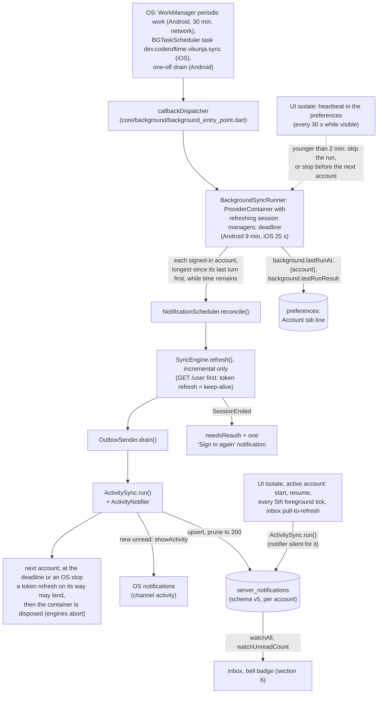

- **The job** (`WorkmanagerBackgroundScheduler`, implementing `BackgroundScheduler` over workmanager 0.10.10; tested against a fake wrapper of `Workmanager`): `registerPeriodicSync()` registers on Android one periodic task every 30 min with `Constraints(networkType: NetworkType.connected)` and `ExistingPeriodicWorkPolicy.update`, so registering again on every start neither duplicates the work nor restarts its period, and on iOS the periodic BGTaskScheduler task `dev.coderoftime.vikunja.sync` with a frequency of 30 min (an earliest begin date, which the system may stretch indefinitely) plus background fetch; `enqueueDrain()` enqueues an ordinary one-off task with the same network constraint on Android, chained after a drain that is running (`ExistingWorkPolicy.append`, natively `APPEND_OR_REPLACE`), never expedited: below Android 12 WorkManager runs expedited work as a foreground service, which the plugin's worker does not provide, and fails it before it starts; it is a no-op on iOS; `cancelAll()` cancels both. `bootstrap.dart` passes the top-level `callbackDispatcher` (`@pragma('vm:entry-point')`, calling `Workmanager().executeTask`) to `Workmanager().initialize` and registers the periodic sync after the first frame while at least one account exists; the last sign-out cancels everything (section 5.6). One job serves every account, not one per account: WorkManager's quota, the standby bucket and iOS's scheduling are per app anyway.
- **The runner** (`BackgroundSyncRunner`, `core/background/background_sync_runner.dart`, headless): builds a `ProviderContainer` like the action handler of section 7.7 (the `ClientIdentity.load()` override included), but with session managers that refresh (section 5.8). It does nothing when the foreground heartbeat, a preferences key the UI isolate writes every 30 s while the app is visible (`ForegroundHeartbeat`, on a timer of its own, so a long foreground run or a backed-off foreground scheduler never lets it age), is younger than 2 min: the foreground already syncs the active account, drains the inactive outboxes and reconciles every scheduler; it checks again before every account and stops once the app came to the front. Otherwise it takes the signed-in accounts by the start of their last turn (`background.lastAttemptAt.<account>`, round-robin, the oldest synced first among equals), so an account that never gets through (an unreachable server) does not starve the others, and, for each while the injected deadline (Android 9 min, under WorkManager's 10 min; iOS 25 s, under the ≈ 30 s) leaves at least 10 s: `NotificationScheduler.reconcile()` first (section 7.7; local only, so the notification window is refilled even when the network steps use up the time) → `SyncEngine.refresh()` → `OutboxSender.drain()` (section 7.5) → `ActivitySync.run()` with the notifier → `reconcile()` again after a sync that got through. Its engines are headless (`runsHeadlessProvider`): a refresh stays incremental even when the daily full resync is due (the app runs that when it is in front; in a background run it would start over every time), and a run another isolate holds is skipped, not waited for (below). A `NetworkFailure` skips the account's remaining network steps, each would wait for its own timeout. A `SessionEnded` marks the account `needsReauth` (section 5.5) and posts the session notification below; any other failure is logged and the run goes on with the next account. At the deadline, and when WorkManager stops the worker (`onTaskStopped`: constraints lost, Doze, standby, quota), a token refresh still on its way gets up to 3 s to land (`SessionManagers.settle()`, D26: a rotation whose answer is dropped ends the session), then the container is disposed: the running engine aborts (`dispose()`) and the incremental run starts from its watermark next time. It writes `background.lastRunAt.<account>` and `background.lastRunResult` to the preferences for the Account tab, never throws out of the callback and returns success to the plugin even when nothing could run: a failure would add WorkManager's retry backoff on top of the period, and the next periodic run comes anyway.
- **One run per account across isolates.** The UI isolate, a background run and a notification action share each account's database, and the heartbeat keeps them apart only in the usual case. Overlapping sync runs are not harmless: a full run purges every task it did not mark itself, so tasks another run marked meanwhile would vanish until the next full run. Every `DefaultSyncEngine` run therefore takes the account's lease in `sync_state` (`sync_lease` = `{owner, until}`, 3 min) in a transaction, renews it on every checkpoint and before every request, checks it in the transaction of the purge and of the completion, and releases it at the end; a run that finds its lease taken (it stalled past 3 min) stops quietly and purges nothing. The app's engine waits for a lease another isolate holds and then adopts the state that run stored; a headless engine skips the sync. Outbox senders of one account coordinate through the queue itself (section 7.5): an op `sending` elsewhere stops the queue until it is 5 min old.
- **Keep-alive** ([D22](decisions.md#d22-session-keep-alive-through-background-sync)): every incremental run starts with `GET /user` (section 7.3); background runs are at least 15 min apart and access tokens live 600 s, so that request finds the token expired, the session manager refreshes it (section 5.4) and the 72 h window slides. No request is spent on the keep-alive itself. On iOS, where runs may never come, a session can still end after 72 h without the app; the next run that reaches the account, or the app's own session check (section 5.5), finds it.
- **Session ended:** an activity notification "Sign in again to *host*" with the payload key `session:<account>`, once per account and ended session (a preferences entry remembers it until the account is signed in again); its tap switches to the account and opens the Account tab with the reauth banner (section 6).
- **Drain after a background Done:** when the drain of a background Done ends with `TokenRejected` (the stored access token had expired, and the action isolate never refreshes, section 7.7), the action handler calls `BackgroundScheduler.enqueueDrain()`; on Android the one-off task runs through the same callback dispatcher in a refreshing container, usually within minutes (Doze defers it to a maintenance window), instead of at the next app open.
- **The activity sync** (`ActivitySync` in `core/activity/`, per account, headless; the read and write clients, the database and a clock injected): `run()` first sends the pending reads, as one `markAllRead()` when every unread row is pending read, else one `markRead(id)` per id (`read_pending` cleared on success, kept on failure); then it pulls `NotificationsPort.list` pages newest first until a page contains an id already stored, at most 3 pages, upserts them (keeping the local `read_pending` and `notified`), prunes the table to the newest 200 and returns the ids that are new and unread. Once an hour, and on the inbox's pull-to-refresh (`refresh(wholeWindow: true)`), the pull goes on past the stored ones while an older stored one is unread here, up to the 200 kept, so a "mark all as read" on the web reaches the badge; what those pages hold that was never stored is old and stored as handled. A notification the pull finds read on the server is withdrawn from the tray. On an empty table (the account's first run) everything is stored as notified, so a sign-in never floods the shade with old activity. It has its own cadence, outside the task sync's request budget:

  | Trigger | Accounts | Runs |
  |---|---|---|
  | background run (periodic, or the drain) | every signed-in account, longest since its last turn first | `reconcile()`, `refresh()`, `drain()`, `ActivitySync.run()` with the notifier, `reconcile()` |
  | app start, resume | the active account | `ActivitySync.run()`, next to the task sync of section 7.3 |
  | every 5th tick of `ForegroundSyncScheduler` (≈ 5 min in front) | the active account | `ActivitySync.run()` |
  | inbox pull-to-refresh | the active account | `ActivityRepository.refresh()` → `ActivitySync.run()`; a failure is the inbox's offline notice |

- **The notifier** (`ActivityNotifier`): for each new unread notification of the kinds `task.comment`, `task.assigned`, `task.mentioned`, `task.created`, `task.deleted`, `project.created` and `team.member.added` (never `task.reminder`: the local reminders of section 7.7 cover it), when the account's `activity` preference is on (a new field of `NotificationPreferences`, on by default; a stored entry without it reads as on) and the notification permission is granted, it calls `NotificationGateway.showActivity(osId, title, body, payload, subtitle, group)` and sets `notified`, so nothing is shown twice. A run shows the newest 5 one by one and one "More activity" notification (key `inbox:<account>`, whose tap opens the inbox) for the rest, all in the account's group (`groupKey` on Android, `threadIdentifier` on iOS), and then cancels the account's oldest activity notifications beyond 10 in the tray (`NotificationGateway.delivered()`), because Android drops every post beyond 50 notifications of an app, reminders included. With several accounts signed in each names its account (`@username · host` as Android's `subText` and iOS's `subtitle`). A read in the inbox, a read the pull finds on the server and a new sign-in (for the session notice) withdraw the notification from the tray; sign-out withdraws everything the account has there (`ActivityTray`). The os id is the hash of section 7.7 over `<account>:activity:<id>`; the payload is `NotificationPayload(account, task: <taskId, or 0>, key: 'activity:<id>')`, with task 0 for `task.deleted` (nothing to open; its tap opens the inbox); the title is the task title, else the project or the team; the body follows the web's wording with the doer's name, localised (en, de): "Anna commented: …" (the first 80 characters of the comment as plain text), "Anna assigned you" (German "Anna hat dir diese Aufgabe zugewiesen"), "Anna mentioned you", "Anna created this task in *project*", "Anna deleted this task", "Anna created the project *title*", "Anna added you to the team *team*". While the app is in front nothing is shown for the active account, whose bell badge shows it; the other accounts' notifications are shown.
- **The gateway:** `LocalNotificationGateway.showActivity` shows the notification at once on a second Android channel `activity` (default importance, name and description localised) without actions, and on iOS without a category; a tap reaches the tap listener of section 6 like any other.
- **Inbox data** (`LocalActivityRepository`, implementing `ActivityRepository` over the DAO of section 7.1 and `ActivitySync`; `activityRepositoryProvider` follows the active account, `accountActivityRepositoryProvider(accountId)` serves any account): `watchAll()` newest first, `watchUnreadCount()` (the badge: unread after applying the pending reads, without the server's `task.reminder` copies, which the phone has shown itself; the inbox still lists them and "Mark all as read" takes them), `refresh()` (one `ActivitySync.run()`, throwing its `VikunjaFailure` and keeping the stored rows), and `markRead(id)` and `markAllRead()`, which change the table at once (`read_pending`) and leave the request to the next activity sync. Server notification reads never go through the outbox of section 7.5: a read is idempotent and cheap to send again.
- **Tests:** the DAO and the migration from 4 to 5 with data; `ActivitySync` (the first run marks everything notified, later runs return only the new unread ones, the stop at a known id, the 3-page cap, the hourly and pull-to-refresh read-back of the stored window, pending reads sent and kept on failure, the mark-all case); the notifier (the kinds, the preference off, the permission denied, the texts per kind in en and de with their fallbacks, the os id's stability, never twice, five per run and one for the rest, the tray trimmed to ten, the account label); the runner with fakes (the heartbeat skip, the deadline between accounts and the dispose, a session ended → `needsReauth` and one notification, the turn order by the last attempt, the app coming to the front between accounts, an OS stop, an unreachable server skipping the other network steps, every step called); the scheduler adapter against a fake `Workmanager` wrapper (the registration arguments per platform); the action handler enqueueing a drain on `TokenRejected`; and an app contract test against 2.7.0 (user B assigns user A → A's activity sync stores it and the notifier shows one activity notification; a read marked locally reaches the server with the next run).
- **Not yet:** deleting server notifications, team and project screens (`team.member.added` opens the inbox), writing comments (step 27; the inbox shows the comment text the notification carries, and since step 10 the task's detail sheet reads its comments online, section 6), the WebSocket (step 17).

## 8. Cross-cutting

- **UI:** material_ui and cupertino_ui instead of the in-SDK libraries ([D2](decisions.md#d2-material_ui-and-cupertino_ui)); dynamic colour on Android [planned, step 8]; dark mode and 200 % text scale in every step. Relative dates in list rows and absolute, localised dates in the detail come from intl, in device local time [exists, step 5].
- **Localisation:** gen-l10n with ARB files, English and German, which is also the first-release scope ([D21](decisions.md#d21-languages-english-and-german)). Generated code lives in `app/lib/l10n/generated/`.
- **Logging:** `package:logging` with redaction of auth headers and tokens, of `code=`, `state=`, `access_token`, `refresh_token` and `Bearer` values, and of callback URLs [exists]; deep links are never logged [in review, step 10]. A ring buffer, file rotation and diagnostics export are planned (step 35).
- **Platform configuration:**
  - Android: `android.uniquePackageNames=false` for Cronet ([D5](decisions.md#d5-dio-with-native_dio_adapter)).
  - Android has a network security config that trusts system and user CAs and permits cleartext. iOS has `NSAllowsArbitraryLoads` and `NSLocalNetworkUsageDescription` [exists, D8].
  - Browser sign-in: on Android, flutter_web_auth_2's `CallbackActivity`, exported, with a `BROWSABLE` intent filter for the scheme `vikunja-dev.coderoftime.vikunja`; since step 10 the filter also names the host `oauth` and the path `/callback`, because the activity completes a pending sign-in with whatever URI of the scheme it receives, and task links of the same scheme must not reach it [in review, step 10]. ASWebAuthenticationSession on iOS needs no URL type for the callback, verified on the simulator in step 2+3 ([D23](decisions.md#d23-browser-sign-in-through-flutter_web_auth_2-client-id-and-redirect-uri)); since step 10 the app declares one anyway, for task links, and the session still catches its own callback ([D44](decisions.md#d44-task-detail-complete-rich-text-from-an-own-parser-of-the-web-editors-schema-details-and-comments-online-on-demand-deep-links-on-the-app-scheme)) [in review, step 10].
  - Task links (section 6, [D44](decisions.md#d44-task-detail-complete-rich-text-from-an-own-parser-of-the-web-editors-schema-details-and-comments-online-on-demand-deep-links-on-the-app-scheme)) [in review, step 10]:
    - Android: `TaskLinkActivity`, exported, translucent, `noHistory`, `excludeFromRecents` and with an empty `taskAffinity`, owns a `BROWSABLE` filter for the scheme with the host `task`. It starts `MainActivity` with the link (`ACTION_VIEW`, `FLAG_ACTIVITY_NEW_TASK`, `SINGLE_TOP` and `CLEAR_TOP`) and finishes: a link tapped in another app would otherwise start its activity in that app's task, and `singleTop` reuses `MainActivity` only on top of its own task, so a second `MainActivity` with a second Flutter engine on the same databases would start there. `MainActivity.onCreate` drops the link data when the activity is reopened from Recents, where it already dropped the extras of a quick action (step 13), and when it is restored after the process died, because both replay the launch intent and would open the task again.
    - iOS: a `CFBundleURLTypes` entry in `Info.plist` with the scheme `vikunja-dev.coderoftime.vikunja` (role Viewer, name `dev.coderoftime.vikunja`).
    - Flutter's built-in deep linking stays on (neither `flutter_deeplinking_enabled` nor `FlutterDeepLinkingEnabled` is set, so Flutter's default applies): it hands the start link and later links to the router as route information, where the router's app-scheme observer takes them before go_router can route them (section 6). No `app_links` or other native plugin is involved.
  - The "New task" app shortcut on Android and Home Screen quick action on iOS come from the `quick_actions` package, with localised titles [exists, step 13].
  - Notifications (section 7.7, [D39](decisions.md#d39-local-notifications-a-scheduler-per-signed-in-account-plans-from-the-local-database-and-diffs-against-a-rolling-window-with-stable-keys-exact-alarms-when-allowed-done-through-the-outbox-from-a-background-isolate-without-a-token-refresh-snooze-local-only-permissions-asked-once-after-the-first-sync)) [exists, step 15]:
    - Android: core library desugaring in the Gradle build (`isCoreLibraryDesugaringEnabled`, `desugar_jdk_libs`), which flutter_local_notifications 22.x needs; the permissions `POST_NOTIFICATIONS` (the runtime permission of Android 13+, asked on the setup screen), `SCHEDULE_EXACT_ALARM` (denied by default on Android 14+ for a new install; the user allows it on the system page the setup screen and the Account tab open; without it the scheduler falls back to inexact alarms) and `RECEIVE_BOOT_COMPLETED` (the plugin re-registers the pending notifications after a reboot); never `USE_EXACT_ALARM`, which Play policy reserves for alarm and calendar apps; the plugin's receivers from its README; a monochrome notification icon (`@drawable/ic_notification`, `res/drawable-*dpi/ic_notification.png`, white on transparent: the llama head of the logo's glyph, see [branding/README.md](../branding/README.md#using-the-assets-in-the-app)). The store release (step 37) needs the Play Console exact-alarm declaration ([D17](decisions.md#d17-notification-policy)).
    - iOS: the notification permission is asked on the same setup screen; `AppDelegate.swift` registers the plugin registrant callback for the background engine that runs Done and Snooze (`setPluginRegistrantCallback`, under the UIScene lifecycle) and sets the `UNUserNotificationCenter` delegate as the plugin's README says; the category `task` carries the three actions without the `foreground` option; no background modes for notifications.
  - Background work (section 7.8, [D40](decisions.md#d40-background-sync-one-periodic-job-for-every-signed-in-account-with-a-deadline-skipped-while-the-app-is-in-front-the-incremental-run-as-the-session-keep-alive-a-one-off-drain-after-a-background-done-server-notifications-synced-into-a-local-inbox-on-their-own-cadence-new-unread-ones-as-activity-notifications-the-first-run-silent)) [exists, step 16]:
    - Android: the workmanager plugin over WorkManager, whose manifest entries come merged from the library; the app runs no foreground service of its own and does not opt into workmanager's `FOREGROUND_SERVICE_DATA_SYNC`. The periodic work (30 min, network constraint, `ExistingPeriodicWorkPolicy.update`) and the one-off drain are registered from Dart.
    - iOS: `UIBackgroundModes` with `fetch` and `BGTaskSchedulerPermittedIdentifiers` with `dev.coderoftime.vikunja.sync` in `Info.plist` (the Dart task name must match it exactly, or BGTaskScheduler refuses the task with code 3); in `AppDelegate.swift`, next to the notification plugin's registrant callback, `WorkmanagerPlugin.setPluginRegistrantCallback` for the background engine, `WorkmanagerPlugin.registerPeriodicTask(withIdentifier:frequency:)` and, under the UIScene lifecycle, `WorkmanagerPlugin.registerLaunchHandlers()` in `didFinishLaunchingWithOptions`. Runs need Background App Refresh on and come at the system's discretion, never after a force-quit.
  - Per-server TLS pinning, mTLS and custom headers are planned for step 35.
- **CI:** analyze, format and tests; a check that the committed generated code is current; the Docker contract tests against the latest release; release builds (Android APK, unsigned iOS device build) ([.github/workflows/ci.yaml](../.github/workflows/ci.yaml)). The contract job starts every service of `test_servers/` and waits for all of them.
- **Test servers:** `test_servers/docker-compose.yaml` runs one server, the latest Vikunja release (2.7.0 on port 34527), for the contract tests of `vikunja_api` (negotiation, OAuth, the read client and, since step 11, the write client, which step 12a extended by creates and moves, step 12b by labels, assignees, reminders and the project user search and step 13 by the user settings, step 16 by the server notifications with two users, step 14 by relations, duplicate and subscriptions, and step 9 by avatars, view positions, the default saved filter's open tasks and the two list settings [in review, step 9], and step 10 by the task details, unread and mark read, comment pages in both orders, attachment previews (a PNG, and the original of a text file and of an SVG) and by-index reads by id and identifier with v2's 307 after a move and v1's 404 [in review, step 10]), the sync, outbox, quick-add, activity, relations, task-list and task-details contract tests of `app/` (steps 6, 7, 11, 12a, 12b, 13, 16, 14, 9 and 10, the quick-add one with a line online and one offline, the activity one with an assignment by a second user, step 14's with an indented quick add, a relation through the outbox, duplicate and subscriptions, step 9's with a List view's tree, the Overview's saved filter and Upcoming against the server [in review, step 9], step 10's with the resolver online, by identifier and through the 307, and the details, comments, mark read and attachment images through the app's clients [in review, step 10]) and manual sign-in ([D28](decisions.md#d28-test-only-the-latest-vikunja-release)). The iOS simulator uses it directly; the Android emulator after `adb reverse tcp:34527 tcp:34527`. `tool/seed_e2e_user.sh` creates the sign-in test user from `test_servers/seed/e2e-user.env`; the [README](../README.md#sign-in-on-a-device-end-to-end) has the manual run.
