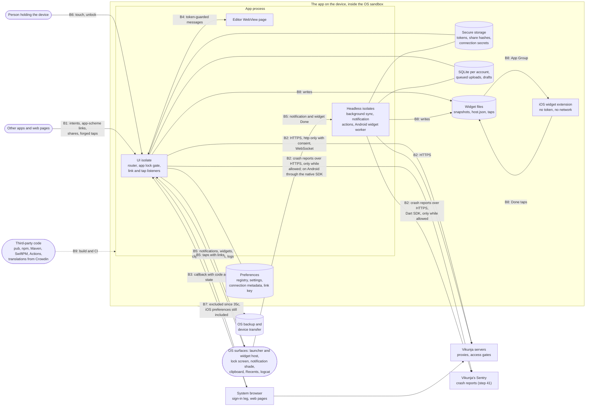

# Threat model

This is the threat model of the Vikunja app, the Android and iOS client for self-hosted Vikunja. It lists what the app protects, from whom, where it is exposed, what protects it in the code and in the tests, and what is left over by decision. Section 8 is the checklist that a security sign-off goes through. A security problem is reported privately, as [SECURITY.md](../SECURITY.md) says.

IDs used throughout: **A** assets, **B** trust boundaries, **E** entry points, **M** mitigations, **R** residual and accepted risks. Paths are relative to the repository root, with three short forms: `core/…`, `features/…` and `bootstrap/…` are under `app/lib/`; a Kotlin file named without a root is under `app/android/app/src/main/kotlin/io/vikunja/app/`, and `AndroidManifest.xml` and `res/…` are under `app/android/app/src/main/`; a test named alone sits next to the one named before it.

## 1. Scope and assumptions

**In scope:** the app on Android and iOS (the Flutter UI isolate, the headless isolates, the Android widget worker, the iOS widget extension), everything it stores on the device, every way in from outside the app, its network traffic, and the code and CI that build it; since step 37c also the store listings kept in the repository and the addresses of the app's pages that the app and the listings link (section 6.10); since step 41 the crash reports the app sends to Vikunja's Sentry and the Sentry SDKs in it (section 6.11).

**Out of scope:** the Vikunja server and its web frontend, the user's browser beyond the sign-in leg, the OS itself, and hardware attacks; vikunja.io with the app's pages (since step 38f; until then the owner's former website), which Vikunja's repository go-vikunja/website builds and its maintainers publish; Sentry's service and the settings of Vikunja's Sentry project (step 41), which an administrator of Vikunja's Sentry organisation keeps ([beta.md](beta.md#what-kolaente-does)).

**Assumptions:**

1. The OS, its app sandbox, the Keychain and the Android Keystore, and the device's screen lock work as documented. A rooted or jailbroken device is out of scope, except where R3 says what such a device exposes.
2. A Vikunja server is trusted with the user's own data on it, but not trusted by the app: everything it sends (`/info`, HTML, links, notification texts, error bodies) is untrusted input, and a pasted or shared link may name an attacker's server.
3. The network is hostile: shared Wi-Fi, captive portals, LAN servers on plain `http`, proxies. Only what the user explicitly allows (an unencrypted connection, a pinned or trusted certificate) is accepted.
4. Other apps and web pages are hostile. On Android they can send intents to every exported component and read the clipboard within the OS's limits; on iOS any web page or app can open an app-scheme URL. A web page on Android reaches only `BROWSABLE` filters (task links and the OAuth callback).
5. What the user lets see the app's output is trusted with it: the home-screen host (launcher) that draws the widgets, apps granted notification access or widget hosting, the keyboard and accessibility services. The OS gives them that access; the app cannot take it back. The widget host is trusted with more than the output: through the list widget's collection template it can make the app start activities, broadcasts and services as itself, the app's non-exported components included (R17).
6. The person holding an unlocked phone is not necessarily its owner (the app lock is the control). Someone holding the locked phone sees only what the lock screen shows.
7. Device backups are protected by the user's own credentials (Apple ID, backup encryption). The app still keeps its data out of them where it can (owner decision of 2026-10-27).
8. The app talks only to the user's servers and the system browser, and since step 41, only in a build made with the Sentry project's DSN and only once the user allowed crash reports, to Vikunja's Sentry: no analytics and no other backend ([Diagnostics]). Vikunja's Sentry is trusted with the scrubbed crash reports as Vikunja's processor, under the project's settings (R45). The app's privacy policy, legal notice and help page on vikunja.io, which every build links from the About page, open in the system browser like every other link; the app sends the website nothing ([Releases]).
9. Developer machines are trusted. Third-party code is pinned and scanned, not audited line by line.

## 2. Assets

| ID | Asset | Where it lives | In device backups | Sensitivity |
|---|---|---|---|---|
| A1 | OAuth refresh token (rotating, 256 hex) | secure storage `account.<id>.refresh_token` | never on another device (Keychain `ThisDeviceOnly`, Keystore-wrapped key) | highest: the account until rotated or revoked |
| A2 | OAuth access token (JWT, 600 s) | secure storage, memory, the `Authorization` header, the WebSocket `auth` frame | as A1 | high, short-lived; valid up to 10 minutes after its session ends ([Sessions]) |
| A3 | Link-share hash (40 characters) and guest JWT (72 h) | secure storage `account.<id>.share_hash`, `.share_token` | as A1 | high for the shared project; the hash signs in again |
| A4 | Connection secrets: access-header values, PKCS#12 file and its password | secure storage `network_profile.<id>.secrets` | as A1 | high: passes an access gate, presents the client certificate |
| A5 | Transient secrets: OAuth code, PKCE verifier and state; a share's password; a new API or CalDAV token; an invite token; on Android the old app's refresh token after the update (step 38b) | memory for one sign-in, one request or one page, the old refresh token for the one start that read it; a copied token or share link in the clipboard | no | high while they exist |
| A6 | Widget-link key (32 random bytes) | preferences `widgets.link_key`, `widgets/host.json`, every widget link and notification payload (`k`) | Android no; iOS yes (preferences) | low to medium: lets a link switch accounts without asking; guards no data |
| A7 | Task data: tasks, descriptions, comments, projects, labels, people, planned notification texts | SQLite per account, `<application support>/accounts/<id>/vikunja.db` | Android no; iOS no since 35c | personal or business data |
| A8 | Queued uploads, downloaded attachments; since step 40m attachment images (previews, originals opened in the viewer) and avatars kept for offline use, at most 100 MB per account and none unused for 30 days | `accounts/<id>/uploads`; `cache/attachments`; `cache/images/<id>` | no | user files |
| A9 | Description and comment drafts | files in `<application support>/accounts/.drafts/` | Android no; iOS no (M36) | personal data, unsent |
| A10 | Account registry: server roots, usernames, display names, `/info` snapshot (read again while signed in since step 37e) | preferences `auth.account_registry` | Android no; iOS yes | personal data, no secret ([Accounts and sign-in]) |
| A11 | Connection metadata: pins, CA certificates, header names, unencrypted-connection consents, last pin mismatch; per account, the origin of a sign-in page on another host where it last signed in after the user confirmed it ([Accounts and sign-in]) | preferences `network.profiles`; `auth.confirmed_sign_in_hosts`, a JSON map of account id to origin, forgotten with the account and removed when empty | Android no; iOS yes | not secret, but its integrity decides whom the app trusts |
| A12 | Privacy settings (app lock, timeout, screenshots, notification content, widget titles); since step 41 the crash report choice, a device setting kept on sign-out ([Diagnostics]) | preferences `privacy.settings`, `crash_reports.consent`; the lock state in memory | Android no; iOS yes | integrity; the choice decides whether crash reports leave |
| A13 | Widget files: snapshots with task titles, catalogs, configs, host settings, Done taps | Android `files/widgets`; iOS App Group `widgets/` | no since 35c | titles, account names, hosts |
| A14 | What the OS shows for the app: notifications, widget views, the clipboard, Recents thumbnails | the OS | — | titles; secrets when copied |
| A15 | Logs, the diagnostics log and the support details | logs: the debug console in debug builds, release builds print nothing; since step 40e the diagnostics log, warnings and errors of every build, redacted at capture: one JSON file per isolate in `<cache>/diagnostics`, at most 200 records and 64 KB, 7 days; the support details: the page's memory while it is open, or the error screen's copy, then wherever the user shares or pastes them; since step 41 the log's records, captured the same way, also in the crash reports while the user allows them (A19) | the log: no (the cache folder) | must hold no secret and no content; the log keeps account ids, the support details number them, name no person and, unless the user switches them on, no host |
| A16 | Write access to the user's data on the server | the outbox, every authenticated request, the notification and widget Done | — | integrity of the user's tasks |
| A17 | The last session end per account: the reason, the part of the app and the time ([Diagnostics]) | preferences `support.lastSessionEnd.<id>`, forgotten with the account | Android no; iOS yes | low: no secret, no content |
| A18 | Session diagnostics per account (step 40y): the last ended session's cause, its time, the server's code, the part of the app, the refused refresh token's fingerprint (the first 16 hex digits of its SHA-256), the fingerprint of the refresh token storage still held when its rotated successor could not be stored, the time and part of the refused token's earliest unanswered refresh, what became of it; the fingerprint of the refresh token last sent with its earliest unanswered send and its refusal; since when storage refuses to read the tokens; for a guest: the last ended session's cause (gone share, needed password, no link, unreadable link), code, part and time, and since when storage refuses to read its link ([Sessions]) | preferences `session.end.<id>`, `session.refresh_in_flight.<id>`, `session.unreadable_since.<id>`, written only while the account is registered (a registry that cannot be read counts as listing it) and taken back when it was signed out during the write, so a re-added account (ids repeat) never shows a previous session's notes; forgotten with the account | Android no; iOS yes | low: no secret, no content; a fingerprint only confirms a token someone already holds |
| A19 | Crash reports (step 41, [Diagnostics]): uncaught errors and SEVERE records as reports, WARNING records as breadcrumbs, after the scrubbers (M51): error types, an error's text only for the types that quote no data, the app's code locations, redacted log messages with their logger, the app's version, the device's model and system, the runtimes' versions, the part of the app, the release `io.vikunja.app@<version>+<build>`; on Android also Java and NDK crashes and ANRs, by type, frames, mechanism, thread names of a safe pattern, library paths and debug images | memory: the Dart SDK's scope (at most 50 breadcrumbs) and, until a start has read the stored choice, at most 20 waiting records and uncaught errors, each report once, an uncaught error as the error object itself until `beforeSend` scrubs it; Android: `<cache>/sentry`, in a folder per DSN, `<cache>/sentry/<SHA-1 of the DSN>` (an earlier DSN's stays until reports are turned off), with the unsent reports, the scope and its breadcrumbs, the markers of exits counted as reported and an NDK crash's report, which sentry-native writes there as it crashes and the scrubber sees only at the next start [uncertain], and the SDK's install id `files/INSTALLATION`; iOS: `<Caches>/io.sentry`, `<Caches>/SentryCrash` and `<Caches>/INSTALLATION` [uncertain for sentry-cocoa 9.34.0]; background isolates keep nothing on disk; once sent, Vikunja's Sentry for the project's retention | no (caches; Android's `files/` by M35); the old app's `cache/sentry` and `files/INSTALLATION` are deleted at the first start ([The previous app]) | low to medium: by design no secret, content, person, host, user or install id; what a pattern misses goes too (R43); Android's native reports keep library paths without the install folder's random names, and Android's NDK crash reports keep the system libraries' load addresses, which link the reports of one boot (R47) |

## 3. Actors and trust boundaries

### 3.1 Actors

- **The owner** of the device and of the accounts.
- **A person holding the device**, locked or unlocked.
- **Other apps** on the device, including ones the user granted notification access, widget hosting, accessibility or keyboard access.
- **Web pages** in any browser.
- **Vikunja servers**: the user's own, a hostile or compromised one, or one an attacker names in a shared link; reverse proxies and access gates in front of them.
- **The network** between the device and a server.
- **The system browser** during the sign-in leg.
- **The OS backup and device transfer** services and wherever they put the data.
- **Third-party code**: pub, npm and Maven packages, since step 41 the Swift package SwiftPM fetches for Sentry, the tools CI downloads (Flutter, osv-scanner, the NDK, the test server's image), GitHub's actions and hosted runners with their images, the OS WebView; vikunja.io's hosting, which serves the app's pages from Vikunja's website repository.
- **Translators and Crowdin** (step 38e): Vikunja's translators and proofreaders in Crowdin project 462614 and Crowdin itself. Since step 45 the workflow "Crowdin" takes the place of the GitHub account of Crowdin's integration: its job `translations` runs Crowdin's CLI with a Crowdin personal access token, and its job `pull-request` pushes the branch `crowdin` to go-vikunja/app and opens pull requests with the approved translations, with the workflow's own token.
- **Vikunja's Sentry** (step 41): the old app's Sentry project, as it is (owner, 2026-11-21), which Sentry (Functional Software, Inc.) runs for Vikunja and whose members read the reports of both apps; it receives the app's crash reports once the user allowed them. Anyone can read its DSN from either app and send events to it (R44).

### 3.2 Data flow



### 3.3 Trust boundaries

| ID | Boundary | What crosses it |
|---|---|---|
| B1 | Other apps and web pages → the app | intents to exported Android components, app-scheme URLs, shares, notification taps an app makes up, quick-action extras |
| B2 | The app ↔ servers and the network | REST requests, the WebSocket, server content, TLS, unencrypted connections, connection settings; since step 41 the crash reports to Vikunja's Sentry and its answers to them |
| B3 | The app ↔ the system browser | the authorize URL, the OAuth callback, web pages the app opens |
| B4 | The app ↔ the editor page in its WebView | description HTML, commands and answers over the JavaScript channel |
| B5 | The app ↔ OS surfaces others can see or use | notifications, widget views and their taps, the clipboard, Recents thumbnails, screenshots, logs, what the user shares through the share sheet |
| B6 | The person holding the device ↔ the app's UI | everything on screen; the app lock |
| B7 | The device ↔ backups and device transfer | the app's files and preferences |
| B8 | The UI isolate ↔ the headless isolates and the iOS extension | shared secure storage, databases, widget files; the right to refresh tokens; since step 40t the app's notifications, which the extension reads and removes for a widget's Done |
| B9 | The repository and CI ↔ third-party code | packages, downloaded tools and the test server's image, the toolchain, GitHub's actions and hosted runner images (step 38c), the signing keys in CI; translations, Crowdin's CLI and the pull requests of the workflow "Crowdin" (steps 38e and 45); the Sentry SDKs from pub, Maven Central and SwiftPM, and the repository variable with the crash reports' DSN (step 41) |

B8 is inside the app's own trust domain. It is listed because the headless parts run without a UI, without the user and often while the app lock is on, so they get fewer rights ([Security and privacy]: nothing without a UI waits for the lock).

Vikunja's Sentry sits on B2 although the user does not add it: like a server it gets what the app sends over the network, and it answers only the transport (E18). Unlike a server it gets nothing but scrubbed crash reports, and nothing before the user allowed them (M51).

## 4. Entry points

| ID | Entry | Platform | Who can use it | Checks | Reaches | Mitigations |
|---|---|---|---|---|---|---|
| E1 | Intent data sent to the exported `MainActivity` (any action, any URI, a bare path too); the engine pushes it as a route. Started from another app's activity without `FLAG_ACTIVITY_NEW_TASK`, a new `MainActivity` in the caller's task, which since step 40h starts the intent again in the app's own task and finishes | Android | any app | every pushed route is consumed: app scheme → the deep-link relay, anything else dropped; since step 40h a start outside the app's task is moved into it before any Dart runs; the app lock gates the UI | nothing outside the relay; a second UI engine on the same data only for the starts M50 does not catch (R33) | M16, M33, M50 |
| E2 | Task links `<scheme>://task/<id or PROJ-12>[?account=]` through `TaskLinkActivity` (`BROWSABLE`) or the iOS URL type | both | any app, any web page | scheme and host in Kotlin, the relay, `parseTaskDeepLink` | the task sheet, or since step 36c the Overview's task pane on a wide window; a switch only after asking; an unknown task is read online in the active account | M17 |
| E3 | Widget links `<scheme>://widget/…` | both | the app's widgets; also any app (explicit intent) and, on iOS, any web page | `WidgetLink.parse`; the widget-link key in constant time | with the key as before; without it no silent switch | M18, M19 |
| E4 | Widget setup: `APPWIDGET_CONFIGURE` to `WidgetConfigureActivity`, `widget/configure?appWidgetId=` | Android (the page refuses on iOS) | the launcher; any app | `isOwnWidget`; the page needs the id among the placed widgets | the setup page | M19 |
| E5 | OAuth callback `<scheme>://oauth/callback` through flutter_web_auth_2's `CallbackActivity`; on iOS ASWebAuthenticationSession hands it to the session | both | any app or page (Android) | state (constant time), `code`, PKCE; a late callback is dropped by the relay | the token exchange | M1 |
| E6 | Notification taps: `SELECT_NOTIFICATION` with a `payload` extra | Android: any app can send it to `MainActivity`; iOS: only `UNUserNotificationCenter` | the app's notifications; on Android any app | only plain taps reach the UI (a made-up action id is ignored, `notificationTapSourceProvider`); JSON decode; the widget-link key | with the key: switch, mark read, open; without: ask or stay in the active account | M18 |
| E7 | Notification actions Done, Snooze | both | the notification shade and lock screen; apps with notification access (assumption 5); on Android the widget host, with any payload (R17) | receivers not exported; payload decoded, unknown accounts ignored; since step 40e a Done or Snooze for an occurrence (`at`) the task has passed is ignored, so a forged `at` can only make the app ignore one; since step 40h Android notifications have no Done while the app lock is on | the outbox from a headless isolate, no user-token refresh | M5, M25 |
| E8 | Shares: `SEND`, `SEND_MULTIPLE` through `ShareTargetActivity`; the internal `ACTION_SHARE` sent straight to `MainActivity` | Android | any app | foreign `content://` only, 50 files, 100,000 characters, broken extras dropped, the share stripped from the intent | the new-task and add-to-task flows; share and invite links | M22 |
| E9 | The "New task" quick action (an extra on any intent to `MainActivity`) | both | the launcher; on Android any app | the type must be `new_task` | the New task sheet in the active account | M24 |
| E10 | `APPWIDGET_UPDATE` to the widget receivers: the app's two and, since step 38b, the old app's provider `widget.AppWidgetReciever`, kept for its placed widgets | Android | any app (the system needs them exported) | — | a redraw, at most one publish run per key and process | — (R20) |
| E11 | Glance Done (`MarkDoneAction` through Glance's non-exported callback receiver) | Android | the widget on the home screen, through the widget host; the host with any parameters (R17) | the queue refuses a hidden row; account and task from the row; the import drops unknown accounts and, since step 40e, a tap whose task has passed the row's `dueAt`, so a forged `dueAt` can only make it ignore one | the queue, the worker, the outbox | M20, M21 |
| E12 | iOS widget extension: `MarkDoneIntent`, request markers, `host.json` | iOS | the widget, through WidgetKit | `isDiscoverable = false`, `.requiresAuthentication`; the app imports each tap once, unknown accounts dropped, since step 40e a tap whose task has passed its `dueAt` too | the outbox at the next app run; since step 40t at once the tapped task's reminders and due-date notification, which it removes | M20, M21, M37 |
| E13 | Server answers: JSON, `/info` (`frontend_url`, notices, legal links), HTML descriptions and comments, attachments, avatars, WebSocket frames, error bodies | both | the server, the network | typed decoding, HTML budgets, link allowlist, no remote images, failures by type; since step 40h the `/info` probe, which runs before any trust check, reads at most 256 KiB and ends after 10 s; since step 47d a size cap on every other answer's body and linear-time reading of server text | the database and the screens | M9–M15, M48, M52 |
| E14 | Pasted or shared links and addresses: server addresses, share links, invite links | both | the user; text another app shares | the link parsers, which since step 40h refuse a link with user info; a probe; the unencrypted-connection question, since step 40h "No encrypted connection" every time an address typed without a scheme falls back to `http`; a question before a stored server that only claims a share link's host | the Connect screen, the guest sign-in, the invite check | M6, M10, M48 |
| E15 | Files the user picks: attachments, a PKCS#12 file, a CA certificate | both | the user | size caps, validated before saving, the picked copy deleted; since step 40h a picture's location removed, and a file that kept it uploaded only after the user's Upload | uploads, connection settings | M9, M43 |
| E16 | Editor page messages (page → app) | both | the page in the WebView | the per-load token; a fixed set of message types; since step 40n `images` names attachment images, of which the app takes only attachment URLs of the account's server, each once per page load, within a budget | the editor's state; the account's attachment images, which the app loads with its session and sends back to the page as raster `data:` URLs ([Descriptions, comments, attachments]) | M27 |
| E17 | A restored backup | iOS (Android transfers nothing) | the backup's owner | the install marker; Keychain items `ThisDeviceOnly` | the preferences come back | M3, M35, M36 |
| E18 | Sentry's answers to a crash report (step 41): the status and the rate-limit headers | both | Sentry; whoever can answer for its host (B2) | TLS: on Android the native transport to `sentry.io` and its subdomains with the system's CAs only, the Dart transport of background isolates with dart:io's; the SDKs read only the status and their rate limits | the SDKs' rate limits, which delay or drop reports; nothing else of the app | M51 |

The device channel's `startNativeCrashReports` and `stopNativeCrashReports` (step 41) are no entry point: the channel lives in the app's process, and only the app's isolate calls them.

## 5. STRIDE per boundary

Repudiation does not apply to a client: the server records who wrote what, and the app adds nothing to that. It is left out of the tables below.

### B1: Other apps and web pages → the app

| | Threat | Example | Mitigations | Residual |
|---|---|---|---|---|
| S | A link or tap that poses as the app's own widget or notification | `widget/account?account=<id>` from another app or an iOS web page; `SELECT_NOTIFICATION` with a made-up payload | M18 | R17, R18, R19 |
| S | A forged OAuth callback | a callback carrying the attacker's code during a pending sign-in | M1 | R1 |
| T | Route injection into the running app | `x://y/connection?origin=https://attacker.example&edit=certificate`, a bare `/home/account-settings/api-tokens/new` | M16 | — |
| T | Tampered shares | the app's own `content://` URIs, `file://`, huge texts, broken parcels, `ACTION_SHARE` straight to `MainActivity` | M22 | — |
| T | A write through a link | a `widget/done` link, a made-up Done | M20, M21 | R17 |
| T | A foreign widget setup | `APPWIDGET_CONFIGURE` or `widget/configure` with some id | M19 | R18 |
| I | Reading the app's files or secrets | file provider paths | M2, M23 | R17 |
| D | Floods of links or updates | repeated links, `APPWIDGET_UPDATE` | the opener runs only the last waiting request (M17) | R20 |
| E | Reaching a privileged screen, or acting while the app is locked | the API-token form, the Connection screen; links while locked | M16, M33 | R18 |
| S, D | The app's UI inside another app's task | an explicit start of `MainActivity` without `FLAG_ACTIVITY_NEW_TASK`: a second UI engine with its own sync, socket and scheduler, under the caller's own activities | M50 (step 40h), M33 | R33 |

### B2: The app ↔ servers and the network

| | Threat | Example | Mitigations | Residual |
|---|---|---|---|---|
| S | An impostor server | rogue Wi-Fi, DNS, a user-installed CA | system trust; a TLS failure never falls back to `http` ([Connections]); a pin or a CA per server address | R8, R9 |
| S | A hostile server phishing through its sign-in page, sending the sign-in to another server's genuine page, or collecting another server's shared links and their passwords | a crafted `frontend_url`, a mix-up | M1, M13, M48 | R1, R2, R41 |
| T | Tampering on an unencrypted connection | LAN `http` | the consent per server address, enforced in the transport (M10) | R8 |
| T | A downgrade to `http` | a network that blocks port 443, so an address typed without a scheme reaches the server only over `http` (step 40h) | "No encrypted connection" every time, the offer of `https` to `http` accounts (M10) | R8 |
| T | Hostile content | script in HTML, huge documents, remote images, links to other apps, a link whose text names another host, an endless answer, a long run of one character | M14, M15, M27, M52 | R31, R49, R50 |
| I | A token or connection secret sent to another host | a redirect, a cross-origin attachment URL, a header following a redirect | M4, M9, M12 | — |
| I | Secrets over `http` | the two-factor secret of servers before 2.7 | M7, M10 | R8 |
| I | The old app's refresh token sent where the app would not send its own | the first start after the update, with the old app's server on `http` or below the support floor | M46 | — |
| I | Secrets quoted in error texts | an exception quoting a header value | M11, M34, M51 | R10 |
| I | A photo's location sent with an attachment | a photo or video with GPS or a place name in its metadata, picked, taken with the camera or shared to the app, which the server keeps and every member of the project can download | M43 | R36 |
| D | Rate limits, a changed certificate | the per-IP limit shared with sign-in; a pin mismatch stops every request by design | M9 | R32 |
| D | A huge or endless answer to the `/info` probe, before any trust check | a portal or a hostile server that streams a large body or trickles it (step 40h) | the probe's limits of 256 KiB and 10 s (M9) | — |
| E | Server text driving the app | failures mapped by type, never by text; no server code runs | M11, M15 | — |
| I | Personal data in a crash report (step 41) | an error or a log message quoting a file's name, a server, a title, an e-mail address or a token; a Java exception's message, a thread named after a URL, Android's network breadcrumbs, the battery, locale or accessibility settings, Sentry's install id; an ANR or a crash from before the user allowed reports, the old app's included | M51 | R43, R47 |
| S, D | Events in Vikunja's Sentry that the app did not send (step 41) | anyone with the DSN, which every build and the old app's code hold, sending fake or misleading reports under the app's release, or enough to use up the project's quota | the project's spike protection and rate limit ([beta.md](beta.md#what-kolaente-does)) | R44 |
| T, I | Crash reports read or changed on the way (step 41) | a CA the user or a device policy installed for a self-hosted server | on Android the native transport to `sentry.io` and its subdomains over https with the system's CAs only; the Dart transport of background isolates with dart:io's system CAs (M51) | R46 |
| D | The app flooding Sentry (step 41) | a widget whose build throws in every frame, an image that fails to load | silent Flutter errors not reported, a repeat within 10 minutes dropped, at most 20 reports per isolate run; the SDKs keep to Sentry's rate limits (M51, E18) | R44 |
| I | What Sentry keeps of a report (step 41) | the IP address every request arrives with, the reports' retention, the organisation's region | nothing of the user's own: no user, IP address or install id in a report (M51); Android's NDK crash reports of one boot can be linked through the system libraries' load addresses (R47) | R45, R47 |
| E | Sentry's answers driving the app (step 41) | a crafted rate-limit header | the SDKs read only the status and their rate limits (E18) | — |

### B3: The app ↔ the system browser

| | Threat | Example | Mitigations | Residual |
|---|---|---|---|---|
| S | Another app with the redirect scheme takes the code | a second `vikunja-…` app | PKCE: the verifier never leaves the app (M1) | R1 |
| T | A changed callback | swapped `code` or `state` | M1 | — |
| I | A web login reused across servers | a mix-up through a remembered session | ephemeral session (M1) | R1 |
| I | The browser leg ignores the connection settings | a pinned server's certificate warning in the browser | the hint before the browser leg (M13) | R2 |

### B4: The app ↔ the editor page

| | Threat | Example | Mitigations | Residual |
|---|---|---|---|---|
| S | A frame or script posing as the page | an injected iframe calling the channel | per-load token, CSP without frames (M27) | R30 |
| T | Script inside a description | ``, `<script>` | hashed-script CSP, the editor's schema (M27) | — |
| I | The page sending content away | `fetch`, an image URL with data | `default-src 'none'`; the page loads no image: since step 40n the app loads the attachment images the page names and sends them as raster `data:` URLs, any other image stays a placeholder, so the page still has no network and no token (M27, [Descriptions, comments, attachments]) | — |
| E | Navigation, new windows, file access | `window.open`, `location =`, `file://` | navigation delegate, file and content access off (M27) | R30 |

### B5: The app ↔ OS surfaces

| | Threat | Example | Mitigations | Residual |
|---|---|---|---|---|
| I | Task titles on the lock screen, to apps with notification access | a reminder's title | M31 | R12, R13 |
| I | Task titles on the home screen, StandBy and the lock-screen widgets | the widget rows | M32 | R17 |
| I | The Recents thumbnail | the app switcher | M30 | R14 |
| I | Screenshots and recordings of a secret | a new API token on screen | M29 | R15 |
| I | The clipboard | a copied token or share link | M28 | R16 |
| I | Logs | an exception text in logcat; since step 40e the diagnostics log's files in the cache folder | M34, M49 | R24, R25, R42 |
| I | The support details | a report shared into a public issue, with a host, a name or a failure's message in it; since step 40e the error screen's copy, on the clipboard without a preview | M45, M49 | R16, R37, R42 |
| I | A host and a username on the lock screen | since step 40e the reminder to open the app before a session ends, whatever the notification content setting, like the "Sign in again" notice | — | R12 |
| T, E | Actions from the lock screen | Done on a locked device | M25 (iOS asks for the unlock while the app lock is on; since step 40h Android shows no Done then) | R12 |
| T | Reminders the old app scheduled before the update | one fires before the first start, with the app's icon and a Done that does nothing | the first start cancels them ([The previous app]) | R38 |
| S, T, E | The widget host acting as the app | a launcher filling the list widget's collection template with a component of its choice: Done or Snooze on any task, a notification posted as the app, Glance's Done with any parameters | — | R17 |

### B6: The person holding the device ↔ the app's UI

| | Threat | Example | Mitigations | Residual |
|---|---|---|---|---|
| S | Someone else unlocks the app | a borrowed phone | the device's biometrics or credential (M33) | R29 |
| I | An unlocked phone in other hands | tasks, settings, the one-time token | the app lock; entry paths wait behind it; a new token is shown once (M33, M7) | R29 |
| T | Turning the lock off | the privacy page | turning it on or off needs a successful prompt (M33) | R29 |
| E | Getting past the lock | a link, a notification tap, back | entry paths wait; back never pops the routes below (M33) | — |
| T | Crash reports turned on behind the user's back (step 41) | the privacy page's switch on an unlocked phone in other hands | the app lock (M33); a report holds no content (M51) | R43 |
| I | Data at rest on a seized device | the database, the drafts | the lock guards the UI only | R3, R4, R5, R6, R11 |

### B7: The device ↔ backups and device transfer

| | Threat | Example | Mitigations | Residual |
|---|---|---|---|---|
| I | The app's data in a cloud backup or a device transfer | the database moved to a new phone by an OEM transfer tool | M35, M36 | R21, R23 |
| I | Secrets in backups | tokens, connection secrets | M2 | — |
| T | A restore bringing back old state | an old registry, an old key | M3 | R21, R22 |

### B8: The UI isolate ↔ the headless isolates and the iOS extension

| | Threat | Example | Mitigations | Residual |
|---|---|---|---|---|
| E | A headless run rotating a user's refresh token | a lost race ending the session for good | M5 | R7 |
| T | One write sent twice | the UI and a notification action both sending; since step 40e a claim returned at the next start while its sender still runs | claim before send ([Outbox]); since step 40e another process's claims returned at once only because every isolate runs in one process, no `android:process` and no iOS extension with the database ([Outbox]); widget taps recorded once (M21) | — |
| I | A token in the extension | a keychain group for the widget | M37 | — |
| T | Tampered App Group taps | a file in `outbox/` | only the app and its extension share the App Group; unknown accounts dropped (M21, M37) | — |
| I | Unredacted errors from headless isolates | an uncaught error in the widget worker | the hooks in all four entry points (M34) | R24 |
| I | Crash reports from a headless isolate after the user turned them off (step 41) | the notification plugin's background engine, which stays for the process's life, or a WorkManager run started while they were allowed | each start of a headless part reads the stored choice and the servers again, and each report reads the choice before it goes, stopping the SDK when it no longer allows them (M51) | — |

### B9: The repository and CI ↔ third-party code

| | Threat | Example | Mitigations | Residual |
|---|---|---|---|---|
| T | A malicious package version | a swapped pub, npm or Maven artifact | M38, M41 | R26 |
| T | A malicious image, action or tool | a moved tag, a swapped download, a changed hosted runner image | M39 | R26 |
| I | CI secrets leaking | the signing keys in a log, an artifact or a job that does not need them; a pull request's workflow or a repository-level copy of a release secret reaching them (step 38c), which serve the betas until the first final release (step 45) | M39, M42 | R28 |
| T | A release from code nobody reviewed | a workflow of an unprotected tag or branch reaching the signing keys; a moved tag | M39, M42 | R28 |
| E | Install scripts running | an npm `postinstall` | `npm ci --ignore-scripts` (M38) | — |
| T | A known-vulnerable dependency | a new advisory | M40 | R26 |
| E | A plugin update exporting a component | a new exported receiver; since step 41 a provider of Sentry's that starts it with the app, or its auto-init or network breadcrumbs back on | M26 | — |
| T | A malicious Sentry SDK (step 41) | a swapped `sentry` or `sentry_flutter` package, an `io.sentry` artifact or epitaph from Maven Central, the `sentry-apple-binaries` checkout or its binary archives | M38, M40 | R26 |
| T | A release whose crash reports go elsewhere (step 41) | the repository variable `VIKUNJA_APP_SENTRY_DSN` changed to another Sentry project or another host | `check_sentry_dsn` fails a release build whose DSN is not https on `sentry.io` (M42); the scrubbers send no secret or content wherever the reports go (M51) | R48 |
| S | A release signed with the wrong key | the debug key, or a swapped secret holding another key than Vikunja's (step 38c) | M42 | R28 |
| T | A hostile or broken translation | a translator's text with broken ICU, a renamed or dropped placeholder, an extra key or an empty text; misleading wording in a language no maintainer reads (step 38e) | M47 | R40 |
| E | The Crowdin token or the Crowdin workflow's write token misused | Crowdin's CLI, Crowdin or a workflow on any branch, which can read the repository secret, changes the project's sources and translations, the web's and the API's included, with the token's rights; the CLI, a downloaded binary, reads a write token of its job; a workflow with `pull-requests: write`, pushed to any branch by someone with write access, has `github-actions[bot]` approve its author's own pull request, which counts for the approval "main protect" requires until the owner's test shows otherwise (step 45) | M39, M47 | R40 |
| T | A release published from another repository | the owner's test repository, a fork or a repository renamed to go-vikunja/app running the release workflow (step 38c) | M42 | — |
| T | A release whose linked pages are gone or moved | a vikunja.io page that the app and the listings link answering 404, losing its anchor, or redirecting to another host (step 40a) | M44 | — |

## 6. Mitigations

Every row names where the control lives and what tests it. "Manual" marks a control without an automated test; section 8 lists its check.

### 6.1 Sign-in and secrets

| ID | Mitigation | Code | Tests | Decisions |
|---|---|---|---|---|
| M1 | Browser sign-in only: the app never handles a password or TOTP code. PKCE S256 over a 32-byte verifier, 16-byte state compared in constant time, an ephemeral browser session, the Android callback filter narrowed to `oauth/callback`. An `http` `frontend_url` is never used for an `https` server. | `packages/vikunja_api/lib/src/auth/authorization_request.dart` (`AuthorizationRequest`); `app/lib/core/auth/web_authenticator.dart` (`preferEphemeral: true`); `app/android/app/src/main/AndroidManifest.xml` (`CallbackActivity`) | `packages/vikunja_api/test/auth/authorization_request_test.dart`, `pkce_test.dart`; `app/test/core/auth/web_authenticator_test.dart`, `browser_sign_in_test.dart`; `app/test/app/oauth_integration_test.dart` | [Accounts and sign-in] |
| M2 | Secrets live only in secure storage: Keychain `first_unlock_this_device`, not synchronizable; AES-GCM with a Keystore-wrapped key on Android. Neither app target has a keychain access group. | `app/lib/core/storage/secure_store.dart` (`FlutterSecureStore.defaultStorage`); `core/auth/token_store.dart`, `link_share_store.dart`; `core/network/network_profile_secrets.dart`; `app/ios/Runner/Runner.entitlements`, `VikunjaWidgets/VikunjaWidgets.entitlements` | `app/test/core/storage/secure_store_options_test.dart`, `app/test/app/entitlements_test.dart`, `app/test/core/auth/token_store_test.dart`, `link_share_store_test.dart` | [Sessions], [Accounts and sign-in], [Connections] |
| M3 | A fresh iOS install wipes Keychain items an earlier install left behind (no install marker and no registry). An account without tokens, as after a restore, needs a new sign-in. | `core/auth/previous_install.dart` (`purgeSecretsLeftByPreviousInstall`); `core/auth/accounts_without_tokens.dart` | `app/test/core/auth/previous_install_test.dart`, `accounts_without_tokens_test.dart` | [Sessions], [Accounts and sign-in] |
| M4 | The access token goes only to the account's own server root and never follows a redirect; every base `Dio` has `followRedirects: false`. | `packages/vikunja_api/lib/src/auth/auth_interceptor.dart` (`AuthInterceptor`); `transport/authenticated_dio.dart`; `app/lib/core/network/dio_factory.dart` | `packages/vikunja_api/test/auth/auth_interceptor_test.dart`, `test/transport/authenticated_dio_test.dart` | [Accounts and sign-in] |
| M5 | The notification-action isolate and the widget worker never refresh a user's token (`SessionManagers(refreshes: false)`); a guest re-authenticates at most once in any container the OS started. The background sync refreshes by design: it is the session keep-alive. | `core/notifications/notification_action_handler.dart` (`backgroundActionOverrides`), used by `core/widgets/widget_entry_points.dart`; `core/auth/link_share_providers.dart` (`maxAuthentications`) | `app/test/core/auth/session_manager_no_refresh_test.dart`, `link_share_session_test.dart`; `app/test/core/notifications/notification_action_handler_test.dart`; `app/test/core/widgets/widget_container_test.dart` | [Notifications and widgets], [Sync], [Accounts and sign-in]; [Security and privacy] (headless containers) |
| M6 | Guests: the hash is written first and deleted first; the share's password is never logged, and stored only when the user checks "Remember the password on this device" (unchecked; since step 40k, owner, 2026-11-19), in secure storage beside the hash, deleted with the guest and forgotten when the server refuses it ([Accounts and sign-in]); the hash stays out of the Connect screen's state and logs; the guest's `Dio` logs no bodies. Since step 40h a shared or invite link with user info (`https://vikunja.example.com@evil.example/…`) is refused like the deep links. | `core/auth/link_share_store.dart`, `core/auth/link_share_gateway.dart`, `features/onboarding/application/guest_sign_in.dart`; `packages/vikunja_logic/lib/src/links/incoming_links.dart` (`parseLinkShareUrl`, `parseInviteLink`) | `app/test/core/auth/link_share_store_test.dart`, `app/test/features/onboarding/guest_sign_in_test.dart`, `application/connect_server_links_test.dart`; `app/test/security/token_leak_test.dart`; `packages/vikunja_logic/test/links/incoming_links_test.dart` | [Accounts and sign-in], [Security and privacy] |
| M7 | A new API or CalDAV token exists only in the state of the page that created it, behind `SecureDisplay`, copied through the sensitive clipboard. The two-factor status is not read over `http` from servers before 2.7, whose answer carries the secret. | `features/account_settings/presentation/one_time_secret_view.dart`; `features/account_settings/application/totp_status_reading.dart` (`canReadTotpStatus`) | `app/test/features/account_settings/api_tokens_page_test.dart`; `account_security_sections_test.dart` ("over http to a server before 2.7 it is not read at all") | [Accounts and sign-in] |
| M8 | Sign-out and removal delete the account's tokens or guest secrets, its database files, uploads, widget files, scheduled notifications, unsent comments and description draft, since step 40q also its record as a kept `http` account (`accounts.kept_http_twins`); the server's connection settings on request. A retired session manager hands out no token, also none from a refresh still running. Since step 40q a test fills every store of two accounts and checks that a sign-out leaves nothing of the one signed out but its widgets' "Account removed", and that every name the app builds from an account id is in its inventory. Since step 47c a widget worker or notification action still running checks the stored registry before each refresh and after each write, and puts "Account removed" back. | `features/session/application/sign_out_controller.dart`, `core/auth/sign_out.dart`, `features/session/application/sign_out_providers.dart` (`accountDataWiper`; in `core/repositories/repository_providers.dart` until step 40q), `core/db/account_database_files.dart` (`deleteFor`), `features/description_editor/application/description_drafts.dart` (`discardAll`), `features/accounts/application/https_twins.dart` (`KeptHttpTwins.forget`), `core/widgets/widget_publisher.dart` (`WidgetPublishers`) | `app/test/security/account_wipe_test.dart`, `app/test/core/auth/sign_out_test.dart`, `app/test/core/auth/session_manager_states_test.dart` (a manager retired during a refresh), `app/test/core/widgets/widget_container_test.dart`, `app/test/core/repositories/task_details_providers_test.dart`, `app/test/features/accounts/http_twin_test.dart`, `app/test/features/description_editor/` | [Sessions], [Sync], [Notifications and widgets], [Connections], [Stack and structure] |
| M46 | Keeping the old app's session after the update (step 38b): refused before the token is sent for an `http` server and one below the support floor; the user `GET /user` returns, within 20 s, must be the token's, else the new session is logged out best effort; the refresh token lives only in memory, in the findings of the start that read it, and is tried at most once per process, only after the first-start wipe has deleted the stored copies; a Cancel or the 30 s limit ends the try, and an answer after that registers and stores nothing, while a session it brings is logged out best effort; the old access token (`user-token`) is never read; logs carry types and booleans only, and the findings print only the record; the preferences hold server addresses and a widget count only (`previous_app.import`), and the old light or dark goes to the device's theme, never to an account. | `core/previous_app/previous_app_import.dart`, `core/auth/previous_app_sign_in.dart`, `features/onboarding/application/previous_app.dart`, `bootstrap/previous_app_start.dart` | `app/test/core/previous_app/previous_app_import_test.dart`, `app/test/core/auth/previous_app_sign_in_test.dart`, `app/test/features/onboarding/application/previous_app_test.dart`, `app/test/features/onboarding/presentation/connect_previous_app_test.dart`, `app/test/bootstrap/previous_app_start_test.dart`, `app/test/security/log_hygiene_test.dart`; on an emulator, 8.2.13, since step 40u through `tool/e2e/update_test.sh` | [Connections], [Accounts and sign-in], [Sessions], [The previous app] |
| M48 | A shared link's server (step 40c): the link's hash and the share's password go without asking only to a stored server on the link's own origin (the scheme, host and port of its root) whose web frontend is the link's base, or to the server that answers at the link's host. A stored server on another origin that names the link's host as its web (`frontend_url`) is offered only when no Vikunja server answers there, and not for a 401 or 403, an access gate's answer: "Which server is it?" fills in its address without focusing the field and, while the field holds that address, names both hosts and says that the link and its password go to that server. Nothing goes to it before Continue, and another address entered instead gets the link. The password sheet names the host the password goes to, on the Connect screen and in the guest's re-authentication banner. "Open the link again" keeps the guest's own stored server. | `features/onboarding/application/guest_sign_in.dart` (`connect`, `serverClaiming`), `connect_server_controller.dart`, `connect_server_state.dart` (`ConnectServerShareNeedsServer.claimingServer`); `core/network/origin_key.dart` (`OriginKey`); `features/onboarding/presentation/connect/connect_server_screen.dart`; `features/onboarding/presentation/guest/share_password_sheet.dart` (`askForSharePassword`, `SharePasswordSheet`); `features/home/presentation/guest_reauth_banner.dart` | `app/test/features/onboarding/guest_sign_in_test.dart`, `application/connect_server_links_test.dart`, `presentation/connect_server_links_screen_test.dart`, `share_password_sheet_test.dart`; `app/test/features/home/guest_account_tab_test.dart`; the accessibility sweep's state "shared link server question" (`app/test/a11y/scenarios_onboarding.dart`) | [Accounts and sign-in] |

### 6.2 Transport

| ID | Mitigation | Code | Tests | Decisions |
|---|---|---|---|---|
| M9 | Connection settings per server address, applied by the transport below every interceptor: a pin on the leaf's SHA-256 checked in the TLS handshake without system roots, a CA certificate per address, a client certificate, access headers only to their own origin with redirects off. No request leaves without its address's settings: locked, damaged and incomplete settings fail closed. A pin mismatch is recorded and never trusted automatically. Since step 40h the `/info` probe, the one request before any of this, reads at most 256 KiB of a body, cancelling the connection there, and ends after twice the probe timeout (10 s) as `ServerTimeout`. | `core/network/network_profile_adapter.dart` (`NetworkProfileAdapter.fetch`), `profile_http_client.dart` (`pinnedCertificateCheck`), `network_profiles.dart`, `header_rules.dart`, `client_certificate.dart`, `certificate_probe.dart`, `client_certificate_check.dart` (`ClientCertificateRefusalCheck`, the second handshake after a lost answer, since step 40q its own file); `packages/vikunja_api/lib/src/negotiation/info_probe.dart` (`maxProbeBodyBytes`) | `app/test/core/network/network_profile_adapter_test.dart`, `profile_http_client_test.dart`, `network_profiles_test.dart`, `header_rules_test.dart`, `client_certificate_test.dart`, `certificate_probe_test.dart`; `tls_docker_test.dart` (opt-in, `VIKUNJA_APP_TLS_DOCKER=1`); `packages/vikunja_api/test/negotiation/info_probe_test.dart`, `server_connector_test.dart` | [Connections] |
| M10 | Unencrypted connections need a consent per server address, enforced in the transport for requests and `ws://`; only the pre-consent `GET …/info` probe without `Authorization` passes. Since step 40h an address typed without a scheme that reached `http` only because every `https` candidate failed asks "No encrypted connection" every time, consent or not, saying that someone on the network may be blocking `https`; the Connection page of an `http` origin with a user account probes `https` on the same host and offers "Use HTTPS", and once the same user is signed in over `https` the app offers to remove the `http` account. | `core/network/network_profile_adapter.dart` (`CleartextBlockedException`, `preConsentProbeKey`); `core/realtime/realtime_providers.dart` (`ProfileRealtimeConnector`); `packages/vikunja_api/lib/src/negotiation/server_connector.dart` (`reachedOverHttpFallback`); `features/onboarding/application/connect_server_controller.dart` (`httpsFailed`), `presentation/connect/insecure_connection_dialog.dart`; `features/connection/presentation/connection_page.dart`; `features/accounts/application/https_twins.dart`, `presentation/account_actions.dart` (`offerToRemoveHttpTwin`) | `network_profile_adapter_test.dart`; `app/test/core/realtime/profile_realtime_connector_test.dart`; `app/test/features/connection/connection_page_test.dart`; `app/test/features/onboarding/application/connect_server_controller_test.dart`, `presentation/connect_server_screen_test.dart`; `app/test/features/accounts/http_twin_test.dart`; `packages/vikunja_api/test/negotiation/server_connector_test.dart` | [Connections] |
| M11 | An error whose text quotes a stored header value or the PKCS#12 password (8 characters or more) keeps its kind and loses its text; the five connection exceptions print only their class and origin; failures are mapped by type, never by text. | `core/network/secret_scrubbing.dart` (`quotesSecret`); `packages/vikunja_domain` failure types | `network_profile_adapter_test.dart`; `app/test/core/network/no_secrets_in_logs_test.dart` | [Connections] |
| M12 | The WebSocket sends the token in its `auth` frame, not the URL, gets the address's settings on the upgrade, and logs states and close codes only. A refused client certificate stops it until the next resume instead of retries; since step 40q, on the address's own `dart:io` client, also when TLS 1.3 ends the upgrade without naming the refusal, which the requests' second handshake then confirms. | `packages/vikunja_api/lib/src/realtime/io_realtime_connector.dart`; `core/realtime/realtime_providers.dart` (`ProfileRealtimeConnector`); `core/network/client_certificate_check.dart` | `packages/vikunja_api/test/realtime/io_realtime_connector_test.dart`; `app/test/core/realtime/realtime_connection_test.dart`, `profile_realtime_connector_test.dart` | [Sync], [Connections], [Stack and structure] |
| M13 | Before the browser leg the app asks when the sign-in page's origin differs from the server's (the host in punycode and without a trailing dot), naming both hosts and saying that the server gets access to the account signed in there; every caller of the sign-in has to pass the question. A first sign-in and an account being added are asked every time; "Sign in again" is asked about the page of its new negotiation unless the account last signed in at that origin. The same dialog carries the hint on what the browser will meet: the pinned fingerprint to compare, a CA, a client certificate, an access login, a different sign-in host. It warns; it does not close the mix-up (R1). | `features/connection/presentation/browser_leg_hint.dart` (`confirmBrowserLeg`, `browserLegConfirmation`; since step 40h the sign-in page's origin in punycode); `features/session/application/sign_in_hosts.dart` (`signInPageOf`, since step 40q the page both the question and the hint name, taken from the authorize URL; `otherSignInHost`, `ConfirmedSignInHosts`), `sign_in_controller.dart` (`confirm:`); `packages/vikunja_api/lib/src/negotiation/server_address.dart` (`withAsciiHost`, step 40h) | `app/test/features/connection/browser_leg_hint_test.dart`; `app/test/features/session/sign_in_host_warning_test.dart`, `application/sign_in_controller_test.dart`, `sign_in_hosts_test.dart`; `packages/vikunja_api/test/negotiation/server_address_test.dart` | [Accounts and sign-in], [Connections] |
| M52 | A size cap on every answer's body (step 47d), outermost in the transport of every `Dio` (the accounts, sign-in, headless isolates, the probe): 64 MiB, 2 MiB for avatars, 25 MiB for attachments and previews read into memory. A body is refused by its `Content-Length` or once more arrives, its connection is closed, and the failure is an unexpected answer that is never retried. Downloads to a file and the `/info` probe, which cuts its own body at 256 KiB, are exempt; the WebSocket is not covered (R49). | `packages/vikunja_api/lib/src/transport/body_cap_adapter.dart` (`BodyCapAdapter`, `maxBodyBytesKey`); `core/network/dio_factory.dart` (`createDio`); `packages/vikunja_api/lib/src/read/read_client.dart` (`getCappedBytes`, `download`); `packages/vikunja_api/lib/src/negotiation/info_probe.dart` | `packages/vikunja_api/test/transport/body_cap_adapter_test.dart`; `app/test/core/network/dio_factory_test.dart`, `network_providers_test.dart`; `packages/vikunja_api/test/read/avatars_read_test.dart`, `attachments_read_test.dart`, `attachment_download_test.dart`; `packages/vikunja_api/test/negotiation/info_probe_test.dart` | [Connections] |

### 6.3 Server content

| ID | Mitigation | Code | Tests | Decisions |
|---|---|---|---|---|
| M14 | Links from server content open only on a tap, in another app, and only for `http(s)` with a host or 12 listed schemes; the app's own scheme is not among them. Since step 40h a long press shows the full address with its host in punycode before anything opens, and a tap asks first, with a warning, when the link's text (without invisible format characters) begins with a web address on another host, holds a bidirectional control, or the text or the address has user info. | `core/links/external_link_opener.dart` (`ExternalLinkOpener`); `features/tasks/application/link_targets.dart` (`linkTextMisleads`, `linkAddressOf`, `linkHostOf`); `features/tasks/presentation/rich_text/rich_text_view.dart`, `link_details.dart` (`showLinkDetails`) | `app/test/core/links/external_link_opener_test.dart`; `app/test/features/tasks/link_targets_test.dart`, `rich_text_view_test.dart`, `task_detail_online_test.dart` | [Descriptions, comments, attachments] |
| M15 | Server HTML is parsed natively within budgets; remote images are never loaded, only attachment images of the account's own server through its authenticated client. Since step 47d the plain text behind search, the inbox, activity notifications and the edit pages comes from a linear scan without regular expressions, and the `/info` probe's checks, external team names and session devices are read in linear time too. | `packages/vikunja_logic/lib/src/text/bounded_html_parser.dart`, `rich_text_parser.dart`; `packages/vikunja_logic/lib/src/links/attachment_urls.dart`; `features/tasks/presentation/rich_text/rich_text_view.dart`; `app/lib/core/text/html_to_text.dart`; `packages/vikunja_api/lib/src/negotiation/probe_classifier.dart`; `packages/vikunja_logic/lib/src/teams/team_rules.dart`, `security/device_description.dart` | `packages/vikunja_logic/test/text/bounded_html_parser_test.dart`, `rich_text_limits_test.dart`, `rich_text_fuzz_test.dart`; `test/links/attachment_urls_test.dart`; `app/test/core/text/html_to_text_test.dart` ("a long run finishes quickly"); `packages/vikunja_api/test/negotiation/probe_classifier_test.dart`; `packages/vikunja_logic/test/teams/team_rules_test.dart`, `security/device_description_test.dart` | [Descriptions, comments, attachments] |

### 6.4 Links and other ways in

| ID | Mitigation | Code | Tests | Decisions |
|---|---|---|---|---|
| M16 | Route injection (G1): an observer registered before the router's own consumes every route the platform pushes; app-scheme URIs go to the relay, anything else, a bare path included, is dropped. Since step 47d it is the binding's first observer, registered with the app's container, and a buffer before it holds what arrives earlier, so no other observer reads a pushed route (their default decodes its query and reported a `FormatException` for an escape that is no UTF-8). The redirect sends any location with a scheme or host to the splash. A cold start ignores the platform's default route, and the relay reads only an app-scheme start link. `MainActivity` strips intent data on a Recents relaunch and a restore. | `app/lib/app/router/app_router.dart` (`_AppSchemeLinks`, `appSchemeLinksProvider`, the `redirect`, `overridePlatformDefaultLocation`); `bootstrap/bootstrap.dart` (`EarlyPushedRoutes`, `createAppContainer`); `core/links/deep_link_relay.dart` (`DeepLinkRelay.accept`); `MainActivity.kt` (`onCreate`) | `app/test/app/route_injection_test.dart` (signed out and in, `/connection?…&edit=certificate` with zero certificate probes; "a link with an escape that is no UTF-8 reports nothing"); `app/test/app/deep_link_test.dart` ("a pushed route of the app is dropped too", the group "pushed before the app runs"); canary in `app/test/features/teams/organise_route_report_test.dart` | [Tasks]; [Security and privacy] |
| M17 | Task links: only the app scheme with host `task`, a strict parser, a switch to another account only after asking, one request at a time with the last one winning; since step 47d a link pushed while the app starts replaces a start link not yet read. | `TaskLinkActivity.kt`; `packages/vikunja_logic/lib/src/links/task_reference.dart` (`parseTaskDeepLink`); `features/tasks/presentation/open/task_opener.dart` (`TaskOpener.openLink`, `request`) | `packages/vikunja_logic/test/links/task_reference_test.dart`; `app/test/core/links/deep_link_relay_test.dart`; `app/test/app/deep_link_test.dart` | [Tasks] |
| M18 | The widget-link key (G2): 32 bytes from `Random.secure()`, created only at the UI start before the install marker is set, new on a fresh install, compared in constant time. Every widget link and every notification payload built once the key exists carries it as `k` (the Dart snapshot builder; Kotlin and Swift from `host.json`); R19 lists those without it. Without the right key a link or tap never switches accounts and never marks anything read: a task goes through the task-link flow, which asks; the rest acts only in the active account. Headless isolates only read the key. Since step 47d a link with an escape that is no UTF-8 and a payload whose time lies outside a date's range are refused as malformed, not thrown. | `core/links/widget_link_key.dart`; `bootstrap/bootstrap.dart` (`_prepareWidgetLinkKey`); `core/links/widget_link.dart` (`WidgetLink.linkKey`); `core/widgets/widget_snapshot_builder.dart`, `widget_providers.dart` (`widgetHostSettings`); `plugins/vikunja_widgets/lib/src/vikunja_widgets.dart` (`writeHost`); `widgets/WidgetLinks.kt`; `app/ios/VikunjaWidgets/ListSelection.swift` (`WidgetLinks.url`); `core/notifications/notification_actions.dart` (`NotificationPayload.linkKey`); `features/widgets/presentation/widget_link_listener.dart`; `features/notifications/presentation/notification_tap_listener.dart` | `app/test/core/links/widget_link_key_test.dart`, `widget_link_test.dart`; `app/test/app/widget_link_test.dart` ("without the link key, as any app or web page can send"); `app/test/core/notifications/notification_payload_test.dart`; `app/test/features/notifications/notification_tap_listener_test.dart` ("without the link key"); `widget_snapshot_builder_test.dart`, `plugin_widget_host_test.dart`; `WidgetLinksTest.kt`; Swift: manual (section 8.3) | [Notifications and widgets]; [Security and privacy] (the widget-link key) |
| M19 | Widget setup (G3): the page refuses an id that is not among the placed widgets `configs()` reports, and refuses when they cannot be read (iOS always refuses: it configures through App Intents). `WidgetConfigureActivity` accepts only the app's own widget ids. A list link's days are clamped to 1–365 (G5). | `features/widgets/presentation/widget_configure_page.dart`; `widgets/WidgetConfigureActivity.kt` (`isOwnWidget`); `core/links/widget_link.dart` (`WidgetLink.maxDays`) | `app/test/features/widgets/widget_configure_page_test.dart` ("refuses, without a form"), `widgets_page_test.dart`; `widget_link_test.dart` ("keeps the days of a list within a year"); Kotlin: manual | [Notifications and widgets]; [Security and privacy] |
| M20 | No link writes: there is no `widget/done`. A widget's Done goes only through Glance's non-exported callback or the iOS App Intent (`isDiscoverable = false`, `.requiresAuthentication`). | `core/links/widget_link.dart`; `widgets/MarkDoneAction.kt`; `app/ios/VikunjaWidgets/MarkDoneIntent.swift` | `app/test/app/widget_link_test.dart` ("a done link, which any app can send, neither switches nor …"); `WidgetActionQueueTest.kt`; since step 40u `app/ios/RunnerTests/DoneTapsTests.swift` (the queue's files in the app's format, unsafe account ids ignored, a second tap before the import ignored, hidden rows, pruning; not yet run on a simulator, section 8.3); the intent and its UI: manual | [Notifications and widgets], [Security and privacy], [Releases] |
| M21 | Widget taps are imported exactly once (`imported_widget_actions`); taps of unknown accounts are dropped; the Android queue refuses a row already hidden. | `core/widgets/widget_taps.dart` (`WidgetTapImport`); `widgets/WidgetActionQueue.kt` | `app/test/core/widgets/widget_container_test.dart`; `WidgetActionQueueTest.kt` | [Notifications and widgets] |
| M22 | Shares: only other apps' `content://` URIs (since step 40u a provider whose lookup fails is refused too, as it cannot rule out the app's own), at most 50 files and 100,000 characters, unparcellable extras dropped, the share stripped from the intent so Recents and a restore never offer it again; the same checks when `ACTION_SHARE` reaches `MainActivity` directly. Shared text is escaped into the task's HTML; since step 47d its links are found in linear time. | `ShareTargetActivity.kt`; `ShareInbox.kt` (`receive`, `isForeignContent`); `MainActivity.kt`; `features/share/application/share_text.dart` | `app/test/app/share_intent_test.dart`, `share_intent_links_test.dart`; `app/test/features/share/share_text_test.dart`, `share_files_test.dart`; `app/test/core/share/channel_share_intent_source_test.dart`; since step 40u `app/android/app/src/test/kotlin/io/vikunja/app/ShareInboxTest.kt` (`isForeignContent` through its pure overload: other schemes, a missing authority, the app's own authorities also behind user info or under another name, a failed lookup); `receive`, `streamsOf` and `withoutShare`: manual (emulator, [Descriptions, comments, attachments]) | [Descriptions, comments, attachments], [Accounts and sign-in], [Releases] |
| M23 | The file provider is not exported and hands out only `cache/attachments`, read-only, per open, after a canonical-path check. | `AndroidManifest.xml` (`AttachmentFileProvider`), `res/xml/attachment_paths.xml`, `FileActionsChannel.kt` | manual (emulator, [Descriptions, comments, attachments]) | [Descriptions, comments, attachments] |
| M24 | The quick action is acted on only for the type `new_task`, and only opens the New task sheet in the active account. | `features/quick_add/presentation/new_task_shortcut.dart`; `core/platform/app_shortcuts.dart` | `app/test/app/new_task_shortcut_test.dart` | [Quick add] |
| M25 | Notification actions: the plugin's receivers are not exported; the payload is decoded and an unknown account ignored; Done goes through the outbox without a user-token refresh. On iOS, Done in the `task_locked` category asks for the device unlock while the app lock is on. Since step 40h Android notifications have no Done while the app lock is on (Snooze stays), and turning the lock on withdraws the reminders and activity notifications already showing, on both platforms. | `core/notifications/notification_action_handler.dart`; `core/notifications/local_notification_gateway.dart` (`_details`), `notification_providers.dart` (`_showsLess`); `AndroidManifest.xml` | `app/test/core/notifications/notification_action_handler_test.dart`, `local_notification_gateway_test.dart`, `notification_providers_test.dart`; `app/test/features/privacy/privacy_page_test.dart` | [Notifications and widgets], [Security and privacy] |
| M26 | The exported Android components of the merged release manifest must equal an allowlist (8 open, 4 permission-protected; the old app's widget provider since step 38b), each pinned with its permission and each intent filter on its own (actions, categories, every attribute of its data elements); an `android:exported` that is neither `true` nor `false` fails; `allowBackup="false"` and the extraction rules attribute are checked too. Since step 41 it also fails on any `io.sentry.*` component, exported or not; unless the meta-data `io.sentry.auto-init` and `io.sentry.breadcrumbs.network-events` are each `false`; on any other `io.sentry.*` meta-data; without `android:networkSecurityConfig`; and unless the source network security config has exactly one `domain-config` for `sentry.io` with its subdomains, without cleartext and with the system's CAs only, and no other one naming a host of it, nested ones included (M51). | `tool/check_exported_components.py` (`ALLOWED`, `SENTRY_META_DATA`, `check_network_config`) | the jobs `android` and `release` (`tool/ci/android.sh`, `release.sh`), which first run the script's `--self-test` (regrouped filters, unpinned data attributes, an export through a resource, since step 41 Sentry's providers, its meta-data and the network security config's cases, among its 37 cases) | [Security and privacy], [Diagnostics] |
| M50 | The app's own task (step 40h): when `MainActivity` is not its task's root and its intent lacks `FLAG_ACTIVITY_NEW_TASK`, it starts the intent again with `NEW_TASK`, `CLEAR_TOP` and `SINGLE_TOP`, without its selector and grant flags, so it reaches the app's own task and its running `MainActivity`, and finishes; the throwaway activity restores nothing, keeps no engine, runs no Dart, attaches no plugin and creates none of the app's channels. Not `singleTask`, which would clear the browser sign-in's Custom Tab. | `OwnTask.kt` (`startedInAnotherTask`, `restart`); `MainActivity.kt` (`onCreate`, `shouldAttachEngineToActivity`, `configureFlutterEngine`) | `app/android/app/src/test/kotlin/io/vikunja/app/OwnTaskTest.kt`; a start from another app's activity on a device: manual (section 8.2), not yet run | [Security and privacy] |

### 6.5 WebView

| ID | Mitigation | Code | Tests | Decisions |
|---|---|---|---|---|
| M27 | The editor page loads from the app's assets under a CSP (`default-src 'none'; script-src 'sha256-…'; style-src 'unsafe-inline'; img-src data:; base-uri 'none'; form-action 'none'`): no network, no frames. The navigation delegate allows only the first main-frame load of the asset, so `window.open` and links are refused. Messages carry a per-load 24-byte token both ways. File and content access are off; debugging only in debug builds. Since step 40n the page names its attachment images (`images`) and the app loads them with the account's session (`EditorImagePreviews`, one per page load, closed with it): only attachment URLs of the account's server, each once, up to 16 MiB in all, through the cache's byte and pixel limits; it sends a PNG, JPEG, GIF or WebP as a `data:` URL, never an SVG or what is no image by its type, and the page accepts only such a URL for an attachment of its server. | `features/description_editor/presentation/webview_editor_bridge.dart` (`_decide`, `isEditorPage`, `lockDownWebView`); `features/description_editor/application/editor_image_previews.dart` (`EditorImagePreviews`, `editorPreviewDataUrl`); `app/assets/editor/editor.html`; `app/editor/src/bridge.js` (`setImagePreviews`) | `app/test/features/description_editor/webview_editor_bridge_test.dart` (incl. "a window.open main-frame navigation after ready is prevented"), `editor_page_policy_test.dart`, `editor_image_previews_test.dart`, `description_editor_image_test.dart`; `app/editor/test/bridge.test.mjs`, `page.test.mjs`; `tool/build_editor.sh --check` | [Descriptions, comments, attachments] |

### 6.6 OS surfaces and the person holding the device

| ID | Mitigation | Code | Tests | Decisions |
|---|---|---|---|---|
| M28 | Sensitive clipboard for new tokens and share links: Android marks the clip `IS_SENSITIVE`; iOS copies `localOnly` with a 2-minute expiry, or plainly while the channel is missing. | `core/platform/sensitive_clipboard.dart`; `MainActivity.kt` (`copySensitive`); `app/ios/Runner/AppDelegate.swift` (`DeviceChannel`) | `app/test/core/platform/device_channel_test.dart` ("the sensitive clipboard"); Swift: manual | [Security and privacy] (sensitive clipboard) |
| M29 | `FLAG_SECURE` while a secret shows and while "Block screenshots" is on, reference-counted so neither clears the other. iOS keeps no window out of captures; there the secure window says whether the screen is captured (a recording, AirPlay, a mirrored display), and a one-time token or a revealed secret field hides while it is, and from the moment the app leaves until iOS has answered again after the return; a channel that fails shows the secret, which would otherwise be lost. | `core/platform/secure_display.dart`; `features/account_settings/presentation/one_time_secret_view.dart`; `features/connection/presentation/secret_text_field.dart`; `AppDelegate.swift` (`ScreenCapture`) | `app/test/core/platform/secure_display_test.dart`, `secret_capture_cover_test.dart`, `device_channel_test.dart`; `api_tokens_page_test.dart`; a real capture: manual (section 8.3) | [Security and privacy] |
| M30 | The app switcher: Android 13+ leaves the app's thumbnail out while the lock is on; elsewhere a privacy cover while the app is inactive. Everywhere, the cover is up whenever the app goes out of sight with the lock on, also during a round trip, so a return under a translucent sheet shows nothing before the lock. | `core/security/screen_protection.dart`, `core/platform/recents_screenshots.dart`, `app/lib/app/widgets/app_lock_gate.dart` | `app/test/app/app_lock_gate_test.dart`; `device_channel_test.dart` | [Security and privacy] |
| M31 | Notification content: "Hide on the lock screen" (`NotificationVisibility.secret` on Android) or "Never show task titles" (generic texts on both platforms); a change reschedules and withdraws delivered ones. Headless runs read the setting anew for every reminder run and activity notification. | `core/security/privacy_settings.dart`, `privacy_providers.dart` (`currentPrivacySettings`); `core/notifications/notification_texts.dart`, `local_notification_gateway.dart`, `notification_scheduler.dart` | `app/test/core/notifications/notification_texts_test.dart`, `local_notification_gateway_test.dart`, `notification_scheduler_test.dart`, `notification_providers_test.dart` | [Security and privacy] |
| M32 | Widget titles can be switched off (snapshots without rows), read anew for every widget build in headless runs too; the iOS rows, labels and Done button are `.privacySensitive()`, redacted on a locked device and in StandBy. | `core/widgets/widget_snapshot_builder.dart`, `core/security/privacy_providers.dart` (`currentPrivacySettings`); `app/ios/VikunjaWidgets/TasksWidget.swift` | `app/test/core/widgets/widget_snapshot_builder_test.dart`, `widget_container_test.dart`; Swift: manual | [Security and privacy] |
| M33 | The app lock: a gate over the UI, locked on every cold start and after the chosen time away by the wall clock; links, widget taps, shortcuts, shares and notification taps wait behind it; back never pops the routes below; unreadable settings fail to the most private values; turning it on or off needs a successful prompt. Since step 40h the app's own round trips keep it open for at most the lock's time, never more than 10 minutes, and 30 s with "Immediately" (`AppExcursions.graceFor`). | `core/security/app_lock_controller.dart` (`isLockedNow`), `privacy_settings_store.dart`, `device_authenticator.dart`, `app_excursions.dart`; `app/lib/app/widgets/app_lock_gate.dart`; `TaskOpener.request` | `app/test/core/security/app_lock_controller_test.dart`, `privacy_settings_test.dart`, `app_excursions_test.dart`, `device_authenticator_test.dart`; `app/test/app/app_lock_gate_test.dart`; `app/test/core/platform/excursion_call_sites_test.dart`; `app/test/features/privacy/privacy_page_test.dart` | [Security and privacy] |
| M34 | Logging: release builds print nothing (`Logger.root.level = Level.OFF` until step 40e; since then `Level.WARNING` with the diagnostics log as their only sink, M49, and since step 41, in a build with crash reports, the crash reports as the second, M51); the debug sink redacts every line; `FlutterError.onError` and `PlatformDispatcher.instance.onError` are installed in all four entry points in every build, redact at capture (since step 40e handing over an `UncaughtErrorReport`, whose text only the debug sink prints; since step 41 also handing the error itself, with Flutter's silent flag, to the crash reports after it is logged, `listenToUncaughtErrors`), never call `presentError`, and the dispatcher hook always returns true, so the engine prints nothing. The rules cover tokens, JWTs, `tk_`, long opaque runs, credential headers, the Cloudflare Access names, e-mail addresses, link fragments, invite and guest fragment keys, and the widget-link key. Secret types print `[redacted]`; the domain's `toString`s print ids, not titles. The request log exists only in debug builds. Kotlin logs failure types; Swift does not log. | `core/logging/logging_setup.dart` (`configureLogging`, in `bootstrap/` until step 40q); `core/logging/redaction.dart` (`redactSecrets`, `describeUriForLog`); `core/network/request_log_interceptor.dart`; `packages/vikunja_domain/lib/src/task/task.dart` and the other domain types | `app/test/security/token_leak_test.dart`, `log_hygiene_test.dart`; `app/test/core/logging/logging_setup_test.dart`, `redaction_test.dart`; `app/test/core/network/request_log_interceptor_test.dart`, `no_secrets_in_logs_test.dart`; `packages/vikunja_domain/test/task/task_test.dart` | [Sessions], [Notifications and widgets], [Connections]; [Security and privacy] |
| M43 | Photo locations on Android and iOS: every photo and video from the photo picker or the camera, and on Android every copy of a share, goes through the device channel's `removeLocation` before it is queued or ready, in place and without being encoded again; a file without a location is never written to. iOS writes an image again without its EXIF and XMP GPS tags (a PNG is encoded again, which loses nothing) and passes a video through a passthrough export with the sharing filter. Android tells the format by the file's first bytes and blanks the location where it is, byte for byte, as Android's MediaProvider does for apps without `ACCESS_MEDIA_LOCATION`: ExifInterface first writes a JPEG, PNG or WebP again without its GPS tags, on a copy that takes the file's place once written; then, in every photo format it reads (JPEG, PNG, WebP, HEIF and AVIF items, TIFF-based raw, CR3, JPEG XL), the app's own reader zeroes the GPS values left in any Exif and overwrites GPS in XMP with spaces; in an MP4, 3GP or QuickTime video the location boxes become `free` boxes and Apple's location values are zeroed, with no `MediaMuxer`, so the tracks and samples stay as they were. Each is read back to check. A file that keeps a location is still handed on (on iOS as it was, on Android with what could be blanked blanked); the log names the platform's reason, never the file, and Android's own log line names neither (R36). Files from the file picker were not touched until step 40h; since then pictures picked there (an `image/*` type other than SVG, by the name where the type is missing) lose their location too, and a picked file that kept it is marked and uploaded only after the user chooses Upload in "Upload with location?"; Skip, a dismissed question or one that can no longer be asked leaves it out and deletes its copy. A shared file that kept it is marked in the share sheet's row, and Create or Add asks the same question. | `features/attachments/application/plugin_attachment_picker.dart`, `attachment_picker.dart`, `presentation/location_kept_prompt.dart` (`withoutUnwantedLocations`, step 40h); `features/share/application/share_files.dart`; `core/platform/location_removal.dart` (`removeFromAll`); `AppDelegate.swift` (`DeviceChannel`), since step 40u with `LocationRemoval` in `app/ios/Runner/LocationRemoval.swift`; `LocationRemoval.kt`, `DeviceChannel.kt` | `app/test/features/attachments/plugin_attachment_picker_test.dart` ("the location of picked photos"); since step 40h `location_kept_prompt_test.dart`, `app/test/features/tasks/task_attachments_test.dart` and `app/test/features/description_editor/description_editor_image_test.dart` (the question, Skip, Upload and a closed sheet); `app/test/features/share/share_files_test.dart` ("the location"); `app/test/core/platform/device_channel_test.dart` ("the location removal hands the path to the app"); `app/android/app/src/test/kotlin/io/vikunja/app/LocationRemovalTest.kt` (45, on the real ExifInterface with hand-built files: JPEG, PNG and WebP with GPS in Exif and XMP, when ExifInterface cannot write them and when writing fails with an error, ImageMagick's PNG text chunks, TIFF-based raw, ORF, RW2 and RAF, HEIF and AVIF items however `iloc` places them, CR3, JPEG XL, both byte orders, a GPS value of an unexpected type, the video boxes, crafted files that must not hold the removal up, the channel's answer, files without a location not written to); Swift: since step 40u `app/ios/RunnerTests/LocationRemovalTests.swift` (6: JPEG, HEIC and PNG with GPS lose it and keep their orientation, make and pixels, so nothing was encoded again; a photo without a location not written to; a text file left alone; an unreadable file fails unchanged; not yet run on a simulator), a photo checked in the simulator, the camera and a video manual (section 8.3); Android: the removal checked on the Android 16 emulator with test files, the flow through the app manual (section 8.2) | [Descriptions, comments, attachments], [Releases] |
| M45 | The support details: built from stored state when their page opens, since step 40e with the diagnostics log at the end (M49), and kept only while it is open; shown first, then shared only by the user through the share sheet; since step 40e also copied from the release error screen without the preview, by the owner's decision of 2026-11-18 (section 10, rule 5). Fixed lines of versions, times, counts, states and enum names; no token, link-share hash, password, failure message (failures through an allow-list of their keys, since step 40y with `not_sent` printed for its two values only), name of a person or share, e-mail address, id, title, payload or user setting; servers as `<server-N>` unless the user switches the addresses on (off at every opening), and then through `describeUriForLog`, without user info, query, fragment or share hash; `redactSecrets` over the whole text. In the log's lines an account id becomes `<account-N>` by its number, and a server's host, only as a whole host, `<server-N>`, any other `scheme://host` `scheme://<server>`, unless the switch is on. The session-end record behind them holds three fields only, forgotten with the account; since step 40y they also print the session diagnostics' last end (A18) as cause, code, part, times and resolution, never its token fingerprints. The support details are never sent to Sentry; since step 41, in a build with crash reports, the page's note on the log says that its errors and the warnings before them also go with each crash report the user allows (`supportDetailsLogNoteCrashReports`, M51). | `features/about/application/support_details.dart` (`renderSupportDetails`, `failureLabel`, `readQueueSummary`, `copyableSupportDetails`), `app/widgets/release_error_widget.dart`, `features/about/presentation/support_details_page.dart`; `core/support/session_end_log.dart`; `core/files/link_share_actions.dart` (`shareText`) | `app/test/security/token_leak_test.dart` ("the support details hold no secret, name, title, message or setting, and a server address only when asked for"); `app/test/features/about/support_details_test.dart` ("one user, line by line": no fingerprint), `support_details_page_test.dart`; `app/test/core/support/session_end_log_test.dart`; since step 41 `app/test/features/privacy/crash_reports_test.dart` (the note) | [Diagnostics], [Sessions], [Security and privacy] |
| M49 | The diagnostics log (step 40e): only records from WARNING up, each redacted when it is made (the message through `redactSecrets`, one line of at most 300 characters; an error by its type, never its text; a stack by the app's own frames, at most 8; an uncaught error as its type and Flutter's library name), so no raw record is kept; one writer and one file per isolate in the cache folder, which backups and device transfer leave out, at most 200 records and 64 KB, 7 days, 3 earlier files per part; nothing printed in release builds; nothing of the log itself is sent: it leaves the device only as the end of the support details (M45). Since step 41, while the user allows crash reports, the same records, captured by the same `DiagnosticsEntry.capture`, also go to Sentry, WARNING as breadcrumbs and SEVERE as reports (M51); the crash reports never read or write the log. The warning, severe and shout calls log errors by type. | `core/logging/diagnostics_log.dart` (`DiagnosticsLog`, `DiagnosticsEntry.capture`, `UncaughtErrorReport`); `core/logging/logging_setup.dart` (`configureLogging(part:)`, in `bootstrap/` until step 40q); `features/about/application/support_details.dart`; `app/widgets/release_error_widget.dart` | `app/test/core/logging/diagnostics_log_test.dart` (since step 41 also: the crash reports take records only, never the log), `app/test/core/logging/logging_setup_test.dart`, `app/test/security/token_leak_test.dart` (the log's files and the export after records and uncaught errors full of secrets), `log_hygiene_test.dart`, `app/test/app/release_error_widget_test.dart`, `app/test/features/about/support_details_test.dart` | [Diagnostics], [Security and privacy] |

### 6.7 Backups

| ID | Mitigation | Code | Tests | Decisions |
|---|---|---|---|---|
| M35 | Android: `allowBackup="false"` plus extraction rules that exclude all nine domains (`path="."`) from cloud backup and from device transfer, with no `<include>` and no `<cross-platform-transfer>`. Below Android 12 `allowBackup="false"` covers both. Caches and `no_backup` are always left out. | `AndroidManifest.xml`; `app/android/app/src/main/res/xml/data_extraction_rules.xml` | `app/test/app/backup_rules_test.dart`; `tool/check_exported_components.py` on the merged manifest; manual D2D check (section 8.2) | [Sessions], [Sync]; [Security and privacy] |
| M36 | iOS: `isExcludedFromBackup` on `Library/Application Support/accounts` and the App Group's `widgets/` (which holds snapshots, catalogs, configs, `outbox/`, `requests/`, `host.json`), set again at every UI start after the first frame, best effort, failures logged by type. Since step 40h the comment and description drafts are files in `accounts/.drafts/`, so the mark covers them. | `core/platform/backup_exclusion.dart` (`excludeAppDataFromBackup`); `bootstrap/bootstrap.dart` (`_excludeFromBackup`); `AppDelegate.swift` (`DeviceChannel.excludeFromBackup`); `core/storage/draft_files.dart` (`DraftFiles`, `draftStoreProvider`), `comment_drafts.dart`; `features/description_editor/application/description_drafts.dart` | `app/test/core/platform/backup_exclusion_test.dart`; `device_channel_test.dart` ("the backup exclusion"); `app/test/core/storage/draft_files_test.dart`, `comment_drafts_test.dart`; `app/test/features/description_editor/description_drafts_test.dart`; Swift: both marks seen in the simulator (section 8.3) | [Security and privacy] |

### 6.8 Isolates and the iOS extension

| ID | Mitigation | Code | Tests | Decisions |
|---|---|---|---|---|
| M37 | The iOS extension runs no Dart and has no keychain group, no network, no SQLite and no logging; it writes taps with first-unlock file protection, follows only app-scheme links, and its Done needs the device unlock. Since step 40t a recorded Done also removes that task's reminders and due-date notification, scheduled and shown, matched by the account and key in their payload; it reads the app's notifications for that only, and the payload holds no secret beyond the link key `k`, which `host.json` gives the extension anyway. | `app/ios/VikunjaWidgets/` (`AppGroupStore.swift`, `MarkDoneIntent.swift`, `ListSelection.swift`) | `app/test/app/entitlements_test.dart`; `log_hygiene_test.dart` (Swift rules); `app/test/app/xcode_project_test.dart`; `app/test/app/widget_extension_contract_test.dart`; since step 40u `app/ios/RunnerTests/DoneTapsTests.swift` (an account id that is no safe file name writes nothing; not yet run on a simulator) | [Sessions], [Notifications and widgets], [Security and privacy], [Releases] |

### 6.9 Supply chain

| ID | Mitigation | Code | Tests | Decisions |
|---|---|---|---|---|
| M38 | Locked dependencies: `pubspec.lock` with a sha256 for every hosted package, installed with `--enforce-lockfile`; `npm ci --ignore-scripts`; Gradle locking of the shipped runtime classpaths (`io.flutter:*` excepted); the Gradle wrapper's `distributionSha256Sum`; since step 40h Gradle's dependency verification, the SHA-256 of every file the Android build fetches, `io.flutter:*` included, and the contract tests' server image pinned by its digest. Until step 41 the iOS plugins' Swift packages declared no remote dependencies; since then sentry_flutter's declares Sentry's for Apple platforms (`sentry-apple-binaries`, exactly 9.34.0), which the committed `Package.resolved` of `Runner.xcworkspace` pins by version and revision, SwiftPM checks its two binary archives against the checksums of that revision's manifest, and `ios_notices.py` fails when the build resolved another version than `ios.md` names or the project's own `Package.resolved` differs; all other native iOS code comes from the locked pub packages. The Sentry artifacts of the Android build (`io.sentry` 8.64.0, `sentry-native-ndk` 0.17.6, epitaph 0.2.0) are in the Gradle lock and verification like every other ([Diagnostics]). | `pubspec.lock`; `tool/ci/lib.sh` (`setup_flutter`); `tool/build_editor.sh`; `app/android/app/gradle.lockfile`, `build.gradle.kts` (`dependencyLocking`); `app/android/gradle/wrapper/gradle-wrapper.properties`; `app/android/gradle/verification-metadata.xml`; `test_servers/docker-compose.yaml`; since step 41 `app/ios/Runner.xcworkspace/xcshareddata/swiftpm/Package.resolved`, `tool/ci/ios_notices.py` (`swift_packages`, `check_project_resolved`) | every Flutter job's `setup_flutter` (`--enforce-lockfile`); the Gradle lock and verification on every Android build; `tool/ci/test_gradle_verification.py`; `packages/vikunja_api/test/contract/test_server_image_test.dart`; since step 41 `tool/ci/test_ios_notices.py` and the job `ios` | [Security and privacy], [Releases], [Diagnostics] |
| M39 | CI on GitHub Actions (step 38c; GitLab's pipeline is gone since step 38d): only GitHub's own actions, each pinned by its full commit SHA, which `test_github_workflows.py` enforces for the committed workflows, not a setting of go-vikunja/app (owner, 2026-11-22), as a workflow pushed on another branch can run any code in `run:` anyway (R28); `permissions: {}` with `contents: read` per job, `contents: write` only for the job that publishes and, since step 45 with `pull-requests: write`, for the job `pull-request` of the workflow "Crowdin"; no `pull_request_target` or `workflow_run`, so a pull request's workflow gets no secret and a read-only token; no expression inside `run:`; `persist-credentials: false`; Flutter for Linux and macOS, osv-scanner and, since step 45, Crowdin's CLI downloaded by version and checked against the SHA-256 in `tool/ci/pins.sh`; the release jobs without a cache; the release secrets only in the job `publish`, which runs only in go-vikunja/app, in the environment `release`, which gets required reviewers and deployments from `v*` tags only once it is set up, at the latest before the first final release, checked by hand (R28), each step with only its own secrets, and the job `secret-scope`, which, while a release secret is also a repository or organisation secret, readable outside the environment, warns on a pre-release tag of 1.0.0 and fails every other tag (owner, 2026-11-22); since step 45 the Crowdin token only in the two steps of the workflow "Crowdin" that run its CLI, in a job with a read-only token, and the job that pushes runs no third-party code and takes the first job's files as untrusted input (M47). Since step 40h Dependabot opens a weekly pull request for the actions (`.github/dependabot.yml`), with a cooldown of 7 days and the SHA pins kept, and the workflow "Upstream versions", without a secret and with `contents: read`, fails weekly while Flutter's stable release or Google's `cronet-bundled` is newer than the pin. | `.github/workflows/ci.yaml`, `release.yaml`, `upstream.yaml`, `crowdin.yaml`; `.github/dependabot.yml`; `tool/ci/upstream.sh`, `upstream_versions.py`; `tool/ci/pins.sh`, `lib.sh`, `osv.sh`, `contract.sh`, `release_publish.sh` (`scope`), `crowdin_sync.sh`; the settings of go-vikunja/app ([releasing.md](releasing.md#once-in-go-vikunjaapp)) | `tool/ci/test_github_workflows.py` (the triggers, permissions, SHA pins and runner labels, no expression in `run:`, where secrets appear, the caches, the jobs' conditions and needs, the scripts they run, the editor job's Node against `app/editor/.nvmrc`); `tool/ci/test_ci_scripts.py` (the files the scripts call); `tool/ci/test_upstream_versions.py`; `tool/ci/test_release_publish.py` (`secret-scope` on final tags and on pre-release tags of 1.0.0 and later versions); `tool/ci/test_crowdin_sync.py`; the settings: manual | [Security and privacy], [Releases], [Identity and scope] |
| M40 | Advisory scans: OSV on `pubspec.lock`, the editor's `package-lock.json` and the Gradle lockfile in every CI run (pull requests, `main`, tags) and in the weekly schedule, on GitHub Actions since step 38c (GitHub turns off a public repository's schedule after 60 days without activity), failing on any finding (native code these lockfiles do not describe is followed by hand, R26); accepted advisories only in `osv-scanner.toml` with a reason and an expiry; `npm audit` fails on high and critical; `flutter pub outdated` informational. Since step 40h the editor's test-only packages, which only jsdom reaches and which never ship, are reported but do not fail the scan, and `npm audit` covers the shipped packages (`--omit=dev`). | `tool/ci/osv.sh` (job `osv`); `osv-scanner.toml`; `tool/ci/editor.sh`, `outdated.sh`, `editor_test_packages.py` | `tool/ci/test_ci_scripts.py` (the scanned lockfiles), `tool/ci/test_github_workflows.py` (`osv` alone on the schedule), `tool/ci/test_editor_test_packages.py` | [Security and privacy] (Dependencies), [Releases] |
| M41 | Reproducible artifacts: the committed editor page must equal what its sources build; SQLite comes prebuilt with verified hashes (Android; iOS uses the system's). | `tool/build_editor.sh --check`; sqlite3's build hook | the job `editor` (`tool/ci/editor.sh`) | [Sync], [Descriptions, comments, attachments] |
| M42 | Release signing and checks: every distributed Android build comes from the workflow "Release" of a `v*` tag in go-vikunja/app (step 38c). Its job `build` makes the bundle and the APK (since step 40h a universal one and one per ABI, all with the tag's version code) without any secret and checks that none is signed. Its job `publish` signs them in the environment `release`, after a reviewer's approval once the environment has its reviewers (a beta before the first final release may run without, R28), with the secrets `KEYSTORE_BASE64` and `KEY_PROPERTIES` (and an optional APK set), copied and unset before anything else runs, decoded with umask 077 into the runner's temporary folder and removed on every exit, every value masked in the log, passwords only in one command's environment. It compares both certificates with the SHA-256 committed in `tool/ci/release_certificates.txt` and fails while none is committed, refuses `CN=Android Debug`, verifies both signatures, the APK's alignment and its version against the tag, requires an APK signature that a second signing reproduces, and publishes `SHA256SUMS` and the APK certificate's SHA-256 with the release. Only a tag run of go-vikunja/app, by name and numeric id, publishes, only while the tag still points at the built commit, with a real signature and no reason against it; every other run is a dry run with throwaway keys. A local release build without `key.properties` gets the debug key and a warning; `VIKUNJA_APP_UNSIGNED=true` builds unsigned. The iOS build of a tag is signed on the owner's Mac by Xcode's automatic signing for the team and uploaded with an App Store Connect API key, whose three variables `ios_release.sh` takes out of the environment before Flutter or Xcode runs and whose file it refuses when other users can read it; it checks the archive's version against the tag. Since step 41 both builds take the crash reports' DSN from `VIKUNJA_APP_SENTRY_DSN`, for the job `build` the repository variable of go-vikunja/app (owner, 2026-11-21), a public value and no secret, for `ios_release.sh` the shell's; neither script prints it, though GitHub's log of the job `build` shows it in the step's environment, unmasked as a variable. `check_sentry_dsn` (`release_lib.sh`), which both run before building, prints a notice when it is unset, and that build has no crash reports; it fails on a DSN that is not `https://<key>@<sentry.io or a subdomain>/<project id>`, without showing it (M51, R48). | `.github/workflows/release.yaml`; `tool/ci/release_build.sh`, `release_sign.sh`, `release_publish.sh`, `release_lib.sh`, `key_properties.py`, `play_upload.py`, `release_certificates.txt`; `app/android/app/build.gradle.kts` (`signingConfigs`); `tool/ci/ios_release.sh`; `.gitignore` (keystores, `key.properties`, `*.p8`) | `tool/ci/test_key_properties.py`; `test_play_upload.py` (against a fake Play server); `test_release_publish.py` (the guard, the secrets, the tag check and the skips, with fake `gh`, `aws` and `git`); since step 40h `test_release_sign.py` (the real-key path with keys keytool makes and APKs aapt2 builds: an upload key alone, a separate APK key, a committed certificate missing or wrong, an EC APK key refused) and `test_release_german.py`; `test_github_workflows.py`; the release dry run with a throwaway JKS key (manual, locally or in a test repository, [releasing.md](releasing.md#the-dry-run)); the iOS dry run (manual); since step 41 `test_github_workflows.py` pins the job `build`'s variables, the DSN's among them, `test_release_sentry_dsn.py` checks `check_sentry_dsn`'s rule and `test_ci_scripts.py` that both release scripts run it before `flutter build` | [Releases], [Diagnostics] |
| M47 | Translations as untrusted input (step 38e; since step 45 through the workflow "Crowdin" instead of Crowdin's GitHub integration): only translations that Crowdin's proofreaders approved leave Crowdin (`--export-only-approved` and `--skip-untranslated-strings` as well as `crowdin.yml`), and only through a pull request from the branch `crowdin`, pushed with the workflow's own token, whose runs of the committed `ci.yaml` wait for a maintainer's approval and which a maintainer merges. The job that runs Crowdin's CLI, pinned and checked against its SHA-256, has a read-only token. German comes only from a download of its own (`--language de`), and the download of every other language may not write `app_de.arb` or `app_en.arb`, so no other language's export, Vikunja's Swiss German without its mapping included, reaches the German or the English source; a file not named `app_<code>.arb` is not taken either, and the run and the pull request name what was left out. The job that pushes runs no third-party code, takes from the first job's artifact only `app_<code>.arb` files that are JSON objects, commits only them, as Vikunja's bot, without `[ci skip]`, so the required checks report, and pushes only the branch `crowdin`, which it resets from `main` whenever it holds anything else, so a commit someone else pushed there does not stay. Symbolic links in the export fail the download. `crowdin.yml` holds no token. Every ARB file is checked like code: English in valid ICU; a translation with only English's keys, no empty text, valid ICU and exactly English's placeholders, which gen-l10n and the analyzer refuse otherwise too (broken ICU fails `flutter pub get`, a renamed placeholder `flutter analyze`); no `@@locale` but the file's own. gen-l10n escapes each text into a Dart string literal, so a translation cannot become code. A language reaches users only through the committed list of shipped languages, which a maintainer changes in a pull request once the language is 50 % translated and approved; German must be complete before a release builds. The Crowdin token is the old app's repository secret `CROWDIN_PERSONAL_TOKEN` until it moves into the environment `crowdin`, limited to `main` (R40); "Allow GitHub Actions to create and approve pull requests" is on for the workflow's pull request, and only its job `pull-request` asks for `pull-requests: write` (M39). | `.github/workflows/crowdin.yaml`; `tool/ci/crowdin_sync.sh`; `crowdin.yml`; `app/l10n.yaml`; `app/lib/app/l10n/shipped_locales.dart`; `tool/l10n_progress.py`, `tool/ci/release_build.sh`, `tool/ci/ios_release.sh`; the settings of go-vikunja/app and of the Crowdin project ([beta.md](beta.md#what-kolaente-does)) | `tool/ci/test_crowdin_config.py`, `test_crowdin_export.py`, `test_crowdin_sync.py` (German only from its own download, the files left out, symbolic links, the artifact checked again, the bot's commit, the push that replaces other commits, the pull request and its renewed text, with fake `crowdin` and `gh`), `test_github_workflows.py` (the Crowdin jobs' permissions, token and steps), `test_l10n_progress.py`; `app/test/l10n/arb_parity_test.dart`, `shipped_locales_test.dart`, `german_texts_test.dart`; every Flutter job's `flutter pub get`, the job `checks`' `flutter analyze`; the settings: manual | [Releases], [Languages] |

### 6.10 The website and the store listings

| ID | Mitigation | Code | Tests | Decisions |
|---|---|---|---|---|
| M44 | The app's pages (the section "Mobile app" of the privacy policy, the help page with deleting your account) and the imprint are part of vikunja.io since step 38f, which Vikunja's repository go-vikunja/website builds and its maintainers publish over HTTPS; this repository holds no website and no build of one, only drafts of the texts (`docs/vikunja-io-drafts.md`). The About page's three links are constants (`WebsitePage`: the privacy policy, the legal notice and, since step 37d, the support page, [Releases]), the same in every build, so no build input can point them elsewhere, and they open in the system browser, which the app sends nothing; since step 38f they are also the same in every language. `check_store_metadata.py` accepts only the fixed https addresses on vikunja.io in the listings' URL files. The repository holds only public values for the listings: those addresses, Vikunja's public contact `hello@vikunja.io` and the copyright "2026 Vikunja and contributors", which the website and the stores publish anyway, and the review account `demo` / `demo` of the public demo, which the demo server shows itself; no person's name or private address, and the App Review phone number, the App Store Connect key and the signing keys stay out. Until kolaente publishes the pages, the links lead to a policy without the app's section and to a missing page, so no build is distributed before then. Since step 40a `release_build.sh` and `ios_release.sh` refuse a release while one of these pages does not answer 200 signed out, ends on another host after redirects over https only, or lacks the element its fragment names, so a page that moved off vikunja.io, or one taken over that redirects elsewhere, stops the release. Until step 38f the pages were on the owner's former website. | `app/lib/app/legal.dart`; `fastlane/metadata/`; `tool/check_store_metadata.py`; `RELEASE_WEBSITE_PAGES` and `check_website_pages` in `tool/ci/release_lib.sh` | `app/test/features/about/about_page_test.dart` (the exact vikunja.io addresses, the same when the app is in German), `tool/ci/test_check_store_metadata.py`, `tool/ci/test_website_pages.py` (the check against a fake `curl`, and the list equal to what the app and the listings link) | [Releases] |

### 6.11 Crash reports

| ID | Mitigation | Code | Tests | Decisions |
|---|---|---|---|---|
| M51 | Crash reports only with the user's consent, scrubbed on the device (step 41). **Gate:** a build without `--dart-define=VIKUNJA_APP_SENTRY_DSN=…` has no listener, question, switch or SDK. With one, nothing starts before the stored choice allows it, and a choice that cannot be read counts as declined. The app asks once, the first time an account, a guest's too, reaches the shell, behind the app lock: Allow allows, No thanks and back decline, neither is the default, a tap beside it does nothing, and a dialog the app closes (a notification or widget tap) is no answer, so it comes again. What is logged before a start has read the stored choice waits in memory, at most 20 and a report only once, and goes only if that choice allows reports and still does once the SDK has started; a change during the start wins and clears it. The switch under App lock and privacy takes effect at once: off closes the SDKs and deletes the unsent reports and the install id (Android `<cache>/sentry` and `files/INSTALLATION`; iOS `<Caches>/io.sentry`, `SentryCrash` and `INSTALLATION`), again at every start while declined. Background isolates (a background run, a notification action, the widget worker) start the Dart SDK alone, which keeps nothing on disk, read the stored choice and the servers again on every start, and each report reads the choice again before it goes, so an engine the OS keeps follows an opt-out. The old app's "Enable Sentry" is not carried over (owner, 2026-11-21; [The previous app]). **Content:** uncaught errors and SEVERE records become reports, WARNING records breadcrumbs redacted when they are made, each record captured as the diagnostics log keeps it (`DiagnosticsEntry.capture`); silent Flutter errors are not reported. The Dart `beforeSend` removes the user, the request, the server name and the transaction; sends an error's text only for the types that quote no data once stripped (format, file system, socket, TLS, HTTP, timeout, Dio and SQLite exceptions, a `PlatformException` by its code, the app's failures by type and code), a Dart `Error`'s text without what it quotes, and anything else, a parsed Java cause included, by its type only; keeps only `code` and `library` of a mechanism's data and only the app's breadcrumbs; runs every text through `redactSecrets` and replaces URLs' hosts, the registered servers' hosts, IP addresses, file paths and SQL statements, and any run of 32 hex characters, an account's id among them, and any UUID become `<id>` unless part of a longer hex run, also next to `_` or `-`, at most 1,000 characters each; removes from frames and debug images the folder names Android and iOS pick at random per install; and keeps of the contexts only the app's version, the OS, the device's model and the runtimes' versions. Sentry's integrations are an allowlist, also in the background isolates' `Sentry.init`, so none of its error hooks (for Flutter errors, PlatformDispatcher errors and the isolate's uncaught errors), automatic or network breadcrumbs, screenshots, view hierarchy, replay, sessions or tracing runs, and a new one stays off until it is looked at; an uncaught Dart error reaches Sentry only through the app's hooks and the reporter, with its repeat rule, limit and check of the stored choice; `sendDefaultPii` is off; the DSN is set last, so a configuration that fails starts nothing; a scrubber that throws drops the report, on both sides. **Android's native SDK:** the app starts it itself through the device channel's `startNativeCrashReports`, before Dart's SDK and with the options that collect or send set by the app, attached ANR thread dumps and raw tombstones, NDK app hangs and debug off among them, so its scrubber (`NativeCrashReports.scrub`) is in place before the SDK handles anything; the scrubber drops exception values, mechanism data, frame variables and source lines, the install folder's random segments in frames and debug images, thread names outside `[A-Za-z0-9 _#()-]{1,40}`, every breadcrumb but the app's, tags, extras and every context but the same allowlist, and a failed start leaves both SDKs off, also when `SentryFlutter.init` fails after both started. Exits from before the allow (ANRs, tombstones and memory-limit exits of the last 91 days, the old app's included) are marked as reported first, after the DSN, in its own folder `<cache>/sentry/<SHA-1 of the DSN>`, where the SDK reads the markers, with the newer of the current time and the newest recorded exit (Android 11 and later), so that a clock set back cannot make an earlier exit new, and the start fails when the markers cannot be written. No Sentry component starts with the app (`io.sentry.auto-init` `false`, its providers removed); its network breadcrumbs are off in the options and in the manifest; and the network security config lets reports go to `sentry.io` and its subdomains only over https and only with the system's CAs. **iOS:** the native SDK captures no crash, app hang or watchdog termination, which would leave without the app's scrubber; it sends only what Dart scrubbed. **Volume:** a report that repeats one of the last 10 minutes is dropped, at most 20 reports go per isolate run, only a report handed to the SDK counts, in a background isolate once the second read of the stored choice let it go, and a background run waits for its reports at most 5 s, on iOS 2 s and never past its deadline. The DSN is in no file of the repository and no script prints it; GitHub's log shows the release step's environment, where a variable is not masked, which is harmless, as every build carries the DSN ([releasing.md](releasing.md#crash-reports)). | `core/crash_reports/`: `crash_report_consent.dart` (`CrashReportConsentStore`, `CrashReportConsentController`), `crash_reporter.dart` (`CrashReporter`, `buildCrashReportsDsn`), `crash_report_scrubber.dart` (`scrubCrashReport`, `crashReportErrorText`, `scrubCrashReportText`), `sentry_crash_report_sdk.dart` (`configureCrashReportOptions`, `configureNativeCrashReportOptions`, `keptSentryIntegrations`, `crashReportCaches`), `crash_report_providers.dart` (`crashReporterProvider`, `startHeadlessCrashReports`, `readStoredCrashReportConsent`); `core/logging/logging_setup.dart` (`listenToUncaughtErrors`); `bootstrap/bootstrap.dart`; `core/background/background_entry_point.dart` (`backgroundFlushTimeout`), `core/notifications/notification_entry_points.dart`, `core/widgets/widget_entry_points.dart`; `features/privacy/presentation/crash_reports_question.dart`, `crash_reports_card.dart`; `NativeCrashReports.kt`, `DeviceChannel.kt`, `PreviousApp.kt`; `AndroidManifest.xml`; `res/xml/network_security_config.xml`; `tool/check_exported_components.py`; `.github/workflows/release.yaml`, `tool/ci/release_build.sh`, `ios_release.sh`, `release_lib.sh` (`check_sentry_dsn`) | `app/test/security/token_leak_test.dart` ("crash reports, while allowed, hold no secret, title, e-mail address, server or IP address, whatever the errors and records quote"; "a PlatformException quoting a file's name …", through a real `Sentry.init` with a transport that keeps the envelopes and sentry_flutter's own `PlatformExceptionEventProcessor` and `AndroidPlatformExceptionEventProcessor`); `app/test/core/crash_reports/crash_report_scrubber_test.dart`, `crash_reporter_test.dart` (the order of the calls, the buffer, a choice changed during the start, deletion, silent errors, repeats, the limit, a background report's second read), `crash_report_consent_test.dart`, `headless_crash_reports_test.dart` (an opt-out reaching a running background isolate; no preferences read without a DSN; every headless entry point through `startHeadlessCrashReports`, and only `sentry_crash_report_sdk.dart` starting Sentry), `sentry_crash_report_sdk_test.dart` (the options and integrations per platform, no isolate listener in a background isolate either, the native start called first and a failed one starting nothing, a failed Dart start stopping both SDKs again, the folders); `app/test/features/privacy/crash_reports_test.dart`; `app/test/core/background/background_flush_test.dart`; `app/test/core/logging/logging_setup_test.dart`, `diagnostics_log_test.dart`, `log_hygiene_test.dart`; `app/test/core/previous_app/previous_app_import_test.dart`; `app/android/app/src/test/kotlin/io/vikunja/app/NativeCrashReportsTest.kt` (17: every option, the DSN before the markers, the markers' time and where the SDK reads them, the scrubber with the install folders' random segments, the report as Sentry's own serializer writes it); `tool/check_exported_components.py --self-test`; `tool/ci/test_release_sentry_dsn.py`; the accessibility sweep's state "crash reports question" (`app/test/a11y/scenarios_overlays.dart`); the native start, the markers and the opt-out on an emulator: manual (section 8.2), not yet run | [Diagnostics], [Security and privacy], [The previous app] |

## 7. Residual and accepted risks

| ID | Risk | Why it stays, and what limits it | Decisions |
|---|---|---|---|
| R1 | OAuth mix-up and shared schemes: Vikunja's callback has no `iss` and there is no consent screen. A server whose `frontend_url` names another server's genuine sign-in page gets the code, and with the token request the verifier, for the account the user signs in with there, and nothing on that page looks wrong; the app asks first (M13), but a user who confirms anyway, or a look-alike host, still hands the account over, and a server whose own `/oauth/authorize` redirects to another host is not asked about (only the browser's address bar shows that host). Any app with a `vikunja-…` scheme can get a token for a user signed in to the web app in the system browser; the old official app (`vikunja-flutter`), which a device may still have, is one more such app. Custom Tab fallback browsers may reuse a web login. On iOS another app could claim the app's scheme for task and widget links (the sign-in callback goes straight to the session). | Needs a server change (RFC 9207 or a consent screen). The question before a sign-in page on another origin (M13); ephemeral sessions where the browser supports them; PKCE keeps a code intercepted on its way back useless. | [Accounts and sign-in], [Tasks] |
| R2 | The sign-in page is the server's: a hostile or compromised server can show a phishing page, and the browser leg ignores the connection settings (a pinned server shows the browser's warning at every sign-in). | The password typed in the browser is protected only by the user's check there; the hint before the browser leg says what to compare. | [Accounts and sign-in], [Connections] |
| R3 | Data at rest is not encrypted: databases, preferences and widget files are readable on a rooted or jailbroken device or from a forensic image of an unlocked device. | Encryption would stop the background runs, notification actions and the widget worker while locked; the app lock guards only the UI. | [Sync], [Security and privacy] |
| R4 | Tokens are readable after the first unlock of the device, also while it is locked. | The background runs and notification actions need them. | [Sessions] |
| R5 | A stolen refresh token works until it rotates or is revoked; an access token works up to 10 minutes after its session ends; deleting the app does not end its sessions (72 h without a refresh does). | Server properties. | [Sessions] |
| R6 | The link-share hash is long-lived: whoever has it has guest access until the share is deleted. | A server property; the hash stays in secure storage and out of logs and routes, and since step 40c a stored server that merely claims the link's host gets it only once the user continued (M48). | [Accounts and sign-in] |
| R7 | A guest's token is renewed, and re-authenticated at most once, inside headless containers. Since step 40u it is also renewed after a 500 that may mean a deleted share, on a server read over v1 before 2.7, at most once per 5 minutes per guest: a renewal, not a sign-in, so not on the sign-in limit, sent to the same server, storing no new data beyond the token ([Accounts and sign-in]). | Renewal does not rotate (the old token stays valid), so no race ends the session. Architecture principle 5 is reworded to "never refresh user tokens". | [Accounts and sign-in]; [Security and privacy] (headless containers) |
| R8 | The OS allows cleartext and trusts user-installed CAs for everything ([Connections]); origins that stay on Cronet or NSURLSession (plain or header-only) trust those CAs. With a consent, an `http` server gets tokens and data in clear text. A user who confirms "No encrypted connection" after a network blocked `https` still connects over `http`; an `http` account stays one until the user signs in over `https` and removes it. | Runtime-typed hosts cannot be narrowed at build time. The consent is per address, enforced in the transport and revocable; pinned and CA-trusted addresses ignore user CAs. Since step 40h a fallback from `https` is named as such every time, and an `http` account is offered `https` where the server answers there (M10). The user CAs stay trusted for every server (owner, 2026-11-19): self-hosters put their own CA on the device by hand or through a device policy, and the earlier app's users would otherwise lose their server at the update; a CA set per server in the app needs dart:io, without the system proxy. A user CA can therefore read the traffic to a public server too, as it can in the device's browser; installing one takes the device's credentials and Android names it in the settings and the notification shade. Since step 40k the realtime socket trusts them as well and takes the system proxy, as the requests do. | [Connections] |
| R9 | "Trust this certificate" is trust on first use. | The user compares the fingerprint (the page shows how); a later change stops every request until reviewed. | [Connections] |
| R10 | Secrets shorter than 8 characters quoted in an error text keep their text; pattern redaction cannot recognise custom header values. | Release builds print nothing; since step 40e the diagnostics log keeps every error by its type only (section 10, rule 2), so such a text stays out of it. Since step 41 a crash report keeps an error's text only for the types M51 lists and a Dart `Error`'s without what it quotes, so such a text reaches Sentry only inside one of those (R43). | [Connections], [Diagnostics] |
| R11 | Secrets of server addresses that neither the old settings nor the registry name stay in secure storage after a reset (it cannot be listed). | Rare; they are encrypted and unused. | [Connections] |
| R12 | By default ("Show everything") notifications show task titles on the lock screen; on Android, Done (since step 40h only while the app lock is off) and Snooze run from the lock screen without an unlock; apps with notification access read titles and can fire the actions; the Account tab's test notification ignores the settings, and so do the "Sign in again" notice and, since step 40e, the reminder to open the app before a session ends, which show the host, the reminder also the username. | The owner's default; the privacy settings hide or genericise the content; the plugin has no per-action unlock on Android, so since step 40h Android leaves Done out while the app lock is on (M25), and Snooze only moves a reminder. The session notices carry no task data, and a sign-in that is about to end needs the user's attention on the locked phone too. | [Notifications and widgets], [Security and privacy], [Sessions] |
| R13 | iOS lets the user, not the app, turn notification previews off. | The page explains Settings → Notifications → Show Previews. | [Security and privacy] |
| R14 | The app-switcher cover is best effort on Android 7–12 and iOS, and shows whenever the app becomes inactive there. | Android 13+ hides the thumbnail natively; a native iOS cover is not built, as the Flutter cover showed in the simulator's app switcher. | [Security and privacy] |
| R15 | Screenshots are blocked on Android only: on iOS a screenshot can take a one-time token or a revealed connection secret. A recording or a mirrored display hides them only once iOS reports the capture (M29), which widget tests cover but no real recording has checked yet. | iOS has no documented way to keep a window out of screenshots; the owner chose the capture cover and no undocumented trick. | [Security and privacy] |
| R16 | The clipboard: Android below 13 shows the clip; keyboards and clipboard managers with access can read it; the iOS sensitive copy is built but not yet checked on a simulator or a device (section 8.3), and copies plainly while the channel does not answer. | Platform limits. | [Security and privacy] (sensitive clipboard) |
| R17 | The widget host is trusted with more than the widgets' content. The launcher (or any app the user allowed to host widgets) sees the content, including the widget-link key in the links of list rows (Glance puts the target intent of a row into the fill-in intent the host holds). The list widget's rows sit in a Glance `LazyColumn` (`widgets/TasksWidget.kt`, `TaskList`), and Glance 1.2.0 makes its collection template `PendingIntent.getActivity(context, 0, Intent(), 184549384)` (`LazyListTranslatorKt`): an empty intent with `FLAG_MUTABLE`, `FLAG_ALLOW_UNSAFE_IMPLICIT_INTENT` and `Intent.FILL_IN_COMPONENT`, so the host's fill-in decides the component, the data and the extras. With it the host can start any activity as the app, its non-exported ones included, and through Glance's non-exported `ActionTrampolineActivity`, which starts the fill-in's `ACTION_INTENT` under `permitUnsafeIntentLaunch`, any broadcast or service as well: flutter_local_notifications' `ActionBroadcastReceiver` (Done or Snooze on any task of any signed-in account; the action handler checks only that the account is known), its `ScheduledNotificationReceiver` (any notification posted as the app, its payload able to carry the key the host has seen), Glance's `ActionCallbackBroadcastReceiver` (`MarkDoneAction` with any parameters), and an activity of the host's own with URI grants, which may reach `AttachmentFileProvider` (`cache/attachments`). The key rotates only on a fresh install, so a host the user removes later keeps a valid key. | Assumption 5: the user chose the host, and it already shows every title. Glance has no lazy list without this template. The fix, a plain `Column` capped by the widget's height with the rest in "N more", gives every row tap and Done its own `PendingIntent` with a fixed target (the Done box's stays mutable on Android 12+ for the checked state, so a host can only replay it), but the list no longer scrolls. The owner's decision of 2026-11-12: accepted for the beta, as every app with a Glance list carries it; reported to Google. The owner's decision of 2026-11-17 (step 40c, [Notifications and widgets]): accepted for 1.0 as well, over that fixed list and over a hand-built scrolling list whose template names one of the app's own activities, a trampoline that checks every tap before it starts anything; both stay described here for a later step, which may also rotate the key when a widget is removed or set up again. Android 16's protection of nested intents may block the path through Glance's trampoline on Android 16 devices at targetSdk 36 (not verified); it does not block the direct fill-in. | [Notifications and widgets]; [Security and privacy] |
| R18 | Without the key, links still act in the active account: a list, Account tab, Open or New task link closes open sheets and navigates (the edit page asks first); another app can open the setup page of one of the user's placed widgets (small integer ids; nothing changes until Save); an outside task link makes one authenticated `GET` of a task on the user's own server; a quick-action extra opens the New task sheet. | UI-only effects inside the user's own account; nothing is written without the user. | [Tasks], [Notifications and widgets]; [Security and privacy] |
| R19 | Taps without the key from the app's own notifications and widgets: the notifications a background run posts before the first UI start after the update has created the key (the WorkManager sync survives the update; activity and session notifications), and the links the native widgets build before the app wrote `host.json`. Such a tap never switches accounts: for another account a task tap asks, while session, inbox ("more") and test taps do nothing; in the active account an activity tap opens its task like a task link (or the inbox), without marking it read or scrolling to the comment. | Degrades to asking or to nothing, never to a silent switch. Reminders that development builds scheduled before 35c keep their payload without `k` until they fire or change. | [Security and privacy] |
| R20 | The widget receivers accept `APPWIDGET_UPDATE` from any app. | The system needs them exported; the effect is a redraw and at most one publish run per key and process. | [Notifications and widgets] |
| R21 | iOS backups still hold the preferences: the registry, since step 40h the ids of `http` accounts the user kept when the app offered to remove them (with their count of unsent changes), the connection metadata (pins, CA certificates, header names, consents, the confirmed sign-in hosts), the privacy settings, since step 41 the crash report choice (A12), so an "allowed" restored to a new device sends reports there without asking again, the install marker, the widget-link key, each account's last session end (A17) and since step 40y its session diagnostics (A18). Restored to a new device the registry comes back without databases, widgets or Keychain items (accounts need a new sign-in; settings with secrets need re-entry); restored to the same device from an encrypted backup the `ThisDeviceOnly` Keychain items come back too. | The owner decision covers the two folders. Since step 40h the description and comment drafts are files in the accounts folder, out of backups (M36). Android transfers nothing. | [Sessions], [Accounts and sign-in]; [Security and privacy] |
| R22 | An iOS restore brings the old widget-link key back with the marker; the key rotates only on a fresh install. | Only the backup's owner has it. Rotating on restore would need an anchor outside the backup. | [Security and privacy] (the widget-link key) |
| R23 | Between an iOS restore and the first UI start, a background engine could create `accounts/<id>` before the backup flag is set again. | An app restored to a new device has not launched, so no background task is registered and no notification engine runs before the user opens it. | [Security and privacy] |
| R24 | Outside the hooks: uncaught errors in the drift database isolate (spawned without an error port) are printed by the engine; errors before `configureLogging()` runs; third-party plugins' own prints and native logs. None of them reaches the diagnostics log either, nor, since step 41, the crash reports, which also miss what a start logs before the previous app's import ([The previous app]); on Android a plugin's Java or NDK crash still reaches them through the native SDK, scrubbed (M51). | Database errors return to their callers; the early errors carry no user data; plugin logs are outside the app's code. | [Security and privacy], [Diagnostics] |
| R25 | Debug builds print stack traces unredacted and lose Flutter's diagnostics tree. | Debug only; stack frames carry code locations, not data. | [Security and privacy] |
| R26 | Supply chain: GitHub's workflows (step 38c) have run only in the owner's test repository (2026-11-16, [Releases]); in go-vikunja/app they first run on the import's pull request, and the weekly scan starts with the merge (step 38d); the hosted images `ubuntu-24.04` and `macos-26` cannot be pinned, so their JDK, Android build-tools, Xcode, AWS CLI, `gh`, `openssl` and Docker, the release's signing and publishing tools among them, change with GitHub's updates, and GitHub's hosted runners see everything a job sees; the macOS Flutter checksum was taken from Homebrew's cask, as Flutter's own list could not be read; Play's API, the AWS CLI and `gh` have met only fakes until the first tag; one download has no pin of the project: the NDK 28.2.13676358, a toolchain of the Android build, which the Android Gradle plugin downloads from Google's SDK repository in each `android` job and each release build; the contract job pulls the test server's image `vikunja/vikunja:2.8.0` (another release through `VIKUNJA_APP_TEST_VIKUNJA_IMAGE`, [Servers]) anonymously from Docker Hub, since step 40h pinned by its digest too, so a moved tag fails the pull; since step 40u the workflow "Contract matrix" pulls six images the same way, 2.3.0, 2.4.0, 2.5.0, 2.6.0, 2.7.1 and 2.8.0, each pinned by tag and digest, every night in go-vikunja/app and on every tag, and runs 2.3.0 without immediate transactions, so its writes can meet "database is locked"; it has not run on GitHub yet; a pull request from a fork runs its own version of the workflows and scripts, with a read-only token and no secret, without a maintainer's approval once its author has had a contribution merged: kolaente's sitting leaves that setting as it is, by GitHub's default an approval only for a first-time contributor (owner, 2026-11-22); since step 40h Dependabot updates only the actions, and the pub, npm and Gradle dependencies are raised by hand; since step 40h Gradle verifies every file it fetches against `verification-metadata.xml`, which the Mac wrote, so the Linux and Windows builds of `aapt2` and the IDE's sources and Javadoc are trusted without a checksum, and a configuration only Linux or an IDE resolves can meet a missing entry; the `ios` job's image `xcode-27` (step 40h) has not run yet, and since step 40u the job also boots a simulator from the image's runtimes for the XCTests, which has not run either; `gradlew` and its jar come from Flutter's cache; the WebView engine is the OS's. The lockfiles do not describe all shipped native code, so no scan sees advisories for SQLite, which sqlite3's build hook downloads prebuilt for Android (SQLite 3.53.4 with sqlite3 3.7.0; not a pub advisory target; iOS uses the system's, updated with iOS), the Flutter engine and the Dart runtime with its BoringSSL and HTTP stack (`io.flutter:*`, left out of the Gradle lock), or Cronet's native code, Chromium's network stack with its BoringSSL and QUICHE (R34); since step 41 also Sentry's native code: sentry-native in `sentry-native-ndk`'s `libsentry.so`, whose bundled third-party code no notice lists, and sentry-cocoa's binaries for iOS, which `Package.resolved` pins and the scan does not read ([Diagnostics]). | Pins, hashes and lockfiles cover the rest: Flutter and osv-scanner by version and SHA-256, and only GitHub's own actions, pinned by commit, with the runner labels named in the workflows so that an image switch shows in a diff (M39), the release jobs without a cache; the scan runs locally too (`tool/ci/osv.sh`, or the OSV API). The uncovered native code is followed by hand, since step 40h with the weekly workflow "Upstream versions" failing while Flutter's stable release or Google's `cronet-bundled` is newer than the pin (M39): the sqlite3, Flutter and Dart release notes at each upgrade, the bundled SQLite version against the NVD at each dependency update, and Chromium's security fixes since the bundled Cronet build at each dependency update and before each release (section 9); since step 41 the release notes of sentry-java, sentry-native and sentry-cocoa at each upgrade of sentry_flutter. | [Security and privacy] (Dependencies); [Releases]; [Identity and scope]; [Servers]; [Diagnostics] |
| R27 | Closed 2026-10-29 by the Cronet move: protobuf-javalite 3.22.3 and its accepted advisory GHSA-735f-pc8j-v9w8 (a crafted message can overflow the stack) left the app with cronet-embedded and cronet-shared, and `osv-scanner.toml` accepts nothing now. `cronet` 500.1.0 carries a newer protobuf, shaded into `org.chromium.net.internal.com.google.protobuf`, which no lockfile names and no scan sees (R26); its only parse of outside data would still be the HTTP flags file, which the app turns off. | Before: not reachable, because the flags file was its only parse and the app turns it off (`android.net.http.ReadHttpFlags=false`); accepted in step 35c without the owner. | [Security and privacy] (Dependencies); [Connections] (embedded Cronet) |
| R28 | The release keys are Vikunja's ([Identity and scope]): the old app's upload key, which signs the bundle and, without an APK key, the APK too, the Play service account and the storage keys of dl.vikunja.io. Until the first final release they stay the old app's repository secrets of go-vikunja/app and serve the betas as they are (owner, 2026-11-22, a residual risk accepted so that no maintainer has to enter them again for the beta): any workflow on any branch or tag, the old app's in its history and on its stale branches included, which everyone with write access can push, can read them, and so can the third-party code such a workflow runs; and the job `publish` starts without an approval while the environment `release`, which its first run creates without rules, has no reviewers, so only the ruleset for `v*` tags stands between a pushed tag and a published beta. It restricts creating, updating and deleting them to its bypass list, the roles Repository admin and Maintain, as a bypass list takes roles and teams, not single people (owner, 2026-11-22): everyone who holds either role, directly or through a team, can push a `v*` tag and so publish a beta with the release keys, and so can go-vikunja's owners, who are admins of each of its repositories; with the role Write on the list, everyone with write access could. Any workflow on any branch can also read the six old secrets no workflow uses, `ANDROID_KEYSTORE_BASE64`, `ANDROID_KEYSTORE_PASSWORD`, `ANDROID_KEY_ALIAS`, `ANDROID_KEY_PASSWORD`, `GPG_PASS` and `SSH_PRIVATE_KEY`, until the owner deletes them once kolaente has confirmed that he keeps the keys elsewhere if anything still needs them (owner, 2026-11-22). The jobs enforce part of the limit: while a release credential is a repository or organisation secret, `secret-scope` warns on a pre-release tag of 1.0.0 and fails every other tag, `v1.0.0` and every later release, beta and hotfix included, and `publish` fails while it lacks a needed secret, so before 1.0.0 the keys are entered again in the environment `release` and the repository copies deleted. No job checks the environment's reviewers, its tag rule or the absent administrator bypass: the manual check of 8.1 and step 3 of beta.md's "Before 1.0.0" do; if they were skipped, `v1.0.0` would publish without an approval. From then on GitHub, the hosted runner of each `publish` job with its image's tools, the organisation's owners and the repository's administrators, who can change the environment's rules, can reach them (step 38c). The upload certificate's SHA-256 is not committed yet, so a real release fails until it is. Sideloaded installs stay bound to the key that signed their first APK, the one in `KEYSTORE_BASE64` as for the old app's APKs. An encrypted copy of the old signing key and of a Play account file sits in go-vikunja/app's public history (tag `0.1.8-beta`), protected only by that encryption. A leaked app signing key cannot be replaced for existing installs. | The build jobs never see a key; `publish` runs only on `v*` tags of go-vikunja/app, which the tag ruleset keeps to the holders of Repository admin and Maintain, whom the check of 8.1 reviews, needs a reviewer's approval once the environment has its reviewers, which the manual check of 8.1 requires before a final release (`secret-scope` only requires that no copy outside the environment is left), and checks the tag, the certificates, the signatures and the debug key (M42); its steps get only their own secrets; no distributed Android build is signed on a laptop (the iOS build is, on the owner's Mac, [Releases]). [Q20](open-questions.md#q20-signing-keys-and-the-apk-beside-the-play-build)'s option A, keys of the owner's own, no longer applies ([Identity and scope]). | [Releases] |
| R29 | App-lock limits: the app's own round trips do not relock it for up to the lock's time, at most 10 minutes, 30 s with "Immediately" (since step 40h; before, up to 10 minutes whatever the lock time), an excursion that ends while the app is hidden counts the hide from its end, and one that starts while the app is hidden counts from the hide, so at most about twice the lock's time (a launcher that answers the pin request but shows nothing leaves one open that long); the lock turns itself off when the device has no screen lock any more; the Android 7–10 paths around the PIN screen are unit-tested only. | Removing the screen lock needs the device credential; a lock that cannot be opened would leave only a reinstall. | [Security and privacy] |
| R30 | The WebView channel has no native origin or frame check, and the Android plugin enables multiple windows by default. | The per-load token and the CSP (no frames) stand in; the navigation delegate refuses every new window, pinned by a test. | [Descriptions, comments, attachments] |
| R31 | Anyone who can write in a shared project, or the server, can put misleading links into descriptions and comments. Since step 40h the residue is a link whose text does not read like an address, such as "Click here", which opens on a tap without asking; its full address is a long press away, but not for TalkBack or VoiceOver, which get only the tap. | They open only on a tap, in another app, for `http(s)` and the listed schemes; since step 40h a long press shows the address and its host, and a link whose text names another host, holds a bidirectional control or has user info asks first (M14). | [Descriptions, comments, attachments] |
| R32 | The WebSocket upgrade and guest sign-ins share the server's per-IP limit with sign-in (10 a minute). | Backoff, `Retry-After`, at most one guest re-authentication per headless container. | [Sync], [Accounts and sign-in] |
| R33 | `MainActivity` is exported for the launcher, `singleTop` and in the default task affinity (`AndroidManifest.xml`). An app that starts it explicitly, or by `MAIN`/`LAUNCHER` with the app's package, from its own activity without `FLAG_ACTIVITY_NEW_TASK` gets a new `MainActivity` in its own task: a second Flutter engine on the same databases, secure storage and preferences, with its own foreground sync, realtime socket, notification scheduler and session refresher beside the first, behind its own app-lock gate, and the caller can put its own activities over it. `TaskLinkActivity`, `ShareTargetActivity` and `WidgetConfigureActivity` hop into the app's task for exactly this reason; since step 40h `MainActivity` does too (M50). Still open: a caller that adds `MULTIPLE_TASK` or `NEW_DOCUMENT` to `NEW_TASK`, or that finishes its own activity before `MainActivity.onCreate`, which then is its task's root, gets the second engine. | It needs an app in the foreground that starts it on purpose; the second UI is gated by the app lock, and the databases and the token refresh already serve several isolates at once ([Sessions], [Sync]). The restart of step 40h (M50) waits for a device check with a start from another app's activity (`adb shell am start` adds `NEW_TASK`), which also shows that the throwaway activity's engine does nothing; until then this row stays as it was. | [Tasks]; [Security and privacy] |
| R34 | The bundled Cronet lags Chrome stable. Since the Cronet move (2026-10-29) it is `cronet-bundled` 500.1.0, Chromium 155.0.8059.16, a Chrome Android stable release since 2026-09-23 (before: the trunk build 143.0.7445.0, about eleven months behind). Google has published Cronet three times in nine weeks so far (3 to 6 weeks apart), each 1 to 2.5 weeks after the Chrome stable release it is built from, so the app is always at least that far behind: on 2026-10-29 stable is 157.0.8103.30, and the security fixes of the M155 patch releases after .16 and of M156 and M157 for `net/`, BoringSSL and QUICHE are missing. Play services does not update it on the device; its fixes arrive only with an app update. | The app turns off Cronet's HTTP flags (`android.net.http.ReadHttpFlags=false` in `AndroidManifest.xml`, pinned by a test), so no system-image package can change the bundled stack's features or settings or replace it with the platform's `HttpEngine`: what ships is what runs. `--refresh-cronet` refuses a build that Chromium Dash does not list as a Chrome stable release for Android, and a test asks for at least 500.1.0. The OSV API knows no advisory for `cronet` or `cronet-bundled` 500.1.0 (2026-10-29), and none for Chromium's native code by these coordinates. The owner raises Cronet whenever Google's Maven has a newer `cronet-bundled`, which since step 40h the weekly workflow "Upstream versions" reports by failing (M39), checks before each release, and when Chrome stable releases since the bundled build fix `net/`, BoringSSL or QUICHE, releases the app soon after Google publishes a Cronet with those fixes (section 9). | [Connections] (embedded Cronet); [Releases] |
| R35 | Closed by step 38d, which deletes GitLab's pipeline: the job `ios` on a Mac of the owner's as a GitLab runner, with the shell executor and outside any sandbox, is gone with it. The runner was never registered. GitHub's job `ios` runs on GitHub's hosted macOS runner, never on the owner's Mac (M39). | Before: optional, on the protected main branch and `v*` tags only, under a macOS user of its own that could not read the keystores, the owner's other files or the owner's Keychain. | [Releases]; [Identity and scope] |
| R36 | A file other than a picture picked through the Files picker (iOS) or the document picker (Android), a video among them, keeps its metadata, a location included; until step 40h pictures picked there did too. A photo or video from the photo picker, the camera or, on Android, a share, and since step 40h a picture picked as a file, can keep its location where it cannot be removed (M43): on Android a location the removal does not look for or cannot reach, among them a video's GPS track as action cameras and dashcams write it, the video of a motion photo and other images after a JPEG's first, place names and country codes, GPS in maker notes, compressed XMP and formats it does not read, such as GIF, WebM or MKV ([Descriptions, comments, attachments]); on iOS a file whose removal fails. The privacy policy names these cases, and Play's Data safety declares no location, as such a location is part of content the user chose ([Releases]). | The app passes a file on as the user chose it; a failed removal is logged with its reason, never the file. Since step 40h a picked file that kept its location goes only after the user chooses Upload in "Upload with location?", skipped by default and when the question is dismissed, and a shared one says so in its row of the share sheet and is asked about the same way on Create or Add (owner, 2026-11-18); a location the removal does not look for is not detected, so it still goes unnoticed. | [Descriptions, comments, attachments] |
| R37 | Shared support details tell whoever reads them the app's and the system's versions, the device's language, what the OS allows the app in the background, the servers' versions, tiers and features, how many accounts and unsent changes there are, the kinds and codes of failures, when the app last synced and why a session ended; since step 40e the app's warnings and errors of the last 7 days, by logger, message, error type and code location; with the switch on, also the server addresses. Pasted into a public issue, they show this to everyone. | Nothing leaves without the user, who sees the text first (except the error screen's copy, R42); the addresses are off at every opening; no content, person, id or secret is in it (M45). Server versions and features are what the servers' own `/info` tells anyone who asks. | [Diagnostics], [Security and privacy] |
| R38 | Between the update and the first start, the old app's reminders can still fire: the notification plugin's boot receiver re-arms them when the package is replaced. They show as the old app scheduled them, with the app's status bar icon, a tap starts the app, and their Done does nothing, as the old callback is gone. | The first start cancels them with the rest of the old app's leftovers. No receiver of the app's own cleans up at the update, because it would race the plugin's, which re-arms them; the alias `vikunja_notification_logo` keeps the plugin's receiver from crashing on the old icon name. On Android 16 the update test (8.2.13) saw none fire: Android removed them at the install, as the update revokes the old app's exact-alarm permission; older Android versions were not tested. | [Notifications and widgets], [The previous app] |
| R39 | The old app's builds from before February 2026 stored their entries with flutter_secure_storage 9, which version 11 cannot decrypt: after the update their users get the note without a prefill and sign in again. | Their entries are only counted, never decrypted, and the first-start wipe deletes them. Only the oldest builds are affected. | [The previous app] |
| R40 | The workflow "Crowdin" (step 45, in place of Crowdin's GitHub integration and its bot account) holds two credentials. The Crowdin personal access token, the old app's repository secret `CROWDIN_PERSONAL_TOKEN` until it moves into the environment `crowdin`: Crowdin's CLI, a downloaded binary, gets it, and so can any workflow on any branch, which everyone with write access can push; it acts with its account's rights in Vikunja's Crowdin project, the web's and the API's files included, as far as its scopes reach, which kolaente knows. The token of the job `pull-request`, with `contents: write` and `pull-requests: write` for that run only: it could push branches, open pull requests and create releases, but not push to `main` or create a `v*` tag past the rulesets, and its pushes start no workflow; the CLI never runs in that job. With "Allow GitHub Actions to create and approve pull requests" on, a workflow with `pull-requests: write` on any branch can have `github-actions[bot]` approve a pull request. GitHub added that setting in 2022 because such an approval met a protected branch's required approvals; a report of 2025-12, unanswered by GitHub, says it no longer does ([releasing.md](releasing.md#once-in-go-vikunjaapp)). Until the owner's one-time test there shows otherwise, it is taken to count: anyone with write access, or a stolen write token, can merge their own pull request into `main` without a second person, and it reaches the next release. Open for the owner: accept this, or close it with a review GitHub Actions cannot give, such as Code Owners' review (which reverses the owner's "Not added: CODEOWNERS" in [Identity and scope]), or with the setting off, the workflow only pushing the branch `crowdin` and a maintainer opening its pull request by hand, who then cannot approve it. Someone with write access can also push onto the branch `crowdin`, approve the bot's pull request, which they did not author, and merge it: "main protect" does not require approval of the most recent reviewable push, which would refuse that approval, as kolaente's sitting changes only its required checks and its merge methods (owner, 2026-11-22); the next sync replaces such a commit only if it runs before the merge. The pull request's own checks run only once a maintainer approves them. Translators with approval rights on Crowdin decide the wording of their language: a misleading text in a language no maintainer reads reaches users once its pull request is merged and the language ships. | The CLI pinned and checked against its SHA-256, in a job with a read-only token and the Crowdin token only in its two steps; the job that pushes without a secret or third-party code, taking only `app_<code>.arb` files that are JSON objects, and German only from its own download (M47); the rulesets for `main` and `v*` tags, with no bot on a bypass list; only that job asks for `pull-requests: write` (`test_github_workflows.py`), and a fork's pull request gets a read-only token; the owner's one-time test of a bot approval, its result recorded here; each sync resets the branch `crowdin` unless it holds exactly the export on the same `main`; the Crowdin token moved into the environment `crowdin`, limited to `main`, once an admin has the time; the checks of M47 on every translation; Vikunja's proofreaders approve a language's texts as they do for the web, a language ships only from the committed list, at 50 %, and a maintainer reads each pull request's diff before merging. | [Releases]; [Languages] |
| R41 | A shared link's server (step 40c): a user who continues on the Connect card without reading it, or whom a look-alike host misleads, still sends the link's hash, and its password if the share has one, to a stored server that only claims the link's host as its web (`frontend_url`). The app cannot check the claim, as only the claiming server makes it, and it offers only the first claiming server in the registry's order. | The claim comes in only from a server the user once added and only when no Vikunja server answers at the link's host; the card names both hosts and says where the link and its password go, the field is filled in but not focused, so the keyboard does not hide that line, and the password sheet names the receiving host (M48). | [Accounts and sign-in] |
| R42 | The diagnostics log (step 40e): its messages keep task ids, sync run ids and saved filter ids, in the files and in the export; its files keep account ids, a 32-hex prefix of a hash of the server and the user id, which a guessed server and a small user id could be matched to; on a rooted device or in a forensic image the files are readable like the database (R3). The error screen's "Copy support details" puts the details on the clipboard without a preview, where keyboards and clipboard managers with access can read them (R16). Since step 41, while the user allows crash reports, the same records' messages, with their task, sync run and saved filter ids (account ids and UUIDs become `<id>`, M51), also reach Sentry as breadcrumbs and reports (A19, R43). | The ids name no content and no person; the export numbers the accounts and hides the hosts; the files live in the cache folder, out of backups, for 7 days at most. The copy is the owner's decision of 2026-11-18: a deliberate action of the user, of a redacted text with the servers hidden, which Android 13 and later preview, and the only way out when the router itself failed. The owner may want the other ids masked too. | [Diagnostics] |
| R43 | The crash reports' scrubbing is pattern-based (step 41): a kind of personal data that no rule knows can pass in the text a report keeps, such as an unquoted value in a Dart `Error`'s text (a title in a `StateError`), a log message whose interpolation the static check does not see, a host that is no URL's and no registered server's (a server named in prose, a host of a server since removed), or the rest of a file path after a space where it is not quoted; the messages keep task, sync run and saved filter ids (R42); the frames name the app's code. Sentry's server-side scrubbing, if on, is the only net behind the app's. | Values are dropped wherever they could be: exceptions of every other type, parsed Java causes and Android's native exceptions go by their type only, a Dart `Error` loses what it quotes, a mechanism keeps only its code and library, the contexts are an allowlist, and every text is redacted and cut to 1,000 characters (M51). The log calls are checked for secrets, content and people interpolated into them (`log_hygiene_test.dart`), and the token-leak test sends the app's secrets, a title, an e-mail address, a host and an IP address through the scrubber, and a file's name through sentry_flutter's real event processors (M51). | [Security and privacy], [Diagnostics] |
| R44 | The DSN is public (step 41): anyone can read it from any build of either app, or from the old app's code, and send events to the project under the app's release: fake or misleading reports, a text or a link meant for whoever reads them, or enough to use up the project's quota, so that real reports are dropped. The old app's reports share the project and its quota, and only the release tells the app's apart from them. | A DSN lets a client send, never read, by Sentry's design. The project's spike protection and a rate limit per key are kolaente's to set ([beta.md](beta.md#what-kolaente-does)); the maintainers read a report's text as untrusted, like an issue's; the app itself sends at most 20 reports per isolate run, no repeat within 10 minutes and no silent Flutter error (M51). | [Diagnostics] |
| R45 | Sentry as Vikunja's processor (step 41): what Sentry keeps depends on settings neither the app nor this repository controls, whether it stores the IP address every report arrives with, its server-side scrubbing, the retention and the organisation's region, which the privacy section names along with whether Sentry's data processing agreement covers the app. The members of Vikunja's Sentry organisation with access to the project read the app's reports beside the old app's. | The app sends no user, IP address or install id of its own (`sendDefaultPii` off, the user removed on both sides) and nothing before the user allowed it (M51). kolaente checks the settings and the region before a beta that sends reports ([beta.md](beta.md#what-kolaente-does)), and the privacy section waits for them ([vikunja-io-drafts.md](vikunja-io-drafts.md)). | [Diagnostics] |
| R46 | The crash reports' TLS (step 41): only Android's native transport, which the app's isolate uses, follows the network security config's rule for `sentry.io`. Background isolates send through the Dart SDK's own transport on dart:io, which Android's network security config does not bind, so the rule does not reach it; it trusts dart:io's default, the system's CAs. On iOS no such rule exists: the native transport, like every NSURLSession request of the app, trusts the CAs iOS trusts, a profile's CA the user trusted included (R8). | The DSN names Sentry's host over https; dart:io does not read the network security config (R8); a CA that can read a report must be one the system or, on iOS, the user trusts, and the reports hold no secret or content (M51). An iOS rule for Sentry's host (ATS pinning) is not built. | [Connections], [Diagnostics] |
| R47 | Native crash reports (step 41): on iOS a native crash, an app hang or a watchdog termination is not reported at all, as the native handler stays off until a scrubber of the app's exists; such a crash shows only in TestFlight's and the App Store's crash reports. Android's scrubbed native reports keep the native frames' library paths and the debug images, with the install folder's random segments replaced by `/data/app/<package>/` (`NativeCrashReports.withoutInstallFolder`), so they name code, not the install; their exception values are dropped, so they say less. Android's NDK crash reports also keep the load addresses of system libraries, which Android maps at the same addresses in every app's process until the device restarts, so reports from one boot can be linked to each other through them. An NDK crash's report waits in `<cache>/sentry` as sentry-native wrote it until the next start scrubs and sends it [uncertain], unless the user turns reports off before then. | Symbolication needs the frames, the debug images and their addresses; the paths name code, not the user's data, and the addresses link only reports of the same boot, as no id of the user, the device or the install goes with a report (M51); Dart's reports, the only ones on iOS, carry no native frames or debug images. iOS gets its native reports from Apple's channels until a scrubber is built ([Diagnostics]). | [Diagnostics] |
| R48 | The DSN is a build input (step 41): whoever can change go-vikunja/app's variables, everyone with write access as well as its administrators and the organisation's owners (GitHub's repository roles, checked 2026-11-22), can point a release's crash reports at another Sentry project or another host; `check_sentry_dsn` (`tool/ci/release_lib.sh`), which both release scripts run before building, fails on a DSN that is not `https://<key>@<sentry.io or a subdomain>/<project id>`, without showing it, so a release cannot fall back to the base config's `http` and user CAs; another project on sentry.io still passes. The job `build` takes it without a reviewer, and the reviewer of the job `publish` sees it only in the job `build`'s log, which shows the step's environment unmasked. `ios_release.sh` takes it from the owner's shell. | A repository variable, not an environment's variable or a secret, by the owner's decision of 2026-11-21: the job `build` has no environment ([Releases]), and every build carries the DSN anyway. Everyone with write access can already push a workflow on any branch that reads the repository's secrets, the release keys among them until the first final release (R28); the reports hold no secret or content wherever they go (M51). | [Releases], [Diagnostics] |
| R49 | A hostile server, or someone on the path of an `http` server the user allowed, can still take the foreground app's memory: with one WebSocket message of any size, and with answers of up to 64 MiB each, which decoded JSON takes several times over (step 47d). | `dart:io` holds a whole WebSocket message and offers no limit; a cap would need the app's own frame parsing. 64 MiB leaves room for the largest real pages. The app ends, and queued changes stay on disk. | [Connections] |
| R50 | An attachment download to a file has no size cap (step 47d exempts it from the transport's, M52): a hostile server can fill the device's storage. | The user starts the download and can cancel it; the listed size and `max_file_size` come from the same server, so neither would bound it. | [Connections], [Descriptions, comments, attachments] |

## 8. Security checklist for sign-off

A sign-off goes through 8.1 on the tree being signed off, 8.2 on the Android emulator for every area the change touched (all of it for a release), and 8.3 once in the final iOS phase. The result and the date go into the step's decision. *Note 2026-11-02, step 37d ([Releases]): the first release's sign-off comes before `v1.0.0`, not before the beta ([8.4](#84-sign-off)); for 8.2 the owner signs in the two accounts.*

### 8.1 Automated

GitHub's workflows (step 38c) have run only in the owner's test repository, green with throwaway keys and without secrets (2026-11-16, [Releases](decisions.md#releases)); in go-vikunja/app they first run on the import's pull request (step 38d). Until then, the jobs' scripts run locally (the [developer guide](development.md#ci-scripts) has them):

```sh
tool/ci/checks.sh              # generated code, format, pure-Dart packages, the Android notices, analyze, the Python tests of tool/ci/
tool/ci/test.sh                # the app, the packages and the plugin
tool/ci/editor.sh              # npm audit, the editor's tests and page
tool/ci/android.sh             # the release APK, the exported components, the Kotlin tests
tool/ci/osv.sh                 # the OSV scan of the three lockfiles
tool/ci/release.sh --dry-run   # the release's build, signing and publish steps with throwaway keys, publishing nothing
tool/ci/ios.sh                 # on a Mac: the unsigned iOS build and its licence notices, then the XCTests on a simulator
tool/ci/ios_release.sh --dry-run   # on a Mac: the iOS release unsigned, with its checks, without the upload
```

`osv.sh` downloads the pinned osv-scanner when none is on PATH; the OSV API's `querybatch` with package names and versions only is the fallback.

| Check | Runs in (CI job → script) | Tests or script |
|---|---|---|
| No secret in any log record or printed line; release builds print nothing; uncaught errors redacted; since step 40e nothing of it in the diagnostics log's files or its export | `checks` → `test.sh` (app) | `app/test/security/token_leak_test.dart`, `app/test/core/logging/logging_setup_test.dart`, `app/test/core/logging/diagnostics_log_test.dart`, `app/test/core/logging/redaction_test.dart`, `app/test/core/network/no_secrets_in_logs_test.dart`, `request_log_interceptor_test.dart` |
| Static log hygiene over Dart, Kotlin and Swift: no secret, content or person interpolated into a log call (the names of tokens, OAuth codes, PKCE verifiers and states, passcodes and header values whatever their ending), no print outside the debug sink; since step 40e errors by their type in warning, severe and shout calls, and no listener on the records but the logging setup's and, since step 41, the crash reports' | `checks` → `test.sh` (app) | `app/test/security/log_hygiene_test.dart` |
| Domain `toString`s without titles | `checks` → `test.sh` (vikunja_domain) | `packages/vikunja_domain/test/task/task_test.dart` |
| The support details hold no secret, content or person, and a host only with the switch on; the session-end record holds three fields; since step 40e the log's account ids numbered and hosts replaced, and the error screen's copy with the servers hidden | `checks` → `test.sh` (app) | `app/test/security/token_leak_test.dart`, `app/test/features/about/support_details_test.dart`, `support_details_page_test.dart`, `app/test/core/support/session_end_log_test.dart`, `app/test/app/release_error_widget_test.dart` |
| Crash reports (step 41): nothing without a DSN or before the stored choice allows it; the question once, a dismissal by the app no answer; the choice followed at once, also by a running background isolate, and the unsent reports deleted with it; no secret, content, person, host or IP address in what reaches Sentry, also through sentry_flutter's own event processors; the SDKs' options and integrations per platform; the volume limits; the old app's choice not carried over | `checks` → `test.sh` (app) | `app/test/security/token_leak_test.dart`, `app/test/core/crash_reports/crash_report_scrubber_test.dart`, `crash_reporter_test.dart`, `crash_report_consent_test.dart`, `headless_crash_reports_test.dart`, `sentry_crash_report_sdk_test.dart`, `app/test/features/privacy/crash_reports_test.dart`, `app/test/core/background/background_flush_test.dart`, `app/test/core/logging/logging_setup_test.dart`, `app/test/core/previous_app/previous_app_import_test.dart` |
| Android's native crash reports (step 41): every option the app sets, the exits from before the allow marked as reported where the SDK reads them, with a time no earlier than the newest exit, the scrubber with the install folders' random segments, also on the report as Sentry writes it | `android` → `android.sh` (the Kotlin tests) | `NativeCrashReportsTest.kt` |
| Nothing of a signed-out account left on the device but its widgets' "Account removed", every per-account name in the inventory (step 40q) | `checks` → `test.sh` (app) | `app/test/security/account_wipe_test.dart`, `app/test/core/auth/sign_out_test.dart`, `app/test/features/accounts/http_twin_test.dart` |
| Backup rules and the Keychain options | `checks` → `test.sh` (app) | `app/test/app/backup_rules_test.dart`, `app/test/core/storage/secure_store_options_test.dart`, `app/test/app/entitlements_test.dart`, `app/test/core/platform/backup_exclusion_test.dart`, `device_channel_test.dart` |
| Exported components, `allowBackup`, the rules attribute; since step 41 no Sentry component, its auto-init and network breadcrumbs off, no other Sentry meta-data, and `sentry.io` over https with the system's CAs only | `android` → `android.sh`; the release's `build` → `release_build.sh` | `tool/check_exported_components.py`, after its `--self-test` |
| Embedded Cronet: no Play services library, a Chrome stable build, no host HTTP flags, no telemetry | `checks` → `test.sh` (app) | `app/test/app/embedded_cronet_test.dart`; `tool/build_android_notices.py --refresh-cronet` (by hand) |
| Route injection (G1) | `checks` → `test.sh` (app) | `app/test/app/route_injection_test.dart`, `deep_link_test.dart`; canary in `organise_route_report_test.dart` |
| Widget-link key, forged widget links and notification taps (G2); since step 40e a Done or a widget tap for an occurrence the task has passed ignored | `checks` → `test.sh` (app); `android` → `android.sh` (the Kotlin tests) | `app/test/core/notifications/notification_action_handler_test.dart`, `app/test/core/widgets/widget_container_test.dart`, `WidgetActionQueueTest.kt`, `app/test/core/links/widget_link_key_test.dart`, `app/test/core/links/widget_link_test.dart`, `app/test/app/widget_link_test.dart`, `app/test/core/notifications/notification_payload_test.dart`, `app/test/features/notifications/notification_tap_listener_test.dart`, `widget_snapshot_builder_test.dart`, `plugin_widget_host_test.dart`; `WidgetLinksTest.kt` |
| Widget setup refusal (G3), day clamp (G5) | `checks` → `test.sh` (app) | `app/test/features/widgets/widget_configure_page_test.dart`, `widgets_page_test.dart`, `app/test/core/links/widget_link_test.dart` |
| Task links and the relay | `checks` → `test.sh` (app, vikunja_logic) | `app/test/core/links/deep_link_relay_test.dart`, `app/test/app/deep_link_test.dart`, `packages/vikunja_logic/test/links/task_reference_test.dart` |
| Sign-in, token scope, redirects; the question before a sign-in page on another host | `checks` → `test.sh` (vikunja_api, app) | `authorization_request_test.dart`, `pkce_test.dart`, `auth_interceptor_test.dart`, `authenticated_dio_test.dart`; `web_authenticator_test.dart`, `browser_sign_in_test.dart`, `oauth_integration_test.dart`, `sign_in_hosts_test.dart`, `sign_in_controller_test.dart`, `sign_in_host_warning_test.dart`, `browser_leg_hint_test.dart` |
| A shared link's hash and password only to a stored server on the link's own origin, to the server at the link's host, or to a stored server that claims the host after Continue; the password sheet names the host (step 40c) | `checks` → `test.sh` (app) | `guest_sign_in_test.dart`, `connect_server_links_test.dart`, `connect_server_links_screen_test.dart`, `share_password_sheet_test.dart`, `guest_account_tab_test.dart` |
| No user-token refresh in headless containers | `checks` → `test.sh` (app) | `session_manager_no_refresh_test.dart`, `link_share_session_test.dart`, `notification_action_handler_test.dart`, `widget_container_test.dart` |
| Connection settings fail closed | `checks` → `test.sh` (app; the Docker test is opt-in) | `network_profile_adapter_test.dart`, `profile_http_client_test.dart`, `network_profiles_test.dart`, `header_rules_test.dart`, `client_certificate_test.dart`, `profile_realtime_connector_test.dart`; `tls_docker_test.dart` with `VIKUNJA_APP_TLS_DOCKER=1` |
| Server content; since step 47d server text read in linear time and every answer's body capped | `checks` → `test.sh` (app, vikunja_logic, vikunja_api) | `external_link_opener_test.dart`; `bounded_html_parser_test.dart`, `rich_text_limits_test.dart`, `rich_text_fuzz_test.dart`, `attachment_urls_test.dart`; `html_to_text_test.dart`, `probe_classifier_test.dart`, `team_rules_test.dart`, `device_description_test.dart`; `body_cap_adapter_test.dart`, `dio_factory_test.dart` |
| WebView refusals and the page's policy | `checks` → `test.sh` (app); `editor` → `editor.sh` | `webview_editor_bridge_test.dart`, `editor_page_policy_test.dart`; `app/editor/test/bridge.test.mjs`, `page.test.mjs`; `tool/build_editor.sh --check` |
| App lock and privacy | `checks` → `test.sh` (app) | `app_lock_controller_test.dart`, `app_lock_gate_test.dart`, `privacy_settings_test.dart`, `app_excursions_test.dart`, `excursion_call_sites_test.dart`, `device_authenticator_test.dart`, `secure_display_test.dart`, `privacy_page_test.dart`, `notification_texts_test.dart`, `local_notification_gateway_test.dart` |
| One-time secrets, and on iOS their cover while the screen is captured | `checks` → `test.sh` (app) | `api_tokens_page_test.dart`, `account_security_sections_test.dart`, `secure_display_test.dart`, `secret_capture_cover_test.dart` |
| Photo locations removed on Android and iOS; on Android blanked in place (a JPEG's, PNG's or WebP's Exif written again by ExifInterface without its GPS tags and the tags it does not know) and a file without a location not written to; on iOS images written again without GPS and without being encoded again (step 40u) | `checks` → `test.sh` (app); `android` → `android.sh` (the Kotlin tests); `ios` → `ios.sh` (the XCTests, step 40u) | `plugin_attachment_picker_test.dart`, `share_files_test.dart`, `device_channel_test.dart`, `LocationRemovalTest.kt` (45: JPEG, PNG, WebP, HEIF, AVIF, TIFF-based raw, RAF, CR3, JPEG XL and video boxes, on hand-built files); `LocationRemovalTests.swift` (6: JPEG, HEIC and PNG) |
| Shares read only from other apps' `content://` providers, a failed lookup refused (step 40u) | `android` → `android.sh` (the Kotlin tests) | `ShareInboxTest.kt` |
| CI pins, the jobs of each workflow, permissions, where secrets appear, the release jobs, the files the scripts call and the lockfiles they scan | `checks` → `checks.sh` (the Python tests) | `tool/ci/test_github_workflows.py` (step 38c), `tool/ci/test_ci_scripts.py` (step 38d) |
| Release signing, version, source link and publishing (step 38c) | `checks` → `checks.sh` (the Python tests); the release's `build` → `release_build.sh` and `publish` → `release_sign.sh`, `release_publish.sh` (a `v*` tag of go-vikunja/app; elsewhere the job `dry-run` and locally `release.sh --dry-run`) | the unsigned check of `release_build.sh`; the certificate, signer, debug-key, alignment, reproducibility and version checks of `release_sign.sh`; the guard, secret and tag checks of `release_publish.sh`; `tool/ci/test_key_properties.py`, `test_play_upload.py`, `test_release_publish.py` (since step 40q also `release_publish.sh`'s Bash copy of the version scheme against `release_version.py`); `app/test/app/release_source_code_test.dart`; `tool/ci/test_release_version.py`; since step 41 `check_sentry_dsn` of `release_build.sh` and `ios_release.sh`, `tool/ci/test_release_sentry_dsn.py` |
| The store listings' rules and the addresses of the app's pages | `checks` → `checks.sh` (the Python tests), `test.sh` (app); since step 40a the release's `build` → `release_build.sh` and the iOS release (`ios_release.sh`), which fetch the pages | `tool/ci/test_check_store_metadata.py`, `tool/ci/test_website_pages.py`, `app/test/features/about/about_page_test.dart`; `tool/check_store_metadata.py --strict` before each submission (by hand) |
| Notices of the release build, the written offer's contact, the desugar_jdk_libs source; since step 41 the iOS build's Swift packages as `Package.resolved` pins them, in `ios.md` with their licences, and the project's `Package.resolved` with the same pins as the workspace's | `checks` → `checks.sh`; the release's `build` → `release_build.sh`; `ios` → `ios.sh`; the iOS release (`ios_release.sh`, by hand on a Mac) | `tool/build_android_notices.py --self-test`, `--check`, `--require-offer-contact`; `tool/ci/desugar_source.py`, `tool/ci/test_desugar_source.py`; `tool/ci/ios_notices.py`, `tool/ci/test_ios_notices.py` |
| The iOS release: the tag's version, `ITSAppUsesNonExemptEncryption`, the committed privacy manifests, every required-reason API declared | `checks` → `checks.sh` (the Python tests); `ios` → `ios.sh` (the required-reason APIs, since step 38c); the iOS release (`ios_release.sh`, by hand on a Mac; locally `--dry-run`) | `tool/ci/required_reason_apis.py`, `tool/ci/test_required_reason_apis.py`, `tool/ci/test_release_version.py` |
| The build_runner code is what the sources generate; the l10n code is generated in every job, never committed (step 38e) | `checks` → `checks.sh` | — |
| Translations (step 38e): every ARB file in valid ICU with English's keys and placeholders, the shipped languages and their mirrors, `crowdin.yml` without a token, the Crowdin commit without `[ci skip]`, German only from its own download (step 45), German complete before a release | `checks` → `checks.sh` (the Python tests), `test.sh` (app); the release's `build` → `release_build.sh`; `ios_release.sh` on the Mac | `app/test/l10n/arb_parity_test.dart`, `shipped_locales_test.dart`, `german_texts_test.dart`; `tool/ci/test_crowdin_config.py`, `test_crowdin_export.py`, `test_crowdin_sync.py`, `test_l10n_progress.py`; `tool/l10n_progress.py --min 100 de` |
| Locked dependencies; since step 41 the iOS build's Swift package by its `Package.resolved` | every Flutter job's `setup_flutter` (`--enforce-lockfile`); the Gradle lock on every Android build; `ios` → `ios.sh` | `tool/ci/lib.sh`, `app/android/app/gradle.lockfile`, `app/ios/Runner.xcworkspace/xcshareddata/swiftpm/Package.resolved` |
| Advisories | `osv` → `osv.sh` (every CI run and the weekly schedule); `editor` → `editor.sh` (`npm audit`); `checks` → `outdated.sh` (informational) | `tool/ci/osv.sh`, `osv-scanner.toml` |
| The Swift compiles, and since step 40u the XCTests of `RunnerTests` pass on a simulator: the location removal and the widgets' Done queue (not yet run) | `ios` → `ios.sh` (on GitHub's macOS runner in go-vikunja/app, elsewhere with `VIKUNJA_APP_IOS_JOB=true`; only where `xcode-select` points to Xcode) | the Runner and the VikunjaWidgets targets; `app/ios/RunnerTests/LocationRemovalTests.swift`, `DoneTapsTests.swift` |

By hand, before each release ([releasing.md](releasing.md)): the dry run ends with only the expected reasons; in go-vikunja/app (step 38c), before a final release, the environment `release` has the owner and kolaente as its reviewers, either of whom may approve their own tag's release, and no administrator bypass, deploys from `v*` tags only and holds the release secrets, and no repository or organisation secret of the same names exists (the job `secret-scope` fails a final tag otherwise and warns on a beta tag of 1.0.0, whose release may still use the old app's repository secrets; no job checks the reviewers, the tag rule or the bypass, R28); for every release, `tool/ci/release_certificates.txt` names the upload certificate; the ruleset for `v*` tags restricts creations, updates and deletions, with only the roles Repository admin and Maintain on its bypass list, and only maintainers who may publish a release hold either role (R28); "main protect" requires the checks `checks`, `editor`, `contract`, `android`, `osv` and `ios` and allows merge commits; "Allow GitHub Actions to create and approve pull requests" is on, with only the workflow "Crowdin" asking for `pull-requests: write`, and R40 holds the result of the owner's one-time test of a bot approval or the owner's acceptance; and the repository is public. Since step 41, for a release that should send crash reports: the repository variable `VIKUNJA_APP_SENTRY_DSN` holds the DSN of the old app's Sentry project and nothing else, and kolaente has checked the project's settings and region ([beta.md](beta.md#what-kolaente-does), R44, R45, R48).

### 8.2 Manual, on the Android emulator

The project's emulator rules apply (start lean, one emulator, stop it afterwards). Use the release build unless a step says otherwise, and two accounts (guests are fine). `export ANDROID_SERIAL=emulator-5554` first.

An inactive account's id, from a debug build:

```sh
adb shell run-as io.vikunja.app cat files/datastore/FlutterSharedPreferences.preferences_pb | grep -aoE '"id":"[0-9a-f]{32}"' | sort -u
ID=<the inactive account's id>
```

1. **Route injection (G1).** While the app runs, each must leave the screen as it was:

   ```sh
   adb shell am start -n io.vikunja.app/.MainActivity -a android.intent.action.VIEW -d x://y/home/account-settings/api-tokens/new
   adb shell am start -n io.vikunja.app/.MainActivity -a android.intent.action.VIEW -d /home/account-settings/api-tokens/new
   adb shell "am start -n io.vikunja.app/.MainActivity -a android.intent.action.VIEW -d 'x://y/connection?origin=https://attacker.example&edit=certificate'"
   ```

2. **Forged widget links (G2).** The first two must neither switch accounts nor open anything; the third must ask before it switches. A row of a placed widget of the other account must still switch without asking.

   ```sh
   adb shell "am start -n io.vikunja.app/.MainActivity -a android.intent.action.VIEW -d 'vikunja-io.vikunja.app://widget/account?account=$ID'"
   adb shell "am start -n io.vikunja.app/.MainActivity -a android.intent.action.VIEW -d 'vikunja-io.vikunja.app://widget/account?account=$ID&k=AAAAAAAAAAAAAAAAAAAAAAAAAAAAAAAAAAAAAAAAAAA'"
   adb shell "am start -n io.vikunja.app/.MainActivity -a android.intent.action.VIEW -d 'vikunja-io.vikunja.app://widget/task/1?account=$ID'"
   ```

3. **Forged notification tap.** Once while the app runs, once after `adb shell am force-stop io.vikunja.app`: no silent switch, nothing marked read (the account picker may ask). A real notification of the other account must still switch when tapped.

   ```sh
   adb shell "am start -n io.vikunja.app/.MainActivity -a SELECT_NOTIFICATION --es payload '{\"account\":\"$ID\",\"task\":1,\"key\":\"x\"}'"
   ```

4. **Widget setup (G3).** The first must show "This widget can't be set up here", the second must open nothing. Placing a list widget from the launcher must still open the form, also before the app has written `host.json`, and the widget's "Set up" and "Choose another list" taps must still work.

   ```sh
   adb shell "am start -n io.vikunja.app/.MainActivity -a android.intent.action.VIEW -d 'vikunja-io.vikunja.app://widget/configure?appWidgetId=999'"
   adb shell am start -n io.vikunja.app/.widgets.WidgetConfigureActivity -a android.appwidget.action.APPWIDGET_CONFIGURE --ei appWidgetId 999
   ```

5. **Device-to-device transfer.** An emulator image with Google Play, Android 12 or later. Install the build, open it, sign in to two accounts, leave a description draft and add connection settings for one server. Then, following Android's `test_d2d.sh` ([Test backup and restore](https://developer.android.com/identity/data/testingbackup)):

   ```sh
   APK=app/build/app/outputs/flutter-apk/app-release.apk
   adb shell bmgr enable true
   adb shell settings put secure backup_enable_d2d_test_mode 1
   adb shell bmgr transport com.google.android.gms/.backup.migrate.service.D2dTransport
   adb shell bmgr init com.google.android.gms/.backup.migrate.service.D2dTransport
   adb shell bmgr list transports          # the D2dTransport line carries the *
   adb shell bmgr backupnow io.vikunja.app   # record the result line
   adb shell pm uninstall --user 0 io.vikunja.app
   adb shell bmgr transport com.google.android.gms/.backup.BackupTransportService
   adb install -t --user 0 "$APK"          # a restore runs with the install
   adb shell bmgr init com.google.android.gms/.backup.migrate.service.D2dTransport
   adb shell settings put secure backup_enable_d2d_test_mode 0
   adb shell bmgr transport com.google.android.gms/.backup.BackupTransportService
   ```

   Pass: the reinstalled app starts like a fresh install, on the Connect screen, with no account, no draft and no connection settings. Keep `adb logcat -d | grep -E "PFTBT|BackupManagerService" | grep io.vikunja.app` with the record.

6. **Uncaught errors.** After using the release build (sign-in, sync, links, the editor), `adb logcat -d | grep -E "Unhandled Exception|flutter"` shows nothing from the app's Dart code, also with the release log level at WARNING since step 40e. There is no safe trigger for an uncaught error in a release build; `logging_setup_test.dart`, `token_leak_test.dart` and `release_error_widget_test.dart` prove the hooks, the log and the error screen. Since step 40e, with a debug build, `adb shell run-as io.vikunja.app ls cache/diagnostics` lists the log's files once the app has logged a warning, and none older than 7 days.

7. **Exported components** against a fresh release build: the `check_exported_components.py` command of 8.1 reports "12 exported components as allowed; backups off.", since step 41 "12 exported components as allowed; backups off; no Sentry component, its network breadcrumbs off, no other Sentry meta-data; sentry.io over https with the system CAs only."

8. **A debug build** for the emulator's ABI (`flutter build apk --debug --target-platform android-arm64`) builds with the Gradle lockfile.

9. **The app lock and the privacy settings** ([Security and privacy]) and **the connection settings** against the Docker `tls` profile ([Connections], [test_servers/tls/README.md](../test_servers/tls/README.md)) when their areas changed.

10. **Embedded Cronet** ([Connections], no HTTP flags), on an emulator image with Google Play: `adb shell cmd package query-services -a android.net.http.FLAGS_FILE_PROVIDER` names the system package that offers HTTP flags (record it). Cronet writes its debug lines only for tags switched on, so before the app starts run `adb shell setprop log.tag.HttpFlagsLoader DEBUG` and `adb shell setprop log.tag.CronetEngine.Builder DEBUG`. With a debug build, after a sign-in and a sync, `adb logcat -d | grep -E "cn_HttpFlagsLoader|cn_CronetEngine.Builder|Cronet unavailable"` shows `cn_HttpFlagsLoader: Not loading HTTP flags because they are disabled in the manifest`, no "Found application exporting HTTP flags" (which proves nothing without the first line) and no "Cronet unavailable"; it also shows a `cn_CronetEngine.Builder` line with `name=App-Packaged-Cronet-Provider, version=155.0.8059.16, enabled=true` (the whole line reads "Using '[class=org.chromium.net.impl.NativeCronetProvider, name=…, version=…, enabled=true]' provider for creating CronetEngine.Builder."), the bundled library of the locked build; a server whose CA is installed as a user CA is reachable without connection settings.

11. **Photo locations** (M43; step 37c): with the camera's location on, a photo taken in the app, one picked in the photo picker, one shared from another app (also with the type `application/octet-stream`), a HEIC photo with GPS and a video with a location, each added as an attachment, arrive on the server without the location. A PNG whose compressed XMP holds GPS arrives with it: `adb logcat -d | grep Vikunja` shows "A location stays in a file" without a path or a reason, and the app's own log names the reason. A file added through Files arrives unchanged. *Emulator, 2026-11-02 ([Descriptions, comments, attachments]):* the removal itself (`LocationRemoval.removeFrom` from the debug APK, as the app's user on files in its cache folder, on Android 16) took the location out of 12 of 13 test files: JPEG, HEIC and AVIF with GPS in Exif and in XMP, PNG, WebP, a QuickTime video with `©xyz` and Apple's location keys and an MP4 from `MediaMuxer.setLocation`; the HEIC, AVIF and video files changed only in their location bytes, and pixels and video samples stayed the same. The PNG with compressed XMP was reported, and files without a location were not written to. Not yet checked: the flow through the pickers, a share and the server, a phone's own HEIC or MOV, and Android below 16.
12. **Support details** (M45; step 37l): with a user and a guest signed in, one task queued offline and one refused, open About › Support details. The text names the servers only as `<server-N>`, and no username, display name, e-mail address, task or project title or failure message; with "Show server addresses" on, the addresses appear without the guest's share hash, and the switch is off again after leaving and coming back. Share opens the system's share sheet; `adb logcat -d | grep -i vikunja` holds none of the text. The background lines follow Settings › Apps › Vikunja › Battery and the battery saver. Since step 40e the text ends with the log of the last 7 days, with the accounts as `<account-N>` and the servers as `<server-N>` while the switch is off. Since step 41, in a build with crash reports, the note on the log says that its errors and the warnings before them also go with each crash report the user allows.
13. **Update from the old app** (M46, R38, R39; step 38b, [The previous app]). Since step 40u `tool/e2e/update_test.sh` runs the setup and the checks below, and `tool/e2e/smoke_test.sh` the fresh install ([The previous app]; the commands are in the [developer guide](development.md#update-and-smoke-tests-on-an-emulator)). The setup:
    - the AVD `Vikunja_Screens` or `Vikunja_Tablet`, the project's own emulators, as installing the old app means uninstalling this one with its data. The scripts' guard refuses any other serial, a physical device or another AVD, before anything is installed; they take the serial as an argument and ignore `ANDROID_SERIAL`, send every command to the adb transport they checked at the start (`adb -t`), and check the transport, the AVD's name and the transport again after each prompt and before each uninstall, install, log clear and recording, so an emulator that took over the serial meanwhile gets nothing more;
    - the old app built from its last commit (`cdbc6e3`; 0.1.8-beta, version code 490) and this app with a higher version code (built unsigned with `--build-number=1000001`, the code of `v1.0.0-beta.1`; any number above 490 works), both for arm64, zip-aligned and signed again with one throwaway key whose passwords stay in a private file and are never printed. The script refuses APKs of another package, without a higher version code or not signed by one and the same certificate;
    - for the `http` part, `--server` defaults to the Docker test server on 34527 (the script sets `adb reverse`), with the E2E user of `test_servers/seed/e2e-user.env` and the demo data of `tool/seed_demo_data.py`, a task of which the first sync must show; for the https part, `--server https://…`: a server behind the repository's test CA, which the owner installs on the emulator, or the public demo with a throwaway account, as the owner chooses.

    The owner registers the accounts and does every sign-in; no command prints a token. The checks:
    - **Sign in again (`http`):** sign the old app in; set it to dark, dynamic colors off, German and a 15-minute sync; place its widget showing Upcoming or a project and add its Quick Settings tile. Last, about two minutes before the install time T, create a task with a reminder at about T + 4 min and one due at about T + 25 min. Record the old reminders (the `dumpsys alarm` entries of flutter_local_notifications' `ScheduledNotificationReceiver`: 2, with their times), the channels, the jobs and the widget (`dumpsys notification`, `jobscheduler`, `appwidget`).
      - At T install the update without opening the app: logcat shows no crash; at T + 4 min the old reminder shows with the app's status bar icon and nothing crashes; the launcher icon and the widget stay; record whether the tile is gone.
      - The first start, without leaving the app until the language is checked: it is in German (`cmd locale get-app-locales`), dark from its first frame, and the channel `reminders` is named „Erinnerungen“. Connect may show „Deine Anmeldung bei localhost:34527 wird übernommen …“ with „Abbrechen“ under it for a moment while it probes the server, then holds the old address, unlocked, with the note and its line about the widget after the sign-in. The old reminders count 0, the channels `Vikunja1` and `Vikunja2` and the work `update-tasks` (WorkManager's diagnostics) are gone, and the old widget is still bound.
      - After a force-stop, Connect still holds the address, with no note and no progress line.
      - After the owner signs in, the theme is still dark, with „Dunkel“ chosen under Design in the Account tab's Darstellung and „Auf diesem Gerät“ under it, the web's colour scheme is unchanged, and "Use system colors" is off. Before its setup the Widgets page lists the old widget as „Widget der bisherigen App“, „Noch nicht eingerichtet“; a tap on the widget opens its setup, and it then shows the chosen list.
      - After T + 25 min nothing shows on `Vikunja1` or `Vikunja2`, neither channel comes back, and logcat shows no crash in the whole part.
    - **Stay signed in (https):** from a fresh install of the old app, signed in, light, dynamic colors on, its widget placed and, last, a reminder at about T + 10 min. After the update Connect shows the locked address with "Keeping you signed in to <host>…" and Cancel under it, then the first-sync screen shows the note "…you're still signed in" with the widget line, and the shell opens with the old account, without a browser; the theme is light, with Light chosen under Theme in the Account tab, "Use system colors" is on, and the web's sessions page lists the app's session. At T + 10 min the reminder shows once, from this app on the channel `reminders`; nothing shows on `Vikunja1` or `Vikunja2`, and nothing crashes. Variant: with the old session ended on the web before the update, Connect shows the progress line briefly, then the address and the sign-in-again note. On the public demo in place of the test CA, the theme is light too, as it stays on the device, and "Use system colors" is still on.
    - **Fresh install:** no note and an empty address; `pm dump io.vikunja.app` lists `io.vikunja.app.widget.AppWidgetReciever` among the disabled components, and the widget picker lists "Tasks" and "New task" once each.

    *Scripted since step 40u* ([The previous app]):
    - **Automatic** in `update_test.sh`: the preflight (package, version codes, certificate, the server's `/info`, the message keys the scripts look for); the old app's state before the update (placed widgets, reminder alarms, the channels `Vikunja1` and `Vikunja2`, the work `update-tasks`); after `adb install -r` the version code and the alarms. Over `http`, on the first start: the note with "sign in again" and its title; the progress line gone within 40 s; the field holding `localhost:34527`, enabled; the widget line only with old widgets placed; the note in German and the per-app language `de`; no browser; no reminder alarm left, and the channel `reminders` named „Erinnerungen“. After a force-stop: Connect again with the address, without the note or the progress line. After the owner's sign-in: the first sync showing the tasks, the dark theme and the tabs in German. Over https: no browser, the shell with tasks or tabs without a sign-in, the light theme. In both: the old widgets still placed, `Vikunja1` and `Vikunja2` gone, `update-tasks` not scheduled (SKIP when WorkManager logs no diagnostics), each leftover found said to have been there before the update or not, a new start still signed in, the channels not back, no Java or native crash and no ANR, and no uncaught Dart error in a debug build's log. In `smoke_test.sh`: Connect without the note and with an empty address, the old provider among the disabled components, after the owner's sign-in the first sync, still signed in after a new start, no crash.
    - **Judged by the owner** when the script asks: dark from the first frame (the script passes it alone when the system is light and the first screenshot dark, else the owner steps through the first second of the recording), the theme when ImageMagick is missing, a screen whose dump holds no text of the app, the progress line and the "still signed in" note over https when no dump caught them (from the recording), the Appearance settings and the "Widget of the previous app" setup, a channel name dumpsys still shortens, and in a release build, which logs nothing, the support details' log for `SEVERE Uncaught` or `SEVERE Flutter` lines.
    - **Since step 41** ([Diagnostics]), in a build with crash reports, both scripts answer the crash reports question with No thanks when it shows over the shell (`decline_crash_reports` in `tool/e2e/lib.sh`), so their checks see the shell; the old app's "Enable Sentry" is not carried over, so the question shows after the update too. In a build without a DSN each shell check spends about 4 s looking for it.
    - **By hand still:** the old reminders at T + 4, T + 10 and T + 25 min, whether the Quick Settings tile is gone, the web's sessions page, the variant with the old session ended on the web, and the widget picker after a fresh install.
    - Each run leaves its log, the screen dumps, the screenshots and a recording of the first start, which stops once a browser has the focus or Connect takes input, so it never holds a sign-in. *Run on 2026-11-20* (step 40u, [The previous app]) on `Vikunja_Screens` (Android 16) against the 2.8.0 test server over `http`, with the old app 0.1.8-beta (490) and this app 1.0.0-beta.1 (1000001) built from the step's final tree, both signed again with one throwaway key, the owner signing in and setting the old app to Dark, no dynamic colours, German and a refresh of 15 (no widget, no tile): the update test passed every check of [The previous app] (28 passed; its 3 failures were the script's own and are fixed: its brightness measure counted the screenshots' alpha channel, so the dark screens measured 0.58 instead of 0.16 and 0.13, and its first-frame question did not tell the native launch screen, which follows the light system ([Look and layout](decisions.md#look-and-layout)), from the app, whose recording shows the launch screen fading straight into the dark app without a light frame of the app; the script now measures without the alpha channel and lays the first 4 s out in `first-frames.png` for the owner). Six reminder alarms of the old app survived the install and were gone after the first start. The smoke test passed 10 of 10. Not run in this step: the `https` variant (last on 2026-11-14) and the checks by hand above.

    *Run on 2026-11-14* on an Android 16 emulator, the old app built from GitHub (`cdbc6e3`) with the throwaway key, the stay-signed-in part on the public demo. Passed: the prefill and the note once, German as the app's language with the channel „Erinnerungen“, the old alarms, `update-tasks` and the tile gone, the old widget kept and set up to Upcoming, the dark theme carried over with "Use system colors" off; the old refresh token kept the session on the demo without a browser, light theme and system colors on; the fresh install without note and with the old provider disabled; no crash in any part. The old reminders did not fire after the update: Android removed both at the install (`exact_alarm_permission_revoked`), as the update does not carry the old app's exact-alarm permission over, so the alias went untested on this version; the notification setup asks for exact alarms again. Not run: the refresh-failure variant and the reminder on the demo, which other people share.

14. **The app's own task** (M50, R33; step 40h, not run yet): `adb shell am start` adds `NEW_TASK`, so the start comes from an activity of another app, such as a throwaway test app that calls `startActivity` with an explicit intent for `io.vikunja.app/.MainActivity` and no flags, once while the app runs and once after `adb shell am force-stop io.vikunja.app`. `adb shell dumpsys activity activities` must show `MainActivity` only in the app's own task, never in the caller's, the running one getting the intent; with the app lock on, the lock screen shows first; logcat shows no crash and only the app's own engine running Dart.
15. **Done and the app lock** (M25, R12; step 40h): with the app lock on, a reminder shows Snooze 10 min and Snooze 1 h but no Done, also on the secure lock screen; a reminder showing when the lock is turned on goes away; with the lock off, Done is back on the next reminder.
16. **Pictures picked as files** (M43, R36; step 40h): a JPEG with GPS picked through Files in the Attachments section arrives on the server without the location; a picture whose location cannot be removed (a PNG with GPS in compressed XMP) brings up "Upload with location?", and Skip or Back leaves it out while Upload sends it.
17. **Crash reports** (M51, R43, R46, R47; step 41, not run yet). A debug build with a dummy DSN, which no host answers, so that nothing reaches Sentry and `run-as` can read the app's folders: `flutter build apk --debug --target-platform android-arm64 --dart-define=VIKUNJA_APP_SENTRY_DSN=https://public@example.invalid/1`. The emulator starts with `-tcpdump <file>` beside the lean flags, so that every packet is recorded without a CA; `tcpdump -A -r <file> | grep -ac example.invalid` counts the DNS questions for the DSN's host [uncertain: the capture not yet tried].
    - Before an answer: `adb shell run-as io.vikunja.app ls cache/sentry files/INSTALLATION` finds neither, and the count is 0.
    - The question comes after the first sign-in, over the shell and behind the app lock; No thanks or back stores the answer, which a force-stop keeps, and the count stays 0. A notification tap while it shows closes it unanswered, and it comes again at the next start.
    - Allow under Account › App lock and privacy: `cache/sentry/<the DSN's SHA-1, 40 hex characters>/` appears with the markers of earlier exits, `last_anr_report` among them. `adb shell am crash io.vikunja.app` [uncertain: on the image's Android version] ends the app with a Java crash; the count rises, at the latest at the next start, and the report waits in `cache/sentry` as an envelope file [uncertain], whose text (`run-as … cat`) holds no host, title, e-mail address, file name, user or install id, no breadcrumb but `app.log` and no context beyond M51's list.
    - Off: `cache/sentry` and `files/INSTALLATION` are gone at once, and after Done on a reminder and a background run (`adb shell cmd jobscheduler run -f io.vikunja.app <job id>`) the count stays as it was. That a running background isolate follows the switch, `headless_crash_reports_test.dart` proves; the emulator shows only that nothing goes after it.
    - With the project's DSN, only once kolaente has checked the project's settings: built with `--dart-define=VIKUNJA_APP_SENTRY_DSN="$(cat <a private file>)"`, never printed or committed; someone with access to the project finds the crash under the release `io.vikunja.app@<version>+<build>`, without a user, an IP address, a host or a context beyond M51's list.

### 8.3 Final iOS phase

The Swift of 35a to 37b builds with Xcode 27.1 (the Mac has Xcode 27.2 since, which the device test uses, [Releases]). What the simulator showed on 2026-10-29 ([Releases]) is noted per item; the rest, and everything once more on a device, waits for the owner's Apple account (37d, or before the first TestFlight build):

1. Runner and VikunjaWidgets build: `AppDelegate.swift` (`DeviceChannel`, `import UniformTypeIdentifiers`), `WidgetData.swift` (`Host.linkKey`), `ListSelection.swift` (`WidgetLinks.url` adds `k`). *2026-10-29 ([Releases]):* passed: the simulator debug build, the unsigned release build and the dry run's archive, with Xcode 27.1.
2. **Backup exclusion**, after a launch, also before the first account. Both must list `com.apple.metadata:com_apple_backup_excludeItem`:

   ```sh
   xattr -l "$(xcrun simctl get_app_container booted io.vikunja.app data)/Library/Application Support/accounts"
   xattr -l "$(xcrun simctl get_app_container booted io.vikunja.app group.io.vikunja.app)/widgets"
   ```

   *Simulator, 2026-10-29 ([Releases]):* both marks set on the iPad Pro 13-inch (iOS 26.5) with a guest signed in; the state before the first account was not looked at.

3. **Sensitive clipboard:** copy a new API token and a share link. The copy works, does not reach a Mac through Universal Clipboard, and the pasteboard is empty after two minutes; the debug log has no "Copied plainly instead".
4. **Widget-link key:** `host.json` in the App Group carries `linkKey`; widget rows and the extension's own links ("Open Vikunja") carry `k`; a row of another account's widget switches without asking; the same `widget/account?account=<id>` link opened from Safari or Notes does not switch.
5. **Notification taps:** a notification of another account switches when tapped.
6. **Widgets while locked:** rows, the small widget's title and their VoiceOver labels are redacted on the lock screen and in StandBy; Done from a widget asks for the unlock.
7. **App lock:** Face ID and the passcode; the cover in the app switcher; Done in a locked notification (`task_locked`) asks for the unlock. *Simulator, 2026-10-29 ([Releases]):* on the iPhone 17 Pro (iOS 26.5) the lock turned on with Face ID, locked "Immediately", showed its cover in the app switcher and opened with a matching face; the passcode and `task_locked` wait for the device.
8. **Connection settings:** handshake pinning and a PKCS#12 client certificate under SecTrust, CA trust under the 825-day rule, headers through NSURLSession, ASWebAuthenticationSession's warning for a pinned server.
9. **Restore:** an encrypted backup restored to another device brings no tokens and no connection secrets back (accounts need a new sign-in, settings with secrets need re-entry), and no databases or widget files; since step 40h no comment or description drafts either (`accounts/.drafts/`, M36).
10. **Sign-in below iOS 17.4:** the ASWebAuthenticationSession fallback on an iOS 15–17.3 device ([Accounts and sign-in], step 37). *2026-10-29 ([Releases]):* not possible in the simulator: no runtime older than iOS 18.6 is installed.
11. **The capture cover:** start a screen recording, AirPlay or a mirrored display while a new API token shows and while a connection secret is revealed: both hide, with the note, and show again when the capture ends; the app switcher's snapshot shows neither (M29). *Simulator, 2026-10-29 ([Releases]):* the simulator does not drive the capture state; widget tests stand in.
12. **Photo locations:** a photo with GPS from Photos, one taken with the camera and a video with a location, each added as an attachment, arrive on the server without the location (M43); since step 40h also a picture with GPS picked in Files, and a picture whose location cannot be removed asks "Upload with location?" first. *Simulator, 2026-10-29 ([Releases]):* a photo whose original carries a GPS IFD of 15 entries arrived without it on the iPad, its image data unchanged byte for byte, the camera's make and model kept; the camera and a video were not checked.
13. **Support details** (M45; step 37l): the Runner builds with `DeviceChannel.backgroundState` (only its function was type-checked, alone, against the iOS 15 simulator SDK); the page's Background App Refresh and Low Power Mode lines follow Settings › General › Background App Refresh and the battery settings, and Share opens the share sheet from the button on an iPad.
14. **The XCTests** (M20, M37, M43; step 40u, [Releases]): after an iOS build has generated `app/ios/Flutter/ephemeral`, `xcodebuild test -project app/ios/Runner.xcodeproj -scheme RunnerTests -destination 'platform=iOS Simulator,name=<an iPhone>' CODE_SIGNING_ALLOWED=NO` passes its 13 tests, the HEIC one run rather than skipped. *2026-11-20:* built for the simulator with Xcode 27.2 (`build-for-testing`), not run on one; the same sources compiled for macOS passed 13 of 13. The job `ios` runs them too, which has not run yet.
15. **Crash reports** (M51, R46, R47; step 41): in a build with a dummy DSN whose host does not exist (`--dart-define=VIKUNJA_APP_SENTRY_DSN=https://public@example.invalid/1`), the question after the first sign-in and the switch as on Android; `ls "$(xcrun simctl get_app_container booted io.vikunja.app data)/Library/Caches"` lists no `io.sentry`, `SentryCrash` or `INSTALLATION` before Allow, never `SentryCrash` after it, as the native crash handler is off, and none of them once the switch is off [uncertain: the folders come from sentry-cocoa 8.56.2's source, not 9.34.0's].

### 8.4 Sign-off

The owner signs off on section 8 before each store release ([section 9](#9-review-cadence)). A beta counts: its tag publishes a GitHub release with the APK and the APK on dl.vikunja.io (step 38c), TestFlight's link is public and anyone can join Play's open test ([Releases]). So 8.1 and 8.2 with the R33 check run before `v1.0.0-beta.1`, on the tree being tagged, and the owner signs; 8.3 waits for the device test, and before `v1.0.0` the owner signs again, with 8.1 on the tree being released, 8.2 for what changed and 8.3. A row names the version, the date, who signed, what ran (8.1, 8.2, 8.3, each with its date or the decision that records it) and the residual risks of section 7 accepted, with any reopened one named; the questions that R17, R19, R21, R33 and R36 leave to the owner are answered in it or in the step's decision.

| Version | Date | Who | What ran | Residual risks accepted |
|---|---|---|---|---|
| | | | | |

## 9. Review cadence

- **With the change itself**, this file is updated when a change adds or alters: an exported component, an intent filter, a URL scheme host or link kind; a plugin with native code or manifest entries; a notification action or App Intent; a method on a platform channel that native code outside the app can reach; a secret or a new place a secret is stored; a storage location, and with it its backup status; a log sink, the diagnostics export or what the support details hold; since step 41 what the crash reports hold, the Sentry SDKs' options, integrations and folders, or where the DSN comes from; a network path (a new host, protocol or adapter); web content in a WebView; a CI job, workflow, action, script, image or downloaded tool, or the signing or publishing of releases; `crowdin.yml`, the workflow "Crowdin" or how translations are checked; the addresses of the app's pages, or what the store listings and their review information hold.
- **When a guard fires:** the exported-components check fails, the OSV scan finds something, or an accepted advisory's `ignoreUntil` passes (none is accepted since 2026-10-29; the scan then fails again); since step 40h also when Gradle's dependency verification refuses a file whose checksum changed, and when the weekly workflow "Upstream versions" fails for a newer Flutter or Cronet.
- **On platform and library upgrades** that touch an assumption: a new Android API level or iOS major (backup rules, `<cross-platform-transfer>`, lock-screen and notification APIs); Flutter or go_router (what the engine pushes as routes, flutter/flutter#128122); flutter_local_notifications (`SELECT_NOTIFICATION` handling); Glance (how row links reach the host, and the lazy list's collection template: today an empty intent with flags `184549384`, that is `FLAG_UPDATE_CURRENT`, `FLAG_MUTABLE`, `FLAG_ALLOW_UNSAFE_IMPLICIT_INTENT` and `Intent.FILL_IN_COMPONENT`, in `LazyListTranslatorKt`, R17); webview_flutter (its defaults); since step 41 sentry_flutter and the native SDKs it brings (the integrations it adds, which the allowlist drops until they are looked at; the Android options the app sets, checked against sentry-android 8.64.0; the folders an opt-out deletes; whether every report still passes a scrubber, M51).
- **For native code no scan sees** (R26, R34), at each upgrade of sqlite3, Flutter or the Dart SDK: the release notes for security fixes, and the SQLite version bundled for Android (sqlite3's changelog) against the NVD; since step 41, at each upgrade of sentry_flutter, the release notes of sentry-java, sentry-native and sentry-cocoa; at each dependency update and before each release, Chromium's security fixes since the bundled Cronet build, and whether cronet_http names a newer Cronet. Cronet is updated only with our releases: whenever `https://dl.google.com/android/maven2/org/chromium/net/cronet-bundled/maven-metadata.xml` lists a newer version, the owner raises it (the version in `build.gradle.kts`, the locks, one release build, then `--refresh-cronet`, which refuses a build that is not a Chrome stable release; check the POM's licence first, [Identity and scope]), and when a Chrome stable release fixes `net/`, BoringSSL or QUICHE, releases the app soon after Google publishes a Cronet with those fixes (R34). *Note 2026-11-02, step 37d ([Releases]): the reading of Flutter's release notes for the first release found the Dart advisory GHSA-frr6-h895-5pxp, fixed in Flutter 3.47.8 (BoringSSL in `dart:io` blocks compromised eMudhra intermediate certificates, and on Android 14 and later `dart:io` uses the updatable Conscrypt root store), which the pin of 3.47.7 lacked; 37d raised the pin to 3.47.9 ([releasing.md](releasing.md#raising-flutter)).*
- **In full** before each store release (step 37) and at least every six months, by the owner, who signs off on section 8. *Note 2026-11-02, step 37d ([Releases]): for the first release before `v1.0.0`, recorded in [8.4](#84-sign-off).*

## 10. Rules for the diagnostics log

Until step 40e release builds kept no log. The diagnostics log of step 40e ([Diagnostics], M49) is the first place logs persist, and it keeps these rules, which every change to it must keep too; each says how it is built. The crash reports of step 41 ([Diagnostics], M51) take the same records and keep rules 1, 3 and 5 for what they send:

1. **Redact at capture.** Each record's message, error text and first stack lines go through `redactSecrets` before they are stored; no raw `LogRecord` reaches memory buffers or disk. *Built:* `DiagnosticsEntry.capture` redacts the message and cuts it to one line of at most 300 characters before anything is kept; an error is kept by its type and a stack by the app's own frames (`package:vikunja_*`, at most 8), so no error text is stored at all; the uncaught-error hooks hand over an `UncaughtErrorReport`, whose redacted text only the debug sink prints, and the log keeps "Uncaught error (<library>)" with the type and the frames. The debug sink's unredacted stack print is not copied. Since step 41 the crash reports take each record through the same `DiagnosticsEntry.capture`; an uncaught error goes to them as the error object itself, which only Sentry's scrubber turns into the report's text, so it waits in memory, never on disk, until a start has read the stored choice (at most 20) and while the SDK builds the report (M51).
2. **Network and connection failures by type.** Pattern redaction cannot recognise custom header values (1–4,096 characters under any name) or short passwords. Store only the error type and the classified failure for network and connection-settings errors, or scrub with the address's secret set (`quotesSecret`) before storing. *Built:* every error is stored by its type only; the four warning and severe calls that quoted an error's text log its type (two in `dio_factory.dart`, the Connect screen's and the sign-in's unexpected failures), and `log_hygiene_test.dart` enforces errors by type for warning, severe and shout.
3. **No content and no people.** No task titles, descriptions, comments, project or label names, file names, links or payloads; accounts by id only (`Account.toString` prints `username@host`); server hosts replaced by `<server-N>` in the export unless the user opts in. *Built:* the log calls name ids, counts, types and enum names (`log_hygiene_test.dart`); the files keep account ids, which the export turns into `<account-N>`, matching the accounts' numbers, or `<account>`; without the opt-in the export replaces a server's host, only as a whole host, by `<server-N>` and any other `scheme://host` by `scheme://<server>`. Task, sync run and saved filter ids stay (R42).
4. **Where it lives.** In the cache directory (`getApplicationCacheDirectory()`), which Android's backup and transfer and iOS backups leave out; never in application support or the App Group. A hard size cap with rotation, and a short retention. *Built:* `<cache>/diagnostics`, one JSON file per isolate, written through a temporary file and a rename; at most 200 records and 64 KB per file and in the merged read; a start deletes files older than 7 days and keeps 3 earlier files per part.
5. **Nothing leaves without the user.** Export only through the share sheet, after a preview of what goes; no upload of the log. Since step 41 ([Diagnostics]) one more way out, by the user's consent: while the user allows crash reports, the WARNING records leave redacted as breadcrumbs and the SEVERE records and uncaught errors as reports, scrubbed again before they go. *Built:* the log leaves the device only as the end of the support details, which their page shows before the user shares them. One exception, the owner's decision of 2026-11-18: a release build's error screen copies the support details with the log, servers hidden, to the clipboard without the preview ("Copy support details"). Why: the copy is the user's deliberate action, the text is redacted, Android 13 and later preview what was copied, and it works when the error is in the router, where opening the page would not (R16, R42). The crash reports exist only in a build with the Sentry project's DSN; the app asks once, the switch on the privacy page turns them off at once, they take records as the log keeps them, never its files, and the support details' note says so (M45, M51, R43).
6. **The release behaviour stays.** Nothing printed to the console in release; `PlatformDispatcher.onError` keeps returning true; `FlutterError.presentError` stays unused. *Built:* release builds log from WARNING up into the diagnostics log only, with no printing sink; the hooks are unchanged otherwise.
7. **Every entry point.** The headless isolates capture through the same path (one writer per isolate, or a lock), since they log too. *Built:* `configureLogging(part:)` in all four entry points, with one `DiagnosticsLog` and one file per isolate; since step 41 the crash reports start in the three headless ones through `startHeadlessCrashReports`, which follows the stored choice on every call (M51).
8. **Tests.** `token_leak_test.dart` asserts on the export bytes as well; `log_hygiene_test.dart` lists the buffer's sink in its allowlist with the reason; the widget-link key, header values and the PKCS#12 password are among the markers. *Built:* `token_leak_test.dart` reads the log's files and the export after records and uncaught errors that quote tokens, header values, the PKCS#12 password, the widget-link key, a share hash and password, a title and an e-mail address; `log_hygiene_test.dart` allows only the logging setup's sinks; `diagnostics_log_test.dart`, `logging_setup_test.dart`, `release_error_widget_test.dart` and `support_details_test.dart` cover the rest.
9. **This file.** The export becomes an entry point and a row of B5 when it is built. *Built:* A15, the B5 rows "Logs" and "The support details", M49 and R42; the log is no entry point, as nothing outside the app reads or writes it. Since step 41 the crash reports: A19, the B2 rows of step 41, E18, M51 and R43–R48.

The support details of step 37l ([Diagnostics], M45) are built from stored state when their page opens and, since step 40e, end with this log. They follow rules 3 and 5 for all of their text: no content and no people, hosts as `<server-N>` unless the user switches them on; nothing leaves without the user, through the share sheet after the page has shown it, or as the error screen's copy.

[Identity and scope]: decisions.md#identity-and-scope
[Stack and structure]: decisions.md#stack-and-structure
[Servers]: decisions.md#servers
[Connections]: decisions.md#connections
[Accounts and sign-in]: decisions.md#accounts-and-sign-in
[Sessions]: decisions.md#sessions
[Sync]: decisions.md#sync
[Outbox]: decisions.md#outbox
[Tasks]: decisions.md#tasks
[Quick add]: decisions.md#quick-add
[Descriptions, comments, attachments]: decisions.md#descriptions-comments-attachments
[Notifications and widgets]: decisions.md#notifications-and-widgets
[Security and privacy]: decisions.md#security-and-privacy
[Diagnostics]: decisions.md#diagnostics
[Languages]: decisions.md#languages
[The previous app]: decisions.md#the-previous-app
[Releases]: decisions.md#releases
