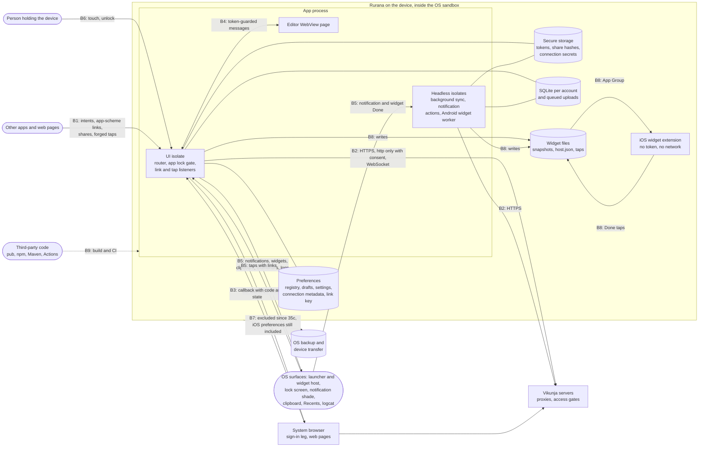

# Threat model

This is the threat model of Rurana, the Android and iOS client for self-hosted Vikunja. It was written in step 35c (2026-10-27) from the code after steps 35a (app lock and privacy, [D64]) and 35b (connection settings per server, [D65]) and from the 35c changes (backup exclusion, deep-link hardening, the uncaught-error hooks, the CI scans). It lists what the app protects, from whom, where it is exposed, what protects it in the code and in the tests, and what is left over by decision. Section 8 is the checklist that a security sign-off goes through.

IDs used throughout: **A** assets, **B** trust boundaries, **E** entry points, **M** mitigations, **R** residual and accepted risks. Paths are relative to the repository root, with three short forms: `core/…`, `features/…` and `bootstrap/…` are under `app/lib/`; a Kotlin file named without a root is under `app/android/app/src/main/kotlin/dev/coderoftime/rurana/`, and `AndroidManifest.xml` and `res/…` are under `app/android/app/src/main/`; a test named alone sits next to the one named before it. [D66] is the decision of step 35c. Step 37a ([D73]) moved CI to GitLab and added release signing; B9, M38–M42 and R26, R28, R34 and R35 follow it. The Cronet move after it (2026-10-29, [D67]'s and [D73]'s notes) closes R27 and narrows R34. Step 37c ([D76]) adds the store listings and the links to Rurana's pages on the owner's website (section 6.10, M44), and the location removal on Android (M43, R36).

## 1. Scope and assumptions

**In scope:** the app on Android and iOS (the Flutter UI isolate, the headless isolates, the Android widget worker, the iOS widget extension), everything it stores on the device, every way in from outside the app, its network traffic, and the code and CI that build it; since step 37c also the store listings kept in the repository and the addresses of Rurana's pages that the app and the listings link (section 6.10).

**Out of scope:** the Vikunja server and its web frontend, the user's browser beyond the sign-in leg, the OS itself, and hardware attacks; the owner's website (coderoftime.dev), which its own repository builds and publishes.

**Assumptions:**

1. The OS, its app sandbox, the Keychain and the Android Keystore, and the device's screen lock work as documented. A rooted or jailbroken device is out of scope, except where R3 says what such a device exposes.
2. A Vikunja server is trusted with the user's own data on it, but not trusted by the app: everything it sends (`/info`, HTML, links, notification texts, error bodies) is untrusted input, and a pasted or shared link may name an attacker's server.
3. The network is hostile: shared Wi-Fi, captive portals, LAN servers on plain `http`, proxies. Only what the user explicitly allows (an unencrypted connection, a pinned or trusted certificate) is accepted.
4. Other apps and web pages are hostile. On Android they can send intents to every exported component and read the clipboard within the OS's limits; on iOS any web page or app can open an app-scheme URL. A web page on Android reaches only `BROWSABLE` filters (task links and the OAuth callback).
5. What the user lets see the app's output is trusted with it: the home-screen host (launcher) that draws the widgets, apps granted notification access or widget hosting, the keyboard and accessibility services. The OS gives them that access; the app cannot take it back. The widget host is trusted with more than the output: through the list widget's collection template it can make the app start activities, broadcasts and services as itself, the app's non-exported components included (R17).
6. The person holding an unlocked phone is not necessarily its owner (the app lock is the control). Someone holding the locked phone sees only what the lock screen shows.
7. Device backups are protected by the user's own credentials (Apple ID, backup encryption). The app still keeps its data out of them where it can (owner decision of 2026-10-27).
8. The app talks only to the user's servers and the system browser: no analytics, no crash reporting, no other backend ([D20]). Rurana's privacy policy, legal notice and support page on the owner's website, which every build links from the About page, open in the system browser like every other link; the app sends the website nothing ([D76], [D77]).
9. Developer machines are trusted. Third-party code is pinned and scanned, not audited line by line.

## 2. Assets

| ID | Asset | Where it lives | In device backups | Sensitivity |
|---|---|---|---|---|
| A1 | OAuth refresh token (rotating, 256 hex) | secure storage `account.<id>.refresh_token` | never on another device (Keychain `ThisDeviceOnly`, Keystore-wrapped key) | highest: the account until rotated or revoked |
| A2 | OAuth access token (JWT, 600 s) | secure storage, memory, the `Authorization` header, the WebSocket `auth` frame | as A1 | high, short-lived; valid up to 10 minutes after its session ends ([D55]) |
| A3 | Link-share hash (40 characters) and guest JWT (72 h) | secure storage `account.<id>.share_hash`, `.share_token` | as A1 | high for the shared project; the hash signs in again |
| A4 | Connection secrets: access-header values, PKCS#12 file and its password | secure storage `network_profile.<id>.secrets` | as A1 | high: passes an access gate, presents the client certificate |
| A5 | Transient secrets: OAuth code, PKCE verifier and state; a share's password; a new API or CalDAV token; an invite token | memory for one sign-in, one request or one page; a copied token or share link in the clipboard | no | high while they exist |
| A6 | Widget-link key (32 random bytes) | preferences `widgets.link_key`, `widgets/host.json`, every widget link and notification payload (`k`) | Android no; iOS yes (preferences) | low to medium: lets a link switch accounts without asking; guards no data |
| A7 | Task data: tasks, descriptions, comments, projects, labels, people, planned notification texts | SQLite per account, `<application support>/accounts/<id>/vikunja.db` | Android no; iOS no since 35c | personal or business data |
| A8 | Queued uploads, downloaded attachments | `accounts/<id>/uploads`; `cache/attachments` | no | user files |
| A9 | Description and comment drafts | preferences | Android no; iOS yes | personal data, unsent |
| A10 | Account registry: server roots, usernames, display names, `/info` snapshot (read again while signed in since step 37e) | preferences `auth.account_registry` | Android no; iOS yes | personal data, no secret ([D25]) |
| A11 | Connection metadata: pins, CA certificates, header names, unencrypted-connection consents, last pin mismatch | preferences `network.profiles` | Android no; iOS yes | not secret, but its integrity decides whom the app trusts |
| A12 | Privacy settings (app lock, timeout, screenshots, notification content, widget titles) | preferences `privacy.settings`; the lock state in memory | Android no; iOS yes | integrity |
| A13 | Widget files: snapshots with task titles, catalogs, configs, host settings, Done taps | Android `files/widgets`; iOS App Group `widgets/` | no since 35c | titles, account names, hosts |
| A14 | What the OS shows for the app: notifications, widget views, the clipboard, Recents thumbnails | the OS | — | titles; secrets when copied |
| A15 | Logs, and the later diagnostics export | debug console only; release builds print nothing | — | must hold no secret and no content |
| A16 | Write access to the user's data on the server | the outbox, every authenticated request, the notification and widget Done | — | integrity of the user's tasks |

## 3. Actors and trust boundaries

### 3.1 Actors

- **The owner** of the device and of the accounts.
- **A person holding the device**, locked or unlocked.
- **Other apps** on the device, including ones the user granted notification access, widget hosting, accessibility or keyboard access.
- **Web pages** in any browser.
- **Vikunja servers**: the user's own, a hostile or compromised one, or one an attacker names in a shared link; reverse proxies and access gates in front of them.
- **The network** between the device and a server.
- **The system browser** during the sign-in leg.
- **The OS backup and device transfer** services and wherever they put the data.
- **Third-party code**: pub, npm and Maven packages, the CI images and the tools CI downloads (Flutter, osv-scanner, the Docker CLI and Compose), GitLab and its shared runners, the OS WebView; GitLab Pages, which serves the owner's website with Rurana's pages from that website's own repository.

### 3.2 Data flow



### 3.3 Trust boundaries

| ID | Boundary | What crosses it |
|---|---|---|
| B1 | Other apps and web pages → the app | intents to exported Android components, app-scheme URLs, shares, notification taps an app makes up, quick-action extras |
| B2 | The app ↔ servers and the network | REST requests, the WebSocket, server content, TLS, unencrypted connections, connection settings |
| B3 | The app ↔ the system browser | the authorize URL, the OAuth callback, web pages the app opens |
| B4 | The app ↔ the editor page in its WebView | description HTML, commands and answers over the JavaScript channel |
| B5 | The app ↔ OS surfaces others can see or use | notifications, widget views and their taps, the clipboard, Recents thumbnails, screenshots, logs |
| B6 | The person holding the device ↔ the app's UI | everything on screen; the app lock |
| B7 | The device ↔ backups and device transfer | the app's files and preferences |
| B8 | The UI isolate ↔ the headless isolates and the iOS extension | shared secure storage, databases, widget files; the right to refresh tokens |
| B9 | The repository and CI ↔ third-party code | packages, CI images and downloaded tools, the toolchain, the signing keys in CI |

B8 is inside the app's own trust domain. It is listed because the headless parts run without a UI, without the user and often while the app lock is on, so they get fewer rights ([D64]: nothing without a UI waits for the lock).

## 4. Entry points

| ID | Entry | Platform | Who can use it | Checks | Reaches | Mitigations |
|---|---|---|---|---|---|---|
| E1 | Intent data sent to the exported `MainActivity` (any action, any URI, a bare path too); the engine pushes it as a route. Started from another app's activity without `FLAG_ACTIVITY_NEW_TASK`, a new `MainActivity` with its own UI engine | Android | any app | every pushed route is consumed: app scheme → the deep-link relay, anything else dropped; the app lock gates the second UI | nothing outside the relay; a second UI engine on the same data, inside the caller's task (R33) | M16, M33 |
| E2 | Task links `<scheme>://task/<id or PROJ-12>[?account=]` through `TaskLinkActivity` (`BROWSABLE`) or the iOS URL type | both | any app, any web page | scheme and host in Kotlin, the relay, `parseTaskDeepLink` | the task sheet, or since step 36c the Overview's task pane on a wide window; a switch only after asking; an unknown task is read online in the active account | M17 |
| E3 | Widget links `<scheme>://widget/…` | both | the app's widgets; also any app (explicit intent) and, on iOS, any web page | `WidgetLink.parse`; the widget-link key in constant time | with the key as before; without it no silent switch | M18, M19 |
| E4 | Widget setup: `APPWIDGET_CONFIGURE` to `WidgetConfigureActivity`, `widget/configure?appWidgetId=` | Android (the page refuses on iOS) | the launcher; any app | `isOwnWidget`; the page needs the id among the placed widgets | the setup page | M19 |
| E5 | OAuth callback `<scheme>://oauth/callback` through flutter_web_auth_2's `CallbackActivity`; on iOS ASWebAuthenticationSession hands it to the session | both | any app or page (Android) | state (constant time), `code`, PKCE; a late callback is dropped by the relay | the token exchange | M1 |
| E6 | Notification taps: `SELECT_NOTIFICATION` with a `payload` extra | Android: any app can send it to `MainActivity`; iOS: only `UNUserNotificationCenter` | the app's notifications; on Android any app | only plain taps reach the UI (a made-up action id is ignored, `notificationTapSourceProvider`); JSON decode; the widget-link key | with the key: switch, mark read, open; without: ask or stay in the active account | M18 |
| E7 | Notification actions Done, Snooze | both | the notification shade and lock screen; apps with notification access (assumption 5); on Android the widget host, with any payload (R17) | receivers not exported; payload decoded, unknown accounts ignored | the outbox from a headless isolate, no user-token refresh | M5, M25 |
| E8 | Shares: `SEND`, `SEND_MULTIPLE` through `ShareTargetActivity`; the internal `ACTION_SHARE` sent straight to `MainActivity` | Android | any app | foreign `content://` only, 50 files, 100,000 characters, broken extras dropped, the share stripped from the intent | the new-task and add-to-task flows; share and invite links | M22 |
| E9 | The "New task" quick action (an extra on any intent to `MainActivity`) | both | the launcher; on Android any app | the type must be `new_task` | the New task sheet in the active account | M24 |
| E10 | `APPWIDGET_UPDATE` to the two widget receivers | Android | any app (the system needs them exported) | — | a redraw, at most one publish run per key and process | — (R20) |
| E11 | Glance Done (`MarkDoneAction` through Glance's non-exported callback receiver) | Android | the widget on the home screen, through the widget host; the host with any parameters (R17) | the queue refuses a hidden row; account and task from the row; the import drops unknown accounts | the queue, the worker, the outbox | M20, M21 |
| E12 | iOS widget extension: `MarkDoneIntent`, request markers, `host.json` | iOS | the widget, through WidgetKit | `isDiscoverable = false`, `.requiresAuthentication`; the app imports each tap once, unknown accounts dropped | the outbox at the next app run | M20, M21, M37 |
| E13 | Server answers: JSON, `/info` (`frontend_url`, notices, legal links), HTML descriptions and comments, attachments, avatars, WebSocket frames, error bodies | both | the server, the network | typed decoding, HTML budgets, link allowlist, no remote images, failures by type | the database and the screens | M9–M15 |
| E14 | Pasted or shared links and addresses: server addresses, share links, invite links | both | the user; text another app shares | the link parsers; a probe; the unencrypted-connection question | the Connect screen, the guest sign-in, the invite check | M6, M10 |
| E15 | Files the user picks: attachments, a PKCS#12 file, a CA certificate | both | the user | size caps, validated before saving, the picked copy deleted | uploads, connection settings | M9 |
| E16 | Editor page messages (page → app) | both | the page in the WebView | the per-load token; a fixed set of message types | the editor's state | M27 |
| E17 | A restored backup | iOS (Android transfers nothing) | the backup's owner | the install marker; Keychain items `ThisDeviceOnly` | the preferences come back | M3, M35, M36 |

## 5. STRIDE per boundary

Repudiation does not apply to a client: the server records who wrote what, and the app adds nothing to that. It is left out of the tables below.

### B1: Other apps and web pages → the app

| | Threat | Example | Mitigations | Residual |
|---|---|---|---|---|
| S | A link or tap that poses as the app's own widget or notification | `widget/account?account=<id>` from another app or an iOS web page; `SELECT_NOTIFICATION` with a made-up payload | M18 | R17, R18, R19 |
| S | A forged OAuth callback | a callback carrying the attacker's code during a pending sign-in | M1 | R1 |
| T | Route injection into the running app | `x://y/connection?origin=https://attacker.example&edit=certificate`, a bare `/home/account-settings/api-tokens/new` | M16 | — |
| T | Tampered shares | the app's own `content://` URIs, `file://`, huge texts, broken parcels, `ACTION_SHARE` straight to `MainActivity` | M22 | — |
| T | A write through a link | a `widget/done` link, a made-up Done | M20, M21 | R17 |
| T | A foreign widget setup | `APPWIDGET_CONFIGURE` or `widget/configure` with some id | M19 | R18 |
| I | Reading the app's files or secrets | file provider paths | M2, M23 | R17 |
| D | Floods of links or updates | repeated links, `APPWIDGET_UPDATE` | the opener runs only the last waiting request (M17) | R20 |
| E | Reaching a privileged screen, or acting while the app is locked | the API-token form, the Connection screen; links while locked | M16, M33 | R18 |
| S, D | The app's UI inside another app's task | an explicit start of `MainActivity` without `FLAG_ACTIVITY_NEW_TASK`: a second UI engine with its own sync, socket and scheduler, under the caller's own activities | M33 | R33 |

### B2: The app ↔ servers and the network

| | Threat | Example | Mitigations | Residual |
|---|---|---|---|---|
| S | An impostor server | rogue Wi-Fi, DNS, a user-installed CA | system trust; a TLS failure never falls back to `http` ([D8]); a pin or a CA per server address | R8, R9 |
| S | A hostile server phishing through its sign-in page | a crafted `frontend_url`, a mix-up | M1 | R1, R2 |
| T | Tampering on an unencrypted connection | LAN `http` | the consent per server address, enforced in the transport (M10) | R8 |
| T | Hostile content | script in HTML, huge documents, remote images, links to other apps | M14, M15, M27 | R31 |
| I | A token or connection secret sent to another host | a redirect, a cross-origin attachment URL, a header following a redirect | M4, M9, M12 | — |
| I | Secrets over `http` | the two-factor secret of servers before 2.7 | M7, M10 | R8 |
| I | Secrets quoted in error texts | an exception quoting a header value | M11, M34 | R10 |
| I | A photo's location sent with an attachment | a photo or video with GPS or a place name in its metadata, picked, taken with the camera or shared to Rurana, which the server keeps and every member of the project can download | M43 | R36 |
| D | Rate limits, a changed certificate | the per-IP limit shared with sign-in; a pin mismatch stops every request by design | M9 | R32 |
| E | Server text driving the app | failures mapped by type, never by text; no server code runs | M11, M15 | — |

### B3: The app ↔ the system browser

| | Threat | Example | Mitigations | Residual |
|---|---|---|---|---|
| S | Another app with the redirect scheme takes the code | a second `vikunja-…` app | PKCE: the verifier never leaves the app (M1) | R1 |
| T | A changed callback | swapped `code` or `state` | M1 | — |
| I | A web login reused across servers | a mix-up through a remembered session | ephemeral session (M1) | R1 |
| I | The browser leg ignores the connection settings | a pinned server's certificate warning in the browser | the hint before the browser leg (M13) | R2 |

### B4: The app ↔ the editor page

| | Threat | Example | Mitigations | Residual |
|---|---|---|---|---|
| S | A frame or script posing as the page | an injected iframe calling the channel | per-load token, CSP without frames (M27) | R30 |
| T | Script inside a description | ``, `<script>` | hashed-script CSP, the editor's schema (M27) | — |
| I | The page sending content away | `fetch`, an image URL with data | `default-src 'none'`; images drawn as placeholders, so no token reaches the page (M27) | — |
| E | Navigation, new windows, file access | `window.open`, `location =`, `file://` | navigation delegate, file and content access off (M27) | R30 |

### B5: The app ↔ OS surfaces

| | Threat | Example | Mitigations | Residual |
|---|---|---|---|---|
| I | Task titles on the lock screen, to apps with notification access | a reminder's title | M31 | R12, R13 |
| I | Task titles on the home screen, StandBy and the lock-screen widgets | the widget rows | M32 | R17 |
| I | The Recents thumbnail | the app switcher | M30 | R14 |
| I | Screenshots and recordings of a secret | a new API token on screen | M29 | R15 |
| I | The clipboard | a copied token or share link | M28 | R16 |
| I | Logs | an exception text in logcat | M34 | R24, R25 |
| T, E | Actions from the lock screen | Done on a locked device | M25 (iOS asks for the unlock while the app lock is on) | R12 |
| S, T, E | The widget host acting as the app | a launcher filling the list widget's collection template with a component of its choice: Done or Snooze on any task, a notification posted as the app, Glance's Done with any parameters | — | R17 |

### B6: The person holding the device ↔ the app's UI

| | Threat | Example | Mitigations | Residual |
|---|---|---|---|---|
| S | Someone else unlocks the app | a borrowed phone | the device's biometrics or credential (M33) | R29 |
| I | An unlocked phone in other hands | tasks, settings, the one-time token | the app lock; entry paths wait behind it; a new token is shown once (M33, M7) | R29 |
| T | Turning the lock off | the privacy page | turning it on or off needs a successful prompt (M33) | R29 |
| E | Getting past the lock | a link, a notification tap, back | entry paths wait; back never pops the routes below (M33) | — |
| I | Data at rest on a seized device | the database, the drafts | the lock guards the UI only | R3, R4, R5, R6, R11 |

### B7: The device ↔ backups and device transfer

| | Threat | Example | Mitigations | Residual |
|---|---|---|---|---|
| I | The app's data in a cloud backup or a device transfer | the database moved to a new phone by an OEM transfer tool | M35, M36 | R21, R23 |
| I | Secrets in backups | tokens, connection secrets | M2 | — |
| T | A restore bringing back old state | an old registry, an old key | M3 | R21, R22 |

### B8: The UI isolate ↔ the headless isolates and the iOS extension

| | Threat | Example | Mitigations | Residual |
|---|---|---|---|---|
| E | A headless run rotating a user's refresh token | a lost race ending the session for good | M5 | R7 |
| T | One write sent twice | the UI and a notification action both sending | claim before send ([D34]); widget taps recorded once (M21) | — |
| I | A token in the extension | a keychain group for the widget | M37 | — |
| T | Tampered App Group taps | a file in `outbox/` | only the app and its extension share the App Group; unknown accounts dropped (M21, M37) | — |
| I | Unredacted errors from headless isolates | an uncaught error in the widget worker | the hooks in all four entry points (M34) | R24 |

### B9: The repository and CI ↔ third-party code

| | Threat | Example | Mitigations | Residual |
|---|---|---|---|---|
| T | A malicious package version | a swapped pub, npm or Maven artifact | M38, M41 | R26 |
| T | A malicious image or tool | a moved tag, a swapped download | M39 | R26 |
| I | CI secrets leaking | the signing keys in a log, an artifact or a job that does not need them | M39, M42 | R28 |
| T | A release from code nobody reviewed | a pipeline of an unprotected tag or branch reaching the signing keys | M39, M42 | R28 |
| E | Install scripts running | an npm `postinstall` | `npm ci --ignore-scripts` (M38) | — |
| T | A known-vulnerable dependency | a new advisory | M40 | R26 |
| E | A plugin update exporting a component | a new exported receiver | M26 | — |
| S | A release signed with the wrong key | the debug key, or a key other than the one the CI variables hold | M42 | R28 |
| E | Merged code on the owner's Mac | a change to `tool/ci/ios.sh` merged to main runs commands on the Mac runner (merge request pipelines never reach it) | the runner is optional and takes only protected refs; [releasing.md](releasing.md) has it run under a macOS user of its own without the keystores | R35 |

## 6. Mitigations

Every row names where the control lives and what tests it. "Manual" marks a control without an automated test; section 8 lists its check.

### 6.1 Sign-in and secrets

| ID | Mitigation | Code | Tests | Decisions |
|---|---|---|---|---|
| M1 | Browser sign-in only: the app never handles a password or TOTP code. PKCE S256 over a 32-byte verifier, 16-byte state compared in constant time, an ephemeral browser session, the Android callback filter narrowed to `oauth/callback`. An `http` `frontend_url` is never used for an `https` server. | `packages/vikunja_api/lib/src/auth/authorization_request.dart` (`AuthorizationRequest`); `app/lib/core/auth/web_authenticator.dart` (`preferEphemeral: true`); `app/android/app/src/main/AndroidManifest.xml` (`CallbackActivity`) | `packages/vikunja_api/test/auth/authorization_request_test.dart`, `pkce_test.dart`; `app/test/core/auth/web_authenticator_test.dart`, `browser_sign_in_test.dart`; `app/test/app/oauth_integration_test.dart` | [D14], [D23] |
| M2 | Secrets live only in secure storage: Keychain `first_unlock_this_device`, not synchronizable; AES-GCM with a Keystore-wrapped key on Android. Neither app target has a keychain access group. | `app/lib/core/storage/secure_store.dart` (`FlutterSecureStore.defaultStorage`); `core/auth/token_store.dart`, `link_share_store.dart`; `core/network/network_profile_secrets.dart`; `app/ios/Runner/Runner.entitlements`, `RuranaWidgets/RuranaWidgets.entitlements` | `app/test/core/storage/secure_store_options_test.dart`, `app/test/app/entitlements_test.dart`, `app/test/core/auth/token_store_test.dart`, `link_share_store_test.dart` | [D24], [D62], [D65] |
| M3 | A fresh iOS install wipes Keychain items an earlier install left behind (no install marker and no registry). An account without tokens, as after a restore, needs a new sign-in. | `core/auth/previous_install.dart` (`purgeSecretsLeftByPreviousInstall`); `core/auth/accounts_without_tokens.dart` | `app/test/core/auth/previous_install_test.dart`, `accounts_without_tokens_test.dart` | [D24], [D25] |
| M4 | The access token goes only to the account's own server root and never follows a redirect; every base `Dio` has `followRedirects: false`. | `packages/vikunja_api/lib/src/auth/auth_interceptor.dart` (`AuthInterceptor`); `transport/authenticated_dio.dart`; `app/lib/core/network/dio_factory.dart` | `packages/vikunja_api/test/auth/auth_interceptor_test.dart`, `test/transport/authenticated_dio_test.dart` | [D23] |
| M5 | The notification-action isolate and the widget worker never refresh a user's token (`SessionManagers(refreshes: false)`); a guest re-authenticates at most once in any container the OS started. The background sync refreshes by design: it is the session keep-alive. | `core/notifications/notification_action_handler.dart` (`backgroundActionOverrides`), used by `core/widgets/widget_entry_points.dart`; `core/auth/link_share_providers.dart` (`maxAuthentications`) | `app/test/core/auth/session_manager_no_refresh_test.dart`, `link_share_session_test.dart`; `app/test/core/notifications/notification_action_handler_test.dart`; `app/test/core/widgets/widget_container_test.dart` | [D39], [D40], [D62], [D63]; [D66] decision 2 |
| M6 | Guests: the hash is written first and deleted first; the share's password is never stored or logged; the hash stays out of the Connect screen's state and logs; the guest's `Dio` logs no bodies. | `core/auth/link_share_store.dart`, `core/auth/link_share_gateway.dart`, `features/onboarding/application/guest_sign_in.dart` | `app/test/core/auth/link_share_store_test.dart`, `app/test/features/onboarding/guest_sign_in_test.dart`, `application/connect_server_links_test.dart`; `app/test/security/token_leak_test.dart` | [D62] |
| M7 | A new API or CalDAV token exists only in the state of the page that created it, behind `SecureDisplay`, copied through the sensitive clipboard. The two-factor status is not read over `http` from servers before 2.7, whose answer carries the secret. | `features/account_settings/presentation/one_time_secret_view.dart`; `features/account_settings/application/totp_status_reading.dart` (`canReadTotpStatus`) | `app/test/features/account_settings/api_tokens_page_test.dart`; `account_security_sections_test.dart` ("over http to a server before 2.7 it is not read at all") | [D55] |
| M8 | Sign-out and removal delete the account's tokens or guest secrets, its database files, uploads, widget files, scheduled notifications, unsent comments and description draft; the server's connection settings on request. | `features/session/application/sign_out_controller.dart`, `core/auth/sign_out.dart`, `core/repositories/repository_providers.dart` (`accountDataWiper`), `core/db/account_database_files.dart` (`deleteFor`), `features/description_editor/application/description_drafts.dart` (`discardAll`) | `app/test/core/auth/sign_out_test.dart`, `app/test/core/widgets/widget_container_test.dart`, `app/test/core/repositories/task_details_providers_test.dart`, `app/test/features/description_editor/` | [D26], [D31], [D63], [D65] |

### 6.2 Transport

| ID | Mitigation | Code | Tests | Decisions |
|---|---|---|---|---|
| M9 | Connection settings per server address, applied by the transport below every interceptor: a pin on the leaf's SHA-256 checked in the TLS handshake without system roots, a CA certificate per address, a client certificate, access headers only to their own origin with redirects off. No request leaves without its address's settings: locked, damaged and incomplete settings fail closed. A pin mismatch is recorded and never trusted automatically. | `core/network/network_profile_adapter.dart` (`NetworkProfileAdapter.fetch`), `profile_http_client.dart` (`pinnedCertificateCheck`), `network_profiles.dart`, `header_rules.dart`, `client_certificate.dart`, `certificate_probe.dart` | `app/test/core/network/network_profile_adapter_test.dart`, `profile_http_client_test.dart`, `network_profiles_test.dart`, `header_rules_test.dart`, `client_certificate_test.dart`, `certificate_probe_test.dart`; `tls_docker_test.dart` (opt-in, `RURANA_TLS_DOCKER=1`) | [D65] |
| M10 | Unencrypted connections need a consent per server address, enforced in the transport for requests and `ws://`; only the pre-consent `GET …/info` probe without `Authorization` passes. | `core/network/network_profile_adapter.dart` (`CleartextBlockedException`, `preConsentProbeKey`); `core/realtime/realtime_providers.dart` (`ProfileRealtimeConnector`) | `network_profile_adapter_test.dart`; `app/test/core/realtime/profile_realtime_connector_test.dart`; `app/test/features/connection/connection_page_test.dart` | [D8], [D65] |
| M11 | An error whose text quotes a stored header value or the PKCS#12 password (8 characters or more) keeps its kind and loses its text; the five connection exceptions print only their class and origin; failures are mapped by type, never by text. | `core/network/secret_scrubbing.dart` (`quotesSecret`); `packages/vikunja_domain` failure types | `network_profile_adapter_test.dart`; `app/test/core/network/no_secrets_in_logs_test.dart` | [D65] |
| M12 | The WebSocket sends the token in its `auth` frame, not the URL, gets the address's settings on the upgrade, and logs states and close codes only. | `packages/vikunja_api/lib/src/realtime/io_realtime_connector.dart`; `core/realtime/realtime_providers.dart` | `packages/vikunja_api/test/realtime/io_realtime_connector_test.dart`; `app/test/core/realtime/realtime_connection_test.dart`, `profile_realtime_connector_test.dart` | [D46], [D65] |
| M13 | Before the browser leg, a hint says what the browser will meet: the pinned fingerprint to compare, a CA, a client certificate, an access login, a different sign-in host. | `features/connection/presentation/browser_leg_hint.dart` (`confirmBrowserLeg`) | `app/test/features/connection/browser_leg_hint_test.dart` | [D65] |

### 6.3 Server content

| ID | Mitigation | Code | Tests | Decisions |
|---|---|---|---|---|
| M14 | Links from server content open only on a tap, in another app, and only for `http(s)` with a host or 12 listed schemes; the app's own scheme is not among them. | `core/links/external_link_opener.dart` (`ExternalLinkOpener`) | `app/test/core/links/external_link_opener_test.dart` | [D44] |
| M15 | Server HTML is parsed natively within budgets; remote images are never loaded, only attachment images of the account's own server through its authenticated client. | `packages/vikunja_logic/lib/src/text/bounded_html_parser.dart`, `rich_text_parser.dart`; `packages/vikunja_logic/lib/src/links/attachment_urls.dart`; `features/tasks/presentation/rich_text/rich_text_view.dart` | `packages/vikunja_logic/test/text/bounded_html_parser_test.dart`, `rich_text_limits_test.dart`, `rich_text_fuzz_test.dart`; `test/links/attachment_urls_test.dart` | [D44], [D58] |

### 6.4 Links and other ways in

| ID | Mitigation | Code | Tests | Decisions |
|---|---|---|---|---|
| M16 | Route injection (G1): an observer registered before the router's own consumes every route the platform pushes; app-scheme URIs go to the relay, anything else, a bare path included, is dropped. The redirect sends any location with a scheme or host to the splash. A cold start ignores the platform's default route, and the relay reads only an app-scheme start link. `MainActivity` strips intent data on a Recents relaunch and a restore. | `app/lib/app/router/app_router.dart` (`_AppSchemeLinks`, the `redirect`, `overridePlatformDefaultLocation`); `core/links/deep_link_relay.dart` (`DeepLinkRelay.accept`); `MainActivity.kt` (`onCreate`) | `app/test/app/route_injection_test.dart` (signed out and in, `/connection?…&edit=certificate` with zero certificate probes); `app/test/app/deep_link_test.dart` ("a pushed route of the app is dropped too"); canary in `app/test/features/teams/organise_route_report_test.dart` | [D44]; [D66] |
| M17 | Task links: only the app scheme with host `task`, a strict parser, a switch to another account only after asking, one request at a time with the last one winning. | `TaskLinkActivity.kt`; `packages/vikunja_logic/lib/src/links/task_reference.dart` (`parseTaskDeepLink`); `features/tasks/presentation/open/task_opener.dart` (`TaskOpener.openLink`, `request`) | `packages/vikunja_logic/test/links/task_reference_test.dart`; `app/test/core/links/deep_link_relay_test.dart`; `app/test/app/deep_link_test.dart` | [D44] |
| M18 | The widget-link key (G2): 32 bytes from `Random.secure()`, created only at the UI start before the install marker is set, new on a fresh install, compared in constant time. Every widget link and every notification payload built once the key exists carries it as `k` (the Dart snapshot builder; Kotlin and Swift from `host.json`); R19 lists those without it. Without the right key a link or tap never switches accounts and never marks anything read: a task goes through the task-link flow, which asks; the rest acts only in the active account. Headless isolates only read the key. | `core/links/widget_link_key.dart`; `bootstrap/bootstrap.dart` (`_prepareWidgetLinkKey`); `core/links/widget_link.dart` (`WidgetLink.linkKey`); `core/widgets/widget_snapshot_builder.dart`, `widget_providers.dart` (`widgetHostSettings`); `plugins/rurana_widgets/lib/src/rurana_widgets.dart` (`writeHost`); `widgets/WidgetLinks.kt`; `app/ios/RuranaWidgets/ListSelection.swift` (`WidgetLinks.url`); `core/notifications/notification_actions.dart` (`NotificationPayload.linkKey`); `features/widgets/presentation/widget_link_listener.dart`; `features/notifications/presentation/notification_tap_listener.dart` | `app/test/core/links/widget_link_key_test.dart`, `widget_link_test.dart`; `app/test/app/widget_link_test.dart` ("without the link key, as any app or web page can send"); `app/test/core/notifications/notification_payload_test.dart`; `app/test/features/notifications/notification_tap_listener_test.dart` ("without the link key"); `widget_snapshot_builder_test.dart`, `plugin_widget_host_test.dart`; `WidgetLinksTest.kt`; Swift: manual (section 8.3) | [D63]; [D66] decision 1 |
| M19 | Widget setup (G3): the page refuses an id that is not among the placed widgets `configs()` reports, and refuses when they cannot be read (iOS always refuses: it configures through App Intents). `WidgetConfigureActivity` accepts only the app's own widget ids. A list link's days are clamped to 1–365 (G5). | `features/widgets/presentation/widget_configure_page.dart`; `widgets/WidgetConfigureActivity.kt` (`isOwnWidget`); `core/links/widget_link.dart` (`WidgetLink.maxDays`) | `app/test/features/widgets/widget_configure_page_test.dart` ("refuses, without a form"), `widgets_page_test.dart`; `widget_link_test.dart` ("keeps the days of a list within a year"); Kotlin: manual | [D63]; [D66] |
| M20 | No link writes: there is no `widget/done`. A widget's Done goes only through Glance's non-exported callback or the iOS App Intent (`isDiscoverable = false`, `.requiresAuthentication`). | `core/links/widget_link.dart`; `widgets/MarkDoneAction.kt`; `app/ios/RuranaWidgets/MarkDoneIntent.swift` | `app/test/app/widget_link_test.dart` ("a done link, which any app can send, neither switches nor …"); `WidgetActionQueueTest.kt`; Swift: manual | [D63], [D64] |
| M21 | Widget taps are imported exactly once (`imported_widget_actions`); taps of unknown accounts are dropped; the Android queue refuses a row already hidden. | `core/widgets/widget_taps.dart` (`WidgetTapImport`); `widgets/WidgetActionQueue.kt` | `app/test/core/widgets/widget_container_test.dart`; `WidgetActionQueueTest.kt` | [D63] |
| M22 | Shares: only other apps' `content://` URIs, at most 50 files and 100,000 characters, unparcellable extras dropped, the share stripped from the intent so Recents and a restore never offer it again; the same checks when `ACTION_SHARE` reaches `MainActivity` directly. Shared text is escaped into the task's HTML. | `ShareTargetActivity.kt`; `ShareInbox.kt` (`receive`, `isForeignContent`); `MainActivity.kt`; `features/share/application/share_text.dart` | `app/test/app/share_intent_test.dart`, `share_intent_links_test.dart`; `app/test/features/share/share_text_test.dart`, `share_files_test.dart`; `app/test/core/share/channel_share_intent_source_test.dart`; Kotlin checks: manual (emulator, [D53]) | [D53], [D62] |
| M23 | The file provider is not exported and hands out only `cache/attachments`, read-only, per open, after a canonical-path check. | `AndroidManifest.xml` (`AttachmentFileProvider`), `res/xml/attachment_paths.xml`, `FileActionsChannel.kt` | manual (emulator, [D53]) | [D53] |
| M24 | The quick action is acted on only for the type `new_task`, and only opens the New task sheet in the active account. | `features/quick_add/presentation/new_task_shortcut.dart`; `core/platform/app_shortcuts.dart` | `app/test/app/new_task_shortcut_test.dart` | [D38] |
| M25 | Notification actions: the plugin's receivers are not exported; the payload is decoded and an unknown account ignored; Done goes through the outbox without a user-token refresh. On iOS, Done in the `task_locked` category asks for the device unlock while the app lock is on. | `core/notifications/notification_action_handler.dart`; `core/notifications/local_notification_gateway.dart`; `AndroidManifest.xml` | `app/test/core/notifications/notification_action_handler_test.dart`, `local_notification_gateway_test.dart` | [D39], [D64] |
| M26 | The exported Android components of the merged release manifest must equal an allowlist (7 open, 4 permission-protected), each pinned with its permission and each intent filter on its own (actions, categories, every attribute of its data elements); an `android:exported` that is neither `true` nor `false` fails; `allowBackup="false"` and the extraction rules attribute are checked too. | `tool/check_exported_components.py` (`ALLOWED`) | the jobs `android` and `release` (`tool/ci/android.sh`, `release.sh`), which first run the script's `--self-test` (regrouped filters, unpinned data attributes, an export through a resource among its 17 cases) | [D66] |

### 6.5 WebView

| ID | Mitigation | Code | Tests | Decisions |
|---|---|---|---|---|
| M27 | The editor page loads from the app's assets under a CSP (`default-src 'none'; script-src 'sha256-…'; style-src 'unsafe-inline'; img-src data:; base-uri 'none'; form-action 'none'`): no network, no frames. The navigation delegate allows only the first main-frame load of the asset, so `window.open` and links are refused. Messages carry a per-load 24-byte token both ways. File and content access are off; debugging only in debug builds. | `features/description_editor/presentation/webview_editor_bridge.dart` (`_decide`, `isEditorPage`, `lockDownWebView`); `app/assets/editor/editor.html`; `app/editor/src/bridge.js` | `app/test/features/description_editor/webview_editor_bridge_test.dart` (incl. "a window.open main-frame navigation after ready is prevented"), `editor_page_policy_test.dart`; `app/editor/test/bridge.test.mjs`, `page.test.mjs`; `tool/build_editor.sh --check` | [D52] |

### 6.6 OS surfaces and the person holding the device

| ID | Mitigation | Code | Tests | Decisions |
|---|---|---|---|---|
| M28 | Sensitive clipboard for new tokens and share links: Android marks the clip `IS_SENSITIVE`; iOS copies `localOnly` with a 2-minute expiry, or plainly while the channel is missing. | `core/platform/sensitive_clipboard.dart`; `MainActivity.kt` (`copySensitive`); `app/ios/Runner/AppDelegate.swift` (`DeviceChannel`) | `app/test/core/platform/device_channel_test.dart` ("the sensitive clipboard"); Swift: manual | [D55]; [D66] decision 4 |
| M29 | `FLAG_SECURE` while a secret shows and while "Block screenshots" is on, reference-counted so neither clears the other. iOS keeps no window out of captures; there the secure window says whether the screen is captured (a recording, AirPlay, a mirrored display), and a one-time token or a revealed secret field hides while it is, and from the moment the app leaves until iOS has answered again after the return; a channel that fails shows the secret, which would otherwise be lost. | `core/platform/secure_display.dart`; `features/account_settings/presentation/one_time_secret_view.dart`; `features/connection/presentation/secret_text_field.dart`; `AppDelegate.swift` (`ScreenCapture`) | `app/test/core/platform/secure_display_test.dart`, `secret_capture_cover_test.dart`, `device_channel_test.dart`; `api_tokens_page_test.dart`; a real capture: manual (section 8.3) | [D55], [D64], [D74] |
| M30 | The app switcher: Android 13+ leaves the app's thumbnail out while the lock is on; elsewhere a privacy cover while the app is inactive. | `core/security/screen_protection.dart`, `core/platform/recents_screenshots.dart`, `app/lib/app/widgets/app_lock_gate.dart` | `app/test/app/app_lock_gate_test.dart`; `device_channel_test.dart` | [D64] |
| M31 | Notification content: "Hide on the lock screen" (`NotificationVisibility.secret` on Android) or "Never show task titles" (generic texts on both platforms); a change reschedules and withdraws delivered ones. | `core/security/privacy_settings.dart`; `core/notifications/notification_texts.dart`, `local_notification_gateway.dart`, `notification_scheduler.dart` | `app/test/core/notifications/notification_texts_test.dart`, `local_notification_gateway_test.dart`, `notification_scheduler_test.dart` | [D64] |
| M32 | Widget titles can be switched off (snapshots without rows); the iOS rows, labels and Done button are `.privacySensitive()`, redacted on a locked device and in StandBy. | `core/widgets/widget_snapshot_builder.dart`; `app/ios/RuranaWidgets/TasksWidget.swift` | `app/test/core/widgets/widget_snapshot_builder_test.dart`; Swift: manual | [D64] |
| M33 | The app lock: a gate over the UI, locked on every cold start and after the chosen time away by the wall clock; links, widget taps, shortcuts, shares and notification taps wait behind it; back never pops the routes below; unreadable settings fail to the most private values; turning it on or off needs a successful prompt. | `core/security/app_lock_controller.dart` (`isLockedNow`), `privacy_settings_store.dart`, `device_authenticator.dart`, `app_excursions.dart`; `app/lib/app/widgets/app_lock_gate.dart`; `TaskOpener.request` | `app/test/core/security/app_lock_controller_test.dart`, `privacy_settings_test.dart`, `app_excursions_test.dart`, `device_authenticator_test.dart`; `app/test/app/app_lock_gate_test.dart`; `app/test/core/platform/excursion_call_sites_test.dart`; `app/test/features/privacy/privacy_page_test.dart` | [D64] |
| M34 | Logging: release builds have no sink (`Logger.root.level = Level.OFF`); the debug sink redacts every line; `FlutterError.onError` and `PlatformDispatcher.instance.onError` are installed in all four entry points in every build, redact at capture, never call `presentError`, and the dispatcher hook always returns true, so the engine prints nothing. The rules cover tokens, JWTs, `tk_`, long opaque runs, credential headers, the Cloudflare Access names, e-mail addresses, link fragments, invite and guest fragment keys, and the widget-link key. Secret types print `[redacted]`; the domain's `toString`s print ids, not titles. The request log exists only in debug builds. Kotlin logs failure types; Swift does not log. | `app/lib/bootstrap/logging_setup.dart` (`configureLogging`); `core/logging/redaction.dart` (`redactSecrets`, `describeUriForLog`); `core/network/request_log_interceptor.dart`; `packages/vikunja_domain/lib/src/task/task.dart` and the other domain types | `app/test/security/token_leak_test.dart`, `log_hygiene_test.dart`; `app/test/bootstrap/logging_setup_test.dart`; `app/test/core/logging/redaction_test.dart`; `app/test/core/network/request_log_interceptor_test.dart`, `no_secrets_in_logs_test.dart`; `packages/vikunja_domain/test/task/task_test.dart` | [D24], [D63], [D65]; [D66] |
| M43 | Photo locations on Android and iOS: every photo and video from the photo picker or the camera, and on Android every copy of a share, goes through the device channel's `removeLocation` before it is queued or ready, in place and without being encoded again; a file without a location is never written to. iOS writes an image again without its EXIF and XMP GPS tags (a PNG is encoded again, which loses nothing) and passes a video through a passthrough export with the sharing filter. Android tells the format by the file's first bytes and blanks the location where it is, byte for byte, as Android's MediaProvider does for apps without `ACCESS_MEDIA_LOCATION`: ExifInterface first writes a JPEG, PNG or WebP again without its GPS tags, on a copy that takes the file's place once written; then, in every photo format it reads (JPEG, PNG, WebP, HEIF and AVIF items, TIFF-based raw, CR3, JPEG XL), the app's own reader zeroes the GPS values left in any Exif and overwrites GPS in XMP with spaces; in an MP4, 3GP or QuickTime video the location boxes become `free` boxes and Apple's location values are zeroed, with no `MediaMuxer`, so the tracks and samples stay as they were. Each is read back to check. A file that keeps a location is still handed on (on iOS as it was, on Android with what could be blanked blanked); the log names the platform's reason, never the file, and Android's own log line names neither (R36). Files from the file picker are not touched. | `features/attachments/application/plugin_attachment_picker.dart`, `attachment_picker.dart`; `features/share/application/share_files.dart`; `core/platform/location_removal.dart`; `AppDelegate.swift` (`LocationRemoval`); `LocationRemoval.kt`, `DeviceChannel.kt` | `app/test/features/attachments/plugin_attachment_picker_test.dart` ("the location of picked photos"); `app/test/features/share/share_files_test.dart` ("the location"); `app/test/core/platform/device_channel_test.dart` ("the location removal hands the path to the app"); `app/android/app/src/test/kotlin/dev/coderoftime/rurana/LocationRemovalTest.kt` (45, on the real ExifInterface with hand-built files: JPEG, PNG and WebP with GPS in Exif and XMP, when ExifInterface cannot write them and when writing fails with an error, ImageMagick's PNG text chunks, TIFF-based raw, ORF, RW2 and RAF, HEIF and AVIF items however `iloc` places them, CR3, JPEG XL, both byte orders, a GPS value of an unexpected type, the video boxes, crafted files that must not hold the removal up, the channel's answer, files without a location not written to); Swift: a photo checked in the simulator, the camera and a video manual (section 8.3); Android: the removal checked on the Android 16 emulator with test files, the flow through the app manual (section 8.2) | [D53], [D74], [D76] |

### 6.7 Backups

| ID | Mitigation | Code | Tests | Decisions |
|---|---|---|---|---|
| M35 | Android: `allowBackup="false"` plus extraction rules that exclude all nine domains (`path="."`) from cloud backup and from device transfer, with no `<include>` and no `<cross-platform-transfer>`. Below Android 12 `allowBackup="false"` covers both. Caches and `no_backup` are always left out. | `AndroidManifest.xml`; `app/android/app/src/main/res/xml/data_extraction_rules.xml` | `app/test/app/backup_rules_test.dart`; `tool/check_exported_components.py` on the merged manifest; manual D2D check (section 8.2) | [D24], [D31]; [D66] |
| M36 | iOS: `isExcludedFromBackup` on `Library/Application Support/accounts` and the App Group's `widgets/` (which holds snapshots, catalogs, configs, `outbox/`, `requests/`, `host.json`), set again at every UI start after the first frame, best effort, failures logged by type. | `core/platform/backup_exclusion.dart` (`excludeAppDataFromBackup`); `bootstrap/bootstrap.dart` (`_excludeFromBackup`); `AppDelegate.swift` (`DeviceChannel.excludeFromBackup`) | `app/test/core/platform/backup_exclusion_test.dart`; `device_channel_test.dart` ("the backup exclusion"); Swift: both marks seen in the simulator (section 8.3) | [D66], [D74] |

### 6.8 Isolates and the iOS extension

| ID | Mitigation | Code | Tests | Decisions |
|---|---|---|---|---|
| M37 | The iOS extension runs no Dart and has no keychain group, no network, no SQLite and no logging; it writes taps with first-unlock file protection, follows only app-scheme links, and its Done needs the device unlock. | `app/ios/RuranaWidgets/` (`AppGroupStore.swift`, `MarkDoneIntent.swift`, `ListSelection.swift`) | `app/test/app/entitlements_test.dart`; `log_hygiene_test.dart` (Swift rules); `app/test/app/xcode_project_test.dart` | [D24], [D63], [D64] |

### 6.9 Supply chain

| ID | Mitigation | Code | Tests | Decisions |
|---|---|---|---|---|
| M38 | Locked dependencies: `pubspec.lock` with a sha256 for every hosted package, installed with `--enforce-lockfile`; `npm ci --ignore-scripts`; Gradle locking of the shipped runtime classpaths (`io.flutter:*` excepted); the Gradle wrapper's `distributionSha256Sum`. The iOS plugins' Swift packages declare no remote dependencies; native iOS code comes only from the locked pub packages. | `pubspec.lock`; `tool/ci/lib.sh` (`setup_flutter`); `tool/build_editor.sh`; `app/android/app/gradle.lockfile`, `build.gradle.kts` (`dependencyLocking`); `app/android/gradle/wrapper/gradle-wrapper.properties` | every Flutter job's `setup_flutter` (`--enforce-lockfile`); the Gradle lock on every Android build | [D66], [D73] |
| M39 | CI on GitLab: every image and service of `.gitlab-ci.yml` pinned by digest; Flutter, osv-scanner, the Docker CLI and Compose downloaded by version and checked against the SHA-256 in `tool/ci/pins.sh`; the release job without a cache, so nothing another pipeline wrote reaches a release; the signing variables protected and scoped to the environment `release`, so they reach only the release job of a protected `v*` tag, never a merge request's or a branch's pipeline; the merge request's sign-offs judged by the target branch's copy of the check. | `.gitlab-ci.yml`; `tool/ci/pins.sh`, `lib.sh`, `osv.sh`, `contract.sh`, `dco.sh`; the project's settings ([releasing.md](releasing.md)) | `tool/ci/test_gitlab_ci.py` (digests, the jobs of each pipeline, the release job's environment, resource group, cache and artifact access, the DCO job); the settings: manual | [D66], [D73] |
| M40 | Advisory scans: OSV on `pubspec.lock`, the editor's `package-lock.json` and the Gradle lockfile in every pipeline (merge requests, `main`, tags) and in the weekly schedule, failing on any finding (native code these lockfiles do not describe is followed by hand, R26); accepted advisories only in `osv-scanner.toml` with a reason and an expiry; `npm audit` fails on high and critical; `flutter pub outdated` informational. | `tool/ci/osv.sh` (job `osv`); `osv-scanner.toml`; `tool/ci/editor.sh`, `outdated.sh` | `tool/ci/test_gitlab_ci.py` (the scanned lockfiles, `osv` in every pipeline and alone on the schedule); the schedule: manual | [D66] decision 5, [D73] |
| M41 | Reproducible artifacts: the committed editor page must equal what its sources build; SQLite comes prebuilt with verified hashes (Android; iOS uses the system's). | `tool/build_editor.sh --check`; sqlite3's build hook | the job `editor` (`tool/ci/editor.sh`) | [D31], [D52] |
| M42 | Release signing and checks: every distributed Android build comes from the release job of a protected `v*` tag. It signs the Play bundle with the upload key and the APK with the APK key (or the upload key), from protected, environment-scoped variables decoded into a private temporary folder for one build each and removed, passwords only in the environment; it fails on a missing or partial set, verifies both signatures against the keys' certificates, refuses `CN=Android Debug`, checks the APK's version against the tag, and publishes `SHA256SUMS` and the APK certificate's SHA-256 with the release. A local release build without keys gets the debug key and a warning; a partial `RURANA_SIGNING_*` set fails the Gradle configuration. The iOS build of a tag is signed on the owner's Mac by Xcode's automatic signing for the team and uploaded with an App Store Connect API key, whose three variables `ios_release.sh` takes out of the environment before Flutter or Xcode runs and whose file it refuses when other users can read it; it checks the archive's version against the tag. | `tool/ci/release.sh`; `app/android/app/build.gradle.kts` (`signingConfigs`); `tool/ci/ios_release.sh`; `.gitignore` (keystores, `key.properties`, `*.p8`) | the release dry run with two throwaway keys (manual, [releasing.md](releasing.md)); `tool/ci/test_gitlab_ci.py` (the release job); the iOS dry run (manual) | [D73], [D74] |

### 6.10 The website and the store listings

| ID | Mitigation | Code | Tests | Decisions |
|---|---|---|---|---|
| M44 | Rurana's pages (privacy policy, support with deleting your account, the project page) and the Impressum are part of the owner's website, coderoftime.dev, which the owner's separate repository builds and publishes through GitLab Pages over HTTPS, as a static site without scripts or forms; this repository holds no website and no build of one. The About page's three links are constants (`WebsitePage`: the privacy policy, the legal notice and, since step 37d, the support page, [D77]), the same in every build, so no build input can point them elsewhere, and they open in the system browser, which the app sends nothing; `check_store_metadata.py` accepts only the fixed https addresses on coderoftime.dev in the listings' URL files. The repository holds only public values for the listings: those addresses, the website's contact address and the copyright, which the website and the stores publish anyway, and the review account `demo` / `demo` of the public demo, which the demo server shows itself; the Impressum's postal address and phone live in the website's repository, and the App Review phone number, the App Store Connect key and the signing keys stay out of both. | `app/lib/app/legal.dart`; `fastlane/metadata/`; `tool/check_store_metadata.py` | `app/test/features/about/about_page_test.dart` (the exact addresses in English and German), `tool/ci/test_check_store_metadata.py` | [D76], [D77] |

## 7. Residual and accepted risks

| ID | Risk | Why it stays, and what limits it | Decisions |
|---|---|---|---|
| R1 | OAuth mix-up and shared schemes: Vikunja's callback has no `iss` and there is no consent screen, so any app with a `vikunja-…` scheme can get a token for a user signed in to the web app in the system browser. Custom Tab fallback browsers may reuse a web login. On iOS another app could claim the app's scheme for task and widget links (the sign-in callback goes straight to the session). | Needs a server change (RFC 9207 or a consent screen). Ephemeral sessions where the browser supports them; PKCE keeps an intercepted code useless. | [D23], [D44] |
| R2 | The sign-in page is the server's: a hostile or compromised server can show a phishing page, and the browser leg ignores the connection settings (a pinned server shows the browser's warning at every sign-in). | The password typed in the browser is protected only by the user's check there; the hint before the browser leg says what to compare. | [D23], [D65] |
| R3 | Data at rest is not encrypted: databases, preferences and widget files are readable on a rooted or jailbroken device or from a forensic image of an unlocked device. | Encryption would stop the background runs, notification actions and the widget worker while locked; the app lock guards only the UI. | [D31], [D64] |
| R4 | Tokens are readable after the first unlock of the device, also while it is locked. | The background runs and notification actions need them. | [D24] |
| R5 | A stolen refresh token works until it rotates or is revoked; an access token works up to 10 minutes after its session ends; deleting the app does not end its sessions (72 h without a refresh does). | Server properties. | [D24], [D55] |
| R6 | The link-share hash is long-lived: whoever has it has guest access until the share is deleted. | A server property; the hash stays in secure storage and out of logs and routes. | [D62] |
| R7 | A guest's token is renewed, and re-authenticated at most once, inside headless containers. | Renewal does not rotate (the old token stays valid), so no race ends the session. Architecture principle 5 is reworded to "never refresh user tokens". | [D62]; [D66] decision 2 |
| R8 | The OS allows cleartext and trusts user-installed CAs for everything ([D8]); origins that stay on Cronet or NSURLSession (plain or header-only) trust those CAs. With a consent, an `http` server gets tokens and data in clear text. | Runtime-typed hosts cannot be narrowed at build time. The consent is per address, enforced in the transport and revocable; pinned and CA-trusted addresses ignore user CAs. | [D8], [D65] |
| R9 | "Trust this certificate" is trust on first use. | The user compares the fingerprint (the page shows how); a later change stops every request until reviewed. | [D65] |
| R10 | Secrets shorter than 8 characters quoted in an error text keep their text; pattern redaction cannot recognise custom header values. | Release builds print nothing; the diagnostics buffer must follow section 10. | [D65] |
| R11 | Secrets of server addresses that neither the old settings nor the registry name stay in secure storage after a reset (it cannot be listed). | Rare; they are encrypted and unused. | [D65] |
| R12 | By default ("Show everything") notifications show task titles on the lock screen; on Android, Done and Snooze run from the lock screen without an unlock; apps with notification access read titles and can fire the actions; the Account tab's test notification ignores the settings. | The owner's default; the privacy settings hide or genericise the content; the plugin has no per-action unlock on Android. | [D39], [D64] |
| R13 | iOS lets the user, not the app, turn notification previews off. | The page explains Settings → Notifications → Show Previews. | [D64] |
| R14 | The app-switcher cover is best effort on Android 7–12 and iOS, and shows whenever the app becomes inactive there. | Android 13+ hides the thumbnail natively; a native iOS cover is not built, as the Flutter cover showed in the simulator's app switcher. | [D64], [D74] |
| R15 | Screenshots are blocked on Android only: on iOS a screenshot can take a one-time token or a revealed connection secret. A recording or a mirrored display hides them only once iOS reports the capture (M29), which widget tests cover but no real recording has checked yet. | iOS has no documented way to keep a window out of screenshots; the owner chose the capture cover and no undocumented trick. | [D55], [D64], [D74] |
| R16 | The clipboard: Android below 13 shows the clip; keyboards and clipboard managers with access can read it; the iOS sensitive copy is built but not yet checked on a simulator or a device (section 8.3), and copies plainly while the channel does not answer. | Platform limits. | [D55]; [D66] decision 4 |
| R17 | The widget host is trusted with more than the widgets' content. The launcher (or any app the user allowed to host widgets) sees the content, including the widget-link key in the links of list rows (Glance puts the target intent of a row into the fill-in intent the host holds). The list widget's rows sit in a Glance `LazyColumn` (`widgets/TasksWidget.kt`, `TaskList`), and Glance 1.2.0 makes its collection template `PendingIntent.getActivity(context, 0, Intent(), 184549384)` (`LazyListTranslatorKt`): an empty intent with `FLAG_MUTABLE`, `FLAG_ALLOW_UNSAFE_IMPLICIT_INTENT` and `Intent.FILL_IN_COMPONENT`, so the host's fill-in decides the component, the data and the extras. With it the host can start any activity as the app, its non-exported ones included, and through Glance's non-exported `ActionTrampolineActivity`, which starts the fill-in's `ACTION_INTENT` under `permitUnsafeIntentLaunch`, any broadcast or service as well: flutter_local_notifications' `ActionBroadcastReceiver` (Done or Snooze on any task of any signed-in account; the action handler checks only that the account is known), its `ScheduledNotificationReceiver` (any notification posted as the app, its payload able to carry the key the host has seen), Glance's `ActionCallbackBroadcastReceiver` (`MarkDoneAction` with any parameters), and an activity of the host's own with URI grants, which may reach `AttachmentFileProvider` (`cache/attachments`). The key rotates only on a fresh install, so a host the user removes later keeps a valid key. | Assumption 5: the user chose the host, and it already shows every title. Glance has no lazy list without this template. The fix, a plain `Column` capped by the widget's height with the rest in "N more", gives every row tap and Done its own `PendingIntent` with a fixed target (the Done box's stays mutable on Android 12+ for the checked state, so a host can only replay it), but the list no longer scrolls. The owner's decision of 2026-11-12: accepted for the beta, as every app with a Glance list carries it; reported to Google; if Glance does not change, the owner chooses before 1.0 between that fixed list and a hand-built scrolling list whose template names one of the app's own activities. Android 16's protection of nested intents may block the trampoline path on Android 16 devices at targetSdk 36 (not verified); it does not block the direct fill-in. | [D63]; [D66] |
| R18 | Without the key, links still act in the active account: a list, Account tab, Open or New task link closes open sheets and navigates (the edit page asks first); another app can open the setup page of one of the user's placed widgets (small integer ids; nothing changes until Save); an outside task link makes one authenticated `GET` of a task on the user's own server; a quick-action extra opens the New task sheet. | UI-only effects inside the user's own account; nothing is written without the user. | [D44], [D63]; [D66] |
| R19 | Taps without the key from the app's own notifications and widgets. Notifications scheduled before 35c keep their payload without `k` until they fire or their text or time changes: `diffSchedule` compares key, time, title, body, exactness and privacy, not the payload, and the boot receiver reschedules them as stored. So do the notifications a background run posts before the first UI start after the update has created the key (the WorkManager sync survives the update; activity and session notifications), and the links the native widgets build before the app wrote `host.json`. Such a tap never switches accounts: for another account a task tap asks, while session, inbox ("more") and test taps do nothing; in the active account an activity tap opens its task like a task link (or the inbox), without marking it read or scrolling to the comment. | Degrades to asking or to nothing, never to a silent switch. One forced reconcile after bootstrap has created a new key would replace the scheduled ones; the spec chose no forced reschedule, so that is the owner's call. | [D66] |
| R20 | The widget receivers accept `APPWIDGET_UPDATE` from any app. | The system needs them exported; the effect is a redraw and at most one publish run per key and process. | [D63] |
| R21 | iOS backups still hold the preferences: description and comment drafts, the registry, the connection metadata (pins, CA certificates, header names, consents), the privacy settings, the install marker and the widget-link key. Restored to a new device the registry comes back without databases, widgets or Keychain items (accounts need a new sign-in; settings with secrets need re-entry); restored to the same device from an encrypted backup the `ThisDeviceOnly` Keychain items come back too. | The owner decision covers the two folders. Whether drafts should move out of preferences is an open question to the owner. Android transfers nothing. | [D24], [D25]; [D66] |
| R22 | An iOS restore brings the old widget-link key back with the marker; the key rotates only on a fresh install. | Only the backup's owner has it. Rotating on restore would need an anchor outside the backup. | [D66] decision 1 |
| R23 | Between an iOS restore and the first UI start, a background engine could create `accounts/<id>` before the backup flag is set again. | An app restored to a new device has not launched, so no background task is registered and no notification engine runs before the user opens it. | [D66] |
| R24 | Outside the hooks: uncaught errors in the drift database isolate (spawned without an error port) are printed by the engine; errors before `configureLogging()` runs; third-party plugins' own prints and native logs. | Database errors return to their callers; the early errors carry no user data; plugin logs are outside the app's code. | [D66] |
| R25 | Debug builds print stack traces unredacted and lose Flutter's diagnostics tree. | Debug only; stack frames carry code locations, not data. | [D66] |
| R26 | Supply chain: no pipeline result on GitLab is recorded yet (the project exists, private, since 2026-10-29), so the weekly scan is inactive and the downloads only the Linux runners make (the Flutter tarball, the Docker CLI and Compose, the osv-scanner Linux binary) are untested; the CI image `ghcr.io/cirruslabs/android-sdk:36` dates from 2025-12-24 and is pinned by digest, so its system packages and Android SDK age until the pin moves; the Docker CLI's SHA-256 was taken on first use (2026-10-29), as Docker publishes no checksums for its static archives; two downloads have no pin of the project: the NDK 28.2.13676358, a toolchain of the Android build that the image lacks, which each `android` and `release` job is expected to install from Google's SDK repository, and the contract job's `socat`, installed from Ubuntu's archive at whatever version it serves; the jobs pull their images anonymously from ghcr.io and Docker Hub, and the test server's image `vikunja/vikunja:2.7.1`, which the docker-in-docker daemon pulls through Google's registry mirror, is pinned by tag only; the jobs run on GitLab's shared runners, which see everything a job sees; a fork's merge request runs in the fork with the fork's configuration until a maintainer runs it in the project; no Dependabot or Renovate; no Gradle dependency verification metadata; `gradlew` and its jar come from Flutter's cache; the WebView engine is the OS's. The lockfiles do not describe all shipped native code, so no scan sees advisories for SQLite, which sqlite3's build hook downloads prebuilt for Android (SQLite 3.53.4 with sqlite3 3.7.0; not a pub advisory target; iOS uses the system's, updated with iOS), the Flutter engine and the Dart runtime with its BoringSSL and HTTP stack (`io.flutter:*`, left out of the Gradle lock), or Cronet's native code, Chromium's network stack with its BoringSSL and QUICHE (R34). | Pins, hashes and lockfiles cover the rest: every image and service of `.gitlab-ci.yml` by digest, and Flutter, osv-scanner, the Docker CLI and Compose by version and SHA-256 (M39), the release job without a cache; the scan runs locally too (`tool/ci/osv.sh`, or the OSV API). The uncovered native code is followed by hand: the sqlite3, Flutter and Dart release notes at each upgrade, the bundled SQLite version against the NVD at each dependency update, and Chromium's security fixes since the bundled Cronet build at each dependency update and before each release (section 9). | [D66] decision 5; [D73] |
| R27 | Closed 2026-10-29 by the Cronet move: protobuf-javalite 3.22.3 and its accepted advisory GHSA-735f-pc8j-v9w8 (a crafted message can overflow the stack) left the app with cronet-embedded and cronet-shared, and `osv-scanner.toml` accepts nothing now. `cronet` 500.1.0 carries a newer protobuf, shaded into `org.chromium.net.internal.com.google.protobuf`, which no lockfile names and no scan sees (R26); its only parse of outside data would still be the HTTP flags file, which the app turns off. | Before: not reachable, because the flags file was its only parse and the app turns it off (`android.net.http.ReadHttpFlags=false`); accepted in step 35c without the owner. | [D66] decisions 5 and 6; [D67] decision 10 and its notes |
| R28 | The release keys do not exist yet ([Q20](open-questions.md#q20-signing-keys-and-the-apk-beside-the-play-build)): until the owner creates them and sets the protected CI variables, the release job refuses to run, and a local release build is signed with the debug key, with a warning. Without an APK set the upload key also signs the public APK, which binds sideloaded installs to it for good. The keys sit in GitLab's CI variables: GitLab, the shared runner of a release job and the maintainers, who may create `v*` tags on any commit, can reach them. A leaked app signing key cannot be replaced for existing installs (Q20's option A). | The release job verifies both signatures against the keys' certificates and refuses the debug key (M42); the variables are protected and scoped to the environment `release`, the keystores and passwords also masked and hidden; `v*` tags are protected and only maintainers create them; no distributed Android build is signed on a laptop (the iOS build is, on the owner's Mac, [D74]). Q20 is decided before the first tag ([releasing.md](releasing.md)). *Note 2026-11-02, step 37d ([D77]): decided, option A; the keys are still to be created.* | [D73]; [D77] |
| R29 | App-lock limits: the app's own round trips do not relock it for up to 10 minutes (a launcher that answers the pin request but shows nothing leaves one open); the lock turns itself off when the device has no screen lock any more; the Android 7–10 paths around the PIN screen are unit-tested only. | Removing the screen lock needs the device credential; a lock that cannot be opened would leave only a reinstall. | [D64] |
| R30 | The WebView channel has no native origin or frame check, and the Android plugin enables multiple windows by default. | The per-load token and the CSP (no frames) stand in; the navigation delegate refuses every new window, pinned by a test. | [D52] |
| R31 | Anyone who can write in a shared project, or the server, can put misleading links into descriptions and comments. | They open only on a tap, in another app, for `http(s)` and the listed schemes. | [D44] |
| R32 | The WebSocket upgrade and guest sign-ins share the server's per-IP limit with sign-in (10 a minute). | Backoff, `Retry-After`, at most one guest re-authentication per headless container. | [D46], [D62] |
| R33 | `MainActivity` is exported for the launcher, `singleTop` and in the default task affinity (`AndroidManifest.xml`). An app that starts it explicitly, or by `MAIN`/`LAUNCHER` with the app's package, from its own activity without `FLAG_ACTIVITY_NEW_TASK` gets a new `MainActivity` in its own task: a second Flutter engine on the same databases, secure storage and preferences, with its own foreground sync, realtime socket, notification scheduler and session refresher beside the first, behind its own app-lock gate, and the caller can put its own activities over it. `TaskLinkActivity`, `ShareTargetActivity` and `WidgetConfigureActivity` hop into the app's task for exactly this reason; `MainActivity` does not. | It needs an app in the foreground that starts it on purpose; the second UI is gated by the app lock, and the databases and the token refresh already serve several isolates at once ([D26], [D31]). The fix, in `onCreate` starting the intent again with `NEW_TASK`, `CLEAR_TOP` and `SINGLE_TOP` and finishing when the activity is not its task's root and was started without `NEW_TASK`, waits for an emulator check with a start from another app's activity (`adb shell am start` adds `NEW_TASK`). | [D44]; [D66] |
| R34 | The bundled Cronet lags Chrome stable. Since the Cronet move (2026-10-29) it is `cronet-bundled` 500.1.0, Chromium 155.0.8059.16, a Chrome Android stable release since 2026-09-23 (before: the trunk build 143.0.7445.0, about eleven months behind). Google has published Cronet three times in nine weeks so far (3 to 6 weeks apart), each 1 to 2.5 weeks after the Chrome stable release it is built from, so the app is always at least that far behind: on 2026-10-29 stable is 157.0.8103.30, and the security fixes of the M155 patch releases after .16 and of M156 and M157 for `net/`, BoringSSL and QUICHE are missing. Play services does not update it on the device; its fixes arrive only with an app update. | The app turns off Cronet's HTTP flags (`android.net.http.ReadHttpFlags=false` in `AndroidManifest.xml`, pinned by a test), so no system-image package can change the bundled stack's features or settings or replace it with the platform's `HttpEngine`: what ships is what runs. `--refresh-cronet` refuses a build that Chromium Dash does not list as a Chrome stable release for Android, and a test asks for at least 500.1.0. The OSV API knows no advisory for `cronet` or `cronet-bundled` 500.1.0 (2026-10-29), and none for Chromium's native code by these coordinates. The owner raises Cronet whenever Google's Maven has a newer `cronet-bundled`, checks before each release, and when Chrome stable releases since the bundled build fix `net/`, BoringSSL or QUICHE, releases the app soon after Google publishes a Cronet with those fixes (section 9). | [D67] decision 10 and its notes; [D73] |
| R35 | The Mac runner: while `RURANA_MACOS_RUNNER` is `true`, the job `ios` runs with the shell executor directly on the owner's Mac, outside any sandbox, on the protected main branch and the protected `v*` tags (never in merge request pipelines: a rule in `.gitlab-ci.yml` checks `CI_COMMIT_REF_PROTECTED`, pinned by `test_gitlab_ci.py`). Whatever is merged to main, or tagged, can change `tool/ci/ios.sh`, `tool/ci/lib.sh`, `.gitlab-ci.yml` or anything the iOS build runs (build hooks, CocoaPods, Xcode's build phases) and run any command there as the runner's user. Under Q20's option A the owner holds the app signing key, which may be on that Mac. | The runner is optional and not registered yet; only reviewed code reaches main and the tags; [releasing.md](releasing.md) has it run under a macOS user of its own that cannot read the keystores, the owner's other files or the owner's Keychain. | [D73] |
| R36 | A file picked through the Files picker (iOS) or the document picker (Android) keeps its metadata, a photo's location included. So does a photo or video from the photo picker, the camera or, on Android, a share whose location cannot be removed (M43): on Android a location the removal does not look for or cannot reach, among them a video's GPS track as action cameras and dashcams write it, the video of a motion photo and other images after a JPEG's first, place names and country codes, GPS in maker notes, compressed XMP and formats it does not read, such as GIF, WebM or MKV ([D76] lists them all); on iOS a file whose removal fails. The privacy policy names these cases, and Play's Data safety declares no location, as such a location is part of content the user chose ([D76]). | The app passes a file on as the user chose it; a failed removal is logged with its reason, never the file, and the upload still goes, so nothing tells the user. A warning per file, for example in the share sheet, would narrow it; it is not built. | [D74], [D76] |

## 8. Security checklist for sign-off

A sign-off goes through 8.1 on the tree being signed off, 8.2 on the Android emulator for every area the change touched (all of it for a release), and 8.3 once in the final iOS phase. The result and the date go into the step's decision. *Note 2026-11-02, step 37d ([D77]): the first release's sign-off comes before `v1.0.0`, not before the beta ([8.4](#84-sign-off)); for 8.2 the owner signs in the two accounts.*

### 8.1 Automated

The GitLab project exists, private (`main` pushed on 2026-10-29), and no pipeline result is recorded yet. Until one is, the jobs' scripts run locally (the [README](../README.md#common-commands) has them):

```sh
tool/ci/checks.sh              # generated code, format, pure-Dart packages, the Android notices, analyze, the Python tests of tool/ci/
tool/ci/test.sh                # the app, the packages and the plugin
tool/ci/editor.sh              # npm audit, the editor's tests and page
tool/ci/android.sh             # the release APK, the exported components, the Kotlin tests
tool/ci/osv.sh                 # the OSV scan of the three lockfiles
tool/ci/release.sh --dry-run   # the release job with throwaway keys, without publishing
tool/ci/ios.sh                 # on a Mac: the unsigned iOS build and its licence notices
tool/ci/ios_release.sh --dry-run   # on a Mac: the iOS release unsigned, with its checks, without the upload
```

`osv.sh` downloads the pinned osv-scanner when none is on PATH; the OSV API's `querybatch` with package names and versions only is the fallback.

| Check | Runs in (GitLab job → script) | Tests or script |
|---|---|---|
| No secret in any log record or printed line; release builds print nothing; uncaught errors redacted | `checks` → `test.sh` (app) | `app/test/security/token_leak_test.dart`, `app/test/bootstrap/logging_setup_test.dart`, `app/test/core/logging/redaction_test.dart`, `app/test/core/network/no_secrets_in_logs_test.dart`, `request_log_interceptor_test.dart` |
| Static log hygiene over Dart, Kotlin and Swift: no secret, content or person interpolated into a log call (the names of tokens, OAuth codes, PKCE verifiers and states, passcodes and header values whatever their ending), no print outside the debug sink | `checks` → `test.sh` (app) | `app/test/security/log_hygiene_test.dart` |
| Domain `toString`s without titles | `checks` → `test.sh` (vikunja_domain) | `packages/vikunja_domain/test/task/task_test.dart` |
| Backup rules and the Keychain options | `checks` → `test.sh` (app) | `app/test/app/backup_rules_test.dart`, `app/test/core/storage/secure_store_options_test.dart`, `app/test/app/entitlements_test.dart`, `app/test/core/platform/backup_exclusion_test.dart`, `device_channel_test.dart` |
| Exported components, `allowBackup`, the rules attribute | `android` → `android.sh`; `release` → `release.sh` | `tool/check_exported_components.py`, after its `--self-test` |
| Embedded Cronet: no Play services library, a Chrome stable build, no host HTTP flags, no telemetry | `checks` → `test.sh` (app) | `app/test/app/embedded_cronet_test.dart`; `tool/build_android_notices.py --refresh-cronet` (by hand) |
| Route injection (G1) | `checks` → `test.sh` (app) | `app/test/app/route_injection_test.dart`, `deep_link_test.dart`; canary in `organise_route_report_test.dart` |
| Widget-link key, forged widget links and notification taps (G2) | `checks` → `test.sh` (app); `android` → `android.sh` (the Kotlin tests) | `app/test/core/links/widget_link_key_test.dart`, `app/test/core/links/widget_link_test.dart`, `app/test/app/widget_link_test.dart`, `app/test/core/notifications/notification_payload_test.dart`, `app/test/features/notifications/notification_tap_listener_test.dart`, `widget_snapshot_builder_test.dart`, `plugin_widget_host_test.dart`; `WidgetLinksTest.kt` |
| Widget setup refusal (G3), day clamp (G5) | `checks` → `test.sh` (app) | `app/test/features/widgets/widget_configure_page_test.dart`, `widgets_page_test.dart`, `app/test/core/links/widget_link_test.dart` |
| Task links and the relay | `checks` → `test.sh` (app, vikunja_logic) | `app/test/core/links/deep_link_relay_test.dart`, `app/test/app/deep_link_test.dart`, `packages/vikunja_logic/test/links/task_reference_test.dart` |
| Sign-in, token scope, redirects | `checks` → `test.sh` (vikunja_api, app) | `authorization_request_test.dart`, `pkce_test.dart`, `auth_interceptor_test.dart`, `authenticated_dio_test.dart`; `web_authenticator_test.dart`, `browser_sign_in_test.dart`, `oauth_integration_test.dart` |
| No user-token refresh in headless containers | `checks` → `test.sh` (app) | `session_manager_no_refresh_test.dart`, `link_share_session_test.dart`, `notification_action_handler_test.dart`, `widget_container_test.dart` |
| Connection settings fail closed | `checks` → `test.sh` (app; the Docker test is opt-in) | `network_profile_adapter_test.dart`, `profile_http_client_test.dart`, `network_profiles_test.dart`, `header_rules_test.dart`, `client_certificate_test.dart`, `profile_realtime_connector_test.dart`; `tls_docker_test.dart` with `RURANA_TLS_DOCKER=1` |
| Server content | `checks` → `test.sh` (app, vikunja_logic) | `external_link_opener_test.dart`; `bounded_html_parser_test.dart`, `rich_text_limits_test.dart`, `rich_text_fuzz_test.dart`, `attachment_urls_test.dart` |
| WebView refusals and the page's policy | `checks` → `test.sh` (app); `editor` → `editor.sh` | `webview_editor_bridge_test.dart`, `editor_page_policy_test.dart`; `app/editor/test/bridge.test.mjs`, `page.test.mjs`; `tool/build_editor.sh --check` |
| App lock and privacy | `checks` → `test.sh` (app) | `app_lock_controller_test.dart`, `app_lock_gate_test.dart`, `privacy_settings_test.dart`, `app_excursions_test.dart`, `excursion_call_sites_test.dart`, `device_authenticator_test.dart`, `secure_display_test.dart`, `privacy_page_test.dart`, `notification_texts_test.dart`, `local_notification_gateway_test.dart` |
| One-time secrets, and on iOS their cover while the screen is captured | `checks` → `test.sh` (app) | `api_tokens_page_test.dart`, `account_security_sections_test.dart`, `secure_display_test.dart`, `secret_capture_cover_test.dart` |
| Photo locations removed on Android and iOS; on Android blanked in place (a JPEG's, PNG's or WebP's Exif written again by ExifInterface without its GPS tags and the tags it does not know) and a file without a location not written to | `checks` → `test.sh` (app); `android` → `android.sh` (the Kotlin tests) | `plugin_attachment_picker_test.dart`, `share_files_test.dart`, `device_channel_test.dart`, `LocationRemovalTest.kt` (45: JPEG, PNG, WebP, HEIF, AVIF, TIFF-based raw, RAF, CR3, JPEG XL and video boxes, on hand-built files) |
| CI pins, the jobs of each pipeline, the DCO and release jobs | `checks` → `checks.sh` (the Python tests) | `tool/ci/test_gitlab_ci.py` |
| Release signing, version and source link | `checks` → `checks.sh` (the Python tests); `release` → `release.sh` (a `v*` tag; locally `--dry-run`) | the signer, debug-key and version checks of `release.sh`; `app/test/app/release_source_code_test.dart`; `tool/ci/test_release_version.py` |
| The store listings' rules and the addresses of Rurana's pages | `checks` → `checks.sh` (the Python tests), `test.sh` (app) | `tool/ci/test_check_store_metadata.py`, `app/test/features/about/about_page_test.dart`; `tool/check_store_metadata.py --strict` before each submission (by hand) |
| Notices of the release build, the written offer's contact, the desugar_jdk_libs source | `checks` → `checks.sh`; `release` → `release.sh`; `ios` → `ios.sh`; the iOS release (`ios_release.sh`, by hand on a Mac) | `tool/build_android_notices.py --self-test`, `--check`, `--require-offer-contact`; `tool/ci/desugar_source.py`, `tool/ci/test_desugar_source.py`; `tool/ci/ios_notices.py`, `tool/ci/test_ios_notices.py` |
| The iOS release: the tag's version, `ITSAppUsesNonExemptEncryption`, the committed privacy manifests, every required-reason API declared | `checks` → `checks.sh` (the Python tests); the iOS release (`ios_release.sh`, by hand on a Mac; locally `--dry-run`) | `tool/ci/required_reason_apis.py`, `tool/ci/test_required_reason_apis.py`, `tool/ci/test_release_version.py` |
| Generated code is what the sources generate | `checks` → `checks.sh` | — |
| Locked dependencies | every Flutter job's `setup_flutter` (`--enforce-lockfile`); the Gradle lock on every Android build | `tool/ci/lib.sh`, `app/android/app/gradle.lockfile` |
| Advisories | `osv` → `osv.sh` (every pipeline and the weekly schedule); `editor` → `editor.sh` (`npm audit`); `checks` → `outdated.sh` (informational) | `tool/ci/osv.sh`, `osv-scanner.toml` |
| The Swift compiles | `ios` → `ios.sh` (only with a Mac runner and `RURANA_MACOS_RUNNER=true`, and only where `xcode-select` points to Xcode) | the Runner and the RuranaWidgets targets |

By hand, before each release ([releasing.md](releasing.md)): the dry run ends with only the expected reasons; on GitLab the `v*` tags are protected, the signing variables are protected and scoped to the environment `release`, the keystores and passwords also masked and hidden, a Mac runner, if registered, runs under a macOS user of its own (R35), the project and its repository, releases and package registry are public, and the weekly schedule exists.

### 8.2 Manual, on the Android emulator

The project's emulator rules apply (start lean, one emulator, stop it afterwards). Use the release build unless a step says otherwise, and two accounts (guests are fine). `export ANDROID_SERIAL=emulator-5554` first.

An inactive account's id, from a debug build:

```sh
adb shell run-as dev.coderoftime.rurana cat files/datastore/FlutterSharedPreferences.preferences_pb | grep -aoE '"id":"[0-9a-f]{32}"' | sort -u
ID=<the inactive account's id>
```

1. **Route injection (G1).** While the app runs, each must leave the screen as it was:

   ```sh
   adb shell am start -n dev.coderoftime.rurana/.MainActivity -a android.intent.action.VIEW -d x://y/home/account-settings/api-tokens/new
   adb shell am start -n dev.coderoftime.rurana/.MainActivity -a android.intent.action.VIEW -d /home/account-settings/api-tokens/new
   adb shell "am start -n dev.coderoftime.rurana/.MainActivity -a android.intent.action.VIEW -d 'x://y/connection?origin=https://attacker.example&edit=certificate'"
   ```

2. **Forged widget links (G2).** The first two must neither switch accounts nor open anything; the third must ask before it switches. A row of a placed widget of the other account must still switch without asking.

   ```sh
   adb shell "am start -n dev.coderoftime.rurana/.MainActivity -a android.intent.action.VIEW -d 'vikunja-dev.coderoftime.rurana://widget/account?account=$ID'"
   adb shell "am start -n dev.coderoftime.rurana/.MainActivity -a android.intent.action.VIEW -d 'vikunja-dev.coderoftime.rurana://widget/account?account=$ID&k=AAAAAAAAAAAAAAAAAAAAAAAAAAAAAAAAAAAAAAAAAAA'"
   adb shell "am start -n dev.coderoftime.rurana/.MainActivity -a android.intent.action.VIEW -d 'vikunja-dev.coderoftime.rurana://widget/task/1?account=$ID'"
   ```

3. **Forged notification tap.** Once while the app runs, once after `adb shell am force-stop dev.coderoftime.rurana`: no silent switch, nothing marked read (the account picker may ask). A real notification of the other account must still switch when tapped.

   ```sh
   adb shell "am start -n dev.coderoftime.rurana/.MainActivity -a SELECT_NOTIFICATION --es payload '{\"account\":\"$ID\",\"task\":1,\"key\":\"x\"}'"
   ```

4. **Widget setup (G3).** The first must show "This widget can't be set up here", the second must open nothing. Placing a list widget from the launcher must still open the form, also before the app has written `host.json`, and the widget's "Set up" and "Choose another list" taps must still work.

   ```sh
   adb shell "am start -n dev.coderoftime.rurana/.MainActivity -a android.intent.action.VIEW -d 'vikunja-dev.coderoftime.rurana://widget/configure?appWidgetId=999'"
   adb shell am start -n dev.coderoftime.rurana/.widgets.WidgetConfigureActivity -a android.appwidget.action.APPWIDGET_CONFIGURE --ei appWidgetId 999
   ```

5. **Device-to-device transfer.** An emulator image with Google Play, Android 12 or later. Install the build, open it, sign in to two accounts, leave a description draft and add connection settings for one server. Then, following Android's `test_d2d.sh` ([Test backup and restore](https://developer.android.com/identity/data/testingbackup)):

   ```sh
   APK=app/build/app/outputs/flutter-apk/app-release.apk
   adb shell bmgr enable true
   adb shell settings put secure backup_enable_d2d_test_mode 1
   adb shell bmgr transport com.google.android.gms/.backup.migrate.service.D2dTransport
   adb shell bmgr init com.google.android.gms/.backup.migrate.service.D2dTransport
   adb shell bmgr list transports          # the D2dTransport line carries the *
   adb shell bmgr backupnow dev.coderoftime.rurana   # record the result line
   adb shell pm uninstall --user 0 dev.coderoftime.rurana
   adb shell bmgr transport com.google.android.gms/.backup.BackupTransportService
   adb install -t --user 0 "$APK"          # a restore runs with the install
   adb shell bmgr init com.google.android.gms/.backup.migrate.service.D2dTransport
   adb shell settings put secure backup_enable_d2d_test_mode 0
   adb shell bmgr transport com.google.android.gms/.backup.BackupTransportService
   ```

   Pass: the reinstalled app starts like a fresh install, on the Connect screen, with no account, no draft and no connection settings. Keep `adb logcat -d | grep -E "PFTBT|BackupManagerService" | grep dev.coderoftime.rurana` with the record.

6. **Uncaught errors.** After using the release build (sign-in, sync, links, the editor), `adb logcat -d | grep -E "Unhandled Exception|flutter"` shows nothing from the app's Dart code. There is no safe trigger for an uncaught error in a release build; `logging_setup_test.dart` and `token_leak_test.dart` prove the hooks.

7. **Exported components** against a fresh release build: the `check_exported_components.py` command of 8.1 reports "11 exported components as allowed; backups off."

8. **A debug build** for the emulator's ABI (`flutter build apk --debug --target-platform android-arm64`) builds with the Gradle lockfile.

9. **The app lock and the privacy settings** ([D64]'s acceptance) and **the connection settings** against the Docker `tls` profile ([D65]'s acceptance, [test_servers/tls/README.md](../test_servers/tls/README.md)) when their areas changed.

10. **Embedded Cronet** ([D67] decision 10), on an emulator image with Google Play: `adb shell cmd package query-services -a android.net.http.FLAGS_FILE_PROVIDER` names the system package that offers HTTP flags (record it). Cronet writes its debug lines only for tags switched on, so before the app starts run `adb shell setprop log.tag.HttpFlagsLoader DEBUG` and `adb shell setprop log.tag.CronetEngine.Builder DEBUG`. With a debug build, after a sign-in and a sync, `adb logcat -d | grep -E "cn_HttpFlagsLoader|cn_CronetEngine.Builder|Cronet unavailable"` shows `cn_HttpFlagsLoader: Not loading HTTP flags because they are disabled in the manifest`, no "Found application exporting HTTP flags" (which proves nothing without the first line) and no "Cronet unavailable"; it also shows a `cn_CronetEngine.Builder` line with `name=App-Packaged-Cronet-Provider, version=155.0.8059.16, enabled=true` (the whole line reads "Using '[class=org.chromium.net.impl.NativeCronetProvider, name=…, version=…, enabled=true]' provider for creating CronetEngine.Builder."), the bundled library of the locked build; a server whose CA is installed as a user CA is reachable without connection settings.

11. **Photo locations** (M43; step 37c): with the camera's location on, a photo taken in the app, one picked in the photo picker, one shared from another app (also with the type `application/octet-stream`), a HEIC photo with GPS and a video with a location, each added as an attachment, arrive on the server without the location. A PNG whose compressed XMP holds GPS arrives with it: `adb logcat -d | grep Rurana` shows "A location stays in a file" without a path or a reason, and the app's own log names the reason. A file added through Files arrives unchanged. *Emulator, 2026-11-02 ([D76]):* the removal itself (`LocationRemoval.removeFrom` from the debug APK, as the app's user on files in its cache folder, on Android 16) took the location out of 12 of 13 test files: JPEG, HEIC and AVIF with GPS in Exif and in XMP, PNG, WebP, a QuickTime video with `©xyz` and Apple's location keys and an MP4 from `MediaMuxer.setLocation`; the HEIC, AVIF and video files changed only in their location bytes, and pixels and video samples stayed the same. The PNG with compressed XMP was reported, and files without a location were not written to. Not yet checked: the flow through the pickers, a share and the server, a phone's own HEIC or MOV, and Android below 16.

### 8.3 Final iOS phase

The Swift of 35a to 37b builds with Xcode 27.1 (the Mac has Xcode 27.2 since, which the device test uses, [D77]). What the simulator showed on 2026-10-29 ([D74]) is noted per item; the rest, and everything once more on a device, waits for the owner's Apple account (37d, or before the first TestFlight build):

1. Runner and RuranaWidgets build: `AppDelegate.swift` (`DeviceChannel`, `import UniformTypeIdentifiers`), `WidgetData.swift` (`Host.linkKey`), `ListSelection.swift` (`WidgetLinks.url` adds `k`). *2026-10-29 ([D74]):* passed: the simulator debug build, the unsigned release build and the dry run's archive, with Xcode 27.1.
2. **Backup exclusion**, after a launch, also before the first account. Both must list `com.apple.metadata:com_apple_backup_excludeItem`:

   ```sh
   xattr -l "$(xcrun simctl get_app_container booted dev.coderoftime.rurana data)/Library/Application Support/accounts"
   xattr -l "$(xcrun simctl get_app_container booted dev.coderoftime.rurana group.dev.coderoftime.rurana)/widgets"
   ```

   *Simulator, 2026-10-29 ([D74]):* both marks set on the iPad Pro 13-inch (iOS 26.5) with a guest signed in; the state before the first account was not looked at.

3. **Sensitive clipboard:** copy a new API token and a share link. The copy works, does not reach a Mac through Universal Clipboard, and the pasteboard is empty after two minutes; the debug log has no "Copied plainly instead".
4. **Widget-link key:** `host.json` in the App Group carries `linkKey`; widget rows and the extension's own links ("Open Rurana") carry `k`; a row of another account's widget switches without asking; the same `widget/account?account=<id>` link opened from Safari or Notes does not switch.
5. **Notification taps:** a notification of another account switches when tapped.
6. **Widgets while locked:** rows, the small widget's title and their VoiceOver labels are redacted on the lock screen and in StandBy; Done from a widget asks for the unlock.
7. **App lock:** Face ID and the passcode; the cover in the app switcher; Done in a locked notification (`task_locked`) asks for the unlock. *Simulator, 2026-10-29 ([D74]):* on the iPhone 17 Pro (iOS 26.5) the lock turned on with Face ID, locked "Immediately", showed its cover in the app switcher and opened with a matching face; the passcode and `task_locked` wait for the device.
8. **Connection settings:** handshake pinning and a PKCS#12 client certificate under SecTrust, CA trust under the 825-day rule, headers through NSURLSession, ASWebAuthenticationSession's warning for a pinned server.
9. **Restore:** an encrypted backup restored to another device brings no tokens and no connection secrets back (accounts need a new sign-in, settings with secrets need re-entry), and no databases or widget files.
10. **Sign-in below iOS 17.4:** the ASWebAuthenticationSession fallback on an iOS 15–17.3 device ([D23], step 37). *2026-10-29 ([D74]):* not possible in the simulator: no runtime older than iOS 18.6 is installed.
11. **The capture cover:** start a screen recording, AirPlay or a mirrored display while a new API token shows and while a connection secret is revealed: both hide, with the note, and show again when the capture ends; the app switcher's snapshot shows neither (M29). *Simulator, 2026-10-29 ([D74]):* the simulator does not drive the capture state; widget tests stand in.
12. **Photo locations:** a photo with GPS from Photos, one taken with the camera and a video with a location, each added as an attachment, arrive on the server without the location (M43). *Simulator, 2026-10-29 ([D74]):* a photo whose original carries a GPS IFD of 15 entries arrived without it on the iPad, its image data unchanged byte for byte, the camera's make and model kept; the camera and a video were not checked.

### 8.4 Sign-off

The owner signs off on section 8 before each store release ([section 9](#9-review-cadence)). A beta counts: its tag publishes a GitLab release with the APK, TestFlight's link is public and anyone can join the Google Group ([D77]). So 8.1 and 8.2 with the R33 check run before `v1.0.0-beta.1`, on the tree being tagged, and the owner signs; 8.3 waits for the device test, and before `v1.0.0` the owner signs again, with 8.1 on the tree being released, 8.2 for what changed and 8.3. A row names the version, the date, who signed, what ran (8.1, 8.2, 8.3, each with its date or the decision that records it) and the residual risks of section 7 accepted, with any reopened one named; the questions that R17, R19, R21, R33 and R36 leave to the owner are answered in it or in the step's decision.

| Version | Date | Who | What ran | Residual risks accepted |
|---|---|---|---|---|
| | | | | |

## 9. Review cadence

- **With the change itself**, this file is updated when a change adds or alters: an exported component, an intent filter, a URL scheme host or link kind; a plugin with native code or manifest entries; a notification action or App Intent; a method on a platform channel that native code outside the app can reach; a secret or a new place a secret is stored; a storage location, and with it its backup status; a log sink or the diagnostics export; a network path (a new host, protocol or adapter); web content in a WebView; a CI job, script, image or downloaded tool, or the signing of releases; the addresses of Rurana's pages, or what the store listings and their review information hold.
- **When a guard fires:** the exported-components check fails, the OSV scan finds something, or an accepted advisory's `ignoreUntil` passes (none is accepted since 2026-10-29; the scan then fails again).
- **On platform and library upgrades** that touch an assumption: a new Android API level or iOS major (backup rules, `<cross-platform-transfer>`, lock-screen and notification APIs); Flutter or go_router (what the engine pushes as routes, flutter/flutter#128122); flutter_local_notifications (`SELECT_NOTIFICATION` handling); Glance (how row links reach the host, and the lazy list's collection template: today an empty intent with flags `184549384`, that is `FLAG_UPDATE_CURRENT`, `FLAG_MUTABLE`, `FLAG_ALLOW_UNSAFE_IMPLICIT_INTENT` and `Intent.FILL_IN_COMPONENT`, in `LazyListTranslatorKt`, R17); webview_flutter (its defaults).
- **For native code no scan sees** (R26, R34), at each upgrade of sqlite3, Flutter or the Dart SDK: the release notes for security fixes, and the SQLite version bundled for Android (sqlite3's changelog) against the NVD; at each dependency update and before each release, Chromium's security fixes since the bundled Cronet build, and whether cronet_http names a newer Cronet. Cronet is updated only with our releases: whenever `https://dl.google.com/android/maven2/org/chromium/net/cronet-bundled/maven-metadata.xml` lists a newer version, the owner raises it (the version in `build.gradle.kts`, the locks, one release build, then `--refresh-cronet`, which refuses a build that is not a Chrome stable release; check the POM's licence first, [D67]), and when a Chrome stable release fixes `net/`, BoringSSL or QUICHE, releases the app soon after Google publishes a Cronet with those fixes (R34). *Note 2026-11-02, step 37d ([D77]): the reading of Flutter's release notes for the first release found the Dart advisory GHSA-frr6-h895-5pxp, fixed in Flutter 3.47.8 (BoringSSL in `dart:io` blocks compromised eMudhra intermediate certificates, and on Android 14 and later `dart:io` uses the updatable Conscrypt root store), which the pin of 3.47.7 lacked; 37d raised the pin to 3.47.9 ([releasing.md](releasing.md#raising-flutter)).*
- **In full** before each store release (step 37) and at least every six months, by the owner, who signs off on section 8. *Note 2026-11-02, step 37d ([D77]): for the first release before `v1.0.0`, recorded in [8.4](#84-sign-off).*

## 10. Constraints for the later diagnostics buffer

The diagnostics export ([D20]) is postponed. Release builds keep no log today; the buffer will be the first place logs persist, so it must keep these rules:

1. **Redact at capture.** Each record's message, error text and first stack lines go through `redactSecrets` before they are stored; no raw `LogRecord` reaches memory buffers or disk. (The uncaught-error hooks already store redacted text; the debug sink's unredacted stack print must not be copied.)
2. **Network and connection failures by type.** Pattern redaction cannot recognise custom header values (1–4,096 characters under any name) or short passwords. Store only the error type and the classified failure for network and connection-settings errors, or scrub with the address's secret set (`quotesSecret`) before storing.
3. **No content and no people.** No task titles, descriptions, comments, project or label names, file names, links or payloads; accounts by id only (`Account.toString` prints `username@host`); server hosts replaced by `<server-N>` in the export unless the user opts in.
4. **Where it lives.** In the cache directory (`getApplicationCacheDirectory()`), which Android's backup and transfer and iOS backups leave out; never in application support or the App Group. A hard size cap with rotation, and a short retention.
5. **Nothing leaves without the user.** Export only through the share sheet, after a preview of what goes; no upload and no crash-reporting SDK.
6. **The release behaviour stays.** Nothing printed to the console in release; `PlatformDispatcher.onError` keeps returning true; `FlutterError.presentError` stays unused.
7. **Every entry point.** The headless isolates capture through the same path (one writer per isolate, or a lock), since they log too.
8. **Tests.** `token_leak_test.dart` asserts on the export bytes as well; `log_hygiene_test.dart` lists the buffer's sink in its allowlist with the reason; the widget-link key, header values and the PKCS#12 password are among the markers.
9. **This file.** The export becomes an entry point and a row of B5 when it is built.

[D8]: decisions.md#d8-cleartext-only-after-the-users-consent
[D14]: decisions.md#d14-browser-sign-in-only
[D20]: decisions.md#d20-scope-cuts-and-mobile-forms-of-desktop-features
[D23]: decisions.md#d23-browser-sign-in-through-flutter_web_auth_2-in-an-ephemeral-session
[D24]: decisions.md#d24-tokens-in-secure-storage-readable-after-the-first-unlock
[D25]: decisions.md#d25-account-registry-in-sharedpreferences-without-secrets
[D26]: decisions.md#d26-refresh-concurrency-single-flight-re-read-and-adopt-write-ahead-epoch
[D31]: decisions.md#d31-one-drift-sqlite-file-per-account-shared-across-isolates
[D34]: decisions.md#d34-outbox-local-first-task-writes-one-serial-sender-coalescing-retry-classes
[D38]: decisions.md#d38-quick-add-the-webs-grammar-with-fixes-through-the-outbox
[D39]: decisions.md#d39-local-notifications-a-scheduler-per-account-with-a-rolling-window
[D40]: decisions.md#d40-background-sync-of-every-account-server-notifications-in-an-inbox
[D44]: decisions.md#d44-task-detail-own-rich-text-parser-online-details-app-scheme-links
[D46]: decisions.md#d46-realtime-one-websocket-for-the-active-account-in-the-foreground
[D52]: decisions.md#d52-descriptions-edited-in-a-locked-down-tiptap-webview-never-silently-overwritten
[D53]: decisions.md#d53-attachments-uploaded-through-the-outbox-opened-through-the-platform-android-share-target
[D55]: decisions.md#d55-security-settings-two-factor-status-sessions-and-tokens-a-new-token-shown-once
[D58]: decisions.md#d58-server-html-parsed-within-work-budgets-a-document-past-one-is-cut
[D62]: decisions.md#d62-onboarding-through-the-browser-link-share-guests-as-an-account-kind
[D63]: decisions.md#d63-home-screen-widgets-app-written-snapshots-glance-on-android-widgetkit-on-ios
[D64]: decisions.md#d64-app-lock-over-the-ui-and-device-privacy-settings
[D65]: decisions.md#d65-connection-settings-per-server-address-applied-in-the-apps-transport
[D66]: decisions.md#d66-threat-model-redacted-errors-no-backups-keyed-widget-and-notification-links
[D67]: decisions.md#d67-agpl-30-or-later-with-an-app-store-permission-dco-reserved-brand-embedded-cronet
[D73]: decisions.md#d73-gitlab-ci-from-local-scripts-versions-from-the-tag-release-signing
[D74]: decisions.md#d74-ios-phase-app-store-prerequisites-testflight-from-the-mac-photo-locations-capture-cover
[D76]: decisions.md#d76-store-listings-and-policies-ruranas-pages-photo-locations-removed-on-android
[D77]: decisions.md#d77-beta-preparation-new-app-id-own-signing-key-public-group-testers
